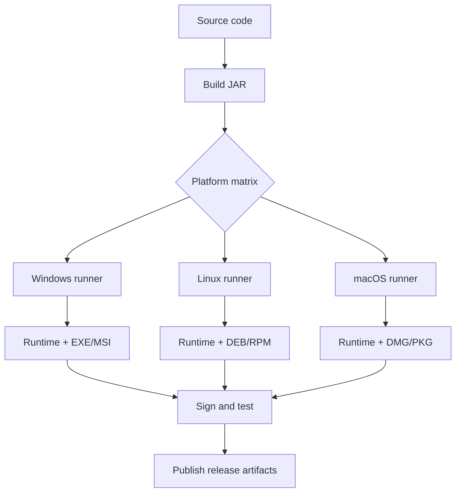

# Vì sao phải build gói trên hệ điều hành đích

Ứng dụng Java có thể được biên dịch thành JAR trên một hệ điều hành rồi chạy trên nhiều nền tảng nếu ứng dụng và các thư viện phụ thuộc chỉ dùng Java API đa nền tảng. Tuy nhiên, khi đóng gói ứng dụng thành native installer bằng `jpackage`, đầu ra còn chứa launcher, runtime image và cấu trúc cài đặt gắn với hệ điều hành, kiến trúc CPU và công cụ đóng gói của nền tảng.

Vì vậy, JAR có thể được dùng chung, nhưng bộ cài EXE/MSI, DEB/RPM, DMG/PKG cần được tạo trong môi trường tương ứng với nền tảng đích. Một lệnh `jpackage` chạy trên Windows không tạo ra bộ cài macOS hoặc Linux chỉ bằng cách đổi `--type`. Tương tự, runtime image tạo trên một nền tảng không thể tùy tiện đưa vào bộ cài cho nền tảng khác.

Trong module Java 16, `jpackage` là công cụ đóng gói ứng dụng đã được hoàn thiện và có thể dùng trong quy trình phát hành hiện đại. Bài này giải thích vì sao native package phụ thuộc môi trường build, cách tổ chức CI cho nhiều hệ điều hành, yêu cầu về kiến trúc và thư viện native, cùng cách kiểm thử artifact. Nội dung tập trung vào các quy trình còn áp dụng, không dựa vào tính năng preview hay công cụ phân phối đã lỗi thời.

## 1. JAR đa nền tảng và native installer khác nhau

Một file JAR chứa bytecode Java và tài nguyên ứng dụng. Nếu không phụ thuộc thư viện native hoặc hành vi riêng của hệ điều hành, cùng một JAR có thể chạy trên các nền tảng có runtime Java tương thích.

Native installer cần thêm nhiều thành phần phụ thuộc nền tảng:

- **Launcher native:** chương trình khởi chạy ứng dụng được tạo cho hệ điều hành và kiến trúc CPU cụ thể.
- **Runtime image:** nếu đóng gói Java runtime, image chứa các binary và thư viện của hệ điều hành/kiến trúc đã tạo ra nó.
- **Cấu trúc ứng dụng:** thư mục, bundle, shortcut, icon, metadata và vị trí cài đặt tuân theo quy ước từng hệ điều hành.
- **Package format:** EXE/MSI, DEB/RPM, DMG/PKG được tạo và xử lý bằng toolchain riêng của nền tảng.
- **Chữ ký và niềm tin:** quy trình ký số, xác minh nhà phát hành và phân phối khác nhau giữa Windows, macOS và Linux.

Do đó, việc biên dịch được JAR trên một máy không có nghĩa máy đó có thể tạo mọi loại native installer.

| Thành phần | Có thể dùng chung giữa hệ điều hành? | Lý do |
|---|---|---|
| Source code Java thuần | Thường có | Java language và Java API chuẩn hỗ trợ nhiều nền tảng. |
| JAR không chứa native library | Thường có | Bytecode được runtime tương thích thực thi. |
| JAR chứa thư viện JNI/JNA native | Không mặc nhiên | Thư viện native phụ thuộc OS, CPU và ABI. |
| Runtime image từ `jlink` | Không mặc nhiên | Image chứa binary runtime theo nền tảng và kiến trúc. |
| Launcher từ `jpackage` | Không | Launcher là chương trình native. |
| EXE/MSI, DEB/RPM, DMG/PKG | Không | Mỗi định dạng thuộc hệ điều hành và toolchain riêng. |

## 2. `jpackage` tạo gói theo nền tảng đang chạy

`jpackage` sử dụng JDK và các công cụ native có trên máy build để tạo application image hoặc installer. Các loại gói thông dụng được chia theo hệ điều hành:

| Máy build | Đầu ra phù hợp |
|---|---|
| Windows | EXE, MSI hoặc `app-image` cho Windows |
| Linux | DEB, RPM hoặc `app-image` cho Linux |
| macOS | DMG, PKG hoặc `app-image` cho macOS |

`--type` chọn loại đầu ra mà nền tảng hiện tại hỗ trợ. Thay `--type msi` bằng `--type dmg` trong cùng một lệnh không biến máy Windows thành môi trường build macOS. Cần chạy quy trình đóng gói trên máy hoặc runner tương ứng với nền tảng đích.

Một số loại installer còn cần công cụ đóng gói của hệ điều hành. Ví dụ, tạo DEB cần công cụ tạo gói Debian; tạo RPM cần công cụ đóng gói RPM; các loại installer Windows cần toolchain Windows mà phiên bản JDK đang dùng hỗ trợ. Trước khi cấu hình CI, kiểm tra tài liệu `jpackage` của đúng JDK và cài các công cụ phụ thuộc trên runner.

## 3. Vì sao không thể chỉ đổi phần mở rộng file?

Các định dạng native không chỉ là cách nén cùng một thư mục. Chúng có cấu trúc và metadata riêng:

- MSI chứa thông tin theo Windows Installer, phục vụ cài đặt, sửa chữa và gỡ cài đặt theo cơ chế của Windows.
- DEB khai báo metadata và dependency theo hệ Debian.
- RPM khai báo metadata, dependency và thông tin package theo hệ RPM.
- DMG là disk image để phân phối nội dung ứng dụng trên macOS.
- PKG là package dành cho macOS Installer.
- EXE là chương trình thực thi, có thể là trình cài đặt được tạo theo toolchain Windows.

Đổi tên một file JAR hoặc ZIP thành `.msi`, `.deb` hay `.dmg` không tạo ra package hợp lệ. `jpackage` phải tạo launcher, cấu trúc thư mục, metadata và installer theo quy tắc của định dạng đích.

## 4. Phân biệt compile Java với build native package

Có thể biên dịch source code với `javac --release 16` trên một máy để kiểm tra ngôn ngữ và API Java 16. Tùy nội dung dự án, file JAR thuần Java sau đó có thể được tái sử dụng trong các job đóng gói của nhiều nền tảng.

Tuy nhiên, `--release 16` không phải tùy chọn cross-compile native installer. Nó không tạo launcher Windows khi chạy trên Linux, không chuyển runtime image Linux thành macOS và không tạo metadata DEB/RPM.

Quy trình thường có hai phần:

1. **Build ứng dụng:** biên dịch source và tạo JAR cùng tài nguyên cần thiết. Nếu ứng dụng thuần Java, artifact này có thể dùng chung cho nhiều nền tảng.
2. **Package theo nền tảng:** trên từng runner, dùng JDK và toolchain của runner để tạo runtime image, launcher và installer tương ứng.

Nếu ứng dụng có JNI, JNA, JavaFX native components hoặc thư viện phụ thuộc binary theo hệ điều hành, phần build ứng dụng cũng có thể cần tạo artifact riêng cho từng nền tảng. Không nên giả định mọi dependency nằm trong JAR đều là đa nền tảng.

## 5. Runtime image phải phù hợp với nền tảng đích

`jlink` tạo runtime image từ các module JDK. Image chứa các thành phần runtime native của nền tảng dùng để tạo nó. Ví dụ, runtime image được tạo trên Windows x64 là image dành cho môi trường Windows x64 tương ứng; không dùng nguyên image đó làm runtime của gói macOS hoặc Linux.

Ví dụ tạo runtime image trên từng runner:

```bash
jlink \
  --add-modules java.base,java.desktop,java.logging \
  --strip-debug \
  --no-header-files \
  --no-man-pages \
  --output build/runtime
```

Danh sách module trên chỉ minh họa. Cần xác định các module mà ứng dụng và thư viện thực sự sử dụng. Chạy lệnh trong runner tương ứng với hệ điều hành và kiến trúc cần phát hành.

Sau đó truyền image vừa tạo cho `jpackage` trên cùng runner:

```bash
jpackage \
  --type deb \
  --name InventoryApp \
  --input build/libs \
  --main-jar inventory-app.jar \
  --main-class com.example.inventory.Main \
  --runtime-image build/runtime \
  --dest dist
```

Lệnh trên minh họa một job Linux tạo DEB. Job Windows sẽ chọn EXE hoặc MSI; job macOS sẽ chọn DMG hoặc PKG. Mỗi job tạo runtime image phù hợp với nền tảng của chính nó trước khi đóng gói.

Nếu không cung cấp `--runtime-image`, `jpackage` có thể tạo runtime image trong quá trình đóng gói bằng công cụ `jlink` từ JDK. Dù chọn cách nào, runtime được tạo vẫn gắn với nền tảng build hiện tại.

## 6. Hệ điều hành và kiến trúc CPU đều quan trọng

Chỉ chọn đúng hệ điều hành vẫn chưa đủ. Windows x64 và Windows ARM64, Linux x64 và Linux ARM64, macOS trên Apple silicon và Mac Intel có thể cần binary hoặc runtime khác nhau.

Khi lập ma trận build, xác định rõ:

- Hệ điều hành đích và phiên bản tối thiểu được hỗ trợ.
- Kiến trúc CPU của máy build, JDK, runtime image và máy người dùng.
- Thư viện native mà ứng dụng hoặc dependency sử dụng.
- ABI và thư viện hệ thống mà binary phụ thuộc.
- Khả năng chạy trên các phiên bản OS cũ hơn trong phạm vi hỗ trợ.

Thông thường, hãy tạo artifact riêng cho từng cặp hệ điều hành/kiến trúc được hỗ trợ, trừ khi đã thiết kế và kiểm thử một artifact đa kiến trúc cụ thể. Không suy luận rằng một gói tạo trên máy x64 sẽ chạy trên ARM64 chỉ vì cùng hệ điều hành.

## 7. Lưu ý riêng khi build trên Linux

Linux có nhiều bản phân phối, phiên bản thư viện và hệ thống package. Build DEB trên một hệ Debian không tự động chứng minh package chạy trên mọi phiên bản Debian hoặc Ubuntu. Tương tự, RPM build trên Fedora không mặc nhiên tương thích với mọi phiên bản RHEL hoặc SUSE.

Một số yếu tố cần kiểm tra:

- **glibc và ABI:** binary native được liên kết với phiên bản thư viện hệ thống. Nếu build trên môi trường quá mới, binary có thể cần symbol hoặc ABI không có trên hệ thống cũ hơn.
- **Dependency package:** metadata DEB/RPM cần phản ánh các thư viện hệ thống mà ứng dụng thực sự cần.
- **Kiến trúc:** package và runtime phải khớp với kiến trúc được công bố.
- **Toolchain:** runner cần công cụ đóng gói tương ứng, chẳng hạn công cụ tạo DEB hoặc RPM.
- **Baseline hỗ trợ:** nên build trên môi trường tương thích với phiên bản Linux cũ nhất mà sản phẩm cam kết hỗ trợ, hoặc dùng môi trường build được kiểm soát có ABI tương thích.

Kiểm thử package trên một bản phân phối mới nhất không thay thế việc kiểm thử trên baseline cũ nhất được hỗ trợ. Nếu phát hành cho nhiều họ Linux, hãy kiểm thử trên đại diện của từng họ và công bố rõ phạm vi tương thích.

## 8. Lưu ý riêng khi build trên Windows

EXE và MSI cần môi trường Windows cùng toolchain installer phù hợp với JDK. Build trên Windows giúp `jpackage` tạo launcher, cấu trúc thư mục và metadata theo quy ước Windows.

Kiểm tra:

- Phiên bản Windows tối thiểu và kiến trúc CPU được hỗ trợ.
- Toolchain đóng gói mà phiên bản JDK yêu cầu cho EXE/MSI.
- Quyền cài đặt per-user hay per-machine theo thiết kế sản phẩm.
- Shortcut, menu ứng dụng, icon, file association nếu có.
- Chữ ký số và trạng thái xác minh nhà phát hành sau khi tạo artifact.
- Nâng cấp từ phiên bản trước, gỡ cài đặt và xử lý dữ liệu người dùng.

Không dùng một MSI hoặc EXE được build trên một kiến trúc để tuyên bố hỗ trợ kiến trúc khác nếu launcher và runtime bên trong chưa được tạo, kiểm thử cho kiến trúc đó.

## 9. Lưu ý riêng khi build trên macOS

DMG và PKG được tạo bằng công cụ native của macOS. Ứng dụng desktop còn có bundle structure, metadata, icon, launcher và yêu cầu bảo mật riêng của nền tảng.

Kiểm tra:

- JDK và runtime image khớp kiến trúc đích, ví dụ Apple silicon hoặc Intel.
- Bundle có đúng tên, identifier, icon và metadata cần thiết.
- Ứng dụng được code sign theo danh tính phát hành phù hợp.
- Quy trình notarization và Gatekeeper đáp ứng yêu cầu của kênh phân phối.
- DMG mở và cài đặt đúng; PKG chạy qua macOS Installer đúng như dự kiến.
- Ứng dụng chạy được trên phiên bản macOS tối thiểu đã công bố.

Ký số và notarization gắn với danh tính nhà phát hành và artifact thực tế. Vì vậy, không thể lấy một bộ cài chưa ký trên nền tảng khác rồi chỉ đổi phần mở rộng để có package macOS hợp lệ.

## 10. Tổ chức CI cho nhiều nền tảng

Với sản phẩm hỗ trợ nhiều hệ điều hành, CI nên có một job đóng gói cho từng nền tảng và kiến trúc. JAR thuần Java có thể được tạo một lần rồi chuyển cho các job nếu dependency thực sự đa nền tảng. Mỗi job cần dùng runner tương ứng để tạo runtime image và installer native.

Ví dụ ma trận phát hành:

| Job CI | Runner | Artifact |
|---|---|---|
| `windows-x64` | Windows x64 | EXE hoặc MSI x64 |
| `linux-x64-deb` | Linux x64 có toolchain Debian | DEB x64 |
| `linux-x64-rpm` | Linux x64 có toolchain RPM | RPM x64 |
| `macos-arm64` | macOS ARM64 | DMG hoặc PKG ARM64 |
| `macos-x64` | macOS x64 | DMG hoặc PKG x64 |

Ma trận trên chỉ là ví dụ. Chọn các job thực sự cần thiết theo nền tảng khách hàng và năng lực build của tổ chức. Có thể gộp tạo DEB/RPM trong một runner Linux phù hợp nếu toolchain và môi trường build được cấu hình đầy đủ, nhưng phải kiểm tra kết quả trên từng hệ đích.

Luồng CI tham khảo:



Mỗi job nên lưu artifact riêng với tên thể hiện nền tảng, kiến trúc, phiên bản ứng dụng và định dạng package. Tránh ghi đè các artifact cùng tên từ nhiều job.

## 11. Có thể dùng container hoặc máy ảo không?

Máy build không nhất thiết phải là máy vật lý dành riêng. Có thể dùng runner CI, máy ảo hoặc container khi môi trường đó cung cấp đúng hệ điều hành, kiến trúc và toolchain cần thiết.

- **Container Linux:** hữu ích để cố định phiên bản distribution, toolchain và thư viện build. Container vẫn dùng kernel của host; cần kiểm tra các giới hạn khi tạo hoặc chạy binary native và package.
- **Máy ảo:** phù hợp khi cần môi trường Windows, macOS hoặc Linux tách biệt, có thể tái tạo và kiểm thử.
- **Hosted CI runner:** tiện để chạy ma trận nền tảng mà không phải tự duy trì mọi máy build.
- **Self-hosted runner:** phù hợp khi cần chứng thư ký số, phần cứng đặc thù hoặc môi trường nội bộ; phải quản lý quyền truy cập và secret an toàn.

Container Linux không thay thế runner Windows hoặc macOS để tạo installer của hai hệ đó. Hãy dùng môi trường đúng nền tảng và tuân thủ điều khoản cấp phép của hệ điều hành cũng như dịch vụ CI, đặc biệt với macOS.

## 12. Ký số sau khi tạo package

Ký số là bước phát hành gắn với nền tảng và artifact. Quy trình có thể khác nhau:

- **Windows:** ký EXE/MSI bằng chứng thư code signing phù hợp và kiểm tra chữ ký trên artifact cuối cùng.
- **macOS:** code sign bundle và thực hiện notarization theo yêu cầu của Apple và kênh phân phối.
- **Linux:** ký package RPM nếu chính sách yêu cầu; khi phân phối qua repository, ký metadata repository và quản lý khóa xác minh theo quy trình của hệ thống.

Khóa riêng và chứng thư phải được lưu trong secret store hoặc hệ thống ký số được kiểm soát. Không đặt private key trong repository hoặc nhúng trực tiếp vào lệnh build được lưu dưới dạng log công khai.

Việc ký artifact trên đúng nền tảng giúp kiểm tra đúng cấu trúc và công cụ xác minh của nền tảng đó. Sau ký, không chỉnh sửa binary hoặc package theo cách làm mất hiệu lực chữ ký; nếu cần thay đổi artifact, phải chạy lại quy trình đóng gói và ký.

## 13. Quy trình kiểm thử cho từng artifact

Sau khi mỗi job tạo xong package, kiểm tra trên hệ điều hành và kiến trúc đích:

1. Xác nhận định dạng, tên, phiên bản và kiến trúc của artifact.
2. Kiểm tra chữ ký và metadata package nếu có.
3. Cài mới trên máy sạch hoặc máy ảo đúng baseline hỗ trợ.
4. Khởi chạy launcher và xác nhận runtime image được tìm thấy.
5. Kiểm tra thư viện native, tài nguyên, file cấu hình và kết nối hệ thống.
6. Nâng cấp từ phiên bản cũ để xác nhận dữ liệu người dùng và cấu hình được giữ đúng.
7. Gỡ cài đặt và xác nhận file ứng dụng cùng dữ liệu được xử lý theo chính sách.
8. Chạy kiểm thử chức năng quan trọng trên từng nền tảng được hỗ trợ.

`jpackage --type app-image` có thể được dùng để kiểm tra launcher và runtime trước khi tạo installer. Tuy nhiên, app-image không kiểm tra đầy đủ hành vi cài đặt, nâng cấp, gỡ cài đặt và xác minh package của hệ điều hành.

## 14. Các lỗi thường gặp

| Hiện tượng | Nguyên nhân thường gặp | Hướng xử lý |
|---|---|---|
| Chạy `jpackage --type dmg` trên Windows không tạo được DMG | Định dạng macOS cần môi trường và công cụ macOS | Chạy job trên macOS runner. |
| Runtime image không khởi chạy trên máy đích | Image không khớp OS/CPU hoặc thiếu module/thư viện cần thiết | Tạo runtime trên runner đúng nền tảng và kiểm thử trên máy đích. |
| DEB cài được nhưng ứng dụng lỗi trên bản Linux cũ | ABI hoặc dependency vượt baseline của hệ thống cũ | Build trên baseline tương thích và kiểm thử trên phiên bản tối thiểu. |
| Package ARM64 không chạy trên máy x64 | Artifact chứa binary/runtime cho kiến trúc khác | Tạo artifact riêng cho từng kiến trúc. |
| MSI/PKG tạo được nhưng bị cảnh báo bảo mật | Artifact chưa được ký hoặc chưa hoàn tất quy trình tin cậy | Thực hiện code signing/notarization theo nền tảng. |
| Cài mới thành công nhưng nâng cấp lỗi | Identifier, version, dữ liệu hoặc chính sách uninstall chưa phù hợp | Kiểm thử nâng cấp và gỡ cài đặt từ phiên bản trước. |

## 15. Cách áp dụng trong quy trình phát hành Java hiện đại

- Phân biệt artifact Java thuần với launcher, runtime và installer native.
- Tạo JAR dùng chung nếu source và dependency không chứa thành phần phụ thuộc nền tảng.
- Dùng runner đúng hệ điều hành và kiến trúc để chạy `jpackage`.
- Tạo runtime image bằng `jlink` trên runner đích hoặc để `jpackage` tạo runtime phù hợp.
- Với Linux, kiểm soát baseline distribution, glibc, ABI và dependency package.
- Với Windows và macOS, chuẩn bị toolchain native và quy trình ký số tương ứng.
- Dùng CI matrix để tạo artifact riêng cho từng hệ điều hành/kiến trúc được hỗ trợ.
- Cài thử trên máy sạch, kiểm tra nâng cấp, gỡ cài đặt và hành vi runtime trước khi phát hành.

Build native installer trên hệ điều hành đích là yêu cầu kỹ thuật xuất phát từ launcher, runtime image, package format và cơ chế bảo mật gắn với nền tảng. Có thể tái sử dụng JAR thuần Java giữa các job, nhưng cần tạo và kiểm thử riêng artifact native cho từng hệ điều hành và kiến trúc. Tổ chức CI theo ma trận nền tảng giúp quy trình phát hành có thể lặp lại, kiểm soát được toolchain và giảm lỗi chỉ xuất hiện trên máy người dùng.
