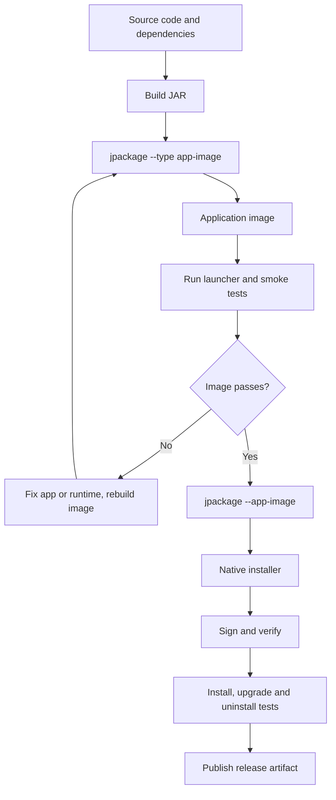

# Tạo installer từ application image đã kiểm thử bằng --app-image

`jpackage` hỗ trợ quy trình đóng gói hai giai đoạn: tạo **application image** trước, kiểm thử image đó, rồi dùng tùy chọn `--app-image` để tạo native installer. Cách làm này tách phần chuẩn bị ứng dụng và runtime khỏi phần tạo gói cài đặt của hệ điều hành.

Application image chứa launcher, ứng dụng và runtime image nếu runtime được đóng gói trong giai đoạn tạo image. Sau khi kiểm tra image chạy đúng, có thể dùng chính image đó làm đầu vào cho `jpackage` để tạo EXE/MSI trên Windows, DEB/RPM trên Linux hoặc DMG/PKG trên macOS. Nhờ vậy, lỗi trong ứng dụng/runtime có thể được phát hiện trước khi điều tra các lỗi riêng của installer.

Trong module Java 16, `jpackage` là công cụ đã được hoàn thiện và tiếp tục phù hợp với quy trình phát hành Java hiện đại. Bài này tập trung vào quy trình `app-image` rồi `--app-image`, các tùy chọn ở từng giai đoạn, giới hạn nền tảng/kiến trúc và cách kiểm thử installer cuối. Nội dung sử dụng các khả năng ổn định, không cần preview feature.

## 1. Phân biệt application image và installer

Hai loại đầu ra có mục đích khác nhau:

| Artifact | Chứa gì? | Dùng để làm gì? |
|---|---|---|
| JAR | Bytecode Java, manifest và tài nguyên ứng dụng | Đầu vào để tạo application image hoặc chạy bằng một runtime Java tương thích. |
| Application image (`app-image`) | Launcher native, ứng dụng, tài nguyên và runtime image nếu được đóng gói | Chạy thử hoặc làm đầu vào để tạo installer. |
| Native installer | Application image được đặt vào quy trình cài đặt của hệ điều hành, kèm metadata và cấu hình cài đặt | Phân phối, cài đặt, nâng cấp và gỡ ứng dụng theo quy ước nền tảng. |

Application image không phải installer. Người dùng có thể chạy launcher trong image, nhưng image chưa tự cung cấp toàn bộ trải nghiệm cài đặt như shortcut, đăng ký ứng dụng, quy trình gỡ cài đặt hoặc tích hợp package manager.

`--app-image` yêu cầu đường dẫn đến application image đã được tạo trước đó. Không truyền file JAR hoặc thư mục `--dest` cha nếu thư mục đó chỉ chứa image con. Hãy truyền đúng thư mục image (hoặc app bundle trên macOS) mà `jpackage --type app-image` đã tạo.

## 2. Giai đoạn 1: tạo application image

Ví dụ ứng dụng có JAR `inventory-app.jar` và lớp main `com.example.inventory.Main`:

```bash
jpackage \
  --type app-image \
  --name InventoryApp \
  --app-version 1.4.0 \
  --input build/libs \
  --main-jar inventory-app.jar \
  --main-class com.example.inventory.Main \
  --dest build/app-image
```

Các tùy chọn chính:

- `--type app-image`: yêu cầu tạo application image thay vì installer.
- `--name`: tên ứng dụng và launcher.
- `--app-version`: phiên bản ứng dụng.
- `--input`: thư mục chứa JAR và các dependency cần đóng gói.
- `--main-jar`: JAR chứa điểm khởi chạy.
- `--main-class`: lớp có phương thức `main`.
- `--dest`: thư mục đầu ra.

Thay đường dẫn, tên JAR, main class và phiên bản bằng giá trị của dự án. Sau khi lệnh chạy xong, kiểm tra cấu trúc thực tế bên trong `build/app-image` để xác định chính xác đường dẫn image. Trên Windows và Linux, image thường là một thư mục ứng dụng; trên macOS, image có thể là application bundle có đuôi `.app`.

Nếu muốn đóng gói runtime tùy chỉnh, tạo runtime image bằng `jlink` trước rồi truyền `--runtime-image` trong giai đoạn tạo application image:

```bash
jlink \
  --add-modules java.base,java.desktop,java.logging \
  --strip-debug \
  --no-header-files \
  --no-man-pages \
  --output build/runtime
```

```bash
jpackage \
  --type app-image \
  --name InventoryApp \
  --input build/libs \
  --main-jar inventory-app.jar \
  --main-class com.example.inventory.Main \
  --runtime-image build/runtime \
  --dest build/app-image
```

Danh sách module của `jlink` chỉ là ví dụ. Cần đưa vào runtime tất cả module mà ứng dụng và thư viện sử dụng. Nếu không truyền `--runtime-image`, `jpackage` có thể tạo runtime image trong giai đoạn đóng gói bằng `jlink` đi kèm JDK.

## 3. Kiểm thử application image trước khi tạo installer

Trước khi chuyển image sang giai đoạn đóng gói, hãy chạy launcher trực tiếp từ image. Tên và vị trí launcher phụ thuộc nền tảng; tìm launcher trong image vừa tạo thay vì giả định một đường dẫn dùng chung.

Kiểm tra tối thiểu:

1. Launcher khởi động được trên hệ điều hành và kiến trúc đã build.
2. Ứng dụng tìm thấy runtime đi kèm nếu image được tạo theo kiểu self-contained.
3. Main class, resource, file cấu hình và dependency đều có mặt.
4. Các chức năng quan trọng hoạt động khi chạy từ image, không chỉ khi chạy từ IDE.
5. Thư viện native và kết nối hệ thống hoạt động trên baseline hệ điều hành được hỗ trợ.
6. Không có đường dẫn tuyệt đối hoặc file chỉ tồn tại trên máy build bị sử dụng nhầm.

Application image nên được thử trên máy sạch hoặc môi trường tương đương máy người dùng. Nếu image chỉ chạy khi máy build đã cài một JDK khác hoặc có file ngoài image, cần sửa cấu hình trước khi tạo installer.

## 4. Giai đoạn 2: tạo installer từ image bằng `--app-image`

Khi image đã đạt yêu cầu, truyền chính đường dẫn image vào `--app-image`:

```bash
jpackage \
  --type deb \
  --name InventoryApp \
  --app-version 1.4.0 \
  --app-image build/app-image/InventoryApp \
  --dest build/installer
```

Đường dẫn `build/app-image/InventoryApp` là ví dụ cho một image dạng thư mục. Hãy thay bằng đúng đường dẫn mà giai đoạn đầu tạo ra. Trên macOS, có thể cần truyền đường dẫn tới bundle, ví dụ `build/app-image/InventoryApp.app`.

Ở giai đoạn này:

- `--app-image` chỉ application image đã tạo và kiểm thử.
- `--type` chọn loại installer của hệ điều hành hiện tại.
- `--name` và `--app-version` đặt metadata của package; nên giữ nhất quán với phiên bản đã build trong image.
- `--dest` chỉ thư mục chứa installer cuối.

Khi dùng `--app-image`, không cung cấp lại các tùy chọn dùng để dựng image từ JAR như `--input`, `--main-jar`, `--main-class` hoặc `--runtime-image`. Các thành phần đó đã được xác định trong application image. Hãy kiểm tra `jpackage --help` của đúng JDK nếu cần bổ sung tùy chọn riêng cho installer.

Giữ thư mục đầu ra sạch cho mỗi lần chạy. Không ghi installer vào bên trong application image nguồn; dùng thư mục `--dest` riêng để tránh làm lẫn artifact đầu vào và đầu ra.

## 5. Chọn loại installer theo nền tảng

Application image và installer phải phù hợp với hệ điều hành, kiến trúc và toolchain của nền tảng đích. Ví dụ các lệnh dưới đây minh họa giai đoạn thứ hai; đường dẫn image cần được thay bằng image đã tạo trên chính nền tảng đó.

### Windows: EXE hoặc MSI

```powershell
jpackage --type msi `
  --name InventoryApp `
  --app-version 1.4.0 `
  --app-image build\app-image\InventoryApp `
  --dest build\installer
```

Chọn `msi` khi quy trình cần Windows Installer và quản trị triển khai tập trung. Có thể chọn `exe` nếu kênh phân phối sử dụng trình cài đặt thực thi. Toolchain Windows cần tương thích với phiên bản JDK đang chạy; riêng các phiên bản JDK cũ có thể yêu cầu WiX major cũ, vì vậy cần kiểm tra prerequisite và vòng đời hỗ trợ trước khi chuẩn hóa môi trường build.

### Linux: DEB hoặc RPM

Trên hệ Debian/Ubuntu:

```bash
jpackage \
  --type deb \
  --name InventoryApp \
  --app-version 1.4.0 \
  --app-image build/app-image/InventoryApp \
  --linux-package-name inventory-app \
  --dest build/installer
```

Trên hệ Fedora/RHEL hoặc hệ RPM tương thích:

```bash
jpackage \
  --type rpm \
  --name InventoryApp \
  --app-version 1.4.0 \
  --app-image build/app-image/InventoryApp \
  --linux-package-name inventory-app \
  --dest build/installer
```

Chọn DEB hay RPM theo hệ package của bản phân phối đích. Kiểm tra dependency, ABI, glibc và kiến trúc CPU; image được tạo trên một bản Linux không mặc nhiên tương thích với mọi bản phân phối cùng định dạng package.

### macOS: DMG hoặc PKG

```bash
jpackage \
  --type dmg \
  --name InventoryApp \
  --app-version 1.4.0 \
  --app-image build/app-image/InventoryApp.app \
  --mac-package-identifier com.example.inventory \
  --dest build/installer
```

Đổi `--type dmg` thành `pkg` nếu kênh phân phối cần package của macOS Installer. `--mac-package-identifier` nên ổn định giữa các phiên bản của cùng ứng dụng. Kiểm tra code signing, notarization và Gatekeeper theo yêu cầu của kênh phát hành.

## 6. Có thể dùng cùng application image để tạo nhiều loại installer không?

Trong cùng hệ điều hành và kiến trúc, một application image đã kiểm thử có thể được dùng làm đầu vào cho các lần tạo installer khác nhau, nếu JDK và toolchain hỗ trợ các định dạng đó. Ví dụ, cùng một image Windows có thể được dùng để tạo MSI và EXE; cùng một image macOS có thể làm đầu vào cho DMG hoặc PKG.

Tuy nhiên, không dùng một application image Windows để tạo DEB hoặc DMG. Application image chứa launcher và runtime phụ thuộc nền tảng. Muốn hỗ trợ nhiều nền tảng, cần tạo image riêng trên từng nền tảng/kiến trúc, sau đó tạo installer tương ứng.

| Application image | Installer có thể tạo trên cùng môi trường phù hợp |
|---|---|
| Windows x64 image | EXE, MSI x64 |
| Linux x64 image | DEB hoặc RPM x64 tùy toolchain và bản phân phối build |
| macOS ARM64 image | DMG hoặc PKG cho môi trường macOS ARM64 tương ứng |
| macOS x64 image | DMG hoặc PKG cho môi trường macOS x64 tương ứng |

Ma trận là ví dụ về cách phân chia artifact. Hãy kiểm tra hỗ trợ thực tế của JDK, OS và toolchain; không suy luận khả năng tương thích chỉ từ tên định dạng.

## 7. Tùy chỉnh installer mà không dựng lại application image

Tách hai giai đoạn giúp thay đổi một số thông tin của installer mà không phải biên dịch lại ứng dụng hoặc tạo lại runtime. Ví dụ, có thể thiết lập metadata package, thư mục cài đặt, nhóm menu hoặc cấu hình installer theo hệ điều hành ở lần gọi thứ hai.

Một số tùy chọn thường gặp:

- `--vendor`: tên nhà cung cấp.
- `--description`: mô tả ứng dụng.
- `--copyright`: thông tin bản quyền.
- `--resource-dir`: thư mục chứa tài nguyên tùy chỉnh cho quá trình đóng gói.
- `--install-dir`: vị trí cài đặt mặc định khi nền tảng và loại installer hỗ trợ.
- `--win-menu`, `--win-shortcut`: tạo mục menu hoặc shortcut trên Windows.
- `--linux-package-deps`: khai báo dependency package trên Linux khi cần.
- `--mac-package-identifier`: định danh package trên macOS.

Các tùy chọn có sẵn và ý nghĩa chi tiết phụ thuộc JDK và hệ điều hành. Đọc `jpackage --help` trên đúng runner trước khi dùng. Nếu thay đổi launcher, runtime, resource ứng dụng hoặc file cần nằm bên trong application image, phải tạo và kiểm thử lại image thay vì chỉ đổi installer metadata.

## 8. Ký số và bảo vệ artifact

Application image đã kiểm thử chưa đồng nghĩa installer đã được ký. Ký số là bước áp dụng cho artifact và bundle theo yêu cầu của hệ điều hành:

- **Windows:** ký EXE/MSI bằng chứng thư code signing phù hợp. Xác minh chữ ký trên installer cuối và thử cài đặt trên máy Windows sạch.
- **macOS:** code sign ứng dụng và thực hiện notarization theo yêu cầu của Apple và kênh phân phối. Kiểm tra bundle và package cuối sau khi ký.
- **Linux:** ký RPM nếu chính sách phân phối yêu cầu; khi phát hành qua repository, ký metadata repository và quản lý khóa xác minh.

Tùy chọn ký của `jpackage` và công cụ bên ngoài có thể khác theo JDK. Không đưa private key vào source code, application image hoặc log CI. Nếu quy trình yêu cầu ký sau khi tạo installer, hãy thực hiện trước khi kiểm thử artifact cuối và công bố checksum của đúng file đã ký.

## 9. Kiểm thử installer cuối cùng

Application image test và installer test là hai bước khác nhau. Sau khi installer được tạo, cần kiểm thử lại các hành vi chỉ xuất hiện trong quá trình cài đặt:

1. Cài mới trên máy sạch có hệ điều hành và kiến trúc được hỗ trợ.
2. Xác nhận vị trí cài đặt, shortcut, menu, icon và launcher.
3. Khởi chạy ứng dụng sau khi cài, xác nhận runtime đi kèm được sử dụng đúng.
4. Kiểm tra quyền cài đặt per-user/per-machine theo cấu hình.
5. Nâng cấp từ phiên bản trước và xác nhận cấu hình/dữ liệu người dùng được giữ đúng.
6. Gỡ cài đặt và kiểm tra file ứng dụng, shortcut, dịch vụ hoặc liên kết file được xử lý theo chính sách.
7. Xác minh chữ ký, cảnh báo bảo mật và log của hệ điều hành.
8. Thử lại trên baseline OS và kiến trúc tối thiểu đã công bố.

Nếu image chạy được nhưng installer lỗi, điều tra riêng metadata, quyền, package toolchain, chữ ký và script cài đặt. Không cần mặc định rằng lỗi nằm trong JAR hoặc runtime; hai giai đoạn được tách ra để khoanh vùng chính xác hơn.

## 10. Lưu application image làm artifact CI

Quy trình hai giai đoạn phù hợp với CI nhiều job:

1. Job build tạo application image trên runner của nền tảng đích.
2. Job test tải image và chạy launcher cùng bộ kiểm thử smoke.
3. Job package dùng lại image đã đạt yêu cầu và gọi `jpackage --app-image`.
4. Job sign ký artifact theo nền tảng.
5. Job release lưu installer, checksum, phiên bản JDK và log build.

Khi chuyển image giữa các job, dùng cơ chế artifact của CI và giữ nguyên cấu trúc thư mục, quyền thực thi, symlink và metadata cần thiết. Không đóng gói rồi giải nén theo cách làm mất executable bit trên Linux/macOS. Mỗi artifact phải gắn với hệ điều hành, kiến trúc, phiên bản ứng dụng và phiên bản JDK đã tạo ra nó.

Application image cũng là artifact phụ thuộc nền tảng. Một image được tạo ở job Windows chỉ được chuyển cho job đóng gói Windows tương thích; không chuyển image đó sang job Linux hoặc macOS để tạo installer khác.

## 11. Sơ đồ quy trình hai giai đoạn



## 12. Lỗi thường gặp khi dùng `--app-image`

| Hiện tượng | Nguyên nhân thường gặp | Cách xử lý |
|---|---|---|
| `jpackage` không tìm thấy image | Truyền nhầm thư mục `--dest` cha hoặc sai tên image | Kiểm tra cấu trúc đầu ra và truyền đúng đường dẫn application image. |
| Truyền JAR vào `--app-image` | Nhầm application image với JAR đầu vào | Tạo image trước bằng `--type app-image`, rồi dùng thư mục image. |
| Package tạo được nhưng launcher lỗi | Image thiếu resource, module hoặc runtime cần thiết | Chạy và kiểm thử image độc lập trước khi tạo installer. |
| Dùng image Windows trên Linux/macOS | Image chứa launcher/runtime của nền tảng khác | Tạo application image riêng trên OS/architecture đích. |
| Thêm lại `--input` hoặc `--main-jar` ở giai đoạn installer | Trộn tùy chọn dựng image với tùy chọn đóng gói image | Dùng `--app-image` làm đầu vào; chỉ thêm tùy chọn installer hợp lệ. |
| Installer không nâng cấp đúng phiên bản cũ | Metadata, package identifier hoặc upgrade configuration thay đổi | Giữ định danh ổn định và kiểm thử nâng cấp từ phiên bản đã phát hành. |
| Image chạy được nhưng installer bị cảnh báo | Installer chưa ký hoặc chưa hoàn tất quy trình tin cậy | Ký và xác minh artifact cuối theo nền tảng. |

## 13. Cách áp dụng trong quy trình Java hiện đại

- Tạo application image riêng bằng `jpackage --type app-image` trên runner đúng OS/architecture.
- Kiểm thử launcher, runtime, resource và dependency trước khi tạo installer.
- Lưu image như một CI artifact có định danh nền tảng, kiến trúc, phiên bản ứng dụng và JDK.
- Dùng `jpackage --app-image` để tạo installer; không truyền lại JAR và các tùy chọn dùng để dựng image.
- Có thể tạo nhiều loại installer từ cùng image trong cùng nền tảng nếu toolchain hỗ trợ.
- Dùng image riêng cho từng OS/architecture; không dùng application image như artifact đa nền tảng.
- Ký số và kiểm thử cài đặt, nâng cấp, gỡ cài đặt trên artifact cuối.

Quy trình `app-image` rồi `--app-image` giúp tách lỗi ứng dụng/runtime khỏi lỗi đóng gói native. Application image đã kiểm thử trở thành đầu vào ổn định cho bước tạo installer trên cùng nền tảng, còn metadata, định dạng package và ký số được xử lý ở giai đoạn phát hành. Cách làm này giúp CI tái sử dụng artifact có kiểm soát và hỗ trợ phát hành Java trên nhiều hệ điều hành mà vẫn giữ đúng yêu cầu của từng nền tảng.
