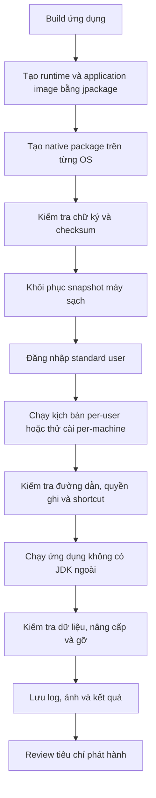

# Kiểm thử cài đặt trên máy sạch có quyền người dùng hạn chế

> **Chương:** Bộ cài ứng dụng  
> **Phạm vi:** Kiểm thử cài đặt, chạy lần đầu, nâng cấp và gỡ ứng dụng Java trên máy chưa có môi trường phát triển, bằng tài khoản không có quyền quản trị. Bài tập trung vào native installer được tạo bằng jpackage, sự khác nhau giữa cài theo người dùng và cài toàn máy trên Windows, macOS, Linux, cùng tiêu chí xác nhận ứng dụng không yêu cầu quyền vượt quá thiết kế.

## Mục tiêu học tập

Sau bài này, bạn có thể:

1. Chuẩn bị máy ảo sạch và tài khoản standard user để kiểm thử bộ cài.
2. Phân biệt application image, native installer và phạm vi cài đặt per-user/per-machine.
3. Chọn kịch bản kiểm thử phù hợp cho Windows, macOS và Linux.
4. Xác minh ứng dụng chạy với runtime được đóng gói mà không cần cài JDK riêng.
5. Kiểm tra quyền ghi, shortcut, file association, dữ liệu người dùng và cập nhật.
6. Xác nhận bộ cài yêu cầu quyền quản trị đúng lúc và thất bại an toàn khi thiếu quyền.
7. Lập ma trận kiểm thử sạch, có thể lặp lại trong CI hoặc trước khi phát hành.

## 1. Vì sao phải kiểm thử trên máy sạch?

Máy phát triển thường đã có JDK, thư viện native, biến môi trường, quyền admin, công cụ build và nhiều ứng dụng phụ trợ. Một ứng dụng có thể chạy tốt trên máy đó dù bộ cài thiếu file, cấu hình sai hoặc vô tình phụ thuộc vào môi trường đã tồn tại.

Máy sạch giúp phát hiện các lỗi mà máy phát triển che giấu:

- Ứng dụng gọi nhầm Java từ PATH thay vì runtime đi kèm.
- Bộ cài thiếu JAR, module, resource, icon hoặc thư viện native.
- Ứng dụng ghi cấu hình vào thư mục cài đặt chỉ đọc.
- Shortcut hoặc file association được tạo ở phạm vi toàn máy dù người dùng chỉ cài cho tài khoản của mình.
- Script cài đặt cố ghi vào thư mục hệ thống hoặc registry cần quyền quản trị.
- Cập nhật/gỡ cài đặt thất bại khi tài khoản không phải administrator.
- Ứng dụng cần mạng hoặc package hệ thống nhưng không thông báo rõ khi máy bị giới hạn.
- Bộ cài chỉ chạy được khi máy có sẵn JDK hoặc một runtime bên ngoài.

Kiểm thử với tài khoản hạn chế còn xác minh nguyên tắc đặc quyền tối thiểu: ứng dụng desktop thông thường nên chạy bằng quyền người dùng đang đăng nhập, không yêu cầu nâng quyền chỉ để ghi log, lưu cấu hình hoặc cập nhật dữ liệu riêng của tài khoản.

## 2. Phân biệt application image và native installer

jpackage là công cụ đóng gói ứng dụng Java thành application image tự chứa hoặc bộ cài native theo nền tảng. Công cụ có thể tạo runtime bằng jlink và đưa runtime đó vào gói ứng dụng, giúp người dùng không phải cài JDK riêng.

Các loại đầu ra thường dùng:

| Nền tảng | Native installer/package | Application image |
| --- | --- | --- |
| Windows | exe, msi | Thư mục ứng dụng có launcher và runtime |
| macOS | dmg, pkg | Bundle .app |
| Linux | deb, rpm | Thư mục ứng dụng có launcher và runtime |

Application image là thư mục ứng dụng có thể chạy sau khi đặt vào vị trí phù hợp. Nó không tự cung cấp toàn bộ trải nghiệm cài đặt như đăng ký package, shortcut, file association hay uninstall entry.

Native installer tích hợp với cơ chế phân phối của hệ điều hành. Tuy nhiên, phạm vi cài đặt phụ thuộc loại package, đường dẫn đích và quyền của tài khoản.

### jpackage trong JDK hiện đại

jpackage được hoàn thiện thành công cụ tiêu chuẩn trong JDK 16 theo JEP 392. Khi xây dựng bài kiểm thử hiện nay, dùng tài liệu và runtime JDK còn được hỗ trợ; không phụ thuộc vào bản thử nghiệm hoặc cách đóng gói cũ đã lỗi thời.

Một điểm quan trọng của jpackage là package native phải được tạo trên nền tảng đích. Muốn phát hành Windows, macOS và Linux, cần pipeline build tương ứng trên từng hệ điều hành. Không tạo một gói Windows trên Linux rồi xem đó là artifact Windows có thể phát hành.

### Runtime đi kèm không loại bỏ mọi phụ thuộc hệ điều hành

Runtime Java được đóng gói giải quyết phụ thuộc vào một JDK/JRE cài sẵn. Ứng dụng vẫn có thể cần thư viện native hoặc thành phần hệ điều hành khác, ví dụ thư viện đồ họa, codec, driver, certificate store hay package hệ thống.

Vì vậy, máy sạch phải không có JDK riêng để kiểm tra đúng runtime đi kèm, nhưng vẫn cần có phiên bản hệ điều hành và thư viện nền nằm trong ma trận hỗ trợ của sản phẩm.

## 3. Hiểu phạm vi cài đặt và quyền người dùng

Có hai phạm vi chính:

| Phạm vi | Vị trí điển hình | Ai nhìn thấy ứng dụng? | Quyền thường cần |
| --- | --- | --- | --- |
| Per-user | Thư mục thuộc hồ sơ người dùng | Tài khoản hiện tại | Có thể cài bằng standard user nếu đích và installer hỗ trợ |
| Per-machine | Thư mục hệ thống hoặc vị trí dùng chung | Nhiều tài khoản trên máy | Thường cần administrator/root hoặc cơ chế cấp quyền tương đương |

Không nên chỉ nhìn tên file cài đặt để kết luận nó là per-user. Hãy xác minh option build, đường dẫn thực tế, shortcut, registry/package database và hành vi khi chạy dưới tài khoản standard user.

### Vị trí mặc định thường gặp của jpackage

| Hệ điều hành | Vị trí cài mặc định điển hình |
| --- | --- |
| Windows | C:\Program Files\<application> |
| Windows với --win-per-user-install | %LOCALAPPDATA%\<application> |
| macOS | /Applications/<application>.app |
| Linux | /opt/<application> |

Các vị trí hệ thống thường không cho standard user ghi. Có thể cấu hình --install-dir, nhưng thay đường dẫn không tự động biến mọi loại installer thành gói per-user. Cần kiểm tra hành vi của package và quyền thư mục trên hệ điều hành thật.

## 4. Chuẩn bị máy sạch và tài khoản thử nghiệm

### Tạo baseline có thể khôi phục

Dùng máy ảo hoặc thiết bị kiểm thử riêng có thể khôi phục snapshot. Mỗi lượt test cài mới nên bắt đầu từ baseline giống nhau.

Baseline cần ghi nhận:

- Hệ điều hành, phiên bản, bản cập nhật và kiến trúc CPU.
- Ngôn ngữ, locale, múi giờ và định dạng vùng.
- Loại tài khoản: standard user hay administrator.
- Trạng thái JDK/JRE: không cài Java ngoài nếu đang kiểm tra runtime đóng gói.
- Trạng thái mạng: online, proxy, firewall hoặc offline theo kịch bản.
- Dung lượng đĩa trống.
- Chính sách bảo mật có ảnh hưởng tới cài đặt, chạy file tải về hoặc đăng ký shortcut.
- Không có bản cũ của ứng dụng, file cấu hình hay thư mục dữ liệu còn sót.

Không dùng tài khoản administrator rồi chỉ bỏ qua hộp thoại UAC để giả lập standard user. Tài khoản kiểm thử phải thực sự không thuộc nhóm quản trị và không có quyền nâng quyền trong kịch bản đang đánh giá.

### Hai tài khoản nên có

- **Standard user:** không có quyền quản trị; dùng để kiểm thử cài đặt per-user, chạy, cập nhật và gỡ ứng dụng trong phạm vi tài khoản.
- **Administrator/root:** dùng cho kịch bản cài đặt toàn máy, cập nhật/gỡ package hệ thống và xác minh quyền quản trị được yêu cầu đúng lúc.

Tách hai vai trò giúp xác định rõ chức năng nào phục vụ người dùng thông thường và chức năng nào cần quản trị viên.

### Ghi lại bằng chứng

Mỗi lượt test nên lưu:

- Artifact chính xác và checksum.
- Phiên bản ứng dụng, phiên bản installer và build ID.
- Ảnh chụp màn hình các bước cài đặt và thông báo quyền.
- Log installer và log ứng dụng.
- Đường dẫn file được tạo/xóa.
- Exit code của lệnh cài/gỡ nếu dùng command line.
- Kết quả chạy lần đầu, nâng cấp và gỡ cài đặt.
- Tài khoản và quyền đã dùng.

## 5. Ma trận nền tảng và quyền hạn

Một ma trận cơ bản nên bao phủ ít nhất các trường hợp sau:

| Nền tảng | Tài khoản | Artifact | Kết quả cần xác minh |
| --- | --- | --- | --- |
| Windows | Standard user | MSI/EXE per-user | Cài vào profile, không cần admin, shortcut thuộc user |
| Windows | Standard user | Installer per-machine | Yêu cầu nâng quyền hoặc từ chối rõ ràng; không để lại cài đặt dở |
| Windows | Administrator | MSI/EXE per-machine | Cài vào vị trí hệ thống, nhiều user sử dụng theo thiết kế |
| macOS | Standard user | DMG chứa .app | Sao chép vào thư mục user ghi được và chạy theo chính sách bảo mật |
| macOS | Standard user | PKG cài vào vị trí hệ thống | Yêu cầu xác thực/quyền phù hợp; không ghi dở khi bị từ chối |
| macOS | Administrator | PKG | Cài đặt và gỡ theo phạm vi hệ thống |
| Linux | Standard user | DEB/RPM hệ thống | Package manager báo thiếu quyền; không tạo thay đổi hệ thống một phần |
| Linux | Standard user | Application image dạng archive | Giải nén vào home và chạy không cần sudo |
| Linux | Root/administrator | DEB/RPM | Cài vào /opt, đăng ký package và gỡ bằng package manager |

Không phải mọi sản phẩm cần phát hành cả hai phạm vi cài đặt. Ma trận phải phản ánh đúng mô hình phân phối đã chọn và phải xác minh trường hợp người dùng không có quyền đáp ứng yêu cầu đó.

## 6. Windows: kiểm thử cài theo người dùng và toàn máy

### Cài per-user bằng jpackage

Trên Windows, --win-per-user-install yêu cầu cài đặt theo tài khoản hiện tại. Vị trí mặc định của ứng dụng khi dùng tùy chọn này là dưới %LOCALAPPDATA%.

Ví dụ tạo MSI per-user:

```powershell
jpackage --type msi --name SampleDesk --app-version 1.2.0 --input build\input --main-jar sample-desk.jar --main-class com.example.Main --win-per-user-install --win-menu --win-shortcut --dest dist
```

Ví dụ chỉ minh họa các tùy chọn chính; thay tên JAR, main class và đường dẫn bằng artifact của ứng dụng. Tạo package trên Windows bằng JDK và công cụ đóng gói tương ứng.

### Các bước test bằng standard user

1. Đăng nhập bằng tài khoản không thuộc nhóm Administrators.
2. Chạy installer per-user.
3. Xác nhận installer không yêu cầu quyền admin ngoài dự kiến.
4. Kiểm tra ứng dụng nằm trong thư mục profile, không nằm trong Program Files.
5. Kiểm tra Start Menu/Desktop shortcut chỉ thuộc tài khoản hiện tại.
6. Khởi chạy ứng dụng bằng shortcut và launcher trực tiếp.
7. Đăng xuất, đăng nhập tài khoản khác và xác nhận ứng dụng per-user không xuất hiện như ứng dụng dùng chung.
8. Gỡ ứng dụng bằng tài khoản đã cài; kiểm tra chỉ xóa file thuộc ứng dụng và không xóa dữ liệu người dùng ngoài chính sách.

### Kiểm tra các vị trí Windows

Với cài đặt per-user, kiểm tra:

- %LOCALAPPDATA% hoặc đường dẫn được cấu hình.
- Shortcut trong Start Menu và Desktop của user.
- Registry per-user nếu installer đăng ký thông tin ứng dụng.
- Không ghi vào HKLM hoặc Program Files khi thiết kế không yêu cầu quyền quản trị.
- Không sửa PATH, JAVA_HOME hoặc biến môi trường toàn máy nếu không có yêu cầu rõ ràng.
- Log và cấu hình người dùng được ghi vào profile, không ghi vào thư mục cài đặt chỉ đọc.

### Cài per-machine và tình huống bị từ chối

Chạy installer toàn máy bằng standard user. Kết quả hợp lệ là hệ điều hành yêu cầu quyền nâng cao hoặc installer từ chối cài đặt với thông báo rõ ràng. Sau khi người dùng hủy hoặc từ chối UAC:

- Không còn shortcut giả hoặc uninstall entry mồ côi.
- Không có thư mục cài đặt dở dang không thể gỡ.
- Không có file hệ thống bị ghi một phần.
- Có thông báo cho biết cần administrator để cài cho toàn máy.

Sau đó chạy lại bằng administrator và xác minh cài đặt toàn máy hoạt động đúng. Không dùng thành công của lượt admin để thay cho kết quả test standard user.

## 7. macOS: phân biệt DMG và PKG

### DMG chứa ứng dụng

DMG là ảnh đĩa dùng để phân phối bundle .app. Với kịch bản không có quyền admin, kiểm tra người dùng có thể mở DMG và sao chép ứng dụng vào một thư mục họ sở hữu, ví dụ ~/Applications, nếu chính sách thiết bị cho phép.

Kiểm thử:

1. Dùng tài khoản standard user không có mật khẩu admin.
2. Mở DMG đã phát hành.
3. Sao chép .app vào thư mục user có quyền ghi.
4. Eject DMG và chạy ứng dụng từ bản đã sao chép.
5. Xác nhận ứng dụng vẫn chạy sau khi DMG được eject.
6. Kiểm tra Gatekeeper, chữ ký code và trạng thái notarization của artifact phát hành.
7. Xác nhận lần chạy đầu không yêu cầu ghi vào /Applications hoặc thư mục hệ thống.

DMG không tự bảo đảm ứng dụng có thể chạy trên mọi máy. Chữ ký, notarization, quarantine, kiến trúc CPU và chính sách quản trị thiết bị đều có thể ảnh hưởng kết quả. Không bỏ qua Gatekeeper hoặc xóa thuộc tính quarantine để làm cho test vượt qua; hãy kiểm thử đúng artifact người dùng sẽ tải.

### PKG cài đặt vào vị trí hệ thống

PKG thường dùng để cài ứng dụng vào vị trí như /Applications. Nếu package hoặc script cài đặt cần ghi vị trí hệ thống, standard user phải được yêu cầu xác thực/quyền phù hợp.

Kiểm tra hai nhánh:

- Người dùng cung cấp quyền hợp lệ: cài đặt hoàn tất và ứng dụng chạy.
- Người dùng không có quyền hoặc hủy xác thực: installer dừng rõ ràng, không để lại bundle hoặc package receipt ở trạng thái không nhất quán.

Nếu sản phẩm cần hỗ trợ người dùng không có quyền admin, cân nhắc phân phối DMG để họ sao chép app vào thư mục cá nhân. Đừng tuyên bố PKG là per-user chỉ vì package có thể được mở bằng tài khoản thường.

### Chữ ký và lần chạy đầu

Nếu phát hành ứng dụng macOS cho người dùng bên ngoài, kiểm tra chữ ký code, chữ ký package và notarization theo quy trình phân phối của sản phẩm. jpackage --mac-sign hỗ trợ ký bundle/package khi có signing identity phù hợp; notarization là bước phân phối riêng và phải được xác minh trên artifact cuối cùng.

Kiểm tra app không ghi dữ liệu vào chính bundle .app. Cấu hình, log, cache và dữ liệu người dùng nên nằm trong thư mục thuộc home của user, chẳng hạn ~/Library/Application Support, ~/Library/Preferences hoặc ~/Library/Caches.

## 8. Linux: package hệ thống và cài trong home

### DEB/RPM là package hệ thống

jpackage có thể tạo DEB hoặc RPM. Vị trí mặc định của ứng dụng là /opt/<application>, thuộc phạm vi hệ thống. Cài đặt package vào hệ thống qua package manager thông thường cần quyền root hoặc cơ chế cấp quyền quản trị tương đương.

Kiểm thử với standard user:

1. Thử cài DEB/RPM theo quy trình được tài liệu hóa.
2. Xác nhận package manager báo thiếu quyền.
3. Xác nhận không có file trong /opt, /usr/share/applications hoặc database package bị thay đổi dở.
4. Xác nhận thông báo hướng dẫn người dùng liên hệ administrator hoặc dùng phương án per-user nếu sản phẩm hỗ trợ.

Sau đó cài package bằng root/administrator trong lượt test riêng. Kiểm tra package database, launcher, shortcut và quy trình gỡ bằng package manager.

### Cài per-user bằng application image

Nếu Linux cần hỗ trợ người dùng không có sudo, có thể phân phối application image do jpackage --type app-image tạo ra dưới dạng archive. Đây là gói ứng dụng tự chứa để người dùng giải nén vào thư mục home; nó không phải DEB/RPM và không đăng ký package hệ thống.

Ví dụ tạo application image:

```bash
jpackage --type app-image --name SampleDesk --input build/input --main-jar sample-desk.jar --main-class com.example.Main --dest dist
```

Người dùng có thể giải nén vào một thư mục do mình sở hữu, ví dụ ~/.local/opt/SampleDesk, rồi chạy launcher trong thư mục bin. Nếu muốn tích hợp menu desktop, tạo desktop entry ở ~/.local/share/applications theo quy ước desktop environment và trỏ Exec/Icon tới đường dẫn trong home.

Nếu muốn launcher gọi từ terminal, có thể đặt wrapper hoặc symlink trong ~/.local/bin và thêm thư mục đó vào PATH của riêng user. Không sửa /usr/bin, /etc/profile hoặc PATH toàn máy trong luồng per-user.

### Kiểm tra trên nhiều môi trường desktop

Linux có nhiều package manager và desktop environment. Kiểm thử theo ma trận phân phối Linux mà sản phẩm cam kết hỗ trợ, ví dụ các bản Debian/Ubuntu dùng DEB và các bản Fedora/RHEL-compatible dùng RPM. Ngoài cài đặt, kiểm tra:

- Launcher chạy được từ terminal và menu.
- File .desktop có đường dẫn Exec và Icon hợp lệ.
- Ứng dụng không ghi vào /opt sau khi khởi chạy.
- Dữ liệu user nằm trong XDG directories hoặc vị trí home phù hợp.
- Package dependencies được khai báo đúng và có thông báo rõ nếu thiếu thư viện hệ thống.

## 9. Kiểm tra runtime đóng gói trên máy không có Java

Một mục tiêu của jpackage là tạo application image có runtime Java phù hợp. Máy sạch nên không cài JDK/JRE ngoài khi thực hiện kịch bản này.

Kiểm tra:

1. Xác nhận java -version không tìm thấy Java ngoài hoặc không có runtime được cấu hình.
2. Cài hoặc giải nén ứng dụng theo đúng luồng.
3. Khởi chạy bằng launcher do jpackage tạo.
4. Xác nhận ứng dụng dùng runtime nằm trong application image.
5. Kiểm tra module cần thiết, resource, provider, font và thư viện native.
6. Chạy các luồng chức năng chính, không chỉ xác nhận cửa sổ ứng dụng xuất hiện.
7. Xác minh log ghi nhận đúng phiên bản Java đi kèm nếu ứng dụng có chức năng chẩn đoán.

Không giả định runtime đóng gói bao gồm mọi thư viện native của hệ điều hành. Kiểm tra các prerequisite ngoài Java mà ứng dụng thật sự cần và ghi rõ trong tài liệu cài đặt.

## 10. Kiểm tra quyền ghi và vị trí dữ liệu

Ứng dụng desktop không nên ghi log, cache, cấu hình hoặc database người dùng vào thư mục cài đặt chỉ đọc. Điều này đặc biệt quan trọng khi cài vào Program Files, /Applications hoặc /opt.

| Hệ điều hành | Vị trí dữ liệu người dùng thường dùng |
| --- | --- |
| Windows | %APPDATA%, %LOCALAPPDATA% |
| macOS | ~/Library/Application Support, ~/Library/Preferences, ~/Library/Caches |
| Linux | XDG_CONFIG_HOME, XDG_DATA_HOME, XDG_CACHE_HOME; mặc định thường dưới ~/.config, ~/.local/share, ~/.cache |

Kiểm tra bằng tài khoản standard user:

- Khởi chạy ứng dụng sau khi cài.
- Tạo cấu hình và dữ liệu người dùng.
- Đóng ứng dụng, mở lại và xác nhận dữ liệu còn.
- Đặt thư mục cài đặt ở trạng thái chỉ đọc nếu phù hợp với mô hình triển khai.
- Xác nhận ứng dụng không cố ghi vào thư mục runtime hoặc thư mục cài.
- Xác nhận một tài khoản khác không đọc được dữ liệu riêng nếu dữ liệu cần được bảo vệ.

Nếu ứng dụng cần cập nhật file chương trình trong thư mục cài đặt, thiết kế updater phải có mô hình quyền riêng. Không yêu cầu ứng dụng desktop chạy elevated liên tục chỉ để tự thay file trong Program Files hoặc /opt.

## 11. Kiểm thử cài đặt, nâng cấp và gỡ

Máy sạch chỉ kiểm tra cài mới. Bộ cài phát hành còn phải được kiểm thử với trạng thái đã cài trước đó.

### Cài mới

- Không có thư mục hoặc package cũ.
- Không có JDK ngoài.
- Tài khoản đúng quyền.
- Installer hoàn tất hoặc từ chối theo đúng phạm vi cài.
- Launcher và shortcut hoạt động.
- Ứng dụng chạy và tạo dữ liệu tại vị trí hợp lệ.

### Nâng cấp cùng phạm vi

Cài phiên bản cũ trước, sau đó nâng lên phiên bản mới bằng cùng tài khoản và phạm vi cài đặt.

Kiểm tra:

- Installer nhận diện đúng sản phẩm cũ.
- Không tạo hai bản cài ngoài chủ đích.
- Shortcut vẫn trỏ tới launcher mới.
- Runtime đi kèm được cập nhật đúng.
- Cấu hình và dữ liệu người dùng được giữ theo chính sách.
- Ứng dụng đang chạy được xử lý rõ ràng: yêu cầu đóng, trì hoãn cập nhật hoặc báo lỗi có thể khắc phục.
- Nếu nâng cấp thất bại, phiên bản trước vẫn ở trạng thái xác định và có hướng phục hồi.

Không coi cài per-user của tài khoản A và cài per-machine là cùng một phạm vi nâng cấp. Kiểm tra các chuyển đổi phạm vi riêng nếu sản phẩm hỗ trợ.

### Gỡ cài đặt

Gỡ bằng đúng tài khoản/quyền đã dùng để cài. Xác nhận:

- Launcher, shortcut và file association được gỡ theo phạm vi.
- Package database hoặc uninstall entry được cập nhật.
- File chương trình và runtime được xóa.
- Dữ liệu người dùng được giữ hoặc xóa theo lựa chọn đã công bố.
- Không xóa file dùng chung hoặc dữ liệu của tài khoản khác.
- Không để lại service, scheduled task, daemon hoặc background process ngoài chủ đích.
- Gỡ cài đặt không cần quyền cao hơn phạm vi cài, trừ khi sản phẩm đã công bố yêu cầu đó.

### Cài lại và rollback

Sau khi gỡ, thử cài lại cùng phiên bản và nâng từ bản cũ hơn. Nếu hỗ trợ rollback, xác minh dữ liệu và định dạng cấu hình tương thích với phiên bản được khôi phục.

## 12. Các kịch bản lỗi và giới hạn quyền

Máy sạch cần kiểm tra cả đường đi thành công lẫn đường đi bị từ chối.

| Kịch bản | Kết quả mong đợi |
| --- | --- |
| Standard user cài package per-user hợp lệ | Cài xong trong phạm vi tài khoản |
| Standard user chạy installer per-machine | Yêu cầu quyền quản trị hoặc từ chối rõ ràng |
| Người dùng hủy UAC/xác thực | Không có cài đặt dở hoặc thay đổi hệ thống không nhất quán |
| Thư mục đích không có quyền ghi | Thông báo đúng vị trí bị chặn; không chuyển sang thư mục hệ thống khác ngoài ý muốn |
| Không đủ dung lượng đĩa | Cài đặt thất bại có kiểm soát, không để lại package nửa vời |
| Mạng bị chặn | Nếu installer không cần tải thêm thành phần, cài vẫn chạy; nếu có dependency mạng, thông báo rõ |
| Thiếu thư viện native hệ thống | Lỗi được ghi nhận và có hướng dẫn prerequisite |
| Installer bị hỏng hoặc checksum sai | Không tiếp tục cài artifact không hợp lệ |
| Chữ ký không hợp lệ hoặc không tin cậy | Hệ điều hành hiển thị cảnh báo theo chính sách; không hướng dẫn người dùng bỏ qua kiểm tra |
| Một tài khoản khác chạy ứng dụng per-user | Không thấy shortcut/cài đặt riêng của tài khoản trước |
| Gỡ cài đặt khi ứng dụng đang chạy | Có hành vi xác định, không để file hoặc process ở trạng thái lửng |

Không cố vượt qua chính sách của hệ điều hành trong test. Mục tiêu là xác minh sản phẩm xử lý quyền thiếu một cách rõ ràng, an toàn và có thể hỗ trợ.

## 13. Kiểm tra chữ ký, nguồn gốc và tính toàn vẹn

Máy sạch là nơi tốt để kiểm tra trải nghiệm tin cậy của artifact tải về:

- Installer có chữ ký hợp lệ theo quy trình phát hành của nền tảng.
- Publisher/Developer ID hiển thị đúng thương hiệu.
- Checksum tải về khớp với artifact đã phát hành.
- Package version và application version nhất quán.
- Không có script cài đặt ghi file ngoài danh sách dự kiến.
- Không tải và thực thi thành phần phụ mà không công bố.
- Log cài đặt không chứa mật khẩu, token hoặc dữ liệu nhạy cảm.

Với Windows, kiểm tra chữ ký Authenticode và cảnh báo bảo vệ ứng dụng trên bản phát hành thật. Với macOS, kiểm tra code signing, package signing và notarization nếu phân phối ngoài App Store. Với Linux, kiểm tra checksum/chữ ký repository hoặc chữ ký package theo kênh phân phối.

Chữ ký hợp lệ không thay thế kiểm thử quyền. Một package được ký vẫn có thể yêu cầu admin để cài toàn máy.

## 14. Tự động hóa kiểm thử trong CI

Có thể chia pipeline thành các giai đoạn:



### Nguyên tắc tự động hóa

- Tạo snapshot riêng cho từng hệ điều hành, phiên bản và kiến trúc.
- Khôi phục snapshot trước mỗi test cài mới.
- Chạy test standard user bằng tài khoản thực sự không có quyền quản trị.
- Chạy test admin riêng cho cài đặt toàn máy.
- Không tái sử dụng profile user đã có dữ liệu cũ khi test fresh install.
- Thu thập log installer, event log và file-system changes.
- Dùng artifact phát hành đã ký, không chỉ dùng thư mục build nội bộ.
- Lưu kết quả theo OS, kiến trúc, installer type và phạm vi cài đặt.

Có thể dùng UI automation cho wizard cài đặt và shortcut; dùng script kiểm tra package database, quyền file và đường dẫn. Các bài test phụ thuộc UAC, Gatekeeper hoặc desktop environment nên có bước kiểm tra thủ công nếu môi trường CI không mô phỏng chính xác hành vi người dùng.

## 15. Tiêu chí chấp nhận

Một bộ cài đạt yêu cầu máy sạch có quyền hạn chế khi:

1. Artifact đúng hệ điều hành và kiến trúc được hỗ trợ.
2. Cài per-user thành công bằng standard user ở nền tảng có hỗ trợ.
3. Cài toàn máy yêu cầu quyền phù hợp; khi bị từ chối không để lại trạng thái dở.
4. Ứng dụng chạy được khi máy không có JDK/JRE ngoài nếu runtime đã được đóng gói.
5. Ứng dụng không ghi dữ liệu người dùng vào thư mục cài đặt chỉ đọc.
6. Shortcut, launcher, file association và uninstall entry thuộc đúng phạm vi.
7. Nâng cấp giữ dữ liệu theo chính sách và không tạo bản cài trùng ngoài ý muốn.
8. Gỡ cài đặt xóa đúng file chương trình nhưng xử lý dữ liệu người dùng theo lựa chọn đã công bố.
9. Chữ ký, checksum và thông tin publisher được xác minh.
10. Log và bằng chứng đủ để tái hiện lỗi trên đúng OS, tài khoản và artifact.

## 16. Checklist phát hành

| Hạng mục | Câu hỏi xác nhận |
| --- | --- |
| Máy sạch | Test bắt đầu từ snapshot chưa cài ứng dụng và chưa có JDK ngoài chưa? |
| Tài khoản | Đã chạy bằng standard user thực sự chưa? |
| Runtime | Application image có runtime Java đúng module và kiến trúc chưa? |
| Windows | Đã test --win-per-user-install, UAC, shortcut và uninstall chưa? |
| macOS | Đã test DMG/PKG, quyền thư mục, Gatekeeper và chữ ký/notarization chưa? |
| Linux | Đã test DEB/RPM với quyền root và app-image trong home chưa? |
| Quyền ghi | Ứng dụng có ghi config/log/cache vào user data directory không? |
| Phạm vi | Không ghi vào thư mục hoặc registry toàn máy trong luồng per-user chứ? |
| Upgrade | Đã nâng từ phiên bản cũ bằng cùng phạm vi cài đặt chưa? |
| Uninstall | Đã xác minh file chương trình và user data được xử lý đúng chưa? |
| Lỗi quyền | Khi bị từ chối quyền, installer có dừng sạch và giải thích rõ không? |
| Tính toàn vẹn | Chữ ký và checksum của artifact phát hành đã được xác minh chưa? |
| CI | Ma trận OS, kiến trúc, tài khoản và installer type đã có kết quả lưu lại chưa? |

## 17. Bài tập thực hành

### Bài 1 — Tạo máy sạch

Tạo máy ảo Windows hoặc Linux chưa cài JDK. Tạo tài khoản standard user, khôi phục snapshot trước mỗi lượt và ghi lại trạng thái baseline.

### Bài 2 — Windows per-user

Tạo MSI với --win-per-user-install. Cài bằng standard user, kiểm tra vị trí %LOCALAPPDATA%, shortcut và khả năng gỡ cài đặt.

### Bài 3 — Windows per-machine bị từ chối

Chạy installer toàn máy bằng standard user. Từ chối yêu cầu UAC và kiểm tra không còn file, shortcut hoặc uninstall entry dở dang.

### Bài 4 — macOS DMG

Mở DMG bằng standard user, sao chép .app vào thư mục cá nhân, eject DMG rồi chạy app. Ghi lại kết quả kiểm tra chữ ký và Gatekeeper.

### Bài 5 — Linux per-user

Tạo application image, đóng thành archive, giải nén trong home và chạy launcher. Tạo desktop entry trong ~/.local/share/applications; xác nhận không cần sudo.

### Bài 6 — Nâng cấp và gỡ

Cài phiên bản cũ, nâng phiên bản mới rồi gỡ bằng cùng tài khoản. Kiểm tra dữ liệu người dùng được giữ hoặc xóa đúng chính sách.

### Bài 7 — Máy không có Java ngoài

Gỡ hoặc dùng snapshot không có JDK/JRE hệ thống. Chạy ứng dụng đã đóng gói, xác nhận launcher sử dụng runtime đi kèm và chức năng chính hoạt động.

## Tài liệu chính thức

- [JEP 392 — Packaging Tool](https://openjdk.org/jeps/392) — jpackage trở thành công cụ tiêu chuẩn trong JDK 16.
- [Java SE 25 — The jpackage Command](https://docs.oracle.com/en/java/javase/25/docs/specs/man/jpackage.html) — loại package, tùy chọn theo nền tảng và --win-per-user-install.
- [Java SE 25 — Packaging Overview](https://docs.oracle.com/en/java/javase/25/jpackage/packaging-overview.html) — yêu cầu build trên nền tảng đích và runtime đi kèm.
- [Java SE 25 — Basic Packaging](https://docs.oracle.com/en/java/javase/25/jpackage/basic-packaging.html) — package type, vị trí cài mặc định và application image.
- [Java SE 25 — Manage the Installation of Your Application](https://docs.oracle.com/en/java/javase/25/jpackage/manage-installation.html) — thư mục cài, shortcut và menu.

**Nguyên tắc áp dụng:** Bắt đầu từ máy sạch và tài khoản standard user, xác minh đúng phạm vi cài đặt trên từng hệ điều hành, kiểm tra runtime đi kèm và vị trí dữ liệu người dùng. Với thao tác toàn máy, yêu cầu quyền quản trị phải rõ ràng; khi thiếu quyền, installer phải dừng sạch và không để lại thay đổi một phần.

