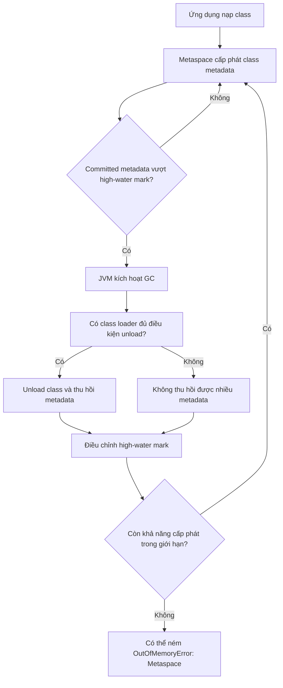

# MetaspaceSize là ngưỡng kích hoạt GC và khác với MaxMetaspaceSize

`-XX:MetaspaceSize` và `-XX:MaxMetaspaceSize` đều liên quan tới vùng Metaspace, nhưng chúng có hai vai trò khác nhau. `MetaspaceSize` đặt high-water mark ban đầu: khi lượng bộ nhớ Metaspace đã commit vượt ngưỡng này, JVM có thể kích hoạt garbage collection để xem có class metadata nào được giải phóng hay không. `MaxMetaspaceSize` đặt giới hạn trên cho native memory được phép cấp phát để lưu class metadata.

Vì vậy, `MetaspaceSize` không phải dung lượng tối đa và cũng không phải lượng bộ nhớ được cấp phát cố định ngay lúc JVM khởi động. Ngược lại, `MaxMetaspaceSize` không phải ngưỡng GC thông thường; đây là giới hạn cấp phát. Sau GC, JVM có thể điều chỉnh high-water mark dựa trên lượng metadata được thu hồi và mức dung lượng còn trống. Hiểu sự khác biệt này giúp tránh tăng nhầm tham số khi gặp GC thường xuyên hoặc `OutOfMemoryError: Metaspace`.

Bài học thuộc chương **Elastic Metaspace** của module **JAVA_VERSION_JAVA16**. Java 16 giới thiệu Elastic Metaspace qua JEP 387; cơ chế quản lý và thu hồi vùng nhớ này tiếp tục được dùng trong JDK hiện đại. Nội dung tập trung vào hai flag vẫn còn áp dụng, cách đọc số liệu và cách chẩn đoán trước khi điều chỉnh.

## 1. Metaspace lưu trữ gì?

Metaspace là vùng native memory của HotSpot VM dùng để lưu class metadata, tức dữ liệu nội bộ mô tả các class đã được nạp. Nó không phải Java heap và không chứa các object nghiệp vụ thông thường.

Class metadata được quản lý theo class loader. Khi class loader không còn reachable và các điều kiện class unloading được đáp ứng, JVM có thể unload các class do loader đó định nghĩa. Metadata tương ứng được thu hồi và các chunk có thể được tái sử dụng hoặc trả lại cho hệ điều hành.

| Vùng nhớ | Lưu trữ | Tham số thường liên quan |
| --- | --- | --- |
| Java heap | Object và array của ứng dụng | `-Xms`, `-Xmx` |
| Metaspace | Class metadata trong native memory | `-XX:MetaspaceSize`, `-XX:MaxMetaspaceSize` |
| Compressed class space | Metadata liên quan compressed class pointers khi tính năng này được bật | `-XX:CompressedClassSpaceSize` |

`-Xmx` không đặt giới hạn cho Metaspace. Một ứng dụng có thể còn nhiều heap trống nhưng vẫn gặp `OutOfMemoryError: Metaspace` nếu giới hạn metadata đã đạt tới hoặc tiến trình không còn đủ native memory để cấp phát.

Khi compressed class pointers được bật, HotSpot dùng một vùng compressed class space riêng bên cạnh phần metadata còn lại. `-XX:CompressedClassSpaceSize` điều khiển kích thước vùng địa chỉ dành cho compressed class pointers; nó không thay thế `-XX:MaxMetaspaceSize`. Theo cách HotSpot tính giới hạn, `MaxMetaspaceSize` áp dụng cho tổng phần committed của compressed class space và vùng metadata còn lại.

## 2. MetaspaceSize là high-water mark ban đầu

`-XX:MetaspaceSize=<size>` đặt ngưỡng ban đầu cho lượng class metadata đã commit. Khi lượng committed metadata vượt ngưỡng, JVM kích hoạt một lần garbage collection để có cơ hội unload các class không còn sử dụng.

Ví dụ:

```bash
java -XX:MetaspaceSize=128m -jar application.jar
```

Trong ví dụ này, `128m` là giá trị high-water mark ban đầu. Nó không có nghĩa JVM cấp phát sẵn 128 MB ngay lúc khởi động, cũng không có nghĩa Metaspace không thể tăng quá 128 MB.

Sau GC, JVM đánh giá lượng metadata đã thu hồi và phần dung lượng còn trống để điều chỉnh high-water mark. Ngưỡng có thể tăng nếu cần tránh GC liên tiếp quá sớm, hoặc giảm khi còn quá nhiều dung lượng trống. Vì thế, giá trị threshold có thể thay đổi trong suốt vòng đời tiến trình.

Trong HotSpot, việc điều chỉnh high-water mark còn chịu ảnh hưởng của `-XX:MinMetaspaceFreeRatio` và `-XX:MaxMetaspaceFreeRatio`, là các tỷ lệ dung lượng trống mục tiêu sau GC. Đây là các tham số tinh chỉnh nâng cao; chỉ nên thay đổi khi log và phép đo cho thấy cần thiết.

`MetaspaceSize` mặc định phụ thuộc nền tảng và cấu hình JVM. Không nên lấy một giá trị mặc định từ máy khác làm chuẩn cho mọi ứng dụng.

## 3. MaxMetaspaceSize là giới hạn cấp phát

`-XX:MaxMetaspaceSize=<size>` đặt giới hạn trên cho native memory có thể được cấp phát để lưu class metadata:

```bash
java -XX:MaxMetaspaceSize=512m -jar application.jar
```

Trong ví dụ, JVM không được cấp phát vượt giới hạn 512 MB cho phần class metadata theo cách HotSpot tính giới hạn này. Giá trị mặc định của `MaxMetaspaceSize` là không giới hạn bởi một cap do flag đặt ra; tiến trình vẫn chịu giới hạn bộ nhớ của hệ điều hành, container và máy chủ.

Khi cần thêm metadata nhưng không thể cấp phát do đã chạm giới hạn, JVM có thể thực hiện GC để thử thu hồi class metadata. Nếu sau đó vẫn không đủ dung lượng, ứng dụng có thể kết thúc với:

```text
java.lang.OutOfMemoryError: Metaspace
```

Tăng `MaxMetaspaceSize` chỉ hợp lý khi số liệu cho thấy ứng dụng thực sự cần thêm class metadata và ngân sách native memory còn đủ. Nếu class loader bị giữ lại ngoài ý muốn hoặc ứng dụng tạo class liên tục, tăng cap có thể chỉ trì hoãn lỗi.

## 4. So sánh hai tham số

| Tiêu chí | `-XX:MetaspaceSize` | `-XX:MaxMetaspaceSize` |
| --- | --- | --- |
| Vai trò | High-water mark ban đầu kích hoạt GC khi vượt ngưỡng | Giới hạn trên của native memory dành cho class metadata |
| Ảnh hưởng chính | Thời điểm xảy ra GC do Metaspace | Khả năng cấp phát thêm metadata |
| Có phải hard cap? | Không | Có |
| JVM có tự điều chỉnh? | Có, high-water mark thay đổi sau GC | Không tự nâng cap vượt giá trị cấu hình |
| Giá trị mặc định | Phụ thuộc nền tảng | Không giới hạn bởi flag |
| Triệu chứng liên quan | GC do metadata có thể xảy ra quá thường xuyên | Có thể gặp `OutOfMemoryError: Metaspace` khi chạm giới hạn |

Hãy ghi nhớ:

- Tăng `MetaspaceSize` có thể giảm các GC do metadata bị kích hoạt quá sớm, nhưng không tăng giới hạn cấp phát.
- Tăng `MaxMetaspaceSize` cho phép cấp phát nhiều metadata hơn, nhưng không tự sửa nguyên nhân class loader leak.
- Đặt `MetaspaceSize` cao hơn `MaxMetaspaceSize` không tạo thêm dung lượng; cap vẫn là giới hạn trên.

## 5. Điều gì xảy ra khi Metaspace vượt ngưỡng?

Có thể mô tả luồng xử lý ở mức khái quát:



Đây là mô hình khái quát; chi tiết thời điểm và loại GC phụ thuộc collector, trạng thái ứng dụng và cách class loader được quản lý. Không phải mọi GC đều đảm bảo unload class. Một class chỉ có thể được thu hồi khi class loader định nghĩa nó không còn được giữ sống và collector thực hiện class unloading theo cấu hình hiện tại.

## 6. Ví dụ đặt cả hai tham số

Có thể cấu hình cả threshold và cap:

```bash
java -XX:MetaspaceSize=128m -XX:MaxMetaspaceSize=512m -jar application.jar
```

Ý nghĩa:

- High-water mark ban đầu là 128 MB.
- Khi committed metadata vượt ngưỡng, JVM có thể kích hoạt GC.
- JVM có thể điều chỉnh high-water mark sau GC.
- Tổng native memory được phép cấp phát cho class metadata vẫn bị giới hạn ở 512 MB.

Các con số chỉ để minh họa cách kết hợp flag. Không có một cặp giá trị phù hợp cho mọi ứng dụng. Framework lớn, ứng dụng dùng nhiều proxy/bytecode generation, plugin hoặc nhiều class loader có thể có nhu cầu metadata khác hẳn một ứng dụng nhỏ.

## 7. Elastic Metaspace từ Java 16 thay đổi điều gì?

JEP 387 đưa Elastic Metaspace vào Java 16 để cải thiện cách HotSpot quản lý vùng nhớ dành cho class metadata. Bộ cấp phát mới quản lý các chunk và commit/uncommit các vùng nhớ theo nhu cầu. Những vùng không còn cần thiết có thể được uncommit để giảm lượng native memory đã commit và trả tài nguyên về hệ điều hành.

Điều này giúp giảm footprint và hạn chế phân mảnh trong các tình huống class loader được tạo rồi giải phóng thường xuyên. Nó không thay đổi vai trò của hai flag:

- `MetaspaceSize` vẫn là high-water mark ban đầu cho GC do metadata.
- `MaxMetaspaceSize` vẫn là giới hạn cấp phát metadata nếu được cấu hình.
- Elastic Metaspace cải thiện việc quản lý và thu hồi bộ nhớ; nó không làm cho giới hạn `MaxMetaspaceSize` biến mất.

Sau khi class được unload, giá trị `used` có thể giảm. Bộ nhớ `committed` cũng có thể giảm khi các chunk đủ điều kiện được uncommit. Tuy nhiên, `reserved` có thể vẫn lớn vì đó là vùng địa chỉ ảo đã reserve, không đồng nghĩa toàn bộ vùng đó đang chiếm RAM vật lý.

## 8. Phân biệt used, committed và reserved

Khi xem báo cáo Metaspace, ba con số này trả lời các câu hỏi khác nhau:

| Chỉ số | Ý nghĩa |
| --- | --- |
| `used` | Phần dung lượng đang chứa class metadata đã sử dụng |
| `committed` | Bộ nhớ đã commit cho Metaspace và sẵn sàng được dùng để cấp phát |
| `reserved` | Không gian địa chỉ ảo đã reserve cho Metaspace; chưa chắc đã commit hoặc chiếm RAM vật lý |

Ví dụ minh họa:

```text
Metaspace:
  used      = 90 MB
  committed = 128 MB
  reserved  = 512 MB
```

Ở đây, 90 MB đang được dùng cho metadata; 128 MB đã commit; 512 MB là không gian địa chỉ đã reserve. Không được kết luận ứng dụng đang sử dụng 512 MB RAM chỉ từ giá trị `reserved`.

Nếu sau một đợt class unloading, `used` giảm nhưng `committed` chưa giảm tương ứng, các chunk còn trống có thể đang được giữ lại để tái sử dụng. Với Elastic Metaspace, những chunk phù hợp có thể được uncommit sau đó; vì vậy, hãy theo dõi xu hướng qua nhiều thời điểm thay vì chỉ nhìn một snapshot.

## 9. Theo dõi Metaspace bằng jcmd

`jcmd` cung cấp lệnh `VM.metaspace` để xem thống kê Metaspace của một JVM đang chạy:

```bash
jcmd <pid> VM.metaspace
```

Có thể xem mức sử dụng theo class loader:

```bash
jcmd <pid> VM.metaspace show-loaders=true
jcmd <pid> VM.classloader_stats
```

Các lệnh này giúp trả lời:

- Số lượng class loader đang tồn tại có tăng liên tục không?
- Loader nào đang giữ nhiều metadata?
- Used, committed và free space thay đổi thế nào theo thời gian?
- Sau khi đóng ứng dụng con/plugin, metadata có được thu hồi không?

Để kiểm tra các flag thực tế của JVM:

```bash
jcmd <pid> VM.flags
```

Nếu cần log GC liên quan tới Metaspace, có thể khởi chạy JVM với Unified Logging:

```bash
java -Xlog:gc+metaspace=info -jar application.jar
```

Lệnh `VM.metaspace` và `VM.classloader_stats` có thể tạo một snapshot có ích cho chẩn đoán. Khi cần kết luận về leak, hãy thu thập nhiều snapshot trong cùng một workload và so sánh sau các chu kỳ tạo/đóng class loader.

## 10. Theo dõi native memory bằng Native Memory Tracking

Metaspace là native memory, vì vậy Native Memory Tracking (NMT) có thể bổ sung góc nhìn về bộ nhớ của tiến trình. NMT phải được bật khi JVM khởi động:

```bash
java -XX:NativeMemoryTracking=summary -jar application.jar
```

Sau đó, lấy thống kê:

```bash
jcmd <pid> VM.native_memory summary
```

Có thể đặt baseline sau khi ứng dụng ổn định rồi so sánh:

```bash
jcmd <pid> VM.native_memory baseline
jcmd <pid> VM.native_memory summary.diff
```

NMT có overhead hiệu năng và bộ nhớ; tài liệu Oracle ghi nhận mức giảm hiệu năng khoảng 5–10% tùy workload. Vì vậy, hãy bật khi cần điều tra hoặc trong môi trường đo lường phù hợp, không mặc định bật trên mọi production instance.

NMT cho thấy bộ nhớ native theo subsystem. Dùng `VM.metaspace` để xem chi tiết Metaspace và class loader; dùng NMT để đối chiếu Metaspace với tổng thể native memory của tiến trình.

## 11. Chẩn đoán khi GC xảy ra quá thường xuyên

Nếu log cho thấy GC thường xuyên do Metaspace:

1. Xác nhận high-water mark hiện tại bằng `jcmd <pid> VM.flags`.
2. Theo dõi `VM.metaspace` để xem `used` và `committed`.
3. Kiểm tra số lượng class loader và tốc độ nạp class.
4. Xác định workload có tạo nhiều proxy, class động hoặc plugin loader hay không.
5. Nếu ứng dụng có mức metadata ổn định nhưng threshold ban đầu quá thấp, cân nhắc tăng `MetaspaceSize` sau khi đo.

Không tăng `MetaspaceSize` chỉ vì thấy một lần GC. GC có thể là một phần bình thường của quá trình quản lý class metadata. Cần đánh giá tần suất, pause time, lượng metadata được thu hồi và ảnh hưởng tới latency.

## 12. Chẩn đoán OutOfMemoryError: Metaspace

Khi gặp `OutOfMemoryError: Metaspace`, hãy kiểm tra:

- Có cấu hình `MaxMetaspaceSize` quá thấp so với workload không?
- `used` tăng liên tục theo thời gian hay ổn định sau warm-up?
- Số lượng class loader có tăng sau mỗi lần reload ứng dụng/plugin không?
- Class loader cũ có bị giữ lại bởi thread context class loader, static reference, ThreadLocal, callback hoặc cache không?
- Ứng dụng có tạo class động liên tục qua proxy, ORM, scripting hoặc bytecode generation không?
- Tổng native memory và giới hạn container có còn đủ không?

Nếu cap được đặt thấp hơn nhu cầu hợp lệ, có thể tăng `MaxMetaspaceSize` sau khi tính ngân sách native memory. Nếu metadata tăng không ngừng do class loader leak, cần sửa vòng đời loader và tham chiếu giữ loader sống. Tăng cap không giải quyết được nguyên nhân giữ metadata.

Không dùng `-Xmx` để sửa trực tiếp lỗi Metaspace. Heap và Metaspace là hai khu vực khác nhau; thay đổi heap chỉ có thể ảnh hưởng gián tiếp đến ngân sách bộ nhớ chung của tiến trình.

## 13. Quy trình chọn giá trị phù hợp

Không có công thức cố định cho `MetaspaceSize` và `MaxMetaspaceSize`. Có thể làm theo quy trình:

1. Chạy workload đại diện với cấu hình mặc định.
2. Thu thập `VM.metaspace`, class loader statistics và GC log.
3. Đo sau startup, sau warm-up, khi tải cao và sau khi unload plugin/redeploy.
4. Xác định mức metadata bình thường và biên tăng trưởng.
5. Nếu GC do threshold quá sớm gây ảnh hưởng đã đo được, điều chỉnh `MetaspaceSize` từng bước.
6. Chỉ đặt `MaxMetaspaceSize` khi có lý do vận hành rõ ràng và đủ ngân sách native memory.
7. Lặp lại bài đo dưới cùng workload để xác nhận hiệu quả.

| Dấu hiệu | Hướng xem xét |
| --- | --- |
| GC metadata sớm, nhưng `used` ổn định và còn nhiều native headroom | Đánh giá tăng `MetaspaceSize` |
| `used` tăng liên tục cùng số class loader | Điều tra loader leak hoặc class generation không giới hạn |
| `used` ổn định gần cap và xuất hiện OOME | Đánh giá nhu cầu thực và `MaxMetaspaceSize` |
| `used` giảm sau unload nhưng `committed` giảm chậm | Theo dõi khả năng tái sử dụng/uncommit của Elastic Metaspace |
| `reserved` lớn nhưng `committed` nhỏ | Không xem `reserved` là RAM đang dùng; kiểm tra committed/RSS |

## 14. Bài tập tự kiểm tra

Một ứng dụng chạy với:

```bash
java -XX:MetaspaceSize=96m -XX:MaxMetaspaceSize=384m -jar service.jar
```

Sau một thời gian, log cho thấy GC được kích hoạt khi Metaspace vượt ngưỡng ban đầu. Sau GC, JVM tiếp tục chạy. Vài giờ sau, ứng dụng ném `OutOfMemoryError: Metaspace`; báo cáo cho thấy nhiều class loader của plugin vẫn còn tồn tại.

Hãy trả lời:

1. `MetaspaceSize=96m` có phải giới hạn tối đa của Metaspace không?
2. JVM có thể điều chỉnh high-water mark sau GC không?
3. Tham số nào đặt cap 384 MB?
4. Vì sao tăng `MetaspaceSize` không giải quyết trực tiếp OOME?
5. Nên kiểm tra gì khi class loader của plugin vẫn tồn tại sau khi plugin đã dừng?

**Đáp án:**

1. Không. Đây là high-water mark ban đầu để kích hoạt GC do metadata.
2. Có. JVM điều chỉnh ngưỡng dựa trên lượng metadata được thu hồi và dung lượng trống.
3. `-XX:MaxMetaspaceSize=384m`.
4. `MetaspaceSize` không nâng giới hạn cấp phát. OOME có thể xảy ra khi chạm `MaxMetaspaceSize` hoặc không còn khả năng cấp phát metadata.
5. Kiểm tra thread context class loader, thread còn sống, ThreadLocal, static reference, cache, callback và các đối tượng còn tham chiếu tới loader.

## Ghi nhớ

**`MetaspaceSize` là high-water mark ban đầu kích hoạt GC khi committed class metadata vượt ngưỡng; `MaxMetaspaceSize` là giới hạn trên của native memory dành cho class metadata.** JVM có thể tự điều chỉnh high-water mark sau GC, nhưng không tự vượt cap do `MaxMetaspaceSize` đặt ra. Khi chẩn đoán, phân biệt `used`, `committed` và `reserved`, theo dõi class loader bằng `jcmd VM.metaspace` và chỉ điều chỉnh flag sau khi đã đo workload. Elastic Metaspace từ Java 16 giúp uncommit vùng không còn cần, nhưng không thay đổi vai trò của hai tham số này.

## Tài liệu tham khảo

- [Oracle Java SE 26 — The java Command: MetaspaceSize and MaxMetaspaceSize](https://docs.oracle.com/en/java/javase/26/docs/specs/man/java.html)
- [Oracle Java SE 26 — Garbage Collection Tuning: Class Metadata](https://docs.oracle.com/en/java/javase/26/gctuning/other-considerations.html)
- [Oracle Java SE 26 — The jcmd Command](https://docs.oracle.com/en/java/javase/26/docs/specs/man/jcmd.html)
- [Oracle Java SE 26 — Native Memory Tracking](https://docs.oracle.com/en/java/javase/26/vm/native-memory-tracking.html)
- [JEP 387 — Elastic Metaspace](https://openjdk.org/jeps/387)
