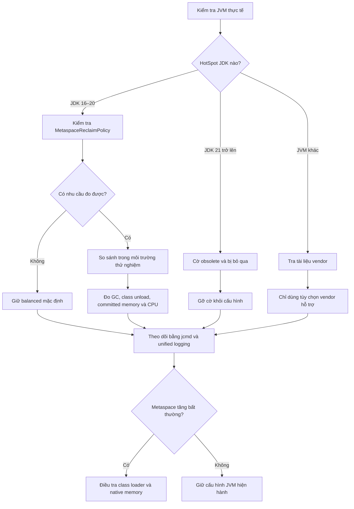

# Cấu hình MetaspaceReclaimPolicy sau khi kiểm tra hỗ trợ của JVM

> **Chương:** Elastic Metaspace  
> **Phạm vi:** Xác định JVM có hỗ trợ cờ `-XX:MetaspaceReclaimPolicy` hay không, hiểu ý nghĩa của cờ trên các bản HotSpot cũ và xử lý đúng khi nâng cấp. Cờ này được giới thiệu cùng Elastic Metaspace trong JDK 16 nhưng đã bị đánh dấu obsolete từ JDK 21; trên JDK hiện đại không được dùng nó để điều khiển việc thu hồi Metaspace. Bài tập trung vào cách kiểm tra runtime thực tế, giữ cấu hình tương thích và chẩn đoán Metaspace bằng công cụ còn được hỗ trợ.

## Mục tiêu học tập

Sau bài này, bạn có thể:

1. Giải thích Metaspace lưu trữ loại dữ liệu nào và vì sao nó nằm ngoài Java heap.
2. Hiểu Elastic Metaspace được giới thiệu trong JDK 16 để cải thiện việc hoàn trả bộ nhớ sau khi class loader được unload.
3. Nhận diện lịch sử và phạm vi hỗ trợ của `MetaspaceReclaimPolicy`.
4. Kiểm tra cờ trên đúng JVM, đúng vendor và đúng phiên bản đang chạy ứng dụng.
5. Phân biệt cờ được chấp nhận với cờ còn có tác dụng.
6. Loại bỏ cờ obsolete khi chạy JDK 21 trở lên.
7. Theo dõi class unloading, Metaspace và class loader bằng `jcmd`, unified logging và Native Memory Tracking.
8. Tránh dùng `MetaspaceSize` hoặc `MaxMetaspaceSize` sai mục đích.

## 1. Metaspace là gì?

Metaspace là vùng bộ nhớ native của HotSpot dùng để lưu metadata của class đã được nạp. Metadata gồm thông tin cấu trúc lớp, method, constant pool và các dữ liệu nội bộ cần thiết để JVM thực thi mã Java.

Metaspace khác Java heap:

| Khu vực | Lưu trữ | Cách quan sát |
| --- | --- | --- |
| Java heap | Object và array được cấp phát bởi ứng dụng | Heap usage, heap dump, GC log |
| Metaspace | Metadata của class và dữ liệu liên quan tới class loader | `jcmd VM.metaspace`, GC/metaspace log |
| Compressed Class Space | Một vùng liên quan đến metadata class khi compressed class pointers được bật | Thống kê class space trong báo cáo Metaspace |
| Native memory khác | Thread stack, code cache, native library, direct buffer và cấu trúc JVM khác | Native Memory Tracking, công cụ hệ điều hành |

Vì Metaspace nằm ngoài heap, tăng `-Xmx` không trực tiếp đặt giới hạn cho Metaspace. Một tiến trình có thể còn nhiều heap trống nhưng vẫn gặp `OutOfMemoryError: Metaspace` nếu metadata vượt giới hạn hoặc native memory không đủ.

Không nên kết luận mọi mức tăng bộ nhớ tiến trình đều do Metaspace. Cần phân biệt heap, Metaspace, class space, direct memory, thread stack và các vùng native khác.

## 2. Class loader quyết định vòng đời metadata

Metadata của class gắn với class loader đã nạp class đó. Khi class loader còn được tham chiếu mạnh, các class do loader quản lý thường vẫn còn sống và metadata chưa thể được thu hồi.

Khi class loader không còn được tham chiếu và đủ điều kiện thu gom:

1. GC có thể xác định class loader đã không còn reachable.
2. Các class do loader quản lý có thể được unload nếu collector và cấu hình cho phép class unloading.
3. Metadata thuộc loader được giải phóng khỏi arena tương ứng.
4. Bộ quản lý Metaspace có thể tái sử dụng các chunk trống hoặc uncommit những vùng không còn cần thiết để trả committed memory về hệ điều hành.

Vì vậy, khả năng thu hồi Metaspace phụ thuộc vào vòng đời class loader và class unloading. Một tùy chọn thu hồi không thể giải phóng metadata của class loader vẫn còn sống.

Các tình huống dễ tạo nhiều class loader hoặc class động gồm:

- Redeploy ứng dụng trong application server.
- Plugin được nạp và gỡ nhiều lần.
- Framework tạo proxy hoặc class bằng bytecode generation.
- Hot reload trong môi trường phát triển.
- Script engine hoặc runtime biên dịch mã động.
- Cache hoặc thread giữ tham chiếu tới class loader cũ.

Một class loader bị giữ lại bởi thread context class loader, `ThreadLocal`, static cache, listener hoặc executor có thể làm các class của nó không unload được. Khi đó, tăng tốc độ reclaim không giải quyết được nguyên nhân.

## 3. Elastic Metaspace trong JDK 16

JEP 387, Elastic Metaspace, được đưa vào JDK 16. Bản thay đổi này viết lại bộ quản lý Metaspace của HotSpot nhằm giảm lãng phí bộ nhớ và hoàn trả các vùng không còn dùng sau class unloading hiệu quả hơn.

Các điểm chính:

- Giảm mức tiêu thụ bộ nhớ trong một số workload có nhiều class loader nhỏ.
- Quản lý các chunk metadata theo cơ chế linh hoạt hơn.
- Có thể uncommit các vùng Metaspace trống thay vì giữ toàn bộ phần đã commit.
- Tách việc giữ địa chỉ virtual memory đã reserve với lượng memory đang commit cho sử dụng.
- Tạo cơ chế thu hồi có thể điều chỉnh bằng cờ `MetaspaceReclaimPolicy` trong các JDK cũ có hỗ trợ.

### Reserve, commit và sử dụng

Ba khái niệm cần phân biệt:

| Khái niệm | Ý nghĩa |
| --- | --- |
| Reserved | Vùng địa chỉ virtual memory JVM dành trước để có thể sử dụng |
| Committed | Phần vùng đã commit, sẵn sàng cho JVM sử dụng |
| Used | Phần dữ liệu metadata đang được sử dụng |

Một vùng được uncommit có thể giảm committed memory nhưng vùng địa chỉ đã reserve vẫn còn. Vì vậy, số liệu virtual size của tiến trình không nhất thiết giảm cùng mức với committed memory.

Sau class unloading, Metaspace có thể giữ chunk trống để tái sử dụng hoặc uncommit một phần về hệ điều hành. Thời điểm và lượng bộ nhớ được trả lại còn phụ thuộc trạng thái allocator, workload và JVM implementation.

### Elastic Metaspace không phải cơ chế chữa class loader leak

Nếu ứng dụng liên tục giữ class loader cũ, metadata vẫn còn sống. Elastic Metaspace chỉ quản lý tốt hơn vùng trống có thể thu hồi; nó không thể unload class còn được tham chiếu.

Khi Metaspace tăng đều qua các chu kỳ redeploy, hãy kiểm tra số class loader, số class được nạp và các tham chiếu giữ loader trước khi thay đổi tham số JVM.

## 4. Lịch sử và phạm vi hỗ trợ của MetaspaceReclaimPolicy

`-XX:MetaspaceReclaimPolicy` là cờ HotSpot được giới thiệu cùng JEP 387 trong JDK 16. Oracle JDK 16 Release Notes mô tả ba giá trị:

| Giá trị trên JDK cũ | Hành vi được mô tả | Ghi chú |
| --- | --- | --- |
| `balanced` | Thu hồi với overhead tính toán thấp; đây là mặc định | Chính sách mặc định trên JDK 16–20 |
| `aggressive` | Tăng mức thu hồi, đổi lại bookkeeping tốn kém hơn | Chỉ là lựa chọn lịch sử trên các JDK còn hỗ trợ |
| `none` | Tắt hoạt động reclaim của Metaspace | Không dùng làm cấu hình thông thường |

Phạm vi phiên bản của cờ trong HotSpot:

| JDK | Trạng thái |
| --- | --- |
| JDK 16–20 | Cờ được hỗ trợ; `balanced` là mặc định |
| JDK 21 trở lên | Cờ bị obsolete và bị bỏ qua, đồng thời JVM phát cảnh báo |
| JVM không dùng HotSpot hoặc bản vendor đã tùy biến | Không suy luận theo số phiên bản Java; phải kiểm tra đúng runtime |

### Vì sao cờ bị obsolete?

JDK 21 Release Notes ghi rõ `MetaspaceReclaimPolicy` được obsoleted vì tác động thực tế của cờ này hạn chế và ít được sử dụng. Khi dùng trên JDK 21, cờ phát cảnh báo obsolete và bị bỏ qua.

Điều này có nghĩa là:

- Việc JVM chấp nhận dòng lệnh không chứng minh cờ còn tác dụng.
- Giữ `-XX:MetaspaceReclaimPolicy=aggressive` trên JDK mới không làm tăng mức thu hồi.
- Không dùng `none` hoặc `aggressive` như một khuyến nghị cho JDK hiện đại.
- Không thay tên cờ bằng một tên khác tự suy đoán; hãy dùng các công cụ và tùy chọn được tài liệu hóa cho runtime đang chạy.

Trong HotSpot hiện đại, việc quản lý Metaspace tiếp tục do JVM tự điều phối. Không có cờ `MetaspaceReclaimPolicy` mới để thay thế trực tiếp cho ứng dụng.

## 5. Kiểm tra đúng JVM trước khi cấu hình

Các tùy chọn `-XX` thường là tùy chọn riêng của JVM implementation, không phải tùy chọn Java SE bảo đảm mọi JVM đều hỗ trợ. Cùng một ứng dụng có thể chạy bằng một bản HotSpot trên máy phát triển và một JVM khác trong production.

Trước khi đánh giá cờ, xác định executable thực sự được service sử dụng.

### Bước 1: Xác định phiên bản và vendor

Chạy bằng đúng executable:

```bash
java -version
```

Nếu ứng dụng dùng `JAVA_HOME`, kiểm tra đúng binary trong thư mục đó:

```bash
"$JAVA_HOME/bin/java" -version
```

Trên Windows PowerShell:

```powershell
& "$env:JAVA_HOME\bin\java.exe" -version
```

Ghi lại vendor, version, runtime build và VM name. Nếu kiểm tra bằng một `java` khác với binary production, kết quả không có giá trị cho cấu hình production.

### Bước 2: Xem các flag HotSpot được công bố

Với HotSpot, có thể liệt kê flag:

```bash
java -XX:+PrintFlagsFinal -version 2>&1 | grep -i Metaspace
```

Trên Windows PowerShell:

```powershell
& "$env:JAVA_HOME\bin\java.exe" -XX:+PrintFlagsFinal -version 2>&1 |
    Select-String -Pattern "Metaspace"
```

Trên JDK 16–20, `MetaspaceReclaimPolicy` là product flag và có thể xuất hiện trong danh sách với giá trị mặc định `balanced`. Trên JDK 21 trở lên, đừng xem việc không xuất hiện trong danh sách flag đang hoạt động là lỗi cài đặt; cờ đã bị obsolete.

`PrintFlagsFinal` là công cụ chẩn đoán HotSpot. Không dùng lệnh này như một phép kiểm tra portable cho mọi JVM implementation.

### Bước 3: Kiểm tra hành vi khi truyền cờ trên một tiến trình ngắn

Có thể chạy một tiến trình chỉ in version để quan sát cách runtime xử lý cờ:

```bash
java -XX:MetaspaceReclaimPolicy=balanced -version
```

Diễn giải kết quả:

| Kết quả | Cách hiểu |
| --- | --- |
| JDK 16–20 HotSpot nhận cờ mà không có cảnh báo obsolete | Cờ được runtime cũ hỗ trợ |
| JDK 21+ phát cảnh báo obsolete và vẫn in version | Cờ được nhận diện để tương thích nhưng bị bỏ qua |
| JVM báo `Unrecognized VM option` | Runtime không hỗ trợ tên cờ này |
| Có lỗi khởi tạo JVM khác | Đọc thông báo đầy đủ; không kết luận chỉ từ exit code |

Lệnh trên chỉ kiểm tra cách parser xử lý tùy chọn. Nó không chứng minh policy tạo ra lợi ích hiệu năng trên workload thực tế.

Không chạy thử nhiều policy trên tiến trình production. Nếu cần so sánh hành vi lịch sử của JDK 16–20, dùng môi trường thử nghiệm với đúng vendor, patch version và workload có thể lặp lại.

## 6. Quyết định cấu hình theo phiên bản

Dựa trên kết quả kiểm tra, chọn hướng xử lý:

| Runtime | Quyết định |
| --- | --- |
| HotSpot JDK 16–20 và có yêu cầu tương thích cụ thể | Có thể đánh giá cờ trong môi trường thử nghiệm; giữ `balanced` mặc định làm baseline |
| HotSpot JDK 21+ | Gỡ cờ khỏi JVM options; nó đã obsolete và không có tác dụng |
| JVM khác HotSpot | Tra tài liệu vendor; không áp dụng tùy chọn HotSpot nếu chưa được hỗ trợ |
| Runtime chưa xác định hoặc nhiều vendor | Chuẩn hóa runtime trước khi thay đổi cấu hình |

### Cấu hình lịch sử cho JDK 16–20

Trên một runtime HotSpot JDK 16–20 đã xác nhận hỗ trợ, cấu hình mặc định có thể được để JVM tự chọn:

```bash
java -jar application.jar
```

`balanced` vốn là giá trị mặc định, do đó thường không cần ghi rõ trong lệnh khởi chạy. Nếu một hệ thống cũ đã có cấu hình tường minh, ghi nhận lý do và đo lường trước khi quyết định giữ hay bỏ.

Nếu cần ghi rõ giá trị mặc định trong một môi trường tương thích cũ đã được kiểm tra, cú pháp là:

```bash
java -XX:MetaspaceReclaimPolicy=balanced -jar application.jar
```

Đây chỉ là ví dụ cấu hình cho HotSpot JDK 16–20. Nó không phải khuyến nghị thêm cờ vào ứng dụng mới và không được mang sang JDK 21 trở lên.

Không lấy cấu hình lịch sử này để áp dụng cho JDK 21+.

### Cấu hình cho JDK hiện đại

Với JDK 21 trở lên, bỏ các mục như:

```text
-XX:MetaspaceReclaimPolicy=balanced
-XX:MetaspaceReclaimPolicy=aggressive
-XX:MetaspaceReclaimPolicy=none
```

Không thay chúng bằng một cờ reclaim khác nếu tài liệu của đúng JVM không công bố cờ đó. Để JVM tự quản lý Metaspace theo cơ chế hiện hành, sau đó dùng số liệu để quyết định có cần thay đổi giới hạn hoặc sửa vòng đời class loader hay không.

Kiểm tra các vị trí có thể lưu JVM options:

- Script start/stop của service.
- Container image, Docker entrypoint và Kubernetes manifest.
- `JAVA_TOOL_OPTIONS` và `JDK_JAVA_OPTIONS`.
- Cấu hình application server hoặc service manager.
- Script CI/CD và biến môi trường của môi trường triển khai.

Một cờ cũ có thể còn sót trong cấu hình container dù đã được xóa khỏi script khởi chạy tại máy phát triển.

## 7. Không nhầm MetaspaceSize với MaxMetaspaceSize

Hai tùy chọn dưới đây vẫn có mục đích riêng trên HotSpot hiện đại, nhưng không thay thế `MetaspaceReclaimPolicy`.

| Tùy chọn | Ý nghĩa | Không có nghĩa là |
| --- | --- | --- |
| `-XX:MetaspaceSize` | Ngưỡng ban đầu có thể kích hoạt GC khi mức sử dụng Metaspace vượt qua; JVM có thể điều chỉnh ngưỡng | Không phải hard limit của Metaspace |
| `-XX:MaxMetaspaceSize` | Giới hạn trên cho Metaspace | Không phải policy quyết định cách reclaim sau class unloading |

### MetaspaceSize

`MetaspaceSize` liên quan tới ngưỡng kích hoạt GC ban đầu khi Metaspace tăng. Đây không phải kích thước vùng nhớ được cấp phát cố định và không phải giới hạn tối đa.

Không giảm `MetaspaceSize` chỉ để cố ép JVM thu hồi bộ nhớ nhiều hơn. Điều đó có thể làm GC xảy ra thường xuyên hơn mà không sửa nguyên nhân class loader còn sống.

### MaxMetaspaceSize

Có thể đặt giới hạn để kiểm soát mức Metaspace tối đa trong một tiến trình:

```bash
java -XX:MaxMetaspaceSize=512m -jar application.jar
```

Ví dụ chỉ minh họa cú pháp, không phải giá trị khuyến nghị cho mọi ứng dụng. Đặt giới hạn quá thấp có thể gây `OutOfMemoryError: Metaspace` dù ứng dụng vẫn cần nạp class hợp lệ.

Trước khi đặt giới hạn, đo mức dùng trong tải bình thường, tải đỉnh, redeploy và giai đoạn khởi động. Dành đủ headroom cho framework, proxy, instrumentation và class được sinh động.

## 8. Chẩn đoán Metaspace trên JDK hiện đại

Khi Metaspace tăng, trước tiên hãy tìm hiểu liệu số class loader và class được nạp có tăng theo thời gian hay không.

### Thống kê Metaspace bằng jcmd

Xác định PID của tiến trình Java, sau đó:

```bash
jcmd <pid> VM.metaspace
```

Để xem chi tiết theo class loader:

```bash
jcmd <pid> VM.metaspace show-loaders=true scale=MB
```

Có thể dùng thêm các tùy chọn như `show-classes`, `by-chunktype`, `by-spacetype` hoặc `vslist` nếu cần phân tích sâu hơn. Các tùy chọn cụ thể phụ thuộc phiên bản JVM; kiểm tra trợ giúp của runtime trước:

```bash
jcmd <pid> help VM.metaspace
```

### Thống kê class loader

```bash
jcmd <pid> VM.classloader_stats
```

Lệnh này giúp quan sát số class và mức sử dụng liên quan tới từng class loader. Nếu mỗi lần redeploy lại xuất hiện một nhóm loader mới và loader cũ không biến mất sau các chu kỳ GC phù hợp, hãy điều tra tham chiếu giữ loader.

Không kết luận leak chỉ từ một ảnh chụp thống kê. So sánh nhiều thời điểm sau khi workload đã ổn định và sau những giai đoạn class unloading có thể xảy ra.

### Unified logging

Có thể bật log phục vụ chẩn đoán:

```bash
java -Xlog:gc+meta=info,class+unload=info -jar application.jar
```

- `gc+meta` cung cấp thông tin liên quan tới Metaspace trong hoạt động GC.
- `class+unload` ghi nhận class unloading.
- Dùng mức log cao hơn chỉ trong môi trường điều tra nếu cần thêm chi tiết, vì lượng log có thể tăng.

Unified logging là cơ chế hiện hành; tránh dựa vào các cờ trace class loading cũ đã bị thay thế.

### Native Memory Tracking

Nếu cần phân tích native memory tổng thể, bật NMT ngay từ lúc khởi chạy:

```bash
java -XX:NativeMemoryTracking=summary -jar application.jar
```

Sau đó truy vấn:

```bash
jcmd <pid> VM.native_memory summary
```

NMT phải được bật từ lúc JVM khởi động mới thu thập được số liệu tương ứng. Công cụ này có overhead và không phải thay thế heap dump. Dùng nó trong môi trường phù hợp với yêu cầu quan sát của ứng dụng.

## 9. Phân biệt Metaspace tăng hợp lý và class loader leak

Metaspace tăng không tự động có nghĩa là memory leak. Ứng dụng có thể nạp thêm class theo lưu lượng, khởi tạo framework hoặc tạo proxy trong giai đoạn warm-up.

| Dấu hiệu | Khả năng cần xem xét |
| --- | --- |
| Metaspace tăng lúc khởi động rồi ổn định | Nạp class ban đầu và warm-up bình thường |
| Số class tăng theo tính năng được gọi lần đầu rồi ổn định | Nạp class theo nhu cầu |
| Số class loader tăng qua mỗi lần redeploy và loader cũ còn tồn tại | Có thể có tham chiếu giữ class loader |
| Metaspace tăng liên tục sau mỗi lần tạo/gỡ plugin | Kiểm tra lifecycle plugin, thread, cache và listener |
| Class unloading có xảy ra nhưng committed memory chưa giảm ngay | Vùng trống có thể được giữ để tái sử dụng hoặc chưa đủ điều kiện uncommit |
| `OutOfMemoryError: Metaspace` xuất hiện khi nạp class | Kiểm tra giới hạn, native memory và tốc độ tăng metadata |

### Các nguồn tham chiếu thường giữ class loader

- Thread còn sống với context class loader cũ.
- ThreadLocal không được xóa.
- Static field hoặc singleton giữ object từ ứng dụng đã unload.
- Cache toàn cục giữ `Class`, `Method`, proxy hoặc metadata của framework.
- Listener chưa deregister.
- Executor, timer hoặc callback vẫn giữ object thuộc loader cũ.
- Native code hoặc agent giữ tham chiếu tới class/object.

Khi class loader vẫn reachable, việc tăng reclaim policy không thể làm metadata của nó biến mất.

## 10. Quy trình xử lý khi nâng từ JDK 16 lên JDK hiện đại

1. **Ghi nhận runtime:** vendor, VM name, version và JVM options thực tế.
2. **Tìm cờ cũ:** rà `MetaspaceReclaimPolicy` trong script, container, service config và biến môi trường.
3. **Kiểm tra hỗ trợ:** dùng đúng executable để kiểm tra flag và cảnh báo obsolete.
4. **Phân loại phiên bản:** JDK 16–20 có cờ; JDK 21+ coi cờ là obsolete/ignored trong HotSpot.
5. **Gỡ cờ trên JDK mới:** không giữ option chỉ vì JVM vẫn nhận nó.
6. **Thiết lập baseline:** thu thập Metaspace, class loader stats và GC/class-unload logs.
7. **Chạy workload đại diện:** warm-up, tải đỉnh, redeploy, plugin reload và shutdown.
8. **Đánh giá giới hạn:** chỉ cân nhắc `MaxMetaspaceSize` sau khi có số liệu và headroom phù hợp.
9. **Điều tra tăng trưởng bất thường:** kiểm tra loader, cache, thread và các tham chiếu giữ class.
10. **Tự động hóa kiểm tra:** phát hiện cờ obsolete trong cấu hình trước khi phát hành.

## 11. Sơ đồ quyết định



## 12. Những lỗi thường gặp

| Hiện tượng | Nguyên nhân | Cách xử lý |
| --- | --- | --- |
| JDK 21+ khởi động có cảnh báo `MetaspaceReclaimPolicy` | Cờ đã obsolete | Gỡ cờ khỏi JVM options |
| Cờ vẫn được chấp nhận nên tưởng còn tác dụng | JVM nhận diện tên cờ để tương thích nhưng bỏ qua | Kiểm tra cảnh báo và tài liệu release notes |
| Dùng `aggressive` để sửa Metaspace leak | Class loader cũ vẫn còn reachable | Điều tra tham chiếu giữ loader |
| Dùng `none` để giảm overhead | Reclaim bị tắt trên runtime cũ | Không dùng làm cấu hình production thông thường |
| Giảm `MetaspaceSize` để ép reclaim | Nhầm ngưỡng GC với giới hạn hoặc policy reclaim | Đo GC và dùng mặc định trước |
| Đặt `MaxMetaspaceSize` quá thấp | Metadata hợp lệ vượt giới hạn | Đo tải đỉnh và dành headroom |
| Metaspace committed không giảm ngay sau unload | Chunk có thể được giữ để tái sử dụng hoặc chưa uncommit | Quan sát nhiều chu kỳ và phân biệt used/committed/reserved |
| `PrintFlagsFinal` không liệt kê cờ trên JVM khác | Flag HotSpot không portable | Xác minh vendor và tài liệu đúng runtime |
| NMT không có dữ liệu | Chưa bật NMT khi JVM khởi động | Bật từ startup ở lần chạy chẩn đoán tiếp theo |

## 13. Checklist cấu hình và vận hành

| Hạng mục | Câu hỏi xác nhận |
| --- | --- |
| Runtime | Đã xác định đúng binary, vendor, VM và version production chưa? |
| HotSpot | Đã xác minh JVM có phải HotSpot trước khi dùng `-XX` flag chưa? |
| Support | Đã kiểm tra flag trên đúng runtime thay vì suy luận theo JDK của máy build chưa? |
| JDK 16–20 | Nếu còn dùng, có lý do và số liệu cho thay đổi policy không? |
| JDK 21+ | Đã gỡ `MetaspaceReclaimPolicy` khỏi cấu hình chưa? |
| Class unloading | Đã kiểm tra class loader có đủ điều kiện unload không? |
| Diagnostics | Đã biết dùng `jcmd VM.metaspace` và `VM.classloader_stats` chưa? |
| Logging | Đã bật unified logging phù hợp trong môi trường điều tra chưa? |
| NMT | Nếu cần phân tích native memory, đã bật từ startup chưa? |
| Limits | `MetaspaceSize` và `MaxMetaspaceSize` có được dùng đúng ý nghĩa không? |
| CI/CD | Có bước tìm cờ obsolete trong script/container/service config không? |
| Regression | Đã kiểm thử warm-up, tải đỉnh, redeploy và plugin lifecycle chưa? |

## 14. Bài tập thực hành

### Bài 1 — Xác định hỗ trợ của JVM

Dùng JDK 17, JDK 21 hoặc JDK mới hơn để chạy `java -version`, `-XX:+PrintFlagsFinal` và thử khởi chạy ngắn với `MetaspaceReclaimPolicy=balanced`. Ghi lại cảnh báo và giải thích vì sao “được chấp nhận” không đồng nghĩa “còn tác dụng”.

### Bài 2 — So sánh tài liệu JDK 16 và JDK 21

Đọc JDK 16 Release Notes và JDK 21 Release Notes. Ghi lại thời điểm cờ được giới thiệu, các giá trị lịch sử và trạng thái obsolete.

### Bài 3 — Quan sát class loader

Chạy ứng dụng có thể nạp một nhóm plugin. Gọi `jcmd VM.classloader_stats` trước và sau khi gỡ plugin. Kiểm tra loader cũ có biến mất sau khi các tham chiếu được giải phóng và GC phù hợp diễn ra hay không.

### Bài 4 — Xem thống kê Metaspace

Dùng `jcmd VM.metaspace show-loaders=true scale=MB`. So sánh used, committed và reserved trong các thời điểm khác nhau. Giải thích vì sao các số liệu không nhất thiết giảm cùng lúc.

### Bài 5 — Bật unified logging

Khởi chạy ứng dụng thử nghiệm với `-Xlog:gc+meta=info,class+unload=info`. Quan sát thời điểm class unload và thông tin Metaspace qua các chu kỳ GC.

### Bài 6 — Kiểm tra NMT

Khởi chạy một JVM thử nghiệm với `-XX:NativeMemoryTracking=summary`, sau đó gọi `jcmd VM.native_memory summary`. Xác định phần thống kê Class/Metaspace và phân biệt với Java heap.

### Bài 7 — Rà soát cấu hình production

Tìm mọi nơi khai báo `MetaspaceReclaimPolicy` trong script, container và service config. Xác định runtime đích, gỡ cờ obsolete trên JDK mới và lập test xác nhận ứng dụng vẫn vận hành đúng.

## Tài liệu chính thức

- [JEP 387 — Elastic Metaspace](https://openjdk.org/jeps/387) — mục tiêu và thay đổi quản lý Metaspace.
- [Oracle JDK 16 Release Notes — JEP 387](https://www.oracle.com/java/technologies/javase/16all-relnotes.html) — các giá trị lịch sử `balanced`, `aggressive`, `none` và mặc định.
- [Oracle JDK 21 Release Notes — MetaspaceReclaimPolicy](https://www.oracle.com/java/technologies/javase/21-relnote-issues.html) — cờ bị obsolete, phát cảnh báo và bị bỏ qua.
- [OpenJDK HotSpot — obsolete JVM flags](https://github.com/openjdk/jdk/blob/master/src/hotspot/share/runtime/arguments.cpp) — bảng flag obsolete trong mã nguồn HotSpot hiện hành.
- [Java SE 25 — jcmd](https://docs.oracle.com/en/java/javase/25/docs/specs/man/jcmd.html) — `VM.metaspace`, `VM.native_memory` và các lệnh chẩn đoán.
- [Java SE 25 — java launcher và unified logging](https://docs.oracle.com/en/java/javase/25/docs/specs/man/java.html) — cấu hình `-Xlog` và các tag class/GC.
- [Oracle Java 25 — Troubleshoot Memory Leaks](https://docs.oracle.com/en/java/javase/25/troubleshoot/troubleshooting-memory-leaks.html) — thống kê class loader và điều tra Metaspace.

**Nguyên tắc áp dụng:** Luôn kiểm tra đúng JVM trước khi truyền một cờ `-XX`. `MetaspaceReclaimPolicy` chỉ còn ý nghĩa trên HotSpot JDK 16–20; từ JDK 21 trở lên cờ đã obsolete và bị bỏ qua. Trên JDK hiện đại, bỏ cờ cũ, để JVM quản lý Metaspace và dùng `jcmd`, unified logging cùng Native Memory Tracking để xác định nguyên nhân tăng bộ nhớ trước khi thay đổi giới hạn.

