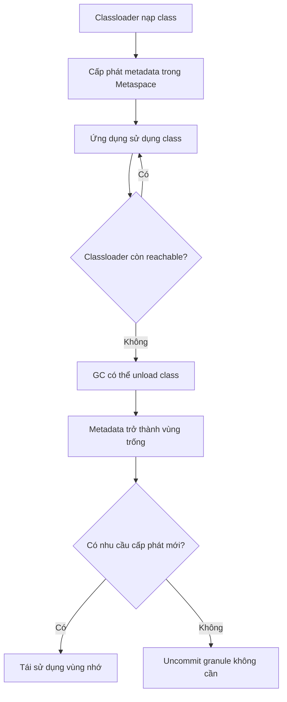

# Đánh đổi giữa tốc độ thu hồi và chi phí quản lý bộ nhớ

Elastic Metaspace là thay đổi trong HotSpot JVM được đưa vào Java 16 qua JEP 387. Mục tiêu là quản lý vùng nhớ chứa metadata của class linh hoạt hơn, giảm phân mảnh và trả lại các vùng đã commit nhưng không còn cần dùng cho hệ điều hành. Cơ chế này vẫn có ý nghĩa trên các bản HotSpot JDK hiện đại.

Thu hồi bộ nhớ nhanh hơn luôn có chi phí quản lý. Nếu JVM liên tục uncommit vùng nhớ ngay khi tạm thời không dùng rồi lại commit khi nạp class mới, ứng dụng có thể phải trả thêm chi phí bookkeeping, thao tác với hệ điều hành và xử lý page fault. JVM cần cân bằng giữa việc giữ vùng nhớ sẵn sàng để tái sử dụng và trả vùng nhớ không cần thiết về hệ điều hành.

Bài học tập trung vào sự khác nhau giữa metadata đã dùng, vùng nhớ đã commit và vùng địa chỉ đã reserve; vòng đời classloader; cách Elastic Metaspace tái sử dụng hoặc uncommit bộ nhớ; và cách quan sát hành vi thực tế trước khi điều chỉnh cấu hình.

## 1. Metaspace lưu trữ điều gì?

Metaspace là vùng native memory của HotSpot dùng để lưu metadata liên quan đến class đã được nạp. Metadata gồm thông tin phục vụ JVM hiểu và thực thi class, chẳng hạn cấu trúc class, method metadata, runtime constant pool và thông tin liên quan đến kiểu dữ liệu.

Metaspace không phải Java heap:

- Java heap chủ yếu chứa object và array được tạo trong ứng dụng.
- Metaspace chứa class metadata do JVM quản lý.
- Bộ nhớ Metaspace được cấp phát từ native memory của tiến trình, không nằm trong giới hạn `-Xmx` theo cùng cách với heap.
- Đối tượng `java.lang.Class` mà ứng dụng nhìn thấy là object trên heap; metadata nền tảng của class được lưu trong vùng quản lý class metadata của JVM.

Vì vậy, tăng heap không trực tiếp làm tăng giới hạn Metaspace. Nếu ứng dụng nạp rất nhiều class hoặc giữ lại nhiều classloader, native memory dùng cho Metaspace có thể tăng dù heap vẫn còn nhiều chỗ.

Metaspace được quản lý theo vòng đời của classloader. Khi classloader không còn được tham chiếu và JVM có thể unload các class do nó định nghĩa, metadata tương ứng trở thành vùng có thể thu hồi hoặc tái sử dụng.

## 2. Vì sao Java 16 cải tiến Metaspace?

Trước Elastic Metaspace, HotSpot đã có cơ chế quản lý Metaspace nhưng có thể giữ lại lượng committed memory đáng kể sau khi class được unload. Việc quản lý các chunk và vùng nhớ tự do cũng có thể tạo ra phân mảnh hoặc chi phí quản lý.

JEP 387 đưa vào allocator mới dựa trên buddy allocation, cùng cách quản lý commit/uncommit linh hoạt hơn. Mục tiêu chính:

- Giảm mức tiêu thụ native memory khi metadata không còn cần thiết.
- Giảm phân mảnh trong quá trình cấp phát và thu hồi.
- Trả lại các granule không còn sử dụng cho hệ điều hành.
- Giúp việc cấp phát và thu hồi Metaspace thích ứng tốt hơn với workload.

Đây là thay đổi triển khai của HotSpot, không phải API Java mà ứng dụng cần gọi. Lập trình viên thường hưởng lợi mà không phải thay đổi mã nguồn. Các JVM khác có thể có cách quản lý metadata riêng.

## 3. Phân biệt used, committed và reserved

Khi đọc số liệu Metaspace, cần phân biệt ba khái niệm:

| Khái niệm | Ý nghĩa |
|---|---|
| Used | Phần bộ nhớ hiện đang chứa class metadata |
| Committed | Phần bộ nhớ JVM đã commit và có thể sử dụng; gồm vùng đang dùng và phần còn trống để cấp phát |
| Reserved | Không gian địa chỉ ảo JVM đã reserve; chưa nhất thiết được commit hoặc chiếm RAM vật lý |

Ví dụ minh họa:

```text
Reserved address space
+------------------------------------------------------+
|                                                      |
|   Committed memory                                   |
|   +----------------------------------------------+   |
|   | Used metadata          | Free committed      |   |
|   +----------------------------------------------+   |
|                                                      |
|   Reserved but uncommitted                           |
|                                                      |
+------------------------------------------------------+
```

Giả sử báo cáo cho thấy Used là 180 MB, Committed là 256 MB và Reserved là 1 GB. Metadata đang chiếm khoảng 180 MB trong vùng đã commit 256 MB; phần còn lại của vùng committed đang sẵn sàng cho cấp phát. JVM đã reserve một vùng địa chỉ lớn hơn, nhưng toàn bộ vùng reserve không tương đương với RAM đang sử dụng.

Các con số trên chỉ là ví dụ để giải thích khái niệm, không phải giá trị mặc định hoặc mục tiêu tối ưu.

Khi metadata được unload, Used có thể giảm trước. Committed có thể chưa giảm ngay vì JVM giữ các granule trống để tái sử dụng. Elastic Metaspace cải thiện khả năng uncommit phần committed không còn cần thiết. Reserved address space có thể vẫn được giữ lại dù backing memory đã được trả về hệ điều hành.

## 4. Vòng đời metadata và classloader

Mỗi class được định nghĩa bởi một classloader cụ thể. Hai class có cùng tên nhưng được định nghĩa bởi hai classloader khác nhau vẫn là hai kiểu khác nhau trong JVM.

Vòng đời khái quát:

1. Classloader nạp và định nghĩa class.
2. JVM cấp phát metadata trong Metaspace.
3. Ứng dụng tiếp tục sử dụng class và các instance của nó.
4. Khi classloader không còn reachable, các class do nó định nghĩa có thể đủ điều kiện unload.
5. Trong chu kỳ GC hỗ trợ class unloading, JVM thu hồi metadata tương ứng.
6. Vùng nhớ trống có thể được allocator tái sử dụng; granule không còn cần có thể được uncommit.



Classloader chỉ đủ điều kiện được thu gom khi không còn đường tham chiếu mạnh giữ nó sống. Các tham chiếu thường vô tình giữ classloader:

- Thread còn chạy code của plugin.
- Thread context classloader vẫn trỏ tới classloader cũ.
- `ThreadLocal` giữ object được tạo bởi classloader.
- Static registry hoặc cache toàn cục giữ class, instance hoặc reflection object.
- Listener, callback hoặc executor chưa được gỡ.
- Framework giữ metadata hoặc proxy class trong cache.

Nếu classloader còn reachable, JVM không thể unload các class của nó chỉ vì ứng dụng đã ngừng gọi plugin.

## 5. Unload class không đồng nghĩa uncommit bộ nhớ ngay lập tức

Có hai bước khác nhau:

**Bước 1 — Thu hồi metadata ở cấp JVM.** Khi class được unload, vùng metadata của nó trở thành vùng trống có thể được allocator quản lý lại. Đây là điều kiện để JVM tái sử dụng không gian cho class được nạp sau đó.

**Bước 2 — Trả committed memory về hệ điều hành.** Khi các granule không còn cần thiết, Elastic Metaspace có thể uncommit chúng. Điều này giúp giảm committed memory và có thể giảm resident memory của tiến trình.

Nếu JVM dự đoán sẽ sớm cần dùng lại vùng nhớ, giữ committed memory có thể tiết kiệm chi phí commit lại. Vì thế, Used giảm không bắt buộc kéo theo Committed giảm cùng lúc hoặc theo đúng tỷ lệ.

Uncommit cũng khác với việc giải phóng toàn bộ vùng địa chỉ ảo đã reserve. JVM có thể tiếp tục giữ vùng address space để phục vụ lần cấp phát tiếp theo.

## 6. Buddy allocation, chunk và granule

Elastic Metaspace sử dụng allocator dựa trên buddy allocation để quản lý các vùng nhớ có kích thước theo cấp bậc. Cách tổ chức này cho phép các block trống phù hợp được ghép lại khi điều kiện đáp ứng, giảm một số dạng phân mảnh và hỗ trợ cấp phát linh hoạt.

Trong quản lý Metaspace, cần phân biệt:

- **Chunk:** đơn vị vùng nhớ allocator cung cấp cho classloader hoặc arena để phục vụ các lần cấp phát metadata.
- **Granule:** đơn vị commit/uncommit của vùng nhớ. Một vùng chunk có thể liên quan đến một hoặc nhiều granule tùy cách bố trí.
- **Commit:** cấp backing memory cho vùng địa chỉ đã reserve để JVM sử dụng.
- **Uncommit:** trả backing memory của vùng không còn cần cho hệ điều hành, trong khi vùng địa chỉ ảo có thể vẫn được reserve.

Sơ đồ khái niệm:

```text
Reserved Metaspace
+------------------------------------------------------+
| Chunk A                   | Chunk B                  |
| +-----------+-----------+ | +-----------+-----------+|
| | Granule 1 | Granule 2 | | | Granule 3 | Granule 4 ||
| +-----------+-----------+ | +-----------+-----------+|
+------------------------------------------------------+

Sau khi metadata được unload:
+------------------------------------------------------+
| Chunk A                   | Chunk B                  |
| +-----------+-----------+ | +-----------+-----------+|
| | Đang dùng | Trống     | | | Trống     | Đang dùng ||
| +-----------+-----------+ | +-----------+-----------+|
+------------------------------------------------------+

Granule trống và không còn cần thiết có thể được uncommit.
```

Sơ đồ chỉ minh họa quan hệ giữa chunk và granule, không phải layout bộ nhớ chính xác của mọi tiến trình. Kích thước, phân loại chunk và cách gộp vùng phụ thuộc triển khai HotSpot.

## 7. Vì sao có đánh đổi giữa thu hồi nhanh và chi phí quản lý?

Khi JVM uncommit vùng nhớ, nó giảm lượng committed memory đang giữ. Nhưng nếu ứng dụng sớm nạp class mới, JVM phải commit lại vùng nhớ trước khi sử dụng.

Việc commit/uncommit có thể kéo theo:

- Công việc bookkeeping để theo dõi granule và trạng thái vùng nhớ.
- Thao tác quản lý bộ nhớ với hệ điều hành.
- Chi phí cấp phát hoặc commit lại khi workload tăng trở lại.
- Page fault khi ứng dụng truy cập vùng nhớ vừa được commit nhưng chưa có trang vật lý sẵn trong trạng thái cần thiết.
- Độ trễ bổ sung trong giai đoạn nạp class hoặc tạo classloader mới.

Ngược lại, giữ lại vùng committed trống có thể làm số liệu native memory cao hơn nhưng cho phép tái sử dụng nhanh khi workload quay lại. Đây là sự cân bằng giữa footprint bộ nhớ và chi phí cấp phát trong tương lai.

| Chính sách hành vi | Lợi ích | Chi phí |
|---|---|---|
| Giữ nhiều vùng trống đã commit | Tái sử dụng nhanh khi nạp class mới | Giữ committed memory cao hơn khi ứng dụng nhàn rỗi |
| Uncommit vùng trống sớm | Giảm committed memory, có thể giảm RSS | Có thể phải commit lại khi workload tăng |
| Quản lý granule nhỏ hơn | Có cơ hội thu hồi các vùng nhỏ, giảm phần trống bị giữ lại | Có thể tăng số lượng đơn vị cần theo dõi và công việc quản lý |
| Quản lý vùng lớn hơn | Ít đơn vị quản lý hơn, thuận tiện cho cấp phát lớn | Có thể giữ lại nhiều khoảng trống chưa dùng hết |

Các dòng trong bảng là nguyên tắc đánh đổi chung của quản lý bộ nhớ. Không nên suy ra rằng người dùng có thể tùy ý chọn kích thước granule bằng một cờ JVM công khai.

## 8. Workload nào hưởng lợi rõ hơn?

Elastic Metaspace đặc biệt hữu ích khi số lượng class thay đổi đáng kể trong vòng đời ứng dụng.

Ví dụ:

- Application server triển khai và gỡ nhiều ứng dụng.
- Hệ thống plugin nạp và dỡ module theo yêu cầu.
- IDE hoặc công cụ build tạo nhiều classloader trong các tác vụ riêng.
- Test runner tạo classloader mới cho từng nhóm test.
- Ứng dụng dùng framework sinh proxy hoặc class động.
- Dịch vụ chạy lâu nhưng có chu kỳ reload cấu hình hoặc thành phần mở rộng.

Trong các hệ thống này, metadata có thể tăng khi nạp module, sau đó một phần được thu hồi khi classloader không còn cần thiết. Elastic Metaspace giúp phần committed không còn dùng được trả lại linh hoạt hơn.

Ứng dụng có tập class gần như cố định từ lúc khởi động thường ít thấy lợi ích từ việc thu hồi liên tục. Với workload đó, giữ một phần memory committed để tái sử dụng có thể hợp lý.

## 9. Ví dụ vòng đời plugin và classloader

Giả sử ứng dụng có chức năng nạp plugin từ JAR. Mỗi plugin được nạp bằng một `URLClassLoader` riêng:

```java
import java.net.URL;
import java.net.URLClassLoader;
import java.nio.file.Path;

public class PluginLoaderExample {
    public static void loadPlugin(Path pluginJar) throws Exception {
        URL[] urls = { pluginJar.toUri().toURL() };

        try (URLClassLoader loader = new URLClassLoader(
                urls,
                PluginLoaderExample.class.getClassLoader())) {

            Class<?> pluginType =
                    loader.loadClass("com.example.plugin.PluginEntry");

            Object plugin = pluginType
                    .getDeclaredConstructor()
                    .newInstance();

            // Gọi plugin và giải phóng mọi tham chiếu sau khi hoàn tất.
            System.out.println(plugin.getClass().getName());
        }
    }
}
```

`URLClassLoader.close()` đóng các tài nguyên JAR mà loader đang quản lý. Nó không trực tiếp unload class và không bảo đảm metadata được thu hồi ngay sau khi đóng.

Để classloader đủ điều kiện unload, ứng dụng cần:

- Dừng thread do plugin tạo và chờ chúng kết thúc.
- Gỡ listener và callback đã đăng ký.
- Xóa object plugin khỏi registry hoặc cache toàn cục.
- Xóa `ThreadLocal` liên quan.
- Khôi phục thread context classloader nếu đã thay đổi.
- Không giữ `Class`, `Method`, `Field`, instance hoặc object proxy của plugin trong thành phần sống lâu hơn.

Sau khi không còn tham chiếu, classloader đủ điều kiện được GC thu gom. Thời điểm unload không được bảo đảm ngay lập tức; JVM thực hiện theo chu kỳ GC và chính sách class unloading của collector.

## 10. Class unloading và Metaspace có thể quan sát độc lập

Khi điều tra, đừng chỉ nhìn một con số tổng. Nên theo dõi:

- Số lượng class đã nạp và đã unload.
- Số classloader đang tồn tại.
- Metaspace Used.
- Metaspace Committed.
- Compressed Class Space nếu báo cáo JVM tách riêng vùng này.
- Native memory tổng thể của tiến trình.

Nếu số classloader liên tục tăng sau mỗi lần reload, đó có thể là dấu hiệu classloader cũ vẫn được giữ tham chiếu. Nếu classloader được unload nhưng committed memory không giảm tương ứng, JVM có thể đang giữ vùng trống để tái sử dụng; điều đó không tự động có nghĩa là rò rỉ.

Một dấu hiệu đáng quan tâm hơn là Used hoặc số classloader tăng liên tục qua các chu kỳ workload tương đương, trong khi các classloader lẽ ra đã kết thúc vẫn tồn tại.

## 11. Chẩn đoán bằng jcmd

`jcmd` là công cụ đi kèm JDK để gửi diagnostic command tới JVM đang chạy. Một số lệnh hữu ích:

```bash
jcmd <pid> VM.metaspace
```

Hiển thị thống kê Metaspace của tiến trình. Có thể dùng để xem mức sử dụng, vùng committed và các thông tin phân bổ mà HotSpot cung cấp.

```bash
jcmd <pid> VM.classloader_stats
```

Hiển thị thống kê theo classloader, hữu ích khi ứng dụng có plugin, module reload hoặc nhiều loader được tạo động.

```bash
jcmd <pid> VM.native_memory summary
```

Hiển thị tổng quan native memory nếu Native Memory Tracking đã được bật khi JVM khởi động. Ví dụ bật ở mức summary:

```bash
java -XX:NativeMemoryTracking=summary -jar application.jar
```

Native Memory Tracking có chi phí runtime và bộ nhớ quản lý riêng. Chỉ bật theo nhu cầu quan sát, đặc biệt khi đo hiệu năng production; cần đánh giá overhead trong môi trường thực tế.

Có thể kiểm tra các diagnostic command mà JVM cụ thể hỗ trợ:

```bash
jcmd <pid> help
```

Thay `<pid>` bằng process ID thực tế. Một số command có thể yêu cầu cùng user hoặc quyền truy cập phù hợp với tiến trình đích.

## 12. Quan sát sự kiện class unloading

Unified Logging có thể ghi nhận class unloading. Ví dụ:

```bash
java -Xlog:class+unload=info -jar application.jar
```

Khi class được unload, log có thể giúp xác định thời điểm và lớp liên quan. Kết hợp log này với `VM.classloader_stats` và `VM.metaspace` để xem:

- Classloader nào đã biến mất.
- Class nào được unload sau chu kỳ reload plugin.
- Used giảm có trùng với sự kiện unload hay không.
- Committed memory có giảm sau khi các granule không còn cần hay không.

Log class unloading chỉ là một nguồn dữ liệu. Nếu classloader không được unload, hãy tìm đường tham chiếu đang giữ nó sống thay vì chỉ cố ép JVM thu hồi Metaspace.

## 13. Cách đọc tình huống thực tế

### Tình huống A: Used giảm, Committed gần như không đổi

Điều này có thể hoàn toàn bình thường. Metadata đã được unload và phần vùng nhớ trống được giữ committed để tái sử dụng cho class mới. Quan sát thêm qua nhiều chu kỳ và xem Committed có được uncommit khi workload nhàn rỗi hay không.

### Tình huống B: Used và số classloader đều tăng sau mỗi lần reload

Có thể classloader cũ vẫn còn reachable hoặc ứng dụng liên tục nạp thêm class mới. Kiểm tra thread, ThreadLocal, static cache, listener và context classloader.

### Tình huống C: Used giảm, Committed giảm, Reserved gần như giữ nguyên

Đây là trạng thái có thể gặp khi JVM uncommit vùng backing memory nhưng vẫn giữ address space đã reserve để dùng lại. Reserved không đồng nghĩa RAM đang sử dụng.

### Tình huống D: Metaspace tăng trong khi heap còn trống

Đây là hai vùng quản lý khác nhau. Heap còn trống không loại trừ khả năng Metaspace tiến gần giới hạn. Kiểm tra số class, classloader và native memory thay vì chỉ tăng `-Xmx`.

### Tình huống E: Nạp class mới chậm sau giai đoạn nhàn rỗi

Một phần vùng nhớ có thể đã bị uncommit và cần commit lại khi workload tăng. Cần đo thời gian nạp class và mức thay đổi native memory trong cùng workload trước khi kết luận đây là nút thắt do Elastic Metaspace.

## 14. Điều chỉnh cấu hình cần dựa trên số liệu

`MaxMetaspaceSize` là giới hạn cho Metaspace. Đặt giới hạn quá thấp có thể khiến JVM gặp `OutOfMemoryError: Metaspace` khi ứng dụng cần nạp thêm class. Tăng giới hạn cũng không xử lý được classloader leak.

Không đặt một giới hạn thấp chỉ để làm giảm số liệu native memory. Hãy xác định nhu cầu thực tế từ:

- Số class được nạp trong workload bình thường và đỉnh tải.
- Số classloader tồn tại đồng thời.
- Metaspace Used/Committed qua nhiều chu kỳ.
- Tần suất reload plugin hoặc triển khai ứng dụng.
- Native memory và RSS của tiến trình.
- Biến động thời gian khởi tạo, nạp class và latency.

Thay đổi cấu hình phải được kiểm tra bằng workload đại diện và theo dõi cả hiệu năng lẫn footprint bộ nhớ. Không dựa vào một snapshot sau khi khởi động để chọn giới hạn.

Elastic Metaspace tự quản lý việc commit/uncommit theo cơ chế của HotSpot. Ứng dụng thông thường không cần điều khiển trực tiếp granule hoặc allocator nội bộ.

## 15. Phân biệt OOM Metaspace và rò rỉ classloader

Thông báo `OutOfMemoryError: Metaspace` cho biết JVM không thể đáp ứng yêu cầu cấp phát metadata trong giới hạn hoặc điều kiện hiện tại. Nó không tự chứng minh rằng Elastic Metaspace bị lỗi.

Các nguyên nhân có thể gồm:

- Ứng dụng thực sự nạp quá nhiều class.
- Framework sinh class động liên tục.
- Classloader cũ không được thu gom vì còn tham chiếu.
- `MaxMetaspaceSize` được đặt thấp hơn nhu cầu.
- Workload hoặc cấu hình đã thay đổi khiến số class tăng.

Classloader leak là vấn đề vòng đời tham chiếu. Uncommit memory chỉ xử lý các vùng đã trở thành trống; nó không thể giải phóng metadata của class vẫn được một classloader reachable sở hữu.

Do đó, khi gặp lỗi, kiểm tra classloader và class unloading trước khi kết luận cần tăng giới hạn hoặc thay đổi chiến lược quản lý bộ nhớ.

## 16. Những lỗi thường gặp

**Đồng nhất Metaspace Used với Committed.** Used là phần đang chứa metadata; committed còn bao gồm vùng trống đã cấp cho JVM.

**Đồng nhất Reserved với RAM.** Reserved là không gian địa chỉ ảo, không có nghĩa toàn bộ vùng đó đang chiếm bộ nhớ vật lý.

**Cho rằng unload class sẽ trả memory về OS ngay lập tức.** Metadata có thể được tái sử dụng trong vùng committed; uncommit là bước quản lý tiếp theo.

**Cho rằng URLClassLoader.close() unload class.** Close đóng tài nguyên loader quản lý, còn việc unload cần classloader không còn reachable và GC thực hiện class unloading.

**Gọi System.gc() để ép thu hồi Metaspace.** Lời gọi này không bảo đảm classloader cụ thể sẽ được thu gom hoặc metadata được uncommit ngay. Hãy sửa vòng đời tham chiếu và quan sát GC thực tế.

**Tăng -Xmx khi gặp OutOfMemoryError: Metaspace.** Heap và Metaspace là các vùng khác nhau. Hãy kiểm tra giới hạn Metaspace, số class và classloader.

**Giảm MaxMetaspaceSize để ép JVM thu hồi sớm.** Giới hạn thấp có thể biến workload hợp lệ thành lỗi cấp phát; nó không sửa classloader leak.

**Kết luận rò rỉ chỉ vì Committed không giảm.** JVM có thể giữ vùng trống để tái sử dụng. Theo dõi Used, classloader và số liệu qua nhiều chu kỳ.

**Chỉ nhìn số liệu heap.** Class metadata nằm trong native memory. Cần quan sát Metaspace và native memory riêng.

## 17. Ghi nhớ

- Elastic Metaspace được đưa vào HotSpot trong Java 16 qua JEP 387.
- Metaspace chứa class metadata trong native memory, khác với Java heap.
- Used, Committed và Reserved là ba số liệu có ý nghĩa khác nhau.
- Classloader không còn reachable là điều kiện quan trọng để các class do nó định nghĩa có thể unload.
- Unload metadata, tái sử dụng vùng trống và uncommit backing memory là các bước khác nhau.
- Buddy allocation và quản lý granule giúp HotSpot giảm phân mảnh, quản lý commit/uncommit linh hoạt hơn.
- Giữ committed memory giúp tái sử dụng nhanh; uncommit sớm giúp giảm footprint nhưng có thể tăng chi phí commit lại.
- Workload có nhiều classloader và class động thường hưởng lợi rõ hơn.
- `URLClassLoader.close()` không bảo đảm class được unload.
- Dùng `jcmd VM.metaspace`, `VM.classloader_stats`, Native Memory Tracking và Unified Logging để điều tra.
- Không kết luận leak từ một snapshot Committed hoặc Reserved.
- Không dùng giới hạn Metaspace thấp để che giấu classloader leak.

Elastic Metaspace cân bằng giữa việc giữ vùng nhớ sẵn sàng tái sử dụng và trả lại vùng không còn cần thiết cho hệ điều hành. Khi phân tích hiệu năng, hãy theo dõi vòng đời classloader cùng Used, Committed và Reserved qua nhiều chu kỳ tải; chỉ điều chỉnh cấu hình sau khi đã xác định rõ chi phí nằm ở cấp phát, unload hay giữ lại native memory.

## Tài liệu tham khảo

- [JEP 387 – Elastic Metaspace](https://openjdk.org/jeps/387) — mục tiêu, allocator và cơ chế quản lý bộ nhớ được đưa vào HotSpot trong Java 16.
- [The jcmd Command – Java SE 16](https://docs.oracle.com/en/java/javase/16/docs/specs/man/jcmd.html) — diagnostic command gửi tới JVM đang chạy.
- [Native Memory Tracking – Java SE 16](https://docs.oracle.com/en/java/javase/16/vm/native-memory-tracking.html) — theo dõi native memory của HotSpot và cách bật NMT.
- [The java Command – Java SE 16](https://docs.oracle.com/en/java/javase/16/docs/specs/man/java.html) — cú pháp `-Xlog` và các tùy chọn JVM.

