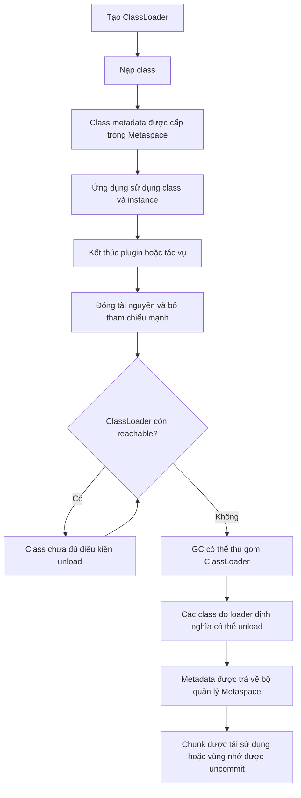

# Kiểm thử tạo, bỏ tham chiếu class loader và quan sát xu hướng metaspace

> **Chương:** Elastic Metaspace  
> **Học phần:** `JAVA_VERSION_JAVA16` — tìm hiểu thay đổi JVM từ Java 16 vẫn có ý nghĩa trong Java hiện đại. Bài này kết hợp vòng đời class loader, khả năng unload class và công cụ quan sát Metaspace để kiểm tra ứng dụng có giải phóng metadata sau khi kết thúc plugin hoặc tác vụ nạp lớp động hay không.

## Mục tiêu học tập

Sau bài này, bạn có thể:

- Giải thích Metaspace lưu trữ class metadata và khác Java heap như thế nào.
- Mô tả đóng góp của JEP 387 (Elastic Metaspace) trong Java 16.
- Hiểu vì sao vòng đời class loader ảnh hưởng đến khả năng thu hồi metadata.
- Phân biệt đóng `URLClassLoader` với việc class loader đủ điều kiện được unload.
- Viết probe tạo nhiều class loader, nạp class rồi bỏ tham chiếu.
- Dùng `WeakReference` và `ReferenceQueue` để quan sát class loader có được thu gom hay không.
- Theo dõi `Metaspace` và `Compressed Class Space` qua JMX.
- Dùng `jcmd VM.metaspace`, `VM.classloader_stats` và Native Memory Tracking để so sánh trước/sau.
- Phân biệt xu hướng tăng metadata với việc bộ cấp phát giữ lại vùng nhớ để tái sử dụng.
- Nhận diện các nguồn tham chiếu khiến class loader không thể được thu gom.

## 1. Metaspace là gì?

Metaspace là vùng native memory mà HotSpot dùng để quản lý metadata của class. Khi JVM nạp class, nó tạo metadata cần cho việc biểu diễn và thực thi class, ví dụ thông tin về kiểu, method, constant pool và cấu trúc liên quan.

Metaspace khác Java heap:

| Khu vực | Lưu trữ | Ví dụ vấn đề |
| --- | --- | --- |
| Java heap | Object và array của ứng dụng | Giữ object không còn cần thiết, tạo heap leak |
| Metaspace | Metadata của class do class loader nạp | Tạo class liên tục hoặc giữ class loader quá lâu |
| Compressed Class Space | Một phần metadata dành cho class pointer khi compressed class pointers được bật trên HotSpot | Vượt giới hạn vùng class space |

Một ứng dụng có thể dùng heap ổn định nhưng Metaspace vẫn tăng nếu liên tục tạo class loader và nạp class mới mà các loader cũ không được giải phóng.

Ví dụ thường gặp:

- Server triển khai nhiều phiên bản plugin.
- Framework tạo proxy hoặc class sinh động.
- Ứng dụng chạy nhiều lần cơ chế hot reload.
- Container hoặc application server tạo class loader riêng cho từng ứng dụng.
- Thư viện tạo class cho biểu thức, serializer, mapper hoặc dependency injection.

Không phải mọi lần nạp class đều là leak. Class metadata cần tồn tại trong khi class và class loader còn được sử dụng. Vấn đề xuất hiện khi vòng đời của loader dài hơn nhu cầu thực tế.

## 2. JEP 387 thay đổi cách quản lý Metaspace

JEP 387 — Elastic Metaspace được đưa vào Java 16. Mục tiêu là giảm lãng phí bộ nhớ và trả lại các vùng Metaspace không còn cần thiết cho hệ điều hành sau khi class metadata được giải phóng.

Ở mức khái niệm, thay đổi tập trung vào:

- Quản lý vùng nhớ theo các chunk có kích thước khác nhau.
- Chia vùng nhớ thành các commit granule để có thể commit khi cần và uncommit phần không còn cần.
- Tái sử dụng chunk trống giữa các class loader.
- Hợp nhất các chunk trống phù hợp để giảm phân mảnh.
- Cho phép trả lại phần bộ nhớ đã commit nhưng không còn sử dụng cho hệ điều hành.

Trước đây, việc thu hồi và trả lại vùng nhớ có thể kém linh hoạt hơn. Elastic Metaspace cải thiện khả năng co giãn: khi class loader được unload và các chunk của nó trở nên trống, JVM có thể tái sử dụng chúng hoặc uncommit vùng thích hợp.

Điểm cần hiểu đúng: JEP 387 cải thiện bộ cấp phát Metaspace. Nó không tự phát hiện và sửa class loader leak trong ứng dụng. Nếu ứng dụng vẫn giữ tham chiếu mạnh đến loader, metadata vẫn còn sống và JVM không thể thu hồi chúng.

## 3. Vòng đời class loader quyết định khả năng thu hồi metadata

Metadata của class gắn với class loader đã định nghĩa class đó. Khi một class loader không còn reachable từ các GC root, nó có thể trở thành đối tượng đủ điều kiện được garbage collector thu gom. Các class do loader đó định nghĩa sau đó có thể được unload và metadata của chúng được giải phóng.

Có thể hình dung:



Có ba bước khác nhau:

1. **Đóng tài nguyên:** ví dụ gọi `URLClassLoader.close()` để đóng các JAR/file handle mà loader đã mở.
2. **Bỏ tham chiếu mạnh:** xóa mọi đường tham chiếu từ ứng dụng đến loader, class, instance và các đối tượng liên quan.
3. **GC và class unloading:** JVM phát hiện loader không còn reachable, thu gom nó và có thể unload các class đã được loader định nghĩa.

`close()` không tự unload class. Nó giải phóng tài nguyên I/O của loader; nếu ứng dụng vẫn giữ tham chiếu đến loader hoặc class của nó, metadata vẫn có thể còn tồn tại.

## 4. Những tham chiếu thường giữ class loader sống

Khi kiểm tra Metaspace tăng liên tục, cần tìm các đường tham chiếu mạnh giữ class loader. Các trường hợp phổ biến:

| Nguồn tham chiếu | Ví dụ | Cách xử lý |
| --- | --- | --- |
| Static cache | Map static giữ `Class`, `Method`, instance hoặc object plugin | Xóa entry khi plugin dừng; tránh cache không có chính sách eviction |
| Thread context class loader | Thread pool giữ context loader của plugin | Khôi phục context loader trước khi trả thread về pool |
| Thread sống lâu | Thread do plugin tạo vẫn chạy sau khi plugin dừng | Dừng thread và chờ kết thúc |
| ThreadLocal | Giá trị hoặc key liên quan class của plugin nằm trên thread dùng chung | Gọi `remove()` trong vòng đời phù hợp |
| Listener đăng ký toàn cục | Event bus hoặc registry giữ callback của plugin | Hủy đăng ký listener khi unload |
| Reflection cache | Framework giữ `Class`, `Field`, `Method` hoặc lookup object | Xóa cache hoặc dùng cơ chế cache không giữ loader ngoài ý muốn |
| Service/provider registry | Registry giữ provider instance hoặc provider class | Hủy đăng ký và giải phóng registry theo vòng đời |
| Instance còn sống | Object được tạo từ class của plugin còn nằm trong session/cache | Kết thúc session và xóa reference |

Một ví dụ rất dễ bỏ sót là thread pool dùng chung. Nếu plugin đặt thread context class loader thành loader của nó rồi trả thread về pool mà không khôi phục giá trị cũ, thread vẫn có thể giữ loader sống rất lâu.

Không chỉ tìm biến `ClassLoader` trực tiếp. Một object `Class<?>`, instance của class do loader định nghĩa, `Method`, callback hoặc một object trong cache cũng có thể dẫn đến loader.

## 5. Tạo class loader thử nghiệm và nạp class

Để quan sát vòng đời loader, ta cần một class có thể được nạp riêng bởi nhiều class loader. Ví dụ sau đặt hai lớp trong cùng file nguồn; `ReloadableFixture` là class fixture được nạp lại bằng từng `URLClassLoader`.

```java
package demo;

import java.io.InputStream;
import java.lang.management.ManagementFactory;
import java.lang.management.MemoryPoolMXBean;
import java.lang.management.MemoryUsage;
import java.lang.ref.ReferenceQueue;
import java.lang.ref.WeakReference;
import java.net.URL;
import java.net.URLClassLoader;
import java.nio.file.Files;
import java.nio.file.Path;
import java.util.ArrayList;
import java.util.List;
import java.util.Locale;

public class MetaspaceLoaderProbe {

    public static void main(String[] args) throws Exception {
        String className = ReloadableFixture.class.getName();
        Path classesDir = copyFixtureToTemporaryDirectory(className);
        URL classesUrl = classesDir.toUri().toURL();

        try {
            ReferenceQueue<ClassLoader> queue = new ReferenceQueue<>();
            List<WeakReference<ClassLoader>> references = new ArrayList<>();

            printMetaspace("Before loading");

            for (int i = 0; i < 500; i++) {
                references.add(loadAndClose(classesUrl, className, queue));
            }

            printMetaspace("After creating 500 class loaders");

            int collected = awaitSomeLoadersToBeCollected(
                    references.size(),
                    queue
            );

            System.out.printf(
                    Locale.ROOT,
                    "Collected class loaders: %d / %d%n",
                    collected,
                    references.size()
            );

            printMetaspace("After collection attempts");
        } finally {
            Path classFile = classesDir.resolve(
                    className.replace('.', '/') + ".class"
            );
            Files.deleteIfExists(classFile);
            Files.deleteIfExists(classFile.getParent());
            Files.deleteIfExists(classesDir);
        }
    }

    private static Path copyFixtureToTemporaryDirectory(
            String className
    ) throws Exception {

        Path root = Files.createTempDirectory("metaspace-probe-");
        String resourceName = "/" + className.replace('.', '/') + ".class";
        Path classFile = root.resolve(resourceName.substring(1));

        Files.createDirectories(classFile.getParent());

        try (InputStream input =
                     MetaspaceLoaderProbe.class.getResourceAsStream(
                             resourceName
                     )) {

            if (input == null) {
                throw new IllegalStateException(
                        "Cannot find class resource: " + resourceName
                );
            }

            Files.copy(input, classFile);
        }

        return root;
    }

    private static WeakReference<ClassLoader> loadAndClose(
            URL classesUrl,
            String className,
            ReferenceQueue<ClassLoader> queue
    ) throws Exception {

        URLClassLoader loader =
                new URLClassLoader(new URL[]{classesUrl}, null);

        try {
            Class<?> loadedClass =
                    Class.forName(className, true, loader);

            if (loadedClass.getClassLoader() != loader) {
                throw new IllegalStateException(
                        "Fixture was not defined by the child loader"
                );
            }

            return new WeakReference<>(loader, queue);
        } finally {
            loader.close();
        }
    }

    private static int awaitSomeLoadersToBeCollected(
            int expected,
            ReferenceQueue<ClassLoader> queue
    ) throws InterruptedException {

        int collected = 0;

        for (int round = 0; round < 10 && collected < expected; round++) {
            // System.gc() chỉ là yêu cầu; JVM không bảo đảm phải chạy GC.
            System.gc();
            Thread.sleep(100);

            while (queue.poll() != null) {
                collected++;
            }
        }

        return collected;
    }

    private static void printMetaspace(String label) {
        System.out.println("--- " + label + " ---");

        for (MemoryPoolMXBean pool :
                ManagementFactory.getMemoryPoolMXBeans()) {

            String name = pool.getName().toLowerCase(Locale.ROOT);

            if (name.contains("metaspace")
                    || name.contains("compressed class space")) {

                MemoryUsage usage = pool.getUsage();

                if (usage != null) {
                    System.out.printf(
                            Locale.ROOT,
                            "%s: used=%s, committed=%s, max=%s%n",
                            pool.getName(),
                            toMiB(usage.getUsed()),
                            toMiB(usage.getCommitted()),
                            toMiB(usage.getMax())
                    );
                }
            }
        }
    }

    private static String toMiB(long bytes) {
        if (bytes < 0) {
            return "not reported";
        }

        return String.format(
                Locale.ROOT,
                "%.2f MiB",
                bytes / (1024.0 * 1024.0)
        );
    }
}

class ReloadableFixture {

    public String value() {
        return "loaded by an isolated class loader";
    }
}
```

Ví dụ có các điểm đáng chú ý:

- Mỗi lần gọi `loadAndClose` tạo một `URLClassLoader` mới.
- Parent loader là `null`, vì fixture chỉ phụ thuộc các kiểu trong `java.base`; loader con sẽ tự định nghĩa class fixture thay vì lấy class từ application loader.
- `WeakReference` theo dõi loader mà không giữ loader sống.
- `ReferenceQueue` nhận thông báo khi weak reference được clear và enqueue.
- `URLClassLoader.close()` đóng tài nguyên file/JAR.
- Biến `loadedClass` chỉ tồn tại trong method; sau khi method trả về, probe không còn giữ tham chiếu mạnh đến đối tượng `Class` này.

Đặt file nguồn là `src/demo/MetaspaceLoaderProbe.java` trong package `demo`. Hai class top-level trong cùng file được compiler tạo thành hai file class riêng. Biên dịch và chạy ví dụ bằng:

```bash
mkdir -p build/classes
javac -d build/classes src/demo/MetaspaceLoaderProbe.java
java -cp build/classes demo.MetaspaceLoaderProbe
```

Class fixture được copy vào thư mục tạm để các loader con có thể nạp độc lập. Trong ứng dụng modular, module chứa probe cần khai báo `requires java.management;` để sử dụng JMX management API.

Đây là probe quan sát, không phải bài kiểm thử xác định thời điểm GC. Số loader được enqueue có thể khác nhau theo collector, tải JVM và thời điểm GC. Không dùng kết quả `0/500` trong một cửa sổ ngắn làm bằng chứng chắc chắn rằng có leak.

## 6. Đọc kết quả probe đúng cách

Probe in ra số class loader được `ReferenceQueue` ghi nhận và mức sử dụng các memory pool trước/sau.

Cần phân biệt:

- Loader được enqueue cho biết weak reference đã bị clear, tức loader không còn reachable theo cơ chế reference processing.
- Log class unloading cho biết JVM thực sự ghi nhận class được unload.
- Metaspace `used` phản ánh metadata đang dùng.
- `committed` là lượng vùng nhớ đã commit để JVM sử dụng.
- `max` là giới hạn nếu pool báo cáo được; giá trị âm có nghĩa không có giới hạn được báo cáo.
- `reserved` là vùng địa chỉ ảo đã reserve, không đồng nghĩa với RAM đang dùng.

Class loader có thể được thu gom nhưng `committed` không giảm ngay theo cùng tỷ lệ. Bộ cấp phát có thể giữ chunk trống để tái sử dụng cho lần nạp class sau. Elastic Metaspace cải thiện khả năng uncommit vùng trống, nhưng việc uncommit phụ thuộc cấu trúc chunk, granule và trạng thái allocator.

RSS của process cũng không nhất thiết giảm đúng bằng thay đổi của `used` hoặc `committed`. Các vùng native khác, page accounting của OS và thời điểm đo có thể ảnh hưởng.

## 7. Theo dõi Metaspace bằng MemoryPoolMXBean

JMX cung cấp `MemoryPoolMXBean` để đọc usage của các memory pool. Trên HotSpot, tên pool thường có `Metaspace` và `Compressed Class Space`; tên cụ thể có thể khác theo JVM implementation.

Đoạn code ở probe dùng:

```java
ManagementFactory.getMemoryPoolMXBeans()
```

và đọc:

```java
MemoryUsage usage = pool.getUsage();

long used = usage.getUsed();
long committed = usage.getCommitted();
long max = usage.getMax();
```

Cách diễn giải:

| Giá trị | Ý nghĩa |
| --- | --- |
| `used` | Bộ nhớ đang được sử dụng trong pool |
| `committed` | Bộ nhớ đã commit và sẵn sàng cho JVM sử dụng |
| `max` | Giới hạn pool nếu JVM báo cáo |
| `getPeakUsage()` | Mức usage cao nhất từ khi JVM khởi động hoặc lần reset gần nhất |

Đừng giả định `max` luôn có giá trị dương. Một số pool không báo giới hạn. Cũng không giả định mọi JVM đều đặt tên pool giống HotSpot.

Đối với Metaspace, việc theo dõi xu hướng qua nhiều chu kỳ tải quan trọng hơn một mẫu đo đơn lẻ. Nếu `used` tăng liên tục sau khi workload kết thúc và class loader lẽ ra đã được giải phóng, hãy điều tra số class và loader còn sống.

## 8. Dùng jcmd để xem thống kê class loader và Metaspace

`jcmd` là công cụ chẩn đoán chính thức đi kèm JDK. Chạy lệnh trên cùng máy với JVM mục tiêu và bằng user/group có quyền phù hợp.

Liệt kê process Java:

```bash
jcmd -l
```

Xem thống kê class loader:

```bash
jcmd <pid> VM.classloader_stats
```

Lệnh này giúp quan sát số class, dung lượng chunk và thống kê theo class loader. Nếu workload tạo loader liên tục, hãy so sánh nhiều lần đo thay vì chỉ xem một snapshot.

Xem tổng quan Metaspace:

```bash
jcmd <pid> VM.metaspace basic=true scale=MB
```

Xem mức sử dụng theo loader:

```bash
jcmd <pid> VM.metaspace show-loaders=true scale=MB
```

Có thể yêu cầu thêm chi tiết class hoặc chunk khi cần:

```bash
jcmd <pid> VM.metaspace show-loaders=true show-classes=true scale=MB
```

Các tùy chọn cụ thể có thể thay đổi theo JDK. Dùng `jcmd <pid> help VM.metaspace` để xem cú pháp mà đúng JVM đang chạy hỗ trợ.

Không dùng riêng `GC.class_histogram` để kết luận Metaspace leak. Lệnh này thống kê object trong Java heap; nó không thay thế thống kê metadata và class loader. Dùng `VM.metaspace` và `VM.classloader_stats` cho câu hỏi về Metaspace.

## 9. So sánh Native Memory Tracking trước và sau workload

Native Memory Tracking (NMT) theo dõi các vùng native memory nội bộ của HotSpot. Để sử dụng, cần bật từ lúc JVM khởi động:

```bash
java -XX:NativeMemoryTracking=summary \
     -Xlog:class+unload=info \
     -cp build/classes \
     demo.MetaspaceLoaderProbe
```

Có thể dùng `detail` nếu cần thông tin theo call site, nhưng mức chi tiết cao hơn có chi phí theo dõi lớn hơn. NMT không theo dõi mọi allocation native do thư viện JNI hoặc native code bên ngoài JVM thực hiện.

Sau khi ứng dụng warm up, tạo baseline:

```bash
jcmd <pid> VM.native_memory baseline
```

Chạy workload tạo và kết thúc plugin/class loader, sau đó lấy chênh lệch:

```bash
jcmd <pid> VM.native_memory summary.diff
```

NMT hiển thị các nhóm native memory như `Class`, `Thread`, `Code`, `GC` và những nhóm khác. Trong nhóm `Class`, xem metadata và class space; đối chiếu với số class loader và class đang tồn tại.

NMT có overhead về CPU và bộ nhớ; tài liệu Oracle cảnh báo mức ảnh hưởng hiệu năng có thể vào khoảng 5–10%, tùy workload và mức theo dõi. Chỉ bật khi cần đo hoặc trong cấu hình giám sát đã đánh giá chi phí; không bật `detail` một cách mặc định cho mọi production workload.

Nếu nghi ngờ native library bên ngoài JVM, NMT không đủ. Cần đối chiếu thêm công cụ theo OS như Process Explorer/PerfMon trên Windows, `pmap` hoặc `/proc` trên Linux và công cụ memory map phù hợp trên macOS.

## 10. Bật log class load và class unload

Unified Logging có thể ghi nhận class được nạp và unload:

```bash
java \
  -Xlog:class+load=info,class+unload=info \
  -cp build/classes \
  demo.MetaspaceLoaderProbe
```

Trong log:

- `class+load` giúp xác định class nào được nạp và class loader liên quan.
- `class+unload` giúp xác nhận JVM đã unload class.
- So sánh log theo các chu kỳ tạo/dừng plugin để tìm loader hoặc class không được giải phóng như dự kiến.

Đây là cú pháp Unified Logging hiện hành. Tránh dùng các cờ tracing cũ như `-XX:+TraceClassLoading` hoặc `-XX:+TraceClassUnloading`; dùng `-Xlog` thay thế.

Log class loading có thể rất nhiều trên ứng dụng lớn. Hãy bật trong thời gian điều tra, chọn output file và mức log phù hợp, sau đó tắt khi không còn cần.

## 11. Phân biệt Metaspace leak với tăng trưởng bình thường

Một ứng dụng có thể nạp thêm class khi nhận tính năng hoặc plugin mới. Metaspace tăng trong giai đoạn đó là bình thường nếu workload tăng và class vẫn cần tồn tại.

Dấu hiệu đáng điều tra:

- Số class loader tăng qua từng chu kỳ triển khai plugin và không giảm sau khi dừng plugin.
- `VM.classloader_stats` liên tục xuất hiện loader cũ.
- `class+unload` không ghi nhận các class của plugin đã kết thúc trong thời gian quan sát hợp lý.
- `Metaspace used` tăng theo mỗi chu kỳ workload tương đương.
- Sau khi workload ổn định, live metadata tiếp tục tăng mà không có tính năng hoặc module mới tương ứng.
- Ứng dụng cuối cùng gặp `OutOfMemoryError: Metaspace` hoặc `OutOfMemoryError: Compressed class space`.

Không kết luận leak chỉ vì `committed` hoặc RSS chưa giảm ngay. Chunk trống có thể được giữ lại để tái sử dụng. Cần quan sát đồng thời số loader, số class, `used`, `committed`, class-unload log và workload.

## 12. Phân biệt Metaspace và Compressed Class Space

Trên HotSpot 64-bit khi compressed class pointers được bật, metadata được chia thành hai vùng logic:

- Metaspace cho phần metadata không thuộc compressed class space.
- Compressed Class Space cho các cấu trúc class pointer được biểu diễn bằng compressed class pointers.

Hai vùng này có liên quan nhưng không phải một pool duy nhất. Vì vậy, ứng dụng có thể gặp hai loại lỗi:

| Lỗi | Ý nghĩa |
| --- | --- |
| `OutOfMemoryError: Metaspace` | Vùng metadata Metaspace không thể đáp ứng thêm allocation |
| `OutOfMemoryError: Compressed class space` | Vùng dành cho compressed class metadata đã hết dung lượng |

Khi gặp lỗi, đọc đúng detail message và kiểm tra đúng pool. Không mặc định mọi lỗi class metadata đều được sửa bằng cách tăng `-Xmx`, vì heap và Metaspace là các vùng khác nhau.

`-XX:MaxMetaspaceSize` có thể đặt giới hạn cho tổng dung lượng metadata được commit theo cách HotSpot quy định. Tăng giới hạn chỉ có thể trì hoãn lỗi nếu nguyên nhân thực sự là thiếu giới hạn; nó không sửa tham chiếu giữ class loader sống. Không đặt giới hạn tùy tiện trước khi đo tải và xu hướng metadata.

## 13. Thiết kế vòng đời plugin để class loader có thể unload

Một kiến trúc plugin cần có API đóng hoặc stop rõ ràng. Khi dừng plugin, thực hiện các bước theo thứ tự:

1. Ngừng nhận công việc mới cho plugin.
2. Chờ hoặc hủy các tác vụ đang chạy theo chính sách.
3. Dừng thread do plugin sở hữu.
4. Hủy đăng ký listener, callback và provider.
5. Xóa cache giữ `Class`, `Method`, instance hoặc object plugin.
6. Khôi phục thread context class loader trên các thread dùng chung.
7. Xóa giá trị `ThreadLocal` liên quan.
8. Đóng `URLClassLoader` để giải phóng file handle.
9. Bỏ mọi tham chiếu mạnh đến loader và class của plugin.

Đừng lưu `ClassLoader` vào một registry toàn cục mà không có thao tác unregister. Cũng không giữ class hoặc instance plugin trong cache của host sau khi plugin dừng.

Một interface `Plugin` do host định nghĩa có thể cung cấp `stop()` hoặc `close()` để plugin tự giải phóng tài nguyên. Host vẫn phải quản lý các tham chiếu mà chính host đã tạo, vì gọi `close()` trên plugin không tự xóa cache bên ngoài plugin.

## 14. Quy trình kiểm thử có thể lặp lại

Để quan sát xu hướng thay vì phụ thuộc vào một lần GC:

1. Khởi động JVM với logging hoặc NMT phù hợp.
2. Đợi ứng dụng warm up và tạo baseline.
3. Ghi số class loader, số class, `Metaspace used/committed` và `Compressed Class Space`.
4. Chạy một workload cố định, ví dụ nạp rồi dừng 100 plugin instance.
5. Xác nhận plugin đã gọi cleanup và host đã bỏ tham chiếu mạnh.
6. Quan sát weak references, class-unload log và thống kê loader.
7. Lặp lại cùng workload nhiều lần.
8. So sánh xu hướng `used`, `committed`, số loader và số class sau mỗi chu kỳ.
9. Nếu số loader/class sống tiếp tục tăng, dùng heap dump hoặc công cụ phân tích reference path để tìm GC root đang giữ loader.
10. Chạy lại sau khi sửa cleanup và so sánh với baseline ban đầu.

Nên dùng cùng JDK, GC, heap size, số plugin và thời gian warm-up khi so sánh. Thay đổi nhiều yếu tố cùng lúc làm kết quả khó diễn giải.

## 15. Những điều không nên kết luận từ một phép đo

| Quan sát | Không nên kết luận ngay | Cần kiểm tra thêm |
| --- | --- | --- |
| `committed` chưa giảm sau khi dừng plugin | Class loader chắc chắn bị leak | `used`, class-unload log và chunk được giữ để tái sử dụng |
| RSS process không giảm | Elastic Metaspace không hoạt động | NMT, native memory khác và memory map của OS |
| WeakReference chưa enqueue sau một lần `System.gc()` | Loader chắc chắn còn bị giữ | GC có chạy không, reference queue, strong reference path |
| `URLClassLoader.close()` đã chạy | Class loader đã unload | Loader có còn reachable không |
| Heap ổn định | Metaspace không thể leak | Class loader stats và Metaspace pool |
| Class count tăng lúc startup | Ứng dụng bị leak | So sánh sau warm-up và workload ổn định |
| `MaxMetaspaceSize` tăng giúp lỗi biến mất | Đã sửa leak | Theo dõi xu hướng và nguồn tham chiếu giữ loader |

Đặc biệt, `System.gc()` chỉ là yêu cầu đến JVM. JVM có thể bỏ qua hoặc trì hoãn yêu cầu. Không viết test production yêu cầu class loader phải được unload trong một số mili giây cố định.

## 16. Các lỗi thường gặp khi kiểm thử class loader và Metaspace

| Lỗi | Hệ quả | Cách xử lý |
| --- | --- | --- |
| Chỉ gọi `URLClassLoader.close()` | Tài nguyên JAR đóng nhưng loader vẫn reachable | Bỏ tham chiếu mạnh và kiểm tra GC root |
| Giữ `Class<?>` trong static cache | Loader không thể được thu gom | Xóa cache khi plugin dừng |
| Thread context class loader vẫn trỏ đến plugin | Thread pool giữ loader sống | Khôi phục context loader |
| ThreadLocal giữ object của plugin | Class và loader tiếp tục sống | Gọi `remove()` và dọn thread |
| Dựa vào một lần `System.gc()` | Test không ổn định giữa các môi trường | Dùng ReferenceQueue và quan sát có deadline |
| Chỉ nhìn RSS | Nhầm lẫn Metaspace với native memory khác | Dùng JMX, jcmd và NMT |
| Chỉ nhìn heap histogram | Không quan sát đúng metadata | Dùng `VM.metaspace` và `VM.classloader_stats` |
| Tăng `MaxMetaspaceSize` ngay | Che dấu nguyên nhân giữ loader | Tìm nguồn tham chiếu và đo workload |
| Dùng cờ tracing class loading cũ | Dùng tùy chọn lỗi thời | Dùng Unified Logging `-Xlog:class+load` và `class+unload` |
| So sánh hai lần đo với workload khác nhau | Kết quả không thể kết luận | Chuẩn hóa workload, warm-up và môi trường |

## 17. Bài tập tự luyện

### Bài 1: Đóng URLClassLoader có unload class ngay không?

Ứng dụng gọi `URLClassLoader.close()` sau khi dừng plugin. Có thể kết luận các class do loader định nghĩa đã được unload không?

**Đáp án:** Không. `close()` giải phóng tài nguyên I/O như JAR/file handle. Loader vẫn cần không còn reachable từ các tham chiếu mạnh; sau đó GC mới có thể thu gom loader và unload các class của nó.

### Bài 2: WeakReference chưa được enqueue

Một probe gọi `System.gc()` rồi kiểm tra `ReferenceQueue`, nhưng queue vẫn rỗng. Điều này có chứng minh loader bị leak không?

**Đáp án:** Không. `System.gc()` chỉ là yêu cầu, GC có thể bị trì hoãn hoặc bỏ qua. Hãy kiểm tra workload, các tham chiếu mạnh, class loader stats và lặp quan sát trong điều kiện kiểm soát.

### Bài 3: Metaspace used giảm nhưng committed không giảm

Sau khi plugin unload, `used` giảm nhưng `committed` gần như giữ nguyên. Điều này có nhất thiết là lỗi không?

**Đáp án:** Không. Bộ quản lý Metaspace có thể giữ chunk trống để tái sử dụng. Hãy quan sát thêm nhiều chu kỳ, mức committed và class loader stats; không đòi hỏi hai giá trị giảm cùng lúc.

### Bài 4: Heap ổn định nhưng Metaspace tăng

Heap gần như không đổi qua nhiều lần hot reload, nhưng `Metaspace used` và số class loader tiếp tục tăng. Nên điều tra gì?

**Đáp án:** Tập trung vào vòng đời class loader: static cache, thread context class loader, ThreadLocal, thread còn chạy, listener và registry giữ class hoặc instance plugin. Heap ổn định không loại trừ Metaspace leak.

### Bài 5: Chọn công cụ quan sát

Cần xem dung lượng theo class loader và so sánh native memory trước/sau một workload. Nên dùng lệnh nào?

**Đáp án:** Dùng `jcmd <pid> VM.classloader_stats`, `jcmd <pid> VM.metaspace show-loaders=true scale=MB` và NMT baseline/`summary.diff` nếu JVM đã bật NMT lúc khởi động.

## Ghi nhớ

Elastic Metaspace từ Java 16 cải thiện cách HotSpot tái sử dụng và trả lại vùng nhớ metadata không còn cần thiết. Khả năng thu hồi vẫn phụ thuộc vòng đời class loader: loader phải không còn reachable trước khi GC có thể unload các class của nó. `URLClassLoader.close()` chỉ đóng tài nguyên I/O; cần xóa cache, thread, ThreadLocal, listener và mọi tham chiếu mạnh khác. Dùng `WeakReference`/`ReferenceQueue` để quan sát loader, JMX để đo memory pool, `jcmd VM.metaspace` và `VM.classloader_stats` để xem metadata theo loader, NMT để so sánh native memory, cùng Unified Logging để xác nhận class unloading. Đánh giá xu hướng qua nhiều chu kỳ workload; không kết luận leak chỉ từ RSS hoặc một lần `System.gc()`.

## Tài liệu tham khảo

- [JEP 387 — Elastic Metaspace](https://openjdk.org/jeps/387).
- [OpenJDK — Elastic Metaspace design and review guide](https://cr.openjdk.org/~stuefe/jep387/review-2020-09-04/guide/review-guide.html).
- [Java SE 26 — The jcmd Command](https://docs.oracle.com/en/java/javase/26/docs/specs/man/jcmd.html).
- [Java SE 26 — MemoryPoolMXBean](https://docs.oracle.com/en/java/javase/26/docs/api/java.management/java/lang/management/MemoryPoolMXBean.html).
- [Java SE 26 — Troubleshooting Memory Leaks](https://docs.oracle.com/en/java/javase/26/troubleshoot/troubleshooting-memory-leaks.html).
- [Java SE 26 — Diagnostic Tools](https://docs.oracle.com/en/java/javase/26/troubleshoot/diagnostic-tools.html).
- [Java SE 26 — The java Command and Unified Logging](https://docs.oracle.com/en/java/javase/26/docs/specs/man/java.html).
