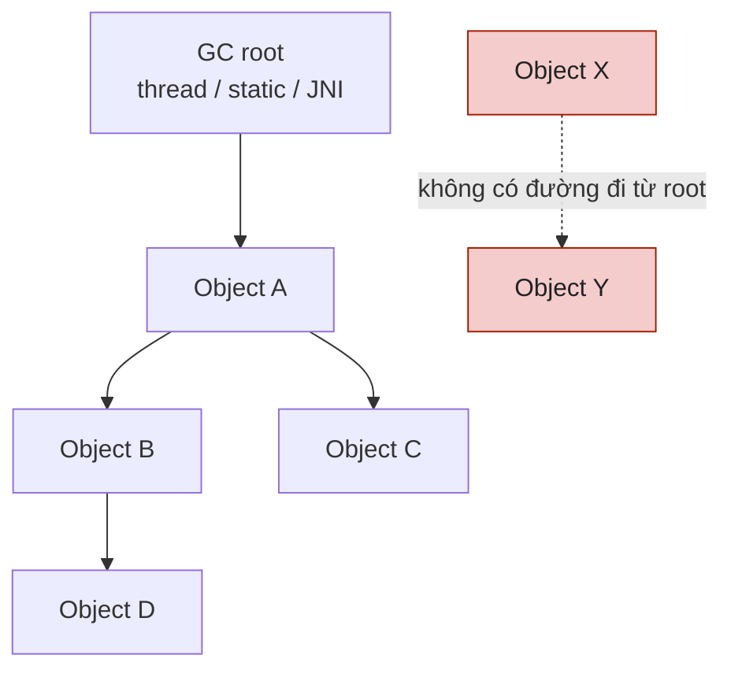

# GC root, thread stack và nguồn công việc gây stop-the-world

Garbage Collector (GC) xác định object nào còn reachable từ các điểm bắt đầu được JVM xem là GC roots, rồi thu hồi những object không còn reachable theo thuật toán của collector. Khi một phase cần trạng thái heap và tham chiếu nhất quán, JVM có thể tạm dừng các Java thread tại safepoint để thực hiện công việc stop-the-world (STW).

Thread stack là một nguồn GC root quan trọng: các reference còn sống trong local variable của frame đang hoạt động có thể giữ object trên heap không bị thu hồi. Tuy nhiên, GC không xem mọi ô nhớ trong stack là root; JVM dùng thông tin liveness và stack map do compiler/runtime duy trì để xác định vị trí thực sự chứa reference. Độ trễ pause còn phụ thuộc vào việc các thread đạt safepoint nhanh đến đâu và collector phải làm bao nhiêu việc trong pause.

## 1. GC root là gì?

GC root là một reference bắt đầu của quá trình truy vết object graph. Nếu object có thể được đi tới từ một root theo các reference hợp lệ, nó được xem là reachable và không thể bị thu hồi trong lần collection đó.

Các nguồn root thường gặp trong JVM gồm:

- **Java thread stack:** reference còn sống trong local variable và operand/frame state của các method đang hoạt động.
- **CPU register và compiled frame:** JIT có thể giữ reference trong register; metadata/stack map giúp JVM xác định vị trí của reference tại safepoint.
- **Static field:** static reference của class đã được nạp có thể giữ object sống.
- **JNI references:** global JNI reference và các handle JNI đang còn hiệu lực có thể giữ object sống; local JNI reference tồn tại theo phạm vi JNI phù hợp.
- **JVM internal roots:** reference được giữ bởi runtime, class loader data, system structures, code cache hoặc các cấu trúc đồng bộ tùy implementation.

Danh sách chính xác và cách quét root thay đổi theo JVM, collector và phiên bản. Không nên coi một danh sách category nội bộ của HotSpot là hợp đồng giống nhau cho mọi JVM.

## 2. Object graph và quá trình đánh dấu reachable

Hãy hình dung một root trỏ tới object A; A trỏ tới B và C; B trỏ tới D. Khi đó A, B, C và D đều reachable từ root:



Object X và Y trong hình không có đường đi từ root nên có thể được thu hồi nếu không có root khác giữ chúng sống. Chỉ việc hai object tham chiếu lẫn nhau không làm chúng sống mãi; nếu cả cụm không thể đi tới từ bất kỳ root nào, GC vẫn có thể thu hồi cả cụm.

GC root không phải là toàn bộ object còn sống. Root là điểm bắt đầu; GC tiếp tục truy vết reference từ root qua heap theo thuật toán của collector.

## 3. Thread stack giữ object sống như thế nào?

Mỗi Java thread có stack riêng, chứa các frame của method đang thực thi. Một frame có thể chứa local variable, operand stack và thông tin phục vụ thực thi. Nếu một local variable đang giữ reference còn sống, object được tham chiếu có thể reachable từ thread stack.

Ví dụ:

```java
class StackRootExample {
    static void process() {
        byte[] payload = new byte[4 * 1024 * 1024];
        payload[0] = 42;

        // payload vẫn được sử dụng trong frame hiện tại.
        consume(payload);
    }

    static void consume(byte[] data) {
        System.out.println(data[0]);
    }
}
```

Khi method process đang hoạt động và payload còn cần cho việc thực thi, reference đó có thể được JVM xem là root trong frame/register tương ứng. Object mảng byte vì vậy vẫn reachable.

Sau khi method kết thúc hoặc reference không còn sống theo liveness của chương trình, JVM có thể không cần giữ object chỉ vì một slot stack cũ vẫn còn chứa bit pattern giống địa chỉ. GC dùng stack map và thông tin runtime để phân biệt reference sống với dữ liệu không còn là reference hợp lệ.

Điều này cũng giải thích vì sao không thể kết luận một object chắc chắn sống tới cuối method chỉ bằng cách nhìn tên biến trong source. JIT có thể xác định biến đã hết lifetime trước dấu ngoặc đóng method, hoặc giữ reference trong register thay vì slot stack.

## 4. Stack map và safepoint

JVM cần biết chính xác vị trí reference trong các frame khi thực hiện những thao tác GC yêu cầu trạng thái thread nhất quán. Compiler tạo metadata như stack map/safepoint map để runtime nhận diện vị trí reference trong interpreted frame và compiled frame.

Khi cần một global safepoint:

1. JVM yêu cầu các Java thread đi tới trạng thái an toàn.
2. Thread đang chạy Java thường kiểm tra safepoint tại các điểm polling do compiler/runtime bố trí.
3. Thread ở trạng thái native hoặc đang thực hiện một số hoạt động đặc biệt được xử lý theo quy tắc của JVM.
4. Khi các thread cần thiết đã đạt trạng thái an toàn, JVM thực hiện phase STW.
5. Sau phase đó, các thread được tiếp tục chạy.

Thời gian từ lúc JVM yêu cầu safepoint đến khi mọi thread cần thiết sẵn sàng thường được gọi là time to safepoint hoặc thời gian đồng bộ safepoint. Đây là phần có thể làm tăng latency ngay cả trước khi GC thực hiện công việc chính.

Không phải mọi collector hay mọi phase đều cần dừng tất cả thread theo cùng cách. Một số collector sử dụng concurrent phase, thread-local handshake hoặc cơ chế đồng bộ khác để giảm phạm vi dừng. Mô hình trên mô tả cách hiểu cơ bản của global safepoint trong HotSpot.

## 5. Vì sao thread stack ảnh hưởng chi phí GC?

GC cần tìm các reference sống trong thread state. Chi phí xử lý root có thể chịu ảnh hưởng bởi:

- Số lượng Java thread cần phối hợp tại safepoint.
- Số frame đang hoạt động và độ sâu call stack.
- Số reference còn sống trong frame/register.
- Số JNI handle và root nội bộ runtime cần xử lý.
- Trạng thái thread khi JVM yêu cầu safepoint và thời gian thread đi tới điểm polling phù hợp.

Nhiều thread không tự động đồng nghĩa pause dài; một thread có stack sâu cũng không nhất thiết làm GC chậm nếu rất ít reference sống. Điều quan trọng là workload và trạng thái thực tế tại thời điểm collection.

Một ứng dụng tạo hàng nghìn thread có thể tăng chi phí phối hợp safepoint và quản lý stack ngay cả khi heap không lớn. Thread pool có kích thước hợp lý thường giúp kiểm soát số thread, nhưng không nên giảm thread chỉ dựa trên một lần GC log; hãy đo cả throughput và latency của ứng dụng.

## 6. Stop-the-world không có nghĩa toàn bộ GC luôn chạy STW

STW mô tả việc tạm dừng các Java application thread trong một phase. Nhiều collector hiện đại chia công việc thành phase STW và phase concurrent:

| Collector | Đặc điểm tổng quát |
| --- | --- |
| Serial GC | Phần lớn công việc collection diễn ra khi application thread dừng; phù hợp workload nhỏ hoặc môi trường đơn giản. |
| Parallel GC | Thu gom STW nhưng dùng nhiều GC worker để tăng throughput. |
| G1 GC | Có các pause STW như young/mixed evacuation; concurrent marking thực hiện một phần công việc khi ứng dụng tiếp tục chạy. |
| ZGC | Thiết kế low-latency, phần lớn công việc nặng được thực hiện concurrent; vẫn có các phase ngắn cần đồng bộ/dừng thread. |
| Shenandoah | Tập trung vào concurrent evacuation và concurrent work; vẫn có một số pause ngắn để đồng bộ trạng thái. |

G1 là collector mặc định trong nhiều bản HotSpot server hiện đại, nhưng mặc định có thể phụ thuộc vendor và cấu hình. ZGC và Shenandoah cũng đã trở thành lựa chọn production trong các JDK hiện đại. Chọn collector theo latency SLO, throughput, footprint và phiên bản JDK được hỗ trợ, không theo một nhãn "không pause".

Không collector nào có thể bảo đảm application thread không bao giờ bị dừng. Concurrent có nghĩa một phần công việc diễn ra song song với ứng dụng, không có nghĩa mọi phase đều không có safepoint.

## 7. Những công việc GC có thể tạo pause STW

Các phase cụ thể phụ thuộc collector, nhưng một số nhóm công việc phổ biến gồm:

### Quét và xử lý GC roots

JVM xác định các reference gốc từ thread stack, static field, JNI handle và cấu trúc runtime. Việc quét root là điểm bắt đầu cho truy vết object graph. Với heap lớn nhưng root set nhỏ, chi phí root scan có thể khác đáng kể so với chi phí xử lý toàn bộ object.

### Initial mark hoặc root marking

Một số collector cần một phase đánh dấu ban đầu khi ứng dụng dừng để ghi nhận tập object bắt đầu hoặc đồng bộ trạng thái trước concurrent marking. G1 có thể kết hợp initial mark với một young collection pause.

### Remark hoặc kết thúc concurrent marking

Trong khi concurrent marking chạy, ứng dụng vẫn có thể thay đổi reference. Collector cần xử lý các thay đổi được ghi nhận và hoàn tất marking trong một phase đồng bộ; phase này có thể tạo pause. Tên phase và chi tiết thuật toán tùy collector.

### Evacuation và cập nhật reference

Collector di chuyển object sống từ vùng nguồn sang vùng đích để thu hồi region/space. Với G1, young và mixed collection có các pause evacuation STW. Công việc có thể gồm copy object, xử lý remembered set và cập nhật reference theo thuật toán của collector.

### Reference processing và class unloading

Xử lý soft/weak/phantom reference, dọn metadata hoặc unload class có thể tham gia vào các phase đồng bộ. Mức độ và thời điểm xử lý khác nhau giữa collector và cấu hình. Nếu có nhiều reference cần xử lý hoặc nhiều class loader đủ điều kiện unload, pause có thể tăng.

### Full GC

Full GC trong HotSpot thường là sự kiện STW có chi phí cao, có thể bao gồm marking, compaction và xử lý metadata. Nếu Full GC xuất hiện thường xuyên, cần điều tra nguyên nhân như allocation pressure, heap sizing, promotion failure, explicit GC hoặc giới hạn bộ nhớ.

## 8. Các safepoint pause không phải GC pause

Một điểm dễ nhầm: JVM có thể dừng thread tại safepoint cho một thao tác VM không phải garbage collection. Ví dụ, một số thao tác quản trị hoặc runtime cần trạng thái thread nhất quán để thực hiện công việc nội bộ.

Do đó, tổng thời gian ứng dụng bị dừng có thể gồm:

- Thời gian đồng bộ để thread đạt safepoint.
- Thời gian thực hiện GC pause.
- Thời gian thực hiện một VM operation khác tại safepoint.

Nếu log cho thấy safepoint pause nhưng không có GC event tương ứng, đừng mặc định đó là GC chậm. Hãy đọc tag safepoint, operation name và JFR event để phân biệt nguồn pause.

## 9. Đọc GC log và safepoint log bằng Unified Logging

JDK hiện đại dùng Unified Logging. Có thể bật log GC và safepoint khi khởi chạy JVM:

```text
-Xlog:gc*,safepoint=info:file=gc.log:time,uptime,level,tags
```

Khi cần chi tiết phase hơn trong môi trường điều tra:

```text
-Xlog:gc+phases=debug,gc+heap=info,safepoint=info:file=gc.log:time,uptime,level,tags
```

Ví dụ chạy ứng dụng:

```powershell
java -Xlog:gc*,safepoint=info:file=gc.log:time,uptime,level,tags -jar app.jar
```

Các tag và mức log chi tiết có thể khác giữa JDK build. Mức debug tạo nhiều dữ liệu hơn, vì vậy chỉ bật khi cần và đánh giá overhead/dung lượng log.

Khi đọc log, phân biệt:

- **GC pause duration:** thời gian phase collection dừng ứng dụng.
- **Safepoint time to reach:** thời gian JVM chờ các thread đạt trạng thái an toàn.
- **Safepoint cleanup/VM operation:** công việc đồng bộ hoặc cleanup liên quan đến safepoint.
- **Concurrent phase duration:** thời gian collector làm việc trong khi application thread tiếp tục chạy; đây không phải pause duration.

Đừng cộng tất cả thời gian concurrent vào tổng STW. Ngược lại, đừng chỉ xem dòng GC pause rồi bỏ qua thời gian chờ thread đạt safepoint.

## 10. Dùng JFR để liên hệ pause với hoạt động thread

Java Flight Recorder (JFR) có thể ghi lại GC event, phase pause và safepoint event. Có thể bắt đầu một recording có thời lượng giới hạn bằng jcmd:

```powershell
jcmd <pid> JFR.start name=gc-latency settings=profile duration=60s filename=gc-latency.jfr
```

Sau khi recording hoàn tất, mở file bằng JDK Mission Control (JMC) hoặc công cụ đọc JFR tương thích. Tìm các event liên quan đến:

- jdk.GarbageCollection và các GC phase event.
- jdk.GCPhasePause cùng các phase con nếu có trong bản JDK.
- jdk.SafepointBegin và event đồng bộ safepoint nếu được ghi.
- Thread CPU load, thread park/block, allocation và GC activity trong cùng khoảng thời gian.

Tên event và trường dữ liệu cụ thể có thể thay đổi theo JDK. Kiểm tra event metadata của recording thay vì giả định mọi phiên bản đều có đúng một tập event giống nhau.

JFR giúp đặt GC pause vào bối cảnh workload: thread nào đang hoạt động, allocation tăng lúc nào, và có safepoint operation nào trùng với latency spike. Nó không thay thế GC log hoặc heap analysis; hãy kết hợp nhiều nguồn dữ liệu.

## 11. Ví dụ diễn giải một latency spike

Giả sử một request có latency cao đúng lúc GC xảy ra. Cần xem ít nhất ba khoảng:

| Khoảng thời gian | Câu hỏi |
| --- | --- |
| Trước pause | Allocation rate có tăng? Có nhiều thread hoặc call stack sâu? |
| Chờ safepoint | Thread nào mất nhiều thời gian để đạt trạng thái an toàn? |
| Trong pause | GC đang scan roots, evacuate object, process references hay thực hiện Full GC? |

Ví dụ, nếu thời gian chờ safepoint dài nhưng phần GC pause ngắn, tối ưu heap size có thể không giải quyết đúng nguyên nhân. Cần điều tra thread state, long-running Java/native transitions hoặc điểm polling của workload.

Ngược lại, nếu thời gian safepoint ngắn nhưng evacuation pause dài, hãy xem số object sống cần di chuyển, remembered set, allocation/promotion pressure và cấu hình collector.

Đây là cách phân loại để đặt giả thuyết, không phải quy tắc kết luận từ một log line. Cần lặp lại quan sát qua nhiều sự kiện và đối chiếu với request trace.

## 12. Thread dump giúp gì và không giúp gì?

Có thể lấy thread dump bằng:

```powershell
jcmd <pid> Thread.print
```

Thread dump hữu ích để xem:

- Số lượng thread và trạng thái RUNNABLE, WAITING, BLOCKED.
- Stack trace của thread tại thời điểm chụp.
- Lock contention hoặc thread đang thực hiện công việc kéo dài.
- Thread pool có quá nhiều worker hoặc task bị kẹt.

Thread dump không phải bản liệt kê đầy đủ GC root và không chứng minh một local variable đang được GC xem là live root. Liveness chính xác phụ thuộc stack map và trạng thái runtime; muốn điều tra object retention cần thêm heap dump, class histogram, JFR hoặc công cụ phân tích heap phù hợp.

## 13. Giảm chi phí pause bằng cách xử lý đúng nguyên nhân

Không có một flag duy nhất phù hợp với mọi GC latency issue. Hãy đi từ bằng chứng:

| Dấu hiệu | Hướng điều tra |
| --- | --- |
| Safepoint synchronization lâu | Số thread, stack depth, thread đang ở native state hoặc hoạt động dài trước safepoint. |
| Root scan chiếm nhiều thời gian | Thread count, live references, JNI handles và root category của collector. |
| Young evacuation pause dài | Allocation rate, object survival, promotion pressure, heap sizing và GC worker utilization. |
| Remark pause dài | Concurrent marking work, reference mutation, reference processing và class unloading. |
| Full GC lặp lại | Heap pressure, promotion failure, explicit GC, humongous allocation hoặc giới hạn heap. |
| GC pause ngắn nhưng request vẫn chậm | Safepoint ngoài GC, lock contention, CPU scheduling, queueing hoặc I/O. |

Các hướng cải thiện có thể gồm:

- Giới hạn thread pool và tránh tạo thread không cần thiết.
- Tránh giữ object lớn trong local variable lâu hơn thời gian cần thiết; để ý các task dài giữ nhiều object qua stack.
- Xử lý đúng vòng đời ThreadLocal, static cache, listener và class loader để tránh retention.
- Điều chỉnh allocation và object lifetime trước khi tăng heap hoặc đổi collector.
- Chọn collector theo SLO và workload, rồi benchmark trên JDK mục tiêu.
- Giữ GC/safepoint log và JFR trong thời gian tái hiện để so sánh trước/sau.

Không cố xóa reference bằng cách gán null một cách máy móc. JIT có thể đã xác định lifetime của biến; việc gán null không bảo đảm giảm pause và có thể làm code khó đọc hơn. Tập trung vào object retention thật sự và profile xác nhận.

## 14. Những điểm cần nhớ

- GC root là điểm bắt đầu của quá trình truy vết object graph; object không reachable từ root có thể được thu hồi.
- Thread stack, register, static field, JNI handle và JVM internal structures có thể chứa root.
- GC dùng stack map/liveness để nhận diện reference sống; không xem mọi slot stack là root.
- Safepoint synchronization time khác với thời gian GC pause.
- STW là pause của application thread trong một phase; không có nghĩa toàn bộ công việc của mọi collector đều STW.
- Root scan, initial/remark, evacuation, reference processing, class unloading và Full GC có thể đóng góp pause tùy collector.
- Có safepoint operation không phải GC; cần phân biệt bằng GC log và safepoint log.
- Dùng Unified Logging với tùy chọn -Xlog:gc*,safepoint=info và JFR để liên hệ pause với workload.
- Thread dump cho biết stack/trạng thái thread, không phải danh sách đầy đủ GC root.
- Tối ưu dựa trên phase và nguyên nhân được đo, không dựa trên một con số pause riêng lẻ.

Khi phân tích GC latency, hãy tách câu hỏi "object nào đang được giữ sống?" khỏi câu hỏi "JVM phải dừng thread để làm công việc gì?". GC roots và stack map giải thích khả năng reachability; safepoint/GC logs giải thích pause đến từ việc chờ thread, quét root hay phase collection nào. Hai góc nhìn này kết hợp mới giúp tìm đúng nguyên nhân.

## Tài liệu tham khảo

- [Garbage Collection Tuning Guide – Java SE 16](https://docs.oracle.com/en/java/javase/16/gctuning/)
- [HotSpot Virtual Machine Garbage Collection Tuning Guide – Java SE 26](https://docs.oracle.com/en/java/javase/26/gctuning/)
- [Unified Logging – Java SE 16 Tools Reference](https://docs.oracle.com/en/java/javase/16/docs/specs/man/java.html)
- [jcmd – Java SE 16 Tools Reference](https://docs.oracle.com/en/java/javase/16/docs/specs/man/jcmd.html)
- [Java Flight Recorder Runtime Guide](https://docs.oracle.com/en/java/javase/26/jfapi/)
- [JEP 333: ZGC: A Scalable Low-Latency Garbage Collector](https://openjdk.org/jeps/333)
- [JEP 379: Shenandoah: A Low-Pause-Time Garbage Collector](https://openjdk.org/jeps/379)
