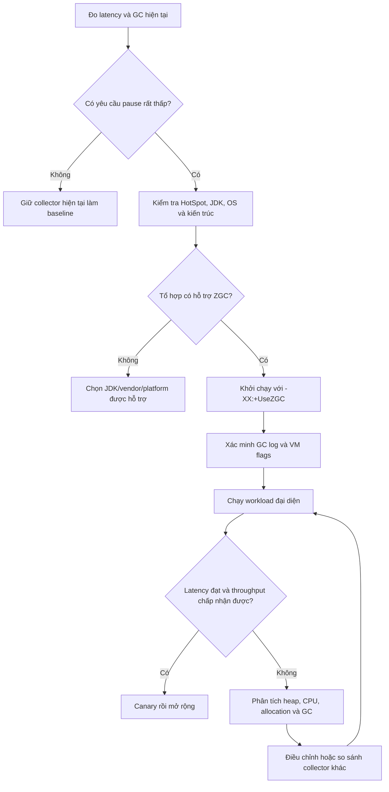

# Bật ZGC bằng -XX:+UseZGC trên tổ hợp JDK và nền tảng được hỗ trợ

> **Chương:** GC và độ trễ  
> **Phạm vi:** Bật Z Garbage Collector (ZGC) trên HotSpot, xác minh tổ hợp JDK/kiến trúc hệ điều hành, cấu hình heap và kiểm tra độ trễ sau khi khởi chạy. Bài phân biệt ZGC trong Java 16 với Generational ZGC trên JDK hiện đại; không dùng tùy chọn thử nghiệm cũ cho runtime đã phát hành chính thức.

## Mục tiêu học tập

Sau bài này, bạn có thể:

1. Giải thích trường hợp ZGC phù hợp và những đánh đổi về CPU, throughput, bộ nhớ.
2. Kiểm tra JDK, JVM vendor, hệ điều hành và kiến trúc trước khi bật ZGC.
3. Xác định nền tảng upstream hỗ trợ ZGC từ JDK 16 và các nền tảng được bổ sung sau đó.
4. Bật ZGC bằng -XX:+UseZGC mà không thêm cờ thử nghiệm không còn cần thiết.
5. Phân biệt ZGC không phân thế hệ ở JDK 16, Generational ZGC trên JDK 21–22 và mặc định từ JDK 23.
6. Chọn -Xms, -Xmx và các tùy chọn liên quan dựa trên workload.
7. Xác minh collector đang chạy và đọc GC log, số liệu heap cùng độ trễ ứng dụng.
8. Xây dựng quy trình thử nghiệm trước khi đưa ZGC vào production.

## 1. ZGC giải quyết vấn đề gì?

ZGC là garbage collector của HotSpot được thiết kế cho ứng dụng cần độ trễ thấp. Phần lớn công việc tốn thời gian của collector được thực hiện đồng thời với các luồng ứng dụng, nhờ đó giảm thời gian ứng dụng phải dừng để chờ GC.

ZGC thường đáng để đánh giá khi:

- Ứng dụng có yêu cầu nghiêm ngặt về p99 hoặc p999 latency.
- Heap lớn và các khoảng dừng GC của collector hiện tại ảnh hưởng đến response time.
- Dịch vụ tương tác cần giữ thời gian phản hồi ổn định trong lúc thu gom rác.
- Workload có đủ CPU và memory headroom cho công việc GC đồng thời.

ZGC không phải lựa chọn mặc định tốt nhất cho mọi ứng dụng. Công việc đồng thời sử dụng CPU trong khi ứng dụng vẫn chạy, vì vậy throughput có thể thấp hơn hoặc cần thêm tài nguyên so với collector tối ưu throughput. ZGC cũng cần đủ dung lượng heap để ứng dụng tiếp tục cấp phát trong khi GC đang xử lý.

Oracle mô tả ZGC là collector có thời gian pause tối đa dưới một millisecond trong tài liệu JDK hiện đại. Đây là mục tiêu thiết kế của collector, không phải cam kết SLA cho mọi workload, phần cứng hoặc mọi thành phần của ứng dụng. Độ trễ tổng thể còn chịu ảnh hưởng của lock contention, I/O, scheduling, safepoint khác và hoạt động của hệ điều hành.

## 2. ZGC là collector của HotSpot

-XX:+UseZGC là tùy chọn của HotSpot VM. Không suy luận rằng mọi JVM implementation hoặc mọi bản phân phối Java đều cung cấp ZGC chỉ vì chúng có cùng số phiên bản Java.

Trước khi cấu hình, xác định:

- JVM thực tế là HotSpot hay một implementation khác.
- Vendor và build đang chạy.
- Phiên bản JDK và bản cập nhật.
- Hệ điều hành và kiến trúc CPU.
- Bản phân phối JDK có build ZGC cho tổ hợp đó hay không.

ZGC đã trở thành tính năng production-ready từ JDK 15 theo JEP 377. Do đó, với JDK 16 trở lên trên HotSpot build có hỗ trợ, bật ZGC bằng -XX:+UseZGC; không cần thêm -XX:+UnlockExperimentalVMOptions chỉ để bật ZGC.

## 3. Kiểm tra tổ hợp JDK và nền tảng

ZGC được hỗ trợ theo tổ hợp hệ điều hành và kiến trúc, không chỉ theo tên hệ điều hành. Bảng dưới đây thể hiện mốc hỗ trợ của upstream OpenJDK HotSpot:

| Hệ điều hành | Kiến trúc | Bắt đầu được hỗ trợ production | Có trong JDK 16? |
| --- | --- | --- | --- |
| Linux | x64 | JDK 15 | Có |
| Linux | AArch64 | JDK 15 | Có |
| Linux | PowerPC | JDK 18 | Không |
| macOS | x64 | JDK 15 | Có |
| macOS | AArch64 (Apple Silicon) | JDK 17 | Không |
| Windows | x64 | JDK 15 | Có |
| Windows | AArch64 | JDK 16 | Có |

Lưu ý khi dùng bảng:

- Đây là mốc hỗ trợ của upstream ZGC; vendor có thể phát hành bộ JDK với tập nền tảng và chính sách hỗ trợ riêng.
- Một tổ hợp có trong mã nguồn upstream không bảo đảm mọi vendor đều phát hành binary cho tổ hợp đó.
- Trên Windows x64, tài liệu OpenJDK nêu yêu cầu Windows 10 version 1803 hoặc Windows Server 2019 trở lên.
- Với macOS AArch64, hỗ trợ bắt đầu từ JDK 17; không suy ngược rằng JDK 16 đã hỗ trợ Apple Silicon.
- Linux PowerPC được bổ sung từ JDK 18, không có trong JDK 16.

Nếu triển khai JDK 25 hoặc một bản JDK mới hơn, vẫn phải kiểm tra ma trận hỗ trợ của vendor và binary cụ thể. Không lấy mốc hỗ trợ lịch sử làm bằng chứng rằng một bản Linux distribution, kernel hoặc CPU bất kỳ đều được nhà cung cấp chứng nhận.

### Kiểm tra môi trường trước khi bật

Chạy bằng đúng executable mà service sẽ sử dụng:

```bash
java -version
java -XshowSettings:properties -version
```

Ghi lại ít nhất:

- java.vendor
- java.vm.name
- java.vm.version
- os.name
- os.arch
- JDK feature version và update/build
- Đường dẫn binary thực tế của service

Có thể in các thông tin cơ bản từ ứng dụng:

```java
public final class RuntimeInfo {
    public static void main(String[] args) {
        System.out.println("Java version: " + Runtime.version());
        System.out.println("Vendor: " + System.getProperty("java.vendor"));
        System.out.println("VM: " + System.getProperty("java.vm.name"));
        System.out.println("VM version: " + System.getProperty("java.vm.version"));
        System.out.println("OS: " + System.getProperty("os.name"));
        System.out.println("Architecture: " + System.getProperty("os.arch"));
    }
}
```

Kết quả từ máy build không thay thế việc kiểm tra runtime production. Container, service manager hoặc script khởi chạy có thể sử dụng một binary Java khác với binary nằm đầu PATH.

## 4. Bật ZGC bằng -XX:+UseZGC

Cú pháp cơ bản:

```bash
java -XX:+UseZGC -jar application.jar
```

Để đặt giới hạn heap và bật GC logging:

```bash
java -XX:+UseZGC -Xms2g -Xmx8g -Xlog:gc* -jar application.jar
```

Các giá trị 2g và 8g chỉ là ví dụ minh họa. Hãy chọn heap dựa trên live set, tốc độ cấp phát, giới hạn container và memory budget của máy.

### Bật ZGC trong script service

Ví dụ script Linux:

```bash
#!/usr/bin/env bash
exec /opt/jdk/bin/java \
  -XX:+UseZGC \
  -Xms2g \
  -Xmx8g \
  -Xlog:gc*:file=/var/log/myapp/gc.log:time,uptime,level,tags \
  -jar /opt/myapp/application.jar
```

Đảm bảo thư mục log tồn tại và user chạy service có quyền ghi. Nếu ứng dụng chạy trong container, đặt heap phù hợp với memory limit của container; không cấp -Xmx bằng toàn bộ giới hạn bộ nhớ vì JVM còn cần native memory, thread stack, metaspace, code cache và các thành phần khác.

### Bật ZGC trong PowerShell

```powershell
& "$env:JAVA_HOME\bin\java.exe" -XX:+UseZGC -Xms2g -Xmx8g -Xlog:gc* -jar .\application.jar
```

Dùng đúng JDK đã xác minh có hỗ trợ ZGC trên Windows và kiến trúc CPU mục tiêu.

## 5. Khác biệt giữa ZGC Java 16 và Generational ZGC hiện đại

Tên tùy chọn bật collector vẫn là -XX:+UseZGC, nhưng chế độ ZGC đã phát triển qua các phiên bản:

| Phiên bản JDK | Chế độ ZGC |
| --- | --- |
| JDK 16–20 | ZGC không phân thế hệ |
| JDK 21–22 | Có ZGC không phân thế hệ và Generational ZGC; bật Generational ZGC bằng -XX:+ZGenerational |
| JDK 23 | Generational ZGC trở thành mặc định; chế độ không phân thế hệ bị deprecated |
| JDK 24 trở lên | Chỉ còn Generational ZGC; chế độ không phân thế hệ đã bị loại bỏ |

### JDK 16

Trong JDK 16, bật ZGC bằng:

```bash
java -XX:+UseZGC -Xmx8g -Xlog:gc* -jar application.jar
```

Đây là ZGC không phân thế hệ. Không thêm -XX:+ZGenerational; tùy chọn này chưa có trong JDK 16.

### JDK 21–22

Generational ZGC được giới thiệu trong JDK 21. Nếu muốn bật chế độ mới trên các bản JDK 21–22, dùng:

```bash
java -XX:+UseZGC -XX:+ZGenerational -Xmx8g -Xlog:gc* -jar application.jar
```

Đây là khác biệt phiên bản cần biết khi đọc cấu hình cũ. Không sao chép tùy chọn này sang JDK 24 trở lên.

### JDK 23 trở lên

Từ JDK 23, Generational ZGC là mặc định khi chọn ZGC. Từ JDK 24, chế độ không phân thế hệ bị loại bỏ theo JEP 490. Vì vậy, trên JDK hiện đại, lệnh thông thường chỉ cần:

```bash
java -XX:+UseZGC -Xmx8g -Xlog:gc* -jar application.jar
```

Không truyền -XX:+ZGenerational trên JDK 24 trở lên; tùy chọn này đã bị loại bỏ cùng chế độ cũ. Cũng không dùng tùy chọn thử nghiệm hoặc cờ unlock từ giai đoạn ZGC còn experimental trong JDK 11–14.

## 6. Xác minh JVM đã bật ZGC

Việc lệnh khởi chạy không báo lỗi chưa đủ để xác nhận ứng dụng đang chạy với collector mong muốn. Kiểm tra cả flag và log của tiến trình thực tế.

### Kiểm tra tùy chọn JVM

Có thể chạy một tiến trình ngắn:

```bash
java -XX:+UseZGC -version
```

Lệnh này kiểm tra runtime chấp nhận tùy chọn và khởi động được. Nó chưa kiểm tra tải ứng dụng, classpath, native library hoặc khả năng vận hành lâu dài.

### Kiểm tra flag của tiến trình

Tìm PID của ứng dụng và xem flag:

```bash
jcmd <pid> VM.flags -all
```

Kiểm tra giá trị UseZGC trong danh sách. Có thể dùng jcmd với đúng user hoặc quyền truy cập tiến trình theo chính sách hệ điều hành.

### Kiểm tra GC log

Khởi chạy với:

```bash
-Xlog:gc*
```

Trong log, xác nhận collector là ZGC và theo dõi các chu kỳ GC. Log cũng giúp nhận biết lỗi khởi tạo collector hoặc các cảnh báo liên quan tới heap.

Không chỉ dựa vào một dòng log đầu tiên. Hãy quan sát trong lúc ứng dụng thực hiện workload đại diện.

## 7. Chọn kích thước heap phù hợp

Đối với ZGC, -Xmx là một trong những tham số quan trọng nhất. Vì phần lớn công việc GC chạy đồng thời, heap phải chứa được live set và có đủ headroom cho các allocation trong thời gian GC xử lý.

Cần xem xét:

- Live set sau khi ứng dụng đã warm-up.
- Allocation rate ở tải bình thường và tải đỉnh.
- Các đợt tăng allocation đột ngột.
- Thời gian cần để ZGC hoàn tất chu kỳ.
- CPU dành cho ứng dụng và GC.
- Giới hạn bộ nhớ của máy hoặc container.
- Native memory ngoài Java heap.

Nếu heap quá nhỏ, ứng dụng có thể phải chờ GC thu hồi bộ nhớ hoặc gặp allocation stall. Nếu heap quá lớn, tiến trình có thể chiếm nhiều RAM hơn cần thiết và ảnh hưởng mật độ triển khai.

### Ví dụ cấu hình heap

```bash
java -XX:+UseZGC -Xms2g -Xmx8g -jar application.jar
```

- -Xms2g: heap ban đầu.
- -Xmx8g: giới hạn tối đa của heap.

Đây không phải giá trị mặc định hay khuyến nghị chung. Đo live set và allocation rate trước khi chọn thông số.

### SoftMaxHeapSize

ZGC hỗ trợ giới hạn mềm -XX:SoftMaxHeapSize. JVM cố gắng giữ heap ở dưới mức này nhưng vẫn có thể tăng tới -Xmx nếu cần để tránh ứng dụng bị đình trệ vì thiếu chỗ cấp phát.

Ví dụ:

```bash
java -XX:+UseZGC \
  -Xmx8g \
  -XX:SoftMaxHeapSize=6g \
  -jar application.jar
```

Ở đây 6 GB là mục tiêu mềm và 8 GB là giới hạn cứng. Không dùng soft limit thấp hơn live set thực tế rồi kỳ vọng ZGC có thể duy trì nó mà không ảnh hưởng hiệu năng.

## 8. Cân bằng độ trễ với việc trả bộ nhớ về hệ điều hành

ZGC có thể uncommit heap memory không còn dùng và trả lại cho hệ điều hành. Cơ chế này giúp giảm footprint khi ứng dụng nhàn rỗi hoặc nhu cầu bộ nhớ giảm.

Các tùy chọn liên quan gồm:

| Tùy chọn | Ý nghĩa |
| --- | --- |
| -XX:+ZUncommit | Bật việc uncommit vùng heap không dùng; mặc định bật |
| -XX:ZUncommitDelay | Thời gian vùng memory phải không được dùng trước khi đủ điều kiện uncommit; mặc định thường là 300 giây |
| -Xms | Mức heap tối thiểu/ban đầu |
| -Xmx | Mức heap tối đa |

Việc commit/uncommit trong lúc ứng dụng chạy có thể ảnh hưởng latency do thao tác quản lý bộ nhớ và page fault. Với workload cực kỳ nhạy độ trễ, có thể thử cố định heap bằng -Xms bằng -Xmx và pre-touch memory lúc khởi động:

```bash
java -XX:+UseZGC \
  -Xms8g \
  -Xmx8g \
  -XX:+AlwaysPreTouch \
  -Xlog:gc* \
  -jar application.jar
```

Cấu hình này yêu cầu đủ RAM ngay khi khởi động và làm tăng thời gian khởi tạo. Khi -Xms bằng -Xmx, heap không thể co xuống dưới mức tối thiểu, nên khả năng trả heap về hệ điều hành bị giới hạn. Chỉ chọn sau khi đo trên máy có memory budget phù hợp.

## 9. Bật logging và theo dõi độ trễ

Unified logging là cách hiện hành để quan sát GC trên các JDK hiện đại.

### GC log cơ bản

```bash
java -XX:+UseZGC -Xlog:gc -jar application.jar
```

### GC log chi tiết hơn

```bash
java -XX:+UseZGC -Xlog:gc* -jar application.jar
```

Có thể ghi log vào file với timestamp:

```bash
java -XX:+UseZGC \
  -Xlog:gc*:file=gc.log:time,uptime,level,tags \
  -jar application.jar
```

Không bật mức log quá chi tiết trong production mà không kiểm tra lượng log, chi phí I/O và chính sách lưu trữ.

### Các chỉ số cần quan sát

| Chỉ số | Vì sao cần theo dõi |
| --- | --- |
| GC pause duration | Xác nhận thời gian dừng ứng dụng trong các pha GC |
| GC cycle duration | Cho biết thời gian một chu kỳ thu gom hoàn tất |
| Allocation rate | Đánh giá tốc độ ứng dụng tạo object |
| Live set | Dung lượng object còn sống sau GC |
| Heap used/committed | Phân biệt bộ nhớ đang dùng và đã commit |
| CPU utilization | Xác định chi phí GC đồng thời có cạnh tranh CPU không |
| Allocation stalls | Phát hiện ứng dụng phải chờ GC cấp phát/reclaim |
| p50, p95, p99, p999 latency | Đo tác động GC lên trải nghiệm thực tế |
| Throughput | Đảm bảo giảm pause không làm mất quá nhiều năng lực xử lý |

ZGC có thể giảm pause nhưng không tự sửa allocation rate quá cao, object retention, lock contention hoặc I/O chậm. Đọc GC log cùng application metrics để tìm nguyên nhân.

## 10. Đánh giá ZGC so với collector khác

| Tiêu chí | ZGC | G1 | Parallel GC |
| --- | --- | --- | --- |
| Mục tiêu chính | Độ trễ rất thấp | Cân bằng throughput và pause goal | Throughput cao |
| Công việc GC | Phần lớn đồng thời | Phần lớn đồng thời, có các pha dừng | Thu gom song song với pause |
| CPU overhead | Có thể cao hơn do concurrent work | Phụ thuộc workload | Tập trung vào thời gian GC |
| Phù hợp | Dịch vụ nhạy p99/p999, heap lớn | Ứng dụng tổng quát cần cân bằng | Batch hoặc workload ưu tiên throughput |
| Đánh đổi | Cần CPU và heap headroom | Pause có thể dài hơn ZGC | Pause có thể dài hơn nhưng throughput tốt |

Không đổi sang ZGC chỉ vì heap lớn hoặc vì tên collector có chữ low latency. Hãy so sánh bằng workload thực tế và cùng giới hạn tài nguyên.

## 11. Những tình huống ZGC có thể không phù hợp

- Ứng dụng có heap nhỏ và không có yêu cầu pause nghiêm ngặt.
- Máy bị giới hạn CPU; concurrent GC cạnh tranh với luồng ứng dụng.
- Container có memory limit thấp, không đủ heap headroom và native memory.
- Batch workload ưu tiên throughput hơn latency.
- Runtime/vendor build không hỗ trợ tổ hợp OS/CPU.
- Ứng dụng có allocation rate vượt khả năng xử lý của GC.
- Độ trễ chủ yếu đến từ database, network, lock hoặc thread scheduling thay vì GC.

Trong các trường hợp đó, hãy giữ collector hiện tại làm baseline, đo số liệu rồi thử ZGC trong môi trường có thể lặp lại.

## 12. Lỗi thường gặp khi bật ZGC

| Hiện tượng | Nguyên nhân có thể | Cách xử lý |
| --- | --- | --- |
| Unrecognized VM option UseZGC | JVM hoặc build không có ZGC | Xác minh HotSpot, vendor, version và OS/CPU |
| ZGC không khởi tạo trên macOS ARM với JDK 16 | ZGC trên macOS AArch64 bắt đầu từ JDK 17 | Dùng JDK/vendor build có hỗ trợ |
| ZGC không có trên Linux PowerPC ở JDK 16 | Upstream bổ sung nền tảng này từ JDK 18 | Nâng JDK hoặc chọn nền tảng được hỗ trợ |
| Windows ARM64 không có ZGC ở JDK cũ hơn 16 | Hỗ trợ upstream bắt đầu từ JDK 16 | Kiểm tra build và vendor cụ thể |
| -XX:+ZGenerational bị báo không nhận diện trên JDK 24+ | Tùy chọn đã bị loại bỏ cùng non-generational mode | Chỉ dùng -XX:+UseZGC |
| Ứng dụng chạy nhưng latency không cải thiện | GC không phải nguyên nhân chính hoặc CPU/heap headroom không đủ | Đối chiếu GC log, allocation rate và application metrics |
| CPU tăng sau khi bật ZGC | Concurrent GC dùng CPU trong lúc ứng dụng chạy | Đánh giá CPU capacity và workload; so sánh collector khác |
| Allocation stall hoặc OOM | Heap thiếu headroom, live set lớn hoặc allocation quá nhanh | Đo live set, tăng heap phù hợp hoặc sửa allocation/retention |
| Container bị OOMKilled | -Xmx cộng native memory vượt memory limit | Dành headroom cho native memory và đo memory usage thực tế |
| Heap không trả memory như kỳ vọng | -Xms, ZUncommit hoặc delay ảnh hưởng khả năng uncommit | Kiểm tra min/max heap và số liệu committed memory |

## 13. Quy trình triển khai ZGC

1. **Xác định mục tiêu latency:** ghi nhận p95/p99/p999 hiện tại và yêu cầu của dịch vụ.
2. **Xác định runtime:** vendor, HotSpot build, JDK version, OS và CPU architecture.
3. **Đối chiếu nền tảng:** kiểm tra bảng hỗ trợ upstream và ma trận chứng nhận của vendor.
4. **Tạo baseline:** chạy collector hiện tại với cùng dữ liệu, tải và giới hạn CPU/RAM.
5. **Bật ZGC ở staging:** dùng -XX:+UseZGC, đặt heap ban đầu có headroom và bật -Xlog:gc*.
6. **Xác minh collector:** kiểm tra startup log và jcmd <pid> VM.flags -all.
7. **Chạy workload đại diện:** warm-up, tải bình thường, tải đỉnh và allocation spike.
8. **Đo cả latency lẫn throughput:** so sánh GC pause, CPU, heap, allocation stall và application latency.
9. **Điều chỉnh heap:** thử -Xmx, -Xms và soft limit khi số liệu chỉ ra nhu cầu.
10. **Canary production:** triển khai một phần traffic, đặt ngưỡng rollback và theo dõi.
11. **Mở rộng hoặc quay lại:** chỉ tăng tỷ lệ khi mục tiêu latency và throughput đều đạt.

### Sơ đồ quyết định



## 14. Checklist trước khi phát hành

| Hạng mục | Câu hỏi xác nhận |
| --- | --- |
| JVM | Đã xác nhận runtime là HotSpot và đúng vendor/build chưa? |
| JDK | Phiên bản có hỗ trợ chế độ ZGC cần dùng chưa? |
| OS/CPU | Tổ hợp hệ điều hành và kiến trúc có trong ma trận hỗ trợ không? |
| Windows | Nếu dùng Windows x64, hệ điều hành có đáp ứng yêu cầu phiên bản không? |
| macOS | Nếu dùng Apple Silicon, JDK có từ phiên bản hỗ trợ AArch64 không? |
| Linux PowerPC | Nếu cần nền tảng này, JDK có từ phiên bản hỗ trợ phù hợp không? |
| JVM flags | Đã dùng -XX:+UseZGC và bỏ các flag generational cũ không còn cần chưa? |
| Heap | -Xmx có đủ live set và allocation headroom không? |
| Container | Heap có chừa RAM cho native memory và phần ngoài heap không? |
| Logging | Có GC log với timestamp và chính sách lưu trữ phù hợp không? |
| Metrics | Có GC pause, allocation rate, heap, CPU và p99/p999 không? |
| Workload | Đã chạy warm-up, tải đỉnh và allocation spike chưa? |
| Canary | Có ngưỡng rollback khi latency, throughput hoặc memory xấu đi không? |

## 15. Bài tập thực hành

### Bài 1 — Xác định nền tảng

Dùng java -version và -XshowSettings:properties để ghi nhận vendor, VM name, OS và architecture. Đối chiếu với bảng hỗ trợ ZGC. Giải thích vì sao JDK 16 không hỗ trợ macOS AArch64 nhưng JDK 17 có.

### Bài 2 — Bật ZGC

Chạy ứng dụng thử nghiệm bằng -XX:+UseZGC -Xmx2g -Xlog:gc*. Xác nhận collector xuất hiện trong log và ứng dụng thực hiện được các luồng chức năng chính.

### Bài 3 — So sánh chế độ theo JDK

So sánh JDK 16, JDK 21, JDK 23 và JDK 24+: ghi lại chế độ ZGC, vai trò của -XX:+ZGenerational và lý do không dùng cờ này trên JDK 24+.

### Bài 4 — Kiểm tra heap headroom

Đo live set và allocation rate trong workload thử nghiệm. Thử hai mức -Xmx khác nhau và quan sát allocation stall, GC cycle cùng p99 latency.

### Bài 5 — Quan sát uncommit

Chạy workload tăng tải rồi giảm tải. Theo dõi heap committed và kiểm tra tác động của -XX:+ZUncommit, -XX:ZUncommitDelay trong môi trường thử nghiệm. Không thay đổi tham số production trước khi đo.

### Bài 6 — So sánh ZGC và G1

Chạy cùng workload, cùng dữ liệu và giới hạn CPU/RAM với ZGC và G1. So sánh p99/p999, throughput, CPU, heap và thời gian GC. Viết kết luận dựa trên mục tiêu dịch vụ.

### Bài 7 — Kiểm thử triển khai

Đưa ZGC vào staging, bật GC logging, kiểm tra flag runtime và chạy canary. Viết điều kiện rollback nếu latency, throughput hoặc memory usage không đạt ngưỡng.

## Tài liệu chính thức

- [JEP 377 — ZGC: Production Ready](https://openjdk.org/jeps/377) — ZGC trở thành tính năng production-ready trong JDK 15.
- [OpenJDK ZGC Project — Supported Platforms](https://wiki.openjdk.org/display/zgc) — nền tảng và mốc hỗ trợ của upstream ZGC.
- [JEP 439 — Generational ZGC](https://openjdk.org/jeps/439) — Generational ZGC được giới thiệu trong JDK 21.
- [JEP 474 — ZGC: Generational Mode by Default](https://openjdk.org/jeps/474) — Generational ZGC trở thành mặc định trong JDK 23.
- [JEP 490 — ZGC: Remove the Non-Generational Mode](https://openjdk.org/jeps/490) — loại bỏ chế độ không phân thế hệ từ JDK 24.
- [Java SE 25 — The Z Garbage Collector](https://docs.oracle.com/en/java/javase/25/gctuning/z-garbage-collector.html) — hướng dẫn heap sizing, uncommit, large pages và logging.
- [Java SE 25 — Available Collectors](https://docs.oracle.com/en/java/javase/25/gctuning/available-collectors.html) — lựa chọn collector theo mục tiêu hiệu năng.
- [Java SE 25 — java launcher](https://docs.oracle.com/en/java/javase/25/docs/specs/man/java.html) — tùy chọn -XX:+UseZGC và các tham số JVM.

**Nguyên tắc áp dụng:** Chỉ bật -XX:+UseZGC sau khi xác minh đúng HotSpot build và tổ hợp JDK/OS/CPU. Trên JDK 16, ZGC chưa phân thế hệ; từ JDK 23 Generational ZGC là mặc định và từ JDK 24 chỉ còn chế độ này. Đánh giá bằng workload thật, đủ heap headroom và số liệu latency/throughput trước khi triển khai production.

