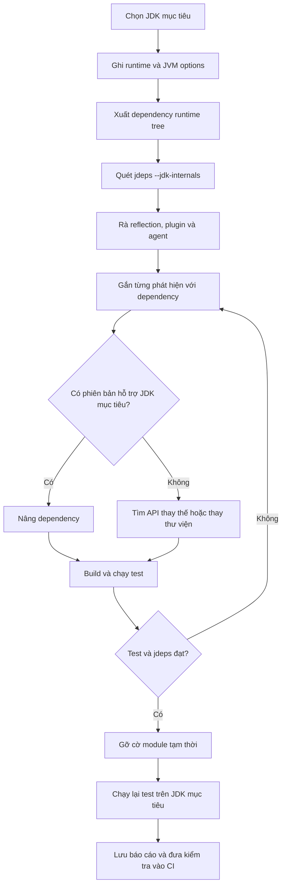

# Kiểm tra thư viện của ứng dụng trước strong encapsulation

> **Chương:** Thực hành tổng hợp  
> **Phạm vi:** Rà soát dependency trước khi chạy ứng dụng trên Java 16 trở lên. Bài kết hợp dependency tree, jdeps, kiểm tra reflection, đánh giá tương thích thư viện, thay thế API nội bộ và kiểm thử trên JDK mục tiêu. Mục tiêu là tìm đúng thành phần gây truy cập JDK internals và lập kế hoạch migration có thể kiểm chứng.

## Mục tiêu học tập

Sau bài này, bạn có thể:

1. Giải thích vì sao strong encapsulation ảnh hưởng đến ứng dụng và thư viện Java cũ.
2. Lập danh sách dependency thực sự có mặt trong runtime.
3. Dùng jdeps để phát hiện tham chiếu bytecode tới JDK internals.
4. Tìm đường reflection động mà phân tích tĩnh không nhìn thấy đầy đủ.
5. Đánh giá release notes và ma trận JDK của thư viện.
6. Phân biệt public access, deep reflection và module readability.
7. Nâng hoặc thay dependency bằng phiên bản/API được hỗ trợ.
8. Xác minh kết quả trên JDK mục tiêu và gỡ cờ tương thích tạm thời.

## 1. Bối cảnh: strong encapsulation thay đổi điều gì?

Từ Java 9, JDK được chia thành các module. Mỗi module chỉ export những package được công khai cho module khác. Một class có modifier public nhưng nằm trong package không export vẫn có thể bị chặn khi module khác cố truy cập.

Java 16 thay đổi mặc định theo JEP 396: strong encapsulation được áp dụng rộng hơn cho các package nội bộ của JDK. Java 17 tiếp tục theo JEP 403 và loại bỏ cơ chế nới lỏng tổng quát thông qua tùy chọn --illegal-access.

Điều này thường bộc lộ vấn đề trong thư viện cũ:

- Thư viện gọi trực tiếp class thuộc package như sun.* hoặc jdk.internal.*.
- Framework dùng reflection để đọc private field hoặc gọi private method của class JDK.
- Thư viện bytecode, mocking hoặc instrumentation phụ thuộc cấu trúc nội bộ của JVM.
- Dependency bắc cầu cũ được framework kéo vào runtime mà nhóm phát triển không biết.
- Plugin hoặc agent chỉ chạy được khi có quyền truy cập rộng vào package JDK.

Lỗi có thể xuất hiện lúc khởi động, khi chạy một tính năng hiếm dùng, khi serialize object hoặc trong lúc tạo proxy. Build thành công trên JDK mới chưa đủ chứng minh toàn bộ ứng dụng tương thích.

### Các lỗi thường gặp

| Thông báo | Ý nghĩa thường gặp | Hướng điều tra |
| --- | --- | --- |
| InaccessibleObjectException | Reflection không được phép truy cập member/package đích | Tìm framework gọi setAccessible hoặc privateLookupIn |
| IllegalAccessError | Bytecode truy cập type/member không được module export hoặc không đủ quyền | Xác định caller, module nguồn và package |
| package is not visible | Compiler không thể truy cập package theo module graph | Kiểm tra exports và requires |
| NoSuchMethodError / NoClassDefFoundError | Dependency không tương thích hoặc runtime nạp sai phiên bản | Kiểm tra dependency resolution và classpath |
| Cảnh báo JDK internals | Có mã hoặc thư viện dùng API nội bộ | Tìm class và dependency phát sinh cảnh báo |

Không phải mọi lỗi trên đều do strong encapsulation. NoSuchMethodError có thể chỉ là xung đột phiên bản thư viện. Giữ stack trace đầy đủ và xác định nguyên nhân trước khi thay JVM options.

## 2. Chuẩn bị baseline có thể lặp lại

Trước khi sửa dependency, ghi lại chính xác môi trường dùng để tái hiện lỗi:

- JDK vendor, feature version, update/build và VM name.
- Hệ điều hành, kiến trúc CPU và cách đóng gói ứng dụng.
- Classpath hoặc module path thực tế.
- Dependency runtime đã resolve, gồm cả dependency bắc cầu.
- JVM options từ script, service manager, container và biến môi trường.
- Stack trace, log cảnh báo và thao tác nghiệp vụ gây lỗi.
- Kết quả test trên JDK hiện đang chạy production.

Chạy bằng đúng executable mà ứng dụng sử dụng:

```bash
java -version
java -XshowSettings:properties -version
```

Nếu service dùng một JDK nằm ngoài PATH, hãy chạy binary đó bằng đường dẫn tuyệt đối. Kết quả từ máy phát triển không có giá trị nếu production dùng vendor hoặc build khác.

Tạo một bản build có thể khôi phục. Ghi checksum artifact và lưu dependency tree trước khi nâng cấp để có thể so sánh trước/sau.

## 3. Kiểm tra dependency runtime

Mục tiêu là tìm mọi thư viện thực sự được nạp khi ứng dụng chạy, không chỉ dependency khai báo trực tiếp.

### Maven

Xuất dependency tree ở runtime scope:

```bash
mvn dependency:tree -Dscope=runtime
```

Thu hẹp một thư viện cụ thể:

```bash
mvn dependency:tree -Dscope=runtime -Dincludes=groupId:artifactId
```

Đọc đường dẫn dependency để biết thư viện nào kéo phiên bản cũ vào. Nếu framework yêu cầu phiên bản mới nhưng dependency management hoặc BOM ép về bản cũ, runtime vẫn có thể dùng phiên bản không tương thích.

### Gradle

Liệt kê runtime classpath:

```bash
./gradlew dependencies --configuration runtimeClasspath
```

Tìm lý do một phiên bản được chọn:

```bash
./gradlew dependencyInsight --dependency library-name --configuration runtimeClasspath
```

Kiểm tra các configuration thực sự dùng để chạy service, worker, plugin hoặc integration test. Dependency chỉ có trong test classpath có thể không xuất hiện ở production; ngược lại, plugin runtime có thể thêm thư viện mà cấu hình compile chính không thể hiện đầy đủ.

### Ghi nhận dependency theo nhóm

| Nhóm | Ví dụ | Cần kiểm tra |
| --- | --- | --- |
| Framework nền | Dependency injection, web framework | Ma trận JDK, module support, reflection |
| Persistence | ORM, JDBC driver | Proxy, entity mapping, driver native |
| Serialization | JSON/XML mapper | Constructor binding, private field access |
| Bytecode | Proxy, mocking, instrumentation | JDK internals, class definition, agent |
| Logging | Logging API và provider | Phiên bản provider được resolve |
| Plugin | Plugin engine, script engine | Class loader, SPI và lifecycle |
| Native | JNI, thư viện native | Hỗ trợ OS/CPU và cách nạp thư viện |

Lưu ý phiên bản thực tế, nguồn dependency, phạm vi runtime và người sở hữu. Không đánh giá thư viện chỉ từ tên artifact hoặc version ghi trong file build.

## 4. Dùng jdeps để tìm JDK internals

jdeps phân tích dependency ở cấp class/package/module. Tùy chọn --jdk-internals giúp phát hiện tham chiếu bytecode tới API nội bộ của JDK và thường đưa ra gợi ý thay thế nếu có.

Quét ứng dụng cùng classpath runtime:

```bash
jdeps --jdk-internals --recursive --class-path "lib/*" app.jar
```

Quét trực tiếp một dependency nghi ngờ:

```bash
jdeps --jdk-internals --recursive lib/legacy-library.jar
```

Với multi-release JAR, chọn phiên bản bytecode phù hợp với runtime đang kiểm tra:

```bash
jdeps --multi-release 17 --jdk-internals --recursive lib/library.jar
```

Kiểm tra cú pháp và tùy chọn của đúng JDK:

```bash
jdeps --help
```

### Đọc kết quả

Với mỗi tham chiếu được báo cáo, ghi lại:

- Class sở hữu tham chiếu.
- Package hoặc class nội bộ được gọi.
- Dependency chứa class đó.
- API công khai được gợi ý, nếu có.
- Phiên bản thư viện có thể loại bỏ tham chiếu.
- Test cần chạy sau khi nâng hoặc thay thư viện.

Không xem cảnh báo là bằng chứng thư viện chắc chắn sẽ lỗi trên mọi JDK. Một số internal API còn được export cho mục đích tương thích, nhưng vẫn không có cam kết như Java SE API. Đánh giá theo JDK mục tiêu và chính sách hỗ trợ của vendor.

### Giới hạn của jdeps

jdeps phân tích tham chiếu có thể suy ra từ bytecode. Công cụ không phát hiện đầy đủ:

- Reflection dùng tên class/field/method lấy từ chuỗi hoặc cấu hình.
- Class được nạp động bởi plugin.
- Bytecode được sinh trong runtime.
- Native code hoặc JNI truy cập cấu trúc JVM.
- Đường thực thi chỉ xuất hiện khi một tính năng hiếm được gọi.

Vì vậy, kết quả không có cảnh báo không có nghĩa ứng dụng chắc chắn không dùng JDK internals. Kết hợp jdeps với rà soát source/configuration và integration test.

### Artifact có dependency lồng bên trong

Một số executable JAR chứa thư viện trong thư mục lồng như BOOT-INF/lib hoặc WEB-INF/lib. Không giả định một lệnh quét duy nhất đã phân tích mọi JAR lồng. Dùng dependency tree của build tool hoặc trích xuất các thư viện runtime vào thư mục kiểm tra tạm, rồi chạy jdeps trên từng JAR cần rà soát.

Không chỉnh sửa artifact phát hành trong lúc kiểm tra; lưu báo cáo riêng để so sánh.

## 5. Rà soát reflection và class loading động

Strong encapsulation thường làm lộ lỗi reflection muộn hơn lỗi tham chiếu bytecode. Hãy rà source code và cấu hình của cả ứng dụng lẫn framework.

Các API và mẫu cần tìm:

```java
setAccessible(true)
trySetAccessible()
getDeclaredField(...)
getDeclaredMethod(...)
getDeclaredConstructor(...)
MethodHandles.privateLookupIn(...)
Class.forName(...)
```

Các lời gọi này không tự động là lỗi. Reflection vào class của ứng dụng hoặc API được mở đúng cách vẫn có thể hợp lệ. Cần xác định package đích và module sở hữu nó.

### Tìm trong source code

Có thể dùng tìm kiếm văn bản để lập danh sách điểm cần xem xét:

```bash
rg -n "setAccessible|trySetAccessible|privateLookupIn|getDeclaredField|getDeclaredMethod|Class\.forName" src
```

Tìm tên package nội bộ trong source:

```bash
rg -n "sun\.|jdk\.internal\.|com\.sun\." src
```

Các kết quả cần được review theo ngữ cảnh. Một chuỗi xuất hiện trong tài liệu hoặc test fixture không nhất thiết là truy cập thực tế.

### Rà cấu hình và extension point

Kiểm tra:

- Tên class plugin trong file cấu hình.
- Danh sách provider và service descriptor.
- Framework scan private field/constructor.
- Agent được truyền qua -javaagent.
- Script khởi động thêm module options.
- Thread context class loader và cache toàn cục.
- Test chỉ chạy trong môi trường development.

Nếu plugin được phát hiện bằng tên class tùy ý, đánh giá khả năng dùng ServiceLoader và SPI công khai để tạo hợp đồng mở rộng ổn định hơn.

## 6. Phân biệt loại truy cập trước khi sửa

Không phải mọi vấn đề module đều cần cùng một cờ hoặc thay đổi.

| Trường hợp | Cơ chế liên quan | Cách xử lý |
| --- | --- | --- |
| Gọi public type trong package chưa export | exports hoặc --add-exports | Ưu tiên API công khai; nếu là package ứng dụng thì export đúng package |
| Deep reflection vào private member | opens hoặc --add-opens | Nâng framework hoặc mở package ứng dụng có mục tiêu |
| Module gọi chưa đọc module nguồn | requires hoặc --add-reads | Sửa module graph khi thực sự cần |
| Gọi API nội bộ không có hợp đồng | JDK internal API | Thay bằng Java SE API hoặc API vendor được tài liệu hóa |
| Nạp plugin | ServiceLoader/SPI | Dùng interface và provider contract |

--add-exports không cấp deep reflection. --add-opens không biến package thành Java SE API và không cho phép code nguồn import public type ở compile time nếu package vẫn chưa export.

Trên JDK 16, --illegal-access=permit từng là cầu nối tương thích cho một số package tồn tại từ JDK 8. JDK 17 theo JEP 403 đã loại bỏ cơ chế nới lỏng này; các giá trị của tùy chọn không còn mở lại quyền truy cập. Không đưa --illegal-access vào cấu hình cho JDK hiện đại.

## 7. Đánh giá khả năng tương thích của từng thư viện

Với mỗi dependency có nguy cơ, kiểm tra các nguồn sau:

1. Release notes của phiên bản đang dùng và phiên bản dự kiến nâng lên.
2. Ma trận hỗ trợ JDK của nhà phát hành.
3. Hướng dẫn migration khi đổi major version.
4. Issue tracker về InaccessibleObjectException, IllegalAccessError hoặc JDK internals.
5. Module descriptor, automatic module name và cách thư viện hỗ trợ classpath/module path.
6. Yêu cầu nâng các dependency liên quan.
7. Native library, agent hoặc plugin được phát hành riêng.

### Bảng đánh giá mẫu

| Dependency | Phiên bản hiện tại | Phiên bản mục tiêu | Bằng chứng tương thích | Quyết định |
| --- | --- | --- | --- | --- |
| Framework nền | Ghi phiên bản đã resolve | Ghi phiên bản dự kiến | Release notes và JDK matrix | Nâng / thay / điều tra |
| ORM | Ghi phiên bản đã resolve | Ghi phiên bản dự kiến | Test mapping và module support | Nâng / thay / điều tra |
| JSON mapper | Ghi phiên bản đã resolve | Ghi phiên bản dự kiến | Test serialization/reflection | Nâng / thay / điều tra |
| Bytecode/agent | Ghi phiên bản đã resolve | Ghi phiên bản dự kiến | JDK support và agent test | Nâng / thay / điều tra |
| Plugin | Ghi phiên bản đã resolve | Ghi phiên bản dự kiến | SPI và class loader test | Nâng / thay / điều tra |

Không đánh dấu tương thích chỉ vì ứng dụng biên dịch được. Cần test những chức năng thư viện thực hiện ở runtime.

## 8. Chọn API thay thế được hỗ trợ

Khi mã ứng dụng trực tiếp dùng API nội bộ, mô tả nhu cầu trước rồi tìm API công khai đáp ứng đúng semantics.

| Nhu cầu | API công khai nên đánh giá |
| --- | --- |
| Mã hóa/giải mã Base64 | java.util.Base64 |
| Atomic counter/reference | AtomicInteger, AtomicLong, AtomicReference |
| Truy cập biến với memory semantics | VarHandle |
| Binary buffer và I/O | ByteBuffer, channel API |
| Ngày giờ | java.time |
| XML parser/transform | JAXP |
| Extension/plugin | ServiceLoader và SPI |
| Biên dịch/phân tích Java | javax.tools và javax.lang.model |
| Native interop trên JDK hiện đại | Foreign Function & Memory API chuẩn từ JDK 22 |

Đây là các hướng thay thế theo nhu cầu, không phải phép ánh xạ một-một cho mọi internal API. Kiểm tra phiên bản giới thiệu API và runtime baseline trước khi sử dụng.

### Ví dụ: thay Base64 nội bộ

```java
import java.nio.charset.StandardCharsets;
import java.util.Base64;

String input = "strong encapsulation";
byte[] bytes = input.getBytes(StandardCharsets.UTF_8);

String encoded = Base64.getEncoder().encodeToString(bytes);
byte[] decoded = Base64.getDecoder().decode(encoded);
String output = new String(decoded, StandardCharsets.UTF_8);
```

java.util.Base64 là API Java SE từ Java 8. Không cần truy cập encoder nội bộ của JDK.

### Ví dụ: plugin bằng ServiceLoader

```java
import java.util.ServiceLoader;

ServiceLoader<PaymentProvider> providers =
        ServiceLoader.load(PaymentProvider.class);

for (PaymentProvider provider : providers) {
    provider.process();
}
```

Với named module, module tiêu thụ khai báo uses và module provider khai báo provides ... with ... trong module descriptor. Cách này tạo extension point có hợp đồng rõ ràng, giảm nhu cầu tự dò class loader hoặc gọi constructor nội bộ.

## 9. Lập kế hoạch nâng hoặc thay dependency

Sau khi có báo cáo, phân loại từng phát hiện:

| Mức ưu tiên | Tiêu chí | Hành động |
| --- | --- | --- |
| Cao | Thư viện gọi internal API và lỗi trên JDK mục tiêu | Nâng hoặc thay ngay; chặn phát hành nếu chức năng quan trọng không chạy |
| Trung bình | Có internal API nhưng chưa tái hiện lỗi | Tạo issue, đánh giá release notes và test chuyên biệt |
| Theo dõi | Tham chiếu không nằm trên đường runtime hoặc chỉ thuộc công cụ build | Ghi nhận phạm vi, xác minh artifact production |
| Không chấp nhận | Không có bản hỗ trợ, không có test và phải mở rộng quyền không kiểm soát | Thay thư viện hoặc trì hoãn nâng runtime có kế hoạch |

Thứ tự ưu tiên thông thường:

1. Nâng thư viện lên phiên bản được nhà phát hành hỗ trợ trên JDK mục tiêu.
2. Nâng dependency bắc cầu theo ma trận tương thích.
3. Thay thư viện đã ngừng duy trì nếu không có bản sửa phù hợp.
4. Sửa mã ứng dụng để dùng API Java SE.
5. Chỉ dùng quyền module tạm thời, hẹp và có thời hạn nếu cần duy trì hoạt động trong lúc migration.

Không nâng tất cả dependency cùng lúc nếu khó xác định regression. Chia thành nhóm liên quan, build và test sau mỗi nhóm.

## 10. Sử dụng cờ module tạm thời có kiểm soát

Nếu dependency chưa thể nâng ngay, có thể cần một cờ hẹp để duy trì dịch vụ trong giai đoạn chuyển tiếp. Trước khi thêm, xác định module nguồn, package và module đích.

Ví dụ một thư viện trên classpath cần deep reflection vào package của JDK:

```bash
java --add-opens=java.base/java.lang=ALL-UNNAMED -jar application.jar
```

Ví dụ code cần truy cập public type trong package chưa export:

```bash
java --add-exports=java.base/sun.nio.ch=ALL-UNNAMED -jar application.jar
```

Hai cờ có mục đích khác nhau. Chỉ thêm package được chứng minh là cần và chỉ cấp cho module đích phù hợp. ALL-UNNAMED có phạm vi rộng vì áp dụng cho mọi unnamed module trong tiến trình.

Mỗi cờ tạm thời phải có:

- Dependency và phiên bản cần quyền.
- Module nguồn/package/module đích.
- Lỗi tái hiện khi bỏ cờ.
- Phiên bản thư viện hoặc thay đổi code dự kiến loại bỏ cờ.
- Người phụ trách và ngày review/gỡ.
- Test xác nhận ứng dụng chạy không cần cờ sau migration.

Không dùng --illegal-access trên JDK 17 trở lên. Không biến --add-opens hoặc --add-exports thành cấu hình vĩnh viễn mà không có owner và lý do.

## 11. Bài thực hành tích hợp: rà soát một ứng dụng

Giả sử một ứng dụng Java có web framework, ORM, JSON mapper, thư viện bytecode và một plugin do nhóm khác phát triển. Ứng dụng chạy trên JDK cũ nhưng cần chuyển sang JDK 17 hoặc mới hơn.

### Bước 1: Chụp trạng thái hiện tại

- Ghi java -version, vendor, OS và kiến trúc.
- Lưu lệnh khởi chạy cùng toàn bộ JVM options.
- Xuất Maven dependency tree hoặc Gradle runtimeClasspath.
- Lưu stack trace và log truy cập module.
- Lưu artifact và checksum.

### Bước 2: Quét JDK internals

Chạy:

```bash
jdeps --jdk-internals --recursive --class-path "lib/*" app.jar
```

Chạy tiếp trên từng JAR nghi ngờ nếu dependency không được phân tích đầy đủ từ artifact chính. Ghi class, package và thư viện sở hữu từng tham chiếu.

### Bước 3: Rà reflection

Tìm setAccessible, trySetAccessible, privateLookupIn, getDeclaredField và Class.forName trong source/configuration. Với thư viện bên thứ ba, xem release notes, tài liệu module và issue tracker.

### Bước 4: Tạo bảng quyết định

| Phát hiện | Chủ sở hữu | Bằng chứng | Hành động |
| --- | --- | --- | --- |
| Framework truy cập private member JDK | Framework | InaccessibleObjectException | Nâng framework |
| Thư viện bytecode tham chiếu internal package | Dependency trực tiếp | jdeps report | Nâng bản hỗ trợ JDK mục tiêu |
| Plugin dùng tên class trong cấu hình | Plugin team | Reflection/config review | Đánh giá ServiceLoader/SPI |
| Code ứng dụng gọi internal class | Ứng dụng | Source search và jdeps | Thay bằng Java SE API |

Thay mô tả bằng tên dependency, phiên bản và class thực tế của ứng dụng đang rà soát. Không dùng bảng mẫu như kết luận về một thư viện cụ thể.

### Bước 5: Nâng từng nhóm

- Nâng framework và dependency nền.
- Nâng ORM/driver và JSON mapper.
- Nâng bytecode library, mocking library và agent.
- Cập nhật plugin hoặc thay extension contract.
- Sửa mã ứng dụng còn gọi API nội bộ.

Sau mỗi nhóm, lưu dependency tree mới, build artifact và chạy test tương ứng.

### Bước 6: Chạy test trên JDK mục tiêu

Test tối thiểu:

- Khởi động ứng dụng.
- Authentication và các request chính.
- Persistence, transaction và lazy loading.
- Serialize/deserialize dữ liệu cũ.
- Proxy, dependency injection và reflection.
- Plugin discovery và class loading.
- Job nền, scheduler và shutdown.
- Packaging/container giống production.

Chạy cả classpath và module path nếu sản phẩm hỗ trợ cả hai cách triển khai. Không coi test classpath là bằng chứng module path hoạt động đúng.

### Bước 7: Gỡ cờ tạm thời

Bỏ từng --add-opens hoặc --add-exports. Chạy lại test liên quan và xác nhận không còn lỗi. Nếu lỗi quay lại, dependency hoặc đường reflection đó chưa được xử lý.

### Bước 8: Đưa kiểm tra vào CI

Giữ dependency tree, jdeps report và test runtime trong pipeline. Khi dependency thay đổi, review những internal API mới xuất hiện. Khi nâng JDK, chạy lại ma trận tương thích thay vì tái sử dụng kết quả của JDK trước.

## 12. Kiểm chứng sau migration

Một migration hoàn tất cần có bằng chứng ở ba lớp:

| Lớp | Bằng chứng |
| --- | --- |
| Dependency | Runtime tree không còn phiên bản cũ chưa được hỗ trợ; release notes xác nhận JDK mục tiêu |
| Bytecode/module | jdeps không báo tham chiếu nội bộ chưa được chấp nhận; module graph và quyền truy cập được giải thích |
| Runtime | Integration test, reflection paths, plugin và packaging chạy trên JDK mục tiêu mà không cần cờ mở không còn lý do |

Chạy lại jdeps:

```bash
jdeps --jdk-internals --recursive --class-path "lib/*" app.jar
```

So sánh báo cáo trước và sau. Nếu vẫn còn kết quả, ghi rõ lý do và người chịu trách nhiệm; không che kết quả bằng cách thêm cờ JVM rộng hơn.

### Những giới hạn cần ghi nhận

- jdeps không phát hiện đầy đủ reflection động và native code.
- Test không thể bao phủ mọi plugin hoặc cấu hình có thể được nạp trong production.
- Một API nội bộ vẫn hoạt động trong một JDK không có nghĩa nó được bảo đảm trong JDK kế tiếp.
- Một thư viện tuyên bố hỗ trợ JDK mới vẫn cần được kiểm thử với đúng phiên bản và tính năng mà ứng dụng sử dụng.
- Việc không còn cảnh báo không thay thế kiểm tra hành vi, bảo mật và hiệu năng.

## 13. Sơ đồ quy trình



## 14. Checklist hoàn tất

| Hạng mục | Câu hỏi xác nhận |
| --- | --- |
| Runtime | Đã ghi đúng JDK vendor/build, OS, kiến trúc và JVM options production chưa? |
| Dependency tree | Đã xuất dependency runtime và xác định dependency bắc cầu chưa? |
| jdeps | Đã quét ứng dụng và các JAR runtime bằng --jdk-internals chưa? |
| Nested JAR | Đã xác minh các dependency đóng gói lồng bên trong chưa? |
| Reflection | Đã rà setAccessible, privateLookupIn, Class.forName và cấu hình plugin chưa? |
| Compatibility | Đã đọc release notes và ma trận hỗ trợ JDK của thư viện chưa? |
| Module | Đã phân biệt exports, opens, readability và internal API chưa? |
| Migration | Đã nâng/thay dependency hoặc sửa code theo thứ tự có thể kiểm soát chưa? |
| Testing | Đã test startup, persistence, serialization, plugin và shutdown trên JDK mục tiêu chưa? |
| Flags | Đã gỡ --illegal-access và các cờ mở không còn cần thiết chưa? |
| Evidence | Đã lưu dependency tree, jdeps report, test result và checksum artifact chưa? |
| CI | Đã tự động hóa kiểm tra để phát hiện dependency regression chưa? |

## 15. Bài tập thực hành

### Bài 1 — Dependency tree

Dùng Maven hoặc Gradle xuất runtime dependency tree. Chọn một dependency bắc cầu, tìm dependency kéo nó vào và ghi cách build tool quyết định phiên bản cuối cùng.

### Bài 2 — Quét jdeps

Chạy jdeps --jdk-internals trên ứng dụng và một thư viện runtime. Ghi class, package nội bộ, dependency sở hữu và API thay thế được gợi ý.

### Bài 3 — Tìm reflection

Tìm các lời gọi setAccessible, trySetAccessible, privateLookupIn và Class.forName trong source. Phân loại trường hợp hợp lệ, trường hợp cần module opens và trường hợp đang phụ thuộc vào JDK internals.

### Bài 4 — Đánh giá release notes

Chọn một framework đang dùng. So sánh phiên bản hiện tại với phiên bản có hỗ trợ JDK mục tiêu; ghi yêu cầu nâng dependency và các thay đổi có thể ảnh hưởng ứng dụng.

### Bài 5 — Phân biệt loại quyền

Tạo hai tình huống: gọi public type trong package chưa export và deep reflection vào private field. Chọn exports/add-exports hoặc opens/add-opens, giải thích vì sao hai cơ chế không thay thế nhau.

### Bài 6 — Migration có bằng chứng

Nâng một dependency có internal API, chạy test trước/sau, quét lại jdeps và thử bỏ cờ mở module. Lưu kết quả và giải thích phần nào vẫn cần theo dõi.

### Bài 7 — Đưa vào CI

Thiết kế job CI chạy dependency tree, jdeps và integration test trên JDK mục tiêu. Định nghĩa điều kiện fail khi một dependency mới đưa JDK internal API vào runtime.

## Tài liệu chính thức

- [JEP 396 — Strongly Encapsulate JDK Internals by Default](https://openjdk.org/jeps/396) — thay đổi mặc định strong encapsulation trong Java 16.
- [JEP 403 — Strongly Encapsulate JDK Internals](https://openjdk.org/jeps/403) — strong encapsulation trên Java 17 và việc loại bỏ cơ chế --illegal-access.
- [Java SE 25 — jdeps](https://docs.oracle.com/en/java/javase/25/docs/specs/man/jdeps.html) — phân tích dependency và tùy chọn --jdk-internals.
- [Java SE 25 — javac](https://docs.oracle.com/en/java/javase/25/docs/specs/man/javac.html) — tùy chọn module và compile-time exports.
- [Java SE 25 — java launcher](https://docs.oracle.com/en/java/javase/25/docs/specs/man/java.html) — tùy chọn module ở runtime.
- [Java SE 25 — Module](https://docs.oracle.com/en/java/javase/25/docs/api/java.base/java/lang/Module.html) — exports, opens và quan hệ module.
- [Java SE 25 — ServiceLoader](https://docs.oracle.com/en/java/javase/25/docs/api/java.base/java/util/ServiceLoader.html) — SPI cho cơ chế nạp provider.

**Nguyên tắc áp dụng:** Kiểm tra dependency runtime trước, dùng jdeps để tìm tham chiếu bytecode và rà riêng reflection động. Nâng hoặc thay thư viện theo bằng chứng tương thích, chạy test trên đúng JDK mục tiêu rồi gỡ cờ chuyển tiếp. Strong encapsulation là ranh giới cần tôn trọng trong thiết kế lâu dài; một cờ mở chỉ nên tồn tại khi có lý do, phạm vi và thời hạn rõ ràng.

