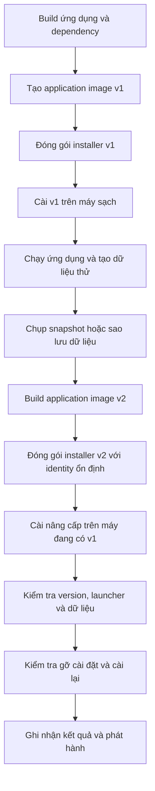

# Tạo bộ cài và kiểm thử nâng cấp trên máy sạch

> **Chương:** Thực hành tổng hợp  
> **Học phần:** `JAVA_VERSION_JAVA16` — khám phá các cải tiến Java 16 còn hữu ích trong Java hiện đại, bao gồm đóng gói JDK, đóng gói ứng dụng và các thay đổi JVM. Bài thực hành tập trung vào việc tạo native installer bằng `jpackage`, quản lý định danh và phiên bản qua các bản phát hành, rồi kiểm tra cài mới, nâng cấp và gỡ cài đặt trên máy sạch.  
> **Phạm vi:** Chỉ sử dụng quy trình và tùy chọn đóng gói còn áp dụng. `jpackage` được hoàn thiện trong Java 16 qua JEP 392 và vẫn là công cụ đóng gói tiêu chuẩn của JDK.

## Mục tiêu thực hành

Sau bài này, bạn có thể:

- Chuẩn bị application image có runtime riêng bằng `jpackage`.
- Tạo bộ cài native phù hợp với Windows, Linux hoặc macOS.
- Giữ định danh sản phẩm ổn định và tăng version đúng cách giữa các lần phát hành.
- Hiểu vai trò của `--app-version`, `--win-upgrade-uuid`, `--linux-package-name`, `--linux-app-release` và `--mac-package-identifier`.
- Cài bản đầu tiên, tạo dữ liệu người dùng thử nghiệm rồi nâng cấp lên bản mới.
- Kiểm tra dữ liệu, cấu hình, shortcut, file association và runtime sau nâng cấp.
- Kiểm thử trên máy sạch không có JDK hoặc dependency phát triển được cài sẵn.
- Phân biệt lỗi ứng dụng, lỗi package manager và lỗi môi trường hệ điều hành.
- Kiểm tra gỡ cài đặt, cài lại, downgrade và khả năng khôi phục dữ liệu.
- Lập checklist phát hành có thể lặp lại trên từng hệ điều hành và kiến trúc.

## 1. Bài toán: phát hành hai phiên bản của một ứng dụng

Giả sử nhóm phát triển có ứng dụng desktop tên `ReportDesk`. Phiên bản `1.0.0` đã được cài trên máy người dùng. Nhóm chuẩn bị phát hành `1.1.0` với các thay đổi:

- Cập nhật logic báo cáo và một số thư viện.
- Bổ sung một trường vào file cấu hình người dùng.
- Thêm một bước chuyển đổi dữ liệu từ schema 1 sang schema 2.
- Giữ nguyên tên ứng dụng, shortcut và vị trí dữ liệu người dùng.
- Cập nhật runtime Java đi kèm nếu cần.

Mục tiêu là người dùng cài bản `1.1.0` và tiếp tục sử dụng dữ liệu đã tạo bằng bản `1.0.0`. Bài thực hành sẽ tạo hai bộ cài và kiểm thử theo trình tự:



Cần tách hai câu hỏi:

1. **Bộ cài có được tạo đúng không?** Kiểm tra package format, metadata, runtime image, signing và công cụ native.
2. **Bản mới có nâng cấp đúng bản cũ không?** Kiểm tra định danh sản phẩm, version, package manager, dữ liệu người dùng, migration và rollback.

Việc jpackage tạo được file MSI, DEB, RPM hoặc PKG chỉ chứng minh bước đóng gói đã hoàn tất. Nó không chứng minh quá trình nâng cấp và dữ liệu người dùng hoạt động đúng.

## 2. Hiểu vai trò của jpackage và native installer

`jpackage` nhận ứng dụng Java và runtime image, tạo application image rồi có thể tạo package native phù hợp với nền tảng. Runtime image thường được tạo bằng `jlink` nếu không cung cấp runtime có sẵn. Nhờ đó người dùng có thể chạy ứng dụng mà không phải tự cài JDK đầy đủ.

Các loại package phổ biến:

| Hệ điều hành | Package native | Cách phân phối thường gặp |
| --- | --- | --- |
| Windows | `msi`, `exe` | Trình cài đặt Windows |
| Linux | `deb`, `rpm` | Package manager của bản phân phối |
| macOS | `pkg`, `dmg` | Installer package hoặc disk image chứa ứng dụng |

Application image có thể được kiểm tra độc lập trước khi tạo installer. Quy trình này giúp xác định lỗi thuộc launcher/runtime hay thuộc package native.

`jpackage` không cung cấp máy chủ cập nhật, cơ chế tự tải bản mới hoặc lịch kiểm tra update. Công cụ tạo package; việc phân phối bản mới và kích hoạt nâng cấp do kênh phát hành, installer và package manager của hệ điều hành đảm nhiệm.

Package native phải được tạo trên nền tảng đích. Muốn phát hành cho Windows, Linux và macOS, cần pipeline hoặc máy build tương ứng cho từng hệ điều hành và kiến trúc được hỗ trợ.

## 3. Chuẩn bị input và tạo application image

Trước khi đóng gói, cần có JAR hoặc module đã build, các dependency, tài nguyên runtime và thông tin launcher.

Ví dụ thư mục đầu vào:

```text
release/
  input/
    report-desk.jar
    reporting-core.jar
    database-driver.jar
    config/
      default.properties
  metadata/
    reportdesk.ico
    reportdesk.png
```

Với ứng dụng classpath, `--input` trỏ đến thư mục chứa các file cần đóng gói; `--main-jar` xác định JAR chính và `--main-class` xác định entry point. Với ứng dụng modular, dùng `--module-path` và `--module`.

Tạo application image phiên bản 1:

```bash
jpackage --type app-image --input release/input --name ReportDesk --app-version 1.0.0 --main-jar report-desk.jar --main-class com.example.report.Main --dest build/image-v1
```

Kiểm tra image trước khi tạo installer:

- Launcher tồn tại và khởi động được.
- Các JAR dependency có mặt và classpath được cấu hình đúng.
- Runtime image có đủ module JDK.
- Tài nguyên được tìm thấy khi chạy từ shortcut và từ terminal.
- Ứng dụng không phụ thuộc JDK cài ngoài.
- Log, cấu hình và dữ liệu người dùng được ghi vào thư mục có quyền phù hợp.

Nếu ứng dụng modular dùng service provider modules, hãy kiểm tra runtime image theo JDK đang dùng. Từ JDK 25, jpackage không tự bao gồm service bindings trong runtime image; nếu ứng dụng cần các provider module được liên kết, truyền `--bind-services` qua `--jlink-options`.

Ví dụ:

```bash
jpackage --type app-image --module-path mods --module com.example.report/com.example.report.Main --jlink-options --bind-services --dest build/image-v1
```

Chỉ thêm tùy chọn này khi ứng dụng modular thực sự cần service binding. Đối chiếu `jpackage --help` và tài liệu đúng phiên bản JDK của pipeline.

## 4. Định danh và version phải ổn định qua các bản phát hành

Installer cần nhận biết bản mới thuộc cùng một sản phẩm. Không thay định danh một cách tùy tiện giữa các release.

| Nền tảng | Định danh cần giữ ổn định | Thông tin cần tăng khi phát hành |
| --- | --- | --- |
| Windows MSI/EXE | `--win-upgrade-uuid` | `--app-version` |
| Linux DEB/RPM | `--linux-package-name` | `--app-version` và khi cần `--linux-app-release` |
| macOS PKG/DMG | `--mac-package-identifier` | `--app-version` |

### 4.1. Windows: giữ Upgrade UUID

`--win-upgrade-uuid` là UUID liên kết các phiên bản package thuộc cùng nhóm nâng cấp. Hãy tạo một UUID cho sản phẩm và giữ nguyên giá trị đó qua các bản phát hành.

Ví dụ UUID minh họa:

```text
8d1c3b20-4e56-4a70-9b11-62a5d3e8c401
```

Không tạo UUID mới cho từng bản cập nhật, vì installer có thể không nhận ra package mới là bản nâng cấp của sản phẩm đang cài. Cũng không dùng chung UUID cho hai ứng dụng độc lập.

Tăng `--app-version` khi phát hành bản mới. Dùng định dạng version tương thích với package Windows; chuỗi ba thành phần số như `1.0.0` và `1.1.0` là lựa chọn dễ kiểm soát.

Phạm vi cài đặt per-user hoặc per-machine cần được lựa chọn rõ ràng. Nếu phát hành sử dụng `--win-per-user-install`, hãy kiểm thử upgrade trong cùng ngữ cảnh user và không đổi scope tùy tiện giữa các release.

### 4.2. Linux: giữ package name và tăng version/release

Package manager nhận diện package theo tên và metadata version. Giữ `--linux-package-name` ổn định, ví dụ `reportdesk`.

`--app-version` cung cấp version ứng dụng/package. `--linux-app-release` là release của RPM hoặc Debian revision của DEB. Khi build lại cùng application version nhưng thay đổi package, tăng release theo quy ước của bản phân phối.

Ví dụ:

| Release | App version | Package release |
| --- | --- | --- |
| Bản đầu | `1.0.0` | `1` |
| Bản tính năng | `1.1.0` | `1` |
| Build sửa package nhưng giữ app version | `1.1.0` | `2` |

Không đổi package name chỉ để biểu diễn version mới. Package manager cần nhận ra đây là cùng một package với version mới hơn.

### 4.3. macOS: giữ package identifier

`--mac-package-identifier` xác định ứng dụng trên macOS. Giữ định danh ổn định, ví dụ `com.example.reportdesk`, qua các bản phát hành. Tăng `--app-version` khi có release mới.

Với `pkg`, kiểm thử cài bản mới trên bản cũ bằng installer. Với `dmg`, cần kiểm thử quy trình mount disk image và thay ứng dụng trong thư mục Applications; DMG là disk image phân phối ứng dụng, không có cùng semantics nâng cấp của package manager như DEB/RPM.

Nếu phân phối ra ngoài môi trường kiểm soát, cần ký bundle/package và thực hiện quy trình notarization phù hợp với chính sách phân phối macOS hiện hành. `jpackage` hỗ trợ ký bằng các tùy chọn macOS; quy trình phát hành vẫn phải xác minh trạng thái chữ ký và khả năng mở trên máy sạch.
## 5. Tạo installer cho từng nền tảng

Các lệnh dưới đây dùng application image đã tạo ở phần trước. Thay đường dẫn và thông tin vendor bằng dữ liệu của sản phẩm thực tế.

### 5.1. Windows MSI

Chạy trên Windows với JDK và toolchain đóng gói phù hợp:

```powershell
jpackage --type msi --name ReportDesk --app-version 1.0.0 --vendor "Example Company" --app-image build/image-v1/ReportDesk --win-upgrade-uuid 8d1c3b20-4e56-4a70-9b11-62a5d3e8c401 --win-menu --win-shortcut --dest dist/windows
```

Kiểm tra:

- MSI có version và vendor đúng.
- Upgrade UUID giống với bản phát hành trước.
- Shortcut và Start Menu entry dùng đúng tên.
- Scope cài đặt nhất quán.
- Package cài được trên Windows sạch theo quyền user dự kiến.

### 5.2. Linux DEB hoặc RPM

Trên Linux, tạo package theo loại bản phân phối:

```bash
jpackage \
  --type deb \
  --name ReportDesk \
  --app-version 1.0.0 \
  --vendor "Example Company" \
  --linux-package-name reportdesk \
  --linux-app-release 1 \
  --linux-shortcut \
  --app-image build/image-v1/ReportDesk \
  --dest dist/linux
```

Với RPM, thay loại package và giữ package name ổn định:

```bash
jpackage \
  --type rpm \
  --name ReportDesk \
  --app-version 1.0.0 \
  --vendor "Example Company" \
  --linux-package-name reportdesk \
  --linux-app-release 1 \
  --linux-shortcut \
  --app-image build/image-v1/ReportDesk \
  --dest dist/linux
```

Kiểm tra metadata package, dependency hệ điều hành, launcher desktop và version/release. Trên các bản phân phối khác nhau, dùng package manager tương ứng để cài và nâng cấp.

### 5.3. macOS PKG

Chạy trên macOS:

```bash
jpackage \
  --type pkg \
  --name ReportDesk \
  --app-version 1.0.0 \
  --vendor "Example Company" \
  --mac-package-identifier com.example.reportdesk \
  --app-image build/image-v1/ReportDesk \
  --dest dist/macos
```

Khi cần ký package, dùng tùy chọn ký và identity được quản lý trong môi trường release. Không đưa private signing key vào source repository hoặc artifact công khai.

Nếu chọn `dmg`, tạo disk image và kiểm thử thao tác mount/copy/replace ứng dụng theo hướng dẫn phát hành của sản phẩm.

## 6. Tạo phiên bản 2 mà vẫn giữ định danh sản phẩm

Sau khi cập nhật ứng dụng, build lại application image với version mới:

```bash
jpackage --type app-image --input release-v2/input --name ReportDesk --app-version 1.1.0 --main-jar report-desk.jar --main-class com.example.report.Main --dest build/image-v2
```

Tạo package phiên bản 2 với các định danh ổn định:

**Windows:**

```powershell
jpackage --type msi --name ReportDesk --app-version 1.1.0 --vendor "Example Company" --app-image build/image-v2/ReportDesk --win-upgrade-uuid 8d1c3b20-4e56-4a70-9b11-62a5d3e8c401 --win-menu --win-shortcut --dest dist/windows
```

**Linux DEB:**

```bash
jpackage \
  --type deb \
  --name ReportDesk \
  --app-version 1.1.0 \
  --vendor "Example Company" \
  --linux-package-name reportdesk \
  --linux-app-release 1 \
  --linux-shortcut \
  --app-image build/image-v2/ReportDesk \
  --dest dist/linux
```

**macOS PKG:**

```bash
jpackage \
  --type pkg \
  --name ReportDesk \
  --app-version 1.1.0 \
  --vendor "Example Company" \
  --mac-package-identifier com.example.reportdesk \
  --app-image build/image-v2/ReportDesk \
  --dest dist/macos
```

Đối chiếu v1 và v2:

- Tên sản phẩm không đổi.
- Định danh nâng cấp/package không đổi.
- Version tăng từ `1.0.0` lên `1.1.0`.
- Package mới chứa application image và runtime đúng.
- Metadata, shortcut và file association vẫn theo chính sách sản phẩm.
- Không vô tình đóng gói file cấu hình hoặc dữ liệu người dùng vào thư mục cài đặt.

## 7. Dữ liệu người dùng phải tách khỏi thư mục cài đặt

Installer có thể thay thế hoặc xóa file trong thư mục cài đặt khi nâng cấp hoặc gỡ cài đặt. Vì vậy, không lưu dữ liệu cần giữ của người dùng trong thư mục chứa launcher, JAR hoặc runtime image.

Có thể dùng vị trí dữ liệu theo hệ điều hành:

| Hệ điều hành | Vị trí dữ liệu ứng dụng thường dùng |
| --- | --- |
| Windows | Thư mục dưới `LOCALAPPDATA` hoặc `APPDATA` |
| macOS | `~/Library/Application Support/ReportDesk` |
| Linux | `XDG_DATA_HOME/reportdesk` hoặc `~/.local/share/reportdesk` |

Ví dụ helper Java 16:

```java
import java.io.IOException;
import java.nio.file.Files;
import java.nio.file.Path;
import java.util.Locale;

final class UserData {

    private UserData() {
    }

    static Path directory() throws IOException {
        String os = System.getProperty("os.name")
                .toLowerCase(Locale.ROOT);

        Path home = Path.of(System.getProperty("user.home"));
        Path data;

        if (os.contains("win")) {
            String localAppData = System.getenv("LOCALAPPDATA");

            data = localAppData == null || localAppData.isBlank()
                    ? home.resolve("AppData/Local/ReportDesk")
                    : Path.of(localAppData, "ReportDesk");

        } else if (os.contains("mac")) {
            data = home.resolve(
                    "Library/Application Support/ReportDesk"
            );

        } else {
            String xdgDataHome = System.getenv("XDG_DATA_HOME");

            Path base = xdgDataHome == null || xdgDataHome.isBlank()
                    ? home.resolve(".local/share")
                    : Path.of(xdgDataHome);

            data = base.resolve("reportdesk");
        }

        return Files.createDirectories(data);
    }
}
```

Helper tạo thư mục dữ liệu nếu chưa có. Ứng dụng có thể lưu database cục bộ, cấu hình và log ở đây theo chính sách riêng.

Không mặc định xóa thư mục dữ liệu người dùng khi uninstall. Nếu sản phẩm cần tính năng xóa sạch dữ liệu, phải yêu cầu xác nhận rõ ràng và thông báo hậu quả. Installer chỉ nên quản lý file thuộc sản phẩm trong phạm vi cài đặt đã khai báo.

## 8. Thiết kế migration dữ liệu cho bản nâng cấp

Một bản mới có thể thay đổi schema database hoặc cấu trúc file cấu hình. Việc cài đặt thành công không bảo đảm dữ liệu cũ đọc được.

Ví dụ:

| Schema | Cấu trúc |
| --- | --- |
| 1 | `reports(id, title, created_at)` |
| 2 | Thêm cột `format` và bảng `report_preferences` |

Khi bản `1.1.0` chạy lần đầu:

1. Đọc schema version hiện tại.
2. Nếu schema cũ hơn version ứng dụng hỗ trợ, tạo backup trước migration.
3. Chạy từng bước migration theo thứ tự.
4. Ghi schema version mới chỉ sau khi migration thành công.
5. Nếu migration thất bại, giữ backup và đưa ra thông báo có thể khôi phục.
6. Chạy lại ứng dụng để xác nhận migration không thực hiện lặp sai dữ liệu.

Migration nên có tính idempotent hoặc có bảng lịch sử migration để tránh chạy lại một bước đã hoàn tất. Với database, dùng transaction khi engine và thay đổi schema cho phép; với file, ghi file mới rồi thay thế nguyên tử khi phù hợp.

Không ghi đè cấu hình người dùng bằng file mặc định của bản mới. Hãy merge các giá trị mặc định mới vào cấu hình hiện tại theo quy tắc rõ ràng, giữ lại giá trị người dùng đã tùy chỉnh và xử lý key đã bị loại bỏ.
## 9. Chuẩn bị máy sạch để kiểm thử

Máy sạch là môi trường mô phỏng người dùng mới cài ứng dụng. Có thể dùng virtual machine hoặc máy thử nghiệm có snapshot để khôi phục giữa các lượt.

Một máy kiểm thử tốt nên:

- Cài đúng phiên bản hệ điều hành và kiến trúc CPU được hỗ trợ.
- Không cài JDK/JRE phát triển bên ngoài application image.
- Không có dependency vô tình được cài sẵn từ IDE hoặc build tool.
- Có user tiêu chuẩn với quyền giống người dùng thực tế.
- Có thể kiểm thử thêm tài khoản admin nếu installer yêu cầu quyền nâng cao.
- Có trạng thái mạng tắt để phát hiện dependency bị tải ngầm.
- Có đường dẫn home/profile mới và không có dữ liệu ứng dụng cũ.
- Dùng locale, timezone và định dạng ngày/tiền tệ đại diện cho thị trường phát hành.

Tạo snapshot trước khi cài. Sau mỗi kịch bản, khôi phục snapshot hoặc dùng VM mới để tránh kết quả bị ảnh hưởng bởi file và registry còn sót từ lần thử trước.

Máy sạch không chỉ là máy không có JDK. Cần loại bỏ cả biến môi trường, PATH, native runtime hoặc file cấu hình mà máy build có thể cung cấp nhưng package không mang theo.

## 10. Kịch bản A: cài mới phiên bản 1

Trên snapshot sạch:

1. Ghi lại OS, version, architecture và tài khoản đang dùng.
2. Xác minh máy không có JDK/JRE bên ngoài cần cho ứng dụng.
3. Cài package `1.0.0`.
4. Kiểm tra installer hoàn tất và package manager ghi nhận sản phẩm.
5. Mở ứng dụng từ shortcut/menu và từ launcher trực tiếp.
6. Tạo một báo cáo, cấu hình tùy chỉnh và dữ liệu mẫu.
7. Đóng ứng dụng đúng cách.
8. Xác minh dữ liệu nằm trong thư mục user data, không nằm trong installation directory.
9. Khởi động lại ứng dụng và xác nhận dữ liệu còn nguyên.

Ghi nhận:

- Thời gian cài đặt và thông báo lỗi.
- Version hiển thị trong ứng dụng.
- Đường dẫn cài đặt và runtime đi kèm.
- Shortcut/menu và file association.
- Vị trí database, cấu hình, log.
- Exit code hoặc log nếu launcher thất bại.

## 11. Kịch bản B: nâng cấp từ phiên bản 1 lên phiên bản 2

Không gỡ bản cũ trước khi cài bản mới. Mục tiêu là kiểm tra đúng luồng upgrade mà người dùng sẽ thực hiện.

Trình tự:

1. Cài `1.0.0` trên máy thử nghiệm.
2. Tạo dữ liệu người dùng và tùy chỉnh cấu hình.
3. Sao lưu thư mục dữ liệu hoặc database để có điểm khôi phục.
4. Đóng ứng dụng và mọi process liên quan.
5. Cài package `1.1.0` bằng cơ chế upgrade của nền tảng.
6. Mở ứng dụng sau nâng cấp.
7. Xác minh version hiển thị là `1.1.0`.
8. Xác minh dữ liệu cũ vẫn tồn tại.
9. Xác minh migration schema hoàn tất và không tạo bản ghi trùng.
10. Kiểm tra shortcut, file association, runtime và log.
11. Khởi động lại máy hoặc user session nếu sản phẩm yêu cầu, rồi kiểm thử lại.

Không dùng thao tác uninstall v1 rồi install v2 để thay thế bài kiểm thử upgrade. Cách đó bỏ qua cơ chế nâng cấp của installer và có thể che lỗi định danh package hoặc dữ liệu bị xóa.

## 12. Thực hiện upgrade theo hệ điều hành

### 12.1. Windows MSI

Cài v1 bằng installer MSI, sau đó chạy MSI v2 với cùng `--win-upgrade-uuid` và version mới.

Ví dụ:

```powershell
msiexec /i dist/windows/ReportDesk-1.0.0.msi
```

Sau khi kiểm tra dữ liệu, nâng cấp bằng package v2:

```powershell
msiexec /i dist/windows/ReportDesk-1.1.0.msi
```

Tên file sinh ra phụ thuộc cấu hình package; thay bằng tên artifact thực tế.

Kiểm tra:

- Windows nhận diện package mới là release của cùng sản phẩm.
- Bản cũ được nâng cấp theo thiết kế installer.
- Shortcut không bị nhân đôi hoặc trỏ đến đường dẫn cũ.
- App version và file thực thi đúng bản mới.
- Dữ liệu user không bị xóa.
- Phạm vi per-user/per-machine và quyền cài đặt nhất quán.

Có thể xem log chi tiết của Windows Installer khi cần chẩn đoán:

```powershell
msiexec /i dist/windows/ReportDesk-1.1.0.msi /L*V upgrade.log
```

Không chỉ dựa vào thông báo installer thành công. Hãy mở ứng dụng và xác minh trạng thái dữ liệu sau khi cài.

### 12.2. Linux DEB

Cài package v1 bằng package manager của Debian/Ubuntu:

```bash
sudo apt install ./reportdesk_1.0.0-1_amd64.deb
```

Sau khi tạo dữ liệu và kiểm thử bản v1, nâng cấp bằng package v2 có cùng package name và version mới hơn:

```bash
sudo apt install ./reportdesk_1.1.0-1_amd64.deb
```

Tên file artifact có thể khác theo output thực tế. Dùng `apt` để cài package local và giải quyết dependency theo môi trường test.

Kiểm tra package manager ghi nhận version mới, launcher desktop hoạt động, dữ liệu user còn nguyên và không có dependency hệ điều hành bị thiếu.

### 12.3. Linux RPM

Cài bản đầu bằng DNF:

```bash
sudo dnf install ./reportdesk-1.0.0-1.x86_64.rpm
```

Nâng cấp bằng package có version/release mới:

```bash
sudo dnf upgrade ./reportdesk-1.1.0-1.x86_64.rpm
```

Kiểm tra package name ổn định, version/release tăng đúng, script package (nếu có) không xóa dữ liệu người dùng và ứng dụng chạy sau nâng cấp.

Cú pháp và tên package manager có thể khác giữa các distro; dùng công cụ được hỗ trợ bởi bản Linux mục tiêu.

### 12.4. macOS PKG

Cài v1:

```bash
sudo installer -pkg ReportDesk-1.0.0.pkg -target /
```

Sau khi tạo dữ liệu, cài v2 với cùng `--mac-package-identifier`:

```bash
sudo installer -pkg ReportDesk-1.1.0.pkg -target /
```

Kiểm tra ứng dụng trong thư mục Applications, version bundle, chữ ký, quyền chạy và dữ liệu người dùng.

Với DMG, kiểm thử riêng quy trình mount, kéo ứng dụng vào Applications, thay thế phiên bản cũ và mở ứng dụng. Không xem DMG là cơ chế upgrade có cùng hành vi với MSI, DEB, RPM hoặc PKG.
## 13. Kiểm tra trên máy không có JDK và dependency phát triển

Application image do jpackage tạo thường chứa Java runtime cần thiết. Vì vậy, kiểm thử quan trọng là chạy trên máy không cài JDK/JRE bên ngoài.

Các bước:

- Tắt mạng sau khi package đã được đưa vào VM.
- Không cài IDE, build tool hoặc JDK phát triển.
- Cài installer từ thư mục local.
- Khởi chạy ứng dụng bằng shortcut và launcher.
- Thực hiện các chức năng cần truy cập database, file, TLS, font, printer hoặc native library nếu sản phẩm sử dụng.
- Kiểm tra các thư viện native của hệ điều hành có sẵn theo đúng yêu cầu package.
- Ghi log nếu ứng dụng không khởi động.

Runtime đi kèm không tự bao gồm mọi dependency hệ điều hành. Ví dụ native library, driver, database service, font hoặc executable bên ngoài vẫn cần được đóng gói hoặc khai báo dependency theo nền tảng.

Nếu ứng dụng dùng native code, kiểm thử đúng kiến trúc CPU và OS. Package x64 không thay thế package ARM64; không giả định một artifact có thể chạy trên mọi kiến trúc.

## 14. Kịch bản C: gỡ cài đặt và cài lại

Sau khi kiểm thử upgrade:

1. Đóng ứng dụng.
2. Gỡ cài đặt bằng cơ chế của hệ điều hành.
3. Kiểm tra launcher, shortcut, file association và package metadata đã được gỡ theo thiết kế.
4. Kiểm tra thư mục cài đặt không còn file thuộc release đã gỡ.
5. Kiểm tra dữ liệu user được giữ lại hoặc xóa theo chính sách đã công bố.
6. Cài lại bản mới.
7. Mở ứng dụng và xác minh dữ liệu được nhận diện đúng.

Gỡ cài đặt cần có hợp đồng rõ ràng:

- File thuộc application image và runtime do installer quản lý.
- File dữ liệu người dùng được quản lý riêng.
- File do người dùng tự tạo không bị xóa ngoài dự kiến.
- Service, shortcut, association và registry/desktop entry được xử lý theo package.

Không để logic cleanup xóa toàn bộ thư mục user data một cách âm thầm. Nếu có lựa chọn xóa dữ liệu, hiển thị rõ và kiểm thử riêng.

## 15. Kiểm thử downgrade và rollback

Nâng cấp có thể thất bại do migration, dependency hoặc lỗi ứng dụng. Cần có phương án phục hồi.

Các trường hợp nên kiểm thử:

| Tình huống | Điều cần xác nhận |
| --- | --- |
| Cài v2 thất bại giữa chừng | Bản đang cài và dữ liệu ở trạng thái có thể khôi phục |
| Migration thất bại | Backup còn nguyên và lỗi được ghi nhận |
| Cài lại v1 sau v2 | Chính sách downgrade được hiểu rõ; dữ liệu schema mới không bị mất âm thầm |
| Cài v2 lần thứ hai | Không tạo thêm shortcut, service hoặc dữ liệu trùng |
| Máy mất điện hoặc process installer bị dừng | Package manager và ứng dụng không ở trạng thái hỏng không thể sửa |
| User không có quyền ghi thư mục cài đặt | Installer báo lỗi rõ hoặc yêu cầu quyền phù hợp |

Không giả định installer tự rollback mọi thay đổi dữ liệu do ứng dụng thực hiện. Package manager có thể quản lý file package, nhưng migration database hoặc file user data là trách nhiệm của ứng dụng.

Nếu v2 chuyển schema dữ liệu theo cách v1 không thể đọc lại, không thể rollback đơn giản bằng cách cài lại v1. Cần backup trước migration, chiến lược tương thích ngược hoặc quy trình restore dữ liệu đã kiểm thử.

## 16. Ma trận kiểm thử máy sạch

Có thể dùng ma trận sau làm bộ kiểm thử phát hành tối thiểu:

| Nhóm | Trạng thái | Kết quả mong đợi |
| --- | --- | --- |
| Cài mới | Máy sạch, user thường | Cài và chạy không cần JDK ngoài |
| Cài mới | Máy có JDK khác version | Ứng dụng vẫn dùng runtime đi kèm |
| Cài mới | Máy offline | Chức năng cốt lõi hoạt động nếu không cần dịch vụ mạng |
| Nâng cấp | v1 có dữ liệu sang v2 | Dữ liệu được giữ và migration thành công |
| Nâng cấp | v1 có cấu hình tùy chỉnh | Giá trị tùy chỉnh được giữ theo chính sách |
| Nâng cấp | v1 đang chạy | Installer yêu cầu đóng app hoặc xử lý process theo thiết kế |
| Nâng cấp | Cài v2 lần thứ hai | Không tạo bản cài hoặc dữ liệu trùng |
| Downgrade | v2 về v1 | Hành vi bị chặn hoặc khôi phục theo chính sách rõ ràng |
| Gỡ cài đặt | Có dữ liệu user | Dữ liệu được giữ/xóa đúng chính sách |
| Cài lại | Còn dữ liệu từ lần trước | Ứng dụng đọc được hoặc yêu cầu migration phù hợp |
| Hệ điều hành | Mỗi OS/version được hỗ trợ | Launcher, runtime và package hoạt động |
| Kiến trúc | Mỗi CPU architecture được hỗ trợ | Native dependency tương thích |

Ngoài ra, kiểm thử path có khoảng trắng và ký tự Unicode, tên user dài, quyền thư mục hạn chế, locale khác nhau, timezone, độ phân giải màn hình và cấu hình đa màn hình nếu ứng dụng có UI.

## 17. Thu thập log và bằng chứng khi upgrade thất bại

Mỗi lần chạy nên ghi nhận:

- Tên package, version, release và checksum.
- OS, build number, architecture và tài khoản cài đặt.
- Phiên bản JDK dùng để tạo package.
- Loại package và định danh sản phẩm.
- Lệnh jpackage hoặc cấu hình build tương ứng.
- Log installer/package manager và exit code.
- Log khởi động ứng dụng.
- Version database/schema trước và sau migration.
- Đường dẫn dữ liệu user và kết quả backup.
- Các bước tái hiện lỗi.

Với Windows MSI, dùng log của Windows Installer như ví dụ ở trên. Với Linux, kiểm tra output của package manager và package metadata. Với macOS, lưu output của installer, kiểm tra bundle và chữ ký.

Trước khi chia sẻ log, che username, đường dẫn riêng tư, token, thông tin kết nối và dữ liệu cá nhân. Không đưa private signing key hoặc credential vào artifact debug.

## 18. Các lỗi thường gặp

| Triệu chứng | Nguyên nhân có thể | Hướng xử lý |
| --- | --- | --- |
| Bản mới cài song song với bản cũ trên Windows | Upgrade UUID thay đổi hoặc package identity không nhất quán | Giữ `--win-upgrade-uuid`, kiểm tra version và scope cài đặt |
| Windows từ chối cài version mới | Version package không hợp lệ hoặc installer không nhận dạng upgrade | Kiểm tra `--app-version`, UUID và log MSI |
| Linux xem bản mới là package khác | `--linux-package-name` thay đổi | Giữ package name và tăng version/release |
| Package manager không chọn bản mới | Version/release không cao hơn bản đã cài | Kiểm tra thứ tự version theo distro |
| macOS xuất hiện hai ứng dụng | Bundle identifier hoặc đường dẫn ứng dụng thay đổi | Giữ `--mac-package-identifier` và kiểm tra cách cài PKG/DMG |
| Ứng dụng mất cấu hình sau upgrade | Lưu dữ liệu trong installation directory hoặc installer ghi đè file user | Chuyển dữ liệu sang thư mục user data và kiểm thử migration |
| Ứng dụng yêu cầu cài Java | Runtime image không được đưa vào application image hoặc launcher sai | Kiểm tra `--runtime-image`, jlink và cấu trúc image |
| Chạy được trên máy build nhưng lỗi trên VM | Máy build có dependency ngoài package | Kiểm thử offline trên máy sạch và đóng gói dependency cần thiết |
| Shortcut mở phiên bản cũ | Shortcut hoặc đường dẫn launcher không được cập nhật | Kiểm tra package identity, shortcut và installation path |
| Migration tạo dữ liệu trùng | Migration không idempotent hoặc version marker ghi sai | Dùng migration history và transaction/backup |
| Uninstall xóa dữ liệu ngoài dự kiến | Cleanup trộn dữ liệu user với file cài đặt | Tách user data và định nghĩa rõ chính sách uninstall |
| Rollback không đọc được database | Schema đã chuyển theo hướng không tương thích ngược | Backup trước migration và kiểm thử restore |
## 19. Bài tập tự luyện

### Bài 1: Giữ định danh Windows

Bạn phát hành MSI v1 và MSI v2. Nhóm thay đổi `--win-upgrade-uuid` ở bản v2 vì nghĩ UUID là version. Điều gì có thể xảy ra và phải sửa thế nào?

**Đáp án:** Installer có thể không nhận diện v2 là bản nâng cấp của v1. Hãy giữ cùng Upgrade UUID cho các phiên bản của một sản phẩm và tăng `--app-version`.

### Bài 2: Package Linux không nâng cấp

Bản DEB mới được tạo nhưng package manager nhận diện như một package khác. Nguyên nhân nào cần kiểm tra đầu tiên?

**Đáp án:** Kiểm tra `--linux-package-name`. Tên package cần ổn định; version và Debian revision được dùng để phân biệt bản phát hành.

### Bài 3: Cấu hình biến mất sau nâng cấp

Ứng dụng lưu `settings.json` trong thư mục cài đặt. Sau khi nâng cấp, file bị thay thế bằng cấu hình mặc định. Thiết kế lại thế nào?

**Đáp án:** Lưu cấu hình người dùng trong thư mục dữ liệu/config của user. File mặc định thuộc application image; khi khởi động, ứng dụng tạo cấu hình ban đầu hoặc merge giá trị mặc định mà không ghi đè tùy chỉnh hiện có.

### Bài 4: Kiểm thử máy sạch

Ứng dụng chạy tốt trên máy phát triển nhưng lỗi trên VM không có JDK. Nêu các bước kiểm tra.

**Đáp án:** Kiểm tra application image có runtime đi kèm, dependency JAR/module, native library và tài nguyên; chạy launcher từ terminal để lấy log; xác nhận package đúng OS/architecture; kiểm thử offline để phát hiện dependency bị tải ngầm.

### Bài 5: Migration thất bại

Bản v2 thay đổi schema database. Migration dừng giữa chừng và người dùng muốn cài lại v1. Cần chuẩn bị gì trước khi phát hành?

**Đáp án:** Có backup trước migration, version schema rõ ràng, migration theo bước và phương án restore. Nếu schema mới không tương thích với v1, phải chặn downgrade hoặc khôi phục backup; không giả định chỉ cài lại binary cũ là đủ.

## 20. Checklist trước khi phát hành

- [ ] Application image v1 và v2 đã được chạy thử độc lập.
- [ ] Package được build trên đúng OS và kiến trúc đích.
- [ ] `--app-version` tăng đúng giữa các release.
- [ ] Windows giữ nguyên `--win-upgrade-uuid`.
- [ ] Linux giữ nguyên `--linux-package-name` và tăng version/release đúng.
- [ ] macOS giữ nguyên `--mac-package-identifier`.
- [ ] Package metadata, vendor, shortcut và file association đúng.
- [ ] Signing và xác minh chữ ký được thực hiện theo chính sách phân phối.
- [ ] Máy sạch không có JDK ngoài đã cài và chạy được ứng dụng.
- [ ] Nâng cấp v1 → v2 giữ dữ liệu và cấu hình người dùng.
- [ ] Migration có backup và có thể phục hồi.
- [ ] Cài lại, uninstall và downgrade đã được kiểm thử.
- [ ] Không xóa dữ liệu người dùng ngoài chính sách đã công bố.
- [ ] Log, checksum và thông tin build được lưu cùng release artifact.

## Ghi nhớ

`jpackage` tạo application image và native installer; installer/package manager của hệ điều hành quyết định cách cài và nâng cấp package. Muốn nâng cấp đúng, phải giữ định danh sản phẩm ổn định và tăng version theo quy tắc nền tảng: Windows dùng cùng `--win-upgrade-uuid`, Linux giữ `--linux-package-name` và quản lý version/release, macOS giữ `--mac-package-identifier`. Kiểm tra application image trước, sau đó cài v1 trên máy sạch, tạo dữ liệu, cài nâng cấp v2 và xác minh migration. Lưu dữ liệu người dùng ngoài installation directory, có backup trước thay đổi schema và kiểm thử uninstall/rollback. Máy sạch phải đại diện cho OS, kiến trúc, quyền và dependency của người dùng thực tế; một lần tạo package thành công chưa đủ để kết luận bản phát hành đã sẵn sàng.

## Tài liệu tham khảo

- [JEP 392 — Packaging Tool](https://openjdk.org/jeps/392).
- [The jpackage Command — Java SE 16](https://docs.oracle.com/en/java/javase/16/docs/specs/man/jpackage.html).
- [The jpackage Command — Java SE 26](https://docs.oracle.com/en/java/javase/26/docs/specs/man/jpackage.html).
- [Packaging Overview — Java SE 26](https://docs.oracle.com/en/java/javase/26/jpackage/packaging-overview.html).
- [Basic Packaging — Java SE 26](https://docs.oracle.com/en/java/javase/26/jpackage/basic-packaging.html).
- [Manage the Installation of Your Application — Java SE 26](https://docs.oracle.com/en/java/javase/26/jpackage/manage-installation.html).
- [Packaging Tool User's Guide — Java SE 26](https://docs.oracle.com/en/java/javase/26/jpackage/index.html).


