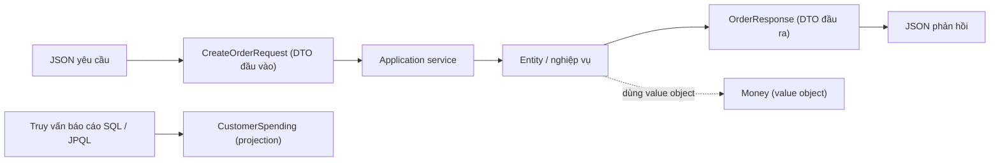

# Chọn `record` cho DTO, kết quả truy vấn và đối tượng giá trị

> **Học phần:** `JAVA_VERSION_JAVA16` · **Chương:** Ứng dụng record. Bài học tập trung vào những cách dùng `record` được chuẩn hóa từ Java 16 và vẫn phù hợp với Java hiện đại; không phụ thuộc vào tính năng thử nghiệm.

`record` (chính thức từ **Java 16**, JEP 395) thích hợp khi một kiểu dữ liệu được xác định chủ yếu bằng **các thành phần dữ liệu mà nó mang**. Ba ứng dụng thường gặp nhất là **DTO** (dữ liệu trao đổi giữa các lớp/hệ thống), **kết quả truy vấn** (projection) và **đối tượng giá trị** (value object). Cả ba đều cần biểu diễn dữ liệu rõ ràng, nhưng cách lựa chọn và các ràng buộc thiết kế có khác nhau.

Sau bài học, bạn có thể:

- Xác định khi nào `record` phù hợp hơn một `class` thông thường.
- Thiết kế DTO đầu vào/đầu ra và kiểu kết quả truy vấn không gắn với vòng đời của thực thể lưu trữ.
- Dùng constructor của `record` để bảo vệ bất biến của value object.
- Nhận biết giới hạn về tính bất biến, `equals`/`hashCode`, framework và khả năng thay đổi hợp đồng dữ liệu.

## 1. Nguyên tắc chọn `record`

Ví dụ khai báo:

```java
public record ProductSummary(long id, String name, int stock) {}
```

Khai báo trên có ý nghĩa gần tương đương với một lớp `final` chứa ba trường `private final`, constructor nhận đủ ba giá trị, các phương thức đọc `id()`, `name()`, `stock()`, và các phương thức `equals()`, `hashCode()`, `toString()` được sinh theo các thành phần đã khai báo. Không có setter; không thể kế thừa `ProductSummary`. Tuy vậy, `record` vẫn được phép triển khai interface, thêm phương thức, kiểm tra dữ liệu trong constructor và khai báo thành viên `static`.

Hai đặc điểm quan trọng khi quyết định dùng `record`:

1. **Trạng thái được công khai theo cấu trúc.** Tên, kiểu và thứ tự component là một phần của API. Người dùng kiểu dữ liệu biết nó chứa gì, và có thể dựng lại nó bằng constructor chuẩn (*canonical constructor*).
2. **Bất biến ở mức tham chiếu, không tự động bất biến sâu.** Không thể gán lại các trường của `record` sau khởi tạo, nhưng đối tượng mutable được giữ trong trường vẫn có thể đổi trạng thái nếu không sao chép phòng vệ.

| Nhu cầu | `record` có phù hợp? | Lý do |
|---|---|---|
| DTO request/response mang dữ liệu rõ ràng | **Thường phù hợp** | Khai báo ngắn, biểu diễn hợp đồng dữ liệu trực tiếp |
| Dòng kết quả SQL, bản tóm tắt báo cáo | **Rất phù hợp** | Chỉ giữ những cột cần dùng, không mang hành vi lưu trữ |
| Value object như mã sản phẩm, số tiền | **Phù hợp** | Dữ liệu xác định danh tính theo giá trị; có thể kiểm tra bất biến |
| JPA entity có định danh và vòng đời cập nhật | **Không nên dùng** | Entity thường cần mô hình trạng thái, constructor/proxy theo quy ước JPA |
| Đối tượng cần setter, chuyển trạng thái liên tục | **Không phù hợp** | `record` không có trạng thái thực thể có thể thay đổi |
| Dữ liệu chứa `List`, mảng, đối tượng mutable | **Cần xử lý thêm** | Phải xem xét bản sao và ngữ nghĩa so sánh |

**Câu hỏi quyết định:** “Hai đối tượng có cùng tập giá trị thành phần có được xem là cùng một giá trị, và tôi có sẵn sàng công khai các thành phần đó làm API không?” Nếu câu trả lời là có, `record` là ứng viên tốt. Nếu đối tượng có danh tính riêng, vòng đời và trạng thái thay đổi theo thời gian, hãy cân nhắc `class`/entity.

## 2. `record` cho DTO: ranh giới giữa các lớp và API

DTO (*Data Transfer Object*) chuyên chở dữ liệu qua một ranh giới như HTTP API, tầng application hoặc hệ thống gửi sự kiện. DTO không nên tự lưu dữ liệu vào cơ sở dữ liệu hoặc chứa nghiệp vụ phụ thuộc hạ tầng.

### 2.1. DTO nhận yêu cầu: kiểm tra hợp lệ ngay khi tạo

File `CreateOrderRequest.java`:

```java
public record CreateOrderRequest(long productId, int quantity) {
    public CreateOrderRequest {
        if (productId <= 0) {
            throw new IllegalArgumentException("productId must be positive");
        }
        if (quantity <= 0) {
            throw new IllegalArgumentException("quantity must be positive");
        }
    }
}
```

Cú pháp `public CreateOrderRequest { ... }` là **compact canonical constructor**. Java tự gán các tham số cho trường tương ứng sau phần thân constructor. Nếu dữ liệu không đạt yêu cầu, đối tượng không được tạo. Trường hợp cần thông báo lỗi đầu vào thân thiện ở HTTP API, ứng dụng có thể dùng cơ chế validation của framework và chuyển ngoại lệ thành phản hồi phù hợp.

Ví dụ payload JSON ứng với DTO:

```json
{
  "productId": 42,
  "quantity": 3
}
```

Tên `productId` và `quantity` là các tên dữ liệu trong hợp đồng. Với thư viện ánh xạ JSON hỗ trợ record (chẳng hạn các bản Jackson hiện đại), có thể ánh xạ payload thông qua các component và canonical constructor. Hãy kiểm tra phiên bản thư viện, cấu hình và quy tắc đặt tên khi tích hợp; bản thân ngôn ngữ Java không tự thực hiện ánh xạ JSON.

### 2.2. DTO trả kết quả: chỉ công khai dữ liệu cần thiết

File `OrderResponse.java`:

```java
import java.math.BigDecimal;
import java.time.Instant;
import java.util.Objects;

public record OrderResponse(
        long id,
        String orderCode,
        BigDecimal total,
        Instant createdAt
) {
    public OrderResponse {
        if (id <= 0) {
            throw new IllegalArgumentException("id must be positive");
        }
        orderCode = Objects.requireNonNull(orderCode, "orderCode").strip();
        if (orderCode.isEmpty()) {
            throw new IllegalArgumentException("orderCode must not be blank");
        }
        Objects.requireNonNull(total, "total");
        Objects.requireNonNull(createdAt, "createdAt");
    }
}
```

Cách sử dụng:

```java
OrderResponse response = new OrderResponse(
        1001L,
        "ORD-1001",
        new BigDecimal("249000"),
        Instant.parse("2026-11-01T08:00:00Z")
);

System.out.println(response.orderCode()); // ORD-1001
```

Dùng `BigDecimal` cho tiền tệ thay vì `double` để tránh sai lệch biểu diễn số thực nhị phân. `BigDecimal`, `String` và `Instant` đều là các kiểu bất biến, giúp `OrderResponse` có ngữ nghĩa ổn định.

**Thiết kế DTO tốt:** giữ trường cần cho từng API, đặt tên rõ nghĩa, quyết định trước cách xử lý `null` và mã hóa thời gian/tiền tệ. Không trả thẳng JPA entity ra bên ngoài, vì điều đó có thể để lộ dữ liệu nội bộ, quan hệ lazy-loading và cấu trúc bảng.

### 2.3. Khi DTO thay đổi

Thêm, xóa hoặc đổi thứ tự component sẽ thay đổi canonical constructor, có thể làm hỏng nơi gọi constructor trực tiếp; đổi tên/kiểu component còn có thể làm hỏng hợp đồng JSON. Vì vậy:

- Tách request và response khi yêu cầu xác thực hoặc trường dữ liệu khác nhau.
- Dùng các DTO riêng cho từng mục đích khi một “DTO dùng chung” bắt đầu có quá nhiều trường tùy chọn.
- Đánh giá tương thích API và hợp đồng serialization trước khi đổi component; dùng versioning hoặc lớp chuyển đổi khi cần.

## 3. `record` cho kết quả truy vấn: projection gọn và an toàn

Kết quả truy vấn thường chỉ cần một phần cột hoặc giá trị tổng hợp. Đây là **projection**: kiểu chỉ đọc mô tả hình dạng dữ liệu trả về, không phải entity có vòng đời trong persistence context.

Ví dụ báo cáo doanh thu theo khách hàng:

File `CustomerSpending.java`:

```java
import java.math.BigDecimal;
import java.util.Objects;

public record CustomerSpending(
        long customerId,
        String customerName,
        BigDecimal totalSpent
) {
    public CustomerSpending {
        if (customerId <= 0) {
            throw new IllegalArgumentException("customerId must be positive");
        }
        Objects.requireNonNull(customerName, "customerName");
        Objects.requireNonNull(totalSpent, "totalSpent");
    }
}
```

### 3.1. Ánh xạ với JDBC

File `SpendingRepository.java` (ứng dụng sở hữu và quản lý vòng đời `Connection` ở bên ngoài phương thức):

```java
import java.sql.Connection;
import java.sql.PreparedStatement;
import java.sql.ResultSet;
import java.sql.SQLException;
import java.util.ArrayList;
import java.util.List;

public final class SpendingRepository {
    public List<CustomerSpending> findTotals(Connection connection)
            throws SQLException {
        String sql = """
                SELECT c.id AS customer_id,
                       c.name AS customer_name,
                       SUM(o.total) AS total_spent
                FROM customers c
                JOIN orders o ON o.customer_id = c.id
                GROUP BY c.id, c.name
                ORDER BY total_spent DESC
                """;

        List<CustomerSpending> rows = new ArrayList<>();

        try (PreparedStatement statement = connection.prepareStatement(sql);
             ResultSet rs = statement.executeQuery()) {
            while (rs.next()) {
                rows.add(new CustomerSpending(
                        rs.getLong("customer_id"),
                        rs.getString("customer_name"),
                        rs.getBigDecimal("total_spent")
                ));
            }
        }

        return List.copyOf(rows);
    }
}
```

Mỗi dòng SQL được chuyển rõ ràng thành một `CustomerSpending`. Đối tượng kết quả không cần setter và không gắn với kết nối sau khi đọc xong. `List.copyOf` tạo danh sách không thể sửa bằng các thao tác thêm/xóa từ phía gọi. Truy vấn minh họa giả định `customer_id` không thể `NULL` và `total` là kiểu SQL tương thích `BigDecimal`; nếu lược đồ khác, phải xử lý quy tắc `NULL` và chuyển kiểu tương ứng.

### 3.2. Projection bằng JPQL/JPA

Khi dùng JPA, có thể ánh xạ một constructor expression vào record, miễn là kiểu và thứ tự đối số khớp canonical constructor:

```sql
SELECT NEW com.example.report.CustomerSpending(
    c.id,
    c.name,
    SUM(o.total)
)
FROM Order o
JOIN o.customer c
GROUP BY c.id, c.name
```

Đây là **JPQL minh họa**, với `Order` là tên entity và `com.example.report.CustomerSpending` là tên đầy đủ của record trong ứng dụng. Kiểm tra kiểu giá trị `SUM` được provider trả về (ví dụ `BigDecimal` khi tổng hợp một thuộc tính `BigDecimal`), và kiểm thử trên phiên bản JPA provider thực tế.

Điểm mấu chốt: một record **có thể là kết quả projection**, nhưng không nên vì vậy mà biến nó thành **JPA entity**. JPA entity thường có vòng đời và yêu cầu framework khác với một kiểu mang dữ liệu bất biến; record là `final` và không cung cấp no-arg constructor theo cách entity JPA thường yêu cầu.

### 3.3. Xử lý kết quả qua Stream

Với `List<CustomerSpending> rows`, Java 16 cho phép dùng `Stream.toList()` để tạo danh sách kết quả không thể sửa:

```java
import java.util.Comparator;
import java.util.List;

List<CustomerSpending> topCustomers = rows.stream()
        .filter(row -> row.totalSpent().signum() > 0)
        .sorted(Comparator.comparing(
                CustomerSpending::totalSpent).reversed())
        .limit(10)
        .toList();
```

`Stream.toList()` là API chuẩn từ Java 16 và vẫn hữu ích ở Java mới. Danh sách thu được là **unmodifiable**; nếu cần thêm/xóa phần tử, hãy chủ động tạo `new ArrayList<>(topCustomers)`.

## 4. `record` cho value object: giá trị quan trọng hơn danh tính

Trong mô hình miền, **value object** được xác định bằng giá trị, không phải ID riêng. Ví dụ: `Money`, mã sản phẩm, khoảng thời gian hoặc tọa độ. Một value object tốt phải có bất biến rõ ràng, ngữ nghĩa so sánh nhất quán và các phép toán trả về giá trị mới.

### 4.1. Chuẩn hóa giá trị trong compact constructor

File `Money.java`:

```java
import java.math.BigDecimal;
import java.util.Currency;
import java.util.Objects;

public record Money(BigDecimal amount, Currency currency) {
    public Money {
        Objects.requireNonNull(amount, "amount");
        Objects.requireNonNull(currency, "currency");

        // BigDecimal.equals() phân biệt 10.0 và 10.00 nếu chưa chuẩn hóa.
        amount = amount.stripTrailingZeros();
    }

    public Money plus(Money other) {
        Objects.requireNonNull(other, "other");
        if (!currency.equals(other.currency())) {
            throw new IllegalArgumentException("Currency mismatch");
        }
        return new Money(amount.add(other.amount()), currency);
    }
}
```

Sử dụng:

```java
Money first = new Money(
        new BigDecimal("10.0"), Currency.getInstance("USD"));
Money second = new Money(
        new BigDecimal("10.00"), Currency.getInstance("USD"));

System.out.println(first.equals(second)); // true sau khi chuẩn hóa
System.out.println(first.plus(second));   // Money[amount=2E+1, currency=USD]
```

Record tự sinh `equals()`/`hashCode()` dựa trên các component. `BigDecimal.equals()` xét cả `scale`, vì vậy chuẩn hóa trong constructor tránh trường hợp hai số tiền có cùng giá trị số học nhưng bị coi là khác nhau. `stripTrailingZeros()` có thể đổi cách hiển thị sang dạng lũy thừa (`2E+1`): định dạng số tiền cho người dùng cần thực hiện riêng ở tầng trình bày.

Trong ví dụ này, số âm được **cho phép** để biểu diễn giá trị điều chỉnh/hoàn tiền; nếu miền nghiệp vụ yêu cầu giá không âm, thêm điều kiện `amount.signum() >= 0` vào kiểu chuyên biệt như `NonNegativePrice`. Phép cộng ở đây từ chối hai đơn vị tiền khác nhau; chuyển đổi ngoại tệ là nghiệp vụ riêng, cần tỷ giá và thời điểm xác định.

### 4.2. Không nhất thiết value object chỉ có dữ liệu

Value object vẫn có thể chứa hành vi:

- `Money.plus(...)` tạo một giá trị mới, không sửa đối tượng hiện tại.
- `DateRange.contains(...)` kiểm tra một thời điểm thuộc khoảng.
- `ProductCode` có thể chuẩn hóa ký tự và kiểm tra định dạng ngay khi tạo.

`record` không buộc kiểu dữ liệu phải “không có phương thức”; nó chỉ phù hợp khi **trạng thái instance** được diễn tả đầy đủ bằng các component đã công khai.

## 5. Bẫy thường gặp: bất biến nông và so sánh

### 5.1. `List` cần bản sao phòng vệ

Không nên giữ trực tiếp một danh sách có thể sửa từ bên ngoài:

```java
import java.util.List;
import java.util.Objects;

record CartLine(String sku, int quantity) {
    CartLine {
        sku = Objects.requireNonNull(sku, "sku").strip();
        if (sku.isEmpty() || quantity <= 0) {
            throw new IllegalArgumentException("Invalid cart line");
        }
    }
}

record CartSnapshot(long id, List<CartLine> lines) {
    CartSnapshot {
        lines = List.copyOf(Objects.requireNonNull(lines, "lines"));
    }
}
```

`List.copyOf` loại bỏ khả năng bên ngoài sửa danh sách snapshot qua các thao tác trên danh sách nguồn, đồng thời từ chối phần tử `null`. Ví dụ trên an toàn vì mỗi `CartLine` chỉ chứa kiểu bất biến. Nếu danh sách chứa phần tử mutable, cần sao chép/biến đổi **từng phần tử** hoặc thiết kế kiểu bất biến cho chúng.

### 5.2. Mảng cần cả sao chép lẫn `equals`/`hashCode` riêng

Hai mảng `byte[]` có cùng nội dung không mặc nhiên `equals` theo nội dung. Nếu đưa mảng vào record rồi dùng các phương thức được sinh mặc định, so sánh sẽ dựa trên tham chiếu mảng. Một cách xử lý đầy đủ:

```java
import java.util.Arrays;
import java.util.Objects;

record Digest(byte[] bytes) {
    Digest {
        bytes = Objects.requireNonNull(bytes, "bytes").clone();
    }

    @Override
    public byte[] bytes() {
        return bytes.clone();
    }

    @Override
    public boolean equals(Object other) {
        return this == other
                || (other instanceof Digest d
                    && Arrays.equals(bytes, d.bytes));
    }

    @Override
    public int hashCode() {
        return Arrays.hashCode(bytes);
    }
}
```

`clone()` ở constructor chống sửa mảng đầu vào sau khi tạo; `clone()` ở accessor chống sửa dữ liệu thông qua giá trị trả về; `Arrays.equals`/`Arrays.hashCode` đưa so sánh về nội dung. Cú pháp `instanceof Digest d` cũng là một cải tiến đã ổn định từ Java 16. Khi có thể, ưu tiên component là các kiểu thực sự bất biến để giảm mã phòng vệ.

### 5.3. Các lưu ý khác

| Tình huống | Cách xử lý |
|---|---|
| Component có `null` ngoài ý muốn | Dùng `Objects.requireNonNull` hoặc quy ước rõ khi `null` hợp lệ |
| Dùng `double` cho tiền tệ | Chọn `BigDecimal` và chính sách làm tròn/scale theo miền |
| Tạo record từ một entity rồi coi là tự đồng bộ | Record giữ snapshot; dữ liệu không tự thay đổi khi entity cập nhật |
| Ghi log nguyên record chứa dữ liệu nhạy cảm | `toString()` mặc định liệt kê các component; kiểm soát log và dữ liệu đưa vào record |
| Kỳ vọng setter hoặc no-arg constructor | Thiết kế qua canonical constructor; chỉ dùng với framework hỗ trợ record |
| Muốn “sửa” một component | Tạo record mới từ giá trị cũ và giá trị được cập nhật |

## 6. Mẫu tổ chức khi kết hợp cả ba vai trò

Một ứng dụng bán hàng có thể sử dụng:



- **DTO** định nghĩa những gì được trao đổi qua API, có thể được version hóa độc lập với bảng dữ liệu.
- **Projection** diễn tả hình dạng kết quả đọc, tránh tải cả entity chỉ để dựng báo cáo.
- **Value object** thể hiện một khái niệm miền có quy tắc riêng, có thể được dùng bên trong entity/service và DTO khi hợp đồng cho phép.

Không nên tái sử dụng một record duy nhất cho cả ba vai trò chỉ vì nó có cùng vài trường hôm nay. Chúng thay đổi vì những lý do khác nhau: DTO thay theo hợp đồng API, projection thay theo truy vấn, value object thay theo quy tắc miền. Khi các mục đích khác nhau, việc tạo kiểu riêng giúp giảm phụ thuộc và tránh đổi dây chuyền.

## 7. Checklist thực hành

Trước khi chọn `record`, hãy kiểm tra:

1. Dữ liệu này có phải là **giá trị/snapshot** thay vì một thực thể có danh tính và vòng đời không?
2. Tất cả component có thực sự cần công khai như một phần API không?
3. Constructor có kiểm tra được giá trị đầu vào và thiết lập bất biến từ đầu không?
4. Các component có bất biến không? Với collection/mảng, đã xét bản sao phòng vệ và so sánh chưa?
5. `equals()`/`hashCode()` được sinh có đúng nghĩa nghiệp vụ không (đặc biệt với `BigDecimal`, mảng và kiểu mutable)?
6. Framework lưu trữ/JSON đang dùng có ánh xạ record qua canonical constructor đúng cách không?
7. Khi hợp đồng dữ liệu đổi, các nơi gọi constructor và client bên ngoài sẽ bị ảnh hưởng như thế nào?

### Bài tập vận dụng

**Bài 1 — DTO:** Tạo `RegisterUserRequest(String email, String displayName)`. Chuẩn hóa khoảng trắng cho tên, từ chối giá trị trống, và giải thích vì sao không nên để mật khẩu xuất hiện trong `toString()` của DTO dùng để ghi log.

**Bài 2 — Projection:** Thiết kế `MonthlyRevenue(int year, int month, BigDecimal total)` và ánh xạ từ một truy vấn `GROUP BY`. Đảm bảo `total` không `null` và xác định cách biểu diễn tháng không có giao dịch.

**Bài 3 — Value object:** Tạo `ProductCode(String value)`, chuẩn hóa mã về chữ hoa (`Locale.ROOT`), kiểm tra mẫu mã hợp lệ trong compact constructor. Chứng minh hai mã khác nhau về cách viết nhưng được chuẩn hóa giống nhau sẽ `equals()`.

**Tiêu chí hoàn thành:** record có các component đúng nghĩa, điều kiện đầu vào rõ ràng, không lộ thay đổi ngoài ý muốn qua tham chiếu mutable, và được đặt đúng tại ranh giới DTO/projection/domain.

---

**Ghi nhớ:** `record` là công cụ biểu diễn **dữ liệu theo giá trị một cách minh bạch**. Từ Java 16 đến Java hiện đại, nó phát huy tác dụng rõ nhất khi dùng cho DTO nhỏ gọn, projection chỉ đọc và value object có bất biến; độ tin cậy đến từ thiết kế component và constructor, không chỉ từ cú pháp ngắn.
