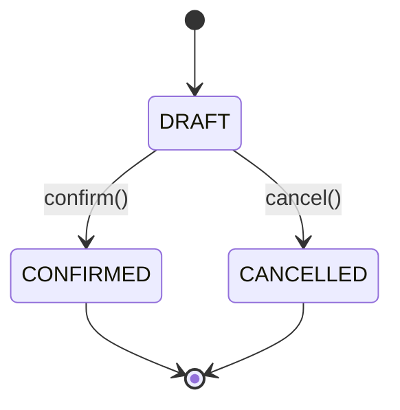
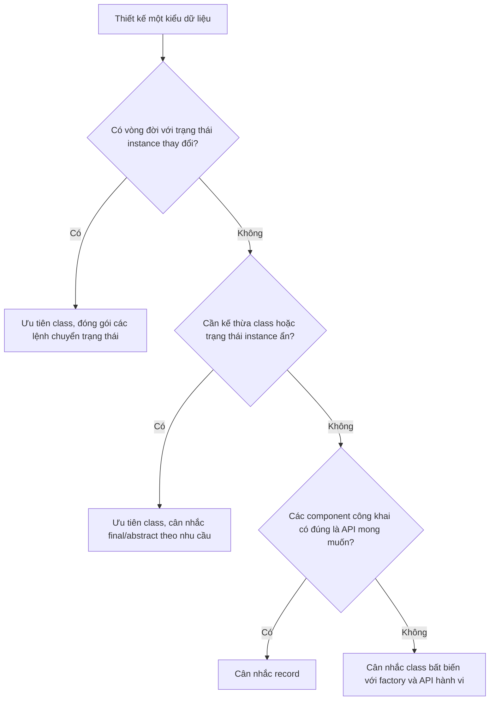

# Chọn `class` khi cần vòng đời mutable, kế thừa hoặc trạng thái ẩn

> **Học phần:** `JAVA_VERSION_JAVA16` · **Chương:** Ứng dụng record. Java 16 đã chuẩn hóa `record`, tạo thêm một lựa chọn tốt cho dữ liệu theo giá trị. Bài này tập trung vào những trường hợp **`class` thông thường vẫn phù hợp hơn**, dựa trên các quy tắc Java ổn định và tiếp tục áp dụng ở Java hiện đại.

## Mục tiêu

Sau bài học, bạn có thể:

1. Phân biệt **đối tượng có vòng đời và danh tính riêng** với **giá trị/snapshot**.
2. Thiết kế một `class` có trạng thái mutable nhưng chỉ cho phép chuyển trạng thái hợp lệ.
3. Chọn `class` khi thực sự cần kế thừa, và phân biệt kế thừa với việc triển khai interface.
4. Bảo vệ **trạng thái triển khai nội bộ** khi không muốn công khai nó thành một phần hợp đồng API.
5. Nhận diện các trường hợp `record` vẫn tốt dù đối tượng chứa phương thức, có collection hoặc được dùng cùng class.

## 1. Hiểu đúng giới hạn của `record`

Một `record` mô tả đối tượng chủ yếu bằng **các component đã khai báo**:

```java
public record OrderSummary(long id, String status, int itemCount) {}
```

Với record trên, Java sinh canonical constructor, accessor `id()`/`status()`/`itemCount()`, `equals()`, `hashCode()` và `toString()` theo các component. Mỗi component tương ứng với một trường instance `private final`. Vì vậy, record là lựa chọn thuận tiện cho **DTO, kết quả truy vấn, snapshot và value object** có cấu trúc dữ liệu rõ ràng.

Tuy nhiên, record đặt ra những ràng buộc có chủ đích:

- Record ngầm là `final`, trực tiếp kế thừa `java.lang.Record`; không thể `extends` một class do ứng dụng định nghĩa và không thể là lớp cha của một class khác.
- Record không được khai báo thêm trường instance ngoài những trường gắn với component; không thích hợp để giữ trạng thái instance phụ trợ ẩn như bộ đếm, cache nội bộ hoặc trạng thái được thêm sau khi tạo.
- Component không thể được gán lại sau khi đối tượng đã khởi tạo. Tuy nhiên, đối tượng mutable được tham chiếu bởi component **vẫn có thể thay đổi** nếu không được phòng vệ.
- Tên, kiểu, thứ tự component có ý nghĩa như một phần của API cấu trúc. Các accessor tương ứng là thành phần của giao diện công khai.
- Record **vẫn có thể** triển khai interface, khai báo phương thức, constructor phù hợp, trường/phương thức `static` và kiểm tra tính hợp lệ của dữ liệu. Nó không chỉ là “một struct không có hành vi”.

Ví dụ, record này hợp lệ và hữu ích:

```java
public record Rectangle(int width, int height) {
    public Rectangle {
        if (width < 0 || height < 0) {
            throw new IllegalArgumentException("Dimensions must be non-negative");
        }
    }

    public long area() {
        return (long) width * height;
    }
}
```

`area()` chỉ tính toán từ component nên không cần trạng thái thay đổi. **Không nên chọn class chỉ vì kiểu dữ liệu có phương thức**. Hãy chọn class khi hành vi của đối tượng yêu cầu một trong các năng lực mà record không biểu diễn tốt: vòng đời mutable, kế thừa thực sự hoặc đóng kín trạng thái triển khai.

## 2. Khi đối tượng có vòng đời mutable và quy tắc chuyển trạng thái

Đơn hàng, phiên làm việc, giỏ hàng đang sửa, tài khoản có số dư hoặc tiến trình xử lý thường tồn tại lâu hơn một thao tác đọc dữ liệu. Chúng có **danh tính ổn định** và **trạng thái thay đổi theo các sự kiện**.

Ví dụ, một đơn hàng có thể đi qua:



Ở mô hình minh họa này, hai trạng thái `CONFIRMED` và `CANCELLED` là trạng thái kết thúc. Không có đường chuyển trực tiếp `CONFIRMED → CANCELLED`; nếu nghiệp vụ có hủy sau xác nhận, cần thiết kế thêm quy tắc hoàn tiền, hoàn tồn kho và trạng thái riêng. Sơ đồ chính là **quy tắc nghiệp vụ**, không phải giới hạn của Java.

### 2.1. Dùng class để bảo vệ chuyển trạng thái

File `Order.java`:

```java
import java.time.Clock;
import java.time.Instant;
import java.util.List;
import java.util.Objects;
import java.util.Optional;
import java.util.UUID;

record OrderLine(String sku, int quantity) {
    OrderLine {
        sku = Objects.requireNonNull(sku, "sku").strip();
        if (sku.isEmpty() || quantity <= 0) {
            throw new IllegalArgumentException("Invalid order line");
        }
    }
}

public final class Order {
    public enum Status { DRAFT, CONFIRMED, CANCELLED }

    private final UUID id;
    private final List<OrderLine> lines;

    // Trạng thái được thay đổi có kiểm soát trong vòng đời đơn hàng.
    private Status status = Status.DRAFT;
    private Instant confirmedAt;

    public Order(UUID id, List<OrderLine> lines) {
        this.id = Objects.requireNonNull(id, "id");
        this.lines = List.copyOf(Objects.requireNonNull(lines, "lines"));
        if (this.lines.isEmpty()) {
            throw new IllegalArgumentException("Order must have lines");
        }
    }

    public UUID id() {
        return id;
    }

    public List<OrderLine> lines() {
        return lines;
    }

    public Status status() {
        return status;
    }

    public Optional<Instant> confirmedAt() {
        return Optional.ofNullable(confirmedAt);
    }

    public void confirm(Clock clock) {
        if (status != Status.DRAFT) {
            throw new IllegalStateException("Only DRAFT can be confirmed");
        }

        Instant time = Instant.now(Objects.requireNonNull(clock, "clock"));
        confirmedAt = time;
        status = Status.CONFIRMED;
    }

    public void cancel() {
        if (status != Status.DRAFT) {
            throw new IllegalStateException("Only DRAFT can be cancelled");
        }
        status = Status.CANCELLED;
    }
}
```

Ở đây, `final class` là lựa chọn có chủ đích: đối tượng **cần thay đổi trạng thái**, nhưng không cần là lớp cha. Dùng `class` **không có nghĩa** phải dùng kế thừa.

Ví dụ sử dụng, từ một class cùng package:

```java
Order order = new Order(
        UUID.randomUUID(),
        List.of(new OrderLine("BOOK-01", 2))
);

order.confirm(Clock.systemUTC());

System.out.println(order.status());                 // CONFIRMED
System.out.println(order.confirmedAt().isPresent()); // true

// order.cancel(); // IllegalStateException theo quy tắc minh họa
```

Thiết kế trên có các lợi ích:

- `id` không đổi khi trạng thái thay đổi: danh tính đơn hàng được giữ nguyên.
- `status` và `confirmedAt` không có setter công khai. Mọi thay đổi đi qua `confirm()`/`cancel()` để kiểm tra điều kiện.
- `List.copyOf` chặn sửa danh sách dòng đơn hàng qua tham chiếu gốc hoặc accessor. Vì `OrderLine` chỉ chứa `String` và `int` nên các phần tử cũng bất biến.
- Truyền `Clock` vào thao tác xác nhận giúp kiểm thử thời gian xác định mà không phụ thuộc đồng hồ hệ thống.
- Các trường được cập nhật bên trong cùng một đối tượng. Không cần tạo một đơn hàng khác với mỗi thay đổi.

**Lưu ý:** Class này minh họa quy tắc nghiệp vụ trong một luồng thực thi; nó **chưa bảo đảm an toàn khi nhiều luồng cùng thay đổi**. Ở ứng dụng thực, xử lý đồng thời có thể cần đồng bộ hóa, transaction hoặc optimistic locking ở tầng lưu trữ. `final` chỉ ngăn kế thừa, không làm đối tượng trở thành immutable hoặc thread-safe.

### 2.2. Vì sao không biểu diễn đơn hàng mutable bằng record?

Có thể viết một record như sau:

```java
import java.util.UUID;

public record OrderSnapshot(UUID id, String status) {}
```

`OrderSnapshot` là **một ảnh chụp tại thời điểm** và hoàn toàn hợp lý khi trả ra API hoặc ghi sự kiện. Nhưng mỗi lần chuyển từ `DRAFT` sang `CONFIRMED`, ta phải tạo một `OrderSnapshot` mới. Chúng có cùng `id` nhưng không phải cùng một instance và không quản lý các quy tắc chuyển trạng thái.

Có thể mô hình hóa toàn bộ ứng dụng theo cách cập nhật bất biến, tạo trạng thái mới sau mỗi lệnh; đó là lựa chọn kiến trúc hợp lệ. Tuy nhiên, khi yêu cầu là **một thực thể có danh tính, vòng đời và trạng thái nội tại thay đổi có kiểm soát**, `class` biểu diễn tự nhiên hơn. Hai kiểu có thể cùng tồn tại: `Order` quản lý vòng đời; `OrderSnapshot` hoặc một DTO record truyền dữ liệu ra ngoài.

## 3. Khi cần kế thừa một class

Java chỉ cho phép một class kế thừa trực tiếp **một class cha**. Record không thể là class con hoặc class cha trong mô hình kế thừa class. Nếu thiết kế thực sự cần `extends`, hãy dùng class.

Kế thừa phù hợp khi tồn tại một quan hệ **“là một loại của” (is-a)** bền vững, các lớp con dùng chung **hợp đồng và một phần triển khai/trạng thái**, đồng thời lớp cha kiểm soát những bất biến chung.

### 3.1. Ví dụ template method với chính sách phí giao hàng

Các chính sách phí có chung bước kiểm tra đầu vào/đầu ra, nhưng mỗi chính sách có cách tính riêng.

```java
import java.math.BigDecimal;
import java.util.Objects;

abstract class ShippingPolicy {
    public final BigDecimal quote(BigDecimal orderTotal) {
        Objects.requireNonNull(orderTotal, "orderTotal");
        if (orderTotal.signum() < 0) {
            throw new IllegalArgumentException("Negative order total");
        }

        BigDecimal fee = computeFee(orderTotal);
        if (fee == null || fee.signum() < 0) {
            throw new IllegalStateException("Invalid shipping fee");
        }
        return fee;
    }

    protected abstract BigDecimal computeFee(BigDecimal orderTotal);
}

final class FlatShippingPolicy extends ShippingPolicy {
    private final BigDecimal fixedFee;

    FlatShippingPolicy(BigDecimal fixedFee) {
        this.fixedFee = Objects.requireNonNull(fixedFee, "fixedFee");
        if (fixedFee.signum() < 0) {
            throw new IllegalArgumentException("Negative fee");
        }
    }

    @Override
    protected BigDecimal computeFee(BigDecimal orderTotal) {
        return fixedFee;
    }
}

final class FreeShippingOverThreshold extends ShippingPolicy {
    private final BigDecimal threshold;
    private final BigDecimal regularFee;

    FreeShippingOverThreshold(BigDecimal threshold, BigDecimal regularFee) {
        this.threshold = Objects.requireNonNull(threshold, "threshold");
        this.regularFee = Objects.requireNonNull(regularFee, "regularFee");
        if (threshold.signum() < 0 || regularFee.signum() < 0) {
            throw new IllegalArgumentException("Negative configuration");
        }
    }

    @Override
    protected BigDecimal computeFee(BigDecimal orderTotal) {
        return orderTotal.compareTo(threshold) >= 0
                ? BigDecimal.ZERO
                : regularFee;
    }
}
```

Cách sử dụng:

```java
ShippingPolicy policy = new FreeShippingOverThreshold(
        new BigDecimal("500000"),
        new BigDecimal("30000")
);

BigDecimal fee = policy.quote(new BigDecimal("600000"));
System.out.println(fee); // 0
```

`quote()` là `final` để mọi chính sách đi qua cùng quy tắc kiểm tra. Mỗi lớp con chỉ triển khai `computeFee()`. Mô hình này có ích khi ta **muốn cố định thuật toán khung** trong class cha.

### 3.2. Không nhầm kế thừa class với đa hình qua interface

Nếu chỉ cần một hợp đồng hành vi mà không có trạng thái hoặc triển khai chung bắt buộc, một interface thường đơn giản hơn:

```java
import java.math.BigDecimal;

public interface ShippingCalculator {
    BigDecimal quote(BigDecimal orderTotal);
}

public record FixedShipping(BigDecimal fee)
        implements ShippingCalculator {
    public FixedShipping {
        if (fee == null || fee.signum() < 0) {
            throw new IllegalArgumentException("Invalid fee");
        }
    }

    @Override
    public BigDecimal quote(BigDecimal orderTotal) {
        if (orderTotal == null || orderTotal.signum() < 0) {
            throw new IllegalArgumentException("Invalid total");
        }
        return fee;
    }
}
```

Đây là **hai file** riêng (`ShippingCalculator.java` và `FixedShipping.java`), vì Java chỉ cho phép tối đa một public top-level type trong mỗi file nguồn. Ví dụ cho thấy một record **vẫn triển khai interface** được và vẫn tham gia đa hình. Vì vậy, “cần polymorphism” tự nó **chưa đủ** để chọn class.

| Nhu cầu | Lựa chọn gợi ý |
|---|---|
| Chỉ triển khai hợp đồng phương thức, dữ liệu của từng đối tượng là giá trị | `record implements Interface` có thể phù hợp |
| Cần class cha giữ triển khai, invariant hoặc trạng thái chung | `abstract class` và class con |
| Không muốn cho class bị kế thừa | `final class` |
| Cần giới hạn tập lớp được phép kế thừa trên Java 17+ | Có thể cân nhắc `sealed class`, tính năng đã được chuẩn hóa từ Java 17 |
| Các kiểu chỉ cần tái sử dụng logic, không thật sự có quan hệ is-a | Ưu tiên composition (chứa/delegate tới một đối tượng khác) |

**Phạm vi Java 16:** `sealed class` vẫn ở trạng thái preview trong Java 16, nên bài này không dùng cú pháp đó như một tính năng Java 16 ổn định. Với dự án chạy JDK 17 trở lên, `sealed` là lựa chọn hiện đại khi cần phân cấp được kiểm soát.

## 4. Khi trạng thái triển khai phải được giữ kín

Khác với record vốn tuyên bố cấu trúc component, class có thể **giấu hoàn toàn cách biểu diễn nội bộ** và chỉ lộ hành vi mà người dùng thực sự cần.

Một kiểu có thể:

- Giữ trường `private` mà không cung cấp accessor.
- Thêm/xóa cache, bộ đếm hoặc thuật toán mà không đổi public API.
- Cho phép cập nhật có kiểm soát thông qua phương thức nghiệp vụ.
- Tránh công khai một đối tượng mutable như `Map`, `List` hoặc mảng.

### 4.1. Ví dụ: kho tồn với hai bộ đếm nội bộ

Người sử dụng chỉ cần biết “còn bao nhiêu hàng bán được?” và có thể giữ hoặc trả hàng. Việc lưu riêng `physicalStock` và `reserved` là chi tiết triển khai.

```java
public final class Inventory {
    private int physicalStock;
    private int reserved;

    public Inventory(int initialStock) {
        if (initialStock < 0) {
            throw new IllegalArgumentException("Negative initial stock");
        }
        this.physicalStock = initialStock;
    }

    public int availableToSell() {
        return physicalStock - reserved;
    }

    public void reserve(int quantity) {
        requirePositive(quantity);
        if (quantity > availableToSell()) {
            throw new IllegalStateException("Insufficient stock");
        }
        reserved += quantity;
    }

    public void release(int quantity) {
        requirePositive(quantity);
        if (quantity > reserved) {
            throw new IllegalStateException("Cannot release unreserved stock");
        }
        reserved -= quantity;
    }

    public void receive(int quantity) {
        requirePositive(quantity);
        physicalStock = Math.addExact(physicalStock, quantity);
    }

    private static void requirePositive(int quantity) {
        if (quantity <= 0) {
            throw new IllegalArgumentException("Quantity must be positive");
        }
    }
}
```

Ví dụ:

```java
Inventory inventory = new Inventory(10);
inventory.reserve(3);
System.out.println(inventory.availableToSell()); // 7

inventory.release(1);
System.out.println(inventory.availableToSell()); // 8
```

Class không cung cấp `setReserved()` hay `setPhysicalStock()`: người dùng không thể trực tiếp tạo trạng thái vô lý, chẳng hạn “đã giữ 20 sản phẩm khi kho chỉ có 10”. Nếu sau này chuyển từ hai bộ đếm sang cấu trúc khác (ví dụ lưu từng lô hàng), public API `reserve()`/`release()`/`availableToSell()` vẫn có thể giữ nguyên.

Đây là mô hình đơn giản chạy trong một luồng và chưa có thao tác xuất kho thực tế; ở ứng dụng đồng thời hay hệ quản trị cơ sở dữ liệu, ràng buộc tồn kho còn cần được bảo vệ tại ranh giới transaction.

### 4.2. Class cũng cần thiết khi dữ liệu **bất biến** nhưng biểu diễn phải ẩn

Không phải chỉ đối tượng mutable mới cần class. Đôi khi một đối tượng bất biến có **private constructor**, factory và API hành vi mà không muốn lộ cấu trúc dữ liệu.

```java
import java.util.Objects;

public final class Eligibility {
    private final int riskScore;

    private Eligibility(int riskScore) {
        this.riskScore = riskScore;
    }

    public static Eligibility assess(int latePayments, int activeLoans) {
        if (latePayments < 0 || activeLoans < 0) {
            throw new IllegalArgumentException("Negative input");
        }

        int score = Math.addExact(
                Math.multiplyExact(latePayments, 10),
                Math.multiplyExact(activeLoans, 2)
        );
        return new Eligibility(score);
    }

    public boolean canApply() {
        return riskScore < 40;
    }
}
```

Điểm chính không nằm ở công thức điểm minh họa; đó là một cách giữ `riskScore` như chi tiết nội bộ. Người gọi biết hành vi `assess(...)`/`canApply()`, không bị ràng buộc vào một component `riskScore()` hoặc constructor công khai. Cách này cho phép thay đổi công thức và cấu trúc lưu điểm mà không phải giữ nguyên các trường được công khai. Đừng xem ví dụ chấm điểm là chính sách ra quyết định thực tế.

Nếu cần mã hóa dữ liệu sang JSON, ánh xạ ORM hoặc truyền qua một ranh giới API, có thể tạo **DTO record riêng** để công khai đúng trường cần trao đổi, thay vì biến class nghiệp vụ thành hợp đồng serialization.

## 5. Một số nhầm lẫn cần tránh

### 5.1. “Record là immutable hoàn toàn”

Sai: record ngăn gán lại component **reference**, nhưng không tự sao chép nội dung mutable.

```java
import java.util.ArrayList;
import java.util.List;

record BadSnapshot(List<String> tags) {}

List<String> source = new ArrayList<>(List.of("new"));
BadSnapshot snapshot = new BadSnapshot(source);

source.add("changed");
System.out.println(snapshot.tags()); // [new, changed]
```

Nếu dữ liệu là snapshot, record vẫn có thể dùng, nhưng phải phòng vệ:

```java
import java.util.List;
import java.util.Objects;

record SafeSnapshot(List<String> tags) {
    SafeSnapshot {
        tags = List.copyOf(Objects.requireNonNull(tags, "tags"));
    }
}
```

`List.copyOf` tạo danh sách không sửa được qua accessor, nhưng **không sao chép sâu** các phần tử mutable. Ví dụ an toàn vì phần tử là `String` bất biến. Lựa chọn giữa record và class phụ thuộc nhu cầu hành vi/vòng đời, không phải sự hiện diện của một `List` đơn thuần.

### 5.2. “Class có thể mutable thì cứ tạo public setter”

Không nên. Một class có vòng đời thường cần các **lệnh nghiệp vụ cụ thể** (`confirm()`, `cancel()`, `reserve()`), chứ không phải setter cho mọi trường. Setter rộng mở có thể bỏ qua quy tắc và tạo trạng thái không hợp lệ.

### 5.3. “Muốn có phương thức thì phải dùng class”

Sai: record có thể có phương thức instance, static method, kiểm tra dữ liệu và triển khai interface. Chỉ những phương thức đòi hỏi **trạng thái instance bổ sung hoặc thay đổi trạng thái theo vòng đời** mới là tín hiệu mạnh để chọn class.

### 5.4. “Class mặc định so sánh theo giá trị”

Không. Nếu không override, `equals()` của class kế thừa từ `Object` so sánh theo **danh tính đối tượng**. Record tự sinh `equals()`/`hashCode()` theo component. Với entity mutable có danh tính nghiệp vụ, phải chủ động xác định quy tắc bằng nhau. Tránh đưa trường mutable vào `hashCode()` của đối tượng đang nằm trong `HashSet` hoặc dùng làm khóa `HashMap`, vì thay đổi hash có thể khiến việc tìm kiếm thất bại.

Ví dụ:

```java
record Point(int x, int y) {}

Point a = new Point(2, 3);
Point b = new Point(2, 3);
System.out.println(a.equals(b)); // true
```

Với class, dù hai đối tượng có cùng trường, chúng vẫn không tự động bằng nhau nếu chưa cài đặt quy tắc so sánh tương ứng.

### 5.5. “Mọi domain object nên là JPA entity class hoặc record”

Không có một kiểu áp dụng cho mọi lớp:

- **JPA entity:** thông thường là class phù hợp yêu cầu vòng đời, constructor và proxy của persistence framework. Record là `final` và không có no-arg constructor chuẩn cho entity, nên thường **không phù hợp làm entity JPA chuẩn**.
- **DTO/projection:** record có thể biểu diễn kết quả truy vấn hoặc dữ liệu trao đổi. Khả năng ánh xạ tự động phụ thuộc phiên bản thư viện/framework.
- **Value object:** record phù hợp khi public components là cấu trúc giá trị mong muốn; class bất biến cũng hợp lý nếu cần ẩn cách biểu diễn hoặc kiểm soát factory.

## 6. Bảng quyết định nhanh

| Câu hỏi thiết kế | Nghiêng về `record` | Nghiêng về `class` |
|---|---|---|
| Cùng component có nghĩa là cùng giá trị? | Có | Không nhất thiết; có danh tính riêng |
| Đối tượng đổi trạng thái trong vòng đời? | Chủ yếu tạo snapshot mới | Có chuyển trạng thái nội tại |
| Cần extends class cha hoặc làm class cha? | Không hỗ trợ | Hỗ trợ nếu phù hợp thiết kế |
| Chỉ cần implements interface? | Có thể | Cũng có thể |
| Có trạng thái instance phụ ngoài dữ liệu công khai? | Không hỗ trợ trực tiếp | Có thể giữ `private` |
| Muốn không lộ cấu trúc bên trong API? | Không phải điểm mạnh | Có factory và phương thức hành vi |
| Muốn giá trị ngắn gọn, sinh accessor/equality? | Rất tiện | Phải cài đặt nếu cần |
| Muốn entity do ORM quản lý với lifecycle? | Thường không phù hợp | Thường phù hợp |
| Có collection cần giữ snapshot? | Dùng được sau khi sao chép phòng vệ | Cũng cần sao chép nếu muốn bất biến |
| Muốn sửa một phần dữ liệu bằng setter? | Không hỗ trợ | Có thể, nhưng ưu tiên lệnh có bất biến |

### Quy trình ra quyết định



Sơ đồ là **gợi ý thiết kế**, không phải quy tắc bắt buộc: cùng một chức năng có thể được triển khai theo các kiến trúc mutable hay immutable khác nhau.

## 7. Bài tập và tình huống thực tế

**Bài tập 1 — Vòng đời:** Viết `Ticket` có trạng thái `OPEN`, `IN_PROGRESS`, `RESOLVED`. Chỉ cho phép `start()` từ `OPEN` và `resolve()` từ `IN_PROGRESS`. Giữ `id` cố định, không có setter cho `status`. Viết thử tình huống gọi sai thứ tự và mô tả ngoại lệ mong muốn.

**Bài tập 2 — Bảo vệ trạng thái ẩn:** Viết `ShoppingCart` giữ `Map<String, Integer>` riêng tư, cung cấp `addItem(sku, quantity)`, `removeItem(sku)` và `snapshot()` trả về một record chứa danh sách dòng hàng bất biến. Giải thích vì sao không trả trực tiếp `Map` nội bộ.

**Bài tập 3 — Phân biệt interface/kế thừa:** Với bộ xử lý thanh toán có hai chiến lược, một dùng API bên ngoài và một chạy cục bộ, thử thiết kế bằng interface trước. Chỉ dùng abstract class khi phát hiện logic chung cần bảo vệ bằng một phương thức `final` hoặc có trạng thái chung thực sự.

**Bài tập 4 — Snapshot:** Thiết kế `OrderView` là record cho `Order` ở phần 2. Hãy giải thích vì sao `OrderView` có thể giống đơn hàng tại thời điểm đọc nhưng không được xem là entity có vòng đời.

**Tự kiểm tra:** Trước khi kết luận nên dùng class hay record, hãy trả lời: “Đối tượng này *là* một giá trị được khai báo qua component, hay *sở hữu* danh tính, luật chuyển trạng thái và chi tiết triển khai phải giữ kín?”

---

## Kết luận

`record` là bổ sung ổn định từ Java 16 cho những mô hình thiên về **dữ liệu theo giá trị**. `class` vẫn là công cụ phù hợp cho thực thể **có vòng đời mutable**, cho **quan hệ kế thừa class** có chủ đích và cho kiểu cần **giữ kín trạng thái triển khai**. Một ứng dụng Java hiện đại thường dùng **cả hai**: class quản lý nghiệp vụ và vòng đời, còn record biểu diễn DTO, projection, snapshot hoặc value object. Chọn đúng theo ngữ nghĩa của đối tượng giúp API rõ ràng và giảm rủi ro phá vỡ bất biến.
