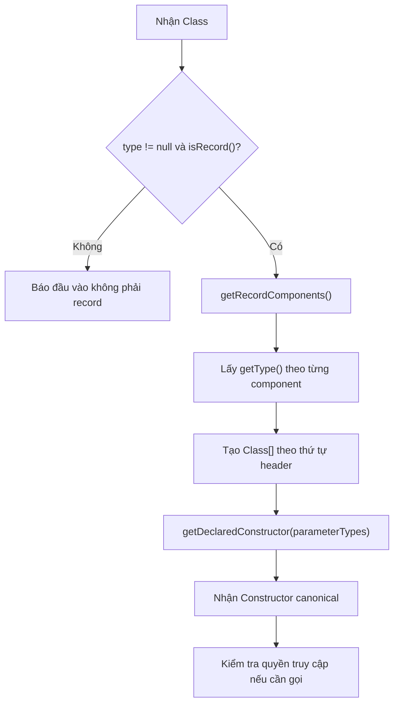

# Xác định canonical constructor từ kiểu của các component

Mỗi record có một **canonical constructor**: constructor nhận các tham số tương ứng với toàn bộ record component, theo đúng thứ tự khai báo. Canonical constructor có thể được compiler tự sinh, được viết tường minh với danh sách tham số đầy đủ, hoặc viết dưới dạng *compact constructor* không khai báo danh sách tham số.

Khi làm việc với Java Reflection, ta có thể xác định constructor này từ metadata của record. Cách làm là lấy danh sách component bằng `Class.getRecordComponents()`, lấy kiểu của từng component bằng `RecordComponent.getType()` theo đúng thứ tự, sau đó truyền mảng kiểu đó cho `Class.getDeclaredConstructor(...)`.

Đây là cách xác định dựa trên chữ ký constructor được Java quy định cho record. Bài học thuộc chương **Metadata record** của module **JAVA_VERSION_JAVA16**; chỉ sử dụng các API record và reflection chính thức, vẫn áp dụng trong Java hiện đại.

## 1. Canonical constructor là gì?

Xét record:

```java
record Customer(String code, String name, int age) {}
```

Các component được khai báo theo thứ tự:

1. `code` có kiểu `String`.
2. `name` có kiểu `String`.
3. `age` có kiểu `int`.

Nếu không tự khai báo constructor, Java tạo canonical constructor tương đương về chữ ký với:

```java
Customer(String code, String name, int age) {
    this.code = code;
    this.name = name;
    this.age = age;
}
```

Đây là constructor khởi tạo toàn bộ component. Trong mã thực tế, compiler sinh phần triển khai phù hợp với quy tắc record; ví dụ trên chỉ minh họa cấu trúc tham số và ý nghĩa gán dữ liệu.

Canonical constructor có ba dạng thường gặp:

| Dạng | Đặc điểm |
| --- | --- |
| Implicit canonical constructor | Compiler tự khai báo khi record không tự khai báo constructor |
| Normal canonical constructor | Người viết khai báo đầy đủ danh sách tham số có cùng component và cùng thứ tự |
| Compact canonical constructor | Dùng cú pháp `Customer { ... }`, không viết danh sách tham số; compiler vẫn tạo chữ ký canonical tương ứng |

Ví dụ compact canonical constructor:

```java
record Customer(String code, String name, int age) {
    Customer {
        if (code == null || code.isBlank()) {
            throw new IllegalArgumentException("code is required");
        }
        if (age < 0) {
            throw new IllegalArgumentException("age must not be negative");
        }
    }
}
```

Mặc dù phần khai báo không viết `Customer(String code, String name, int age)`, constructor vẫn có đúng ba tham số theo record header. Vì vậy, Reflection vẫn có thể tìm thấy nó bằng chữ ký tham số này.

## 2. Quy tắc xác định chữ ký canonical

Theo cấu trúc record, canonical constructor có các tham số:

- Cùng số lượng với record component.
- Cùng kiểu tương ứng với từng component.
- Giữ nguyên thứ tự component trong record header.

Ví dụ:

```java
record Invoice(String invoiceNo, long amount, boolean paid) {}
```

Chữ ký tham số cần tìm là:

```java
Invoice(String.class, long.class, boolean.class)
```

Để dựng chữ ký này bằng reflection, sử dụng:

| API | Mục đích |
| --- | --- |
| `Class.isRecord()` | Xác nhận kiểu đang kiểm tra là record |
| `Class.getRecordComponents()` | Lấy danh sách component theo thứ tự khai báo |
| `RecordComponent.getType()` | Lấy kiểu `Class<?>` của mỗi component |
| `Class.getDeclaredConstructor(Class<?>... parameterTypes)` | Tìm constructor khai báo trong lớp có đúng danh sách kiểu tham số |

**Không sắp xếp component theo tên.** Thứ tự tham số của canonical constructor phải tương ứng với thứ tự record header. Nếu đổi vị trí hai component có cùng kiểu, chỉ nhìn mảng kiểu có thể không phân biệt được hai vị trí đó; thứ tự lấy từ record metadata vẫn là căn cứ đúng.

## 3. Ví dụ hoàn chỉnh: Tìm canonical constructor

Lưu đoạn mã sau vào `FindCanonicalConstructorDemo.java`:

```java
import java.lang.reflect.Constructor;
import java.lang.reflect.RecordComponent;

public class FindCanonicalConstructorDemo {

    public record Invoice(String invoiceNo, long amount, boolean paid) {}

    static Constructor<?> findCanonicalConstructor(Class<?> recordType)
            throws NoSuchMethodException {
        if (recordType == null || !recordType.isRecord()) {
            throw new IllegalArgumentException("Expected a record class");
        }

        RecordComponent[] components = recordType.getRecordComponents();
        Class<?>[] parameterTypes = new Class<?>[components.length];

        for (int i = 0; i < components.length; i++) {
            parameterTypes[i] = components[i].getType();
        }

        return recordType.getDeclaredConstructor(parameterTypes);
    }

    public static void main(String[] args) throws NoSuchMethodException {
        Constructor<?> constructor =
                findCanonicalConstructor(Invoice.class);

        System.out.println("Constructor: " + constructor);
        for (Class<?> parameterType : constructor.getParameterTypes()) {
            System.out.println(parameterType.getTypeName());
        }
    }
}
```

Biên dịch và chạy bằng JDK 16 trở lên:

```bash
javac FindCanonicalConstructorDemo.java
java FindCanonicalConstructorDemo
```

Kết quả có dạng:

```text
Constructor: public FindCanonicalConstructorDemo$Invoice(java.lang.String,long,boolean)
java.lang.String
long
boolean
```

Tên lớp đầy đủ có thể khác đôi chút tùy cách compiler đặt tên cho record lồng, nhưng danh sách tham số phải là `String`, `long` và `boolean` theo thứ tự component.

Hàm `findCanonicalConstructor` làm bốn việc:

1. Kiểm tra đầu vào khác `null` và là record.
2. Lấy mảng component theo thứ tự khai báo.
3. Tạo mảng `Class<?>[]` từ `getType()` của từng component.
4. Dùng `getDeclaredConstructor(parameterTypes)` để tìm constructor có đúng chữ ký.

Với một kiểu record hợp lệ, canonical constructor luôn tồn tại, dù được compiler tự sinh hay do người viết khai báo. Vì vậy, `NoSuchMethodException` thường chỉ ra đầu vào không đúng như dự kiến, metadata hoặc logic dựng kiểu tham số bị sai, hay đang tìm trên một kiểu khác với kiểu record mong muốn.

## 4. Vì sao dùng `getDeclaredConstructor()`?

Hai API thường bị nhầm lẫn:

| API | Phạm vi tìm kiếm |
| --- | --- |
| `getConstructor(Class<?>... parameterTypes)` | Chỉ tìm constructor `public` |
| `getDeclaredConstructor(Class<?>... parameterTypes)` | Tìm constructor được khai báo trong lớp, kể cả constructor không public |

Record có thể có mức truy cập khác nhau, ví dụ record lồng riêng tư hoặc record ở phạm vi package. Canonical constructor phải có mức truy cập phù hợp với record, nhưng không phải mọi canonical constructor đều là `public`.

Do mục tiêu là tìm canonical constructor của chính kiểu record đang xét, `getDeclaredConstructor(...)` là lựa chọn tổng quát hơn. Phương thức này tìm đúng constructor theo chữ ký, không có nghĩa là nó tự cấp quyền gọi constructor.

Ví dụ một record package-private:

```java
record InternalKey(String value, int version) {}
```

Khi mã nằm trong phạm vi có thể tham chiếu `InternalKey.class`, `getDeclaredConstructor(String.class, int.class)` có thể tìm được canonical constructor dù constructor đó không phải public. Khả năng gọi constructor từ nơi khác vẫn tuân theo quy tắc truy cập Java.

## 5. Record có constructor overload

Một record có thể khai báo constructor bổ sung với danh sách tham số khác canonical constructor:

```java
record User(String username, int level) {
    User(String username) {
        this(username, 1);
    }
}
```

Record này có hai constructor:

| Constructor | Chữ ký |
| --- | --- |
| Canonical | `User(String, int)` |
| Overloaded | `User(String)` |

Nếu chỉ gọi `getDeclaredConstructors()`, kết quả là danh sách các constructor nhưng thứ tự không phải quy tắc để xác định canonical constructor. Không nên lấy phần tử đầu tiên hoặc chọn constructor có ít tham số nhất.

Hãy dựng danh sách kiểu từ record component rồi tìm chính xác:

```java
Constructor<?> canonical =
        User.class.getDeclaredConstructor(String.class, int.class);

Constructor<?> overloaded =
        User.class.getDeclaredConstructor(String.class);
```

Reflection tìm theo toàn bộ danh sách kiểu tham số, vì vậy các constructor overload không gây nhầm lẫn nếu chữ ký được dựng đúng.

## 6. Kiểu generic và type erasure

Với record generic:

```java
record Envelope<T>(String id, T payload) {}
```

Component `payload` được khai báo bằng biến kiểu `T`. Nhưng chữ ký constructor ở mức runtime sử dụng kiểu đã áp dụng **type erasure**. Nếu `T` không có bound, erasure của nó là `Object`.

Do đó, khi dựng tham số từ `RecordComponent.getType()`:

| Component | `getType()` | Kiểu tham số constructor |
| --- | --- | --- |
| `id` | `String.class` | `String.class` |
| `payload` | `Object.class` | `Object.class` |

Có thể tìm canonical constructor như sau:

```java
import java.lang.reflect.Constructor;

record Envelope<T>(String id, T payload) {}

public class GenericRecordConstructorDemo {
    public static void main(String[] args) throws NoSuchMethodException {
        Constructor<?> constructor =
                Envelope.class.getDeclaredConstructor(
                        String.class,
                        Object.class
                );

        System.out.println(constructor);
        for (Class<?> parameterType : constructor.getParameterTypes()) {
            System.out.println(parameterType.getTypeName());
        }
    }
}
```

Nếu record khai báo bound:

```java
record NumericEnvelope<T extends Number>(T payload) {}
```

thì erasure của `T` là `Number`. Chữ ký constructor runtime dùng `Number.class`:

```java
Constructor<?> constructor =
        NumericEnvelope.class.getDeclaredConstructor(Number.class);
```

Không dùng `getGenericType()` làm đối số cho `getDeclaredConstructor()`, vì phương thức này nhận `Class<?>...`. `getGenericType()` trả về `Type` và phục vụ phân tích kiểu khai báo; còn `getType()` trả về kiểu `Class<?>` cần cho việc tìm constructor runtime.

## 7. Component có kiểu nguyên thủy hoặc mảng

`getType()` giữ nguyên kiểu component, bao gồm kiểu nguyên thủy và kiểu mảng. Không tự chuyển đổi sang wrapper hay kiểu phần tử:

```java
record SensorReading(int value, long timestamp, String[] tags) {}
```

Mảng tham số để tìm canonical constructor là:

```java
new Class<?>[] {
    int.class,
    long.class,
    String[].class
}
```

Các kiểu này phải khớp chính xác với constructor:

- `int` dùng `int.class`, không phải `Integer.class`.
- `long` dùng `long.class`, không phải `Long.class`.
- `String[]` dùng `String[].class`.

Ví dụ:

```java
Constructor<?> constructor = SensorReading.class.getDeclaredConstructor(
        int.class,
        long.class,
        String[].class
);
```

Với record không có component:

```java
record EmptyRecord() {}
```

canonical constructor không có tham số. Có thể tìm bằng:

```java
Constructor<?> constructor =
        EmptyRecord.class.getDeclaredConstructor();
```

Mảng component rỗng vẫn hợp lệ; vòng lặp dựng kiểu không chạy và lời gọi varargs không có đối số tương ứng.

## 8. Xác minh constructor và đọc generic parameter metadata

Sau khi tìm thấy constructor, có thể kiểm tra chữ ký runtime:

```java
Class<?>[] parameterTypes = constructor.getParameterTypes();
for (int i = 0; i < parameterTypes.length; i++) {
    System.out.printf("[%d] %s%n",
            i, parameterTypes[i].getTypeName());
}
```

Đối với record generic, nếu cần xem thêm thông tin khai báo generic của tham số constructor, dùng `Constructor.getGenericParameterTypes()`:

```java
import java.lang.reflect.Constructor;
import java.lang.reflect.Type;

record Envelope<T>(String id, T payload) {}

public class GenericConstructorMetadataDemo {
    public static void main(String[] args) throws NoSuchMethodException {
        Constructor<?> constructor =
                Envelope.class.getDeclaredConstructor(
                        String.class, Object.class);

        for (Type type : constructor.getGenericParameterTypes()) {
            System.out.println(type.getTypeName());
        }
    }
}
```

Thông tin generic có thể cho kết quả tương ứng với `String` và `T`, trong khi `getParameterTypes()` cho `String.class` và `Object.class`. Hai API phục vụ hai mục đích: tìm constructor cần kiểu runtime `Class<?>`, còn đọc generic parameter metadata dùng `Type`.

## 9. Tìm thấy constructor không đồng nghĩa với có quyền gọi

`getDeclaredConstructor(...)` trả về đối tượng `Constructor<?>` nếu tìm thấy chữ ký phù hợp. Nó không bỏ qua kiểm tra truy cập.

Nếu muốn tạo instance bằng reflection, có thể gọi:

```java
Object instance = constructor.newInstance("INV-100", 250_000L, true);
```

Đoạn trên minh họa cho một record có canonical constructor tương ứng ba kiểu tham số. Việc gọi thành công còn phụ thuộc khả năng truy cập constructor, lớp record, package và module. Các ngoại lệ thường cần xử lý gồm:

| Ngoại lệ | Nguyên nhân |
| --- | --- |
| `IllegalAccessException` | Không có quyền truy cập constructor |
| `InstantiationException` | Không thể tạo instance qua constructor được chọn; không phải tình huống thông thường với record cụ thể hợp lệ |
| `IllegalArgumentException` | Số lượng hoặc kiểu đối số truyền vào không tương thích |
| `InvocationTargetException` | Phần thân constructor phát sinh exception; xem nguyên nhân qua `getCause()` |
| `NoSuchMethodException` | Không tìm thấy constructor với đúng danh sách kiểu tham số |

Với record public trong package được export phù hợp, canonical constructor public có thể được dùng như API công khai. Với record không public hoặc package không mở cho module gọi, việc tìm constructor vẫn có thể thành công nhưng lời gọi có thể bị từ chối. Không nên mặc định gọi `setAccessible(true)` để xử lý mọi lỗi truy cập; hãy thiết kế và cấu hình package/module theo API cần công khai.

Ngoài ra, gọi canonical constructor sẽ thực thi validation mà record khai báo trong normal hoặc compact canonical constructor. Chỉ tìm constructor bằng reflection không tạo instance và không chạy logic validation đó.

## 10. Quy trình tổng quát



Quy trình này dùng metadata record làm nguồn xác định chữ ký, không phụ thuộc thứ tự liệt kê constructor và không cần suy đoán từ tên constructor.

## 11. Bài tập tự kiểm tra

Cho các khai báo:

```java
record Point(int x, int y) {}

record Message<T extends CharSequence>(
        String topic,
        T body
) {
    Message(String topic) {
        this(topic, null);
    }
}

record Empty() {}
```

Hãy trả lời:

1. Kiểu tham số nào cần truyền vào `Point.class.getDeclaredConstructor(...)`?
2. Canonical constructor của `Message` có bao nhiêu tham số?
3. Kiểu runtime của component `body` trong `Message` là gì?
4. Làm thế nào để tìm canonical constructor thay vì overloaded constructor của `Message`?
5. `Empty.class.getDeclaredConstructor()` có tìm được canonical constructor không?
6. Vì sao không thể dùng `getGenericType()` trực tiếp làm đối số của `getDeclaredConstructor()`?

**Đáp án:**

1. `int.class, int.class` theo thứ tự `x` rồi `y`.
2. Hai tham số: `String` và `CharSequence`.
3. `CharSequence.class` vì `T extends CharSequence` có erasure là bound đầu tiên `CharSequence`.
4. Dựng mảng kiểu từ `Message.class.getRecordComponents()` rồi truyền mảng đó vào `getDeclaredConstructor(parameterTypes)`; chữ ký là `(String.class, CharSequence.class)`.
5. Có. Record không component có canonical constructor không tham số.
6. Vì `getGenericType()` trả về `Type`, trong khi `getDeclaredConstructor()` nhận `Class<?>...`; để tìm chữ ký runtime cần dùng `getType()`.

## Ghi nhớ

**Canonical constructor được xác định bằng đúng kiểu và thứ tự của toàn bộ record component.** Lấy `RecordComponent[]` từ `getRecordComponents()`, chuyển từng component thành `Class<?>` bằng `getType()` rồi gọi `getDeclaredConstructor(parameterTypes)`. Cách này vẫn đúng với compact canonical constructor, record có overload, kiểu nguyên thủy, mảng và record generic sau type erasure. Tìm được constructor không đồng nghĩa với được phép gọi nó; quyền truy cập vẫn tuân theo quy tắc Java và module.

## Tài liệu tham khảo

- [Oracle Java SE API — `Class.getRecordComponents()` và `Class.getDeclaredConstructor()`](https://docs.oracle.com/en/java/javase/25/docs/api/java.base/java/lang/Class.html)
- [Oracle Java SE API — `RecordComponent.getType()`](https://docs.oracle.com/en/java/javase/25/docs/api/java.base/java/lang/reflect/RecordComponent.html#getType())
- [Oracle Java SE API — `Constructor`](https://docs.oracle.com/en/java/javase/25/docs/api/java.base/java/lang/reflect/Constructor.html)
- [Oracle Java SE — Record Classes](https://docs.oracle.com/en/java/javase/25/language/records.html)
- [Java Language Specification — Record Classes](https://docs.oracle.com/javase/specs/jls/se25/html/jls-8.html#jls-8.10)
