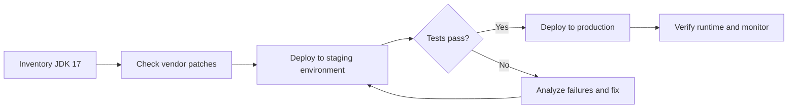

# Choosing a Supported JDK 17 Distribution and Staying Updated with Patches

> **Topic:** Java 17 · **Chapter:** Practice Environment  
> **Policy information verified as of:** November 15, 2026. Support lifecycles, patch versions, and license terms may change; when applying to production systems, always check the vendor's official page.

## 1. Why Does Choosing the Right JDK 17 Distribution Matter?

To write and run Java 17 programs, you need a **Java Development Kit (JDK)** containing tools such as `java`, `javac`, `jar`, `jlink`, and `jpackage`. **Java 17** itself defines the platform, language, and API version; whereas a **JDK distribution** is the software package built, tested, packaged, released, and patched by an organization.

For example, Eclipse Temurin 17, Amazon Corretto 17, and Microsoft Build of OpenJDK 17 all implement Java SE 17, but they differ in publisher, support schedule, installation method, patch delivery channel, supported platforms, and commercial support policies. Therefore, the right question is not only "Is Java 17 installed on this machine?" but also:

- Which vendor did Java 17 come from, and for which exact operating system and CPU architecture?
- Has the latest security patch from **that vendor** been applied?
- Does the vendor still release updates for Java 17 on the platform in use?
- Can the team update, test, and redeploy in a repeatable way?

**Distinguishing three concepts:**

| Concept | Meaning | Example |
|---|---|---|
| Java version | Feature/API release line to use | `17` (LTS) |
| Update version | Bug-fix and security level within the same Java 17 line | `17.0.21` |
| Vendor build | Actual package that may include build numbers and distribution tags | Temurin `17.0.21+9`, Corretto `17.0.21.0.11`, Microsoft `17.0.21.0.2` |

LTS (*Long-Term Support*) means that certain vendors commit to maintaining that Java line longer than standard feature releases. **LTS does not mean every vendor supports it until the exact same date**, or that a single Java 17 installation can stay untouched forever.

## 2. JDK 17 Distributions to Consider

The following options still have JDK 17 distribution and update channels as of the verification date. All dates are **each vendor's policy milestones**, not a date when Java 17 stops running.

| Distribution | Suitable When | Java 17 Updates and Support | Notes for Decision-Making |
|---|---|---|---|
| **Eclipse Temurin 17** (Eclipse Adoptium) | Learning, cross-platform development, enterprise applications needing free OpenJDK | Patches released via Adoptium; the support page states **at least until 10/2027** for the 17 line, with the principle of continuing LTS builds as long as upstream sources remain maintained | Check the supported OS, CPU architecture list, and corresponding support channels; community binary releases do not imply a commercial SLA |
| **Amazon Corretto 17** | Services running on AWS/Amazon Linux or wanting an OpenJDK line with a published long support schedule | Amazon plans the final update in **07/2029**, end of life in **10/2029** | Use Corretto's official repository/installer; technical support channels depend on the AWS Support plan and service scope |
| **Microsoft Build of OpenJDK 17** | Windows workstations, Azure, environments managed with Microsoft tooling | Microsoft releases quarterly patches; **09/2027** is the *earliest* published end-of-support milestone and may be extended | Support for managed Azure services may follow a separate schedule from a JDK installed by the team on VMs/containers |
| **Oracle JDK 17** | Organizations that have standardized on Oracle JDK with clear Oracle licensing/support policies | Premier Support through **09/2026**; Extended Support through **09/2029 or later** per published policy | Oracle JDK 17 updates released from **10/15/2024** onward use the **Oracle Technology Network (OTN) License**; usage rights and patch entitlement must be verified before deployment |

Sources: [Temurin Support](https://adoptium.net/support), [Amazon Corretto FAQ](https://aws.amazon.com/corretto/faqs/), [Microsoft OpenJDK Support Roadmap](https://learn.microsoft.com/en-us/java/openjdk/support), [Oracle Java SE Support Roadmap](https://www.oracle.com/java/technologies/java-se-support-roadmap.html).

### Choosing Based on Practical Needs

**If learning Java 17 or building standard Java applications:** Eclipse Temurin 17 is an easy starting choice. Download the JDK from [Adoptium](https://adoptium.net/temurin/releases), and select **JDK 17**, the exact operating system, and CPU architecture. If commercial support is needed, evaluate a support provider's contract separately rather than treating the "LTS" label as an SLA guarantee.

**If deploying primarily on AWS:** Corretto 17 is a sensible choice because it has official packages for Amazon Linux and a Java 17 update schedule through 2029. However, choosing Corretto does not replace updating the operating system, application libraries, or container images.

**If the organization standardizes on a Microsoft environment:** Microsoft Build of OpenJDK 17 provides official installers and package repositories. At the same time, plan the migration to the next supported LTS line before Microsoft's Java 17 support milestone; do not assume Azure services and self-managed machines share the same policy.

**If the organization requires Oracle JDK:** confirm the license, support subscription scope, update download process, and deployment responsibilities. Do not interpret "the file can be downloaded" as "permitted to use for free for every purpose." Another OpenJDK distribution can be chosen if Oracle's policy does not fit, after running application compatibility tests.

In RHEL environments or platforms supported by an OS vendor, also evaluate the JDK distributed through the OS channel: the support lifecycle **of the package on that platform** may differ from Temurin or independently downloaded OpenJDK builds. See [Red Hat OpenJDK Life Cycle and Support Policy](https://access.redhat.com/articles/1299013) if using Red Hat.

### Decision Criteria

When comparing two JDK 17 packages, document at least:

1. **Compatibility:** operating system, OS version, CPU (`x64`, `aarch64`/ARM64), container environment, and native/JNI libraries if any.
2. **Patches:** official download location, speed of security updates, repository/installer, and security advisory sources.
3. **Support lifecycle:** end date and applicable conditions; the difference between community updates and commercial support contracts.
4. **Licensing and cost:** usage, redistribution, and support terms; evaluated per distribution.
5. **Operability:** automated installation, checksum/signature verification, version control across developer machines, CI, and production, and rollback plan.

For a project, standardize on the **Java 17 line** across build and runtime environments. When there is a reason to use different distributions between environments, document the exception and run tests on the target runtime: Java SE compatibility does not eliminate all differences in root certificates, native packages, OS configuration, or vendor-specific fixes.

## 3. Understanding Version Numbers and Patch Release Schedules

In Java 17, a version such as `17.0.21+9` can be read as follows:

```text
17 . 0 . 21 + 9
│    │    │    └─ Build number of the update
│    │    └────── Update number in the Java 17 line
│    └─────────── Minor version component
└──────────────── Feature version: Java 17
```

Vendors may append one or more vendor-specific version components, so **do not directly compare suffix strings across two vendors to conclude which package is newer**. Compare against the release page of the same distribution and the same platform; also read security advisories and release fix details.

Verified examples as of November 15, 2026:

- Eclipse Temurin released **17.0.21+9** on October 30, 2026.
- Amazon Corretto 17 has builds in the **17.0.21** line.
- Microsoft Build of OpenJDK published **17.0.21.0.2** in the October 2026 update cycle.

These are **examples at the time of writing**, not fixed values to copy into every future installation command. Sources: [Adoptium – Temurin 17.0.21](https://adoptium.net/news/2026/10/eclipse-temurin-17021-21013-2505-2701-available), [Corretto 17 User Guide](https://docs.aws.amazon.com/corretto/latest/corretto-17-ug/amazon-linux-install.html), [Microsoft – October 2026 Patch Update](https://devblogs.microsoft.com/java/java-openjdk-october-2026-patch-security-update/).

Major vendors typically have quarterly **Critical Patch Update (CPU)** cycles around **January, April, July, and October**. Additional patches or out-of-band updates may appear between cycles. Therefore:

- Update **within the 17.0.x line** to receive fixes for Java 17, rather than keeping an installation from 2021.
- Follow advisories from **the exact vendor you use**, not just a general Java aggregator site.
- Read release notes and compatibility warnings; a security patch can still change behavior related to TLS, certificates, locales, or the runtime.
- Only move from Java 17 to Java 21/25 under a separate feature-version upgrade plan. Regularly patching Java 17 **does not require** automatically changing the major version.

## 4. Installing an Official JDK 17

### Step 1: Choose the Right Download

On the vendor's site, select **JDK** → **17 (LTS)** → **operating system** → **CPU architecture** → **package type** (`.msi`, `.pkg`, `.deb`, `.rpm`, `.zip`, `.tar.gz`, etc.). For programming learners, choose **JDK instead of JRE only** because `javac` is needed to compile programs.

Trusted download sites:

| Vendor | Where to Download JDK 17 and Installation Docs |
|---|---|
| Eclipse Temurin | [Temurin Releases](https://adoptium.net/temurin/releases) · [Installation](https://adoptium.net/installation) |
| Amazon Corretto | [Corretto 17 Downloads](https://docs.aws.amazon.com/corretto/latest/corretto-17-ug/downloads-list.html) |
| Microsoft OpenJDK | [Downloads](https://learn.microsoft.com/en-us/java/openjdk/download) · [Install](https://learn.microsoft.com/en-us/java/openjdk/install) |
| Oracle JDK | [Oracle JDK 17](https://www.oracle.com/java/technologies/downloads/archive/) · [Support Roadmap](https://www.oracle.com/java/technologies/java-se-support-roadmap.html) |

Do not get installers from unknown websites or repackaged bundles without an update policy. If the download page provides a **SHA-256** checksum or digital signature, verify it to detect corrupted or tampered files during distribution. On Windows, you can compute the downloaded file's hash with PowerShell:

```powershell
Get-FileHash -Algorithm SHA256 "C:\path\jdk-17-installer.msi"
```

Compare the returned SHA-256 string against **the checksum published by the vendor for that exact file**. Do not use a checksum from another version or architecture.

### Step 2a: Windows — Eclipse Temurin 17 Example

You can use the MSI installer from Adoptium or Windows Package Manager (`winget`). With `winget`, verify the JDK 17 package ID and install:

```powershell
winget search --id EclipseAdoptium.Temurin.17.JDK
winget install --id EclipseAdoptium.Temurin.17.JDK --exact
```

If an enterprise environment manages software centrally, use the IT-approved channel. After installation, **open a new terminal** and check:

```powershell
java -version
javac -version
Get-Command java -All
$env:JAVA_HOME
```

`JAVA_HOME` must point to **the JDK 17 root directory**, not the `bin` directory and not the path to `java.exe`. `PATH` needs to allow the system to find `%JAVA_HOME%\bin` or the `bin` directory of that installation. If multiple JDKs exist, `Get-Command java -All` helps detect an older installation appearing earlier in `PATH`.

When updating with `winget`, use the same installed package ID:

```powershell
winget upgrade --id EclipseAdoptium.Temurin.17.JDK --exact
```

The command may fail to upgrade if the installation is not managed by `winget`, restricted by machine policy, or if the vendor has not yet published the new package on that channel. In that case, use the original installation channel and verify against the official release version.

### Step 2b: macOS — Eclipse Temurin 17 Example

Use the `.pkg` file matching Intel or Apple Silicon from Adoptium. If the machine manages software with Homebrew, install the exact cask for Java 17:

```bash
brew install --cask temurin@17
```

Inspect available JDKs and select JDK 17 for the terminal session:

```bash
/usr/libexec/java_home -V
export JAVA_HOME=$(/usr/libexec/java_home -v 17)
export PATH="$JAVA_HOME/bin:$PATH"
java -version
javac -version
```

Place the configuration in your shell startup file (for example `~/.zshrc`) if you want to keep the selection when opening a new terminal. Only edit the configuration after confirming that `java_home` returns the intended JDK path. Update the installed cask:

```bash
brew upgrade --cask temurin@17
```

Note that package sources and Homebrew release cadence can vary by platform; if you need a specific patch, check both the [Temurin release notes](https://adoptium.net/news/) and the available cask version details.

### Step 2c: Ubuntu/Debian — Eclipse Temurin 17 Example

For Linux operating systems using `apt`, first configure **Adoptium's repository and verification key** according to the [Linux installer packages](https://adoptium.net/installation/linux) documentation. Then install the exact Java 17 package:

```bash
sudo apt update
sudo apt install temurin-17-jdk

java -version
javac -version
```

If the Adoptium repository has not been added, `apt` may report that `temurin-17-jdk` cannot be found; do not arbitrarily substitute another package name and assume the vendor is the same. On Fedora/RHEL with the Adoptium repository configured, the corresponding package can be installed with:

```bash
sudo dnf install temurin-17-jdk
```

For **Amazon Linux**, if choosing Corretto 17, you can install the JDK following AWS documentation:

```bash
sudo dnf install java-17-amazon-corretto-devel
java -version
javac -version
```

Some Amazon Linux versions use `yum`; follow the documentation for the corresponding OS version. On machines with multiple JDKs, check symlinks/`alternatives` so that `java` and `javac` both point to the desired Java 17 line.

### Step 3: Verify the Actual Version, Vendor, and Path

Run:

```bash
java -version
javac -version
java -XshowSettings:properties -version
```

Look in the output for values such as `java.version`, `java.vendor`, and `java.home`. For example, a Temurin 17.0.21 installation might print:

```text
openjdk version "17.0.21" 2026-10-20
OpenJDK Runtime Environment Temurin-17.0.21+9
OpenJDK 64-Bit Server VM Temurin-17.0.21+9
```

This is **illustrative output**, not a requirement for your machine to print every character identically. Cross-check against the vendor's release page; what matters most is the version line `17`, the update level, the vendor, and the actual JDK path invoked by the system.

Check command locations on Linux:

```bash
command -v java
readlink -f "$(command -v java)"
echo "$JAVA_HOME"
```

On macOS, use `/usr/libexec/java_home -V`; on Windows PowerShell, use `Get-Command java -All`. If `java -version` is 17 but `javac -version` is 21, or the IDE runs a different JDK from the terminal, the project risks compiling and running across inconsistent environments.

### Step 4: Test Compilation with Java 17

Create `HelloJdk17.java`:

```java
public class HelloJdk17 {
    public static void main(String[] args) {
        System.out.println("JDK: " + Runtime.version());
        System.out.println("Vendor: " + System.getProperty("java.vendor"));
        System.out.println("Java home: " + System.getProperty("java.home"));
    }
}
```

Run:

```bash
javac --release 17 HelloJdk17.java
java HelloJdk17
```

`--release 17` instructs the compiler to use the language and public APIs corresponding to Java 17. If you must compile on a newer JDK in CI, this option remains useful, though it **does not replace testing the program on a real JDK 17 runtime**. With Gradle or Maven, explicitly declare the Java toolchain / compiler release 17 and ensure the test task also runs on the chosen JDK 17.

## 5. Proper JDK 17 Patching Workflow

An application running stably on Java 17.0.x does not automatically have the security fixes of Java 17.0.y. JDK updates must be part of operations, from laptops to CI and servers.



### 5.1. Inventory Where the JDK Is Used

Create a tracking table for each environment:

| Environment | Vendor | Running Version | Update Source | Responsible Person/Role |
|---|---|---|---|---|
| Developer laptop | Temurin | e.g. `17.0.20` | `winget` / Homebrew / installer | Developer |
| CI build/test | Temurin | e.g. `17.0.20` | Runner image or Java toolchain config | CI maintainer |
| Staging | Corretto | e.g. `17.0.20` | AWS repository / container image | Operations team |
| Production | Corretto | e.g. `17.0.20` | Image/VM release pipeline | Operations team |

The numbers in the table only illustrate how to inventory; replace them with actual findings. **The inventory must cover both the JDK used to build and the runtime running the application.** A single machine can have an IDE-bundled JDK, a system JDK, a CI runner JDK, and a JDK inside a container image.

### 5.2. Identify the Appropriate Update

1. Open the vendor's official **release notes or security advisory** page.
2. Select line **17**, matching your current architecture and operating system.
3. Read the version number, fix details, related CVE information, and compatibility notices.
4. Check whether the update has appeared in **the distribution channel you use**; a package on a package manager may sync later than the direct download website.
5. Finalize the target version and the staging/production upgrade schedule; prioritize critical security patches based on exposure and organizational policy.

Do not conclude "safe" merely because a version string looks recent, or because a vulnerability scanner flags an older `17.0.x` number. Some vendors may **backport fixes** without sharing the same build string as another vendor. When assessing vulnerabilities, check the vendor's advisory and your actual configuration.

### 5.3. Apply the Patch Through the Installed Channel

The following commands are examples **when the JDK was installed using the corresponding package manager**:

**Windows — Temurin 17 via winget:**

```powershell
winget upgrade --id EclipseAdoptium.Temurin.17.JDK --exact
```

**macOS — Temurin 17 via Homebrew:**

```bash
brew upgrade --cask temurin@17
```

**Ubuntu/Debian — Temurin 17 from the Adoptium repository:**

```bash
sudo apt update
sudo apt install --only-upgrade temurin-17-jdk
```

**Fedora/RHEL — Temurin 17 from the Adoptium repository:**

```bash
sudo dnf upgrade temurin-17-jdk
```

**Amazon Linux — Corretto 17 from the AWS repository:**

```bash
sudo dnf upgrade java-17-amazon-corretto-devel
```

If using manually downloaded `.msi`/`.pkg`/`.tar.gz` installers, get the new installer in the same 17 line from the vendor, verify the checksum or signature, and upgrade according to the instructions for that installation method. **Do not mix multiple installation mechanisms for the same package** because it becomes hard to tell which copy is updated and which one is on `PATH`.

When the JDK is updated on disk, **running Java processes usually do not switch to the new patch automatically**. Restart the corresponding service/pod/process after deployment, then check the version inside the new process or runtime instead of only checking files on the host.

### 5.4. Test Before Promoting to Production

After installing the patch in a staging/test environment:

- Check the actual `java -version`, `javac -version`, and `java.home`; confirm the selected vendor/17 line matches.
- Rebuild and rerun unit tests, integration tests, and smoke tests according to the project workflow.
- Test runtime-sensitive flows: TLS/HTTPS, truststore/certificates, database connections, date/time/locale handling, cryptography, native/JNI libraries, and service startup.
- For web services, inspect startup logs, error rates, latency, CPU/memory, and health checks before and after deployment.
- Keep the previous image/JDK package ready for **rollback** if the patch causes an issue; at the same time ensure rolling back does not leave the system exposed for long to a critical vulnerability.

If the application runs in containers/Kubernetes, changing the JDK on a laptop or CI **does not automatically update** the runtime in already-built containers. You must update the base image, **rebuild the application image**, test, redeploy the container/pod, and verify `java -version` inside the running instance. A mutable tag like `eclipse-temurin:17-jre` does not automatically change the contents of running containers; for repeatable workflows, pin by **digest** on release and actively bump the digest with each patch cycle.

### 5.5. Record Deployment Evidence

Record at least: timestamp, environment, vendor, old/new versions, release notes source, checksum or image identifier, test results, deployer, and post-rollout status. Example:

```text
Environment: staging
Vendor: Eclipse Temurin
Java feature version: 17
Before: 17.0.20
After: 17.0.21+9
Source: Adoptium release 2026-10-30
Checks: java -version / smoke test / HTTPS / DB connection
Status: passed; awaiting production deployment schedule
```

This is a logging example, not a record of a system that was actually updated.

## 6. Controlling JDK 17 in Projects and CI/CD

Specifying Java 17 for compilation is one thing; specifying **the distribution, patch level, and where tests run** is another. Practices to apply:

**Gradle — declare a Java 17 toolchain:**

```kotlin
java {
    toolchain {
        languageVersion = JavaLanguageVersion.of(17)
    }
}
```

The snippet above is for `build.gradle.kts` in a Gradle project applying the `java` plugin. A toolchain requests Java version 17, but may pick any vendor if no vendor constraint is configured. If exact environment reproducibility is required, manage the JDK distribution in the runner or add appropriate vendor criteria.

**Maven — declare the target language/API version:**

```xml
<properties>
    <maven.compiler.release>17</maven.compiler.release>
</properties>
```

The `release` property controls compilation compatibility; it does not guarantee Maven or the test runner is actually running on JDK 17. So you still need to check `java -version` in CI and the real runtime.

With GitHub Actions, `actions/setup-java` can be configured with `distribution: 'temurin'` and `java-version: '17'`. When bumping patches, understand how the action, cache, and runner fetch new builds; do not assume a cached build from an earlier run is already patched. In environments requiring auditing or strict reproducibility, explicitly manage binary/image identifiers and pin-refresh policies.

Environments to check individually:

| Component | What to Verify |
|---|---|
| IDE | Project SDK and Gradle/Maven JDK both match Java 17 |
| Terminal | `java`, `javac`, `JAVA_HOME`, and `PATH` match the target JDK |
| CI | Distribution and Java 17 line are explicitly declared; patch pickup mechanism exists |
| Container/VM | Actual runtime is updated and processes have restarted |
| Artifact | Built/tested against Java 17 APIs and bytecode target |

## 7. Common JDK Selection and Update Errors

| Symptom | Common Cause | How to Fix |
|---|---|---|
| `java -version` reports 21/25 even though JDK 17 is installed | Another JDK appears earlier in `PATH`; shell has not picked up new variables | Check command paths, `JAVA_HOME`, `alternatives`, or `java_home`; open a new terminal |
| `java -version` is 17 but `javac` is missing | Runtime/JRE installed or `PATH` lacks the JDK `bin` directory | Install full **JDK 17**; check `javac -version` |
| `java` is 17 but `javac` is 21 | Commands resolve to two different installations | Synchronize paths and IDE/build tool settings; re-check both |
| Application throws `UnsupportedClassVersionError` | Artifact was compiled for a newer Java version than the runtime | Set compiler `--release 17`/proper toolchain and test on Java 17 |
| Host JDK updated but service still reports old version | Process was not restarted or uses a bundled/separate JDK | Perform a controlled restart/rollout and check the **actual process's** runtime |
| Host patched but container still uses old version | Image contains old JDK; container was not rebuilt | Update base image, rebuild, test, and redeploy |
| Package manager reports no new version | Repository unconfigured, out of sync, or manually installed package | Cross-check original install channel with official release page; do not overwrite carelessly |
| Organization uses Oracle JDK 17 without clarity on patch entitlement | Confusion between Oracle JDK 17 updates and other OpenJDK binaries | Check OTN License, contracts, and Oracle policy, or evaluate another vendor |

## 8. Hands-On Scenario: Choosing JDK 17 for a Development Team

Suppose a team builds a Java 17 application, develops on Windows/macOS, runs CI on Linux, and deploys the service in containers. The team does not have a mandatory contract with a specific JDK vendor.

**Recommended rollout:**

1. Choose **Eclipse Temurin 17** as the standard distribution; check Adoptium's support policy for the expected maintenance window of the project.
2. Install JDK 17 from the official website or package manager on each machine; record the vendor and actual patch level.
3. Set `--release 17` or Java toolchain 17 in the build system, configure CI to use Temurin 17, and run tests on a Java 17 runtime.
4. In containers, select the corresponding Temurin 17 base image and establish a workflow to **periodically update the digest, rebuild, test, and redeploy**.
5. Track quarterly patch cycles and urgent advisories; validate on staging before promoting to production.
6. Before approaching the vendor's published support milestone, decide whether to continue via an active supported channel or plan an upgrade to a newer Java LTS version after application testing.

**Self-check questions:**

1. Why do Temurin, Corretto, Microsoft, and Oracle have different support end dates even though all are Java 17?
2. A machine reports `java -version` as 17.0.21, while the application inside Docker is using 17.0.18. Which components need updating?
3. When using JDK 17 from Oracle, what licensing details must be checked before downloading and deploying patches released after October 15, 2024?
4. Why is setting `sourceCompatibility = 17` or `maven.compiler.release = 17` insufficient to conclude that the production runtime is using a newly patched JDK 17?

**Suggested answers:** (1) Because update and support policies are published individually by each vendor. (2) Update the base image, rebuild and redeploy the container, and verify the running runtime. (3) The OTN License and usage/support entitlements appropriate for the organization. (4) Because compiler settings control the built artifact, whereas the production runtime has its own update lifecycle.

## 9. Official Documentation to Check When Updating

- [Eclipse Adoptium – Temurin Releases](https://adoptium.net/temurin/releases), [Support](https://adoptium.net/support), [Linux installation](https://adoptium.net/installation/linux), [Temurin 17.0.21 release announcement (2026-10-30)](https://adoptium.net/news/2026/10/eclipse-temurin-17021-21013-2505-2701-available).
- [Amazon Corretto – FAQ and support calendar](https://aws.amazon.com/corretto/faqs/), [Corretto 17 downloads](https://docs.aws.amazon.com/corretto/latest/corretto-17-ug/downloads-list.html), [Amazon Linux installation](https://docs.aws.amazon.com/corretto/latest/corretto-17-ug/amazon-linux-install.html).
- [Microsoft Build of OpenJDK – support roadmap](https://learn.microsoft.com/en-us/java/openjdk/support), [download](https://learn.microsoft.com/en-us/java/openjdk/download), [installation](https://learn.microsoft.com/en-us/java/openjdk/install).
- [Oracle – Java SE Support Roadmap and JDK 17 update licensing changes](https://www.oracle.com/java/technologies/java-se-support-roadmap.html).
- [Oracle – JDK 17 `java` command documentation](https://docs.oracle.com/en/java/javase/17/docs/specs/man/java.html) for looking up `-XshowSettings:properties`.

**Guiding principle:** choose a JDK 17 distribution with an appropriate update channel and support period, verify the actual vendor and version in every environment, and apply Java 17 patches throughout the application's lifecycle. Do not let "17 LTS" become an excuse to skip security patches or future version migration planning.
