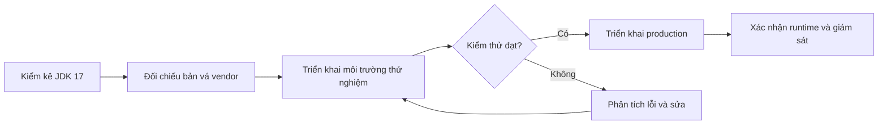

# Chọn bản phân phối JDK 17 và cập nhật bản vá được hỗ trợ

> **Chủ đề:** Java 17 · **Chương:** Môi trường thực hành  
> **Thông tin chính sách được đối chiếu ngày:** 15/11/2026. Vòng đời hỗ trợ, phiên bản bản vá và điều khoản giấy phép có thể thay đổi; khi áp dụng cho hệ thống thật, luôn đối chiếu trang chính thức của nhà cung cấp.

## 1. Vì sao cần chọn đúng bản phân phối JDK 17?

Để viết và chạy chương trình Java 17, bạn cần một **Java Development Kit (JDK)** có các công cụ như `java`, `javac`, `jar`, `jlink` và `jpackage`. Bản thân **Java 17** xác định phiên bản nền tảng, ngôn ngữ và API; còn **bản phân phối JDK** là gói phần mềm được một tổ chức biên dịch, kiểm thử, đóng gói, phát hành và cung cấp bản vá.

Ví dụ, Eclipse Temurin 17, Amazon Corretto 17 và Microsoft Build of OpenJDK 17 đều triển khai Java SE 17, nhưng khác nhau ở nhà phát hành, lịch hỗ trợ, cách cài đặt, kênh nhận bản vá, nền tảng được hỗ trợ và chính sách hỗ trợ thương mại. Vì vậy, câu hỏi đúng không chỉ là “Máy đã cài Java 17 chưa?” mà còn là:

- Java 17 được lấy từ nhà cung cấp nào, đúng hệ điều hành và kiến trúc CPU nào?
- Bản vá bảo mật mới nhất của **nhà cung cấp đó** đã được áp dụng chưa?
- Nhà cung cấp còn phát hành cập nhật cho Java 17 trên nền tảng đang sử dụng không?
- Nhóm có thể cập nhật, thử nghiệm và triển khai lại một cách lặp lại được không?

**Phân biệt ba khái niệm:**

| Khái niệm | Ý nghĩa | Ví dụ |
|---|---|---|
| Phiên bản Java | Dòng tính năng/API cần sử dụng | `17` (LTS) |
| Phiên bản cập nhật | Mức sửa lỗi và bảo mật trong cùng dòng Java 17 | `17.0.21` |
| Bản dựng của nhà cung cấp | Gói thực tế có thể thêm số build, nhãn phân phối | Temurin `17.0.21+9`, Corretto `17.0.21.0.11`, Microsoft `17.0.21.0.2` |

LTS (*Long-Term Support*) nghĩa là có những nhà cung cấp cam kết duy trì dòng Java đó lâu hơn các bản phát hành tính năng thông thường. **LTS không có nghĩa mọi nhà cung cấp đều hỗ trợ đến cùng một ngày**, hoặc một lần cài đặt Java 17 có thể giữ nguyên mãi mãi.

## 2. Những bản phân phối JDK 17 nên cân nhắc

Các lựa chọn sau vẫn có kênh phân phối và cập nhật JDK 17 tại thời điểm đối chiếu. Tất cả các ngày là **mốc chính sách của từng nhà cung cấp**, không phải ngày Java 17 ngừng chạy.

| Bản phân phối | Phù hợp khi | Cập nhật và hỗ trợ Java 17 | Lưu ý cần quyết định |
|---|---|---|---|
| **Eclipse Temurin 17** (Eclipse Adoptium) | Học tập, phát triển đa nền tảng, ứng dụng doanh nghiệp cần OpenJDK miễn phí | Phát hành bản vá qua Adoptium; trang hỗ trợ công bố **ít nhất đến 10/2027** cho dòng 17, với nguyên tắc tiếp tục dựng bản LTS khi nguồn upstream còn được duy trì | Cần kiểm tra danh sách hệ điều hành, kiến trúc CPU và kênh hỗ trợ tương ứng; cộng đồng phát hành binary không đồng nghĩa SLA thương mại |
| **Amazon Corretto 17** | Dịch vụ chạy trên AWS/Amazon Linux hoặc muốn một dòng OpenJDK có lịch hỗ trợ dài được công bố | Amazon dự kiến bản cập nhật cuối **07/2029**, kết thúc vòng đời **10/2029** | Dùng repository/installer chính thức của Corretto; kênh hỗ trợ kỹ thuật tùy gói AWS Support và phạm vi dịch vụ |
| **Microsoft Build of OpenJDK 17** | Máy trạm Windows, Azure, môi trường được quản lý bằng công cụ Microsoft | Microsoft phát hành bản vá theo quý; **09/2027** là mốc kết thúc hỗ trợ *sớm nhất* đã công bố, có thể được gia hạn | Hỗ trợ cho dịch vụ Azure được quản lý có thể có lịch riêng với JDK do nhóm tự cài trên VM/container |
| **Oracle JDK 17** | Tổ chức đã chọn Oracle JDK và có chính sách giấy phép/hỗ trợ Oracle rõ ràng | Premier Support đến **09/2026**; Extended Support đến **09/2029 hoặc sau đó** theo chính sách công bố | Các bản cập nhật Oracle JDK 17 phát hành từ **15/10/2024** dùng **Oracle Technology Network (OTN) License**; phải kiểm tra quyền sử dụng và quyền nhận bản vá trước khi triển khai |

Nguồn: [Temurin Support](https://adoptium.net/support), [Amazon Corretto FAQ](https://aws.amazon.com/corretto/faqs/), [Microsoft OpenJDK Support Roadmap](https://learn.microsoft.com/en-us/java/openjdk/support), [Oracle Java SE Support Roadmap](https://www.oracle.com/java/technologies/java-se-support-roadmap.html).

### Chọn theo nhu cầu thực tế

**Nếu học Java 17 hoặc xây dựng ứng dụng Java thông thường:** Eclipse Temurin 17 là lựa chọn khởi đầu dễ dùng. Tải JDK từ [Adoptium](https://adoptium.net/temurin/releases), chọn chính xác **JDK 17**, hệ điều hành và kiến trúc CPU. Trường hợp cần hỗ trợ thương mại, đánh giá thêm hợp đồng của đơn vị cung cấp hỗ trợ thay vì coi nhãn “LTS” là cam kết SLA.

**Nếu triển khai chủ yếu trên AWS:** Corretto 17 là một lựa chọn hợp lý vì có gói chính thức cho Amazon Linux và lịch cập nhật Java 17 đến năm 2029. Tuy nhiên, chọn Corretto không thay thế việc cập nhật hệ điều hành, thư viện ứng dụng hay image container.

**Nếu tổ chức chuẩn hóa môi trường Microsoft:** Microsoft Build of OpenJDK 17 có bộ cài và kho gói chính thức. Đồng thời, nên lập kế hoạch chuyển sang dòng LTS được hỗ trợ tiếp theo trước mốc hỗ trợ Java 17 của Microsoft; không giả định dịch vụ Azure và máy tự quản lý có chung chính sách.

**Nếu tổ chức yêu cầu Oracle JDK:** cần xác nhận giấy phép, phạm vi đăng ký hỗ trợ, cách tải bản cập nhật và trách nhiệm triển khai. Không nên hiểu “có thể tải tệp” đồng nghĩa “được phép sử dụng miễn phí cho mọi mục đích”. Có thể chọn một bản phân phối OpenJDK khác nếu chính sách Oracle không phù hợp, sau khi kiểm thử tương thích ứng dụng.

Trong môi trường RHEL hoặc nền tảng được nhà cung cấp hệ điều hành hỗ trợ, cũng nên đánh giá JDK được phân phối qua kênh hệ điều hành: vòng đời hỗ trợ **của gói trên nền tảng đó** có thể khác với vòng đời của Temurin hoặc OpenJDK tải độc lập. Xem [Red Hat OpenJDK Life Cycle and Support Policy](https://access.redhat.com/articles/1299013) nếu dùng Red Hat.

### Tiêu chí ra quyết định

Khi so sánh hai gói JDK 17, nên ghi lại tối thiểu:

1. **Tương thích:** hệ điều hành, phiên bản OS, CPU (`x64`, `aarch64`/ARM64), môi trường container, thư viện native/JNI nếu có.
2. **Bản vá:** địa chỉ phát hành chính thức, tốc độ nhận cập nhật bảo mật, repository/installer, nguồn thông báo bảo mật.
3. **Vòng đời hỗ trợ:** ngày kết thúc và điều kiện áp dụng; sự khác biệt giữa cập nhật cộng đồng và hợp đồng hỗ trợ thương mại.
4. **Giấy phép và chi phí:** điều khoản dùng, phân phối lại và hỗ trợ; đánh giá theo từng bản phân phối.
5. **Khả năng vận hành:** cài đặt tự động, kiểm tra checksum/chữ ký, kiểm soát phiên bản trên máy lập trình, CI và production, kế hoạch quay lui.

Với một dự án, nên thống nhất **dòng Java 17** ở môi trường biên dịch và chạy. Khi có lý do dùng bản phân phối khác nhau giữa các môi trường, phải ghi rõ ngoại lệ và chạy kiểm thử trên runtime đích: tính tương thích Java SE không loại trừ mọi khác biệt ở chứng chỉ gốc, gói native, cấu hình hệ điều hành hoặc bản sửa riêng của vendor.

## 3. Hiểu số phiên bản và lịch phát hành bản vá

Trong Java 17, một phiên bản như `17.0.21+9` có thể đọc như sau:

```text
17 . 0 . 21 + 9
│    │    │    └─ Số build của bản cập nhật
│    │    └────── Số cập nhật trong dòng Java 17
│    └─────────── Phần phiên bản phụ
└──────────────── Phiên bản tính năng: Java 17
```

Nhà cung cấp có thể bổ sung một hoặc nhiều thành phần phiên bản riêng, vì vậy **không nên so trực tiếp chuỗi hậu tố giữa hai vendor để kết luận gói nào mới hơn**. Hãy so với trang phát hành của cùng bản phân phối, cùng nền tảng; đồng thời đọc thông báo bảo mật và nội dung sửa lỗi.

Ví dụ có kiểm chứng tại thời điểm 15/11/2026:

- Eclipse Temurin đã phát hành **17.0.21+9** ngày 30/10/2026.
- Amazon Corretto 17 có bản dựng thuộc dòng **17.0.21**.
- Microsoft Build of OpenJDK đã công bố bản **17.0.21.0.2** trong đợt cập nhật tháng 10/2026.

Đây là **ví dụ tại thời điểm viết**, không phải giá trị cố định để sao chép vào mọi lệnh cài đặt trong tương lai. Nguồn: [Adoptium – Temurin 17.0.21](https://adoptium.net/news/2026/10/eclipse-temurin-17021-21013-2505-2701-available), [Corretto 17 User Guide](https://docs.aws.amazon.com/corretto/latest/corretto-17-ug/amazon-linux-install.html), [Microsoft – October 2026 Patch Update](https://devblogs.microsoft.com/java/java-openjdk-october-2026-patch-security-update/).

Các nhà cung cấp lớn thường có các đợt **Critical Patch Update (CPU)** theo quý vào khoảng **tháng 1, 4, 7, 10**. Một số bản vá bổ sung hoặc bản cập nhật ngoài lịch có thể xuất hiện giữa các kỳ. Do đó:

- Cập nhật **trong dòng 17.0.x** để nhận bản sửa cho Java 17, thay vì giữ nguyên bản cài từ năm 2021.
- Theo dõi thông báo từ **đúng vendor đang sử dụng**, không chỉ từ một trang tổng hợp về Java.
- Đọc release notes và cảnh báo tương thích; một bản vá bảo mật vẫn có thể thay đổi hành vi liên quan TLS, chứng chỉ, locale hay runtime.
- Chỉ chuyển từ Java 17 sang Java 21/25 theo một kế hoạch nâng cấp phiên bản tính năng riêng. Việc vá Java 17 thường xuyên **không đòi hỏi** phải tự động chuyển phiên bản chính.

## 4. Cài một JDK 17 chính thức

### Bước 1: Chọn bản tải phù hợp

Trên trang của vendor, chọn lần lượt **JDK** → **17 (LTS)** → **hệ điều hành** → **kiến trúc CPU** → **kiểu gói** (`.msi`, `.pkg`, `.deb`, `.rpm`, `.zip`, `.tar.gz`...). Đối với người học lập trình, chọn **JDK thay vì chỉ JRE** vì cần `javac` để biên dịch chương trình.

Các trang tải đáng tin cậy:

| Vendor | Nơi tải JDK 17 và tài liệu cài đặt |
|---|---|
| Eclipse Temurin | [Temurin Releases](https://adoptium.net/temurin/releases) · [Installation](https://adoptium.net/installation) |
| Amazon Corretto | [Corretto 17 Downloads](https://docs.aws.amazon.com/corretto/latest/corretto-17-ug/downloads-list.html) |
| Microsoft OpenJDK | [Downloads](https://learn.microsoft.com/en-us/java/openjdk/download) · [Install](https://learn.microsoft.com/en-us/java/openjdk/install) |
| Oracle JDK | [Oracle JDK 17](https://www.oracle.com/java/technologies/downloads/archive/) · [Support Roadmap](https://www.oracle.com/java/technologies/java-se-support-roadmap.html) |

Không lấy bản cài từ website không rõ nguồn hoặc các gói tự đóng lại mà không có chính sách cập nhật. Nếu trang download cung cấp **SHA-256** hoặc chữ ký số, hãy kiểm tra để phát hiện tệp hỏng hoặc bị thay đổi trong quá trình phân phối. Trên Windows, có thể tính hash của tệp đã tải bằng PowerShell:

```powershell
Get-FileHash -Algorithm SHA256 "C:\duong-dan\jdk-17-installer.msi"
```

So sánh chuỗi SHA-256 trả về với **checksum được công bố bởi vendor cho chính tệp đó**. Đừng dùng một chuỗi checksum của phiên bản khác hoặc kiến trúc khác.

### Bước 2a: Windows — ví dụ Eclipse Temurin 17

Có thể dùng bộ cài MSI từ Adoptium hoặc Windows Package Manager (`winget`). Với `winget`, hãy xác nhận package ID của JDK 17 rồi cài:

```powershell
winget search --id EclipseAdoptium.Temurin.17.JDK
winget install --id EclipseAdoptium.Temurin.17.JDK --exact
```

Nếu môi trường doanh nghiệp quản lý phần mềm tập trung, dùng kênh được IT chấp thuận. Sau cài đặt, **mở terminal mới** rồi kiểm tra:

```powershell
java -version
javac -version
Get-Command java -All
$env:JAVA_HOME
```

`JAVA_HOME` phải trỏ tới **thư mục gốc của JDK 17**, không phải thư mục `bin` và không phải đường dẫn đến `java.exe`. `PATH` cần cho phép hệ thống tìm thấy `%JAVA_HOME%\bin` hoặc thư mục `bin` của bản cài đặt tương ứng. Nếu có nhiều JDK, `Get-Command java -All` giúp phát hiện bản cũ đang đứng trước trong `PATH`.

Khi cập nhật bằng `winget`, nên dùng cùng package ID đã cài:

```powershell
winget upgrade --id EclipseAdoptium.Temurin.17.JDK --exact
```

Lệnh có thể không nâng được nếu bản cài không được quản lý bởi `winget`, bị giới hạn qua chính sách máy hoặc vendor chưa phát hành gói mới trên kênh đó. Khi ấy dùng kênh cài đặt ban đầu và đối chiếu phiên bản phát hành chính thức.

### Bước 2b: macOS — ví dụ Eclipse Temurin 17

Sử dụng file `.pkg` phù hợp với Intel hoặc Apple Silicon từ Adoptium. Nếu máy đã quản lý phần mềm bằng Homebrew, cài đúng cask dành cho Java 17:

```bash
brew install --cask temurin@17
```

Kiểm tra các JDK hiện có và chọn JDK 17 cho phiên terminal:

```bash
/usr/libexec/java_home -V
export JAVA_HOME=$(/usr/libexec/java_home -v 17)
export PATH="$JAVA_HOME/bin:$PATH"
java -version
javac -version
```

Cần đặt cấu hình trong file khởi tạo shell (ví dụ `~/.zshrc`) nếu muốn giữ lựa chọn khi mở terminal mới. Chỉ nên sửa cấu hình sau khi đã xác nhận đường dẫn `java_home` trả về đúng JDK định dùng. Cập nhật cask đã cài:

```bash
brew upgrade --cask temurin@17
```

Lưu ý nguồn gói và tốc độ phát hành Homebrew có thể khác nhau tùy nền tảng; nếu cần một bản vá cụ thể, kiểm tra cả [release notes Temurin](https://adoptium.net/news/) và thông tin phiên bản cask đang có.

### Bước 2c: Ubuntu/Debian — ví dụ Eclipse Temurin 17

Đối với hệ điều hành Linux dùng `apt`, trước tiên cấu hình **repository và khóa xác thực của Adoptium** theo tài liệu [Linux installer packages](https://adoptium.net/installation/linux). Sau đó cài gói chính xác của Java 17:

```bash
sudo apt update
sudo apt install temurin-17-jdk

java -version
javac -version
```

Nếu chưa thêm repository của Adoptium, `apt` có thể báo không tìm thấy `temurin-17-jdk`; không nên thay thế tùy tiện bằng một tên gói khác rồi cho rằng vendor giống nhau. Trên Fedora/RHEL đã cấu hình repository Adoptium, gói tương ứng có thể cài bằng:

```bash
sudo dnf install temurin-17-jdk
```

Với **Amazon Linux**, nếu chọn Corretto 17, có thể cài JDK theo tài liệu AWS:

```bash
sudo dnf install java-17-amazon-corretto-devel
java -version
javac -version
```

Một số phiên bản Amazon Linux dùng `yum`; theo đúng tài liệu của hệ điều hành tương ứng. Với máy có nhiều JDK, kiểm tra symlink/cơ chế `alternatives` để lệnh `java` và `javac` cùng chỉ tới dòng Java 17 mong muốn.

### Bước 3: Xác nhận phiên bản, nhà cung cấp và đường dẫn thực tế

Chạy:

```bash
java -version
javac -version
java -XshowSettings:properties -version
```

Tìm trong kết quả các giá trị như `java.version`, `java.vendor` và `java.home`. Ví dụ một bản cài Temurin 17.0.21 có thể in ra:

```text
openjdk version "17.0.21" 2026-10-20
OpenJDK Runtime Environment Temurin-17.0.21+9
OpenJDK 64-Bit Server VM Temurin-17.0.21+9
```

Đây là **kết quả minh họa**, không phải yêu cầu máy phải in đúng từng ký tự. Đối chiếu với trang phát hành của vendor; quan trọng nhất là dòng phiên bản `17`, bản cập nhật, vendor và đường dẫn JDK đang được hệ thống thực sự gọi.

Kiểm tra vị trí lệnh trên Linux:

```bash
command -v java
readlink -f "$(command -v java)"
echo "$JAVA_HOME"
```

Trên macOS, dùng `/usr/libexec/java_home -V`; trên Windows PowerShell, dùng `Get-Command java -All`. Nếu `java -version` là 17 nhưng `javac -version` là 21, hoặc IDE chạy bằng JDK khác terminal, dự án có nguy cơ biên dịch và chạy trên các môi trường không nhất quán.

### Bước 4: Biên dịch thử bằng Java 17

Tạo file `HelloJdk17.java`:

```java
public class HelloJdk17 {
    public static void main(String[] args) {
        System.out.println("JDK: " + Runtime.version());
        System.out.println("Vendor: " + System.getProperty("java.vendor"));
        System.out.println("Java home: " + System.getProperty("java.home"));
    }
}
```

Chạy:

```bash
javac --release 17 HelloJdk17.java
java HelloJdk17
```

`--release 17` yêu cầu trình biên dịch sử dụng ngôn ngữ và API công khai tương ứng Java 17. Nếu phải biên dịch trên JDK mới hơn trong CI, tùy chọn này vẫn hữu ích, nhưng **không thay thế kiểm thử chương trình trên runtime JDK 17 thật**. Với Gradle hoặc Maven, hãy khai báo rõ Java toolchain / compiler release 17 và bảo đảm tác vụ test cũng chạy trên JDK 17 được chọn.

## 5. Quy trình cập nhật bản vá JDK 17 đúng cách

Một ứng dụng chạy ổn trên Java 17.0.x chưa chắc đã nhận các bản sửa bảo mật của Java 17.0.y. Cập nhật JDK phải là một phần của quy trình vận hành, từ laptop đến CI và máy chủ.



### 5.1. Kiểm kê nơi đang dùng JDK

Tạo một bảng lưu cho từng môi trường:

| Môi trường | Vendor | Phiên bản đang chạy | Nguồn cập nhật | Người/chức năng chịu trách nhiệm |
|---|---|---|---|---|
| Laptop lập trình | Temurin | Ví dụ `17.0.20` | `winget` / Homebrew / installer | Người phát triển |
| CI build/test | Temurin | Ví dụ `17.0.20` | Image runner hoặc cấu hình Java toolchain | Người quản lý CI |
| Staging | Corretto | Ví dụ `17.0.20` | Repository / container image AWS | Nhóm vận hành |
| Production | Corretto | Ví dụ `17.0.20` | Quy trình phát hành image/VM | Nhóm vận hành |

Các con số trong bảng chỉ minh họa cách kiểm kê; hãy thay bằng kết quả thực tế. **Inventory phải gồm cả JDK dùng để build và runtime chạy ứng dụng.** Trên một máy có thể tồn tại JDK do IDE cài riêng, JDK hệ thống, JDK của CI runner và JDK nằm trong image container.

### 5.2. Xác định bản cập nhật phù hợp

1. Mở trang **release notes hoặc security advisory** chính thức của vendor.
2. Chọn dòng **17**, kiến trúc và hệ điều hành đúng với bản hiện có.
3. Đọc số phiên bản, nội dung sửa lỗi, thông tin CVE liên quan và các cảnh báo tương thích.
4. Kiểm tra bản cập nhật đã xuất hiện trong **kênh phân phối đang dùng** hay chưa; một gói trên package manager có thể được đồng bộ muộn hơn website tải trực tiếp.
5. Chốt phiên bản mục tiêu và lịch nâng cấp thử nghiệm/production; ưu tiên bản vá bảo mật quan trọng theo mức độ phơi nhiễm và chính sách của tổ chức.

Không kết luận “an toàn” chỉ vì chuỗi phiên bản trông mới, hoặc vì một vulnerability scanner đánh dấu số phiên bản `17.0.x` cũ. Một số vendor có thể **backport bản sửa** mà không dùng cùng chuỗi build với vendor khác. Khi đánh giá lỗ hổng, đối chiếu advisory của nhà cung cấp và cấu hình thực tế.

### 5.3. Áp dụng bản vá qua kênh đã cài

Các lệnh sau là ví dụ **khi JDK đã được cài bằng đúng package manager tương ứng**:

**Windows — Temurin 17 qua winget:**

```powershell
winget upgrade --id EclipseAdoptium.Temurin.17.JDK --exact
```

**macOS — Temurin 17 qua Homebrew:**

```bash
brew upgrade --cask temurin@17
```

**Ubuntu/Debian — Temurin 17 từ repository Adoptium:**

```bash
sudo apt update
sudo apt install --only-upgrade temurin-17-jdk
```

**Fedora/RHEL — Temurin 17 từ repository Adoptium:**

```bash
sudo dnf upgrade temurin-17-jdk
```

**Amazon Linux — Corretto 17 từ repository AWS:**

```bash
sudo dnf upgrade java-17-amazon-corretto-devel
```

Nếu dùng bộ cài `.msi`/`.pkg`/`.tar.gz` tải thủ công, hãy lấy bộ cài mới cùng dòng 17 từ vendor, kiểm tra checksum hoặc chữ ký, rồi nâng theo hướng dẫn dành cho phương thức cài đó. **Không trộn nhiều cơ chế cài đặt cho cùng một gói** vì sẽ khó biết bản nào được cập nhật và bản nào đang nằm trên `PATH`.

Khi JDK được cập nhật trên đĩa, **tiến trình Java đang chạy thường chưa tự chuyển sang bản vá mới**. Cần khởi động lại service/pod/quá trình tương ứng sau khi triển khai, rồi kiểm tra phiên bản bên trong tiến trình hoặc runtime mới, thay vì chỉ xác nhận tệp trên host.

### 5.4. Kiểm thử trước khi đưa lên production

Sau khi cài bản vá trên môi trường thử nghiệm:

- Kiểm tra `java -version`, `javac -version` và `java.home` thực tế; xác nhận cùng vendor/dòng 17 đã chọn.
- Build và chạy lại unit test, integration test, smoke test theo quy trình của dự án.
- Thử những luồng nhạy cảm với runtime: TLS/HTTPS, truststore/chứng chỉ, kết nối cơ sở dữ liệu, xử lý thời gian/locale, mã hóa, thư viện native/JNI, khởi động service.
- Với web service, xem log khởi động, tỷ lệ lỗi, độ trễ, CPU/bộ nhớ và các health check trước/sau triển khai.
- Chuẩn bị bản image/gói JDK trước đó để **quay lui** nếu bản vá gây sự cố; đồng thời bảo đảm việc quay lui không làm hệ thống phơi nhiễm kéo dài trước lỗ hổng nghiêm trọng.

Nếu ứng dụng chạy trong container/Kubernetes, thay đổi JDK trên laptop hoặc CI **không tự cập nhật** runtime trong container đã phát hành. Cần cập nhật base image, **rebuild application image**, kiểm thử, triển khai lại container/pod và xác nhận `java -version` bên trong bản đang chạy. Một tag linh hoạt như `eclipse-temurin:17-jre` không tự thay đổi nội dung container đang chạy; với quy trình cần lặp lại được, nên pin theo **digest** khi phát hành và chủ động nâng digest theo mỗi đợt vá.

### 5.5. Lưu bằng chứng triển khai

Ghi lại ít nhất: thời gian, môi trường, vendor, bản cũ/bản mới, nguồn release notes, checksum hoặc định danh image, kết quả kiểm thử, người triển khai và tình trạng sau khi rollout. Ví dụ:

```text
Môi trường: staging
Vendor: Eclipse Temurin
Java feature version: 17
Trước: 17.0.20
Sau: 17.0.21+9
Nguồn: Adoptium release 30/10/2026
Kiểm tra: java -version / smoke test / HTTPS / DB connection
Trạng thái: đạt; chờ lịch triển khai production
```

Đây là ví dụ ghi chép, không phản ánh một hệ thống đã thật sự được cập nhật.

## 6. Kiểm soát JDK 17 trong dự án và CI/CD

Chỉ định Java 17 cho quá trình biên dịch là một việc; chỉ định **bản phân phối, bản vá và nơi chạy kiểm thử** là việc khác. Một số thực hành nên áp dụng:

**Gradle — khai báo toolchain Java 17:**

```kotlin
java {
    toolchain {
        languageVersion = JavaLanguageVersion.of(17)
    }
}
```

Đoạn trên dành cho `build.gradle.kts` của một dự án Gradle áp dụng plugin `java`. Toolchain yêu cầu phiên bản Java 17, nhưng có thể chọn một vendor bất kỳ nếu không có cấu hình ràng buộc nhà cung cấp. Nếu cần tái hiện môi trường chính xác, hãy quản lý bản phân phối JDK trong runner hoặc thiết lập thêm tiêu chí vendor phù hợp.

**Maven — khai báo phiên bản API/ngôn ngữ mục tiêu:**

```xml
<properties>
    <maven.compiler.release>17</maven.compiler.release>
</properties>
```

Thuộc tính `release` kiểm soát mức tương thích biên dịch; không bảo đảm Maven hay test runner đang được chạy trên đúng bản JDK 17. Vì vậy vẫn cần kiểm tra `java -version` ở CI và runtime thật.

Với GitHub Actions, có thể cấu hình `actions/setup-java` bằng `distribution: 'temurin'` và `java-version: '17'`. Khi cần nâng bản vá, phải hiểu cách action, cache và runner lấy bản build mới; đừng mặc định kết quả của một lần build cũ đã được cập nhật. Ở môi trường có yêu cầu kiểm toán hoặc tái hiện tuyệt đối, quản lý rõ định danh binary/image và chính sách làm mới pin.

Các môi trường nên được kiểm tra riêng:

| Thành phần | Điều cần xác nhận |
|---|---|
| IDE | Project SDK và Gradle/Maven JDK cùng phù hợp với Java 17 |
| Terminal | `java`, `javac`, `JAVA_HOME` và `PATH` khớp JDK mục tiêu |
| CI | Bản phân phối và dòng Java 17 được khai báo rõ; có cơ chế nhận bản vá |
| Container/VM | Runtime thực tế được cập nhật và tiến trình đã khởi động lại |
| Artifact | Được build/test với API và bytecode mục tiêu Java 17 |

## 7. Những lỗi chọn và cập nhật JDK thường gặp

| Triệu chứng | Nguyên nhân thường gặp | Cách xử lý |
|---|---|---|
| `java -version` báo 21/25 dù đã cài JDK 17 | JDK khác đứng trước trong `PATH`; shell chưa nhận biến mới | Kiểm tra đường dẫn lệnh, `JAVA_HOME`, `alternatives` hoặc `java_home`; mở terminal mới |
| `java -version` là 17 nhưng `javac` không có | Đã cài runtime/JRE hoặc `PATH` chưa chứa JDK `bin` | Cài **JDK 17** đầy đủ; kiểm tra `javac -version` |
| `java` 17 nhưng `javac` 21 | Các lệnh đang tới hai bản cài khác nhau | Đồng bộ đường dẫn và cấu hình IDE/build tool; kiểm tra lại cả hai |
| Ứng dụng có `UnsupportedClassVersionError` | Artifact được biên dịch cho phiên bản Java mới hơn runtime | Đặt compiler `--release 17`/toolchain đúng dòng và chạy thử trên Java 17 |
| Máy đã cập nhật JDK nhưng service vẫn báo phiên bản cũ | Tiến trình chưa được khởi động lại hoặc dùng JDK riêng | Restart/rollout có kiểm soát và kiểm tra runtime của **tiến trình thực tế** |
| Host đã vá nhưng container vẫn dùng phiên bản cũ | Image chứa JDK cũ; container không được rebuild | Nâng base image, rebuild, kiểm thử và redeploy |
| Package manager báo không có bản mới | Repository chưa cấu hình, chưa đồng bộ hoặc gói cài thủ công | Đối chiếu kênh cài gốc với trang release chính thức; không cài chồng tùy tiện |
| Tổ chức dùng Oracle JDK 17 mà chưa rõ quyền dùng bản vá mới | Nhầm lẫn giữa bản cập nhật Oracle JDK 17 và các binary OpenJDK khác | Kiểm tra OTN License, hợp đồng và chính sách Oracle hoặc đánh giá nhà cung cấp khác |

## 8. Tình huống thực hành: chọn JDK 17 cho nhóm phát triển

Giả sử một nhóm xây dựng ứng dụng Java 17, lập trình trên Windows/macOS, chạy CI trên Linux và triển khai dịch vụ trong container. Nhóm chưa có hợp đồng bắt buộc với một nhà cung cấp JDK.

**Đề xuất triển khai:**

1. Chọn **Eclipse Temurin 17** làm bản phân phối chuẩn; kiểm tra chính sách hỗ trợ của Adoptium cho thời gian dự kiến duy trì dự án.
2. Cài JDK 17 từ website hoặc package manager chính thức trên từng máy; ghi vendor và bản vá thực tế.
3. Đặt `--release 17` hoặc Java toolchain 17 trong hệ thống build, cấu hình CI dùng Temurin 17 và chạy test trên runtime Java 17.
4. Trong container, chọn base image Temurin 17 tương ứng và xây dựng quy trình **định kỳ cập nhật digest, rebuild, kiểm thử, redeploy**.
5. Theo dõi các đợt vá hàng quý và advisory khẩn cấp; thử trên staging rồi đưa sang production.
6. Trước khi đến gần mốc hỗ trợ công bố của vendor, quyết định tiếp tục bằng một kênh hỗ trợ còn hiệu lực hoặc lập kế hoạch nâng lên phiên bản Java LTS mới hơn sau khi kiểm thử ứng dụng.

**Câu hỏi tự kiểm tra:**

1. Vì sao cùng là Java 17 nhưng thời hạn hỗ trợ của Temurin, Corretto, Microsoft và Oracle không giống nhau?
2. Một máy có `java -version` là 17.0.21 nhưng ứng dụng trong Docker đang dùng 17.0.18. Cần cập nhật những thành phần nào?
3. Nếu sử dụng JDK 17 từ Oracle, thông tin giấy phép nào cần kiểm tra trước khi tải và triển khai bản vá phát hành sau 15/10/2024?
4. Vì sao thay `sourceCompatibility = 17` hoặc `maven.compiler.release = 17` không đủ để kết luận runtime production đã dùng JDK 17 có bản vá mới?

**Đáp án gợi ý:** (1) Vì chính sách cập nhật và hỗ trợ do từng vendor công bố. (2) Cập nhật base image, rebuild và redeploy container, kiểm tra runtime đang chạy. (3) OTN License và quyền sử dụng/nhận hỗ trợ phù hợp với tổ chức. (4) Vì cấu hình compiler kiểm soát artifact, còn runtime production có vòng đời cập nhật riêng.

## 9. Tài liệu chính thức để kiểm tra khi cần cập nhật

- [Eclipse Adoptium – Temurin Releases](https://adoptium.net/temurin/releases), [Support](https://adoptium.net/support), [Linux installation](https://adoptium.net/installation/linux), [Temurin 17.0.21 release announcement (30/10/2026)](https://adoptium.net/news/2026/10/eclipse-temurin-17021-21013-2505-2701-available).
- [Amazon Corretto – FAQ và support calendar](https://aws.amazon.com/corretto/faqs/), [Corretto 17 downloads](https://docs.aws.amazon.com/corretto/latest/corretto-17-ug/downloads-list.html), [Amazon Linux installation](https://docs.aws.amazon.com/corretto/latest/corretto-17-ug/amazon-linux-install.html).
- [Microsoft Build of OpenJDK – support roadmap](https://learn.microsoft.com/en-us/java/openjdk/support), [download](https://learn.microsoft.com/en-us/java/openjdk/download), [installation](https://learn.microsoft.com/en-us/java/openjdk/install).
- [Oracle – Java SE Support Roadmap và thay đổi giấy phép cập nhật JDK 17](https://www.oracle.com/java/technologies/java-se-support-roadmap.html).
- [Oracle – tài liệu lệnh `java` trong JDK 17](https://docs.oracle.com/en/java/javase/17/docs/specs/man/java.html) để tra cứu `-XshowSettings:properties`.

**Nguyên tắc áp dụng:** chọn một bản phân phối JDK 17 có kênh cập nhật và thời hạn hỗ trợ phù hợp, xác nhận vendor cùng phiên bản thực tế ở từng môi trường, rồi cập nhật các bản vá Java 17 trong suốt vòng đời ứng dụng. Không để “17 LTS” trở thành lý do bỏ qua các bản vá bảo mật hoặc lịch chuyển đổi phiên bản sau này.
