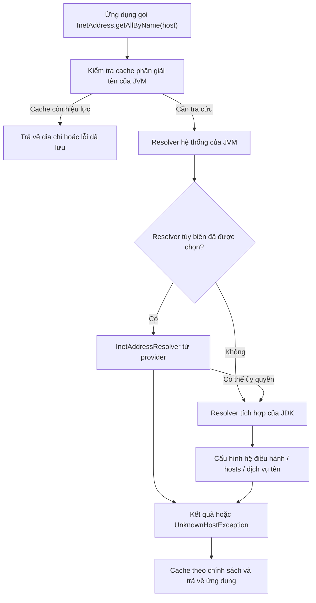

# Phân giải hostname trong Java và vai trò của resolver hệ điều hành hoặc provider tùy biến

> **Phạm vi:** Hợp đồng `java.net.InetAddress` và cơ chế `java.net.spi.InetAddressResolverProvider` được đưa vào Java 18 (JEP 418), vẫn hiện diện trong các JDK hiện đại. Bài tập trung vào cách tên máy được đổi thành địa chỉ IP, điều gì do hệ điều hành quyết định, khi nào nên thay resolver, và những giới hạn cần kiểm chứng trong ứng dụng thực tế.

## 1. Mục tiêu học tập

Sau bài này, bạn có thể:

1. Phân biệt **hostname**, **địa chỉ IPv4/IPv6**, **phân giải xuôi** (hostname → IP) và **phân giải ngược** (IP → hostname).
2. Sử dụng đúng `InetAddress.getByName`, `getAllByName`, `getHostAddress`, `getHostName` và `getCanonicalHostName`; nhận biết kết quả phụ thuộc môi trường.
3. Giải thích cách Java 18+ chọn **resolver mặc định của JDK** hoặc một **`InetAddressResolverProvider` do ứng dụng cung cấp**.
4. Hiểu bộ nhớ đệm phân giải tên, chính sách IPv4/IPv6, lỗi `UnknownHostException` và cách kiểm thử không phụ thuộc DNS công cộng.
5. Viết một provider nhỏ, ủy quyền các tên không xử lý cho resolver mặc định mà không gây đệ quy.

## 2. InetAddress giải quyết bài toán gì?

Ứng dụng thường biết tên dịch vụ như `api.example.com` nhưng tầng mạng cần địa chỉ IP để kết nối. `InetAddress` là mô hình địa chỉ IP của Java; các phương thức tra cứu của nó chuyển tên máy thành một hoặc nhiều đối tượng `Inet4Address` / `Inet6Address`. Một tên có thể trỏ tới nhiều IP và danh sách có thể thay đổi theo thời gian, vùng mạng, bản ghi DNS hoặc chính sách resolver.

| Thuật ngữ | Ý nghĩa | Ví dụ |
|---|---|---|
| Hostname | Tên logic cần phân giải | `api.example.com` |
| IPv4 / IPv6 literal | Địa chỉ IP đã ở dạng văn bản | `192.0.2.10` / `2001:db8::10` |
| Forward lookup | Tìm IP từ hostname | `api.example.com → [IPv4, IPv6, …]` |
| Reverse lookup | Tìm tên từ địa chỉ IP | `192.0.2.10 → tên máy, nếu có` |
| Resolver | Thành phần thực hiện việc tra cứu | Resolver mặc định của JDK hoặc provider tùy biến |

`192.0.2.0/24` và `2001:db8::/32` là các dải địa chỉ dành cho tài liệu; chúng được dùng dưới đây để minh họa, **không phải** địa chỉ máy chủ Internet dùng trong sản xuất.



Sơ đồ mô tả luồng tra cứu thông thường. Cache có thể trả lời trước khi resolver được gọi; một số thao tác với **IP literal** chỉ kiểm tra cú pháp hoặc tạo đối tượng mà không cần truy vấn tên.

## 3. Hợp đồng API: phương thức nào thực sự tra cứu?

| API | Hợp đồng cần nhớ |
|---|---|
| `InetAddress.getByName(host)` | Phân giải hostname và trả về **một** địa chỉ trong tập kết quả; `UnknownHostException` khi không phân giải được. |
| `InetAddress.getAllByName(host)` | Trả về **mảng địa chỉ** ứng với tên máy theo resolver và chính sách lựa chọn/thứ tự địa chỉ của JVM. Không giả định mảng có số phần tử hay thứ tự cố định. |
| `address.getHostAddress()` | Trả về **chuỗi IP** của đối tượng hiện tại; không cần reverse lookup. |
| `address.getHostName()` | Trả lại tên đã gắn với đối tượng nếu có; nếu chưa biết tên, có thể thực hiện reverse lookup. |
| `address.getCanonicalHostName()` | Thử tìm tên đầy đủ qua resolver bằng reverse lookup; nếu không tìm được thì có thể trả về chính chuỗi IP. |
| `InetAddress.getByAddress(bytes)` | Tạo đối tượng từ **4 byte IPv4** hoặc **16 byte IPv6**; không truy vấn DNS, báo lỗi nếu độ dài sai. |
| `InetAddress.getLoopbackAddress()` | Lấy địa chỉ loopback thích hợp (`127.0.0.1` hoặc `::1`); phù hợp các phép kiểm tra cục bộ. |
| `InetAddress.getLocalHost()` | Lấy tên host của máy hiện tại rồi phân giải; không đảm bảo trả về IP của giao diện mạng mà ứng dụng kỳ vọng. |

Một vài chi tiết dễ nhầm:

- `getByName("192.0.2.10")` và `getByName("2001:db8::10")` nhận **IP literal** và chỉ xác minh dạng địa chỉ, không cần hỏi DNS. Từ **JDK 22** có thêm `InetAddress.ofLiteral(String)` để phân tích literal một cách rõ ràng; khi viết mã chạy trên Java 18, dùng API đã có từ Java 18 như `getByAddress` cho tình huống cần chắc chắn không tra cứu tên.
- `getByName(null)` hoặc `getByName("")` trả về địa chỉ loopback theo hợp đồng API. Vì vậy, **tự kiểm tra hostname rỗng** nếu đầu vào bắt buộc phải là tên dịch vụ hợp lệ; không để đầu vào rỗng vô tình trở thành kết nối đến máy cục bộ.
- `getByName` không đồng nghĩa với mở kết nối TCP, kiểm tra cổng dịch vụ hay xác minh chứng chỉ TLS. Phân giải thành công không có nghĩa dịch vụ có thể truy cập.
- `getHostName` có thể trả về tên vốn đã được ghi nhớ, nên không thích hợp để bắt buộc kiểm tra bản ghi reverse. `getCanonicalHostName` có thể thử reverse nhưng **không phải** cơ chế xác thực danh tính máy chủ.

### Ví dụ A: quan sát kết quả phân giải

Chạy `HostnameLookup.java` trên **JDK 18 trở lên**:

```java
import java.net.InetAddress;
import java.net.UnknownHostException;

public class HostnameLookup {
    public static void main(String[] args) {
        String host = args.length > 0 ? args[0] : "localhost";
        if (host.isBlank()) {
            throw new IllegalArgumentException("Hostname không được rỗng");
        }

        try {
            InetAddress[] addresses = InetAddress.getAllByName(host);
            System.out.println("Host: " + host);
            for (InetAddress address : addresses) {
                System.out.printf("%s (%s)%n",
                        address.getHostAddress(),
                        address.getClass().getSimpleName());
            }
        } catch (UnknownHostException e) {
            System.err.println("Không phân giải được host: " + host);
            // Có thể do tên không tồn tại, dịch vụ tên lỗi, mạng lỗi, v.v.
        }
    }
}
```

Chạy bằng Java source-file launcher:

```text
java HostnameLookup.java localhost
java HostnameLookup.java example.com
```

`localhost` thường có sẵn trong cấu hình hệ điều hành; `example.com` cần môi trường có khả năng phân giải tên bên ngoài. Số lượng IP và thứ tự in ra **có thể khác nhau** giữa các máy và lần chạy; không lấy ví dụ này làm phép kiểm thử với kết quả IP cố định.

### Ví dụ B: tạo IP không phụ thuộc DNS

```java
import java.net.InetAddress;

public class LiteralAddress {
    public static void main(String[] args) throws Exception {
        byte[] ipv4 = {(byte) 192, 0, 2, 10};
        InetAddress address = InetAddress.getByAddress(ipv4);

        System.out.println(address.getHostAddress()); // 192.0.2.10
        System.out.println(address.getAddress().length); // 4
        System.out.println(InetAddress.getLoopbackAddress().isLoopbackAddress()); // true
    }
}
```

Đừng dùng `getCanonicalHostName()` trong phép thử này nếu muốn giữ nó độc lập với reverse lookup.

## 4. Resolver mặc định: Java ủy quyền cho môi trường chạy

Nếu ứng dụng không đăng ký provider phù hợp, `InetAddress` dùng **resolver tích hợp của JDK**. Resolver này thường gọi các cơ chế tra cứu tên của nền tảng; nó có thể sử dụng cấu hình mạng cục bộ, tệp `hosts` và các dịch vụ tên như DNS tùy hệ điều hành. Do đó, không thể suy luận đơn giản rằng *mỗi lần* `getAllByName` đều gửi một truy vấn DNS ra mạng.

Trên một số hệ điều hành, thứ tự tìm tên và nguồn dữ liệu chịu ảnh hưởng của tệp cấu hình hosts, cơ chế tra cứu tên của hệ thống, DNS server, search domain, VPN hoặc cấu hình mạng container. Hành vi cụ thể do nền tảng quyết định; Java không hứa rằng kết quả của các môi trường này giống nhau.

**Hệ quả thực tế:**

1. Bản ghi `api.internal` có thể phân giải được trong VPN doanh nghiệp nhưng báo `UnknownHostException` ở máy không kết nối VPN.
2. Một hostname có thể trả về cả bản ghi A (IPv4) và AAAA (IPv6); phiên bản JDK, khả năng mạng và chính sách ưu tiên địa chỉ ảnh hưởng kết quả trả về.
3. Dịch vụ DNS đổi IP nhưng tiến trình Java vẫn có thể nhìn thấy bản ghi cũ do **cache của JVM** hoặc cache ở tầng hệ điều hành/resolver.
4. `nslookup` / `dig` trực tiếp hỏi DNS có thể không phản ánh cùng chuỗi nguồn dữ liệu mà cơ chế tra cứu tên của hệ điều hành đang dùng. Khi chẩn đoán, so sánh cả kết quả chạy **ngay trong JVM**.

Một lựa chọn hữu ích khi **kiểm thử mapping cục bộ** là hệ thống property `jdk.net.hosts.file`. Khi cấu hình nó, JDK sử dụng tệp hosts được chỉ định để phân giải tên theo cơ chế riêng, thay cho resolver hệ thống thông thường. Ví dụ:

```text
# Nội dung tệp lab-hosts (định dạng hosts)
192.0.2.10 api.lab.test
```

```text
java -Djdk.net.hosts.file=lab-hosts HostnameLookup.java api.lab.test
```

Nếu tệp chỉ định không tồn tại hoặc không có hostname cần tìm, lần tra cứu tương ứng có thể nhận `UnknownHostException`; không mặc định rơi về DNS hệ điều hành. Đây là công cụ kiểm thử có phạm vi tên hữu hạn, không phải cơ chế thay thế toàn bộ hệ thống phân giải tên cho ứng dụng sản xuất. Khi kiểm thử **provider tùy biến**, không bật `jdk.net.hosts.file` vì cấu hình này có thể làm JDK chọn resolver tệp hosts thay vì provider.

## 5. Java 18: InetAddressResolverProvider tùy biến hoạt động ra sao?

Từ **Java 18**, JEP 418 bổ sung SPI công khai:

- `java.net.spi.InetAddressResolverProvider`: một **factory** tạo resolver. Lớp triển khai cần constructor không tham số và hai phương thức `get(Configuration)`, `name()`.
- `java.net.spi.InetAddressResolver`: hợp đồng tra cứu xuôi `lookupByName(String, LookupPolicy)` và tra cứu ngược `lookupByAddress(byte[])`.
- `Configuration.builtinResolver()`: cho phép provider ủy quyền những tên không tự xử lý về resolver tích hợp, không phải gọi lại `InetAddress.getByName`.
- `Configuration.lookupLocalHostName()`: truy xuất tên host cục bộ từ cấu hình hệ thống khi thật sự cần.
- `LookupPolicy`: mô tả họ địa chỉ IPv4/IPv6 cần trả về và thứ tự ưu tiên. Provider có trách nhiệm tôn trọng chính sách đó.

**Điểm quan trọng:** Java chọn **một resolver cho cả JVM**, thông qua `ServiceLoader` bằng system class loader khi phát sinh lần lookup đầu tiên sau khi VM khởi tạo đầy đủ. Provider đầu tiên tìm thấy sẽ được dùng; thứ tự tìm nhiều provider **không được bảo đảm**. Nếu không có provider, dùng resolver mặc định. Nếu `get(Configuration)` của provider lỗi, lỗi được chuyển cho lời gọi kích hoạt lookup; không được giả định JDK tự động bỏ qua provider lỗi. Lookup rất sớm trong quá trình boot có thể dùng resolver tích hợp.

Không có API công khai theo hợp đồng này để đổi provider theo từng lời gọi `getByName` hay hot-swap resolver đang chạy. Hãy xem provider là cấu hình **phạm vi tiến trình**, và tạo JVM mới khi thử thay đổi đăng ký.

### 5.1. Hiểu chính xác LookupPolicy

`lookupByName` nhận `LookupPolicy` với các bit đặc tính:

| Hằng số | Ý nghĩa |
|---|---|
| `LookupPolicy.IPV4` | Cần tra cứu/trả về IPv4. |
| `LookupPolicy.IPV6` | Cần tra cứu/trả về IPv6. |
| `LookupPolicy.IPV4_FIRST` | Khi có cả hai họ địa chỉ, ưu tiên IPv4 trong thứ tự kết quả. |
| `LookupPolicy.IPV6_FIRST` | Khi có cả hai họ địa chỉ, ưu tiên IPv6 trong thứ tự kết quả. |

Đọc bằng `policy.characteristics()` và kiểm tra các bit bằng phép `&`. `IPV4` và `IPV6` có thể kết hợp; `IPV4_FIRST` và `IPV6_FIRST` biểu đạt **thứ tự**, không có nghĩa chỉ tra cứu duy nhất họ địa chỉ đó. Nếu không có bit FIRST, giữ thứ tự hệ thống. Khi trả về nhiều địa chỉ, provider phải lọc và sắp xếp phù hợp; nếu không có địa chỉ thuộc họ được yêu cầu thì ném `UnknownHostException`.

### 5.2. Ví dụ provider: chỉ ánh xạ một hostname thử nghiệm

Ví dụ dùng địa chỉ dành cho tài liệu `192.0.2.10` và tên `api.lab.test`. Provider trả lời tên này, xử lý chiều reverse của IP thử nghiệm, còn tất cả trường hợp khác ủy quyền resolver mặc định. Mã chỉ sử dụng API đã có trên **Java 18**.

Tạo `src/main/java/demo/resolver/LabResolverProvider.java`:

```java
package demo.resolver;

import java.net.InetAddress;
import java.net.UnknownHostException;
import java.net.spi.InetAddressResolver;
import java.net.spi.InetAddressResolver.LookupPolicy;
import java.net.spi.InetAddressResolverProvider;
import java.util.Arrays;
import java.util.stream.Stream;

public final class LabResolverProvider extends InetAddressResolverProvider {
    private static final String LAB_HOST = "api.lab.test";
    private static final byte[] LAB_IP = {(byte) 192, 0, 2, 10};

    @Override
    public String name() {
        return "lab-resolver";
    }

    @Override
    public InetAddressResolver get(Configuration configuration) {
        // Lấy delegate trực tiếp: không gọi InetAddress.getByName ở đây.
        InetAddressResolver builtin = configuration.builtinResolver();

        return new InetAddressResolver() {
            @Override
            public Stream<InetAddress> lookupByName(
                    String host, LookupPolicy policy) throws UnknownHostException {
                if (!LAB_HOST.equalsIgnoreCase(host)) {
                    return builtin.lookupByName(host, policy);
                }

                // Mapping chỉ có IPv4; phải tôn trọng họ địa chỉ được yêu cầu.
                if ((policy.characteristics() & LookupPolicy.IPV4) == 0) {
                    throw new UnknownHostException(host);
                }
                return Stream.of(InetAddress.getByAddress(LAB_IP));
            }

            @Override
            public String lookupByAddress(byte[] address)
                    throws UnknownHostException {
                if (Arrays.equals(LAB_IP, address)) {
                    return LAB_HOST;
                }
                return builtin.lookupByAddress(address);
            }
        };
    }
}
```

Tạo `src/main/java/demo/App.java`:

```java
package demo;

import java.net.InetAddress;

public final class App {
    public static void main(String[] args) throws Exception {
        for (InetAddress address : InetAddress.getAllByName("api.lab.test")) {
            System.out.println(address.getHostAddress()); // 192.0.2.10
        }
    }
}
```

Đăng ký provider với `ServiceLoader` bằng file **không có đuôi mở rộng**:

```text
src/main/resources/META-INF/services/java.net.spi.InetAddressResolverProvider
```

Nội dung đúng một dòng:

```text
demo.resolver.LabResolverProvider
```

Với dự án Maven/Gradle thông dụng, tài nguyên trong `src/main/resources` được đóng gói vào classpath lúc chạy; hãy xác minh file `META-INF/services/java.net.spi.InetAddressResolverProvider` thực sự có trong output hoặc JAR. Với **named module**, có thể đăng ký bằng chỉ thị `provides java.net.spi.InetAddressResolverProvider with demo.resolver.LabResolverProvider;` trong `module-info.java` và bảo đảm module cung cấp provider được đưa vào cấu hình runtime. Hai hình thức đăng ký là các cách triển khai theo môi trường build; ví dụ mã ở trên dùng classpath.

**Tránh các lỗi thường gặp:**

- Không gọi `InetAddress.getAllByName(host)` hay `getByName(host)` để "fallback" **bên trong** `lookupByName`: lời gọi lại sẽ đi qua chính resolver tùy biến và có thể lặp vô hạn.
- Trong `get(Configuration)`, tránh thao tác làm phát sinh lookup, tải lớp phức tạp hay giữ khóa dài; việc khởi tạo provider có thể gây vòng phụ thuộc hoặc deadlock.
- Nếu provider chỉ khai báo một IPv4 như ví dụ, không trả IPv4 khi `LookupPolicy` yêu cầu riêng IPv6. Provider thực tế còn cần xử lý đầy đủ thứ tự trả về, chuẩn hóa hostname, lỗi backend và quan sát vận hành.
- Không dựa vào thứ tự các provider nếu ứng dụng có nhiều bản triển khai trên classpath/module path.

**Khi nào cần provider tùy biến?** Khi một tiến trình Java cần chính sách phân giải chuyên biệt, ví dụ service discovery trong mạng nội bộ, mapping ở môi trường thử nghiệm, backend tên máy riêng hoặc lớp ghi nhận/giám sát lookup. Với ứng dụng thông thường, ưu tiên dùng resolver tích hợp và cấu hình mạng chuẩn của môi trường chạy.

## 6. Cache phân giải tên là một phần của hợp đồng vận hành

`InetAddress` duy trì cache cho lookup thành công và không thành công. Ngoài ra hệ điều hành hoặc dịch vụ tên phía sau cũng có thể có cache, nên thay đổi DNS có thể không xuất hiện ngay trong ứng dụng.

| Java security property | Tác dụng | Ngữ nghĩa giá trị |
|---|---|---|
| `networkaddress.cache.ttl` | Thời gian giữ kết quả phân giải **thành công** | Số giây; `0` không cache; số âm là giữ vô hạn. Mặc định phụ thuộc implementation/cấu hình. |
| `networkaddress.cache.negative.ttl` | Thời gian giữ lookup **thất bại** | Số giây; `0` không cache, số âm giữ vô hạn; mặc định thường là `10` giây theo tài liệu JDK. |
| `networkaddress.cache.stale.ttl` | Cho phép dùng kết quả thành công đã cũ khi làm mới không thành công | `0`/không đặt là tắt; giá trị dương là thời gian lưu kết quả stale; tương tác với TTL thành công. |

Ba khóa này là **security properties** của Java, không cấu hình trực tiếp bằng `-Dnetworkaddress.cache.ttl=...` hoặc `System.setProperty("networkaddress.cache.ttl", ...)`. Có thể thiết lập trong cấu hình bảo mật của JDK hoặc qua file security properties nạp lúc khởi động. Ví dụ một file `resolver-security.properties` cho thí nghiệm:

```properties
networkaddress.cache.ttl=30
networkaddress.cache.negative.ttl=5
networkaddress.cache.stale.ttl=0
```

```text
java -Djava.security.properties=resolver-security.properties -cp <classpath> demo.App
```

Đây là **giá trị minh họa**, không phải khuyến cáo chung cho mọi hệ thống. TTL ngắn khiến backend được hỏi thường xuyên hơn; TTL dài làm ứng dụng chậm nhận thay đổi IP. Hãy đặt cấu hình trước lần lookup đầu tiên và kiểm chứng trên đúng bản JDK đang triển khai.

## 7. IPv4, IPv6 và thứ tự địa chỉ

Trên nền tảng hỗ trợ cả hai họ địa chỉ, các property hệ thống sau có thể ảnh hưởng cách Java chọn socket và sắp xếp địa chỉ:

- `java.net.preferIPv6Addresses=true`: ưu tiên địa chỉ IPv6 khi thích hợp; `system`: giữ thứ tự mà system-wide resolver trả về; `false`: thông thường ưu tiên IPv4.
- `java.net.preferIPv4Stack=true`: yêu cầu dùng IPv4 stack; không phù hợp nếu cần kết nối các đích chỉ có IPv6.

Các tùy chọn này được đọc **khi khởi động JVM**. Ví dụ:

```text
java -Djava.net.preferIPv6Addresses=system HostnameLookup.java example.com
```

Đừng coi thứ tự IP do `getAllByName` trả về là hợp đồng cố định. Nếu hệ thống phải kết nối tin cậy trên nhiều địa chỉ, thiết kế chiến lược kết nối/fallback phù hợp; đừng mặc định chỉ chọn phần tử `[0]` và coi đó là địa chỉ lâu dài của dịch vụ.

## 8. Xử lý lỗi, hiệu năng và an toàn

| Hiện tượng | Ý nghĩa / hướng kiểm tra |
|---|---|
| `UnknownHostException` | Resolver không trả được địa chỉ; có thể do hostname sai, cấu hình hosts/DNS, VPN, mạng, cache âm hoặc backend tùy biến. Ngoại lệ này **không chứng minh** host vĩnh viễn không tồn tại. |
| Lookup thành công nhưng kết nối thất bại | Phân giải tên và kết nối TCP/TLS là các bước khác nhau; kiểm tra IP đích, cổng, route, firewall, TLS và timeout kết nối. |
| Đổi DNS nhưng Java vẫn trả IP cũ | Kiểm tra cache JVM, cache hệ điều hành và cấu hình TTL trước khi kết luận provider lỗi. |
| Chạy máy này được, máy khác lỗi | Đối chiếu bản JDK, cài đặt mạng, tệp hosts, VPN, DNS/search domain, khả năng IPv6 và danh sách provider được nạp. |
| Lookup chậm | Các phương thức tra cứu theo tên của `InetAddress` có thể **chặn luồng gọi**; lập kế hoạch timeout/giới hạn luồng ở tầng ứng dụng thay vì giả định `getByName` có tham số timeout riêng. |

Khi nhận hostname từ bên ngoài, xác thực input theo yêu cầu nghiệp vụ trước khi phân giải. Nếu hostname dùng để quyết định kết nối đến mạng nội bộ hay tài nguyên nhạy cảm, cần kiểm soát **địa chỉ IP thực sự được kết nối**, vì tên có thể chuyển IP theo thời gian (DNS rebinding). Không sử dụng kết quả reverse lookup hoặc tên canonical làm bằng chứng danh tính/bảo mật; xác thực TLS và chính sách truy cập là bước khác.

## 9. Thực hành tự kiểm chứng

1. Chạy `HostnameLookup.java` với `localhost`, `example.com` và một tên chắc chắn không tồn tại trong miền `.invalid`. Ghi lại địa chỉ, thứ tự và `UnknownHostException` nếu có. Giải thích yếu tố môi trường nào ảnh hưởng kết quả.
2. Thử `-Djava.net.preferIPv6Addresses=system` so với mặc định. Trên máy không có IPv6 hoặc hostname chỉ có một họ địa chỉ, giải thích vì sao kết quả có thể không đổi.
3. Tạo `lab-hosts` với mapping `192.0.2.10 api.lab.test`, rồi chạy thử `-Djdk.net.hosts.file=lab-hosts`. Xác nhận rằng tên thử nghiệm hoạt động mà không cần đăng bản ghi DNS công cộng.
4. Đăng ký `LabResolverProvider` bằng `META-INF/services`, mở JVM mới và chạy `demo.App`. Kết quả kỳ vọng là `192.0.2.10`. Thử một hostname khác để quan sát việc ủy quyền về resolver mặc định. Khi làm thử nghiệm này, **bỏ** `jdk.net.hosts.file`.
5. Giả sử `api.lab.test` có IPv4 nhưng policy chỉ yêu cầu IPv6. Chỉ ra dòng code phải ném `UnknownHostException` và giải thích vì sao trả IPv4 sẽ vi phạm hợp đồng.

**Tiêu chí hoàn thành:** Bạn có thể giải thích rõ nơi Java lấy dữ liệu phân giải tên, sự khác nhau giữa lookup xuôi/ngược, lý do cache làm kết quả khác thời điểm, cách thay resolver từ Java 18 và vì sao không có một thứ tự IP cố định cho mọi môi trường.

## 10. Tài liệu chuẩn để đối chiếu

- [`InetAddress` — Java SE 27 API](https://docs.oracle.com/en/java/javase/27/docs/api/java.base/java/net/InetAddress.html): hợp đồng phân giải xuôi/ngược và cache.
- [`InetAddressResolverProvider` — Java SE 27 API](https://docs.oracle.com/en/java/javase/27/docs/api/java.base/java/net/spi/InetAddressResolverProvider.html): thời điểm chọn provider và phạm vi JVM.
- [`InetAddressResolver` — Java SE 27 API](https://docs.oracle.com/en/java/javase/27/docs/api/java.base/java/net/spi/InetAddressResolver.html): hai phương thức lookup.
- [`InetAddressResolver.LookupPolicy` — Java SE 27 API](https://docs.oracle.com/en/java/javase/27/docs/api/java.base/java/net/spi/InetAddressResolver.LookupPolicy.html): bit IPv4/IPv6 và thứ tự kết quả.
- [Networking Properties — Java SE 27](https://docs.oracle.com/en/java/javase/27/docs/api/java.base/java/net/doc-files/net-properties.html): cấu hình IPv4/IPv6 và cache.
- [JEP 418 — Internet-Address Resolution SPI](https://openjdk.org/jeps/418): thay đổi bổ sung từ Java 18.
