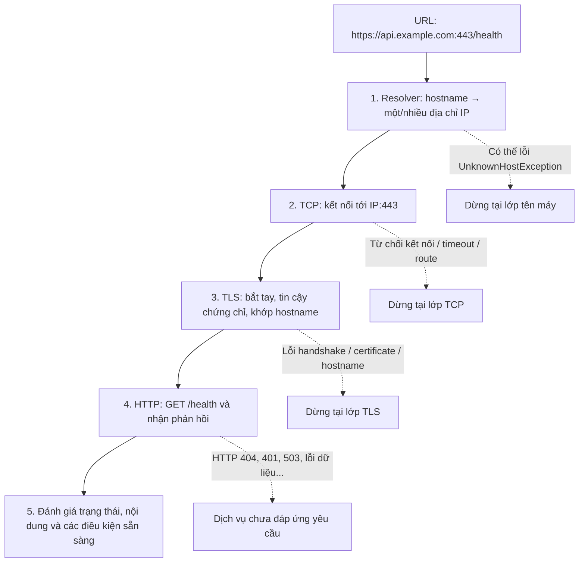

# Phân biệt tra cứu tên, kết nối TCP, xác thực TLS và khả năng truy cập dịch vụ

> **Chương:** Hợp đồng `InetAddress` — **mô-đun:** `JAVA_VERSION_JAVA18`. Trọng tâm là hiểu chính xác mỗi phép kiểm tra mạng chứng minh được điều gì trong Java, đặc biệt khi dùng `InetAddress`, `Socket` và `java.net.http.HttpClient`. Các API và ví dụ chính dưới đây chạy được từ **JDK 18** và tiếp tục hữu ích trên JDK hiện đại.

Một lỗi chẩn đoán phổ biến là thấy `InetAddress.getByName("api.example.com")` thành công rồi kết luận “dịch vụ đang hoạt động”. Kết quả đó chỉ cho biết **tên đã được phân giải thành địa chỉ IP**. Giữa một địa chỉ IP và một lời gọi API thành công còn nhiều bước độc lập: kết nối đến **đúng cổng**, hoàn tất **TLS và xác thực máy chủ** (nếu dùng HTTPS), gửi yêu cầu **HTTP**, rồi kiểm tra **phản hồi theo hợp đồng nghiệp vụ**.

## 1. Kết quả cần đạt

Sau bài học, bạn có thể:

1. Phân biệt bằng ví dụ thực tế bốn mức kiểm tra: **DNS/tên máy → TCP → TLS → dịch vụ HTTP**.
2. Giải thích chính xác `InetAddress.getAllByName` và `InetAddress.isReachable` *không* chứng minh được điều gì.
3. Dùng `Socket.connect(SocketAddress, timeout)` để kiểm tra **cổng TCP** và nhận biết giới hạn của thời hạn chờ kết nối.
4. Hiểu sự khác biệt giữa **bắt tay TLS**, **kiểm tra chuỗi tin cậy chứng chỉ** và **xác thực tên host**; tránh vô hiệu hóa xác minh chứng chỉ để “sửa” lỗi.
5. Dùng `HttpClient` của JDK để kiểm tra một URL HTTP(S) với thời hạn chờ, quan sát mã HTTP, xử lý lỗi và tự xác định tiêu chí một dịch vụ “sẵn sàng”.

## 2. Một yêu cầu HTTPS trải qua các lớp nào?

Giả sử chương trình gọi `https://api.example.com:443/health` theo đường truyền **trực tiếp** (không qua proxy):



Mỗi mũi tên cần **một bằng chứng riêng**. Thành công của bước trước **không đảm bảo** bước sau thành công.

| Mức | Câu hỏi được kiểm tra | Công cụ/API Java 18+ | Kết quả thành công chứng minh | Điều chưa chứng minh |
|---|---|---|---|---|
| **1. Tên máy** | Có ánh xạ hostname sang IP không? | `InetAddress.getAllByName(host)` | Resolver của JVM có thể trả IP tại thời điểm đó | Cổng TCP mở, dịch vụ đang chạy, tên có chứng chỉ đúng |
| **2. TCP** | Có thiết lập được kết nối tới IP và cổng không? | `Socket.connect(endpoint, timeout)` | Kết nối TCP tới điểm cuối đó thành công | Đích có hỗ trợ TLS, xác thực TLS, hiểu HTTP |
| **3. TLS** | Kênh bảo mật có thương lượng và xác thực máy chủ đúng không? | `SSLSocket.startHandshake()` với xác minh endpoint, hoặc `HttpClient` HTTPS mặc định | Kênh TLS hợp lệ theo cấu hình trust và tên đích | Endpoint HTTP tồn tại, trả dữ liệu đúng |
| **4. Ứng dụng** | Đúng URL, phương thức, quyền và phản hồi mong muốn không? | `HttpClient.send` + kiểm tra status/body | Yêu cầu cụ thể đã được xử lý ở mức quan sát được | Toàn bộ hệ thống khỏe, mọi phụ thuộc đều sẵn sàng |

**Lưu ý đường đi thực tế:** proxy HTTP(S), gateway, reverse proxy, TLS termination, service mesh và cân bằng tải có thể thay đổi nơi DNS được tra cứu, nơi TCP/TLS kết thúc và hệ thống nào trả phản hồi. Với `HttpClient`, **đừng mặc định** một lần gọi `InetAddress.getAllByName(host)` luôn phản ánh chính xác địa chỉ cuối cùng mà client sẽ kết nối.

## 3. Lớp tên máy: InetAddress phân giải được ≠ dịch vụ truy cập được

### 3.1. Tra cứu xuôi chỉ trả địa chỉ

`InetAddress.getAllByName(host)` sử dụng resolver của JVM. Resolver tích hợp có thể dựa trên tệp hosts, cấu hình mạng và dịch vụ phân giải tên của hệ điều hành; từ Java 18 có thể có `InetAddressResolverProvider` tùy biến. Thành công nghĩa là có ít nhất một địa chỉ được trả về, không có một phép bắt tay TCP hay TLS nào được thực hiện chỉ bởi phương thức này.

```java
import java.net.InetAddress;
import java.net.UnknownHostException;

public class ResolveOnly {
    public static void main(String[] args) {
        String host = args.length > 0 ? args[0] : "localhost";
        if (host.isBlank()) {
            throw new IllegalArgumentException("Hostname không được rỗng");
        }

        try {
            for (InetAddress address : InetAddress.getAllByName(host)) {
                System.out.println(address.getHostAddress());
            }
            System.out.println("Chỉ xác nhận tra cứu tên thành công.");
        } catch (UnknownHostException e) {
            System.err.println("Không phân giải được hostname: " + host);
        }
    }
}
```

Thử:

```text
java ResolveOnly.java localhost
java ResolveOnly.java example.com
```

Kết quả phụ thuộc resolver, mạng, VPN, bộ nhớ đệm của JVM/hệ điều hành, và chính sách IPv4/IPv6. `getAllByName` có thể trả **nhiều IP**; không xem phần tử đầu tiên là địa chỉ duy nhất hoặc cố định của dịch vụ.

Đặc biệt, `InetAddress.getByName(null)` và `getByName("")` trả về loopback theo hợp đồng API. Ứng dụng cần **tự chặn hostname rỗng** để tránh kiểm tra nhầm chính máy đang chạy.

### 3.2. Vì sao isReachable không phải “health check”?

`InetAddress.isReachable(int timeout)` chỉ thực hiện kiểm tra **best effort** ở tầng mạng. Tùy quyền và nền tảng, nó có thể dùng ICMP Echo hoặc thử TCP tới **cổng 7 (Echo)**; tường lửa hoặc chính sách máy chủ có thể chặn những cơ chế này ngay cả khi cổng ứng dụng vẫn hoạt động.

```java
InetAddress address = InetAddress.getByName("example.com");
boolean reachable = address.isReachable(1_000);
System.out.println(reachable);
```

`false` **không kết luận** dịch vụ HTTPS ở cổng 443 hỏng; `true` cũng **không kết luận** API ở cổng 443 hoạt động. Dùng `isReachable` chỉ khi mục tiêu là quan sát khả năng tiếp cận địa chỉ ở mức best effort, và diễn giải kết quả trong giới hạn đó.

### 3.3. Reverse DNS và tên canonical không xác thực máy chủ

`getHostName()` có thể trả về tên được nhớ từ lúc tạo `InetAddress`; `getCanonicalHostName()` có thể tra cứu tên ngược. Cả hai không phải bằng chứng rằng máy chủ ở IP ấy sở hữu hostname mong muốn hoặc chứng chỉ TLS hợp lệ. Việc xác thực endpoint HTTPS phải xảy ra tại **lớp TLS**.

## 4. Lớp TCP: mở được một cổng vẫn chưa biết giao thức

### 4.1. Dùng Socket.connect đúng mục đích

Ví dụ kiểm tra cổng của từng địa chỉ mà JVM trả về; giả sử máy chủ đích cho phép kết nối trực tiếp:

```java
import java.io.IOException;
import java.net.InetAddress;
import java.net.InetSocketAddress;
import java.net.Socket;
import java.net.UnknownHostException;

public class TcpPortProbe {
    public static void main(String[] args) {
        if (args.length != 2 || args[0].isBlank()) {
            System.err.println("Dùng: java TcpPortProbe.java <host> <port>");
            return;
        }

        String host = args[0];
        int port = Integer.parseInt(args[1]);
        if (port < 1 || port > 65_535) {
            throw new IllegalArgumentException("Port phải trong [1, 65535]");
        }

        try {
            InetAddress[] addresses = InetAddress.getAllByName(host);
            for (InetAddress address : addresses) {
                try (Socket socket = new Socket()) {
                    // Đã có IP; timeout này dành cho giai đoạn kết nối TCP.
                    socket.connect(new InetSocketAddress(address, port), 2_000);
                    System.out.printf("TCP OK: %s:%d%n",
                            address.getHostAddress(), port);
                } catch (IOException e) {
                    System.out.printf("TCP FAIL: %s:%d (%s)%n",
                            address.getHostAddress(), port, e.getClass().getSimpleName());
                }
            }
        } catch (UnknownHostException e) {
            System.err.println("DNS/Resolver FAIL: " + host);
        }
    }
}
```

Ví dụ chạy:

```text
java TcpPortProbe.java localhost 8000
java TcpPortProbe.java example.com 443
```

Nếu máy cục bộ không có tiến trình lắng nghe trên cổng 8000, việc `localhost` phân giải thành công nhưng TCP báo từ chối kết nối là **kết quả đúng và có ý nghĩa**.

| Tình huống | Diễn giải đúng |
|---|---|
| `UnknownHostException` | Không lấy được IP phù hợp từ resolver; chưa có kết luận về TCP. |
| `ConnectException: Connection refused` | Có phản hồi từ chối kết nối đến điểm cuối đó, thường do không có listener hoặc chính sách từ chối. |
| `SocketTimeoutException` khi `connect` | Giai đoạn mở kết nối TCP quá thời hạn cho phép; có thể do mất gói, firewall hoặc đích không phản hồi. |
| `NoRouteToHostException` / lỗi I/O mạng khác | Không có đường đi khả dụng hoặc có lỗi mạng/chính sách liên quan. |
| `socket.connect` hoàn tất | Đúng **địa chỉ IP/cổng TCP** đã kết nối được tại thời điểm đó; chưa biết TLS/HTTP. |

**Giới hạn timeout cần nhớ:** Constructor `new InetSocketAddress(String host, int port)` *có thể phân giải tên ngay* trước khi gọi `Socket.connect`. Vì thế, `connect(endpoint, 2_000)` **không phải thời hạn tổng cộng 2 giây cho cả DNS + TCP**. Trong ví dụ, `InetAddress.getAllByName` được gọi riêng để làm rõ điều này; bản thân phép tra cứu cũng có thể chặn luồng và không có tham số timeout trực tiếp trên `getAllByName`.

`Socket.setSoTimeout` là timeout của thao tác **đọc dữ liệu** trên socket, không phải giới hạn thời gian `connect`. TCP thành công cũng không đảm bảo server sẽ gửi byte đầu tiên hay phản hồi đủ nhanh.

### 4.2. Bẫy kiểm thử từng địa chỉ

Hostname có thể có cả A và AAAA, nhiều IP cho từng họ, hoặc backend không đồng nhất. Một IP không kết nối được không chứng minh **mọi IP** đều lỗi. Ngược lại, chỉ một IP thành công chưa đủ để kết luận tất cả backend phía sau cân bằng tải đều sẵn sàng.

Tránh ghi nhớ IP tĩnh từ phép lookup rồi dùng nó vô thời hạn. Khi ứng dụng dùng HTTPS, nếu tự kết nối qua IP, cần vẫn giữ hostname ban đầu để xác minh chứng chỉ và xử lý SNI phù hợp; chỉ sửa HTTP `Host` header không tự khôi phục xác thực TLS.

## 5. Lớp TLS: kênh mã hóa ≠ xác thực đúng máy chủ

TLS đứng **sau TCP** khi kết nối HTTPS trực tiếp qua TCP. Bắt tay TLS thương lượng giao thức, thuật toán, khóa phiên và thường nhận chứng chỉ máy chủ. Đối với kết nối HTTPS tin cậy, client cần kiểm tra ít nhất:

- **Chuỗi tin cậy chứng chỉ:** chứng chỉ do nguồn tin cậy phù hợp xác nhận; các điều kiện hợp lệ áp dụng theo cấu hình trust của JVM (ví dụ thời hạn hiệu lực và chính sách thuật toán).
- **Định danh endpoint:** chứng chỉ hợp lệ với **hostname trong URL**. Chứng chỉ đáng tin cậy nhưng cấp cho tên khác vẫn phải bị từ chối.
- **Thỏa thuận giao thức và tham số TLS:** client và server có bộ giao thức/thuật toán tương thích, hoàn thành handshake.

**SNI (Server Name Indication)** là phần mở rộng gửi thông tin tên máy chủ trong lúc bắt tay TLS để server chọn chứng chỉ/cấu hình phù hợp khi phục vụ nhiều website trên một IP. SNI **không tự xác thực** hostname; client vẫn phải kiểm tra chứng chỉ và tên đích.

Ở đây nên dùng `java.net.http.HttpClient` với URL `https://...` và cấu hình TLS mặc định của JDK: client thực hiện xác thực chứng chỉ và hostname. Khi dùng `SSLSocket` ở mức thấp, **phải chú ý bật endpoint identification** thay vì chỉ gọi `startHandshake`.

### 5.1. Ví dụ SSLSocket với kiểm tra hostname

Mã dùng được trên Java 18; minh họa cách **không bỏ sót kiểm tra tên máy chủ**:

```java
import java.net.InetSocketAddress;
import java.net.Socket;
import javax.net.ssl.SSLParameters;
import javax.net.ssl.SSLSocket;
import javax.net.ssl.SSLSocketFactory;

public class TlsEndpointProbe {
    public static void main(String[] args) throws Exception {
        String host = args.length > 0 ? args[0] : "example.com";
        int port = args.length > 1 ? Integer.parseInt(args[1]) : 443;
        if (host.isBlank() || port < 1 || port > 65_535) {
            throw new IllegalArgumentException("Host/port không hợp lệ");
        }

        try (Socket tcp = new Socket()) {
            tcp.connect(new InetSocketAddress(host, port), 3_000);

            SSLSocketFactory factory =
                    (SSLSocketFactory) SSLSocketFactory.getDefault();
            // Truyền hostname gốc để TLS có thông tin nhận diện endpoint.
            try (SSLSocket tls = (SSLSocket)
                    factory.createSocket(tcp, host, port, true)) {
                SSLParameters parameters = tls.getSSLParameters();
                parameters.setEndpointIdentificationAlgorithm("HTTPS");
                tls.setSSLParameters(parameters);
                tls.setSoTimeout(3_000); // Timeout đọc/ghi nhận dữ liệu từ socket
                tls.startHandshake();

                System.out.println("TLS OK: " + tls.getSession().getProtocol());
            }
        }
    }
}
```

```text
java TlsEndpointProbe.java example.com 443
```

Nếu hostname không khớp, chuỗi chứng chỉ không đáng tin cậy, chứng chỉ hết hiệu lực hoặc hai phía không thương lượng được TLS, `startHandshake()` có thể ném `SSLHandshakeException` hoặc lỗi `SSLException`/`IOException` tương ứng. Kết nối TCP có thể vẫn đã thành công trước khi handshake thất bại.

`tls.setSoTimeout` giới hạn **thời gian chờ của thao tác đọc**, không thiết lập một deadline tổng cho toàn bộ handshake. `new InetSocketAddress(host, port)` vẫn có thể tốn thời gian phân giải tên bên ngoài timeout TCP. Khi hệ thống cần giới hạn tổng thời gian, hãy thiết kế deadline ở cấp thao tác và xử lý hủy/tài nguyên tương ứng.

**Không giải quyết sự cố TLS bằng cách** chấp nhận mọi chứng chỉ, tắt kiểm tra hostname, dùng trust manager luôn trả “đúng”, hoặc bỏ qua ngoại lệ handshake. Khi gặp lỗi, cần kiểm tra hostname URL, SAN trên chứng chỉ, chuỗi CA tin cậy, thời gian hệ thống và cấu hình TLS server/client.

## 6. Lớp HTTP và mức sẵn sàng của dịch vụ

Sau DNS/TCP/TLS, ứng dụng cần gửi **đúng yêu cầu** để biết server có đáp ứng nghiệp vụ hay không. `GET /`, `GET /health`, `GET /ready` hoặc một truy vấn API thật có thể có ý nghĩa khác nhau; hãy chọn endpoint mà dịch vụ của bạn công bố.

| Quan sát | Có thể khẳng định | Chưa thể khẳng định |
|---|---|---|
| HTTP `200 OK` trên `/health` | Endpoint trả 200 cho request quan sát được | Cơ sở dữ liệu, hàng đợi, tất cả tính năng đều khỏe nếu endpoint không kiểm tra chúng |
| HTTP `204 No Content` | Server xử lý request và không trả nội dung, nếu hợp đồng cho phép | Payload nghiệp vụ đúng |
| HTTP `301` / `302` / `307` / `308` | Có phản hồi điều hướng HTTP | URL ban đầu đã phục vụ đúng tài nguyên cuối cùng |
| HTTP `401` / `403` | Đã nhận phản hồi HTTP nhưng bị yêu cầu xác thực hoặc từ chối quyền | Đường dẫn hoặc thao tác nghiệp vụ đã hoạt động đối với tài khoản mong muốn |
| HTTP `404 Not Found` | Server HTTP trả phản hồi; đường dẫn/tài nguyên không tìm thấy theo request | API cần kiểm tra đã sẵn sàng |
| HTTP `500` / `503` | Có phản hồi HTTP nhưng lỗi server hoặc chưa sẵn sàng | Hệ thống đủ khỏe để nhận lưu lượng |
| HTTP `2xx` nhưng body sai schema hoặc thiếu dữ liệu | Có phản hồi thành công ở mức HTTP | Hợp đồng nghiệp vụ đã được thỏa mãn |

Không nên coi mọi status `2xx` đều thành công theo nghiệp vụ nếu API yêu cầu mã cụ thể và nội dung cụ thể. Ngược lại, endpoint được bảo vệ có thể trả `401` dù TCP/TLS và server HTTP đều hoạt động.

### 6.1. Ví dụ HttpClient: kiểm tra HTTP(S) với timeout

`java.net.http.HttpClient` có từ Java 11 và dùng được trên **Java 18**; nó phù hợp hơn tự triển khai HTTP trên `Socket`. Ví dụ sau kiểm tra URL do người dùng truyền vào, không tự động theo redirect để người học quan sát chính xác status tại URL ban đầu:

```java
import java.io.IOException;
import java.net.URI;
import java.net.http.HttpClient;
import java.net.http.HttpConnectTimeoutException;
import java.net.http.HttpRequest;
import java.net.http.HttpResponse;
import java.net.http.HttpTimeoutException;
import java.time.Duration;
import javax.net.ssl.SSLHandshakeException;

public class HttpServiceProbe {
    public static void main(String[] args) {
        String target = args.length > 0 ? args[0] : "https://example.com/";
        URI uri = URI.create(target);
        String scheme = uri.getScheme();

        if (uri.getHost() == null ||
                (!"http".equalsIgnoreCase(scheme)
                 && !"https".equalsIgnoreCase(scheme))) {
            throw new IllegalArgumentException("Cần URL http:// hoặc https:// hợp lệ");
        }

        HttpClient client = HttpClient.newBuilder()
                .connectTimeout(Duration.ofSeconds(3))
                .followRedirects(HttpClient.Redirect.NEVER)
                .build();

        HttpRequest request = HttpRequest.newBuilder(uri)
                .timeout(Duration.ofSeconds(8))
                .GET()
                .build();

        try {
            HttpResponse<Void> response =
                    client.send(request, HttpResponse.BodyHandlers.discarding());

            int status = response.statusCode();
            System.out.println("URL: " + uri);
            System.out.println("HTTP status: " + status);
            System.out.println("Có phiên TLS: " + response.sslSession().isPresent());

            if (status == 200) {
                System.out.println("HTTP 200; cần kiểm tra thêm hợp đồng endpoint.");
            } else {
                System.out.println("Endpoint chưa đáp ứng tiêu chí status == 200.");
            }
        } catch (HttpConnectTimeoutException e) {
            System.err.println("Hết hạn thời gian thiết lập kết nối: " + e);
        } catch (HttpTimeoutException e) {
            System.err.println("Hết hạn thời gian yêu cầu HTTP: " + e);
        } catch (SSLHandshakeException e) {
            System.err.println("Không hoàn thành/xác thực được TLS: " + e);
        } catch (IOException e) {
            System.err.println("Lỗi I/O, tên máy, kết nối hoặc giao thức: " + e);
        } catch (InterruptedException e) {
            Thread.currentThread().interrupt();
            System.err.println("Yêu cầu bị gián đoạn.");
        }
    }
}
```

Chạy:

```text
java HttpServiceProbe.java https://example.com/
java HttpServiceProbe.java http://localhost:8000/
```

Ở URL `https://...`, `HttpClient` dùng TLS và cơ chế kiểm tra chứng chỉ/tên host mặc định; ở `http://...`, **không có TLS**, nên `response.sslSession().isPresent()` thường là `false`. Chương trình vẫn có thể dùng proxy mặc định của JVM/môi trường và kết quả phụ thuộc mạng thực tế. `HttpResponse.sslSession()` cho biết phiên SSL/TLS có gắn với response; nó không thay thế việc đánh giá dữ liệu nghiệp vụ.

**Hai loại timeout khác nhau:**

- `HttpClient.Builder.connectTimeout(Duration)` áp dụng khi cần **thiết lập kết nối mới**. Nếu tái sử dụng kết nối có sẵn, không cần thực hiện lại giai đoạn connect; vì thế timeout này không kiểm soát toàn bộ yêu cầu. Trong triển khai JDK, timeout thiết lập kết nối cũng bao gồm TLS handshake.
- `HttpRequest.Builder.timeout(Duration)` đặt giới hạn cho việc thực hiện yêu cầu. Khi hết hạn, `HttpTimeoutException` được ném; `HttpConnectTimeoutException` là trường hợp chuyên biệt. Trong triển khai JDK, khoảng thời gian này bao phủ đến khi hoàn tất phần thân phản hồi, nếu có.

Đừng suy luận rằng mỗi loại ngoại lệ ánh xạ duy nhất tới một lớp; lỗi DNS, proxy, handshake hoặc mạng có thể được bọc trong `IOException` hoặc nguyên nhân bên trong ngoại lệ. Quan sát **lớp lỗi, cause và log** trước khi kết luận.

### 6.2. Cần kiểm tra body và hợp đồng nghiệp vụ như thế nào?

`BodyHandlers.discarding()` bỏ nội dung nên chỉ đủ cho phép đo HTTP status. Với một endpoint thực tế:

```java
HttpRequest request = HttpRequest.newBuilder(
        URI.create("https://api.example.com/ready"))
        .timeout(Duration.ofSeconds(8))
        .GET()
        .build();

HttpResponse<String> response = client.send(
        request, HttpResponse.BodyHandlers.ofString());

boolean statusOk = response.statusCode() == 200;
boolean payloadOk = response.body().contains("\"ready\":true");
// Chỉ là minh họa: hệ thống thật nên parse JSON/schema đúng chuẩn.
boolean ready = statusOk && payloadOk;
```

Đoạn code là **phần mở rộng** của ví dụ trong mục 6.1 (tái sử dụng biến `client`); `contains` chỉ minh họa hình thức đánh giá đơn giản, **không phù hợp để xác minh JSON trong sản xuất**. Ứng dụng thật cần parse JSON có cấu trúc, kiểm tra schema, quyền truy cập, mã lỗi nghiệp vụ và các điều kiện phụ thuộc đã được thỏa thuận. Nếu endpoint cần token, hãy cung cấp cơ chế xác thực thích hợp; `401` không tương đương máy chủ “chết”.

Với health check, nên phân biệt:

- **Liveness:** tiến trình có đang chạy và còn phản hồi không?
- **Readiness:** instance đã sẵn sàng nhận lưu lượng phục vụ (ví dụ đã tải cấu hình và kết nối được phụ thuộc bắt buộc)?
- **End-to-end:** một luồng nghiệp vụ cụ thể có thành công từ góc nhìn người dùng/khách hàng không?

Ba định nghĩa này do hợp đồng hệ thống quyết định. Một endpoint có thể báo liveness thành công trong khi readiness thất bại; không nên dùng một kết quả HTTP để tuyên bố mọi tính năng đều khỏe.

## 7. Bảng tình huống: xác định lỗi dừng ở đâu

| Kịch bản | DNS | TCP | TLS | HTTP/dịch vụ | Kết luận hợp lý |
|---|---|---|---|---|---|
| Sai hostname, không có mapping | ❌ | Chưa thử | Chưa thử | Chưa thử | Kiểm tra đầu vào, resolver, DNS/VPN, cache thất bại. |
| Hostname đúng, cổng 443 đóng | ✅ | ❌ | Chưa thử | Chưa thử | Kiểm tra listener, port, routing, firewall; DNS không phải nguyên nhân trực tiếp. |
| TCP mở, server nói HTTP thuần tại cổng 443 | ✅ | ✅ | ❌ | Chưa có HTTPS hợp lệ | Kiểm tra scheme, cổng và cấu hình TLS; TCP mở không có nghĩa đó là HTTPS. |
| TCP mở, chứng chỉ cho hostname khác | ✅ | ✅ | ❌ xác thực tên | Chưa gửi request HTTPS hợp lệ | Sửa tên URL/chứng chỉ/SNI, không vô hiệu hóa kiểm tra hostname. |
| TLS hợp lệ, GET `/health` trả 404 | ✅ | ✅ | ✅ | ❌ đường dẫn | Kiểm tra route và hợp đồng endpoint, không cần suy ra DNS hỏng. |
| TLS hợp lệ, GET `/ready` trả 503 | ✅ | ✅ | ✅ | ❌ readiness | Lớp HTTP hoạt động, nhưng instance báo chưa sẵn sàng. |
| TLS hợp lệ, API trả 401 vì thiếu token | ✅ | ✅ | ✅ | Từ chối auth | Kiểm tra cơ chế xác thực, chưa kết luận lỗi mạng. |
| HTTP 200, payload sai | ✅ | ✅ | ✅ | ❌ nghiệp vụ | Cần kiểm thử schema và dữ liệu, HTTP 200 chưa đủ. |

Biểu tượng ✅ trong bảng chỉ mô tả **kịch bản giả định đã quan sát**, không hàm ý một request nhất thiết phải thực hiện lại từng bước (client có thể tái sử dụng kết nối hoặc cache DNS).

## 8. Quy trình chẩn đoán thực tế

Khi người dùng báo “Java gọi API lỗi”:

1. **Chốt đích thực sự:** lưu URL đã được chuẩn hóa, hostname, scheme, cổng, path, môi trường chạy, có dùng proxy hay không. Đừng in token, mật khẩu hoặc dữ liệu nhạy cảm vào log.
2. **Tách tên máy:** nếu cần, gọi `InetAddress.getAllByName` từ **cùng JVM/mạng** với ứng dụng. Ghi nhận các IP và thời điểm kiểm tra; so sánh với cấu hình DNS, VPN, container và resolver tùy biến. Hãy nhớ cache JVM có thể thay đổi kết quả theo thời gian.
3. **Tách TCP:** thử `Socket.connect` đến đúng cổng, có timeout; nếu hostname có nhiều IP, xem từng IP khi đường kết nối trực tiếp. Nếu dùng proxy, thử đường **qua proxy** mà ứng dụng thực sự sử dụng.
4. **Tách TLS:** nếu HTTPS, xác nhận chuỗi tin cậy chứng chỉ, SAN/hostname, SNI, thời gian máy và chính sách TLS. Đọc lỗi handshake để biết giai đoạn nào bị từ chối.
5. **Tách HTTP:** gửi đúng phương thức, URL, header và cơ chế auth; quan sát status, redirect và body. Với mã `401`, `404`, `503`, đọc hợp đồng API để định vị nguyên nhân.
6. **Đánh giá dịch vụ:** xác nhận endpoint đang đo **liveness**, **readiness** hay yêu cầu nghiệp vụ. Quyết định thành công dựa trên **hợp đồng**, tránh dùng tiêu chí chung như “có IP” hoặc “có HTTP status”.

Với `HttpClient`, kết nối đang được giữ và tái sử dụng, redirect, proxy và cân bằng tải có thể khiến hai phép đo từ hai công cụ độc lập không đi cùng tuyến mạng. Khi cần so sánh, hãy ghi lại cấu hình, thời điểm và điểm đo.

## 9. An toàn khi kiểm tra dịch vụ

- **Không dùng DNS/reverse DNS làm danh tính:** hostname tra cứu được hay trả reverse hợp lý không thay thế kiểm tra chứng chỉ TLS. DNS có thể đổi IP và dễ bị ảnh hưởng bởi cấu hình mạng.
- **Không tắt xác thực TLS** để vượt lỗi certificate; cần sửa truststore, tên máy chủ, chứng chỉ hoặc phía server. Với kết nối HTTP thuần, không có xác thực TLS để bảo vệ dữ liệu.
- **Không tin mù quáng vào URL do bên ngoài cung cấp:** hệ thống kiểm tra URL đầu vào cần kiểm soát scheme, hostname và **địa chỉ thực tế sau phân giải** để tránh truy cập tài nguyên nội bộ ngoài ý muốn (SSRF/DNS rebinding); với redirect, cần kiểm tra lại đích chuyển hướng.
- **Không kiểm tra bằng tác vụ gây tác dụng phụ:** ưu tiên endpoint giám sát chuyên dụng, được phép truy cập. Không gửi yêu cầu thay đổi dữ liệu chỉ để thử xem dịch vụ “còn sống”.
- **Không xem timeout là nguyên nhân gốc:** timeout là dấu hiệu giai đoạn chờ vượt ngưỡng; có thể do mạng, proxy, backend chậm hoặc thiếu tài nguyên. Cần log và metric liên quan để phân biệt.

## 10. Bài thực hành và câu hỏi tự kiểm tra

### Bài 1 — Quan sát sự khác biệt giữa DNS và TCP

Trên JDK 18 trở lên, chạy `ResolveOnly.java` với `localhost`. Sau đó chạy `TcpPortProbe.java localhost 8000` khi bạn **chưa mở** server cục bộ trên cổng 8000. Giải thích tại sao một phép thành công nhưng phép còn lại có thể báo từ chối kết nối.

Nếu có chương trình `jwebserver` của JDK (Simple Web Server được giới thiệu ở Java 18), mở một terminal khác và chạy:

```text
jwebserver -b 127.0.0.1 -p 8000
```

Tiếp tục kiểm tra:

```text
java TcpPortProbe.java 127.0.0.1 8000
java HttpServiceProbe.java http://127.0.0.1:8000/
```

Kỳ vọng: TCP kết nối được và HTTP thường trả phản hồi với URL gốc; **không có TLS** do dùng `http://`. Để tránh suy luận quá mức, status cụ thể phụ thuộc tài liệu/tệp được server phục vụ và cấu hình máy đang chạy. Dừng server bằng `Ctrl+C`.

### Bài 2 — TCP thành công nhưng TLS có thể thất bại

Chạy `TlsEndpointProbe.java example.com 443` trên mạng có thể truy cập tên miền này. Sau đó thử với một hostname/cổng **được phép kiểm tra** nhưng không cung cấp TLS đúng như yêu cầu. Ghi nhận: phép `TcpPortProbe` có thể cho kết quả khác `TlsEndpointProbe` như thế nào?

### Bài 3 — Phân biệt các trạng thái HTTP

Dựa trên một dịch vụ thử nghiệm mà bạn sở hữu, cấu hình những endpoint:

| Endpoint | Kỳ vọng minh họa | Ý nghĩa |
|---|---|---|
| `GET /ready` | `200` khi đủ điều kiện, `503` khi chưa sẵn sàng | Readiness |
| `GET /not-found` | `404` | Đường dẫn không tồn tại |
| `GET /private` thiếu token | `401` | Thiếu quyền xác thực |
| `GET /data` | `200` nhưng payload sai schema | Vi phạm hợp đồng nghiệp vụ |

Dùng `HttpServiceProbe` quan sát status. Trả lời: những kịch bản nào **DNS/TCP/TLS vẫn thành công** dù yêu cầu nghiệp vụ thất bại?

### Tự kiểm tra

1. Vì sao `InetAddress.isReachable(1000) == false` không có nghĩa `https://host:443` đã hỏng?
2. Vì sao `Socket.connect(..., 2000)` không đảm bảo **DNS + TCP** luôn kết thúc trong 2 giây?
3. Một chứng chỉ TLS có chuỗi tin cậy hợp lệ nhưng tên trong SAN khác hostname URL. Kết nối HTTPS có nên được coi thành công không?
4. HTTP `401` khác lỗi DNS, lỗi TCP và lỗi TLS ở điểm nào?
5. Tại sao HTTP `200` có thể vẫn chưa đủ để kết luận readiness hoặc giao dịch nghiệp vụ thành công?

**Đạt mục tiêu** khi bạn có thể chỉ ra **chính xác lớp đã thành công/lỗi** trong một báo cáo sự cố và chọn phép kiểm tra phù hợp với tiêu chí cần chứng minh.

## 11. Tài liệu chuẩn

- [`InetAddress` — Java SE 27 API](https://docs.oracle.com/en/java/javase/27/docs/api/java.base/java/net/InetAddress.html): phân giải xuôi/ngược và giới hạn của `isReachable`.
- [`InetSocketAddress` — Java SE 27 API](https://docs.oracle.com/en/java/javase/27/docs/api/java.base/java/net/InetSocketAddress.html): constructor có thể phân giải hostname và trạng thái unresolved.
- [`Socket` — Java SE 27 API](https://docs.oracle.com/en/java/javase/27/docs/api/java.base/java/net/Socket.html): `connect(endpoint, timeout)` và `setSoTimeout`.
- [`SSLParameters` — Java SE 27 API](https://docs.oracle.com/en/java/javase/27/docs/api/java.base/javax/net/ssl/SSLParameters.html): `setEndpointIdentificationAlgorithm("HTTPS")`.
- [`HttpClient.Builder` — Java SE 27 API](https://docs.oracle.com/en/java/javase/27/docs/api/java.net.http/java/net/http/HttpClient.Builder.html): `connectTimeout` và TLS context.
- [`HttpRequest.Builder` — Java SE 27 API](https://docs.oracle.com/en/java/javase/27/docs/api/java.net.http/java/net/http/HttpRequest.Builder.html): thời hạn yêu cầu.
- [JSSE Reference Guide — Java SE 27](https://docs.oracle.com/en/java/javase/27/security/java-secure-socket-extension-jsse-reference-guide.html): xác thực chứng chỉ, TLS handshake và cấu hình JSSE.
- [JEP 418 — Internet-Address Resolution SPI](https://openjdk.org/jeps/418): khả năng thay resolver từ Java 18; cách triển khai resolver được trình bày ở bài liền trước trong chương.
