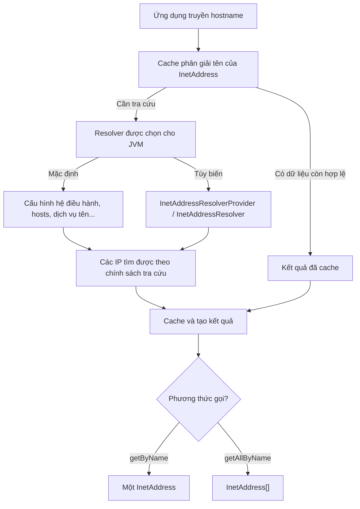

# InetAddress.getByName() và getAllByName(): kết quả một địa chỉ hoặc toàn bộ địa chỉ

> **Chương:** Hợp đồng `InetAddress` — **mô-đun:** `JAVA_VERSION_JAVA18`. Bài học tập trung vào hai phương thức phân giải tên vẫn được dùng trong các JDK hiện đại: `InetAddress.getByName(String)` và `InetAddress.getAllByName(String)`. Mã thực hành chính chạy từ **Java 18 trở lên**; phần lưu ý về API mới hơn sẽ ghi rõ phiên bản.

## 1. Mục tiêu học tập

Sau bài này, bạn có thể:

1. Phân biệt đúng **một kết quả** của `getByName` và **mảng kết quả** của `getAllByName`.
2. Giải thích “toàn bộ địa chỉ” có nghĩa là **toàn bộ địa chỉ mà resolver đang sử dụng trả về cho lần tra cứu**, chứ không phải danh sách IP bất biến hoặc mọi máy chủ của dịch vụ trên thế giới.
3. Quan sát IPv4/IPv6, thứ tự địa chỉ, trường hợp IP literal, hostname rỗng và lỗi `UnknownHostException`.
4. Chọn API phù hợp để hiển thị thông tin mạng, kết nối dịch vụ nhiều địa chỉ và xây dựng phép thử lặp lại được.
5. Nhận biết ảnh hưởng của cache JVM, chính sách IPv4/IPv6 và resolver tùy biến từ Java 18.

## 2. Đặt hai chữ ký cạnh nhau

```java
public static InetAddress   getByName(String host) throws UnknownHostException;
public static InetAddress[] getAllByName(String host) throws UnknownHostException;
```

| Tiêu chí | `getByName(host)` | `getAllByName(host)` |
|---|---|---|
| Kiểu trả về | `InetAddress` | `InetAddress[]` |
| Số lượng địa chỉ quan sát được | **Một** địa chỉ | **Tất cả địa chỉ mà resolver trả về**, thường từ một trở lên |
| Khi hostname có cả A và AAAA | Nhận một trong các địa chỉ phù hợp chính sách resolver/JVM | Có thể nhận cả IPv4 và IPv6 nếu được hỗ trợ và resolver trả về |
| Khi hostname có nhiều IP | Không cho ứng dụng thấy các địa chỉ còn lại | Cho ứng dụng duyệt các địa chỉ được trả về |
| Khi đầu vào là IP literal hợp lệ | Trả đối tượng địa chỉ tương ứng | Trả mảng chứa địa chỉ literal tương ứng |
| Khi `host == null` hoặc `host.isEmpty()` | Trả địa chỉ loopback | Trả mảng chứa địa chỉ loopback |
| Khi không thể phân giải hostname | Ném `UnknownHostException` | Ném `UnknownHostException` |
| Phù hợp | Cần một địa chỉ để quan sát/tiêu thụ | Muốn biết tập kết quả và tự quyết định cách thử, phân loại hoặc lựa chọn |

Một đối tượng `InetAddress` đại diện cho **địa chỉ IP** và có thể lưu thêm tên host; nó không đại diện cho socket đang kết nối. Hai phương thức **không tạo kết nối TCP, không xác minh TLS và không kiểm tra sức khỏe dịch vụ**.

Để hiểu rõ hơn, giả sử resolver trả về hai địa chỉ cho `api.example.test`:

```text
api.example.test
  ├─ 192.0.2.10   (IPv4)
  └─ 2001:db8::10 (IPv6)

getByName(host)    → một InetAddress
getAllByName(host) → InetAddress[] gồm các địa chỉ được trả về
```

`192.0.2.0/24` (IPv4) và `2001:db8::/32` (IPv6) là các dải **dành cho tài liệu**, không phải các đích Internet công cộng dùng để kiểm thử kết nối thật.

## 3. “Toàn bộ địa chỉ” phụ thuộc resolver hiện tại

Khi truyền **hostname** (chẳng hạn `example.com`), hai phương thức yêu cầu resolver của JVM chuyển tên thành IP. Java 18 giới thiệu `java.net.spi.InetAddressResolverProvider` (JEP 418), cho phép thay resolver mặc định bằng provider tùy biến. Nếu ứng dụng không dùng provider phù hợp, Java sử dụng resolver tích hợp dựa trên cấu hình và dịch vụ tên của môi trường chạy.



Sơ đồ mô tả đường đi khái quát cho **hostname**. Với **IP literal hợp lệ** (ví dụ `192.0.2.10`), JDK kiểm tra định dạng IP và tạo địa chỉ tương ứng mà không cần phân giải hostname qua DNS.

### Vì sao cùng một tên có thể cho kết quả khác nhau?

- Tệp `hosts`, DNS, VPN, mạng doanh nghiệp, chính sách trong container hoặc resolver tùy biến có thể trả dữ liệu khác nhau.
- DNS có thể trả nhiều bản ghi A (IPv4) và AAAA (IPv6), thay đổi theo vùng, thời điểm hoặc chính sách cân bằng tải.
- JVM có **cache kết quả thành công và thất bại**; hai lần gọi không nhất thiết phát sinh hai truy vấn mới.
- Cấu hình IPv4/IPv6 của JVM và hệ điều hành có thể ảnh hưởng các họ địa chỉ được phép dùng và thứ tự của chúng.

Vì vậy, `getAllByName` chỉ phản ánh **mảng địa chỉ tại thời điểm quan sát theo resolver và chính sách của JVM**. Nó không đảm bảo thấy mọi endpoint, mọi IP DNS từng công bố, hoặc địa chỉ sẽ giữ nguyên về sau.

## 4. Ví dụ đầy đủ: cùng hostname, hai cách quan sát

Tạo tệp `AddressLookup.java`:

```java
import java.net.Inet4Address;
import java.net.Inet6Address;
import java.net.InetAddress;
import java.net.UnknownHostException;

public class AddressLookup {
    public static void main(String[] args) {
        String host = args.length > 0 ? args[0] : "localhost";
        if (host == null || host.isBlank()) {
            throw new IllegalArgumentException("Hostname không được rỗng");
        }

        try {
            // Mỗi phương thức là một lời gọi API riêng.
            InetAddress one = InetAddress.getByName(host);
            InetAddress[] all = InetAddress.getAllByName(host);

            System.out.printf("host=%s%n", host);
            System.out.printf("getByName: %s (%s)%n",
                    one.getHostAddress(), family(one));

            System.out.printf("getAllByName: %d địa chỉ%n", all.length);
            for (int i = 0; i < all.length; i++) {
                System.out.printf("  [%d] %s (%s)%n",
                        i, all[i].getHostAddress(), family(all[i]));
            }
        } catch (UnknownHostException e) {
            System.err.println("Resolver không trả được địa chỉ cho: " + host);
            System.err.println("Chi tiết: " + e.getMessage());
        }
    }

    private static String family(InetAddress address) {
        if (address instanceof Inet4Address) return "IPv4";
        if (address instanceof Inet6Address) return "IPv6";
        return "IP";
    }
}
```

Chạy bằng Java source-file launcher có từ trước Java 18:

```text
java AddressLookup.java localhost
java AddressLookup.java example.com
java AddressLookup.java 192.0.2.10
```

**Cách đọc kết quả:**

- Với `localhost`, máy có thể trả `127.0.0.1`, `::1` hoặc cả hai. Không áp đặt kết quả giống nhau trên Windows, Linux và macOS.
- Với `example.com`, nếu máy có khả năng phân giải tên ngoài Internet, có thể nhận nhiều địa chỉ, nhưng **số lượng, họ IP và thứ tự không cố định**.
- Với `192.0.2.10`, đây là IP literal: `getByName` trả `192.0.2.10`; `getAllByName` trả một mảng chứa địa chỉ đó. Việc tạo đối tượng không chứng minh IP đó có thể truy cập.

Không nên viết kiểm thử kiểu `assertEquals("93.184.215.14", InetAddress.getByName("example.com").getHostAddress())`: bản ghi thật có thể thay đổi và môi trường kiểm thử có thể dùng resolver khác.

### Có được khẳng định one bằng all[0] không?

Trong một tập kết quả ổn định, `getByName` thường chọn một địa chỉ theo thứ tự mà resolver/JVM cung cấp. Tuy nhiên, **hai lời gọi riêng biệt** ở ví dụ trên có thể quan sát kết quả khác nếu dữ liệu hoặc cache thay đổi, nên không biến phép so sánh `one.equals(all[0])` thành một bất biến của hệ thống. Nếu cần dùng **chính xác tập kết quả đã quan sát**, chỉ gọi `getAllByName` một lần rồi làm việc với mảng được trả về.

```java
InetAddress[] addresses = InetAddress.getAllByName(host);
InetAddress selected = addresses[0]; // Địa chỉ đầu tiên trong lần tra cứu này
```

Cách lấy `[0]` ở đây đảm bảo **nhất quán với mảng đã nhận**, nhưng không đảm bảo địa chỉ đó là IPv4, khả dụng nhất, gần nhất hay được giữ nguyên theo thời gian.

## 5. IPv4/IPv6: nhiều IP không đồng nghĩa chỉ một họ địa chỉ

`InetAddress` có hai lớp con thường gặp:

| Lớp con | Kiểu IP | Ví dụ literal | Số byte từ `getAddress()` |
|---|---|---|---|
| `Inet4Address` | IPv4 | `192.0.2.10` | 4 |
| `Inet6Address` | IPv6 | `2001:db8::10` | 16 |

Khi ứng dụng cần xem **mọi địa chỉ mà resolver cung cấp**, nên gọi `getAllByName` và phân loại theo kiểu:

```java
import java.net.Inet4Address;
import java.net.Inet6Address;
import java.net.InetAddress;
import java.util.ArrayList;
import java.util.List;

public class AddressFamilies {
    public static void main(String[] args) throws Exception {
        String host = args.length > 0 ? args[0] : "localhost";
        if (host.isBlank()) throw new IllegalArgumentException("Host rỗng");

        InetAddress[] addresses = InetAddress.getAllByName(host);
        List<Inet4Address> ipv4 = new ArrayList<>();
        List<Inet6Address> ipv6 = new ArrayList<>();

        for (InetAddress address : addresses) {
            if (address instanceof Inet4Address a4) {
                ipv4.add(a4);
            } else if (address instanceof Inet6Address a6) {
                ipv6.add(a6);
            }
        }

        System.out.println("Số IPv4: " + ipv4.size());
        System.out.println("Số IPv6: " + ipv6.size());
        for (InetAddress address : addresses) {
            System.out.println(address.getHostAddress());
        }
    }
}
```

### Chính sách ưu tiên địa chỉ của JVM

Hai **system properties** còn hữu ích trên JDK hiện đại:

| Property | Ý nghĩa thực hành |
|---|---|
| `java.net.preferIPv6Addresses=false` (mặc định) | Khi có cả hai họ địa chỉ, thông thường ưu tiên địa chỉ IPv4 trong danh sách kết quả. |
| `java.net.preferIPv6Addresses=true` | Ưu tiên địa chỉ IPv6 khi khả dụng. |
| `java.net.preferIPv6Addresses=system` | Giữ thứ tự mà resolver hệ thống trả về. |
| `java.net.preferIPv4Stack=true` | Yêu cầu sử dụng IPv4 stack; không thích hợp với đích chỉ có IPv6. |

Chúng được đọc **khi JVM khởi động**. Thử mỗi cấu hình trong tiến trình mới:

```text
java -Djava.net.preferIPv6Addresses=true AddressLookup.java localhost
java -Djava.net.preferIPv6Addresses=system AddressLookup.java localhost
```

Thứ tự có thể không khác nếu resolver chỉ trả một họ địa chỉ hoặc môi trường không hỗ trợ IPv6. Không được kỳ vọng rằng `getByName` sẽ luôn chọn IPv4 hay `getAllByName` sẽ luôn trả cả A và AAAA.

Nếu cần tuân theo một quy tắc lựa chọn cụ thể, hãy nhận mảng rồi lọc/ưu tiên địa chỉ theo tiêu chí rõ ràng. Dù vậy, lựa chọn IP để **kết nối thực tế** còn cần xử lý trường hợp backend không khả dụng và timeout ở tầng TCP; việc phân giải tên chưa xác nhận kết nối đã thành công.

## 6. Các trường hợp biên quan trọng

### 6.1. `null` và chuỗi rỗng đều cho loopback

Theo hợp đồng Javadoc, hai phương thức không coi `null` hoặc `""` là lỗi hostname:

```java
InetAddress a = InetAddress.getByName(null);
InetAddress b = InetAddress.getByName("");
InetAddress[] c = InetAddress.getAllByName(null);
InetAddress[] d = InetAddress.getAllByName("");

System.out.println(a.isLoopbackAddress()); // true
System.out.println(b.isLoopbackAddress()); // true
System.out.println(c.length);              // 1
System.out.println(d[0].isLoopbackAddress()); // true
```

Địa chỉ loopback có thể là `127.0.0.1` hoặc `::1`. **Bắt buộc tự kiểm tra đầu vào** khi hàm nghiệp vụ yêu cầu hostname thật:

```java
static InetAddress[] resolveRequiredHost(String host)
        throws UnknownHostException {
    if (host == null || host.isBlank()) {
        throw new IllegalArgumentException("host phải có nội dung");
    }
    return InetAddress.getAllByName(host);
}
```

`String.isBlank()` còn bắt các chuỗi chỉ gồm khoảng trắng; đối với chuỗi như `"  example.com  "`, ứng dụng cần đặt quy tắc chuẩn hóa rõ ràng trước khi phân giải. Đừng vô tình chuyển đầu vào rỗng thành một thao tác đến **máy cục bộ**.

### 6.2. IP literal hợp lệ là trường hợp đặc biệt

Hai phương thức chấp nhận hostname **hoặc** chuỗi biểu diễn địa chỉ IPv4/IPv6. Nếu đầu vào là IP literal hợp lệ, JDK chỉ kiểm tra dạng địa chỉ; không cần đi qua tra cứu hostname.

```java
InetAddress ipv4 = InetAddress.getByName("192.0.2.10");
InetAddress[] ipv6 = InetAddress.getAllByName("2001:db8::10");

System.out.println(ipv4.getHostAddress());  // 192.0.2.10
System.out.println(ipv6.length);            // 1
System.out.println(ipv6[0] instanceof java.net.Inet6Address); // true
```

Nếu bạn chỉ muốn **parse IP literal**, hãy dùng API chuyên biệt khi phù hợp:

- Trên **Java 18**, `InetAddress.getByAddress(byte[])` tạo địa chỉ từ đúng 4 hoặc 16 byte và không thực hiện tra cứu tên.
- Từ **Java 22 trở lên**, `InetAddress.ofLiteral(String)` chỉ parse IPv4/IPv6 literal, ném `IllegalArgumentException` nếu không hợp lệ và không thực hiện reverse lookup. **Không dùng phương thức này khi mã nguồn cần biên dịch trên Java 18.**

Không dùng `getByName(input)` làm bộ kiểm tra “input chỉ được phép là IP”: một hostname hợp lệ cũng có thể được phân giải thành công.

### 6.3. Khi hostname không phân giải được

Với tên không tồn tại hoặc resolver không trả được địa chỉ, cả hai phương thức ném `UnknownHostException`:

```java
import java.net.InetAddress;
import java.net.UnknownHostException;

public class UnknownHostDemo {
    public static void main(String[] args) {
        String host = "no-such-host.invalid";
        try {
            InetAddress[] addresses = InetAddress.getAllByName(host);
            System.out.println("Số địa chỉ: " + addresses.length);
        } catch (UnknownHostException e) {
            System.out.println("Không có kết quả phân giải: " + host);
        }
    }
}
```

`.invalid` là miền được dành riêng cho tên không hợp lệ theo quy ước DNS, phù hợp để minh họa lỗi thông thường. Tuy nhiên, một **resolver tùy biến** hoặc cấu hình tên cục bộ về lý thuyết vẫn có thể gán địa chỉ cho một tên như vậy. Không khẳng định `UnknownHostException` chỉ có một nguyên nhân: tên sai, cấu hình VPN/DNS, dịch vụ tên không hoạt động hoặc cache lookup thất bại đều có thể ảnh hưởng.

### 6.4. Tên host và kết quả không đồng nghĩa nhau

`getHostAddress()` cho chuỗi IP để quan sát. `getHostName()` có thể trả tên đã biết hoặc thực hiện reverse lookup trong một số tình huống; `getCanonicalHostName()` có thể tra cứu tên đầy đủ theo resolver. Cả hai thao tác tên ngược **không dùng để khẳng định rằng một IP thuộc sở hữu của hostname ban đầu**.

Nếu mục tiêu là xem kết quả của `getByName`/`getAllByName`, hãy in `getHostAddress()` và `getClass().getSimpleName()`; đừng vô tình biến thử nghiệm thành bài kiểm tra reverse DNS.

## 7. Kết quả có thể được cache: gọi hai lần chưa chắc tra cứu hai lần

`InetAddress` có cache cho cả kết quả **thành công** và **không thành công**. TTL được quyết định bởi các **Java security properties**; một resolver hoặc hệ điều hành phía dưới cũng có thể có cache riêng.

| Security property | Ý nghĩa |
|---|---|
| `networkaddress.cache.ttl` | Thời gian cache kết quả phân giải tên thành công (giây); `0` để không cache, `-1` để giữ vô hạn. Mặc định phụ thuộc triển khai/cấu hình. |
| `networkaddress.cache.negative.ttl` | Thời gian cache lỗi phân giải tên (giây); mặc định thường là 10 giây theo tài liệu JDK. |
| `networkaddress.cache.stale.ttl` | Trên JDK hỗ trợ, có thể cho phép dùng kết quả thành công đã cũ trong một thời gian khi lần làm mới thất bại. Cần kiểm tra chính sách của JDK đang chạy. |

Đây là **security properties**, không phải các property hệ thống mà bạn có thể giả định sẽ được thay bằng `System.setProperty("networkaddress.cache.ttl", ...)` hoặc `-Dnetworkaddress.cache.ttl=...`. Hãy cấu hình qua `java.security` hoặc file security properties được nạp **lúc khởi động**, và xác nhận lại bằng API/cấu hình ở đúng JDK bạn sử dụng.

Ví dụ file cấu hình dành cho **thử nghiệm**, không phải mặc định khuyến nghị:

```properties
networkaddress.cache.ttl=30
networkaddress.cache.negative.ttl=5
```

```text
java -Djava.security.properties=lookup-security.properties AddressLookup.java example.com
```

`lookup-security.properties` là tệp chứa hai dòng properties ở trên và phải nằm trong thư mục chạy lệnh (hoặc dùng đường dẫn tuyệt đối). Khi so sánh các lần lookup, lưu ý **TTL JVM không đồng nghĩa TTL DNS** từ máy chủ DNS.

### Điều gì xảy ra nếu DNS đổi từ A sang B?

1. Tiến trình Java có thể vẫn nhận **A** vì cache còn hiệu lực.
2. Khi cache cần làm mới, resolver có thể trả **B** hoặc tập địa chỉ đã thay đổi.
3. Lời gọi `getByName` tiếp theo vẫn chỉ lộ **một** địa chỉ theo dữ liệu mới.
4. `getAllByName` tiếp theo có thể lộ **nhiều** địa chỉ mới, nhưng chỉ sau khi JVM/resolver thực sự nhìn thấy thay đổi.

Do đó, không thể chứng minh resolver “đang luôn gọi DNS” chỉ bằng cách đặt hai lời gọi liên tiếp trong một vòng lặp.

## 8. Kiểm thử có kiểm soát bằng jdk.net.hosts.file

Để học hành vi **một IP so với nhiều IP** mà không phụ thuộc DNS ngoài Internet, JDK hỗ trợ `jdk.net.hosts.file`. Khi bật property hệ thống này, bộ phân giải tên tích hợp lấy mapping từ **một tệp hosts được chỉ định** thay vì cơ chế resolver hệ điều hành thông thường. Cơ chế này đặc biệt hữu ích trong kiểm thử, không nhằm thay thế DNS trong triển khai thông thường.

Tạo tệp văn bản `lab-hosts`:

```text
# IP               Hostname
192.0.2.10         multi.example.test
192.0.2.11         multi.example.test
2001:db8::10       multi.example.test
192.0.2.20         single.example.test
```

Chạy hai trường hợp bằng JVM mới:

```text
java -Djdk.net.hosts.file=lab-hosts AddressLookup.java multi.example.test
java -Djdk.net.hosts.file=lab-hosts AddressLookup.java single.example.test
```

Kết quả mong đợi về **số lượng** là `getByName` chỉ hiển thị một IP, còn `getAllByName` có thể liệt kê các mapping phù hợp với địa chỉ và chính sách của JDK. Đừng cố định thứ tự IP hoặc giả định IPv6 luôn được trả về nếu nền tảng/chính sách không cho phép. Tệp hosts thử nghiệm này không làm các địa chỉ tài liệu trở thành máy chủ có thể kết nối.

Nếu tệp `lab-hosts` không tồn tại, hoặc tên truy vấn không nằm trong mapping và không có đường phân giải thích hợp, lookup có thể ném `UnknownHostException`. Khi dùng `jdk.net.hosts.file`, đừng kỳ vọng lời gọi sẽ tự động fallback sang DNS bên ngoài.

**Lưu ý Java 18+:** khi `jdk.net.hosts.file` được đặt, JDK dùng cơ chế tệp hosts thay cho việc lựa chọn `InetAddressResolverProvider` thông thường. Hãy tách riêng bài kiểm thử tệp hosts và bài kiểm thử provider tùy biến.

## 9. Nên chọn API nào khi lập trình?

| Bài toán | API nên ưu tiên | Lý do |
|---|---|---|
| Hiển thị một địa chỉ minh họa | `getByName` | Giao diện đơn giản khi chỉ cần một kết quả. |
| Liệt kê IP của host để chẩn đoán | `getAllByName` | Có thể in hết mảng IPv4/IPv6 thực tế. |
| Lựa chọn ưu tiên IPv4/IPv6 theo chính sách riêng | `getAllByName` rồi lọc/đánh giá | Không khóa vào một lựa chọn duy nhất của JVM. |
| Có nhiều địa chỉ và cần thử kết nối dự phòng | `getAllByName` kết hợp logic kết nối có timeout | Có thể thử địa chỉ khác khi địa chỉ đã chọn không kết nối được. |
| Tạo địa chỉ từ 4/16 byte IP mà không hỏi DNS | `getByAddress(byte[])` trên Java 18 | Nhận byte IP, kiểm tra độ dài và tạo đối tượng; không xử lý cú pháp chuỗi. |
| Chỉ parse chuỗi IP literal, từ chối hostname | `ofLiteral(String)` từ Java 22; trên Java 18 cần tự kiểm tra cú pháp literal trước khi sử dụng API thích hợp | Tránh nhầm việc phân giải được hostname với việc chuỗi đầu vào vốn là IP literal. |
| Gọi dịch vụ HTTPS | `HttpClient`/client phù hợp giao thức | Client phải xử lý kết nối TCP, TLS, HTTP và proxy; chỉ phân giải tên không đủ. |

### Sai lầm hay gặp

- **“`getByName` trả IP chính của website.”** Không có một “IP chính” được bảo đảm cho mọi môi trường; thứ tự địa chỉ có thể bị chính sách resolver ảnh hưởng.
- **“`getAllByName` trả mọi IP của dịch vụ.”** Nó chỉ trả tập địa chỉ từ resolver/JVM ở thời điểm đó, có thể không bao trùm tất cả backend.
- **“Chọn `getAllByName()[0]` là đã có failover.”** Chưa có. Ứng dụng vẫn cần chiến lược kết nối, thời hạn chờ, thử lại có kiểm soát và xử lý lỗi phù hợp.
- **“Hostname phân giải được tức server đang sống.”** Phân giải tên không mở kết nối hoặc kiểm tra TLS/HTTP.
- **“Luôn gọi `getByName` trước `getAllByName` để cache.”** Không có yêu cầu như vậy; gọi thêm có thể làm tăng công việc và có thể quan sát dữ liệu ở thời điểm khác nhau.
- **“Đã phân giải được IP thì URL HTTPS có danh tính hợp lệ.”** Sai. Danh tính TLS phải được xác thực theo hostname/certificate trong quá trình thiết lập kết nối bảo mật.

## 10. Bài tập vận dụng

**Bài 1 — Quan sát hai phương thức.** Chạy `AddressLookup.java` với `localhost`, `192.0.2.10` và `example.com`. Ghi lại số lượng, kiểu IPv4/IPv6 và thứ tự. Vì sao không nên ghi cứng tập IP của `example.com` trong bài kiểm tra tự động?

**Bài 2 — Đầu vào đặc biệt.** Tự thử gọi `getByName(null)`, `getByName("")`, `getAllByName(null)` và `getAllByName("")`. Kết quả có báo lỗi không? Vì sao chương trình nghiệp vụ vẫn nên chặn đầu vào trống?

**Bài 3 — IPv4/IPv6.** Chạy `AddressFamilies.java` cùng `java.net.preferIPv6Addresses` ở các chế độ `false`, `true` và `system`. Trình bày điều kiện nào khiến bạn không quan sát được khác biệt.

**Bài 4 — Resolver cục bộ.** Sử dụng `lab-hosts` ở mục 8 với `multi.example.test`. Thử đổi một địa chỉ và tạo **JVM mới** trước khi đo lại; giải thích tại sao làm việc trong cùng JVM có thể gây nhầm lẫn vì cache.

**Bài 5 — Quyết định thiết kế.** Một hostname trả về 4 IP nhưng hai trong số đó không thể kết nối TCP. Tại sao chỉ dùng `getByName` có thể che khuất các lựa chọn khác? `getAllByName` đã đủ để đảm bảo kết nối thành công chưa? Nêu các thành phần còn thiếu.

### Câu hỏi tự kiểm tra

1. `getByName` và `getAllByName` khác nhau ở **kiểu dữ liệu** và **số lượng địa chỉ** như thế nào?
2. Với `InetAddress.getAllByName("2001:db8::10")`, có cần truy vấn DNS không?
3. Vì sao một lần gọi `getAllByName` có thể chỉ trả **một** địa chỉ ngay cả khi tên đó dùng cho một hệ thống phân tán?
4. Điều gì xảy ra khi một trong hai hàm nhận `null` hoặc chuỗi rỗng?
5. Có nên kỳ vọng `getByName(host)` luôn trả IPv4 trước IPv6 không?
6. Vì sao cập nhật bản ghi DNS không nhất thiết làm kết quả trong JVM thay đổi ngay?

**Tiêu chí đạt:** Bạn giải thích được chính xác `getByName` trả **một `InetAddress`**, còn `getAllByName` trả **mảng các `InetAddress` theo resolver được chọn**, biết xử lý các trường hợp đặc biệt và tự quan sát kết quả trên JDK đang dùng mà không dựa vào địa chỉ cố định của dịch vụ công cộng.

## 11. Tài liệu chuẩn để đối chiếu

- [`InetAddress` — Java SE 27 API](https://docs.oracle.com/en/java/javase/27/docs/api/java.base/java/net/InetAddress.html): hợp đồng `getByName`, `getAllByName`, `getByAddress`, `ofLiteral` và cache.
- [`InetAddress` — Java SE 18 API](https://docs.oracle.com/en/java/javase/18/docs/api/java.base/java/net/InetAddress.html): đối chiếu những gì biên dịch/chạy được ngay từ Java 18.
- [`InetAddressResolver` — Java SE 27 API](https://docs.oracle.com/en/java/javase/27/docs/api/java.base/java/net/spi/InetAddressResolver.html): cơ chế resolver Java 18+ và chính sách địa chỉ.
- [Networking Properties — Java SE 27](https://docs.oracle.com/en/java/javase/27/docs/api/java.base/java/net/doc-files/net-properties.html): `java.net.preferIPv6Addresses` và `java.net.preferIPv4Stack`.
- [Java Networking — Java SE 18](https://docs.oracle.com/en/java/javase/18/core/java-networking.html): cách cấu hình `jdk.net.hosts.file` cho kiểm thử.
- [JEP 418 — Internet-Address Resolution SPI](https://openjdk.org/jeps/418): cơ chế provider phân giải tên được giới thiệu ở Java 18 và tiếp tục sử dụng.
