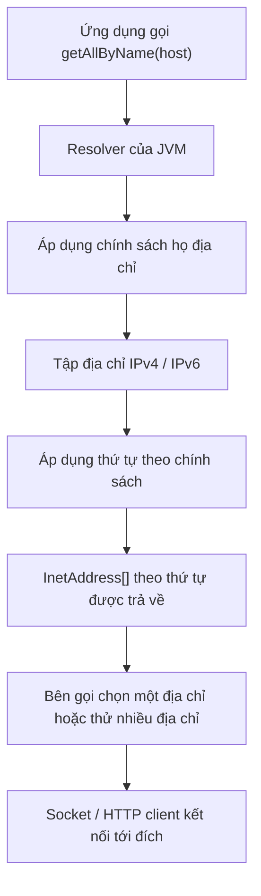

# Địa chỉ IPv4, IPv6 và thứ tự địa chỉ ảnh hưởng thế nào đến bên gọi

> **Chương:** Hợp đồng `InetAddress` — **mô-đun:** `JAVA_VERSION_JAVA18`. Bài học giải thích cách JVM trả về địa chỉ IPv4/IPv6, ý nghĩa thứ tự trong mảng `InetAddress[]`, các cấu hình dual-stack còn dùng trên JDK hiện đại và cách bên gọi chọn địa chỉ để kết nối. Các API chính đều có từ Java 18; SPI resolver được giới thiệu ở Java 18 vẫn tiếp tục áp dụng.

Một hostname có thể ánh xạ tới nhiều địa chỉ. Có thể có nhiều bản ghi IPv4 (A), nhiều bản ghi IPv6 (AAAA), hoặc cả hai họ. Khi ứng dụng chỉ nhìn thấy một địa chỉ hoặc luôn thử địa chỉ đầu tiên, thứ tự trả về có thể ảnh hưởng trực tiếp tới việc kết nối thành công, độ trễ và khả năng dự phòng.

Điều cần nắm rõ là **họ địa chỉ**, **thứ tự địa chỉ** và **khả năng sử dụng socket** là ba vấn đề liên quan nhưng khác nhau. Ưu tiên IPv6 không chứng minh mạng IPv6 đang hoạt động tốt; ưu tiên IPv4 không làm cho dịch vụ chỉ có IPv6 trở nên truy cập được.

## 1. Mục tiêu học tập

Sau bài này, bạn có thể:

1. Phân biệt IPv4, IPv6, dual-stack và địa chỉ có scope.
2. Đọc kết quả `InetAddress.getAllByName()` và hiểu thứ tự địa chỉ mà JVM trả về.
3. Giải thích chính xác hai system properties `java.net.preferIPv6Addresses` và `java.net.preferIPv4Stack`.
4. Hiểu `InetAddressResolver.LookupPolicy` và trách nhiệm của resolver tùy biến từ Java 18.
5. Thiết kế lựa chọn/fallback địa chỉ có timeout, không phụ thuộc mù quáng vào phần tử `[0]`.
6. Kiểm thử hành vi IPv4/IPv6 trên JDK và môi trường mạng đang triển khai.

## 2. IPv4, IPv6 và dual-stack

**IPv4** dùng địa chỉ 32 bit, thường được viết thành bốn số thập phân, ví dụ `192.0.2.10`. **IPv6** dùng địa chỉ 128 bit, thường được viết ở dạng hexadecimal có dấu hai chấm, ví dụ `2001:db8::10`.

| Khái niệm | Ý nghĩa | Ví dụ |
|---|---|---|
| IPv4 | Họ địa chỉ 32 bit | `192.0.2.10` |
| IPv6 | Họ địa chỉ 128 bit | `2001:db8::10` |
| Dual-stack | Máy/ứng dụng có thể sử dụng cả IPv4 và IPv6 | Một hostname trả cả A và AAAA |
| IPv4-only | Chỉ dùng socket IPv4 | Không kết nối trực tiếp được tới đích chỉ có IPv6 |
| IPv6-only | Môi trường chỉ có khả năng IPv6; có thể cần cơ chế chuyển tiếp như NAT64 để truy cập một số đích IPv4 | Mạng di động hoặc mạng doanh nghiệp được cấu hình IPv6-only |
| Link-local IPv6 | Địa chỉ chỉ có ý nghĩa trên một liên kết mạng cụ thể | `fe80::1%<scope>` |

Các địa chỉ `192.0.2.0/24` và `2001:db8::/32` là dải dành cho tài liệu, phù hợp để minh họa nhưng không phải IP máy chủ Internet có thể dùng để kết nối thật.

Một hostname có thể được phân giải thành nhiều địa chỉ:

```text
service.example.test
    ├── 192.0.2.10       IPv4
    ├── 192.0.2.11       IPv4
    ├── 2001:db8::10     IPv6
    └── 2001:db8::11     IPv6
```

Đây là ví dụ minh họa về số lượng và họ địa chỉ. DNS thực tế có thể trả ít hơn, nhiều hơn, chỉ một họ, hoặc tập địa chỉ thay đổi theo thời gian và vị trí truy vấn.

### 2.1. Địa chỉ và socket là hai khái niệm khác nhau

`InetAddress` biểu diễn địa chỉ IP. Nó không phải kết nối mạng, không đại diện cho cổng TCP và không chứng minh địa chỉ đó có thể truy cập.

- `Inet4Address` đại diện cho IPv4.
- `Inet6Address` đại diện cho IPv6.
- `InetAddress.getAddress()` trả byte của địa chỉ: 4 byte cho IPv4, 16 byte cho IPv6.
- `InetAddress.getHostAddress()` trả chuỗi địa chỉ để quan sát.
- `Socket` hoặc API client ở tầng cao hơn mới thực hiện kết nối tới một địa chỉ và cổng.

Vì vậy, nhìn thấy một `Inet6Address` trong mảng kết quả không chứng minh máy đang có route IPv6 tới đích đó.

## 3. JVM trả về và sắp xếp địa chỉ như thế nào?

`InetAddress.getAllByName(host)` trả một mảng địa chỉ do resolver của JVM cung cấp. Với hostname, resolver có thể dựa trên cơ chế của hệ điều hành hoặc provider tùy biến. Từ Java 18, SPI `InetAddressResolverProvider` cho phép thay resolver mặc định.



`getByName(host)` trả về một `InetAddress`. Khi ứng dụng cần quan sát toàn bộ kết quả và tự chọn cách sử dụng, hãy gọi `getAllByName(host)` một lần rồi xử lý mảng đó. Không nên gọi riêng hai phương thức rồi giả định kết quả của hai lần tra cứu luôn giống nhau.

### 3.1. Thứ tự là một phần quan trọng của kết quả

Giả sử resolver trả về:

```text
[
  2001:db8::10,  // IPv6
  192.0.2.10,    // IPv4
  2001:db8::11   // IPv6
]
```

Nếu ứng dụng lấy `addresses[0]`, nó sẽ chọn IPv6. Nếu thứ tự được thay đổi để IPv4 đứng trước, cùng đoạn code sẽ chọn IPv4. Do đó, thứ tự ảnh hưởng tới **địa chỉ được thử đầu tiên**, nhưng không khẳng định địa chỉ đó nhanh nhất hoặc có thể kết nối.

Không có một thứ tự IP bất biến cho mọi máy, mọi JVM và mọi lần phân giải. Thứ tự phụ thuộc chính sách lookup, khả năng của hệ điều hành, resolver đang dùng và cấu hình lúc JVM khởi động.

### 3.2. Hai system properties điều khiển hành vi IPv4/IPv6

JDK cung cấp hai property quan trọng:

| Property | Mặc định | Ý nghĩa |
|---|---|---|
| `java.net.preferIPv6Addresses` | `false` | Khi cả hai họ có thể được sử dụng, chọn thứ tự ưu tiên địa chỉ IPv6 hoặc IPv4. |
| `java.net.preferIPv4Stack` | `false` | Khi đặt `true`, yêu cầu dùng socket IPv4-only; ứng dụng không thể kết nối trực tiếp tới đích chỉ có IPv6. |

Các property này được kiểm tra **một lần khi JVM khởi động**. Đặt chúng bằng `-D` trên lệnh chạy Java để hành vi được xác định ngay từ đầu. Thay đổi bằng `System.setProperty()` sau khi các lớp networking đã khởi tạo không phải cách cấu hình đáng tin cậy.

`java.net.preferIPv6Addresses` chấp nhận ba giá trị:

| Giá trị | Hành vi |
|---|---|
| `false` | Ưu tiên IPv4 trước IPv6 khi cả hai họ có sẵn; đây là mặc định. |
| `true` | Ưu tiên IPv6 trước IPv4 khi cả hai họ có sẵn. |
| `system` | Giữ thứ tự mà resolver toàn hệ thống trả về. |

Ví dụ chạy cùng một chương trình trong các JVM riêng:

```text
java AddressOrder.java example.com
java -Djava.net.preferIPv6Addresses=true AddressOrder.java example.com
java -Djava.net.preferIPv6Addresses=system AddressOrder.java example.com
java -Djava.net.preferIPv4Stack=true AddressOrder.java example.com
```

Lệnh cuối cùng yêu cầu IPv4-only stack. Nếu hostname chỉ có IPv6, ứng dụng có thể không nhận được địa chỉ IPv6 phù hợp hoặc không thể kết nối bằng socket IPv4-only. Đừng đặt property này chỉ vì muốn IPv4 xuất hiện trước trong một danh sách.

**Giới hạn quan trọng:** nếu hệ điều hành không hỗ trợ IPv6, hostname chỉ có một họ địa chỉ, hoặc resolver chỉ trả một IP, thay đổi `preferIPv6Addresses` có thể không tạo ra khác biệt quan sát được. Property chỉ định chính sách ưu tiên; nó không bật IPv6 trên card mạng, không tạo route và không sửa firewall.

## 4. Quan sát họ và thứ tự địa chỉ bằng Java

Tạo tệp `AddressOrder.java`:

```java
import java.net.Inet4Address;
import java.net.Inet6Address;
import java.net.InetAddress;
import java.net.UnknownHostException;

public class AddressOrder {
    public static void main(String[] args) {
        String host = args.length > 0 ? args[0] : "localhost";
        if (host.isBlank()) {
            throw new IllegalArgumentException("Hostname không được rỗng");
        }

        try {
            InetAddress[] addresses = InetAddress.getAllByName(host);
            int ipv4Count = 0;
            int ipv6Count = 0;

            System.out.println("Host: " + host);
            for (int i = 0; i < addresses.length; i++) {
                InetAddress address = addresses[i];
                String family;

                if (address instanceof Inet4Address) {
                    family = "IPv4";
                    ipv4Count++;
                } else if (address instanceof Inet6Address) {
                    family = "IPv6";
                    ipv6Count++;
                } else {
                    family = "Unknown";
                }

                System.out.printf("[%d] %-7s %s%n",
                        i, family, address.getHostAddress());
            }

            System.out.printf("Tổng: %d IPv4, %d IPv6%n",
                    ipv4Count, ipv6Count);
        } catch (UnknownHostException e) {
            System.err.println("Không phân giải được: " + host);
        }
    }
}
```

Chạy:

```text
java AddressOrder.java localhost
java AddressOrder.java example.com
```

Để so sánh chính sách, chạy lại mỗi lệnh với một property ở mục 3.2. Mỗi lần chạy là một JVM mới, nhờ đó các property được đọc từ lúc khởi động.

Khi xem kết quả, hãy ghi nhận:

- Mảng có bao nhiêu địa chỉ.
- Có cả IPv4 và IPv6 hay chỉ một họ.
- Họ nào xuất hiện đầu tiên.
- Cấu hình mạng và JDK đang dùng.

Không chép một thứ tự quan sát được thành kỳ vọng cố định của bài kiểm thử. Một máy có thể chỉ trả loopback IPv4, máy khác có cả `::1` và `127.0.0.1`.

## 5. Thứ tự địa chỉ ảnh hưởng đến bên gọi ra sao?

### 5.1. Khi chỉ sử dụng `getByName`

`getByName(host)` trả về một địa chỉ. Nếu ứng dụng dùng địa chỉ đó để tạo socket, kết nối sẽ phụ thuộc vào họ địa chỉ được chọn. Trong môi trường dual-stack, một địa chỉ IPv6 được chọn đầu tiên có thể gặp vấn đề nếu route IPv6 bị lỗi trong khi IPv4 vẫn hoạt động; tình huống ngược lại cũng có thể xảy ra.

```java
InetAddress address = InetAddress.getByName("service.example.test");
Socket socket = new Socket();
socket.connect(new InetSocketAddress(address, 443), 2_000);
```

Đoạn code chỉ thử **một địa chỉ**. Nếu kết nối thất bại, ứng dụng không tự động biết các địa chỉ còn lại trong DNS để thử tiếp.

### 5.2. Khi sử dụng `getAllByName`

Ứng dụng có thể xem danh sách và thử từng địa chỉ theo một chính sách rõ ràng. Ví dụ sau thử tuần tự với timeout cho mỗi địa chỉ:

```java
import java.io.IOException;
import java.net.InetAddress;
import java.net.InetSocketAddress;
import java.net.Socket;
import java.net.UnknownHostException;

public class ConnectWithFallback {
    public static void main(String[] args) throws Exception {
        if (args.length != 2 || args[0].isBlank()) {
            throw new IllegalArgumentException(
                    "Dùng: java ConnectWithFallback.java <host> <port>");
        }

        String host = args[0];
        int port = Integer.parseInt(args[1]);
        if (port < 1 || port > 65_535) {
            throw new IllegalArgumentException("Port phải từ 1 đến 65535");
        }

        InetAddress[] addresses = InetAddress.getAllByName(host);
        IOException lastFailure = null;

        for (InetAddress address : addresses) {
            try (Socket socket = new Socket()) {
                socket.connect(new InetSocketAddress(address, port), 2_000);
                System.out.printf("Kết nối thành công tới %s:%d%n",
                        address.getHostAddress(), port);
                return;
            } catch (IOException e) {
                lastFailure = e;
                System.err.printf("Không kết nối được %s: %s%n",
                        address.getHostAddress(), e.getClass().getSimpleName());
            }
        }

        throw new IOException("Không địa chỉ nào kết nối được: " + host,
                lastFailure);
    }
}
```

Chạy với một máy chủ và cổng mà bạn được phép kiểm tra:

```text
java ConnectWithFallback.java localhost 8000
java ConnectWithFallback.java example.com 443
```

Đây là ví dụ fallback đơn giản, không phải thuật toán tối ưu cho mọi ứng dụng:

- Timeout 2 giây áp dụng **cho từng lần kết nối**. Nếu có nhiều địa chỉ, tổng thời gian chờ có thể lớn hơn 2 giây.
- `getAllByName` có thể chặn trong khi phân giải tên và bản thân API không có tham số timeout DNS.
- Kết nối tuần tự có thể chậm hơn chiến lược thử nhiều địa chỉ có kiểm soát song song.
- Một lỗi kết nối có thể là timeout, từ chối kết nối, lỗi route hoặc chính sách mạng. Cần log nguyên nhân để chẩn đoán.
- Khi đã kết nối được, đoạn code kết thúc; nó chưa thực hiện TLS hay giao thức ứng dụng.

Trong hệ thống có yêu cầu độ trễ nghiêm ngặt, hãy đặt **deadline tổng** cho toàn bộ thao tác và phân bổ thời gian còn lại cho mỗi lần thử. Có thể cân nhắc chiến lược kiểu Happy Eyeballs (RFC 8305), cho phép thử IPv6 và IPv4 lệch thời gian để tránh chờ một họ mạng bị lỗi quá lâu. Không nên tự triển khai race phức tạp nếu HTTP client hoặc thư viện networking đang dùng đã có cơ chế kết nối phù hợp và được kiểm thử.

### 5.3. Đừng nhầm thứ tự phân giải với thứ tự kết nối

Mảng từ `getAllByName` cho biết thứ tự địa chỉ mà resolver trả về. Bên gọi có thể:

1. Dùng địa chỉ đầu tiên.
2. Thử tuần tự từng địa chỉ.
3. Ưu tiên một họ địa chỉ theo cấu hình ứng dụng.
4. Dùng client cấp cao có chiến lược kết nối riêng.

Do đó, hai ứng dụng chạy cùng JDK và nhận cùng mảng IP vẫn có thể có hành vi khác nhau vì cách chúng sử dụng mảng đó khác nhau. Với `Socket`, khi truyền trực tiếp một `InetAddress` vào `InetSocketAddress`, bạn đang chỉ định đúng một IP. Đừng giả định constructor `InetSocketAddress(host, port)` hay một lần `Socket.connect` sẽ tự thử toàn bộ mảng mà `getAllByName` có thể trả về.

## 6. Resolver tùy biến và LookupPolicy từ Java 18

Java 18 bổ sung SPI `java.net.spi.InetAddressResolverProvider` (JEP 418). Resolver được chọn cho JVM có thể nhận `InetAddressResolver.LookupPolicy` trong `lookupByName`.

`LookupPolicy` mô tả hai nhóm thông tin:

| Nhóm | Hằng số | Ý nghĩa |
|---|---|---|
| Họ địa chỉ cần truy vấn | `IPV4` | Yêu cầu địa chỉ IPv4 |
| Họ địa chỉ cần truy vấn | `IPV6` | Yêu cầu địa chỉ IPv6 |
| Thứ tự kết quả | `IPV4_FIRST` | Đặt IPv4 trước IPv6 |
| Thứ tự kết quả | `IPV6_FIRST` | Đặt IPv6 trước IPv4 |

`IPV4` và `IPV6` có thể kết hợp để yêu cầu cả hai họ. Phải có ít nhất một bit họ địa chỉ. `IPV4_FIRST` và `IPV6_FIRST` là lựa chọn thứ tự; nếu không đặt bit FIRST thì dùng thứ tự hệ thống. Không được đặt đồng thời `IPV4_FIRST` và `IPV6_FIRST`.

Một resolver tùy biến cần tôn trọng policy được truyền vào: lọc họ địa chỉ không được yêu cầu và trả kết quả theo thứ tự phù hợp. Vì vậy, nếu ứng dụng cài provider riêng, hành vi quan sát được có thể phụ thuộc cả logic provider chứ không chỉ resolver của hệ điều hành.

Không nên triển khai provider chỉ để đảo vài phần tử trong mảng nếu system property hiện có đã đáp ứng. Provider là cấu hình phạm vi JVM, có ảnh hưởng rộng đến lookup trong tiến trình; hãy dùng khi thực sự cần một chính sách phân giải tên riêng và kiểm thử toàn bộ ứng dụng.

## 7. IPv6 scope: địa chỉ có thể cần thông tin giao diện

Một số địa chỉ IPv6, đặc biệt địa chỉ **link-local** thuộc dải `fe80::/10`, chỉ có ý nghĩa trên một interface hoặc link cụ thể. Khi dùng loại địa chỉ này, scope identifier (ví dụ tên hoặc chỉ số interface) có thể là phần thiết yếu để chọn đúng đường đi.

Đừng loại bỏ phần scope khi lưu hoặc tái tạo địa chỉ nếu ứng dụng cần giữ nguyên ngữ nghĩa. `Inet6Address` cung cấp `getScopeId()` và `getScopedInterface()` để quan sát scope của địa chỉ có phạm vi.

Ví dụ kiểm tra:

```java
import java.net.Inet6Address;
import java.net.InetAddress;

public class Ipv6ScopeInfo {
    public static void main(String[] args) throws Exception {
        for (InetAddress address :
                InetAddress.getAllByName(args.length > 0 ? args[0] : "localhost")) {
            if (address instanceof Inet6Address ipv6) {
                System.out.println("Address: " + ipv6.getHostAddress());
                System.out.println("Scope ID: " + ipv6.getScopeId());
                System.out.println("Interface: " + ipv6.getScopedInterface());
            }
        }
    }
}
```

Không phải mọi IPv6 address đều có scope ID có ý nghĩa; địa chỉ global unicast thường không cần scope interface như link-local. Đừng coi một scope ID quan sát được trên máy này là chỉ số có thể chuyển nguyên sang máy khác.

## 8. Kiểm thử hành vi trên môi trường thật

### 8.1. So sánh trong các JVM riêng

Chạy chương trình `AddressOrder` ở mục 4 trong bốn trường hợp:

```text
java AddressOrder.java localhost
java -Djava.net.preferIPv6Addresses=true AddressOrder.java localhost
java -Djava.net.preferIPv6Addresses=system AddressOrder.java localhost
java -Djava.net.preferIPv4Stack=true AddressOrder.java localhost
```

Ghi lại họ địa chỉ và thứ tự. Nếu không thấy khác biệt, kiểm tra:

- Máy có hỗ trợ IPv6 và đã bật IPv6 trên interface đang dùng không?
- Resolver có trả cả hai họ địa chỉ cho hostname không?
- Có đang dùng `localhost`, tên có thể chỉ ánh xạ tới một họ trên máy hiện tại không?
- Có provider tùy biến hoặc cấu hình hosts ảnh hưởng kết quả không?

### 8.2. Tạo dữ liệu kiểm thử cục bộ

Để quan sát nhiều mapping mà không phụ thuộc DNS công cộng, có thể dùng property `jdk.net.hosts.file` của JDK. Tạo tệp `lab-hosts`:

```text
192.0.2.10       dual.example.test
192.0.2.11       dual.example.test
2001:db8::10     dual.example.test
2001:db8::11     dual.example.test
```

Chạy:

```text
java -Djdk.net.hosts.file=lab-hosts AddressOrder.java dual.example.test
java -Djdk.net.hosts.file=lab-hosts -Djava.net.preferIPv6Addresses=true AddressOrder.java dual.example.test
```

Property hosts file là cơ chế phục vụ kiểm thử của JDK. Khi bật, JDK sử dụng resolver tệp hosts tích hợp thay cho resolver hệ thống thông thường; không coi đây là cách cấu hình DNS cho môi trường sản xuất. Khi thử `InetAddressResolverProvider` tùy biến, hãy tách phép thử này ra vì `jdk.net.hosts.file` ảnh hưởng cơ chế chọn resolver.

Các IP trong tệp chỉ là địa chỉ tài liệu, không thể dùng để chứng minh có route thật. Mục tiêu của bài thử là quan sát **lọc họ và thứ tự kết quả**.

### 8.3. Kiểm tra kết nối theo từng địa chỉ

Sau khi quan sát mảng, dùng `ConnectWithFallback` với hostname và cổng của dịch vụ bạn kiểm soát. Ghi nhận IP nào kết nối thành công, IP nào timeout hoặc bị từ chối. Không dùng một phép thử `ping` hoặc `InetAddress.isReachable()` để thay thế kiểm tra TCP tới đúng cổng ứng dụng.

Kết quả có thể thay đổi giữa Wi-Fi, VPN, mạng di động, container và CI runner. Một địa chỉ IPv6 có mặt trong DNS nhưng không có route IPv6 khả dụng vẫn có thể thất bại khi kết nối; điều đó không làm bản ghi DNS trở thành sai.

## 9. Lựa chọn thiết kế cho bên gọi

| Yêu cầu | Hướng xử lý |
|---|---|
| Ứng dụng chỉ cần hiển thị IP | Dùng `getAllByName` để cho thấy các địa chỉ hiện có; không tuyên bố địa chỉ nào là duy nhất. |
| Ứng dụng chỉ hỗ trợ IPv4 | Cân nhắc `java.net.preferIPv4Stack=true` khi khởi động nếu thực sự cần IPv4-only; ghi nhận giới hạn không truy cập được đích chỉ IPv6. |
| Ứng dụng cần dual-stack | Giữ cấu hình mặc định khi phù hợp, kiểm thử cả IPv4 và IPv6 trên môi trường triển khai. |
| Ứng dụng có chính sách ưu tiên IPv6 | Đặt `java.net.preferIPv6Addresses=true` lúc khởi động và xác minh đường IPv6 thực tế; chuẩn bị fallback nếu nghiệp vụ yêu cầu. |
| Cần giữ thứ tự hệ thống | Đặt `java.net.preferIPv6Addresses=system` lúc khởi động và hiểu thứ tự hệ thống vẫn có thể khác theo môi trường. |
| Dịch vụ có nhiều IP, cần chịu lỗi | Dùng toàn bộ kết quả, deadline tổng, timeout mỗi lần thử, logging và fallback có kiểm soát. |
| Dùng HTTP(S) | Ưu tiên HTTP client phù hợp; không tự thay hostname bằng IP nếu điều đó làm mất SNI hoặc xác thực hostname TLS. |

### Những lỗi thiết kế cần tránh

- Chỉ lấy `getAllByName(host)[0]` rồi coi đó là địa chỉ bền vững của dịch vụ.
- Bật `preferIPv4Stack=true` để “sửa DNS” trong khi vấn đề thật là route, firewall hoặc dịch vụ IPv6.
- Bật `preferIPv6Addresses=true` mà không kiểm tra mạng IPv6, rồi quy mọi timeout cho DNS.
- Coi `preferIPv6Addresses=system` là thứ tự giống nhau trên tất cả máy; nó chỉ giữ thứ tự resolver toàn hệ thống cung cấp.
- Thử tuần tự vô hạn với timeout dài, khiến request của người dùng bị kéo dài theo số địa chỉ.
- Dùng IP lấy được từ DNS cho HTTPS nhưng quên xác thực hostname gốc trong TLS.
- Ghi cứng địa chỉ IP công cộng vào kiểm thử tự động.

## 10. Bài tập tự kiểm tra

1. Một hostname có hai A record và hai AAAA record. Vì sao `getByName` không đủ để hiển thị toàn bộ bốn địa chỉ?
2. `java.net.preferIPv6Addresses=true` và `java.net.preferIPv4Stack=true` khác nhau như thế nào? Vì sao không thể xem chúng là hai cách viết cùng một lựa chọn?
3. Khi đặt `java.net.preferIPv6Addresses=system`, ai quyết định thứ tự cuối cùng mà JVM nhận được?
4. Nếu phần tử đầu tiên của mảng là IPv6 nhưng máy không có route IPv6 tới đích, điều gì có thể xảy ra? Ứng dụng cần làm gì để thử địa chỉ tiếp theo?
5. Vì sao timeout 2 giây cho từng địa chỉ không đồng nghĩa tổng thời gian kết nối tối đa là 2 giây?
6. `LookupPolicy.IPV4_FIRST` khác với `LookupPolicy.IPV4` ở điểm nào?
7. Tại sao scope ID quan trọng với một số địa chỉ IPv6 link-local?

**Tiêu chí hoàn thành:** Bạn giải thích được vì sao cùng hostname có thể có nhiều địa chỉ, đọc đúng thứ tự do JVM trả về, phân biệt ưu tiên họ địa chỉ với giới hạn socket, và thiết kế cách kết nối có fallback phù hợp với deadline của ứng dụng.

## 11. Tài liệu chuẩn

- [InetAddress — Java SE 27 API](https://docs.oracle.com/en/java/javase/27/docs/api/java.base/java/net/InetAddress.html): hợp đồng trả về địa chỉ và các phương thức phân giải tên.
- [Inet6Address — Java SE 27 API](https://docs.oracle.com/en/java/javase/27/docs/api/java.base/java/net/Inet6Address.html): scope ID và interface của địa chỉ IPv6.
- [InetAddressResolver.LookupPolicy — Java SE 27 API](https://docs.oracle.com/en/java/javase/27/docs/api/java.base/java/net/spi/InetAddressResolver.LookupPolicy.html): lọc họ địa chỉ và thứ tự kết quả; có từ Java 18.
- [Networking Properties — Java SE 27](https://docs.oracle.com/en/java/javase/27/docs/api/java.base/java/net/doc-files/net-properties.html): `java.net.preferIPv4Stack` và `java.net.preferIPv6Addresses`.
- [JEP 418 — Internet-Address Resolution SPI](https://openjdk.org/jeps/418): SPI resolver được bổ sung trong Java 18.
- [RFC 8305 — Happy Eyeballs Version 2](https://www.rfc-editor.org/rfc/rfc8305): nguyên tắc giảm độ trễ khi thử kết nối trên nhiều họ địa chỉ.
