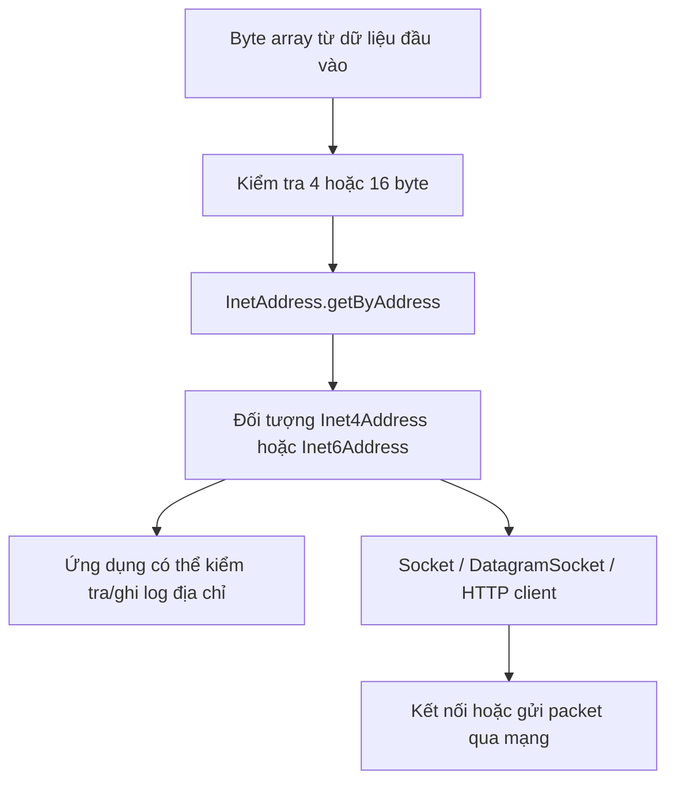

# InetAddress.getByAddress(): tạo đối tượng từ byte địa chỉ mà không tra cứu tên

> **Chương:** Hợp đồng `InetAddress` — **mô-đun:** `JAVA_VERSION_JAVA18`. Bài học tập trung vào `InetAddress.getByAddress(byte[])` và overload `getByAddress(String, byte[])`, hai API đã có từ lâu và vẫn hữu ích trên JDK hiện đại. Ví dụ biên dịch từ **Java 18**; phần mở rộng IPv6 có scope cũng dùng API đã có từ Java 18.

Khi dữ liệu IP đã có ở dạng byte — chẳng hạn đọc từ giao thức nhị phân, cấu hình mạng hoặc một cấu trúc dữ liệu đã được phân tích — bạn không cần chuyển nó thành chuỗi hostname rồi gọi resolver. `InetAddress.getByAddress` tạo đối tượng địa chỉ trực tiếp từ **4 byte IPv4** hoặc **16 byte IPv6**. Phương thức không thực hiện reverse lookup và không kiểm tra địa chỉ đó có thể truy cập được hay không.

Đây là hợp đồng khác với `getByName`: `getByName` nhận hostname hoặc IP literal ở dạng chuỗi; `getByAddress` nhận byte địa chỉ thô. Chọn đúng API giúp tránh lookup không cần thiết, xử lý đúng thứ tự byte và giữ ranh giới rõ ràng giữa phân tích dữ liệu với hoạt động mạng.

## 1. Mục tiêu học tập

Sau bài này, bạn có thể:

1. Giải thích hợp đồng của `getByAddress(byte[])` và `getByAddress(String, byte[])`.
2. Xác định đúng độ dài byte của IPv4/IPv6 và ý nghĩa **network byte order**.
3. Chuyển các octet IPv4 lớn hơn 127 sang Java `byte` mà không làm mất bit.
4. Phân biệt việc tạo `InetAddress` với phân giải hostname, reverse lookup và kết nối socket.
5. Xử lý dữ liệu đầu vào có kiểm tra độ dài, null và bản sao byte an toàn.
6. Biết khi nào cần scope ID/interface cho IPv6 link-local và API phù hợp để tạo địa chỉ scoped.

## 2. Hai overload và hợp đồng chính

`InetAddress` cung cấp hai overload:

```java
public static InetAddress getByAddress(byte[] addr)
        throws UnknownHostException;

public static InetAddress getByAddress(String host, byte[] addr)
        throws UnknownHostException;
```

| Tiêu chí | `getByAddress(byte[])` | `getByAddress(String, byte[])` |
|---|---|---|
| Đầu vào | Byte IP thô | Tên host do ứng dụng cung cấp và byte IP thô |
| Độ dài hợp lệ | 4 byte (IPv4), 16 byte (IPv6) | 4 byte (IPv4), 16 byte (IPv6) |
| Resolver hệ thống | Không cần | Không dùng resolver để xác minh địa chỉ hoặc hostname |
| Kiểm tra hostname | Không có hostname đầu vào | **Không kiểm tra tính hợp lệ của hostname** |
| Kết quả | `InetAddress` tương ứng với họ địa chỉ | `InetAddress` có địa chỉ và tên host được gắn |
| Lỗi chính | `UnknownHostException` nếu độ dài địa chỉ không hợp lệ | `UnknownHostException` nếu độ dài địa chỉ không hợp lệ |
| Tác dụng mạng | Không mở socket, không kiểm tra khả năng truy cập | Không mở socket, không kiểm tra khả năng truy cập |

Phương thức đầu tiên phù hợp khi chỉ cần một đối tượng biểu diễn IP. Overload thứ hai hữu ích khi chương trình **đã biết** tên logic gắn với địa chỉ và muốn giữ tên đó trên đối tượng; tên được truyền vào không được tra cứu để xác minh mối liên hệ với IP.

## 3. Byte IP ở network byte order

Tài liệu API quy định byte được truyền theo **network byte order**: byte có trọng số cao nhất đứng đầu mảng. Với IPv4, bốn byte lần lượt tương ứng bốn octet từ trái sang phải.

Ví dụ địa chỉ tài liệu `192.0.2.10`:

```text
Địa chỉ: 192.0.2.10
Byte:    C0 00 02 0A
Thập phân: 192, 0, 2, 10
```

Trong Java, `byte` là số nguyên có dấu 8 bit, miền giá trị từ -128 đến 127. Vì vậy, octet 192 phải được viết `(byte) 192`; các bit vẫn được giữ nguyên dù khi in trực tiếp giá trị có thể là số âm.

```java
byte[] ipv4 = {
    (byte) 192, 0, 2, 10
};

InetAddress address = InetAddress.getByAddress(ipv4);
System.out.println(address.getHostAddress()); // 192.0.2.10
```

### 3.1. Đọc octet không dấu

Để hiển thị từng byte như octet IPv4, dùng `Byte.toUnsignedInt`:

```java
import java.net.InetAddress;

byte[] bytes = InetAddress.getByAddress(
        new byte[] {(byte) 192, 0, 2, 10}).getAddress();

for (byte value : bytes) {
    System.out.println(Byte.toUnsignedInt(value));
}
// 192
// 0
// 2
// 10
```

Ví dụ trên tạo địa chỉ từ byte rồi đọc lại byte của đối tượng. Nếu dữ liệu byte đã có, hãy dùng trực tiếp `getByAddress` để không cần phân tích chuỗi.

### 3.2. Tạo byte IPv4 từ một số nguyên

Khi một giao thức lưu IPv4 trong 32 bit, có thể tách byte theo thứ tự network byte order. `ByteBuffer` mặc định dùng big-endian, nhưng nên ghi rõ để người đọc hiểu hợp đồng:

```java
import java.net.InetAddress;
import java.nio.ByteBuffer;
import java.nio.ByteOrder;

public class AddressFromInt {
    public static void main(String[] args) throws Exception {
        int packed = 0xC000020A; // 192.0.2.10

        byte[] bytes = ByteBuffer.allocate(Integer.BYTES)
                .order(ByteOrder.BIG_ENDIAN)
                .putInt(packed)
                .array();

        InetAddress address = InetAddress.getByAddress(bytes);
        System.out.println(address.getHostAddress()); // 192.0.2.10
    }
}
```

Đừng đổi sang little-endian khi byte nguồn là định dạng mạng. Nếu dữ liệu được ghi theo thứ tự byte riêng của một định dạng file hoặc giao thức nội bộ, hãy giải mã đúng định dạng đó trước khi gọi `getByAddress`.

## 4. Tạo địa chỉ IPv4 và IPv6

### 4.1. Ví dụ IPv4

```java
import java.net.Inet4Address;
import java.net.InetAddress;
import java.util.Arrays;

public class CreateIpv4 {
    public static void main(String[] args) throws Exception {
        byte[] raw = {
            (byte) 203, 0, 113, 7
        };

        InetAddress address = InetAddress.getByAddress(raw);

        System.out.println(address instanceof Inet4Address); // true
        System.out.println(address.getHostAddress());        // 203.0.113.7
        System.out.println(Arrays.toString(address.getAddress()));
    }
}
```

`203.0.113.0/24` là dải IPv4 dành cho tài liệu. Địa chỉ ví dụ giúp minh họa octet đầu lớn hơn 127; không dùng nó như máy chủ Internet có thể kết nối.

### 4.2. Ví dụ IPv6

IPv6 có độ dài 128 bit, tức 16 byte. Ví dụ `2001:db8::10` được biểu diễn bằng:

```text
20 01 0D B8 00 00 00 00 00 00 00 00 00 00 00 10
```

```java
import java.net.Inet6Address;
import java.net.InetAddress;

public class CreateIpv6 {
    public static void main(String[] args) throws Exception {
        byte[] raw = {
            0x20, 0x01, 0x0d, (byte) 0xb8,
            0, 0, 0, 0, 0, 0, 0, 0, 0, 0, 0, 0x10
        };

        InetAddress address = InetAddress.getByAddress(raw);

        System.out.println(address instanceof Inet6Address); // true
        System.out.println(address.getHostAddress());
    }
}
```

Kết quả văn bản có thể dùng cách rút gọn IPv6 khác nhau theo formatter, nhưng địa chỉ vẫn biểu diễn cùng 16 byte. Đừng so sánh chuỗi IPv6 bằng phép so sánh văn bản để kiểm tra hai địa chỉ có bằng nhau hay không; dùng `InetAddress.equals` hoặc so sánh byte.

### 4.3. Họ địa chỉ được xác định từ độ dài

| Độ dài mảng | Loại đối tượng được tạo | Ý nghĩa |
|---:|---|---|
| 4 | `Inet4Address` | IPv4 |
| 16 | `Inet6Address` | IPv6 |
| 0, 3, 5, 15, 17... | Không tạo được | `UnknownHostException` |

`getByAddress` không nhận CIDR như `192.0.2.0/24`, không nhận cổng như `192.0.2.10:443` và không tự tách subnet mask. Đầu vào phải là **đúng các byte của một địa chỉ IP**, không phải chuỗi hay cấu trúc endpoint.

## 5. Overload có hostname: gắn tên, không xác minh tên

`getByAddress(String host, byte[] addr)` tạo địa chỉ từ byte và lưu tên được truyền vào:

```java
byte[] raw = {(byte) 192, 0, 2, 10};

InetAddress address =
        InetAddress.getByAddress("api.example.test", raw);

System.out.println(address.getHostAddress()); // 192.0.2.10
System.out.println(address.getHostName());    // api.example.test
```

Hợp đồng Javadoc nêu rõ:

- Resolver hệ thống **không được gọi để kiểm tra tính hợp lệ của địa chỉ**.
- Tên host cũng **không được kiểm tra tính hợp lệ**.
- Nếu byte là IPv4 thì trả `Inet4Address`; nếu là IPv6 thì trả `Inet6Address`.
- Mảng phải có 4 hoặc 16 byte.

Điều này có nghĩa ứng dụng có thể gắn một tên tùy ý vào một IP bất kỳ:

```java
InetAddress labelled = InetAddress.getByAddress(
        "trusted-api.example.test",
        new byte[] {(byte) 192, 0, 2, 10});
```

Lời gọi trên **không chứng minh** `trusted-api.example.test` thật sự ánh xạ tới `192.0.2.10`. Không dùng overload này để xác thực DNS, chứng minh quyền sở hữu hostname hoặc tạo niềm tin bảo mật từ tên được truyền vào. Chỉ truyền hostname đã được ứng dụng xác định từ nguồn đáng tin cậy nếu cần giữ tên trên đối tượng.

### 5.1. Tên được gắn và reverse lookup về sau

Ba phương thức sau có hợp đồng khác nhau:

| API | Hành vi |
|---|---|
| `getHostAddress()` | Trả chuỗi IP; không reverse lookup. |
| `getHostName()` | Nếu đối tượng được tạo với hostname, trả hostname đã ghi nhớ; nếu không có tên, có thể thực hiện reverse lookup. |
| `getCanonicalHostName()` | Dùng resolver hệ thống để thử reverse lookup; nếu không tìm được tên đầy đủ thì trả chuỗi IP. |

Ví dụ với đối tượng được tạo bằng overload có host:

```java
InetAddress named = InetAddress.getByAddress(
        "api.example.test",
        new byte[] {(byte) 192, 0, 2, 10});

System.out.println(named.getHostName()); // Tên đã gắn
System.out.println(named.getHostAddress()); // IP
// getCanonicalHostName() vẫn có thể thực hiện reverse lookup.
```

Với `getByAddress(byte[])`, không có hostname được gắn. Bản thân thao tác tạo đối tượng không block và không reverse lookup; nếu sau đó gọi `getHostName` hoặc `getCanonicalHostName` thì lookup ngược có thể xảy ra. Vì thế, khi muốn quan sát IP mà không phát sinh lookup, hãy dùng `getHostAddress`.

## 6. Dữ liệu đầu vào và xử lý lỗi

### 6.1. Kiểm tra null và độ dài trước khi tạo

API ném `UnknownHostException` nếu byte array có độ dài không hợp lệ. Ở tầng ứng dụng, nên kiểm tra đầu vào trước để thông báo lỗi gần với nguồn dữ liệu:

```java
import java.net.InetAddress;
import java.net.UnknownHostException;
import java.util.Objects;

public class RawAddressFactory {
    public static InetAddress fromBytes(byte[] input)
            throws UnknownHostException {
        Objects.requireNonNull(input, "input");

        if (input.length != 4 && input.length != 16) {
            throw new IllegalArgumentException(
                    "Địa chỉ IP phải có 4 byte hoặc 16 byte");
        }

        // Sao chép nếu dữ liệu đến từ buffer/mảng mutable có thể được tái sử dụng.
        byte[] stableBytes = input.clone();
        return InetAddress.getByAddress(stableBytes);
    }
}
```

`Objects.requireNonNull` báo lỗi rõ ràng nếu bên gọi truyền `null`. Ví dụ chủ động sao chép byte đầu vào để tách vòng đời của địa chỉ khỏi buffer mutable mà bên gọi có thể tái sử dụng. Đây là biện pháp bảo vệ dữ liệu ở ranh giới ứng dụng, đặc biệt hữu ích khi đọc từ packet buffer hoặc vùng nhớ dùng chung.

### 6.2. Phân biệt lỗi định dạng với lỗi mạng

| Tình huống | Kết quả |
|---|---|
| Mảng có 4 byte | Tạo đối tượng IPv4 |
| Mảng có 16 byte | Tạo đối tượng IPv6 |
| Mảng có độ dài khác | `UnknownHostException` từ API (hoặc lỗi validation riêng nếu ứng dụng kiểm tra trước) |
| Đầu vào `null` | Cần kiểm tra trước; ví dụ dùng `Objects.requireNonNull` |
| IP chưa được gán hoặc không có route | `getByAddress` vẫn tạo đối tượng; lỗi chỉ có thể xuất hiện ở thao tác mạng sau đó |
| IP bị firewall chặn | Không ảnh hưởng việc tạo đối tượng; kết nối có thể thất bại |

`UnknownHostException` trong trường hợp này nói về **độ dài byte không hợp lệ**, không phải DNS không tìm thấy hostname. Đây là điểm khác biệt quan trọng so với `getByName`.

## 7. IPv6 link-local và scope interface

Một địa chỉ IPv6 link-local (thường thuộc dải `fe80::/10`) chỉ có ý nghĩa trên một liên kết mạng cụ thể. Cùng chuỗi địa chỉ có thể tồn tại trên nhiều interface, vì vậy khi tạo địa chỉ link-local để sử dụng, đôi khi cần chỉ rõ interface hoặc scope ID.

`InetAddress.getByAddress(byte[])` chỉ nhận byte địa chỉ, không nhận tham số scope; đối tượng IPv6 tạo theo cách này không mang scope interface. Với IPv6 link-local cần scope, dùng các overload của `Inet6Address`:

```java
import java.net.Inet6Address;
import java.net.NetworkInterface;

// interface phải là interface cục bộ phù hợp và có scope ID hợp lệ.
NetworkInterface networkInterface =
        NetworkInterface.getByName("eth0");
if (networkInterface == null) {
    throw new IllegalStateException("Không tìm thấy interface eth0");
}

byte[] linkLocal = {
        (byte) 0xfe, (byte) 0x80,
        0, 0, 0, 0, 0, 0, 0, 0, 0, 0, 0, 0, 0, 1
};

Inet6Address scoped = Inet6Address.getByAddress(
        null, linkLocal, networkInterface);
```

Tên interface `eth0` chỉ là ví dụ phổ biến trên Linux; tên thật khác nhau theo hệ điều hành và máy. Hãy kiểm tra interface tồn tại trước khi gọi. Overload nhận `NetworkInterface` ném `UnknownHostException` nếu interface không có scope ID phù hợp cho loại địa chỉ đó. Overload nhận số nguyên scope ID cũng tồn tại, nhưng số scope phải phù hợp với máy đang chạy; không sao chép một scope ID từ máy khác.

Địa chỉ IPv6 global thường không cần scope interface. Không thêm scope một cách tùy tiện cho mọi IPv6 address.

## 8. Tạo InetAddress không có nghĩa là kết nối thành công

`getByAddress` chỉ tạo **giá trị địa chỉ**:



Tạo đối tượng không:

- Gửi truy vấn DNS hoặc reverse DNS.
- Mở TCP connection.
- Gửi UDP packet.
- Kiểm tra IP có được cấp phát cho một host hay không.
- Kiểm tra firewall, route, cổng, TLS hoặc trạng thái dịch vụ.
- Xác thực hostname gắn kèm trong overload có host.

Nếu cần kết nối TCP, phải dùng socket với địa chỉ và cổng:

```java
InetAddress address = InetAddress.getByAddress(
        new byte[] {(byte) 192, 0, 2, 10});

try (java.net.Socket socket = new java.net.Socket()) {
    socket.connect(new java.net.InetSocketAddress(address, 443), 2_000);
    System.out.println("TCP connected");
}
```

Ví dụ này chỉ minh họa bước kết nối; dải `192.0.2.0/24` dành cho tài liệu nên không mong đợi kết nối Internet thành công. Với HTTPS, ứng dụng còn phải thiết lập TLS và xác thực hostname theo URL/certificate; không lấy tên được gắn bằng `getByAddress(host, bytes)` làm bằng chứng xác thực.

## 9. Khi nào nên dùng getByAddress?

| Tình huống | API phù hợp | Lý do |
|---|---|---|
| Byte IPv4/IPv6 đã được parse từ giao thức nhị phân | `InetAddress.getByAddress(byte[])` | Tạo đối tượng trực tiếp, không hostname lookup |
| Cần giữ hostname đã được xác định từ nguồn đáng tin | `InetAddress.getByAddress(host, byte[])` | Gắn tên lên đối tượng; không xác minh quan hệ tên/IP |
| Chỉ có hostname, cần tìm IP | `InetAddress.getByName` / `getAllByName` | Đây là nhiệm vụ phân giải tên |
| Chỉ có chuỗi literal và baseline Java 22+ | `InetAddress.ofLiteral` | Parse chuỗi IP literal mà không tra cứu hostname |
| Cần IPv6 link-local với interface | `Inet6Address.getByAddress(host, bytes, networkInterface)` | Gắn scope ID tương ứng interface |
| Cần kiểm tra TCP/TLS/HTTP | `Socket` / `HttpClient` hoặc client giao thức tương ứng | `InetAddress` chỉ là địa chỉ, không phải kết nối |

Đừng dùng `getByAddress` để thay cho parser chuỗi IP nếu dữ liệu vẫn là văn bản; đừng dùng `getByName` nếu đã có byte IP chính xác và không cần hostname lookup.

## 10. Bài tập tự kiểm tra

1. Vì sao `InetAddress.getByAddress(byte[])` yêu cầu 4 hoặc 16 byte?
2. Network byte order đặt byte có trọng số cao nhất ở vị trí nào?
3. Vì sao octet IPv4 203 phải viết thành `(byte) 203` trong mảng Java?
4. `getByAddress("api.example.test", bytes)` có xác minh hostname ánh xạ tới byte đã truyền không?
5. `getByAddress(byte[])` có thực hiện reverse lookup ngay lúc tạo không? Phương thức nào có thể làm reverse lookup về sau?
6. Tại sao `UnknownHostException` ở đây không nhất thiết liên quan tới DNS?
7. Vì sao một IPv6 link-local có thể cần scope interface?
8. Sau khi tạo `InetAddress` thành công, còn những bước nào cần thực hiện để kết nối HTTPS tới dịch vụ?

**Tiêu chí hoàn thành:** Bạn có thể lấy byte từ một cấu trúc dữ liệu, kiểm tra độ dài và byte order, tạo đúng `Inet4Address`/`Inet6Address`, giải thích việc gắn hostname không xác minh DNS, và tách biệt tạo đối tượng địa chỉ khỏi hoạt động kết nối mạng.

## 11. Tài liệu chuẩn

- [InetAddress — Java SE 27 API](https://docs.oracle.com/en/java/javase/27/docs/api/java.base/java/net/InetAddress.html): hợp đồng `getByAddress(byte[])`, overload có hostname, network byte order và reverse lookup.
- [InetAddress — Java SE 18 API](https://docs.oracle.com/en/java/javase/18/docs/api/java.base/java/net/InetAddress.html): xác nhận các overload `getByAddress` đã có trong baseline Java 18.
- [Inet6Address — Java SE 18 API](https://docs.oracle.com/en/java/javase/18/docs/api/java.base/java/net/Inet6Address.html): tạo IPv6 scoped theo `NetworkInterface` hoặc scope ID.
- [OpenJDK InetAddress source](https://github.com/openjdk/jdk/blob/master/src/java.base/share/classes/java/net/InetAddress.java): đối chiếu cách triển khai hiện hành và các ghi chú về hostname gốc.
