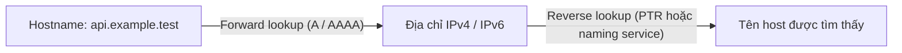

# getHostAddress(), getHostName() và getCanonicalHostName(): biểu diễn địa chỉ và tra cứu ngược

> **Chương:** Hợp đồng `InetAddress` — **mô-đun:** `JAVA_VERSION_JAVA18`. Bài học phân biệt ba cách đọc thông tin từ một đối tượng địa chỉ IP: chuỗi IP, tên host đã gắn và tên canonical được tìm qua reverse lookup. Các API này vẫn dùng được trên JDK hiện đại; phần resolver tùy biến dựa trên SPI có từ Java 18.

Ba phương thức có tên gần giống nhau nhưng mục đích khác nhau. `getHostAddress()` định dạng địa chỉ IP thành chuỗi và không cần tìm tên. `getHostName()` trả hostname đã biết hoặc có thể thực hiện reverse lookup nếu đối tượng chưa có hostname. `getCanonicalHostName()` cố gắng tìm tên canonical của địa chỉ thông qua cơ chế phân giải ngược. Nếu dùng sai, một dòng log tưởng như chỉ in IP có thể vô tình kích hoạt tra cứu mạng chậm; hoặc ứng dụng có thể nhầm tên reverse với bằng chứng xác thực máy chủ.

## 1. Mục tiêu học tập

Sau bài này, bạn có thể:

1. Phân biệt chính xác `getHostAddress`, `getHostName` và `getCanonicalHostName`.
2. Giải thích hostname gắn sẵn trong đối tượng khác với tên được tìm bằng reverse lookup.
3. Mô tả vai trò của PTR record và giới hạn của reverse DNS.
4. Hiểu `InetAddressResolver.lookupByAddress(byte[])` trong SPI resolver Java 18+.
5. Tránh reverse lookup không cần thiết trong logging, metrics và đường xử lý request.
6. Không dùng tên reverse hoặc canonical để xác minh danh tính máy chủ; biết khi nào cần TLS hostname verification.

## 2. Ba phương thức, ba hợp đồng

| Phương thức | Kết quả | Có thể gọi resolver? | Khi nào dùng |
|---|---|---|---|
| `getHostAddress()` | Chuỗi biểu diễn địa chỉ IP của đối tượng | Không cần reverse lookup | Logging địa chỉ, hiển thị IP, chẩn đoán |
| `getHostName()` | Hostname đã được gắn/ghi nhớ; nếu chưa biết thì có thể reverse lookup | Có, nếu cần tìm tên | Khi ứng dụng cần hostname và chấp nhận chi phí lookup |
| `getCanonicalHostName()` | Tên canonical nếu tìm được; nếu không thì trả chuỗi địa chỉ IP | Có thể thực hiện reverse lookup | Khi cần thử lấy tên canonical, không dùng làm định danh bảo mật |

Ví dụ về một đối tượng địa chỉ:

```text
Địa chỉ IP:              192.0.2.10
Hostname được gắn:       api.example.test
Tên canonical tìm được:  node-10.example.test
```

Ba dòng trên có thể khác nhau. Hostname gắn với đối tượng là tên ứng dụng đã dùng khi tạo địa chỉ; tên canonical có thể là kết quả tra cứu ngược. Chúng không nhất thiết bằng nhau và không có bảo đảm rằng reverse lookup luôn trả tên.

### 2.1. `getHostAddress()`: biểu diễn IP, không tìm tên

`getHostAddress()` trả địa chỉ dưới dạng văn bản:

```java
import java.net.InetAddress;

public class HostAddressExample {
    public static void main(String[] args) throws Exception {
        InetAddress address = InetAddress.getByName("localhost");
        System.out.println(address.getHostAddress());
    }
}
```

Kết quả có thể là `127.0.0.1` hoặc `::1` tùy resolver và cấu hình máy. Phương thức không cần reverse DNS để tạo chuỗi IP.

Với IPv6 có scope, chuỗi trả về có thể kèm scope identifier, ví dụ dạng `fe80::1%12`. Scope là một phần thông tin định tuyến cần thiết trong một số trường hợp link-local; đừng xóa nó nếu ứng dụng cần tái tạo đúng địa chỉ scoped. Chuỗi IPv6 có thể được rút gọn khác nhau nhưng vẫn biểu diễn cùng địa chỉ.

**Quy tắc thực tế:** nếu chỉ muốn ghi IP vào log hoặc metric, dùng `getHostAddress()`. Không gọi `getHostName()` chỉ để có chuỗi "dễ đọc" hơn.

### 2.2. `getHostName()`: hostname đã biết hoặc reverse lookup

Theo hợp đồng API:

- Nếu `InetAddress` được tạo từ hostname, hostname đó được ghi nhớ và `getHostName()` trả lại tên đã biết.
- Nếu đối tượng không có hostname gắn sẵn, phương thức có thể thực hiện reverse name lookup và trả tên tìm được.

Ví dụ hostname đã được gắn trong lúc phân giải:

```java
InetAddress address = InetAddress.getByName("localhost");

System.out.println(address.getHostAddress()); // IP
System.out.println(address.getHostName());    // Tên đã gắn nếu được giữ lại
```

Ngược lại, nếu đối tượng được tạo từ byte mà không có hostname:

```java
byte[] raw = {(byte) 192, 0, 2, 10};
InetAddress address = InetAddress.getByAddress(raw);

System.out.println(address.getHostAddress()); // 192.0.2.10
System.out.println(address.getHostName());    // Có thể cần reverse lookup
```

Không giả định lời gọi thứ hai luôn trả hostname. Nếu resolver không tìm được tên, kết quả có thể là chuỗi địa chỉ. Với hostname đã gắn, phương thức có thể trả tên đó mà không cần reverse lookup.

### 2.3. `getCanonicalHostName()`: thử tìm tên canonical

`getCanonicalHostName()` cố gắng lấy tên canonical cho địa chỉ IP. Việc này có thể cần tra cứu ngược thông qua naming service đang được JVM sử dụng. Nếu không xác định được tên, phương thức trả về biểu diễn IP.

```java
InetAddress address = InetAddress.getByName("localhost");

System.out.println("IP:        " + address.getHostAddress());
System.out.println("Host:      " + address.getHostName());
System.out.println("Canonical: " + address.getCanonicalHostName());
```

Không viết kiểm thử yêu cầu kết quả canonical luôn là một chuỗi cố định. Tên có thể phụ thuộc tệp hosts, cấu hình DNS/PTR, resolver hệ điều hành, provider tùy biến, VPN và cache. Trên một máy, canonical có thể là `localhost`; trên máy khác có thể là hostname đầy đủ hoặc chính chuỗi IP.

## 3. Reverse lookup và PTR record

Phân giải xuôi và phân giải ngược có hướng khác nhau:



Với DNS, reverse lookup thường dựa trên bản ghi **PTR**:

- IPv4 dùng miền đặc biệt `in-addr.arpa`, đảo thứ tự các octet. Ví dụ địa chỉ `192.0.2.10` được tra theo tên `10.2.0.192.in-addr.arpa`.
- IPv6 dùng `ip6.arpa`, biểu diễn địa chỉ theo từng nibble hexadecimal đảo ngược. Tên truy vấn có 32 nibble, mỗi nibble được phân tách bằng dấu chấm.

PTR record là dữ liệu do vùng reverse DNS quản lý. Người quản lý địa chỉ IP (hoặc đơn vị được ủy quyền) có thể cấu hình PTR; chủ sở hữu một bản ghi A/AAAA không nhất thiết kiểm soát vùng reverse tương ứng. Vì vậy:

1. Hostname có A/AAAA không có nghĩa IP bắt buộc có PTR.
2. PTR có thể trả về một tên khác với hostname ban đầu.
3. Một địa chỉ có thể có nhiều PTR hoặc dữ liệu reverse thay đổi theo cấu hình.
4. Không có PTR không có nghĩa IP không hoạt động hoặc dịch vụ bị lỗi.

**Quan trọng:** `InetAddress` gọi cơ chế phân giải tên của JVM/nền tảng. Cơ chế đó có thể dựa trên DNS, tệp hosts hoặc naming service khác. Không thể khẳng định mọi lần `getHostName` hay `getCanonicalHostName` đều phát một truy vấn DNS PTR ra mạng.

## 4. Hostname được gắn không phải tên reverse

Một điểm dễ nhầm là overload `InetAddress.getByAddress(String host, byte[] addr)`:

```java
byte[] ip = {(byte) 192, 0, 2, 10};

InetAddress labelled = InetAddress.getByAddress(
        "api.example.test", ip);

System.out.println(labelled.getHostAddress()); // 192.0.2.10
System.out.println(labelled.getHostName());    // api.example.test
```

`getByAddress(host, bytes)` chỉ gắn tên được cung cấp vào đối tượng. Nó không gọi resolver để xác minh hostname, không kiểm tra A/AAAA và không chứng minh tên ánh xạ tới byte đã truyền. `getHostName()` có thể trả tên đã gắn đó thay vì thực hiện reverse lookup.

Đối chiếu ba cách tạo đối tượng:

| Cách tạo | Hostname có thể được lưu sẵn? | Ý nghĩa khi gọi `getHostName()` |
|---|---|---|
| `InetAddress.getByName("api.example.test")` | Có, nếu hostname được dùng để phân giải và gắn vào kết quả | Thường trả hostname đã biết |
| `InetAddress.getByAddress(bytes)` | Không | Có thể reverse lookup |
| `InetAddress.getByAddress("api.example.test", bytes)` | Có, theo đúng chuỗi được truyền | Trả tên đã gắn; không xác minh DNS |

`getCanonicalHostName()` có mục đích lấy tên canonical thông qua tra cứu ngược; không được dùng kết quả `getHostName()` của đối tượng có nhãn tùy ý để suy luận danh tính thật.

## 5. Resolver tùy biến Java 18: lookupByAddress

JEP 418 bổ sung SPI `java.net.spi.InetAddressResolverProvider` từ Java 18. `InetAddressResolver` có hai điểm tra cứu:

- `lookupByName(String, LookupPolicy)` cho phân giải xuôi hostname thành địa chỉ.
- `lookupByAddress(byte[])` cho phân giải ngược địa chỉ thành hostname.

Khi `getHostName()` cần tìm tên cho đối tượng không có hostname ghi nhớ, hoặc `getCanonicalHostName()` cần tìm tên canonical, resolver tùy biến có thể nhận lời gọi `lookupByAddress`. Provider có thể ủy quyền về resolver tích hợp bằng đối tượng `builtinResolver` lấy từ `Configuration`.

Ví dụ phần thân minh họa:

```java
public String lookupByAddress(byte[] address)
        throws UnknownHostException {
    System.out.println("Reverse lookup requested");
    return builtin.lookupByAddress(address);
}
```

Đây là phần thân bên trong implementation `InetAddressResolver`, không phải một lớp provider hoàn chỉnh. `builtin` phải được lấy từ `configuration.builtinResolver()` khi provider được tạo. Không gọi `InetAddress.getByName` trong `lookupByAddress` để tìm tên thay thế; đó là tra cứu xuôi và không thực hiện đúng hợp đồng reverse. Cũng không gọi lại `getHostName` hoặc `getCanonicalHostName` trên đối tượng bên trong provider vì có thể tạo vòng lặp resolver.

### 5.1. Không phải mọi lời gọi đều làm provider chạy

| Thao tác | Có thể gọi lookupByAddress? | Lý do |
|---|---|---|
| `getHostAddress()` | Không | Chỉ định dạng byte IP |
| `getHostName()` với hostname đã gắn | Thường không cần | Tên đã có sẵn trong đối tượng |
| `getHostName()` với đối tượng chỉ có byte | Có | Có thể cần tìm reverse name |
| `getCanonicalHostName()` | Có | Thử tìm tên canonical qua reverse lookup |
| `getByAddress(byte[])` | Không tại thời điểm tạo | Chỉ tạo đối tượng từ byte |
| `getByAddress(host, bytes)` | Không tại thời điểm tạo | Chỉ gắn hostname được truyền vào |

Không suy ra số lần provider được gọi từ số lần ứng dụng gọi phương thức. Tên đã gắn, trạng thái đối tượng, cache và resolver được chọn đều ảnh hưởng đường đi thực tế. Để quan sát, dùng địa chỉ thử nghiệm và provider có log, sau đó kiểm tra riêng từng trường hợp.

## 6. Reverse lookup có thể chậm và chặn luồng

Reverse lookup phụ thuộc naming service của môi trường. Nếu không có PTR, DNS chậm, VPN không khả dụng hoặc resolver không phản hồi, thao tác tìm tên có thể kéo dài. Các phương thức `getHostName()` và `getCanonicalHostName()` không cung cấp tham số timeout riêng.

Ví dụ không nên đặt reverse lookup ngầm trong một vòng lặp xử lý request:

```java
for (InetAddress clientAddress : clientAddresses) {
    // Có thể thực hiện reverse lookup và chặn luồng.
    log.info("Client: {}", clientAddress.getHostName());
}
```

Nếu mục tiêu chỉ là log IP, dùng:

```java
for (InetAddress clientAddress : clientAddresses) {
    log.info("Client IP: {}", clientAddress.getHostAddress());
}
```

Nếu nghiệp vụ thật sự cần hostname, hãy thiết kế việc tra cứu ở vị trí phù hợp: không chặn event loop, có giới hạn thời gian ở tầng gọi nếu kiến trúc hỗ trợ, ghi nhận lỗi/độ trễ và tránh gọi lặp không cần thiết. Không coi reverse lookup là một thao tác định dạng chuỗi miễn phí.

## 7. An toàn: reverse DNS không xác thực danh tính

Không dùng `getHostName()` hoặc `getCanonicalHostName()` để quyết định một kết nối có đáng tin cậy hay không:

- PTR có thể được cấu hình bởi bên quản lý dải IP, không nhất thiết bởi chủ sở hữu hostname ban đầu.
- Reverse name có thể khác hostname trong URL hoặc tên dịch vụ mà ứng dụng mong đợi.
- Bản ghi DNS có thể thay đổi, bị cấu hình sai hoặc bị kiểm soát bởi một bên không đáng tin.
- Tên canonical trả về không phải chứng chỉ mật mã và không chứng minh peer đang kết nối sở hữu tên đó.

Với HTTPS, xác thực danh tính máy chủ phải dựa trên **hostname đích** và kiểm tra chứng chỉ TLS (chuỗi tin cậy, SAN/hostname, thời hạn và chính sách bảo mật). Reverse lookup không thay thế TLS hostname verification.

Nếu ứng dụng nhận địa chỉ từ một nguồn không tin cậy, hãy coi hostname reverse là metadata để hiển thị/chẩn đoán. Không dùng nó để bỏ qua allowlist, cấp quyền, chọn tenant hoặc thay đổi chính sách bảo mật.

## 8. Ví dụ tổng hợp: so sánh ba phương thức

Tạo tệp `HostNameMethods.java`:

```java
import java.net.InetAddress;

public class HostNameMethods {
    public static void main(String[] args) throws Exception {
        String host = args.length > 0 ? args[0] : "localhost";

        InetAddress fromHost = InetAddress.getByName(host);
        byte[] raw = fromHost.getAddress();
        InetAddress fromBytes = InetAddress.getByAddress(raw);
        InetAddress withLabel = InetAddress.getByAddress(host, raw);

        print("fromHost", fromHost);
        print("fromBytes", fromBytes);
        print("withLabel", withLabel);
    }

    private static void print(String label, InetAddress address) {
        System.out.println("[" + label + "]");
        System.out.println("  address:   " + address.getHostAddress());
        System.out.println("  hostname:  " + address.getHostName());
        System.out.println("  canonical: " + address.getCanonicalHostName());
    }
}
```

Chạy:

```text
java HostNameMethods.java localhost
java HostNameMethods.java example.com
```

Đây là chương trình quan sát, không phải test có output cố định. Các kết quả hostname/canonical có thể phụ thuộc môi trường. Chú ý:

1. `fromHost` có hostname gắn từ lần phân giải đầu.
2. `fromBytes` được tạo từ byte nên không mang hostname đầu vào; gọi `getHostName` có thể phát sinh reverse lookup.
3. `withLabel` mang tên được truyền vào; `getHostName` có thể trả tên đó mà không xác minh DNS.
4. `getCanonicalHostName` có thể thực hiện reverse lookup trong cả các trường hợp; kết quả có thể khác hostname đã gắn.

Không dùng `example.com` hoặc tên miền công cộng làm fixture có kết quả PTR cố định. Để kiểm thử tự động, dùng resolver/provider giả lập hoặc môi trường DNS nội bộ có dữ liệu được kiểm soát.

## 9. Lựa chọn API theo mục đích

| Mục đích | API nên dùng | Lý do |
|---|---|---|
| Ghi địa chỉ IP vào log | `getHostAddress()` | Không cần reverse lookup |
| Hiển thị hostname đã dùng để tạo đối tượng | `getHostName()` | Trả hostname đã ghi nhớ nếu có |
| Thử lấy tên canonical của địa chỉ | `getCanonicalHostName()` | Thực hiện mục tiêu reverse/canonical lookup |
| Xác thực máy chủ HTTPS | HTTP/TLS client với hostname URL và xác minh chứng chỉ | Reverse DNS không xác thực danh tính |
| Tránh lookup trong đường xử lý request | `getHostAddress()` | Chỉ định dạng IP |
| Kiểm thử reverse resolver Java 18+ | `InetAddressResolver.lookupByAddress` | Đúng điểm vào của SPI cho lookup ngược |

## 10. Bài tập tự kiểm tra

1. `getHostAddress()` khác `getHostName()` ở điểm nào về dữ liệu trả về và khả năng lookup?
2. Một `InetAddress` được tạo bằng `getByName("api.example.test")`. Vì sao `getHostName()` có thể trả lại tên ban đầu mà không reverse lookup?
3. Một `InetAddress` được tạo bằng `getByAddress(byte[])`. Điều gì có thể xảy ra khi gọi `getHostName()`?
4. `getCanonicalHostName()` trả về gì nếu resolver không tìm được tên?
5. PTR record có bắt buộc tồn tại khi một hostname có A/AAAA record không?
6. Vì sao reverse DNS không thể dùng để xác minh danh tính peer HTTPS?
7. Trong resolver provider Java 18+, phương thức nào phục vụ reverse lookup?
8. Vì sao dùng `getHostName()` để log hàng nghìn kết nối có thể gây chậm?

**Tiêu chí hoàn thành:** Bạn phân biệt được chuỗi IP, hostname đã gắn và tên canonical; biết phương thức nào có thể kích hoạt reverse lookup, hiểu vai trò của `lookupByAddress`, và chọn API phù hợp để tránh độ trễ hoặc lỗi xác thực danh tính.

## 11. Tài liệu chuẩn

- [InetAddress — Java SE 27 API](https://docs.oracle.com/en/java/javase/27/docs/api/java.base/java/net/InetAddress.html): hợp đồng `getHostAddress`, `getHostName` và `getCanonicalHostName`.
- [InetAddress — Java SE 18 API](https://docs.oracle.com/en/java/javase/18/docs/api/java.base/java/net/InetAddress.html): xác nhận các API đã có trong baseline Java 18.
- [InetAddressResolver — Java SE 27 API](https://docs.oracle.com/en/java/javase/27/docs/api/java.base/java/net/spi/InetAddressResolver.html): hợp đồng `lookupByAddress` cho resolver tùy biến.
- [InetAddressResolverProvider — Java SE 27 API](https://docs.oracle.com/en/java/javase/27/docs/api/java.base/java/net/spi/InetAddressResolverProvider.html): cấu hình và vòng đời provider.
- [JEP 418 — Internet-Address Resolution SPI](https://openjdk.org/jeps/418): SPI phân giải tên và reverse lookup được bổ sung từ Java 18.
