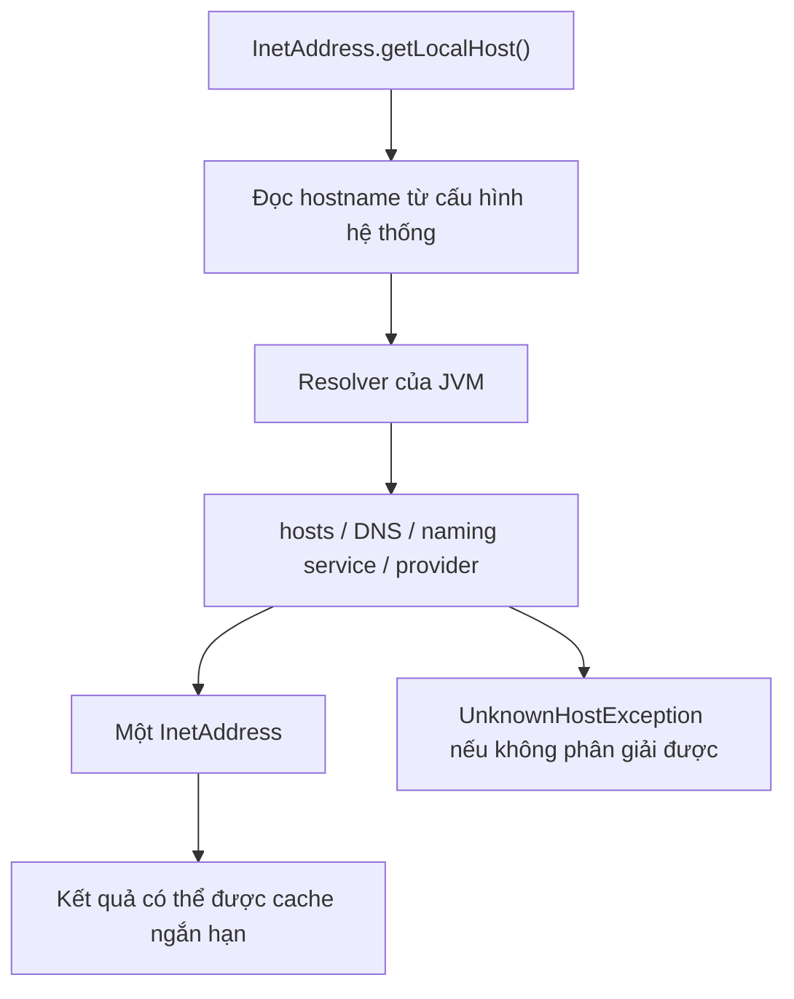

# getLocalHost() và getLoopbackAddress(): phân biệt cấu hình hostname với địa chỉ loopback

> **Chương:** Hợp đồng `InetAddress` — **mô-đun:** `JAVA_VERSION_JAVA18`. Bài học phân biệt địa chỉ mà JVM tìm được cho hostname của máy với địa chỉ loopback luôn trỏ về chính máy cục bộ. Hai API này vẫn được hỗ trợ trên JDK hiện đại; phần liên hệ resolver provider sử dụng SPI có từ Java 18.

`InetAddress.getLocalHost()` và `InetAddress.getLoopbackAddress()` đều trả về một `InetAddress`, nhưng chúng trả lời hai câu hỏi khác nhau:

- **`getLocalHost()`:** hostname hệ thống của máy này phân giải thành địa chỉ IP nào?
- **`getLoopbackAddress()`:** địa chỉ loopback nào có thể dùng để nói chuyện với chính máy này?

Nếu dùng nhầm, ứng dụng có thể bind server vào loopback trong khi mong muốn nhận kết nối từ máy khác, hoặc dùng địa chỉ của hostname hệ thống như thể đó là địa chỉ mạng duy nhất của máy.

## 1. Mục tiêu học tập

Sau bài này, bạn có thể:

1. Giải thích `getLocalHost()` lấy hostname hệ thống rồi phân giải thành địa chỉ.
2. Phân biệt hostname hệ thống, `localhost`, loopback và địa chỉ của từng network interface.
3. Dùng `getLoopbackAddress()` khi ứng dụng chỉ cần giao tiếp nội bộ trên cùng máy.
4. Dùng `NetworkInterface` để liệt kê địa chỉ IPv4/IPv6 thực sự gắn với interface.
5. Hiểu cache, resolver provider và lý do `getLocalHost()` có thể trả kết quả khác giữa máy host, VM và container.
6. Chọn đúng địa chỉ khi bind server: loopback, một interface cụ thể hoặc wildcard.

## 2. Hợp đồng hai API

| API | Hợp đồng | Có cần hostname lookup? | Kết quả |
|---|---|---|---|
| `InetAddress.getLocalHost()` | Lấy tên host từ cấu hình hệ thống, rồi phân giải tên đó thành `InetAddress` | Có thể cần; kết quả phân giải có thể được cache trong thời gian ngắn | Một địa chỉ của local host |
| `InetAddress.getLoopbackAddress()` | Trả về địa chỉ loopback | Không cần phân giải hostname `localhost` | Một địa chỉ loopback IPv4 hoặc IPv6 |

`getLocalHost()` ném `UnknownHostException` nếu tên host của hệ thống không phân giải được thành địa chỉ. Đừng giả định phương thức luôn tự chuyển sang loopback khi cấu hình hostname sai.

`getLoopbackAddress()` trả địa chỉ thuộc loopback: thường là `127.0.0.1` (IPv4) hoặc `::1` (IPv6). Đây là địa chỉ của interface loopback, không phải địa chỉ IP của card mạng Ethernet/Wi-Fi.

## 3. `getLocalHost()`: hostname hệ thống được phân giải

### 3.1. Đường đi của lời gọi

Về mặt hợp đồng, `getLocalHost()` thực hiện hai việc:

1. Lấy hostname của máy từ cấu hình hệ thống.
2. Dùng cơ chế resolver của JVM để phân giải hostname đó thành địa chỉ IP.



Vì vậy, kết quả phụ thuộc cấu hình tên máy của môi trường chạy. Tên hệ thống có thể được ánh xạ trong tệp `hosts`, DNS nội bộ hoặc resolver tùy biến; không có cam kết rằng nó luôn là địa chỉ public, địa chỉ interface đang gửi request hoặc địa chỉ mà máy khác có thể truy cập.

### 3.2. Ví dụ quan sát địa chỉ local host

Tạo `LocalHostExample.java`:

```java
import java.net.InetAddress;
import java.net.UnknownHostException;

public class LocalHostExample {
    public static void main(String[] args) {
        try {
            InetAddress local = InetAddress.getLocalHost();

            System.out.println("Host name: " + local.getHostName());
            System.out.println("IP:        " + local.getHostAddress());
            System.out.println("IPv4:      " +
                    (local instanceof java.net.Inet4Address));
            System.out.println("IPv6:      " +
                    (local instanceof java.net.Inet6Address));
            System.out.println("Loopback:  " + local.isLoopbackAddress());
        } catch (UnknownHostException e) {
            System.err.println(
                    "Không phân giải được hostname của máy: " + e.getMessage());
        }
    }
}
```

Chạy trên JDK 18 trở lên:

```text
java LocalHostExample.java
```

Không có một output cố định cho mọi máy. Kết quả có thể khác khi chạy trên laptop, máy chủ, VM, container hoặc khi thay đổi VPN và cấu hình hosts/DNS.

### 3.3. Những điều `getLocalHost()` không đảm bảo

- Không liệt kê tất cả địa chỉ của tất cả network interface.
- Không đảm bảo trả địa chỉ public có thể quảng bá cho client bên ngoài.
- Không đảm bảo trả địa chỉ mà socket outbound sẽ dùng khi kết nối tới một đích cụ thể.
- Không đảm bảo địa chỉ là IPv4 hay IPv6.
- Không kiểm tra dịch vụ đang lắng nghe trên địa chỉ đó.
- Không kiểm tra firewall, route, cổng TCP hoặc TLS.

Một máy nhiều card mạng (multi-homed host) có thể có nhiều địa chỉ. `getLocalHost()` chỉ trả một `InetAddress`; nếu cần danh sách địa chỉ interface, dùng `NetworkInterface.getNetworkInterfaces()`.

## 4. `getLoopbackAddress()`: địa chỉ dành cho giao tiếp trên cùng máy

Loopback là đường mạng quay trở lại chính network stack của máy hiện tại. Hai dạng thường gặp:

| Họ | Địa chỉ loopback | Ý nghĩa |
|---|---|---|
| IPv4 | `127.0.0.1` (thuộc toàn dải `127.0.0.0/8`) | Kết nối quay về máy cục bộ qua IPv4 |
| IPv6 | `::1` | Kết nối quay về máy cục bộ qua IPv6 |

`getLoopbackAddress()` trả một địa chỉ loopback mà JVM chọn. Họ địa chỉ cụ thể có thể khác theo môi trường và cấu hình; đừng viết test yêu cầu luôn là `127.0.0.1`.

### 4.1. Ví dụ

```java
import java.net.InetAddress;

public class LoopbackExample {
    public static void main(String[] args) {
        InetAddress loopback = InetAddress.getLoopbackAddress();

        System.out.println("Address:  " + loopback.getHostAddress());
        System.out.println("Loopback: " + loopback.isLoopbackAddress());
    }
}
```

Kết quả quan trọng cần kiểm chứng là `isLoopbackAddress()` trả `true`. Không cần gọi `InetAddress.getByName("localhost")` để lấy loopback nếu ý định của chương trình chỉ là chọn interface loopback.

### 4.2. So sánh với `localhost`

`localhost` là hostname. Khi gọi:

```java
InetAddress byName = InetAddress.getByName("localhost");
InetAddress loopback = InetAddress.getLoopbackAddress();

System.out.println(byName.getHostAddress());
System.out.println(loopback.getHostAddress());
```

hai kết quả thường là địa chỉ loopback, nhưng đường đi của API khác nhau:

- `getByName("localhost")` yêu cầu resolver phân giải hostname; kết quả chịu ảnh hưởng hosts, resolver, cache và provider.
- `getLoopbackAddress()` trả loopback trực tiếp, không cần tra cứu hostname.

`localhost` có thể có nhiều mapping (IPv4 và IPv6), còn `getLoopbackAddress()` chỉ trả một địa chỉ. Nếu cần quan sát toàn bộ mapping của hostname, dùng `getAllByName("localhost")`.

## 5. Liệt kê địa chỉ trên network interface

Khi câu hỏi là “máy này có những địa chỉ IP nào?”, `getLocalHost()` không đủ. Dùng `NetworkInterface` để liệt kê interface và các địa chỉ gắn với từng interface.

Tạo `ListInterfaceAddresses.java`:

```java
import java.net.InetAddress;
import java.net.NetworkInterface;
import java.net.SocketException;
import java.util.Enumeration;

public class ListInterfaceAddresses {
    public static void main(String[] args) throws SocketException {
        Enumeration<NetworkInterface> interfaces =
                NetworkInterface.getNetworkInterfaces();

        if (interfaces == null) {
            System.out.println("Không có network interface để liệt kê.");
            return;
        }

        while (interfaces.hasMoreElements()) {
            NetworkInterface network = interfaces.nextElement();

            System.out.printf("%s (%s), up=%s, loopback=%s%n",
                    network.getName(),
                    network.getDisplayName(),
                    network.isUp(),
                    network.isLoopback());

            Enumeration<InetAddress> addresses =
                    network.getInetAddresses();
            while (addresses.hasMoreElements()) {
                InetAddress address = addresses.nextElement();
                String family = address instanceof java.net.Inet4Address
                        ? "IPv4"
                        : address instanceof java.net.Inet6Address
                            ? "IPv6"
                            : "IP";

                System.out.printf("  %-4s %s%n",
                        family, address.getHostAddress());
            }
        }
    }
}
```

Chạy:

```text
java ListInterfaceAddresses.java
```

Một máy có thể có interface Ethernet, Wi-Fi, VPN, bridge/container, loopback và interface ảo. Danh sách này phản ánh trạng thái của môi trường tại thời điểm gọi; interface có thể down, địa chỉ có thể thay đổi và quyền truy cập hệ thống có thể ảnh hưởng kết quả.

Không phải mọi địa chỉ liệt kê được đều có thể truy cập từ bên ngoài. Địa chỉ private, link-local, loopback và địa chỉ trong network namespace có phạm vi sử dụng khác nhau. Đặc biệt, địa chỉ loopback của container trỏ về chính container đó, không tự động trỏ về host.

## 6. Liên hệ resolver provider từ Java 18

JEP 418 bổ sung `InetAddressResolverProvider` và `InetAddressResolver` từ Java 18. `getLocalHost()` cần tên host hệ thống rồi phân giải tên đó; do đó đường phân giải hostname có thể đi qua resolver được cài cho JVM, tùy trạng thái cache và cách triển khai resolver.

Trong `InetAddressResolverProvider.Configuration` có phương thức:

- `lookupLocalHostName()` đọc hostname local từ cấu hình hệ thống.
- `builtinResolver()` trả về resolver tích hợp của JDK để provider có thể ủy quyền.

Hai thao tác có vai trò khác nhau:

| API | Mục đích | Tra cứu hostname? |
|---|---|---|
| `Configuration.lookupLocalHostName()` | Lấy tên local từ cấu hình hệ thống khi xây dựng resolver tùy biến | Không tự phân giải tên thành IP |
| `InetAddress.getLocalHost()` | Lấy tên local rồi phân giải thành địa chỉ | Có thể gọi resolver |
| `InetAddress.getLoopbackAddress()` | Lấy địa chỉ loopback | Không cần resolver hostname |

Nếu viết resolver provider, hãy dùng `Configuration.lookupLocalHostName()` khi cần biết hostname hệ thống. Tránh gọi `InetAddress.getLocalHost()` từ quá trình khởi tạo provider nếu điều đó có thể kích hoạt lại resolver đang được cài đặt và tạo vòng phụ thuộc.

Cache của `InetAddress` và cache ngắn hạn cho kết quả local host có thể làm cho các lần gọi liên tiếp không kích hoạt lookup mới. Không lấy số lần log trong provider làm số lần chính xác mà ứng dụng gọi `getLocalHost()`.

## 7. Chọn địa chỉ khi bind server

Chọn địa chỉ bind dựa trên **ai được phép kết nối tới server**:

| Ý định | Cách bind | Kết quả mong muốn |
|---|---|---|
| Chỉ cho tiến trình trên cùng máy truy cập | Bind vào `InetAddress.getLoopbackAddress()` | Chỉ truy cập qua loopback của máy/namespace hiện tại |
| Chỉ nhận kết nối qua một interface cụ thể | Bind vào địa chỉ IP đã chọn từ `NetworkInterface` | Giới hạn vào địa chỉ interface đó |
| Nhận kết nối qua các interface phù hợp | Bind wildcard bằng `new InetSocketAddress(port)` | Bind vào địa chỉ wildcard; hành vi dual-stack phụ thuộc nền tảng/cấu hình socket |

Ví dụ bind local-only:

```java
import java.net.InetAddress;
import java.net.InetSocketAddress;
import java.net.ServerSocket;
import java.net.Socket;

public class LocalOnlyServer {
    public static void main(String[] args) throws Exception {
        int port = 8080;
        InetAddress loopback = InetAddress.getLoopbackAddress();

        try (ServerSocket server = new ServerSocket()) {
            server.bind(new InetSocketAddress(loopback, port));
            System.out.println("Listening on " +
                    server.getLocalSocketAddress());
            try (Socket client = server.accept()) {
                System.out.println("Accepted local client: " +
                        client.getRemoteSocketAddress());
            }
        }
    }
}
```

Bind vào loopback có nghĩa là client từ máy khác không thể kết nối trực tiếp tới socket đó qua interface mạng thông thường. Đây thường là lựa chọn đúng cho dịch vụ chỉ dành cho local development hoặc local agent.

Nếu dùng `getLocalHost()` để bind, socket có thể chỉ lắng nghe trên một địa chỉ được phân giải từ hostname hệ thống. Nó không tự động lắng nghe trên tất cả địa chỉ của máy. Nếu cần wildcard, dùng `new InetSocketAddress(port)`; nếu cần một interface cụ thể, chọn địa chỉ của interface đó.

Wildcard bind và dual-stack có chi tiết phụ thuộc hệ điều hành/socket configuration. Kiểm tra thực tế bằng `ServerSocket.getLocalSocketAddress()` và thử kết nối từ các họ địa chỉ mà ứng dụng cần hỗ trợ.

## 8. Những tình huống dễ gây nhầm

| Hiện tượng | Cách hiểu đúng |
|---|---|
| `getLocalHost()` trả `127.0.1.1` hoặc loopback trên một Linux host | Hostname hệ thống có thể được ánh xạ vào loopback trong cấu hình hosts; đây không nhất thiết là lỗi API. |
| `getLocalHost()` trả IP khác IP public | Resolver trả địa chỉ theo cấu hình local; IP public/NAT có thể không được gán trực tiếp lên interface. |
| `getLocalHost()` ném `UnknownHostException` | Tên host hệ thống không phân giải được; kiểm tra hostname, hosts, DNS/VPN và resolver. |
| `getLoopbackAddress()` trả IPv6 | JVM chọn loopback IPv6; ứng dụng không nên giả định luôn là IPv4. |
| `localhost` và `getLoopbackAddress()` khác họ địa chỉ | `localhost` được resolver phân giải, còn API loopback trả một địa chỉ trực tiếp; hai đường đi có thể khác. |
| Container trả hostname hoặc IP khác host | Container có hostname, interfaces và network namespace riêng; địa chỉ local trong container không nhất thiết là địa chỉ host. |
| Bind vào địa chỉ từ `getLocalHost()` nhưng client ngoài không truy cập được | Địa chỉ có thể chỉ thuộc một interface nội bộ, private hoặc loopback; kiểm tra bind address, route, firewall và NAT. |

## 9. Checklist chẩn đoán ngắn

Khi ứng dụng báo “không tìm được địa chỉ máy local” hoặc “server chỉ truy cập được từ máy chạy”:

1. In `getLocalHost().getHostName()` và `getHostAddress()`, xử lý `UnknownHostException`.
2. In `getLoopbackAddress().getHostAddress()` và xác nhận `isLoopbackAddress()` là `true`.
3. Liệt kê `NetworkInterface`, kiểm tra tên, trạng thái up và các địa chỉ IPv4/IPv6.
4. Đối chiếu hostname hệ thống với hosts/DNS/VPN/container configuration.
5. Kiểm tra địa chỉ bind: loopback, interface cụ thể hay wildcard.
6. Kiểm tra cổng đang lắng nghe và đường kết nối từ đúng vị trí client.

Đừng dùng `InetAddress.isReachable()` như phép thử thay thế cho việc mở TCP tới cổng ứng dụng. Khả năng reachability ở tầng mạng và khả năng kết nối tới một socket cụ thể là hai việc khác nhau.

## 10. Bài tập tự kiểm tra

1. `getLocalHost()` lấy dữ liệu từ đâu và vì sao nó có thể cần resolver?
2. `getLoopbackAddress()` khác `getByName("localhost")` ở điểm nào?
3. Vì sao `getLocalHost()` không phải cách liệt kê tất cả IP của máy?
4. Một ứng dụng chỉ cần nhận request từ chính máy chạy nó. Nên bind vào địa chỉ nào?
5. Một ứng dụng cần nhận request qua mọi interface. Vì sao bind vào kết quả `getLocalHost()` có thể không đáp ứng yêu cầu?
6. Vì sao hostname và địa chỉ local trong container có thể khác host vật lý?
7. `InetAddressResolverProvider.Configuration.lookupLocalHostName()` hữu ích thế nào khi viết resolver provider Java 18+?
8. Nếu `getLocalHost()` ném `UnknownHostException`, cần kiểm tra những cấu hình nào trước?

**Tiêu chí hoàn thành:** Bạn có thể giải thích hostname hệ thống được phân giải thành một địa chỉ như thế nào, phân biệt loopback với địa chỉ interface, liệt kê được địa chỉ máy bằng `NetworkInterface` và chọn bind address phù hợp với phạm vi client.

## 11. Tài liệu chuẩn

- [InetAddress — Java SE 27 API](https://docs.oracle.com/en/java/javase/27/docs/api/java.base/java/net/InetAddress.html): hợp đồng `getLocalHost()`, `getLoopbackAddress()` và `isLoopbackAddress()`.
- [InetAddress — Java SE 18 API](https://docs.oracle.com/en/java/javase/18/docs/api/java.base/java/net/InetAddress.html): đối chiếu các API có trong baseline Java 18.
- [NetworkInterface — Java SE 27 API](https://docs.oracle.com/en/java/javase/27/docs/api/java.base/java/net/NetworkInterface.html): liệt kê interface và địa chỉ được gắn.
- [InetAddressResolverProvider.Configuration — Java SE 27 API](https://docs.oracle.com/en/java/javase/27/docs/api/java.base/java/net/spi/InetAddressResolverProvider.Configuration.html): `lookupLocalHostName()` và `builtinResolver()`, có từ Java 18.
- [JEP 418 — Internet-Address Resolution SPI](https://openjdk.org/jeps/418): resolver provider được bổ sung từ Java 18.
