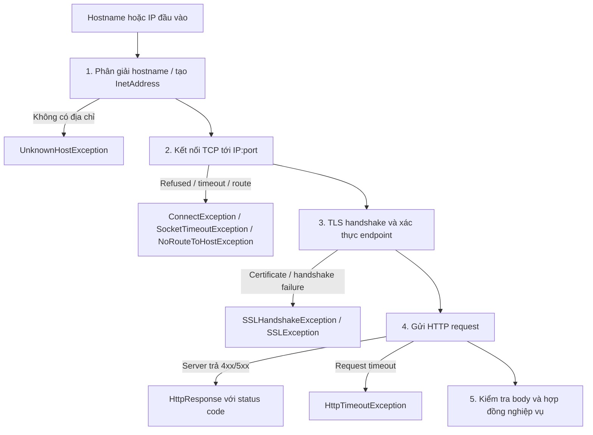

# UnknownHostException: phân biệt lỗi phân giải với lỗi xảy ra sau khi đã có địa chỉ

> **Chương:** Hợp đồng `InetAddress` — **mô-đun:** `JAVA_VERSION_JAVA18`. Bài học giúp đọc đúng `UnknownHostException` trong các API mạng Java, xác định nó phát sinh ở bước nào và phân biệt với lỗi kết nối TCP, TLS hoặc HTTP. Các ví dụ dùng API có từ Java 18 và vẫn áp dụng trên JDK hiện đại.

Khi một ứng dụng báo `UnknownHostException`, cách hiểu thường gặp là “DNS không tìm thấy máy chủ”. Cách hiểu đó chưa đủ chính xác. Ngoại lệ này thường xuất hiện khi Java không có địa chỉ cho một hostname, nhưng nó cũng có thể xuất hiện khi một endpoint socket vẫn đang ở trạng thái **unresolved**, hoặc khi dữ liệu byte truyền cho `InetAddress.getByAddress` không có độ dài hợp lệ. Ngược lại, một khi đã có địa chỉ IP và bắt đầu kết nối, lỗi thường thuộc nhóm TCP, TLS hoặc giao thức ứng dụng.

Muốn xử lý đúng, cần tìm **API nào ném ngoại lệ**, **đầu vào ở dạng hostname hay IP đã biết**, và **chương trình đã đi tới bước nào**. Không nên phân loại lỗi chỉ dựa trên chuỗi thông báo.

## 1. Mục tiêu học tập

Sau bài này, bạn có thể:

1. Giải thích `UnknownHostException` là một `IOException` và nhận diện các tình huống API Java có thể ném nó.
2. Phân biệt lỗi hostname lookup với endpoint chưa được resolve và dữ liệu IP byte không hợp lệ.
3. Phân biệt `UnknownHostException` với lỗi kết nối TCP, timeout, TLS và HTTP.
4. Dùng `InetAddress.getAllByName` để tách bước phân giải tên khỏi bước kết nối.
5. Hiểu negative DNS cache và vì sao sửa hostname/hosts chưa chắc làm kết quả trong JVM đổi ngay.
6. Xây dựng quy trình chẩn đoán dựa trên bằng chứng tại từng lớp mạng.

## 2. UnknownHostException nói điều gì?

`java.net.UnknownHostException` kế thừa `java.io.IOException`. Hợp đồng tổng quát của nó là báo rằng địa chỉ IP của một host không thể được xác định. Tuy nhiên, ngoại lệ này không tự giải thích nguyên nhân gốc:

- Tên không tồn tại hoặc không có bản ghi địa chỉ phù hợp.
- Resolver không truy cập được, DNS/VPN/hosts có vấn đề hoặc môi trường mạng chưa sẵn sàng.
- Resolver tùy biến không thể phân giải tên và báo `UnknownHostException`.
- Một thao tác socket nhận `InetSocketAddress` chưa được resolve.
- `InetAddress.getByAddress` nhận mảng byte có độ dài không phải 4 hoặc 16.

Vì vậy, **đừng kết luận ngay rằng tên miền chắc chắn không tồn tại**. Ngoại lệ có thể phản ánh trạng thái tạm thời của resolver hoặc hợp đồng đầu vào của một API khác.

### 2.1. Những API có thể ném UnknownHostException

| API/tình huống | Ý nghĩa |
|---|---|
| `InetAddress.getByName(host)` | Không xác định được địa chỉ cho hostname đầu vào |
| `InetAddress.getAllByName(host)` | Không tìm được tập địa chỉ phù hợp cho hostname |
| `InetAddress.getLocalHost()` | Không phân giải được hostname của máy cục bộ |
| `InetAddress.getByAddress(bytes)` | Mảng byte không có độ dài 4 hoặc 16 |
| `InetAddress.getByAddress(host, bytes)` | Độ dài byte không hợp lệ; hostname không được xác minh |
| `Socket.connect(unresolvedEndpoint, timeout)` | Endpoint `InetSocketAddress` chưa có địa chỉ IP |

Các trường hợp trên không cùng một nguyên nhân. Ví dụ, `getByAddress(new byte[8])` không tra cứu DNS nhưng vẫn ném `UnknownHostException` vì dữ liệu địa chỉ không hợp lệ.

## 3. Phân biệt lỗi theo từng giai đoạn

Một kết nối HTTPS trực tiếp thường đi qua các bước:



Sơ đồ giả định client kết nối trực tiếp. Nếu dùng proxy, service mesh hoặc gateway, điểm phân giải tên và điểm kết thúc TCP/TLS có thể khác. Dù vậy, nguyên tắc chẩn đoán vẫn là xác định lớp phát sinh lỗi.

| Lớp | Thành công chứng minh | Lỗi thường gặp |
|---|---|---|
| Phân giải tên | JVM có thể lấy một hoặc nhiều IP cho hostname tại thời điểm đó | `UnknownHostException` |
| TCP | Kết nối được tới địa chỉ IP và cổng cụ thể | `ConnectException`, `SocketTimeoutException`, `NoRouteToHostException` |
| TLS | Bắt tay và xác thực endpoint bảo mật thành công theo cấu hình client | `SSLHandshakeException`, `SSLException` |
| HTTP | Server HTTP đã trả phản hồi cho request | Status `4xx`/`5xx`, hoặc lỗi I/O/timeout |
| Nghiệp vụ | Response thỏa hợp đồng dữ liệu và điều kiện của ứng dụng | Sai schema, trạng thái nghiệp vụ hoặc dữ liệu |

HTTP `404` hoặc `503` không phải `UnknownHostException`: server HTTP đã trả một phản hồi. Tương tự, TCP connection refused không có nghĩa hostname không phân giải được; nhiều trường hợp ứng dụng đã có IP và nhận phản hồi từ chối ở cổng đích.

## 4. Lỗi phân giải hostname

### 4.1. Tách riêng bước lookup

Khi đầu vào là hostname, dùng `getAllByName` để quan sát việc phân giải:

```java
import java.net.InetAddress;
import java.net.UnknownHostException;

public class ResolveHost {
    public static void main(String[] args) {
        if (args.length != 1 || args[0].isBlank()) {
            throw new IllegalArgumentException("Cần hostname không rỗng");
        }

        String host = args[0];
        try {
            InetAddress[] addresses = InetAddress.getAllByName(host);
            System.out.println("Resolve OK: " + host);
            for (InetAddress address : addresses) {
                System.out.println(address.getHostAddress());
            }
        } catch (UnknownHostException e) {
            System.err.println("Resolve failed: " + host);
            System.err.println("Reason: " + e.getMessage());
        }
    }
}
```

Chạy:

```text
java ResolveHost.java localhost
java ResolveHost.java example.com
java ResolveHost.java no-such-host.invalid
```

`localhost` thường được cấu hình cục bộ. `example.com` cần môi trường có khả năng phân giải tên ngoài. Miền `.invalid` được dành riêng cho tên không hợp lệ và phù hợp làm ví dụ, nhưng resolver tùy biến vẫn có thể áp dụng chính sách riêng. Không dùng kết quả IP cụ thể của một hostname công cộng làm kỳ vọng cố định.

### 4.2. UnknownHostException không nhất thiết là DNS NXDOMAIN

Java phân giải tên qua resolver được chọn cho JVM. Resolver mặc định có thể dựa trên cấu hình hệ điều hành, tệp hosts và dịch vụ tên; từ Java 18 có thể có `InetAddressResolverProvider` tùy biến. Do đó, `UnknownHostException` có thể xuất hiện khi:

- hostname bị gõ sai hoặc không có bản ghi A/AAAA phù hợp;
- tệp hosts không có mapping mong muốn;
- DNS server không phản hồi hoặc không truy cập được;
- VPN, DNS search domain hoặc network namespace chưa được thiết lập;
- provider tùy biến báo không phân giải được tên;
- JVM đang giữ kết quả lỗi trong negative cache.

Ngoại lệ không cung cấp bằng chứng đủ để phân biệt NXDOMAIN, timeout DNS, lỗi cấu hình hosts hay lỗi backend. Hãy đối chiếu thông báo, cause nếu có, log resolver và phép thử từ đúng môi trường chạy ứng dụng.

### 4.3. IP literal có thể không cần hostname lookup

`InetAddress.getByName("192.0.2.10")` hoặc `getByName("2001:db8::10")` có thể phân tích IP literal trực tiếp. Khi chuỗi là literal hợp lệ, không cần forward hostname lookup. Nhưng IP literal sai định dạng không nên được coi là hostname hợp lệ hoặc được dùng như cách validate IP.

Nếu chương trình đã có byte địa chỉ, `getByAddress` tạo đối tượng trực tiếp. Lưu ý API này có thể ném `UnknownHostException` vì độ dài byte sai — một trường hợp không liên quan tới DNS.

## 5. Endpoint unresolved cũng có thể dẫn đến UnknownHostException

`InetSocketAddress` có trạng thái **resolved** và **unresolved**:

- `new InetSocketAddress(host, port)` cố gắng phân giải hostname khi tạo endpoint. Nếu không phân giải được, constructor có thể tạo endpoint unresolved; kiểm tra bằng `isUnresolved()`.
- `InetSocketAddress.createUnresolved(host, port)` chủ động tạo endpoint chưa phân giải, không tra cứu tên tại thời điểm tạo.
- `new InetSocketAddress(InetAddress, port)` tạo endpoint từ địa chỉ đã có.

### 5.1. Socket.connect với endpoint unresolved

`Socket.connect(SocketAddress, timeout)` yêu cầu endpoint có địa chỉ. Nếu endpoint là `InetSocketAddress` unresolved, thao tác ném `UnknownHostException`. Đây là lỗi do endpoint chưa có IP để kết nối; nó không có nghĩa `connect` vừa thực hiện một DNS lookup thành công rồi bị TCP từ chối.

```java
import java.net.InetSocketAddress;
import java.net.Socket;
import java.net.UnknownHostException;

public class UnresolvedEndpoint {
    public static void main(String[] args) {
        InetSocketAddress endpoint =
                InetSocketAddress.createUnresolved("api.example.test", 443);

        System.out.println("Unresolved: " + endpoint.isUnresolved()); // true

        try (Socket socket = new Socket()) {
            socket.connect(endpoint, 2_000);
        } catch (UnknownHostException e) {
            System.err.println(
                    "Endpoint chưa có IP để kết nối: " + e.getMessage());
        } catch (java.io.IOException e) {
            System.err.println("Lỗi I/O khi kết nối: " + e);
        }
    }
}
```

Muốn dùng `Socket` trực tiếp, hãy phân giải hostname trước và tạo endpoint bằng một `InetAddress`:

```java
InetAddress[] addresses = InetAddress.getAllByName("api.example.test");
InetSocketAddress endpoint =
        new InetSocketAddress(addresses[0], 443);

try (Socket socket = new Socket()) {
    socket.connect(endpoint, 2_000);
}
```

Đây chỉ là ví dụ kết nối TCP tới địa chỉ đầu tiên. Ứng dụng thực tế cần xử lý nhiều địa chỉ, timeout tổng và fallback nếu phù hợp.

### 5.2. SocketChannel có ngoại lệ khác

Với NIO `SocketChannel.connect`, truyền `InetSocketAddress` unresolved sẽ gây `java.nio.channels.UnresolvedAddressException` (ngoại lệ unchecked), không phải `UnknownHostException`. Cùng một lỗi trạng thái endpoint nhưng API khác có thể dùng loại ngoại lệ khác nhau; hãy đọc đúng hợp đồng phương thức đang gọi.

## 6. UnknownHostException từ getByAddress: lỗi độ dài byte

`InetAddress.getByAddress(byte[])` không phân giải hostname. Nó tạo đối tượng từ byte IP:

- 4 byte → `Inet4Address`;
- 16 byte → `Inet6Address`;
- độ dài khác → `UnknownHostException`.

Ví dụ:

```java
import java.net.InetAddress;
import java.net.UnknownHostException;

public class InvalidAddressBytes {
    public static void main(String[] args) {
        byte[] invalid = new byte[8];
        try {
            InetAddress.getByAddress(invalid);
        } catch (UnknownHostException e) {
            System.out.println("Độ dài byte IP không hợp lệ: " +
                    invalid.length);
        }
    }
}
```

Đây là lỗi dữ liệu đầu vào, không phải lỗi DNS. Nếu dữ liệu đến từ packet hoặc file nhị phân, kiểm tra offset, length và network byte order trước khi tạo địa chỉ. Không cố khắc phục bằng cách thay DNS server.

## 7. Sau khi đã có IP: các lỗi TCP thường gặp

Khi `InetAddress` đã có, kết nối TCP tới địa chỉ/cổng vẫn có thể thất bại.

| Ngoại lệ | Ý nghĩa thường gặp | Hướng kiểm tra |
|---|---|---|
| `ConnectException: Connection refused` | Điểm cuối từ chối kết nối; thường không có listener ở cổng đó hoặc có chính sách chủ động từ chối | Kiểm tra host/IP, port, listener, firewall và service |
| `SocketTimeoutException` trong `connect` | Không thiết lập kết nối trong thời hạn cho phép | Kiểm tra route, firewall, packet loss, backend và timeout |
| `NoRouteToHostException` | Network stack báo không có đường tới host hoặc lỗi mạng tương ứng | Kiểm tra route, gateway, subnet, VPN và firewall |
| `BindException` | Lỗi bind local address/port, ví dụ cổng đã dùng hoặc địa chỉ không gắn với máy | Kiểm tra local port, bind address và interface |
| `SocketException` khác | Lỗi socket/network tổng quát | Đọc message/cause và trạng thái socket |

Ví dụ phân biệt lookup và TCP. Đây là phần thân xử lý trong `main`; các kiểu `InetAddress`, `Socket` và `InetSocketAddress` thuộc package `java.net`:

```java
InetAddress[] addresses = InetAddress.getAllByName("localhost");

for (InetAddress address : addresses) {
    try (java.net.Socket socket = new java.net.Socket()) {
        socket.connect(
                new java.net.InetSocketAddress(address, 8000), 1_500);
        System.out.println("TCP OK: " + address.getHostAddress());
    } catch (java.net.SocketTimeoutException e) {
        System.out.println("TCP timeout: " + address.getHostAddress());
    } catch (java.net.ConnectException e) {
        System.out.println("TCP refused: " + address.getHostAddress());
    }
}
```

Nếu `getAllByName` thành công nhưng cả hai kết nối bị từ chối, lỗi nằm ở bước TCP/cổng đích chứ không phải bước hostname lookup.

## 8. Sau TCP: TLS và HTTP không phải lỗi phân giải tên

### 8.1. TLS handshake

Nếu TCP kết nối được nhưng chứng chỉ không đáng tin, hostname không khớp SAN hoặc hai phía không thống nhất được tham số TLS, client có thể ném `SSLHandshakeException` hoặc `SSLException`. Lúc này đã có đường kết nối tới một điểm cuối; cần kiểm tra chứng chỉ, truststore, hostname URL, SNI, thời gian hệ thống và cấu hình TLS.

Không tắt xác minh chứng chỉ hoặc hostname để “sửa” `UnknownHostException`. Hai vấn đề thuộc các giai đoạn khác nhau.

### 8.2. HTTP status và timeout

Với `HttpClient`:

- HTTP `404`, `401`, `503` thường được trả dưới dạng `HttpResponse` với status code; chúng không phải `UnknownHostException`.
- Timeout toàn bộ request có thể phát sinh `HttpTimeoutException`.
- Lỗi thiết lập kết nối có thể phát sinh `HttpConnectTimeoutException`.
- Lỗi DNS, proxy, socket hoặc TLS có thể được bọc trong một `IOException`; đọc cause chain để tìm lỗi gốc.

Ví dụ kiểm tra status. Đoạn dưới là phần xử lý response sau khi `client` và `request` đã được tạo:

```java
HttpResponse<String> response =
        client.send(request, HttpResponse.BodyHandlers.ofString());

System.out.println("HTTP status: " + response.statusCode());
if (response.statusCode() == 503) {
    System.out.println("Server đã phản hồi nhưng đang báo chưa sẵn sàng.");
}
```

Mã `503` cho biết server HTTP đã trả phản hồi; cần kiểm tra readiness và phụ thuộc dịch vụ. Nó không chứng minh DNS bị lỗi.

## 9. Cache kết quả thành công và thất bại

`InetAddress` cache cả lookup thành công và lookup thất bại. Negative cache có thể khiến một hostname vừa được sửa vẫn tiếp tục ném `UnknownHostException` trong một khoảng thời gian.

| Security property | Ý nghĩa |
|---|---|
| `networkaddress.cache.ttl` | Thời gian cache kết quả phân giải thành công, tính bằng giây |
| `networkaddress.cache.negative.ttl` | Thời gian cache kết quả phân giải thất bại, tính bằng giây |
| `networkaddress.cache.stale.ttl` | Trên JDK hỗ trợ, chính sách dùng kết quả thành công cũ khi làm mới thất bại |

Đây là **Java security properties**, không phải các system properties thông thường. Không giả định `-Dnetworkaddress.cache.negative.ttl=0` hoặc `System.setProperty` sẽ cấu hình được cache. Thiết lập qua file security properties/cấu hình bảo mật theo đúng JDK và thực hiện trước lookup đầu tiên.

Khi chẩn đoán:

1. Kiểm tra hostname, hosts, DNS, VPN và resolver provider.
2. Ghi nhận thời điểm lỗi đầu tiên và thời gian từ lần thay đổi cấu hình.
3. Xác minh security properties và trạng thái JVM; nếu cần kiểm tra thay đổi cấu hình, dùng tiến trình mới.
4. Không kết luận cache âm là nguyên nhân duy nhất nếu chưa có bằng chứng từ log/cấu hình.

## 10. Quy trình chẩn đoán theo bằng chứng

Khi ứng dụng báo lỗi mạng, đi theo thứ tự:

1. **Xác định API ném lỗi:** `getByName`, `getAllByName`, `getLocalHost`, `getByAddress`, `Socket.connect` hay client HTTP?
2. **Kiểm tra kiểu đầu vào:** hostname, IP literal, byte array hay `InetSocketAddress` unresolved?
3. **Tách lookup:** nếu là hostname, gọi `getAllByName` trong cùng JVM/môi trường và ghi IP nhận được. Không log thông tin nhạy cảm.
4. **Tách TCP:** dùng IP đã resolve và thử đúng cổng với timeout; nếu có nhiều IP, ghi nhận kết quả từng IP.
5. **Tách TLS:** kiểm tra hostname URL, SAN, chuỗi CA, SNI và handshake.
6. **Tách HTTP:** quan sát status, redirect, header và body theo hợp đồng endpoint.
7. **Kiểm tra cache và hạ tầng:** negative cache, hosts, DNS, VPN, proxy, container/network namespace.

### Bảng quyết định nhanh

| Bằng chứng quan sát | Nhóm nguyên nhân nên điều tra trước |
|---|---|
| `getAllByName(host)` ném `UnknownHostException` | Resolver, hostname, hosts/DNS, provider, cache âm |
| `getAllByName` trả IP, `Socket.connect` báo `Connection refused` | Listener, port, firewall hoặc service đích |
| `getAllByName` trả IP, `Socket.connect` timeout | Route, firewall, packet loss, backend hoặc timeout |
| TCP thành công, TLS handshake lỗi | Certificate, hostname verification, truststore, SNI, TLS config |
| TLS thành công, HTTP trả `401`/`404`/`503` | Authentication, route/path, readiness hoặc logic server |
| `getByAddress` ném `UnknownHostException` với mảng 8 byte | Độ dài dữ liệu IP không hợp lệ |
| `Socket.connect` ném `UnknownHostException` với endpoint unresolved | Endpoint chưa có địa chỉ IP |

## 11. Bài tập tự kiểm tra

1. `UnknownHostException` có luôn chứng minh DNS server trả NXDOMAIN không? Giải thích.
2. Vì sao `InetAddress.getByAddress(new byte[8])` có thể ném `UnknownHostException` dù không gọi DNS?
3. `InetSocketAddress.createUnresolved` tạo trạng thái gì? `Socket.connect` phản ứng ra sao?
4. `SocketChannel.connect` dùng ngoại lệ nào với endpoint unresolved?
5. Hostname phân giải được nhưng TCP connection refused. Nên kiểm tra lớp nào?
6. TCP thành công nhưng TLS báo hostname mismatch. Vì sao đây không phải lỗi DNS?
7. HTTP `503` khác `UnknownHostException` như thế nào?
8. Negative cache có thể khiến lỗi tiếp tục xuất hiện sau khi sửa hosts/DNS ra sao?

**Tiêu chí hoàn thành:** Bạn có thể lần theo ngoại lệ về đúng API và giai đoạn, phân biệt lỗi hostname lookup với lỗi dữ liệu hoặc endpoint unresolved, rồi chọn bước kiểm tra kế tiếp dựa trên bằng chứng thay vì suy đoán từ tên ngoại lệ.

## 12. Tài liệu chuẩn

- [UnknownHostException — Java SE 27 API](https://docs.oracle.com/en/java/javase/27/docs/api/java.base/java/net/UnknownHostException.html): hợp đồng và quan hệ kế thừa.
- [InetAddress — Java SE 27 API](https://docs.oracle.com/en/java/javase/27/docs/api/java.base/java/net/InetAddress.html): lookup hostname, địa chỉ literal, byte address và cache.
- [InetSocketAddress — Java SE 27 API](https://docs.oracle.com/en/java/javase/27/docs/api/java.base/java/net/InetSocketAddress.html): trạng thái resolved/unresolved và `createUnresolved`.
- [Socket — Java SE 27 API](https://docs.oracle.com/en/java/javase/27/docs/api/java.base/java/net/Socket.html): `connect`, timeout và ngoại lệ cho endpoint unresolved.
- [SocketChannel — Java SE 27 API](https://docs.oracle.com/en/java/javase/27/docs/api/java.base/java/nio/channels/SocketChannel.html): `connect` và `UnresolvedAddressException`.
- [Networking Properties — Java SE 27](https://docs.oracle.com/en/java/javase/27/docs/api/java.base/java/net/doc-files/net-properties.html): cấu hình cache phân giải tên.
- [JEP 418 — Internet-Address Resolution SPI](https://openjdk.org/jeps/418): resolver tùy biến được bổ sung từ Java 18.
