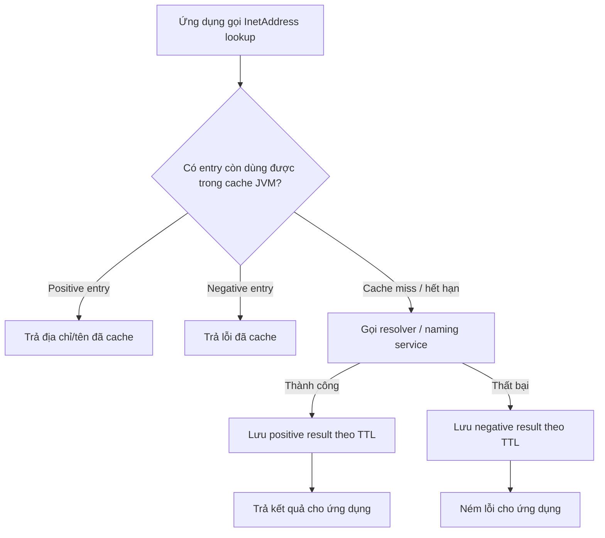

# Cache kết quả thành công và thất bại trong InetAddress

> **Chương:** Hợp đồng `InetAddress` — **mô-đun:** `JAVA_VERSION_JAVA18`. Bài học giải thích cache tên máy trong `InetAddress`, cách điều chỉnh thời gian lưu kết quả thành công/thất bại và cách xử lý kết quả cũ khi làm mới lỗi. Các security properties còn dùng trên JDK hiện đại được trình bày theo tài liệu Java SE 27; riêng `networkaddress.cache.stale.ttl` là khả năng có trong JDK mới hơn Java 18.

Một ứng dụng gọi `InetAddress.getByName("api.example.test")` nhiều lần không nhất thiết thực hiện phân giải tên nhiều lần. `InetAddress` có cache ở cấp JVM để tránh lặp việc gọi naming service, giảm độ trễ và giảm tải. Cache lưu cả kết quả thành công lẫn thất bại; vì vậy nó có thể làm ứng dụng tiếp tục dùng IP cũ sau khi DNS thay đổi, hoặc tiếp tục nhận lỗi sau khi hostname vừa được sửa.

Muốn chẩn đoán đúng, cần phân biệt cache của `InetAddress` với cache ở hệ điều hành, DNS resolver, proxy hoặc thư viện mạng khác. Đồng thời, phải cấu hình các TTL bằng **Java security properties**, không coi chúng là system properties thông thường.

## 1. Mục tiêu học tập

Sau bài này, bạn có thể:

1. Giải thích vì sao `InetAddress` cache cả kết quả phân giải thành công và thất bại.
2. Phân biệt positive cache, negative cache và stale positive result.
3. Cấu hình `networkaddress.cache.ttl` và `networkaddress.cache.negative.ttl` đúng cách.
4. Hiểu `networkaddress.cache.stale.ttl` trên JDK hỗ trợ và không nhầm nó với tính năng Java 18.
5. Phân tích ảnh hưởng của cache tới DNS thay đổi, lỗi `UnknownHostException` và resolver provider.
6. Kiểm thử cache trong JVM mới, nhận biết giới hạn của việc đo thời gian và tránh API/property nội bộ.

## 2. Vì sao InetAddress cần cache?

Mỗi lần phân giải tên có thể phải đi qua resolver của JVM, cấu hình hosts, naming service của hệ điều hành hoặc backend DNS. Những thao tác này có độ trễ và có thể thất bại tạm thời. Cache cho phép dùng lại kết quả của lần phân giải trước.

`InetAddress` cache kết quả cho cả:

- **Forward lookup:** hostname → một hoặc nhiều địa chỉ IP.
- **Reverse lookup:** địa chỉ IP → hostname.
- **Kết quả thành công:** địa chỉ hoặc tên đã tìm được.
- **Kết quả thất bại:** lần phân giải không tìm được kết quả.

`192.0.2.0/24` và `2001:db8::/32` là các dải địa chỉ dành cho tài liệu, chỉ dùng minh họa trong bài.



Sơ đồ mô tả nguyên tắc chung. Cơ chế resolver, cache nội bộ và cache bên dưới có thể khác theo JDK, hệ điều hành và provider. Một cache hit có nghĩa lời gọi hiện tại không cần truy cập naming service thêm lần nữa.

## 3. Positive cache: lưu kết quả thành công

`networkaddress.cache.ttl` quy định số giây giữ kết quả phân giải **thành công** trong cache `InetAddress`.

| Giá trị | Ý nghĩa |
|---:|---|
| Số nguyên dương, ví dụ `30` | Giữ kết quả trong số giây tương ứng |
| `0` | Không cache kết quả thành công |
| `-1` hoặc số âm khác | Cache vô hạn theo hợp đồng property |
| Không cấu hình | Dùng mặc định của implementation/JDK |

Không có một giá trị mặc định dương chung cho mọi implementation. Tài liệu Java SE mô tả mặc định là phụ thuộc implementation; hãy kiểm tra file security properties của đúng JDK được triển khai thay vì ghi cứng một con số cho mọi môi trường.

### 3.1. DNS thay đổi nhưng JVM vẫn trả IP cũ

Giả sử tại thời điểm T0, resolver trả:

```text
api.example.test -> 192.0.2.10
```

Sau đó quản trị DNS thay đổi bản ghi:

```text
api.example.test -> 192.0.2.20
```

Nếu JVM vẫn còn positive cache entry cho tên này, lời gọi tiếp theo có thể tiếp tục trả `192.0.2.10` cho tới khi entry hết hạn hoặc bị thay thế theo chính sách cache. Việc DNS authoritative đã cập nhật không buộc cache trong tiến trình Java phải đổi ngay.

Điều này quan trọng với dịch vụ có IP thay đổi khi triển khai/failover, load balancer trả nhiều địa chỉ, container/pod thay đổi thường xuyên hoặc dịch vụ nội bộ chuyển endpoint trong lúc JVM vẫn chạy lâu dài.

TTL quá dài có thể khiến ứng dụng giữ địa chỉ cũ lâu; TTL quá ngắn làm tăng số lần gọi naming service và có thể tăng độ trễ hoặc tải hệ thống.

## 4. Negative cache: lưu kết quả phân giải thất bại

`networkaddress.cache.negative.ttl` quy định số giây giữ kết quả phân giải **thất bại**. Theo tài liệu JDK hiện đại, giá trị mặc định của property này là `10` giây.

| Giá trị | Ý nghĩa |
|---:|---|
| Số nguyên dương, ví dụ `5` | Giữ lỗi phân giải trong số giây tương ứng |
| `0` | Không cache kết quả thất bại |
| `-1` hoặc số âm khác | Cache lỗi vô hạn |
| Không cấu hình | Mặc định là `10` giây theo tài liệu JDK |

### 4.1. Vì sao hostname vừa được sửa vẫn lỗi?

1. T0: ứng dụng gọi `getByName("api.example.test")` khi tên chưa tồn tại.
2. Resolver không tìm được địa chỉ; `UnknownHostException` được ném và kết quả thất bại được cache.
3. T1: quản trị viên thêm bản ghi DNS hoặc mapping hosts hợp lệ.
4. T2: ứng dụng gọi lại trong khi negative cache còn hiệu lực.
5. JVM có thể tiếp tục trả lỗi đã cache, chưa thực hiện lookup mới.
6. Sau khi entry âm hết hạn, lookup tiếp theo mới có cơ hội hỏi naming service lại.

Đây là lý do không nên kết luận rằng “DNS vẫn sai” chỉ từ một lần thử ngay sau khi sửa cấu hình.

### 4.2. Cache âm vô hạn có thể làm lỗi kéo dài

Nếu đặt `networkaddress.cache.negative.ttl=-1`, một lần phân giải thất bại có thể được giữ vô hạn trong cache của JVM. Điều này thường không phù hợp với hostname có thể xuất hiện sau khi service khởi động hoặc khi DNS được cập nhật.

Không đặt negative TTL vô hạn trừ khi mô hình vận hành thực sự yêu cầu và bạn đã đánh giá cách phục hồi. Với hệ thống có hostname động, negative TTL hữu hạn thường giúp ứng dụng thử lại sau lỗi tạm thời.

## 5. Stale positive cache trên JDK mới hơn Java 18

Một số JDK hiện đại hỗ trợ security property `networkaddress.cache.stale.ttl`. Property này cho phép giữ và dùng **kết quả thành công đã cũ** khi TTL thông thường hết hạn nhưng lần làm mới hostname không thành công.

**JDK 21+:** `networkaddress.cache.stale.ttl` được tài liệu hóa trong JDK 21 trở lên; nó không thuộc bộ networking properties được tài liệu Java 18 mô tả. Khi chạy Java 18, không giả định property này có hiệu lực.

| Giá trị | Ý nghĩa trên JDK hỗ trợ |
|---:|---|
| Số nguyên dương | Cho phép giữ stale name trong khoảng thời gian cấu hình |
| `0` hoặc không đặt | Không dùng stale names |
| Số âm | Bị bỏ qua theo hợp đồng property |

Một tên được xem là **stale** khi TTL của kết quả thành công đã hết hạn và lần lookup để làm mới không thành công. Stale cache hữu ích khi hệ thống ưu tiên tiếp tục dùng địa chỉ cũ trong một sự cố resolver tạm thời hơn là thất bại ngay.

Nếu stale TTL lớn hơn positive TTL, positive TTL trở thành chu kỳ làm mới. Ví dụ:

```properties
networkaddress.cache.ttl=30
networkaddress.cache.stale.ttl=300
```

JVM có thể thử làm mới sau mỗi 30 giây trong khi vẫn giữ kết quả cũ tối đa theo cửa sổ stale 300 giây. Nếu refresh thành công, kết quả mới thay thế kết quả cũ; nếu refresh thất bại, JDK có thể tiếp tục dùng stale entry trong thời gian được phép. Hãy kiểm tra tài liệu của đúng JDK vì mặc định stale TTL phụ thuộc implementation.

**Trade-off:** stale cache tăng khả năng chịu lỗi khi naming service tạm thời gián đoạn, nhưng có thể giữ IP đã lỗi thời. Không bật nó chỉ để che lỗi DNS; cần cân nhắc khả năng endpoint cũ đã bị thu hồi, chuyển chủ sở hữu hoặc không còn an toàn.

## 6. Đây là Java security properties, không phải system properties

Ba property:

- `networkaddress.cache.ttl`
- `networkaddress.cache.negative.ttl`
- `networkaddress.cache.stale.ttl` (JDK hỗ trợ, từ JDK mới hơn Java 18)

là **security properties**. Không cấu hình chúng bằng:

```text
java -Dnetworkaddress.cache.ttl=30 ...
```

và không dựa vào:

```java
System.setProperty("networkaddress.cache.ttl", "30");
```

Đây không phải cơ chế cấu hình đúng cho các security properties này. Hãy đặt chúng trong file `java.security` của JDK hoặc file security properties bổ sung được nạp lúc JVM khởi động.

### 6.1. Cấu hình bổ sung cho Java 18+

Tạo file `resolver-security.properties`:

```properties
networkaddress.cache.ttl=30
networkaddress.cache.negative.ttl=5
```

Chạy chương trình:

```text
java -Djava.security.properties=file:/absolute/path/resolver-security.properties ResolveHost.java api.example.test
```

`-Djava.security.properties=<URL>` nạp một file security properties bổ sung để ghi đè/bổ sung cấu hình mặc định theo cơ chế của JDK. Dùng một dấu `=` cho file bổ sung. Cú pháp hai dấu `==` có ý nghĩa thay thế toàn bộ security properties mặc định và thường không phù hợp cho ví dụ cấu hình TTL đơn lẻ.

### 6.2. Bổ sung stale TTL trên JDK hỗ trợ

Trên JDK có hỗ trợ `networkaddress.cache.stale.ttl`, có thể thêm:

```properties
networkaddress.cache.ttl=30
networkaddress.cache.negative.ttl=5
networkaddress.cache.stale.ttl=300
```

Không thêm dòng stale TTL vào cấu hình Java 18 với kỳ vọng nó có tác dụng; hãy xác minh property này trong tài liệu của JDK đích. Các security properties được áp dụng ở thời điểm khởi động/cấu hình cache; thay đổi sau khi JVM đã bắt đầu phân giải tên không phải cách thử nghiệm đáng tin cậy.

## 7. Cache JVM khác cache của hệ điều hành và DNS

Một yêu cầu phân giải tên có thể đi qua nhiều lớp cache:

| Lớp | Phạm vi | Điều khiển bởi |
|---|---|---|
| Cache InetAddress | Trong tiến trình JVM | Các security properties networkaddress.cache.* |
| Cache resolver/hệ điều hành | Theo môi trường chạy | Dịch vụ DNS client, system resolver và cấu hình hệ điều hành |
| Cache DNS recursive resolver | Nhiều client cùng sử dụng | TTL của bản ghi DNS và chính sách resolver |
| Cache trong HTTP client/proxy/service mesh | Theo thư viện hoặc thành phần mạng | Cấu hình riêng của client/proxy/mesh |

Do đó, thay TTL của `InetAddress` không xóa cache của hệ điều hành hay DNS recursive resolver. Tương tự, `nslookup` hoặc `dig` có thể cho kết quả mới trong khi JVM vẫn trả entry đã cache.

TTL của Java là chính sách cache tại lớp JVM; nó không đồng nghĩa với TTL của bản ghi DNS authoritative. Resolver hệ điều hành hoặc provider tùy biến cũng có thể có cache riêng.

## 8. Ảnh hưởng tới InetAddressResolverProvider

Từ Java 18, `InetAddressResolverProvider` có thể thay resolver được dùng trong JVM. Cache của `InetAddress` ảnh hưởng số lần resolver được gọi:

| Lần gọi | Trạng thái | Provider có thể được gọi? |
|---|---|---|
| Lookup hostname đầu tiên, cache miss | Chưa có entry | Có |
| Lookup lặp trong positive TTL | Positive cache hit | Không cần gọi lại |
| Lookup lặp trong negative TTL | Negative cache hit | Không cần gọi lại |
| Lookup sau khi entry hết hạn | Cần refresh | Có thể được gọi lại |
| Lookup stale khi refresh thất bại trên JDK hỗ trợ | Có stale positive entry | JDK có thể trả stale result theo chính sách |

Vì vậy, nếu provider ghi log hoặc đếm số lần `lookupByName` được gọi, số lần đó có thể thấp hơn số lần ứng dụng gọi `InetAddress.getByName`/`getAllByName`. Reverse lookup cũng có cache; không chỉ forward lookup mới chịu ảnh hưởng.

Cache không thay đổi hợp đồng provider, nhưng nó thay đổi thời điểm và số lần backend được hỏi. Khi kiểm thử provider, hãy dùng hostname fixture riêng và chạy mỗi kịch bản trong một JVM mới để tránh kết quả của lần trước ảnh hưởng lần sau.

## 9. Quan sát lookup lặp lại

Chương trình sau đo thời gian của từng lần gọi. Đây là công cụ quan sát, không phải phép chứng minh cache hit tuyệt đối: thời gian còn phụ thuộc resolver, OS cache, DNS, CPU và trạng thái mạng.

```java
import java.net.InetAddress;
import java.net.UnknownHostException;

public class AddressCacheProbe {
    public static void main(String[] args) {
        String host = args.length > 0 ? args[0] : "localhost";

        for (int i = 1; i <= 5; i++) {
            long start = System.nanoTime();
            try {
                InetAddress[] addresses = InetAddress.getAllByName(host);
                long elapsed = System.nanoTime() - start;

                System.out.printf(
                        "Attempt %d: %d address(es), %.3f ms%n",
                        i, addresses.length, elapsed / 1_000_000.0);
                for (InetAddress address : addresses) {
                    System.out.println("  " + address.getHostAddress());
                }
            } catch (UnknownHostException e) {
                long elapsed = System.nanoTime() - start;
                System.out.printf(
                        "Attempt %d: failed after %.3f ms (%s)%n",
                        i, elapsed / 1_000_000.0, e.getClass().getSimpleName());
            }
        }
    }
}
```

Chạy:

```text
java AddressCacheProbe.java localhost
java AddressCacheProbe.java example.com
```

Có thể thấy lần đầu chậm hơn các lần sau, nhưng đừng khẳng định chỉ từ timing rằng cache JVM chắc chắn là nguyên nhân; OS hoặc resolver cũng có cache. Để kiểm thử chính xác provider được gọi bao nhiêu lần, dùng provider thử nghiệm có bộ đếm và một hostname fixture chưa được tra cứu trong JVM đó.

## 10. Cache không có API công khai để xóa tùy ý

`InetAddress` không cung cấp API công khai chung để xóa toàn bộ cache hoặc xóa entry của một hostname cụ thể. Khi cần một tiến trình thử nghiệm sạch:

1. Dùng một JVM mới cho kịch bản mới.
2. Đặt security properties trước khi JVM thực hiện lookup đầu tiên.
3. Dùng hostname fixture khác nhau giữa các test nếu cần cô lập dữ liệu.
4. Kiểm soát cả cache của OS/resolver bên dưới nếu bài test cần quan sát backend.

Không dựa vào reflection để truy cập cache private, hoặc các property nội bộ như `sun.net.inetaddr.ttl` / `sun.net.inetaddr.negative.ttl`. Đây là chi tiết implementation/private, không phải API cấu hình chuẩn cần dùng trong mã hiện đại. Không có bảo đảm chúng tiếp tục hoạt động giữa các bản JDK.

## 11. Chọn TTL theo yêu cầu vận hành

| Nhu cầu | Hướng cân nhắc | Rủi ro cần đánh giá |
|---|---|---|
| Endpoint thay đổi thường xuyên | Positive TTL hữu hạn và phù hợp chu kỳ triển khai | TTL quá ngắn tăng lookup; quá dài giữ IP cũ |
| Hostname nội bộ ổn định | TTL dài hơn nếu dữ liệu và quy trình thay đổi có kiểm soát | Thay đổi khẩn cấp có thể chậm tới ứng dụng |
| DNS có lỗi thoáng qua | Negative TTL ngắn, hữu hạn | TTL quá ngắn có thể tạo nhiều lookup khi backend lỗi |
| Resolver chậm và cần giảm tải | Negative TTL có thể giảm lookup lặp | Lỗi tạm thời có thể được giữ lại trong cache |
| Ưu tiên tiếp tục chạy khi resolver gián đoạn | Cân nhắc stale TTL trên JDK hỗ trợ | Có thể tiếp tục dùng IP cũ không còn đúng |
| Endpoint nhạy cảm về bảo mật | TTL và stale policy phải theo threat model | Cache dài/stale có thể giữ địa chỉ đã thay đổi chủ sở hữu |

Không có một bộ TTL tối ưu cho mọi ứng dụng. Hãy xem xét thời gian DNS thay đổi, thời gian failover cần đạt, độ ổn định của resolver, khả năng thử lại và việc địa chỉ cũ còn an toàn để kết nối hay không.

Cache vô hạn có thể giảm lookup nhưng giữ kết quả lâu dài; negative cache vô hạn có thể khiến lỗi tồn tại suốt vòng đời JVM; stale cache có thể tăng khả năng chịu lỗi nhưng dùng địa chỉ đã cũ. Đừng chọn giá trị chỉ để làm một phép thử cục bộ chạy nhanh hơn.

## 12. Bài tập tự kiểm tra

1. `networkaddress.cache.ttl` điều khiển kết quả nào? Giá trị `0` và `-1` khác nhau ra sao?
2. Vì sao hostname vừa được thêm vào DNS vẫn có thể ném `UnknownHostException` trong cùng JVM?
3. `networkaddress.cache.negative.ttl` mặc định là bao nhiêu theo tài liệu JDK hiện đại?
4. Vì sao các TTL này phải được cấu hình bằng security properties thay vì `-Dnetworkaddress.cache.ttl`?
5. `networkaddress.cache.stale.ttl` làm gì khi refresh lookup thất bại? Property này có thuộc baseline Java 18 không?
6. Vì sao `dig` cho kết quả mới nhưng ứng dụng Java vẫn trả IP cũ?
7. Cache ảnh hưởng số lần `InetAddressResolverProvider.lookupByName` được gọi như thế nào?
8. Có thể dùng API công khai nào để xóa một entry `InetAddress` tùy ý?

**Tiêu chí hoàn thành:** Bạn giải thích được positive/negative/stale cache, cấu hình đúng security properties, phân biệt cache JVM với cache bên dưới và chẩn đoán được vì sao DNS thay đổi nhưng kết quả trong ứng dụng chưa đổi ngay.

## 13. Tài liệu chuẩn

- [InetAddress — Java SE 27 API](https://docs.oracle.com/en/java/javase/27/docs/api/java.base/java/net/InetAddress.html): mô tả cache thành công, thất bại và stale name.
- [Networking Properties — Java SE 27](https://docs.oracle.com/en/java/javase/27/docs/api/java.base/java/net/doc-files/net-properties.html): hợp đồng ba security properties networkaddress.cache.*.
- [Networking Properties — Java SE 18](https://docs.oracle.com/en/java/javase/18/docs/api/java.base/java/net/doc-files/net-properties.html): positive và negative cache có trong baseline Java 18.
- [InetAddressResolver — Java SE 27 API](https://docs.oracle.com/en/java/javase/27/docs/api/java.base/java/net/spi/InetAddressResolver.html): resolver SPI có từ Java 18 và ảnh hưởng tới lookup.
- [JEP 418 — Internet-Address Resolution SPI](https://openjdk.org/jeps/418): resolver provider được bổ sung trong Java 18.
