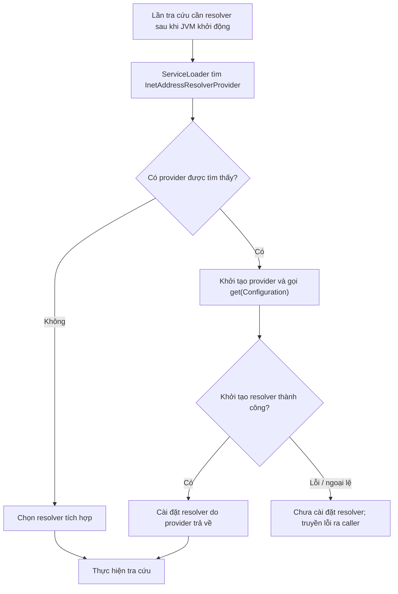

# Không có provider và provider khởi tạo lỗi: phân biệt dùng resolver tích hợp với lỗi được truyền ra

**Chương:** Resolver SPI  
**Phạm vi:** Java 18 giới thiệu Internet-Address Resolution SPI (JEP 418); hợp đồng của `java.net.spi.InetAddressResolverProvider` và `java.net.spi.InetAddressResolver` vẫn được hỗ trợ trên các JDK hiện đại.

## Mục tiêu học tập

Sau bài này, bạn có thể:

- Giải thích khi nào `InetAddress` sử dụng resolver tích hợp và khi nào thử cài đặt resolver do provider cung cấp.
- Phân biệt ba nhóm kết quả: **không tìm thấy provider**, **tìm thấy provider nhưng khởi tạo thất bại**, và **resolver đã hoạt động nhưng tra cứu tên máy thất bại**.
- Tự dựng thí nghiệm độc lập để quan sát việc ngoại lệ từ `get(Configuration)` đi ngược ra lời gọi `InetAddress.getByName(...)`.
- Chẩn đoán lỗi cấu hình `ServiceLoader` mà không nhầm chúng với việc không có provider.

## 1. Hợp đồng chọn resolver của `InetAddress`

Kể từ Java 18, `InetAddress` hỗ trợ SPI để ứng dụng cung cấp cơ chế phân giải tên máy và địa chỉ IP. `InetAddressResolverProvider` là **factory** tạo `InetAddressResolver`, còn resolver thực hiện tra cứu xuôi (hostname → IP) và ngược (IP → hostname).

Trong một lần chạy JVM, sau khi máy ảo đã hoàn tất khởi động và có lời gọi `InetAddress` đầu tiên cần thực hiện tra cứu, quá trình thiết lập resolver hệ thống diễn ra theo hợp đồng sau:

1. Dùng `ServiceLoader` với **system class loader** để tìm `InetAddressResolverProvider`.
2. **Không tìm thấy provider nào:** thiết lập resolver tích hợp của JDK làm resolver toàn hệ thống.
3. **Tìm thấy provider:** khởi tạo provider được chọn và gọi `provider.get(configuration)` để lấy resolver. Nếu thành công, resolver trả về được cài đặt cho các lần tra cứu tiếp theo.
4. **Việc khởi tạo resolver từ provider đã tìm thấy phát sinh lỗi hoặc ngoại lệ:** resolver hệ thống **không được thiết lập** ở lần thử đó; lỗi/ngoại lệ được truyền tới bên gọi thao tác `InetAddress` đã kích hoạt quá trình tra cứu.

Nếu có nhiều provider, thứ tự tìm thấy là chi tiết phụ thuộc implementation; không được giả định thứ tự hoặc kỳ vọng tự chuyển sang provider kế tiếp khi provider đã chọn hỏng.

`InetAddress` có thể sử dụng resolver tích hợp cho các thao tác tra cứu diễn ra **trước khi JVM khởi động hoàn chỉnh**. Đây là chi tiết khởi động được tài liệu API nêu riêng, không phải quy tắc khôi phục khi khởi tạo provider lỗi.

`ServiceLoader` tìm dịch vụ theo cơ chế đăng ký provider: ứng dụng dùng classpath thường đặt tệp `META-INF/services/java.net.spi.InetAddressResolverProvider` trong JAR/thư mục tài nguyên; ứng dụng có module tường minh dùng khai báo `provides ... with ...` phù hợp.

### Sơ đồ quyết định



Điểm mấu chốt là điều kiện fallback: **không tìm thấy provider** khác với **tìm thấy provider nhưng khởi tạo lỗi**. Nhánh thứ hai báo lỗi để người gọi/đơn vị vận hành phát hiện cấu hình hoặc mã provider hỏng.

## 2. So sánh các trường hợp cần phân biệt

| Trạng thái | Hành vi đúng theo API | Tín hiệu khi chẩn đoán |
| --- | --- | --- |
| Không phát hiện provider nào | Chọn resolver tích hợp của JDK | Tra cứu theo cấu hình phân giải tên của máy; có thể thành công hoặc phát sinh `UnknownHostException` tùy hostname |
| Provider được phát hiện, khởi tạo đối tượng provider thất bại | Không tự động chuyển sang resolver tích hợp như nhánh “không có provider” | `ServiceLoader` có thể báo `ServiceConfigurationError`; kiểm tra nguyên nhân gốc |
| Đối tượng provider được tạo, nhưng `get(Configuration)` ném `RuntimeException` hoặc `Error` | Không thiết lập resolver hệ thống tại lần khởi tạo đó; truyền lỗi về caller đã kích hoạt tra cứu | Stack trace đi qua bước thiết lập resolver và chứa nguyên nhân từ `get` |
| Provider khởi tạo thành công và trả về resolver | Dùng resolver đó cho các lần tra cứu sau | Kết quả theo implementation của resolver |
| Resolver đã được cài đặt nhưng không tìm thấy hostname | Lỗi **tra cứu** theo hợp đồng `lookupByName`, không phải lỗi **khởi tạo** | Thường là `UnknownHostException` |

**Lưu ý:** Một tệp dịch vụ có nội dung sai, lớp provider không tìm thấy, hoặc constructor hỏng **không tương đương** việc không đăng ký provider nào. Đây có thể là lỗi cấu hình dịch vụ, cần được điều tra thay vì mặc định coi như không có provider.

## 3. Thí nghiệm tối thiểu: hai cấu hình, hai JVM

Ví dụ dùng một chương trình tra cứu và một provider cố tình ném lỗi từ `get(Configuration)`. Không cần viết implementation `InetAddressResolver` vì bài này chỉ kiểm tra nhánh khởi tạo thất bại.

Cấu trúc thư mục ví dụ:

```text
resolver-demo/
├── src/
│   └── demo/
│       ├── Lookup.java
│       └── BrokenProvider.java
└── broken/
    └── META-INF/
        └── services/
            └── java.net.spi.InetAddressResolverProvider
```

**`src/demo/Lookup.java`**

```java
package demo;

import java.net.InetAddress;

public final class Lookup {
    public static void main(String[] args) throws Exception {
        System.out.println("BEFORE_LOOKUP");
        InetAddress address = InetAddress.getByName("localhost");
        System.out.println("RESOLVED=" + address.getHostAddress());
        System.out.println("AFTER_LOOKUP");
    }
}
```

**`src/demo/BrokenProvider.java`**

```java
package demo;

import java.net.spi.InetAddressResolver;
import java.net.spi.InetAddressResolverProvider;

public final class BrokenProvider extends InetAddressResolverProvider {
    public BrokenProvider() {
        // Constructor đơn giản để cô lập lỗi tại get(...).
    }

    @Override
    public String name() {
        return "broken-provider-demo";
    }

    @Override
    public InetAddressResolver get(Configuration configuration) {
        System.out.println("PROVIDER_GET_CALLED");
        throw new IllegalStateException("DEMO_RESOLVER_INIT_FAILED");
    }
}
```

**`broken/META-INF/services/java.net.spi.InetAddressResolverProvider`**

```text
demo.BrokenProvider
```

Tệp đăng ký chứa **tên lớp đầy đủ**, ghi bằng UTF-8; không thêm phần mở rộng `.class` hoặc `.java`. Tệp nằm dưới `broken` để ta chủ động thêm/bỏ đăng ký provider qua classpath.

### Bước 1 — Biên dịch một lần

Tại thư mục `resolver-demo`, chạy trên JDK hỗ trợ SPI này (Java 18 trở lên):

```shell
javac -d out src/demo/Lookup.java src/demo/BrokenProvider.java
```

Sau khi biên dịch, `out` chỉ chứa lớp `.class`. Việc lớp `BrokenProvider` có trên classpath **không tự đăng ký** nó thành dịch vụ: `ServiceLoader` vẫn cần metadata đăng ký tương ứng.

### Bước 2 — Không có provider: resolver tích hợp

```shell
java -cp out demo.Lookup
```

Do không có tệp đăng ký dịch vụ trong classpath của lượt chạy này, `ServiceLoader` không phát hiện `BrokenProvider`. Lời gọi tra cứu được thực hiện bằng resolver tích hợp. Ví dụ đầu ra thường gặp:

```text
BEFORE_LOOKUP
RESOLVED=127.0.0.1
AFTER_LOOKUP
```

`localhost` có thể trả về `::1` hay địa chỉ khác tùy cấu hình máy và ưu tiên IPv4/IPv6. Giá trị IP cụ thể không phải tiêu chí kiểm tra; điều cần kiểm chứng là chương trình **không in** `PROVIDER_GET_CALLED`, và việc phân giải đi theo cấu hình của resolver tích hợp.

### Bước 3 — Có provider, nhưng khởi tạo resolver lỗi

Chạy trong **một tiến trình JVM mới**, lần này thêm thư mục `broken` vào classpath:

**Windows (dấu chấm phẩy phân tách classpath):**

```shell
java -cp "out;broken" demo.Lookup
```

**Linux/macOS (dấu hai chấm phân tách classpath):**

```shell
java -cp "out:broken" demo.Lookup
```

Kết quả kỳ vọng có dạng (lược bớt stack trace):

```text
BEFORE_LOOKUP
PROVIDER_GET_CALLED
Exception in thread "main" java.lang.IllegalStateException: DEMO_RESOLVER_INIT_FAILED
    ...
```

`AFTER_LOOKUP` không được in vì `get(Configuration)` đã ném ngoại lệ. Thông báo `DEMO_RESOLVER_INIT_FAILED` do chính provider tạo ra, cho thấy quá trình khởi tạo resolver đã chạy và lỗi truyền đến bên gọi `InetAddress.getByName`. JDK **không tự âm thầm dùng resolver tích hợp để thực hiện lại lần tra cứu này**.

Cần chạy từng tình huống ở **JVM riêng**: resolver dùng bởi `InetAddress` là resolver toàn hệ thống của tiến trình và thông thường được chọn một lần khi cần tra cứu đầu tiên sau bootstrap. Chỉ đổi classpath hay tài nguyên đăng ký trong khi tiến trình đang chạy không tạo lại một thí nghiệm sạch.

## 4. Khi constructor lỗi, ngoại lệ có thể được bọc

Hãy thay constructor của `BrokenProvider` trong thí nghiệm bằng:

```java
public BrokenProvider() {
    throw new IllegalStateException("DEMO_PROVIDER_CTOR_FAILED");
}
```

Biên dịch lại và chạy với classpath chứa thư mục `broken`. Khi `ServiceLoader` không thể tạo instance của provider, lỗi thường được báo dưới dạng `java.util.ServiceConfigurationError`, với nguyên nhân bên trong liên quan tới `DEMO_PROVIDER_CTOR_FAILED`; `get(Configuration)` không được gọi.

Điểm phân biệt với ví dụ trước:

- **Lỗi tại constructor / tải lớp / cấu hình dịch vụ:** quá trình phát hiện hoặc tạo provider gặp lỗi; `ServiceLoader` có thể bọc nguyên nhân bằng `ServiceConfigurationError`.
- **Lỗi ném từ `get(Configuration)`:** tài liệu `InetAddressResolverProvider` quy định lỗi hoặc ngoại lệ đó được truyền về caller kích hoạt tra cứu.
- Cả hai là **đường lỗi của provider đã được chọn**, không thuộc trường hợp “không có provider nào”.

Vì vậy khi xử lý sự cố, đọc **toàn bộ chuỗi nguyên nhân** (`getCause()`) và stack trace thay vì chỉ suy luận từ tên exception ngoài cùng.

## 5. Delegation chủ động khác với fallback tự động

API `InetAddressResolverProvider.Configuration` cung cấp phương thức `builtinResolver()`. Provider có thể **chủ động** trả về hoặc ủy quyền cho resolver tích hợp:

```java
@Override
public InetAddressResolver get(Configuration configuration) {
    return configuration.builtinResolver();
}
```

Trong trường hợp này **provider có được tìm thấy và `get` đã chạy thành công**; chính provider lựa chọn dùng resolver tích hợp. Đây là hành vi ứng dụng lập trình rõ ràng, khác hẳn với việc runtime tự bỏ qua provider đang khởi tạo lỗi. Nếu muốn fallback cho một số hostname, provider có thể thiết kế resolver tùy biến ủy quyền từng lookup cho `builtinResolver()` theo quy tắc riêng của mình.

Không nên che mọi exception trong `get` bằng một `catch` trả về resolver tích hợp: làm vậy khiến lỗi cấu hình thực sự bị giấu. Chỉ dùng delegation khi đó là chính sách đã xác định, có log/giám sát phù hợp.

## 6. Quy trình chẩn đoán một ca thực tế

1. **Xác định giai đoạn lỗi.** Nếu thấy `UnknownHostException` khi phân giải một hostname, hãy kiểm tra DNS, hosts file, chính sách resolver và tên truy vấn. Nếu stack trace dừng ở `ServiceLoader`, constructor provider hoặc `get(Configuration)`, ưu tiên chẩn đoán lỗi triển khai/khởi tạo provider.
2. **Kiểm tra đường đăng ký.** Với classpath, xác nhận có `META-INF/services/java.net.spi.InetAddressResolverProvider` tại đúng root tài nguyên và lớp khai báo tồn tại. Với module tường minh, kiểm tra `provides java.net.spi.InetAddressResolverProvider with ...;` và module hiện diện khi chạy.
3. **Cô lập provider.** Trong bản chạy thử, chỉ để một provider để tránh thứ tự lựa chọn phụ thuộc JVM/triển khai. Kiểm tra dấu vết tại constructor và `get`.
4. **Tạo JVM mới cho mỗi tình huống.** So sánh cấu hình không đăng ký provider, cấu hình có provider khỏe mạnh, và cấu hình có provider cố tình ném lỗi; không dựa vào việc thay đổi tệp dịch vụ trong cùng tiến trình.
5. **Giữ phần khởi tạo đơn giản.** Tránh thực hiện tra cứu `InetAddress` phức tạp ngay trong constructor hay bước khởi tạo provider vì có nguy cơ vòng lặp tải lớp hoặc deadlock. Dùng test và log để phát hiện lỗi sớm.

### Câu hỏi tự kiểm tra

**1. Không có provider nào trên đường tải dịch vụ, nhưng truy vấn hostname thất bại. Đây có phải lỗi khởi tạo SPI không?**  
Không. Resolver tích hợp có thể đã được chọn thành công; lỗi tra cứu hostname là vấn đề khác và có thể biểu hiện bằng `UnknownHostException`.

**2. Provider có metadata đăng ký hợp lệ, nhưng `get` ném `IllegalStateException`. JVM có nghĩa vụ dùng resolver tích hợp để thử lại không?**  
Không. Hợp đồng SPI quy định lỗi/ngoại lệ khởi tạo được truyền về caller đã kích hoạt lookup và resolver hệ thống chưa được thiết lập bởi lần thử thất bại đó.

**3. Provider trả về `configuration.builtinResolver()` có đồng nghĩa “không phát hiện provider”?**  
Không. Provider đã được phát hiện và lựa chọn; nó chủ động cung cấp resolver tích hợp.

**4. Vì sao nhìn thấy `ServiceConfigurationError` chưa đủ để kết luận DNS hỏng?**  
Vì exception này có thể phát sinh khi `ServiceLoader` không thể đọc metadata, tải lớp hoặc tạo instance của provider, trước khi một tra cứu DNS thông thường được thực hiện.

## Tài liệu tham khảo

- [JDK 27 — `InetAddressResolverProvider`](https://docs.oracle.com/en/java/javase/27/docs/api/java.base/java/net/spi/InetAddressResolverProvider.html): quy tắc chọn provider, chọn resolver tích hợp và truyền lỗi từ bước khởi tạo.
- [JDK 27 — `InetAddressResolverProvider.Configuration`](https://docs.oracle.com/en/java/javase/27/docs/api/java.base/java/net/spi/InetAddressResolverProvider.Configuration.html): `builtinResolver()` và ủy quyền có chủ đích.
- [JDK 27 — `InetAddressResolver`](https://docs.oracle.com/en/java/javase/27/docs/api/java.base/java/net/spi/InetAddressResolver.html): hợp đồng tra cứu `lookupByName`/`lookupByAddress` và `UnknownHostException`.
- [JDK 27 — `ServiceLoader`](https://docs.oracle.com/en/java/javase/27/docs/api/java.base/java/util/ServiceLoader.html): cơ chế đăng ký service provider và lỗi tải dịch vụ.
