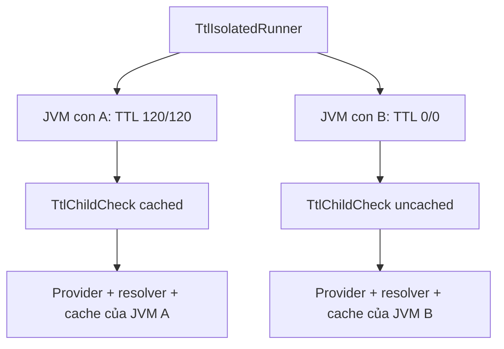

# Thiết lập TTL trong môi trường kiểm thử riêng mà không phụ thuộc thao tác xóa cache nội bộ

## 1. Mục tiêu và bối cảnh

Từ Java 18, **Internet-Address Resolution SPI** (JEP 418) cho phép ứng dụng cung cấp `InetAddressResolverProvider` để `InetAddress` sử dụng một resolver tùy biến. Cơ chế này vẫn hữu ích trên JDK hiện đại để kiểm thử hợp đồng của trình phân giải tên.

Khi kiểm thử cache của `InetAddress`, một khó khăn thường gặp là: **lần tra cứu thứ hai cùng hostname có thể nhận kết quả đã lưu**, nên thay đổi fixture hay gọi resolver lại không nhất thiết làm kết quả đổi ngay. Dùng reflection để xóa các trường cache private của JDK sẽ khiến test mong manh vì chi tiết triển khai có thể thay đổi.

Bài này xây dựng môi trường kiểm thử có thể lặp lại bằng cách **khởi động JVM mới cho từng cấu hình TTL**. Mỗi JVM nạp file security properties của riêng mình và dùng provider mô phỏng; mọi tra cứu đều qua `InetAddress.getAllByName`, là đường API có cache cần kiểm tra.

Sau bài học, bạn có thể:

- Thiết lập **positive TTL** và **negative TTL** bằng Java security properties.
- Phân biệt một lần `InetAddressResolverProvider.get(Configuration)` với nhiều lần `InetAddressResolver.lookupByName(...)`.
- Kiểm chứng cache bật và cache tắt bằng số lần resolver thực sự được gọi.
- Chạy hai trạng thái cache trong **hai tiến trình JVM độc lập**, không dựa vào xóa cache nội bộ, Java agent, reflection hoặc `--add-opens`.
- Hiểu vì sao kiểm tra TTL theo thời gian thực cần lưu ý độ trễ và timer.

> Phạm vi: chỉ sử dụng API công khai còn hỗ trợ trên JDK hiện đại. Các ví dụ dựa trên hợp đồng SPI có từ Java 18 và các security properties hiện hành.

## 2. TTL là security property

`InetAddress` cache cả kết quả phân giải hostname **thành công** và **thất bại**. Các Java security properties sau điều khiển thời gian giữ kết quả:

| Thuộc tính | Ý nghĩa | Giá trị bài học |
| --- | --- | --- |
| `networkaddress.cache.ttl` | Thời gian giữ kết quả phân giải tên thành công | `120` giây khi bật; `0` khi tắt |
| `networkaddress.cache.negative.ttl` | Thời gian giữ kết quả thất bại (`UnknownHostException`) | `120` giây khi bật; `0` khi tắt |
| `networkaddress.cache.stale.ttl` | Thời gian giữ bản ghi positive cũ sau khi hết TTL và refresh thất bại | `0` để loại bỏ biến số stale |

Với positive/negative TTL, giá trị `0` nghĩa là không cache và giá trị âm theo tài liệu networking properties nghĩa là cache vô hạn. Các giá trị dương được tính bằng **giây**. Giá trị positive TTL mặc định có thể phụ thuộc JDK; negative TTL mặc định trong tài liệu Java SE 25 là 10 giây. Bài này đặt giá trị tường minh để không phụ thuộc mặc định.

`networkaddress.cache.stale.ttl` cũng là security property hiện hành. Khi bằng `0` hoặc không đặt, không dùng stale names. Nếu stale TTL lớn hơn positive TTL, positive TTL có thể là khoảng thời gian thử refresh; đó là phép thử riêng, nên bài chính đặt stale TTL bằng `0`.

**Security property khác system property:**

```text
# Đúng: tham số JVM để nạp một file security properties.
-Djava.security.properties=file:/.../cache-enabled.security

# Sai mục đích: chỉ tạo system property, không thay đổi security property TTL.
-Dnetworkaddress.cache.ttl=120
```

`System.setProperty("networkaddress.cache.ttl", "120")` cũng không cấu hình được cache TTL. `Security.setProperty(...)` có thể cấu hình security property trước khi JDK đọc chính sách, nhưng dễ bị phụ thuộc thời điểm khởi tạo. File security properties được nạp **trước khi chạy main** giúp phép thử tái lập hơn.

Theo tài liệu Oracle, `-Djava.security.properties=<URL>` **bổ sung** file vào cấu hình security mặc định và cho phép tên trùng trong file bổ sung ghi đè giá trị trước đó. Không dùng dạng hai dấu bằng (`java.security.properties==<URL>`) vì nó thay thế toàn bộ cấu hình security gốc.

## 3. Thiết kế môi trường kiểm thử cô lập

Ví dụ dùng hai hostname dưới `.invalid` và địa chỉ IPv4 trong dải `192.0.2.0/24` dành cho tài liệu:

| Hostname | Hành vi fixture | Kiểm thử |
| --- | --- | --- |
| `hit.ttl-test.invalid` | Trả IPv4 `192.0.2.17` | Cache kết quả thành công |
| `miss.ttl-test.invalid` | Ném `UnknownHostException` | Cache kết quả thất bại |

Resolver fixture xử lý tên trực tiếp, không cần DNS công cộng hay truy cập endpoint thật.

Cấu trúc dự án:

```text
ttl-isolation-demo/
  src/demo/ttl/
    ProbeCounters.java
    TtlFixtureResolver.java
    TtlFixtureProvider.java
    TtlChildCheck.java
    TtlIsolatedRunner.java
  config/
    cache-enabled.security
    cache-disabled.security
  out/
    demo/ttl/
    META-INF/services/
      java.net.spi.InetAddressResolverProvider
```

File `config/cache-enabled.security`:

```properties
networkaddress.cache.ttl=120
networkaddress.cache.negative.ttl=120
networkaddress.cache.stale.ttl=0
```

File `config/cache-disabled.security`:

```properties
networkaddress.cache.ttl=0
networkaddress.cache.negative.ttl=0
networkaddress.cache.stale.ttl=0
```

Chương trình cha `TtlIsolatedRunner` chạy hai JVM con:



Mỗi JVM có cache, provider instance và static counters riêng. Hai phép thử chỉ khác **TTL bật/tắt**; hostname, resolver, số lần gọi và API gọi được giữ giống nhau.

## 4. Provider và resolver kiểm thử có bộ đếm

Để đo hành vi thật qua `InetAddress`, cần bộ đếm cho **giai đoạn cài provider** và **giai đoạn resolver xử lý từng hostname**. Không dùng `System.setProperty` để giữ dữ liệu đo vì tất cả mã chạy trong cùng classpath của một JVM con; static counters là đủ.

### 4.1. Bộ đếm

Tạo `src/demo/ttl/ProbeCounters.java`:

```java
package demo.ttl;

import java.util.concurrent.atomic.AtomicInteger;

final class ProbeCounters {
    static final AtomicInteger PROVIDER_CREATED = new AtomicInteger();
    static final AtomicInteger PROVIDER_GETS = new AtomicInteger();
    static final AtomicInteger POSITIVE_LOOKUPS = new AtomicInteger();
    static final AtomicInteger NEGATIVE_LOOKUPS = new AtomicInteger();

    private ProbeCounters() {
    }
}
```

`AtomicInteger` giúp mỗi phép tăng được thực hiện nguyên tử; bài học sẽ chạy các lookup tuần tự để không phụ thuộc lịch chạy của nhiều luồng. Mỗi JVM con có riêng một phiên bản `ProbeCounters` với các giá trị khởi đầu bằng 0.

### 4.2. Resolver trả kết quả thành công hoặc thất bại có chủ đích

Tạo `src/demo/ttl/TtlFixtureResolver.java`:

```java
package demo.ttl;

import java.net.InetAddress;
import java.net.UnknownHostException;
import java.net.spi.InetAddressResolver;
import java.net.spi.InetAddressResolver.LookupPolicy;
import java.util.Objects;
import java.util.stream.Stream;

public final class TtlFixtureResolver implements InetAddressResolver {
    private static final String HIT = "hit.ttl-test.invalid";
    private static final String MISS = "miss.ttl-test.invalid";
    private static final byte[] FIXTURE_IP = {(byte) 192, 0, 2, 17};

    @Override
    public Stream<InetAddress> lookupByName(String host, LookupPolicy policy)
            throws UnknownHostException {
        Objects.requireNonNull(host, "host");
        Objects.requireNonNull(policy, "policy");

        if (HIT.equals(host)) {
            ProbeCounters.POSITIVE_LOOKUPS.incrementAndGet();
            if ((policy.characteristics() & LookupPolicy.IPV4) == 0) {
                throw new UnknownHostException(
                        "Policy không cho phép IPv4 của fixture");
            }
            // Không tra cứu lồng nhau: tạo InetAddress trực tiếp từ byte.
            return Stream.of(InetAddress.getByAddress(host, FIXTURE_IP));
        }

        if (MISS.equals(host)) {
            ProbeCounters.NEGATIVE_LOOKUPS.incrementAndGet();
            throw new UnknownHostException(
                    "Fixture không có địa chỉ cho " + host);
        }

        throw new UnknownHostException("Host ngoài fixture: " + host);
    }

    @Override
    public String lookupByAddress(byte[] addr)
            throws UnknownHostException {
        Objects.requireNonNull(addr, "addr");
        if (addr.length != 4 && addr.length != 16) {
            throw new IllegalArgumentException(
                    "IPv4 phải có 4 byte, IPv6 phải có 16 byte");
        }
        throw new UnknownHostException(
                "Fixture này không có reverse mapping");
    }
}
```

Resolver không truy cập DNS hay mạng. Hai counter chỉ tăng khi phương thức `lookupByName` **được gọi thật sự** cho đúng hostname fixture. Positive lookup trả một `InetAddress`, còn negative lookup ném `UnknownHostException`; đây chính là hai loại kết quả mà cache của `InetAddress` có thể lưu.

### 4.3. Provider được JDK discovery qua ServiceLoader

Tạo `src/demo/ttl/TtlFixtureProvider.java`:

```java
package demo.ttl;

import java.net.spi.InetAddressResolver;
import java.net.spi.InetAddressResolverProvider;
import java.util.Objects;

public final class TtlFixtureProvider extends InetAddressResolverProvider {
    public TtlFixtureProvider() {
        ProbeCounters.PROVIDER_CREATED.incrementAndGet();
    }

    @Override
    public String name() {
        return "ttl-isolation-fixture";
    }

    @Override
    public InetAddressResolver get(Configuration configuration) {
        Objects.requireNonNull(configuration, "configuration");
        ProbeCounters.PROVIDER_GETS.incrementAndGet();
        return new TtlFixtureResolver();
    }
}
```

Đăng ký provider bằng file không có phần mở rộng:

```text
out/META-INF/services/java.net.spi.InetAddressResolverProvider
```

Nội dung chính xác một dòng:

```text
demo.ttl.TtlFixtureProvider
```

Với ví dụ chạy trên classpath, descriptor phải ở **gốc classpath output**. Theo hợp đồng `InetAddressResolverProvider`, JDK tìm provider bằng system class loader, cài resolver từ provider đầu tiên được chọn, và các lần lookup tiếp theo sử dụng resolver hệ thống này. Vì thế `PROVIDER_GETS` và `POSITIVE_LOOKUPS`/`NEGATIVE_LOOKUPS` đo **hai giai đoạn khác nhau**.

## 5. JVM con kiểm tra cache bật và cache tắt

Tạo `src/demo/ttl/TtlChildCheck.java`:

```java
package demo.ttl;

import java.net.InetAddress;
import java.net.UnknownHostException;
import java.security.Security;

public final class TtlChildCheck {
    private static final String HIT = "hit.ttl-test.invalid";
    private static final String MISS = "miss.ttl-test.invalid";
    private static final int REPEATS = 4;

    private static void require(boolean ok, String message) {
        if (!ok) {
            throw new AssertionError(message);
        }
    }

    private static void verifySecurityProperties(boolean cacheEnabled) {
        String ttl = cacheEnabled ? "120" : "0";

        require(ttl.equals(Security.getProperty("networkaddress.cache.ttl")),
                "Positive TTL không đúng: "
                + Security.getProperty("networkaddress.cache.ttl"));

        require(ttl.equals(
                        Security.getProperty("networkaddress.cache.negative.ttl")),
                "Negative TTL không đúng: "
                + Security.getProperty("networkaddress.cache.negative.ttl"));

        require("0".equals(
                        Security.getProperty("networkaddress.cache.stale.ttl")),
                "Stale TTL phải bằng 0 trong bài test");
    }

    private static void verifyPositive(boolean cacheEnabled)
            throws Exception {
        for (int attempt = 1; attempt <= REPEATS; attempt++) {
            InetAddress[] results = InetAddress.getAllByName(HIT);
            require(results.length == 1, "Fixture phải có đúng một IPv4");
            require("192.0.2.17".equals(results[0].getHostAddress()),
                    "Sai địa chỉ của fixture");

            int expected = cacheEnabled ? 1 : attempt;
            require(ProbeCounters.POSITIVE_LOOKUPS.get() == expected,
                    "Sai số lookup positive tại lần " + attempt);
            require(ProbeCounters.PROVIDER_GETS.get() == 1,
                    "Provider.get phải được gọi một lần");
            require(ProbeCounters.PROVIDER_CREATED.get() == 1,
                    "Provider constructor phải được gọi một lần");
        }
    }

    private static void verifyNegative(boolean cacheEnabled)
            throws Exception {
        for (int attempt = 1; attempt <= REPEATS; attempt++) {
            try {
                InetAddress.getAllByName(MISS);
                throw new AssertionError("Fixture phải ném UnknownHostException");
            } catch (UnknownHostException expectedFailure) {
                // Cùng một loại lỗi dù trả từ resolver hay negative cache.
            }

            int expected = cacheEnabled ? 1 : attempt;
            require(ProbeCounters.NEGATIVE_LOOKUPS.get() == expected,
                    "Sai số lookup negative tại lần " + attempt);
            require(ProbeCounters.PROVIDER_GETS.get() == 1,
                    "Cache không được khiến JDK cài lại provider");
        }
    }

    public static void main(String[] args) throws Exception {
        require(args.length == 1,
                "Cách chạy: TtlChildCheck cached | uncached");
        require("cached".equals(args[0]) || "uncached".equals(args[0]),
                "Mode phải là cached hoặc uncached");

        boolean cacheEnabled = "cached".equals(args[0]);

        // Đọc cấu hình thật trước khi gọi InetAddress lần đầu.
        verifySecurityProperties(cacheEnabled);

        require(ProbeCounters.PROVIDER_CREATED.get() == 0,
                "Provider đã khởi tạo trước ca kiểm tra");
        require(ProbeCounters.PROVIDER_GETS.get() == 0,
                "Resolver đã được cài trước ca kiểm tra");
        require(ProbeCounters.POSITIVE_LOOKUPS.get() == 0,
                "Positive resolver counter chưa bắt đầu ở 0");
        require(ProbeCounters.NEGATIVE_LOOKUPS.get() == 0,
                "Negative resolver counter chưa bắt đầu ở 0");

        verifyPositive(cacheEnabled);
        verifyNegative(cacheEnabled);

        int expectedLookups = cacheEnabled ? 1 : REPEATS;
        require(ProbeCounters.POSITIVE_LOOKUPS.get() == expectedLookups,
                "Tổng lookup positive không đúng");
        require(ProbeCounters.NEGATIVE_LOOKUPS.get() == expectedLookups,
                "Tổng lookup negative không đúng");

        System.out.println("Mode: " + args[0]);
        System.out.println("Provider created: "
                + ProbeCounters.PROVIDER_CREATED.get());
        System.out.println("Provider get: "
                + ProbeCounters.PROVIDER_GETS.get());
        System.out.println("Positive lookups: "
                + ProbeCounters.POSITIVE_LOOKUPS.get());
        System.out.println("Negative lookups: "
                + ProbeCounters.NEGATIVE_LOOKUPS.get());
        System.out.println("PASS: isolated TTL verification");
    }
}
```

Chương trình kiểm tra **security properties thực tế** bằng `Security.getProperty`; việc nhìn vào tên file config hoặc biến command-line là chưa đủ. Nếu file không được nạp, phép thử dừng ngay với `AssertionError`, không âm thầm sử dụng TTL mặc định.

Số lần resolver chạy được kiểm tra sau **từng lần** gọi:

- Mode `cached`: lần đầu có một lookup positive hoặc negative; ba lần sau dùng cache, nên counter vẫn là 1.
- Mode `uncached`: mỗi lần đều tới resolver; counter tăng 1, 2, 3, 4.
- Hai mode đều kỳ vọng `PROVIDER_CREATED == 1` và `PROVIDER_GETS == 1` sau khi bắt đầu lookup.

Test gọi tuần tự để tránh biến số đồng thời. TTL 120 giây được chọn để bốn lời gọi hoàn tất trước khi entry hết hạn; không cần `Thread.sleep` hay thao tác xóa cache.

## 6. Chương trình cha khởi chạy hai JVM độc lập

Để tránh việc một bài test vô tình dùng lại cache của bài khác, tạo `src/demo/ttl/TtlIsolatedRunner.java`. Lớp này không gọi `InetAddress` để phân giải; nó chỉ chuẩn bị hai lệnh Java rồi khởi chạy từng JVM con:

```java
package demo.ttl;

import java.nio.file.Files;
import java.nio.file.Path;
import java.util.List;
import java.util.Locale;

public final class TtlIsolatedRunner {
    private static String javaExecutable() {
        String name = System.getProperty("os.name")
                .toLowerCase(Locale.ROOT).contains("win")
                ? "java.exe" : "java";
        return Path.of(System.getProperty("java.home"), "bin", name)
                .toString();
    }

    private static void launch(String mode, String configFile)
            throws Exception {
        Path securityFile = Path.of("config", configFile)
                .toAbsolutePath().normalize();
        if (!Files.isRegularFile(securityFile)) {
            throw new IllegalStateException(
                    "Thiếu file cấu hình: " + securityFile);
        }

        List<String> command = List.of(
                javaExecutable(),
                "-Djava.security.properties=" + securityFile.toUri(),
                "-Djava.net.preferIPv4Stack=true",
                "-cp",
                System.getProperty("java.class.path"),
                "demo.ttl.TtlChildCheck",
                mode
        );

        System.out.println("Running isolated JVM: " + mode);
        Process process = new ProcessBuilder(command)
                .inheritIO()
                .start();
        int exitCode = process.waitFor();

        if (exitCode != 0) {
            throw new AssertionError(
                    "Child JVM failed: mode=" + mode
                    + ", exitCode=" + exitCode);
        }
    }

    public static void main(String[] args) throws Exception {
        launch("cached", "cache-enabled.security");
        launch("uncached", "cache-disabled.security");
        System.out.println("PASS: both child JVMs");
    }
}
```

Ba chi tiết bảo đảm phép thử cô lập:

1. `securityFile.toUri()` tạo URL `file:` hợp lệ từ đường dẫn trên hệ điều hành đang chạy. Không cần tự ghép dấu phân cách đường dẫn.
2. `new ProcessBuilder(command)` khởi chạy **tiến trình hệ điều hành mới**. Nó không phải lời gọi hàm Java trong cùng class loader; các static counter và cache trong JVM con trước không tồn tại trong JVM con sau.
3. `process.waitFor()` kiểm tra exit code. Nếu JVM con báo lỗi cấu hình TTL hoặc assertion thất bại, runner báo lỗi thay vì coi toàn bộ suite đã PASS.

Hai JVM con được chạy tuần tự để kết quả console có thứ tự rõ ràng; thời gian tiến trình con đầu tiên sống không ảnh hưởng đến TTL của tiến trình thứ hai.

## 7. Biên dịch và chạy

Các ví dụ dùng `javac --release 18` để giới hạn API có từ Java 18, tương thích với nền tảng Java 18 trở lên. Không cần Gradle, thư viện bên thứ ba hoặc quyền mở module nội bộ.

Từ thư mục `ttl-isolation-demo`, trên **Windows PowerShell**:

```powershell
New-Item -ItemType Directory -Force -Path out, config, "out/META-INF/services" | Out-Null

javac --release 18 -d out src/demo/ttl/ProbeCounters.java src/demo/ttl/TtlFixtureResolver.java src/demo/ttl/TtlFixtureProvider.java src/demo/ttl/TtlChildCheck.java src/demo/ttl/TtlIsolatedRunner.java

$descriptor = "out/META-INF/services/java.net.spi.InetAddressResolverProvider"
[System.IO.File]::WriteAllText(
  $descriptor,
  "demo.ttl.TtlFixtureProvider" + [Environment]::NewLine,
  [System.Text.UTF8Encoding]::new($false)
)

@(
  "networkaddress.cache.ttl=120",
  "networkaddress.cache.negative.ttl=120",
  "networkaddress.cache.stale.ttl=0"
) | Set-Content -Encoding Ascii -Path config/cache-enabled.security

@(
  "networkaddress.cache.ttl=0",
  "networkaddress.cache.negative.ttl=0",
  "networkaddress.cache.stale.ttl=0"
) | Set-Content -Encoding Ascii -Path config/cache-disabled.security

java -cp out demo.ttl.TtlIsolatedRunner
```

**Bash/Linux/macOS**:

```bash
mkdir -p out/META-INF/services config
javac --release 18 -d out src/demo/ttl/ProbeCounters.java src/demo/ttl/TtlFixtureResolver.java src/demo/ttl/TtlFixtureProvider.java src/demo/ttl/TtlChildCheck.java src/demo/ttl/TtlIsolatedRunner.java

printf '%s\n' 'demo.ttl.TtlFixtureProvider' > out/META-INF/services/java.net.spi.InetAddressResolverProvider

printf '%s\n' 'networkaddress.cache.ttl=120' 'networkaddress.cache.negative.ttl=120' 'networkaddress.cache.stale.ttl=0' > config/cache-enabled.security
printf '%s\n' 'networkaddress.cache.ttl=0' 'networkaddress.cache.negative.ttl=0' 'networkaddress.cache.stale.ttl=0' > config/cache-disabled.security

java -cp out demo.ttl.TtlIsolatedRunner
```

Service descriptor được ghi UTF-8 không BOM. PowerShell 5.1 có thể tạo BOM với một số cách ghi UTF-8, vì vậy ví dụ dùng `UTF8Encoding(false)`. Hai file security properties chỉ chứa ký tự ASCII; `Set-Content -Encoding Ascii` phù hợp cho dữ liệu cấu hình này.

## 8. Kết quả kỳ vọng và ý nghĩa

Khi chạy `java -cp out demo.ttl.TtlIsolatedRunner`, hai JVM con lần lượt in các kết quả:

```text
Running isolated JVM: cached
Mode: cached
Provider created: 1
Provider get: 1
Positive lookups: 1
Negative lookups: 1
PASS: isolated TTL verification
Running isolated JVM: uncached
Mode: uncached
Provider created: 1
Provider get: 1
Positive lookups: 4
Negative lookups: 4
PASS: isolated TTL verification
PASS: both child JVMs
```

Ma trận quan sát:

| Phép đo sau 4 lần hỏi cùng hostname | TTL 120 giây | TTL 0 giây |
| --- | ---: | ---: |
| Số JVM con | 1 | 1 |
| Số instance provider được tạo | 1 | 1 |
| Số lần `get(Configuration)` của provider | 1 | 1 |
| Số lần `lookupByName` cho hostname thành công | 1 | 4 |
| Số lần `lookupByName` cho hostname thất bại | 1 | 4 |
| Số lần caller nhận địa chỉ thành công | 4 | 4 |
| Số lần caller nhận `UnknownHostException` | 4 | 4 |

**Điểm quan trọng:** TTL thay đổi số lần `lookupByName` được gọi, nhưng không làm provider được khởi tạo lại mỗi lần cache miss. Provider có nhiệm vụ cài resolver cấp JVM, còn resolver thực hiện các lần phân giải tên. Với cache hit, kết quả được trả trước khi resolver phải xử lý lần nữa.

Hai nhóm địa chỉ thành công/thất bại được hỏi với **cùng hostname chính xác** trong từng nhóm. Vì vậy, khác biệt về bộ đếm bắt nguồn từ chính sách cache, không phải do đổi cache key.

Trường hợp negative cache dễ gây nhầm: cả bốn lời gọi đều ném `UnknownHostException`, dù thực tế resolver chỉ ném một lần ở mode cached. Việc caller nhận lỗi bốn lần không có nghĩa resolver đã xử lý bốn lần.

## 9. Nếu muốn kiểm tra đúng thời điểm TTL hết hạn

Hai mode `120` và `0` phù hợp để kiểm chứng **có cache / không cache** mà không cần dùng đồng hồ. Muốn kiểm tra quá trình hết hạn và refresh, cần một phép thử riêng và lưu ý sai số thời gian.

Ví dụ mở rộng: tạo file `config/cache-short.security` trong **một JVM con mới**:

```properties
networkaddress.cache.ttl=1
networkaddress.cache.negative.ttl=1
networkaddress.cache.stale.ttl=0
```

Trong biến thể của `TtlChildCheck` dành cho TTL ngắn, có thể làm:

```java
InetAddress.getAllByName("hit.ttl-test.invalid");
// Ngay sau lần đầu: positive resolver counter = 1.

Thread.sleep(2_000L);

InetAddress.getAllByName("hit.ttl-test.invalid");
// Sau khi TTL 1 giây hết hạn: kỳ vọng resolver được gọi lần nữa.
```

Đây là bài tập kiểm tra hết hạn chứ **không phải** đoạn chạy trực tiếp trong hai mode chính, vì `TtlChildCheck` hiện tại chỉ chấp nhận `cached` hoặc `uncached`. Cần bổ sung mode `expires` và kiểm tra `Security.getProperty` tương ứng nếu muốn tự động hóa.

Đối với test dựa vào thời gian thực:

- Đo khoảng thời gian bằng `System.nanoTime()` nếu cần chẩn đoán thời gian đã trôi qua.
- Dùng khoảng chờ dài hơn TTL để tránh sát biên giới hết hạn; không suy luận từ `Thread.sleep(1_000)` rằng chính xác một giây đã trôi qua và mọi scheduler đã thực hiện như mong muốn.
- Chạy một JVM mới và một hostname fixture mới để cô lập trạng thái; không cố tác động trực tiếp vào map cache của `InetAddress`.
- Nếu kiểm tra stale TTL, phải mô phỏng cả **refresh thất bại** và chính sách giữ bản ghi cũ; đó là hành vi bổ sung so với positive/negative cache thông thường.

Với kiểm thử tích hợp có yêu cầu ổn định cao, ưu tiên bài cơ bản TTL 120/0 cho assert chính xác và để kiểm tra hết hạn theo thời gian ở bộ test riêng có biên độ thời gian phù hợp.

## 10. Lỗi thường gặp và cách chẩn đoán

| Triệu chứng | Nguyên nhân cần kiểm tra |
| --- | --- |
| `Security.getProperty("networkaddress.cache.ttl")` trả giá trị khác file | Tham số `java.security.properties` có thể thiếu, URL file sai, hoặc file không được nạp |
| Đã đặt `-Dnetworkaddress.cache.ttl=0` nhưng vẫn cache | Đây là **system property**; JVM cần **security property** |
| Chạy cached rồi uncached trong cùng JVM và kết quả không đổi | Hai ca đang dùng lại cache, policy hoặc resolver đã khởi tạo |
| `PROVIDER_GETS == 0` sau khi gọi hostname | Thiếu service descriptor tại gốc classpath, tên provider sai hoặc provider khác được chọn |
| `POSITIVE_LOOKUPS == 0` dù API trả địa chỉ | Có thể đã hỏi IP literal, nhận kết quả cache sẵn, hoặc chưa dùng provider fixture |
| Cache bật nhưng số lookup luôn tăng | TTL chưa nạp, hostname đổi giữa các lần, entry hết hạn hoặc môi trường có đường tra cứu khác |
| Cache tắt nhưng số lookup không tăng | Chưa thực sự dùng TTL `0` hoặc đang gọi API khác đường phân giải hostname |
| Lỗi `UnknownHostException` xuất hiện bốn lần | Chỉ cho biết caller nhận lỗi bốn lần; xem `NEGATIVE_LOOKUPS` để biết resolver chạy bao nhiêu lần |
| Kết quả sai khi chạy nhiều test song song | Các test có thể chia sẻ một JVM/cache và chồng chéo lookup; hãy dùng JVM riêng và các fixture riêng |
| `ProcessBuilder` không chạy được JVM con | Kiểm tra `java.home/bin/java`, classpath và file security property có tồn tại |

### 10.1. Đừng xóa cache bằng reflection

Một số mã cũ thử truy cập trường private của `InetAddress` hoặc mở module bằng `--add-opens` để xóa map cache. Điều đó phụ thuộc cách một JDK cụ thể tổ chức nội bộ, có thể bị strong encapsulation chặn và có nguy cơ xóa trạng thái dùng chung với các test khác.

Với bài này, chỉ cần hai lần khởi động JVM mới. Các lớp cache cũ, entry negative và static resolver của JVM trước đều kết thúc cùng tiến trình đó.

### 10.2. Đừng gọi resolver trực tiếp khi đo cache của InetAddress

```java
// Kiểm tra logic resolver, KHÔNG đo cache của InetAddress.
TtlFixtureResolver resolver = new TtlFixtureResolver();
resolver.lookupByName(
        "hit.ttl-test.invalid",
        InetAddressResolver.LookupPolicy.of(
                InetAddressResolver.LookupPolicy.IPV4));
```

Lời gọi trực tiếp không đi qua cache của `InetAddress`. Khi muốn đo TTL cấp JDK, phải gọi `InetAddress.getByName` hoặc `InetAddress.getAllByName` với hostname thật.

Tương tự, `InetAddress.getByAddress(bytes)` chỉ tạo đối tượng từ byte IP, còn `InetAddress.getByName("192.0.2.17")` nhận một IPv4 literal và được parse trực tiếp; chúng không phù hợp để chứng minh rằng forward resolver được gọi.

### 10.3. Đừng đổi cấu hình sau khi cache đã được khởi tạo

Ngay cả khi `Security.setProperty` cập nhật giá trị có thể đọc được qua `Security.getProperty`, một cache policy hoặc đối tượng cache đã khởi tạo không nhất thiết đọc lại nó. Việc đổi thuộc tính rồi gọi cùng hostname trong cùng JVM không chứng minh rằng TTL mới đã được áp dụng.

Khi cần thử một TTL khác, thay file security property và **khởi động JVM con mới**.

### 10.4. Đừng nhầm cache của JDK với cache mạng

Fixture của bài không truy vấn DNS công cộng, nên bộ đếm chỉ đo số lần JDK gọi resolver SPI. Trong hệ thống thực, resolver tùy biến có thể gọi thêm built-in resolver, OS, DNS server hoặc service discovery; mỗi tầng có thể có chính sách cache riêng.

Nếu bộ đếm ở provider không đổi nhưng DNS thực tế có traffic, cần xác định tầng nào khởi tạo request. Bài học chỉ chứng minh hành vi cache của `InetAddress` trên đường gọi hostname tới custom resolver.

## 11. Checklist và bài tập mở rộng

- [ ] Mỗi ca TTL chạy trong **một JVM mới** và có security properties riêng.
- [ ] File cache-enabled đặt positive/negative TTL bằng `120` và stale TTL bằng `0`.
- [ ] File cache-disabled đặt positive/negative TTL bằng `0`.
- [ ] JVM con xác nhận TTL đang dùng bằng `Security.getProperty` trước lookup.
- [ ] Service descriptor nằm ở `out/META-INF/services` với đúng tên provider.
- [ ] Mỗi JVM tạo một provider và gọi `get(Configuration)` một lần.
- [ ] Trong mode cached, bốn lần hỏi hostname thành công chỉ gọi resolver một lần.
- [ ] Trong mode cached, bốn lần hỏi hostname thất bại chỉ gọi resolver một lần.
- [ ] Trong mode uncached, mỗi hostname được resolver xử lý bốn lần.
- [ ] Tất cả ca negative đều ném `UnknownHostException` ra caller.
- [ ] Không dùng reflection, truy cập cache private, `--add-opens` hoặc thao tác clear cache.
- [ ] Không yêu cầu DNS công cộng, không chạy phụ thuộc mạng.

**Bài tập 1:** Thêm một mode thứ ba `expires` với cả positive/negative TTL bằng 1 giây. Trong JVM con riêng, tra cứu một hostname, chờ đủ thời gian rồi tra cứu lại. Ghi bộ đếm trước và sau; giải thích vì sao test này cần biên độ thời gian và không nên thay thế toàn bộ suite kiểm tra cache-on/cache-off.

**Bài tập 2:** Viết một test có hai hostname positive khác nhau. Lặp lại một hostname nhiều lần trong mode cached và tra hostname còn lại một lần. Giải thích cache key theo hostname, đồng thời xác nhận số lần provider được cài vẫn không tăng vì thêm hostname mới.

**Bài tập 3:** Thêm kiểm tra `Security.getProperty("networkaddress.cache.ttl")` và `System.getProperty("networkaddress.cache.ttl")` trong JVM con. Giải thích vì sao chỉ kết quả đầu mới phản ánh security property điều khiển cache.

**Tiêu chí hoàn thành:** Có thể thay TTL mà không cần chạm vào internals của JDK; chạy mỗi cấu hình trong JVM riêng; kiểm chứng được cả positive và negative cache qua resolver counters; và phân biệt việc cài provider với số lần xử lý hostname thực sự.

## Tài liệu tham khảo

- [JEP 418 – Internet-Address Resolution SPI](https://openjdk.org/jeps/418): cơ chế resolver SPI được giới thiệu từ Java 18.
- [InetAddress – Java SE 25](https://docs.oracle.com/en/java/javase/25/docs/api/java.base/java/net/InetAddress.html): cache thành công/thất bại, các TTL và API phân giải tên.
- [Networking Properties – Java SE 25](https://docs.oracle.com/en/java/javase/25/docs/api/java.base/java/net/doc-files/net-properties.html): positive, negative, stale address cache security properties.
- [The Security Properties File – Java SE 25](https://docs.oracle.com/en/java/javase/25/security/security-properties-file.html): nạp file qua `java.security.properties`, cú pháp append/override và giá trị security properties.
- [InetAddressResolver – Java SE 25](https://docs.oracle.com/en/java/javase/25/docs/api/java.base/java/net/spi/InetAddressResolver.html): hợp đồng `lookupByName`/`lookupByAddress`.
- [InetAddressResolverProvider – Java SE 25](https://docs.oracle.com/en/java/javase/25/docs/api/java.base/java/net/spi/InetAddressResolverProvider.html): provider SPI, discovery và `get(Configuration)`.
- [RFC 2606](https://www.rfc-editor.org/rfc/rfc2606) và [RFC 5737](https://www.rfc-editor.org/rfc/rfc5737): miền `.invalid` và IPv4 TEST-NET dành cho ví dụ.
