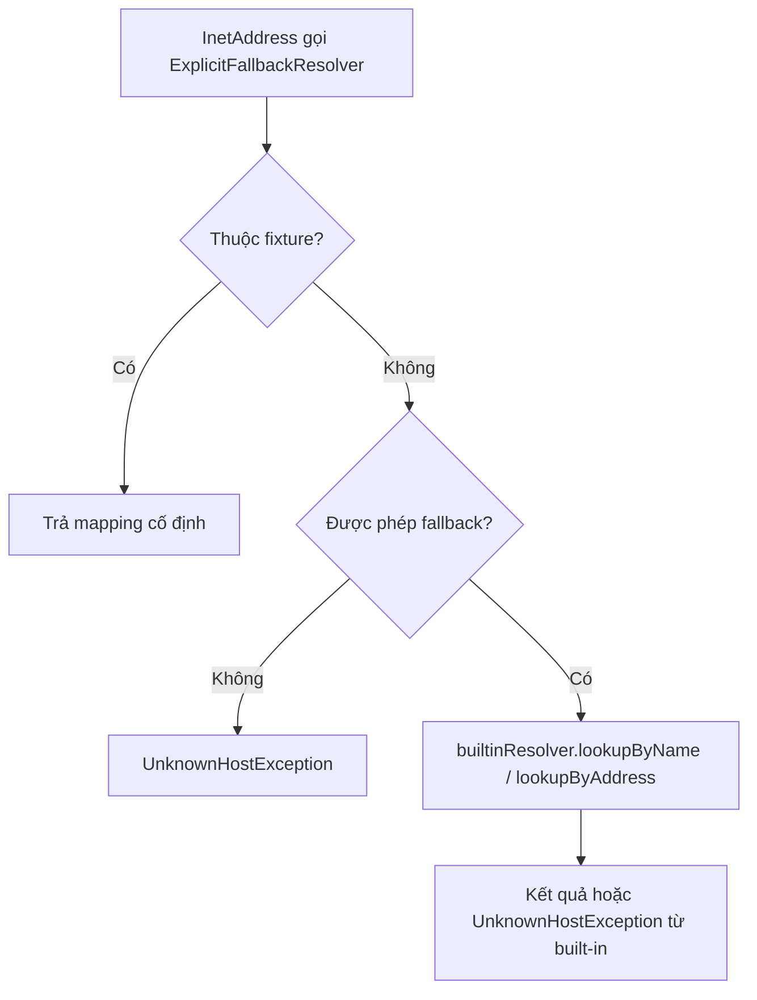

# Thiết kế fallback tường minh bằng builtinResolver và kiểm tra không tạo vòng đệ quy

## 1. Mục tiêu và lý do cần fallback tường minh

Từ Java 18, **Internet-Address Resolution SPI** (JEP 418) cho phép ứng dụng cài `InetAddressResolverProvider` thay thế resolver hệ thống của `InetAddress`. Khi provider được cài, các lời gọi phân giải tên qua `InetAddress` dùng resolver được provider trả về, chứ không tự động thử lại resolver tích hợp nếu custom resolver ném `UnknownHostException`.

Trong thực tế, một custom resolver có thể chỉ quản lý một phần không gian tên, ví dụ hostname của môi trường kiểm thử hoặc dịch vụ nội bộ. Những hostname còn lại cần một chính sách rõ ràng: chặn, trả lỗi hoặc **ủy quyền có chủ đích** sang resolver tích hợp của JDK.

Bài này thiết kế fallback bằng `InetAddressResolverProvider.Configuration.builtinResolver()` và chứng minh rằng đường fallback không quay ngược vào resolver đang được cài. Đây là kỹ thuật còn được hỗ trợ trên JDK hiện đại, không phụ thuộc API nội bộ, reflection hay thao tác can thiệp `InetAddress`.

Mục tiêu sau bài:

- Phân biệt **provider discovery**, **custom lookup** và **delegation tới built-in resolver**.
- Nhận `builtinResolver()` từ `Configuration` đúng lúc trong `get(Configuration)` và chuyển trực tiếp reference đó cho resolver tùy biến.
- Xây một bảng tuyến đường: hostname thuộc fixture → xử lý tại chỗ; hostname nằm trong allowlist → builtin resolver; hostname khác → từ chối.
- Giữ nguyên `LookupPolicy` khi ủy quyền forward lookup; ủy quyền reverse lookup theo byte IP với đúng contract.
- Kiểm tra với một fake built-in resolver có bộ đếm, không cần DNS công cộng, và thêm guard báo lỗi nếu tái nhập resolver cùng luồng.
- Phân biệt unit test hoàn toàn xác định với integration test phụ thuộc cấu hình hostname của hệ điều hành.

## 2. Hợp đồng của Configuration.builtinResolver()

`InetAddressResolverProvider.get(Configuration configuration)` được JDK gọi khi cài resolver tùy biến. Đối tượng cấu hình cung cấp:

| API | Ý nghĩa |
| --- | --- |
| `configuration.builtinResolver()` | Trả về `InetAddressResolver` tích hợp của JDK để provider có thể ủy quyền |
| `configuration.lookupLocalHostName()` | Đọc tên máy local từ cấu hình hệ thống; không phải resolver thay thế |

`Configuration` là một sealed interface do JDK cung cấp. Bài này **không** tạo implementation giả của `Configuration`. Thay vào đó, test logic của custom resolver bằng cách truyền vào một implementation `InetAddressResolver` giả qua constructor; integration test mới lấy `builtinResolver()` thực từ JDK.

Mẫu chuẩn:

```java
@Override
public InetAddressResolver get(Configuration configuration) {
    InetAddressResolver builtin =
            Objects.requireNonNull(configuration.builtinResolver());
    return new ExplicitFallbackResolver(builtin);
}
```

Sau đó, trong custom resolver:

```java
return builtin.lookupByName(host, lookupPolicy);
```

**Không viết fallback bằng cách gọi lại facade `InetAddress`:**

```java
// PHẢN VÍ DỤ — dễ tái nhập chính resolver tùy biến sau khi đã cài.
return Arrays.stream(InetAddress.getAllByName(host));
```

Lý do: `InetAddress.getAllByName(host)` gọi system-wide resolver, mà sau khi provider được cài chính là custom resolver hiện tại. Custom resolver lại gọi `InetAddress.getAllByName`, tạo chu trình `custom → InetAddress → custom → ...`. Hệ quả có thể là `StackOverflowError`, kẹt luồng, hoặc lỗi khó phân tích. Cần gọi trực tiếp `builtin.lookupByName` từ reference do JDK cung cấp.

Lưu ý quan trọng: `builtinResolver()` **không** bảo đảm chỉ đọc máy local hay không dùng mạng. Built-in resolver tuân theo cấu hình tên của hệ điều hành và có thể dùng DNS hoặc naming service khác. Do đó chính sách cho phép fallback phải được quyết định ở ứng dụng.

## 3. Chính sách định tuyến của ví dụ

Bài dùng một fixture riêng và một allowlist nhỏ cho fallback:

| Đầu vào | Quy tắc | Kết quả |
| --- | --- | --- |
| `fixture.team.invalid` | Custom resolver xử lý | IPv4 `192.0.2.54` |
| `localhost` | Cho phép ủy quyền sang `builtinResolver()` | Kết quả tùy cấu hình máy; thường là loopback |
| `missing.team.invalid` | Không thuộc fixture hay allowlist | `UnknownHostException`; không hỏi built-in |
| Reverse `192.0.2.54` | Custom resolver xử lý | `fixture.team.invalid` |
| Reverse `127.0.0.1` và `::1` | Cho phép ủy quyền sang built-in | Hostname nếu built-in tìm được |
| Reverse các IP khác | Không cho phép fallback | `UnknownHostException` |

Các tên `.invalid` và địa chỉ `192.0.2.0/24` dành cho ví dụ; không gắn với endpoint thật. Chính sách này cố tình **không** fallback cho mọi hostname không biết. Nếu sản phẩm cần fallback mở, đó là quyết định nghiệp vụ riêng: nó có thể làm lộ hostname nội bộ tới DNS ngoài dự kiến.

Sơ đồ định tuyến:



Trong ví dụ, một guard bằng `ThreadLocal` phát hiện trường hợp cùng một resolver bị gọi lồng nhau trên cùng luồng; nó giúp test xác định lỗi tái nhập **trước khi** sinh vòng gọi vô hạn. Đây là cơ chế phòng vệ minh họa, không thay thế thiết kế delegation đúng.

## 4. Cấu trúc dự án ví dụ

```text
resolver-explicit-fallback/
  src/demo/fallback/
    ResolverProbe.java
    ExplicitFallbackResolver.java
    ExplicitFallbackProvider.java
    FallbackUnitCheck.java
    FallbackIntegrationCheck.java
  out/
    META-INF/services/
      java.net.spi.InetAddressResolverProvider
```

Chương trình `FallbackUnitCheck` dùng một fake built-in resolver để kiểm tra logic mà không dùng DNS hay host OS. `FallbackIntegrationCheck` dùng provider được `ServiceLoader` discovery trên một JVM mới, sau đó kiểm tra đường custom, allowlist và reverse mapping.

Các ví dụ dùng API public có từ Java 18, nên có thể biên dịch bằng `javac --release 18` trên JDK hỗ trợ tùy chọn release này.

## 5. Mã nguồn: resolver dùng built-in delegation

### 5.1. Counter dùng chung trong JVM kiểm thử

Tạo `src/demo/fallback/ResolverProbe.java`:

```java
package demo.fallback;

import java.util.concurrent.atomic.AtomicInteger;

final class ResolverProbe {
    static final AtomicInteger PROVIDER_CREATED = new AtomicInteger();
    static final AtomicInteger PROVIDER_GETS = new AtomicInteger();
    static final AtomicInteger CUSTOM_FORWARD = new AtomicInteger();
    static final AtomicInteger CUSTOM_REVERSE = new AtomicInteger();
    static final AtomicInteger BUILTIN_FORWARD = new AtomicInteger();
    static final AtomicInteger BUILTIN_REVERSE = new AtomicInteger();
    static final AtomicInteger REENTRY_BLOCKED = new AtomicInteger();

    // Chỉ dùng để test integration trong cùng JVM.
    static volatile ExplicitFallbackResolver installed;

    private ResolverProbe() {
    }
}
```

Counter này minh họa đường gọi; chúng không có ý nghĩa như chỉ số giám sát sản xuất và không thay thế tracing trong ứng dụng thực.

### 5.2. Resolver có allowlist và guard tái nhập

Tạo `src/demo/fallback/ExplicitFallbackResolver.java`:

```java
package demo.fallback;

import java.net.InetAddress;
import java.net.UnknownHostException;
import java.net.spi.InetAddressResolver;
import java.net.spi.InetAddressResolver.LookupPolicy;
import java.util.Arrays;
import java.util.Objects;
import java.util.stream.Stream;

public final class ExplicitFallbackResolver implements InetAddressResolver {
    static final String FIXTURE_HOST = "fixture.team.invalid";
    static final byte[] FIXTURE_IP = {(byte) 192, 0, 2, 54};
    static final byte[] IPV4_LOOPBACK = {127, 0, 0, 1};
    static final byte[] IPV6_LOOPBACK = {
        0, 0, 0, 0, 0, 0, 0, 0,
        0, 0, 0, 0, 0, 0, 0, 1
    };

    private final InetAddressResolver builtin;
    private final ThreadLocal<Boolean> inLookup =
            ThreadLocal.withInitial(() -> Boolean.FALSE);

    public ExplicitFallbackResolver(InetAddressResolver builtin) {
        this.builtin = Objects.requireNonNull(builtin, "builtin");
    }

    private void enter() {
        if (Boolean.TRUE.equals(inLookup.get())) {
            ResolverProbe.REENTRY_BLOCKED.incrementAndGet();
            throw new IllegalStateException(
                    "Recursive resolution on ExplicitFallbackResolver");
        }
        inLookup.set(Boolean.TRUE);
    }

    private void exit() {
        inLookup.remove();
    }

    @Override
    public Stream<InetAddress> lookupByName(String host, LookupPolicy policy)
            throws UnknownHostException {
        Objects.requireNonNull(host, "host");
        Objects.requireNonNull(policy, "policy");
        enter();
        try {
            if (FIXTURE_HOST.equalsIgnoreCase(host)) {
                ResolverProbe.CUSTOM_FORWARD.incrementAndGet();
                if ((policy.characteristics() & LookupPolicy.IPV4) == 0) {
                    throw new UnknownHostException(
                            "Fixture chỉ cung cấp địa chỉ IPv4");
                }

                // Không gọi InetAddress.getAllByName: dùng byte đã có.
                return Stream.of(InetAddress.getByAddress(host, FIXTURE_IP));
            }

            if ("localhost".equalsIgnoreCase(host)) {
                ResolverProbe.BUILTIN_FORWARD.incrementAndGet();

                // Reference này lấy từ Configuration.builtinResolver().
                // Materialize stream bên trong guard để bắt tái nhập ngay.
                try (Stream<InetAddress> addresses =
                             builtin.lookupByName(host, policy)) {
                    return addresses.toList().stream();
                }
            }

            // Không chuyển mọi tên lạ ra DNS ngoài dự kiến.
            throw new UnknownHostException(
                    "Không được phép fallback hostname: " + host);
        } finally {
            exit();
        }
    }

    @Override
    public String lookupByAddress(byte[] address)
            throws UnknownHostException {
        Objects.requireNonNull(address, "address");
        if (address.length != 4 && address.length != 16) {
            throw new IllegalArgumentException(
                    "Địa chỉ phải có 4 hoặc 16 byte");
        }

        enter();
        try {
            if (Arrays.equals(address, FIXTURE_IP)) {
                ResolverProbe.CUSTOM_REVERSE.incrementAndGet();
                return FIXTURE_HOST;
            }

            if (Arrays.equals(address, IPV4_LOOPBACK)
                    || Arrays.equals(address, IPV6_LOOPBACK)) {
                ResolverProbe.BUILTIN_REVERSE.incrementAndGet();
                return builtin.lookupByAddress(address);
            }

            throw new UnknownHostException(
                    "Không được phép fallback địa chỉ: "
                    + Arrays.toString(address));
        } finally {
            exit();
        }
    }
}
```

Các điểm cần chú ý:

1. Resolver nhận `builtin` bằng constructor, **không tự tìm built-in bằng `InetAddress.getByName`**.
2. Fixture forward dùng `InetAddress.getByAddress(host, byte[])`. API này chỉ tạo địa chỉ từ byte có sẵn, không gọi system-wide resolver để xác minh hostname, vì vậy không tạo lookup lồng nhau.
3. Khi fallback forward, truyền **nguyên đối tượng `LookupPolicy`** cho built-in để giữ họ địa chỉ và thứ tự ưu tiên được caller yêu cầu.
4. `try (Stream<InetAddress> addresses = ...)` tiêu thụ stream thành danh sách trong phạm vi guard, tránh để một thao tác lazy chạy sau khi đã bỏ guard. Với bài test nhỏ, cách này chủ động và dễ kiểm chứng; trong ứng dụng sản xuất phải cân nhắc số lượng địa chỉ và chi phí materialization.
5. `ThreadLocal` phát hiện trường hợp cùng instance bị gọi lồng nhau **trên cùng luồng**. Nó không chứng minh an toàn tuyệt đối với mọi cách custom provider dùng luồng khác; bảo đảm chính vẫn là truyền built-in reference đúng.
6. Reverse fallback dùng trực tiếp `builtin.lookupByAddress(address)`, không gọi `InetAddress.getCanonicalHostName` bên trong resolver.

### 5.3. Provider lấy đúng built-in từ Configuration

Tạo `src/demo/fallback/ExplicitFallbackProvider.java`:

```java
package demo.fallback;

import java.net.spi.InetAddressResolver;
import java.net.spi.InetAddressResolverProvider;
import java.util.Objects;

public final class ExplicitFallbackProvider extends InetAddressResolverProvider {
    public ExplicitFallbackProvider() {
        // Không làm bất kỳ DNS lookup nào trong constructor.
        ResolverProbe.PROVIDER_CREATED.incrementAndGet();
    }

    @Override
    public String name() {
        return "explicit-builtin-fallback";
    }

    @Override
    public InetAddressResolver get(Configuration configuration) {
        Objects.requireNonNull(configuration, "configuration");

        InetAddressResolver builtin =
                Objects.requireNonNull(
                        configuration.builtinResolver(),
                        "configuration.builtinResolver()");

        ResolverProbe.PROVIDER_GETS.incrementAndGet();
        ExplicitFallbackResolver result =
                new ExplicitFallbackResolver(builtin);
        ResolverProbe.installed = result;
        return result;
    }
}
```

Đăng ký provider trên classpath bằng tệp:

```text
META-INF/services/java.net.spi.InetAddressResolverProvider
```

Nội dung chính xác:

```text
demo.fallback.ExplicitFallbackProvider
```

Không kích hoạt phân giải tên trong constructor, static initializer hoặc `get(Configuration)`. Javadoc của provider khuyến nghị việc khởi tạo phải đơn giản để giảm rủi ro deadlock hoặc vòng tải lớp. JDK dùng system class loader để discovery provider, và việc lựa chọn provider đầu tiên khi có nhiều provider là implementation-specific; test này chỉ đăng ký một provider.

## 6. Unit test xác định, không cần DNS thật

Tạo `src/demo/fallback/FallbackUnitCheck.java`. Fake built-in bên dưới **không** triển khai sealed `Configuration`; nó chỉ triển khai `InetAddressResolver` là dependency được truyền qua constructor.

```java
package demo.fallback;

import java.net.Inet4Address;
import java.net.InetAddress;
import java.net.UnknownHostException;
import java.net.spi.InetAddressResolver;
import java.net.spi.InetAddressResolver.LookupPolicy;
import java.util.Arrays;
import java.util.List;
import java.util.stream.Stream;

public final class FallbackUnitCheck {
    private static void require(boolean ok, String message) {
        if (!ok) {
            throw new AssertionError(message);
        }
    }

    @FunctionalInterface
    private interface CheckedAction {
        void run() throws UnknownHostException;
    }

    private static void expectUnknown(CheckedAction action) {
        try {
            action.run();
            throw new AssertionError("Phải ném UnknownHostException");
        } catch (UnknownHostException expected) {
            // Đúng hợp đồng.
        }
    }

    private static final class CountingBuiltin implements InetAddressResolver {
        int forwardCalls;
        int reverseCalls;
        String receivedHost;
        LookupPolicy receivedPolicy;
        byte[] receivedAddress;

        @Override
        public Stream<InetAddress> lookupByName(
                String host, LookupPolicy policy) throws UnknownHostException {
            forwardCalls++;
            receivedHost = host;
            receivedPolicy = policy;

            if (!"localhost".equals(host)
                    || (policy.characteristics() & LookupPolicy.IPV4) == 0) {
                throw new UnknownHostException(host);
            }

            return Stream.of(InetAddress.getByAddress(
                    host, ExplicitFallbackResolver.IPV4_LOOPBACK));
        }

        @Override
        public String lookupByAddress(byte[] address)
                throws UnknownHostException {
            reverseCalls++;
            receivedAddress = address.clone();
            if (Arrays.equals(
                    address, ExplicitFallbackResolver.IPV4_LOOPBACK)) {
                return "localhost";
            }
            throw new UnknownHostException("Không có reverse mapping");
        }
    }

    // Fake này cố tình trả request về custom resolver để test guard.
    private static final class ReenteringBuiltin implements InetAddressResolver {
        ExplicitFallbackResolver target;

        @Override
        public Stream<InetAddress> lookupByName(
                String host, LookupPolicy policy) throws UnknownHostException {
            return target.lookupByName(host, policy);
        }

        @Override
        public String lookupByAddress(byte[] address)
                throws UnknownHostException {
            return target.lookupByAddress(address);
        }
    }

    public static void main(String[] args) throws Exception {
        LookupPolicy policy = LookupPolicy.of(LookupPolicy.IPV4);
        CountingBuiltin spy = new CountingBuiltin();
        ExplicitFallbackResolver resolver =
                new ExplicitFallbackResolver(spy);

        // A. Host fixture được xử lý nội bộ; không gọi built-in.
        List<InetAddress> fixture = resolver.lookupByName(
                ExplicitFallbackResolver.FIXTURE_HOST, policy).toList();
        require(fixture.size() == 1
                        && fixture.get(0) instanceof Inet4Address
                        && Arrays.equals(
                            fixture.get(0).getAddress(),
                            ExplicitFallbackResolver.FIXTURE_IP),
                "Fixture IPv4 không đúng");
        require(spy.forwardCalls == 0,
                "Fixture không được đi vào built-in");

        // B. Tên không được phép fallback phải bị chặn.
        expectUnknown(() -> resolver.lookupByName(
                "missing.team.invalid", policy));
        require(spy.forwardCalls == 0,
                "Hostname bị chặn không được gửi tới built-in");

        // C. Allowlist được delegate đúng một lần, giữ nguyên policy.
        List<InetAddress> local =
                resolver.lookupByName("localhost", policy).toList();
        require(local.size() == 1
                        && Arrays.equals(local.get(0).getAddress(),
                                ExplicitFallbackResolver.IPV4_LOOPBACK),
                "Sai kết quả fallback giả");
        require(spy.forwardCalls == 1,
                "Phải delegate một lần, không có lookup vòng");
        require("localhost".equals(spy.receivedHost),
                "Sai hostname truyền sang built-in");
        require(spy.receivedPolicy == policy,
                "Phải truyền nguyên LookupPolicy");

        // D. Reverse mapping của fixture do custom xử lý.
        require(ExplicitFallbackResolver.FIXTURE_HOST.equals(
                        resolver.lookupByAddress(
                                ExplicitFallbackResolver.FIXTURE_IP)),
                "Sai reverse mapping fixture");
        require(spy.reverseCalls == 0,
                "Reverse của fixture không được gọi built-in");

        // E. Loopback reverse fallback chỉ đi vào built-in một lần.
        byte[] loopback = ExplicitFallbackResolver.IPV4_LOOPBACK.clone();
        require("localhost".equals(resolver.lookupByAddress(loopback)),
                "Sai reverse fallback");
        require(spy.reverseCalls == 1
                        && Arrays.equals(spy.receivedAddress, loopback),
                "Reverse fallback không chuyển đúng byte địa chỉ");

        // F. IP không nằm trong allowlist không đi ra built-in.
        expectUnknown(() -> resolver.lookupByAddress(
                new byte[] {(byte) 192, 0, 2, 55}));
        require(spy.reverseCalls == 1,
                "Reverse bị chặn không được delegate");

        // G. Hợp đồng lỗi độ dài sai khác lỗi không có hostname.
        try {
            resolver.lookupByAddress(new byte[3]);
            throw new AssertionError("Độ dài 3 phải bị từ chối");
        } catch (IllegalArgumentException expected) {
            // Hợp đồng SPI.
        }

        // H. Fake lỗi cố tình tái nhập cùng resolver: guard bắt ngay.
        ReenteringBuiltin wrong = new ReenteringBuiltin();
        ExplicitFallbackResolver protectedResolver =
                new ExplicitFallbackResolver(wrong);
        wrong.target = protectedResolver;

        try {
            protectedResolver.lookupByName("localhost", policy);
            throw new AssertionError("Guard phải phát hiện recursion");
        } catch (IllegalStateException expected) {
            require(expected.getMessage().contains("Recursive"),
                    "Guard phải báo rõ lỗi tái nhập");
        }

        try {
            protectedResolver.lookupByAddress(
                    ExplicitFallbackResolver.IPV4_LOOPBACK);
            throw new AssertionError("Guard reverse phải phát hiện recursion");
        } catch (IllegalStateException expected) {
            require(expected.getMessage().contains("Recursive"),
                    "Guard reverse phải báo rõ lỗi tái nhập");
        }

        require(ResolverProbe.REENTRY_BLOCKED.get() == 2,
                "Hai ca tái nhập phải bị bắt");

        // Guard đã được giải phóng trong finally sau ngoại lệ.
        require(protectedResolver.lookupByName(
                ExplicitFallbackResolver.FIXTURE_HOST, policy)
                .count() == 1,
                "Guard không được giữ trạng thái lỗi vĩnh viễn");

        System.out.println("PASS: custom fixture no delegation");
        System.out.println("PASS: denied hostname no delegation");
        System.out.println("PASS: explicit forward fallback once");
        System.out.println("PASS: LookupPolicy identity preserved");
        System.out.println("PASS: reverse fixture and loopback fallback");
        System.out.println("PASS: bad length rejected");
        System.out.println("PASS: forward and reverse recursion detected");
    }
}
```

**Điều được chứng minh:** trong unit test, `CountingBuiltin` chỉ nhận một lời gọi forward và một lời gọi reverse từ allowlist. Với fake built-in cố tình vòng ngược, guard ném `IllegalStateException` ngay lần tái nhập thay vì chờ `StackOverflowError`. Hai test dùng fake không gọi DNS công cộng và không phụ thuộc hosts file của OS.

**Giới hạn:** guard này chỉ theo dõi cùng luồng. Nó không phải cơ chế kiểm tra đồ thị phụ thuộc toàn cục cho mọi luồng. Trong sản phẩm, tránh tạo dependency vòng mới là giải pháp đúng; unit test tái nhập giúp phát hiện một lớp lỗi phổ biến.

## 7. Integration test với builtinResolver() thật của JDK

Tạo `src/demo/fallback/FallbackIntegrationCheck.java`:

```java
package demo.fallback;

import java.net.InetAddress;
import java.net.UnknownHostException;
import java.net.spi.InetAddressResolver.LookupPolicy;
import java.util.Arrays;
import java.util.List;

public final class FallbackIntegrationCheck {
    private static void require(boolean condition, String message) {
        if (!condition) {
            throw new AssertionError(message);
        }
    }

    public static void main(String[] args) throws Exception {
        // Không trộn test hosts file với test provider SPI.
        require(System.getProperty("jdk.net.hosts.file") == null,
                "Không bật jdk.net.hosts.file trong integration test");
        require(ResolverProbe.PROVIDER_GETS.get() == 0,
                "Provider đã được gọi trước test");

        InetAddress[] fixed = InetAddress.getAllByName(
                ExplicitFallbackResolver.FIXTURE_HOST);
        require(fixed.length == 1
                        && Arrays.equals(fixed[0].getAddress(),
                                ExplicitFallbackResolver.FIXTURE_IP),
                "Custom mapping chưa được sử dụng");

        require(ResolverProbe.PROVIDER_CREATED.get() == 1,
                "Provider không được ServiceLoader tạo");
        require(ResolverProbe.PROVIDER_GETS.get() == 1,
                "Provider.get(Configuration) phải được gọi một lần");
        require(ResolverProbe.CUSTOM_FORWARD.get() >= 1,
                "Custom resolver chưa được gọi");

        ExplicitFallbackResolver installed = ResolverProbe.installed;
        require(installed != null, "Resolver cài từ provider không tồn tại");

        // Hostname ngoài allowlist không bao giờ delegate.
        int beforeForward = ResolverProbe.BUILTIN_FORWARD.get();
        try {
            InetAddress.getAllByName("missing.team.invalid");
            throw new AssertionError("Hostname bị chặn phải ném lỗi");
        } catch (UnknownHostException expected) {
            // Được custom resolver chặn.
        }
        require(ResolverProbe.BUILTIN_FORWARD.get() == beforeForward,
                "Hostname bị chặn đã lọt sang built-in");

        // Gọi trực tiếp resolver đã cài để loại bỏ ảnh hưởng cache,
        // hoặc special-case localhost bên trong facade InetAddress.
        LookupPolicy ipv4 = LookupPolicy.of(LookupPolicy.IPV4);
        try {
            List<InetAddress> local =
                    installed.lookupByName("localhost", ipv4).toList();
            System.out.println("INFO: built-in localhost result count="
                    + local.size());
        } catch (UnknownHostException environmentSpecific) {
            System.out.println("INFO: built-in cannot resolve localhost: "
                    + environmentSpecific.getMessage());
        }

        require(ResolverProbe.BUILTIN_FORWARD.get() == beforeForward + 1,
                "Phải thử ủy quyền forward đúng một lần");
        require(ResolverProbe.REENTRY_BLOCKED.get() == 0,
                "Built-in thật không được gọi lại custom resolver");

        // Reverse fixture không chuyển sang built-in.
        int beforeReverse = ResolverProbe.BUILTIN_REVERSE.get();
        String host = installed.lookupByAddress(
                ExplicitFallbackResolver.FIXTURE_IP.clone());
        require(ExplicitFallbackResolver.FIXTURE_HOST.equals(host),
                "Custom reverse mapping sai");
        require(ResolverProbe.BUILTIN_REVERSE.get() == beforeReverse,
                "Fixture reverse không được delegate");

        // Reverse loopback được phép, tên thực tế phụ thuộc cấu hình OS.
        try {
            String local = installed.lookupByAddress(
                    ExplicitFallbackResolver.IPV4_LOOPBACK.clone());
            System.out.println("INFO: built-in reverse result=" + local);
        } catch (UnknownHostException environmentSpecific) {
            System.out.println("INFO: no reverse hostname for loopback: "
                    + environmentSpecific.getMessage());
        }

        require(ResolverProbe.BUILTIN_REVERSE.get() == beforeReverse + 1,
                "Phải thử ủy quyền reverse đúng một lần");
        require(ResolverProbe.REENTRY_BLOCKED.get() == 0,
                "Không được có recursive delegation");
        require(ResolverProbe.PROVIDER_GETS.get() == 1,
                "Delegation không được cài lại provider");

        System.out.println("PASS: provider installed from ServiceLoader");
        System.out.println("PASS: fixture mapping stays in custom resolver");
        System.out.println("PASS: denied host never reaches built-in");
        System.out.println("PASS: explicit built-in forward/reverse delegation");
        System.out.println("PASS: no recursion in integration");
    }
}
```

Test chia rõ **hai tầng bằng chứng**. Lời gọi `InetAddress.getAllByName("fixture.team.invalid")` xác nhận JDK cài provider và xử lý custom fixture. Sau đó test lấy reference resolver được provider trả về và gọi trực tiếp `lookupByName("localhost", policy)` cùng `lookupByAddress(loopbackBytes)` để thử nhánh built-in **không phụ thuộc cache của facade**.

Địa chỉ và hostname của built-in phụ thuộc naming service trên từng máy. Test chỉ yêu cầu nhánh delegation được vào một lần và không tái nhập, còn mapping thực tế được in để quan sát. Unit test ở phần 6 mới chứng minh chắc chắn giá trị kết quả và tham số truyền.

Nếu `localhost` không phân giải được theo cấu hình OS, integration in INFO thay vì chuyển sang DNS công cộng. Đây không phải lỗi logic của delegation; việc áp dụng chính sách retry trong sản phẩm cần một test riêng.

## 8. Biên dịch và chạy trên JDK 18+

Từ thư mục `resolver-explicit-fallback`, tạo output và biên dịch năm file bằng API public.

### Windows PowerShell

```powershell
New-Item -ItemType Directory -Force -Path "out/META-INF/services" | Out-Null

javac --release 18 -d out src/demo/fallback/ResolverProbe.java src/demo/fallback/ExplicitFallbackResolver.java src/demo/fallback/ExplicitFallbackProvider.java src/demo/fallback/FallbackUnitCheck.java src/demo/fallback/FallbackIntegrationCheck.java

$descriptor = "out/META-INF/services/java.net.spi.InetAddressResolverProvider"
[System.IO.File]::WriteAllText(
  $descriptor,
  "demo.fallback.ExplicitFallbackProvider" + [Environment]::NewLine,
  [System.Text.UTF8Encoding]::new($false)
)

# Mỗi lệnh java khởi chạy một JVM độc lập.
java -Djava.net.preferIPv4Stack=true -cp out demo.fallback.FallbackUnitCheck
java -Djava.net.preferIPv4Stack=true -cp out demo.fallback.FallbackIntegrationCheck
```

### Bash / Linux / macOS

```bash
mkdir -p out/META-INF/services
javac --release 18 -d out \
  src/demo/fallback/ResolverProbe.java \
  src/demo/fallback/ExplicitFallbackResolver.java \
  src/demo/fallback/ExplicitFallbackProvider.java \
  src/demo/fallback/FallbackUnitCheck.java \
  src/demo/fallback/FallbackIntegrationCheck.java

printf '%s\n' 'demo.fallback.ExplicitFallbackProvider' \
  > out/META-INF/services/java.net.spi.InetAddressResolverProvider

java -Djava.net.preferIPv4Stack=true -cp out demo.fallback.FallbackUnitCheck
java -Djava.net.preferIPv4Stack=true -cp out demo.fallback.FallbackIntegrationCheck
```

Service configuration file phải có tên `META-INF/services/java.net.spi.InetAddressResolverProvider` và nội dung đúng tên class provider. Ở Windows PowerShell 5.1, `Set-Content -Encoding UTF8` có thể ghi UTF-8 BOM; ví dụ dùng `UTF8Encoding(false)` để ghi descriptor không BOM.

Hai phép chạy dùng JVM mới nên static counter của unit test không can thiệp integration test. Không thêm provider JAR khác vào classpath nếu muốn giả định chỉ một provider được discovery.

**Không bật `-Djdk.net.hosts.file=...` trong integration test này.** Theo tài liệu Java Networking, khi property này được đặt, `InetAddress` lấy ánh xạ tên từ file hosts chỉ định **thay cho system-wide resolver**, nên phép thử provider không còn đo đúng điều cần kiểm chứng. Muốn kiểm tra một hosts file tĩnh, sử dụng một suite riêng, không trộn với suite SPI.

### Kết quả kỳ vọng

Unit test:

```text
PASS: custom fixture no delegation
PASS: denied hostname no delegation
PASS: explicit forward fallback once
PASS: LookupPolicy identity preserved
PASS: reverse fixture and loopback fallback
PASS: bad length rejected
PASS: forward and reverse recursion detected
```

Integration test:

```text
INFO: built-in localhost result count=...
INFO: built-in reverse result=...
PASS: provider installed from ServiceLoader
PASS: fixture mapping stays in custom resolver
PASS: denied host never reaches built-in
PASS: explicit built-in forward/reverse delegation
PASS: no recursion in integration
```

Dòng INFO có thể thay bằng thông báo `UnknownHostException` tùy máy. Các dòng PASS không phụ thuộc hostname built-in trả về mà chỉ kiểm đường gọi và guard. Unit test không dùng DNS công cộng; integration có thể sử dụng naming service nền cho `localhost`.

## 9. Các lỗi thiết kế fallback thường gặp

### 9.1. Gọi InetAddress facade để fallback

```java
// Sai: khi custom resolver đã được cài sẽ gọi lại chính nó.
return Arrays.stream(InetAddress.getAllByName(host));
```

Nên giữ reference `configuration.builtinResolver()` từ `get(Configuration)` rồi gọi `builtin.lookupByName(host, policy)`. Không có API công khai nào yêu cầu phải tìm lại built-in bằng `InetAddress.getAllByName`.

### 9.2. Khởi tạo DNS trong provider constructor hoặc get(Configuration)

```java
// Sai mục đích: có thể kích hoạt lookup ngay lúc đang cài provider.
InetAddress.getByName("service.example");
```

Khi chưa cài xong system-wide resolver, các thao tác tái nhập có thể vướng trạng thái bootstrap hoặc class loading. Giữ constructor và `get(Configuration)` tối giản; chỉ lấy `builtinResolver()` và tạo custom resolver, không gọi name resolution.

### 9.3. Bắt mọi UnknownHostException rồi tự động fallback

Nếu viết:

```java
try {
    return resolveFixture(host, policy);
} catch (UnknownHostException ignored) {
    return builtin.lookupByName(host, policy);
}
```

mọi hostname ngoài fixture, kể cả hostname đáng lẽ phải chặn, đều có thể rơi xuống DNS của OS. Bài này thay bằng **allowlist** để phân biệt “không có mapping” với “được phép dùng naming service hệ thống”. Trong sản phẩm, chính sách cần dựa vào domain hoặc zone đáng tin cậy, không dựa trên wildcard quá rộng.

### 9.4. Thay đổi policy khi chuyển sang built-in

`LookupPolicy` mã hóa cả họ IPv4/IPv6 và thứ tự ưu tiên. Không tự ý đổi policy thành chỉ IPv4 hoặc đổi thứ tự, trừ khi kiến trúc có quy tắc rõ và được kiểm thử. Test fake built-in kiểm tra cùng object policy được chuyển tới delegate.

### 9.5. Chuyển nhầm IP literal và reverse lookup

`InetAddress.getByName("192.0.2.54")` xử lý IP literal trực tiếp, không phải một bài test forward resolver. `InetAddress.getByAddress(byte[])` tạo đối tượng từ byte IP, không làm reverse lookup. Muốn kiểm tra reverse path qua facade, dùng `getCanonicalHostName()` trên đối tượng tạo từ byte thô; unit test của bài kiểm tra trực tiếp `lookupByAddress` để tránh cache và sự khác biệt hostname ở OS.

### 9.6. Nghĩ guard đồng nghĩa mọi recursion đều không thể xảy ra

`ThreadLocal` chỉ chặn việc một instance bị tái nhập trên **cùng luồng**. Nó không tự bảo vệ trước vòng gọi giữa nhiều thread, executor hoặc callback không trực tiếp. Điều quan trọng nhất là **không tạo dependency ngược tới facade `InetAddress`** từ custom resolver. Nếu có nhiều tầng proxy, cần bổ sung tracing/correlation ID và test tương tác có chủ đích.

### 9.7. Nhầm lỗi discovery và lỗi lookup

Nếu `get(Configuration)` ném exception hoặc provider không được load đúng, đó là lỗi **cài resolver**. Nếu built-in fallback `lookupByName` ném `UnknownHostException`, đó là lỗi **phân giải hostname**. Bắt chung tất cả exception rồi gọi tiếp một resolver khác sẽ che mất nguyên nhân thật và có thể tạo vòng.

## 10. Checklist và bài tập mở rộng

- [ ] Provider lấy `configuration.builtinResolver()` trong `get(Configuration)`.
- [ ] Custom resolver nhận built-in reference qua constructor.
- [ ] Provider không tự lookup DNS trong constructor hoặc `get(Configuration)`.
- [ ] Fixture forward/reverse xử lý tại custom resolver, không gọi built-in.
- [ ] Chỉ hostname `localhost` và địa chỉ loopback được fallback trong ví dụ.
- [ ] Hostname và IP bị chặn ném `UnknownHostException`, không delegate.
- [ ] Forward fallback giữ nguyên `LookupPolicy` từ caller.
- [ ] Reverse fallback chuyển đúng byte địa chỉ sang built-in.
- [ ] Fake built-in đếm chính xác một lần forward và một lần reverse.
- [ ] Test chủ động tạo vòng và nhận `IllegalStateException` từ guard.
- [ ] Integration chứng minh provider được ServiceLoader tạo và không bị cài lại bởi fallback.
- [ ] Integration không cần một DNS server công cộng và không phụ thuộc hostname built-in trả về.
- [ ] Không cấu hình `jdk.net.hosts.file` trong cùng suite kiểm tra SPI.

**Bài tập 1:** Mở allowlist cho một hostname nội bộ giả, nhưng dùng fake built-in thay vì DNS thật. Viết assertion kiểm tra lời gọi không vượt khỏi allowlist và `UnknownHostException` từ fake built-in được truyền ra caller.

**Bài tập 2:** Chuyển fixture thành dual-stack và bổ sung policy `IPV4_FIRST`, `IPV6_FIRST`. Chứng minh policy được chuyển nguyên vẹn khi fallback; fixture phải tự lọc/sắp xếp IP theo policy mà nó nhận.

**Bài tập 3:** Bỏ guard trong một bản sao riêng của resolver unit test, rồi mô phỏng chu trình dependency bằng một fake built-in có giới hạn độ sâu tự kiểm soát. Phân tích vì sao gọi `InetAddress` từ bên trong custom resolver là thiết kế không an toàn, nhưng không cố tạo `StackOverflowError` thật trong CI.

**Tiêu chí hoàn thành:** Có một custom resolver fallback tường minh bằng `Configuration.builtinResolver()`, quản lý phạm vi fallback bằng allowlist, kiểm tra được tham số và số lần delegate trong test hoàn toàn offline, chứng minh không có vòng trong đường built-in thật, và phân biệt kết quả phụ thuộc OS với hợp đồng chung của Java.

## Tài liệu tham khảo

- [JEP 418 – Internet-Address Resolution SPI](https://openjdk.org/jeps/418): giới thiệu khả năng tùy biến resolver từ Java 18.
- [InetAddressResolverProvider.Configuration – Java SE 25](https://docs.oracle.com/en/java/javase/25/docs/api/java.base/java/net/spi/InetAddressResolverProvider.Configuration.html): `builtinResolver()` và `lookupLocalHostName()`.
- [InetAddressResolverProvider – Java SE 25](https://docs.oracle.com/en/java/javase/25/docs/api/java.base/java/net/spi/InetAddressResolverProvider.html): discovery, cài resolver và lưu ý tránh class-loading cycle.
- [InetAddressResolver – Java SE 25](https://docs.oracle.com/en/java/javase/25/docs/api/java.base/java/net/spi/InetAddressResolver.html): `lookupByName`, `lookupByAddress` và `LookupPolicy`.
- [InetAddress – Java SE 25](https://docs.oracle.com/en/java/javase/25/docs/api/java.base/java/net/InetAddress.html): facade, cache, IP literal và cơ chế name resolution.
- [Java Networking – Java SE 25](https://docs.oracle.com/en/java/javase/25/core/java-networking.html): `jdk.net.hosts.file` và việc sử dụng hosts file thay cho system-wide resolver.
- [RFC 2606](https://www.rfc-editor.org/rfc/rfc2606) và [RFC 5737](https://www.rfc-editor.org/rfc/rfc5737): miền `.invalid` và IPv4 TEST-NET.
