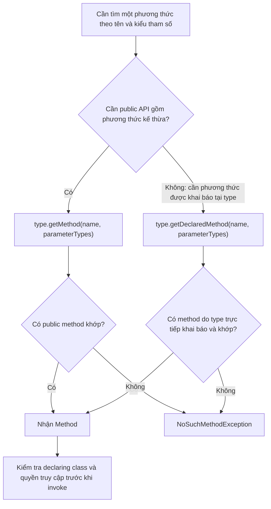

# getMethod() và getDeclaredMethod(): phạm vi public, kế thừa và member khai báo trực tiếp

> **Chương:** Hợp đồng reflection — **Module:** Java 18 và các hợp đồng API còn áp dụng trên JDK hiện đại.  
> **Đối tượng:** Người đã biết lớp, kế thừa và interface trong Java, muốn dùng reflection chính xác khi đọc API hoặc xây dựng công cụ.

## Bạn sẽ học được gì?

Sau bài này, bạn có thể:

1. Chọn `Class.getMethod(...)` khi cần tìm **phương thức `public` có thể được tra cứu từ một kiểu**, kể cả phương thức khai báo ở superclass hoặc superinterface.
2. Chọn `Class.getDeclaredMethod(...)` khi cần tìm **phương thức do chính lớp/interface đó khai báo**, bất kể là `public`, `protected`, package-private hay `private`.
3. Dùng `Method.getDeclaringClass()` để xác định phương thức thật sự được khai báo ở đâu.
4. Phân biệt **tìm thấy phương thức** với **được phép gọi phương thức** qua reflection.
5. Hiểu vì sao các lời gọi có tên giống nhau vẫn nhận `NoSuchMethodException` khi kiểu tham số khác nhau.

Đây là hợp đồng của Java Reflection vẫn có hiệu lực trên JDK hiện đại. Chủ đề không dựa vào API Java đã bị loại bỏ hoặc hành vi chỉ có trên một phiên bản cũ.

## 1. Hai câu hỏi khác nhau dẫn đến hai API khác nhau

Cho một `Class<?> type`:

```java
Method publicMethod = type.getMethod("doWork", String.class);
Method ownMethod    = type.getDeclaredMethod("doWork", String.class);
```

Cùng nhận **tên phương thức** và danh sách **`Class<?>` của từng kiểu tham số**, nhưng hai phương thức dùng hai tiêu chí tìm kiếm khác nhau.

| Tiêu chí | `getMethod(name, parameterTypes)` | `getDeclaredMethod(name, parameterTypes)` |
| --- | --- | --- |
| Phạm vi visibility | Chỉ phương thức `public` | Mọi mức truy cập: `public`, `protected`, package-private, `private` |
| Phương thức khai báo ngay trong kiểu đang xét | Có, nếu `public` | Có, kể cả không `public` |
| Phương thức `public` kế thừa từ superclass | Có | Không |
| Phương thức `public` được kế thừa từ superinterface | Có, theo quy tắc kế thừa phương thức | Không |
| Phương thức `private` khai báo ở superclass | Không | Không — phải tra cứu trên chính superclass |
| Căn cứ tìm kiếm | Tập phương thức `public` có thể tìm từ kiểu đó | Chỉ các phương thức **khai báo trực tiếp** trong kiểu đó |
| Khi không khớp | Ném `NoSuchMethodException` | Ném `NoSuchMethodException` |

**`declared` nghĩa là “được khai báo trực tiếp”, không có nghĩa là “được quyền truy cập”.** Vì thế một `private` method có thể được `getDeclaredMethod` tìm thấy nhưng lệnh `Method.invoke` từ nơi khác vẫn không được phép thực hiện.

Tên và từng kiểu tham số phải khớp đúng với chữ ký phản chiếu; lookup không tự thực hiện chuyển kiểu, boxing, widening hay áp dụng đối số varargs như một lời gọi phương thức thông thường. Return type không được truyền vào hai API này.

## 2. Thí nghiệm: superclass, subclass và interface

Ta tạo ba kiểu trong package `model` và một chương trình quan sát trong package `app`. Việc đặt chương trình ngoài package `model` giúp thể hiện rõ ranh giới truy cập đối với phương thức `private`.

Cấu trúc tệp:

```text
reflection-demo/
└── src/
    ├── model/
    │   ├── Parent.java
    │   ├── Tagged.java
    │   └── Child.java
    └── app/
        └── ReflectionContractsDemo.java
```

**`src/model/Parent.java`**

```java
package model;

public class Parent {
    public String greet(String name) {
        return "Xin chào, " + name;
    }

    protected String protectedParent() {
        return "protected";
    }

    private String privateParent() {
        return "private";
    }
}
```

**`src/model/Tagged.java`**

```java
package model;

public interface Tagged {
    default String tag() {
        return "tagged";
    }

    static String helper() {
        return "helper";
    }
}
```

**`src/model/Child.java`**

```java
package model;

public class Child extends Parent implements Tagged {
    public String own() {
        return "own";
    }

    private String secret() {
        return "secret";
    }
}
```

Ở đây `Child` không khai báo lại `greet(String)` và `tag()`; chúng đến từ `Parent` và `Tagged`. Ngược lại, `own()` và `secret()` được khai báo ngay trong `Child`.

**`src/app/ReflectionContractsDemo.java`**

```java
package app;

import java.lang.reflect.Method;
import java.lang.reflect.Modifier;
import model.Child;
import model.Parent;
import model.Tagged;

public final class ReflectionContractsDemo {
    private static void inspect(
            Class<?> type,
            boolean declaredOnly,
            String name,
            Class<?>... parameterTypes) {

        String operation = declaredOnly ? "getDeclaredMethod" : "getMethod";
        try {
            Method method = declaredOnly
                    ? type.getDeclaredMethod(name, parameterTypes)
                    : type.getMethod(name, parameterTypes);

            System.out.printf(
                    "%s.%s(%s) -> %s [%s]%n",
                    type.getSimpleName(),
                    operation,
                    name,
                    method.getDeclaringClass().getSimpleName(),
                    Modifier.toString(method.getModifiers()));
        } catch (NoSuchMethodException e) {
            System.out.printf(
                    "%s.%s(%s) -> NoSuchMethodException%n",
                    type.getSimpleName(),
                    operation,
                    name);
        }
    }

    public static void main(String[] args) throws ReflectiveOperationException {
        inspect(Child.class, false, "greet", String.class);
        inspect(Child.class, true,  "greet", String.class);
        inspect(Child.class, false, "own");
        inspect(Child.class, true,  "own");
        inspect(Child.class, false, "secret");
        inspect(Child.class, true,  "secret");
        inspect(Child.class, false, "tag");
        inspect(Child.class, true,  "tag");
        inspect(Child.class, false, "protectedParent");
        inspect(Parent.class, true, "protectedParent");
        inspect(Child.class, true,  "privateParent");
        inspect(Parent.class, true, "privateParent");
        inspect(Child.class, false, "helper");
        inspect(Tagged.class, false, "helper");
        inspect(Child.class, false, "greet", CharSequence.class);

        Method greet = Child.class.getMethod("greet", String.class);
        System.out.println("invoke greet -> " + greet.invoke(new Child(), "Lan"));

        Method secret = Child.class.getDeclaredMethod("secret");
        System.out.println("canAccess secret -> " + secret.canAccess(new Child()));
    }
}
```

Từ thư mục `reflection-demo`, biên dịch và chạy bằng JDK hiện đại (tương thích Java 18 trở lên):

```shell
javac -encoding UTF-8 -d out src/model/Parent.java src/model/Tagged.java src/model/Child.java src/app/ReflectionContractsDemo.java
java -cp out app.ReflectionContractsDemo
```

Kết quả dự kiến:

```text
Child.getMethod(greet) -> Parent [public]
Child.getDeclaredMethod(greet) -> NoSuchMethodException
Child.getMethod(own) -> Child [public]
Child.getDeclaredMethod(own) -> Child [public]
Child.getMethod(secret) -> NoSuchMethodException
Child.getDeclaredMethod(secret) -> Child [private]
Child.getMethod(tag) -> Tagged [public]
Child.getDeclaredMethod(tag) -> NoSuchMethodException
Child.getMethod(protectedParent) -> NoSuchMethodException
Parent.getDeclaredMethod(protectedParent) -> Parent [protected]
Child.getDeclaredMethod(privateParent) -> NoSuchMethodException
Parent.getDeclaredMethod(privateParent) -> Parent [private]
Child.getMethod(helper) -> NoSuchMethodException
Tagged.getMethod(helper) -> Tagged [public static]
Child.getMethod(greet) -> NoSuchMethodException
invoke greet -> Xin chào, Lan
canAccess secret -> false
```

Lần tra cứu `greet` cuối cùng thất bại vì đã hỏi `CharSequence.class` thay vì `String.class`, dù `String` là một `CharSequence`. Hai lớp không tương đương trong chữ ký phương thức.

### Đọc kết quả theo nguồn khai báo

- **`greet(String)`:** là `public` của `Parent` nên `Child.class.getMethod(...)` tìm thấy. `Child.class.getDeclaredMethod(...)` không tìm thấy vì `Child` không khai báo lại phương thức này.
- **`own()`:** do `Child` khai báo và là `public` nên cả hai API đều tìm thấy.
- **`secret()`:** do `Child` khai báo nhưng là `private`, vì thế chỉ `getDeclaredMethod` tìm thấy.
- **`tag()`:** phương thức `default` `public` được kế thừa từ `Tagged` nên có mặt trong lookup `getMethod` trên `Child`.
- **`protectedParent()`:** không phải `public`, và cũng không được `Child` khai báo; muốn xem khai báo phải tra cứu trên `Parent.class`.
- **`privateParent()`:** không được kế thừa; `getDeclaredMethod` trên `Parent.class` mới tìm thấy.
- **`helper()`:** phương thức `static` trong interface **không được lớp triển khai kế thừa**; hãy tìm trên chính `Tagged.class`.

## 3. Lược đồ tư duy: tìm theo API công khai hay theo nơi khai báo?



Nếu mục tiêu là **thống kê tất cả phương thức** thay vì tìm một chữ ký, hai API tương ứng là `getMethods()` và `getDeclaredMethods()`. Các phương thức dạng số nhiều trả về mảng và **không bảo đảm thứ tự**; hãy lọc/sắp xếp nếu cần báo cáo ổn định.

### Bảng tình huống thường gặp

| Nhu cầu | Lựa chọn | Lý do |
| --- | --- | --- |
| Framework gọi endpoint `public` kế thừa từ base controller | `getMethod` | Quan tâm API công khai có thể tra cứu trên subclass |
| Kiểm tra phương thức `private` trong chính lớp cần phân tích | `getDeclaredMethod` | Chỉ API `declared` tìm thấy phương thức không `public` |
| Tìm phương thức `public` bị subclass override | Cả hai API đều có thể tìm thấy | Phương thức override là khai báo mới của subclass |
| Tìm `public` method chỉ có ở superclass | `getMethod` trên subclass hoặc `getDeclaredMethod` trên superclass | Tùy cần tìm theo API kế thừa hay theo nơi khai báo |
| Tìm `default` method từ interface mà lớp không override | `getMethod` trên lớp | Được kế thừa qua interface |
| Tìm `static` method khai báo trong interface | Gọi trên `SomeInterface.class` | Interface static method không được lớp triển khai kế thừa |

## 4. Tìm thấy chưa đồng nghĩa có quyền `invoke()`

Cả `getMethod` và `getDeclaredMethod` **chỉ tìm và trả về đối tượng `Method`**. Khi thực thi `method.invoke(receiver, args)`, Java tiếp tục áp dụng kiểm soát truy cập.

Trong ví dụ, `app.ReflectionContractsDemo` tìm được `Child.secret()` bằng `getDeclaredMethod`, nhưng:

```java
Method secret = Child.class.getDeclaredMethod("secret");
Child child = new Child();

System.out.println(secret.canAccess(child)); // false
// secret.invoke(child); // sẽ ném IllegalAccessException
```

Lý do là phương thức `secret()` thuộc quyền `private` của lớp khác, còn chương trình quan sát không có đặc quyền truy cập. Với phương thức instance, `Method.canAccess(obj)` dùng receiver phù hợp; với phương thức `static`, dùng `canAccess(null)`.

Trên JDK hiện đại có **strong encapsulation** của module. Việc gọi `setAccessible(true)` không phải một cách bảo đảm để vượt qua mọi ranh giới; nó có thể bị từ chối (ví dụ `InaccessibleObjectException`). `trySetAccessible()` có thể trả `false` khi không thể mở quyền truy cập. Nếu bạn viết framework, hãy thiết kế hợp đồng công khai hoặc cấu hình module phù hợp thay vì giả định mọi thành viên `private` đều gọi được.

Đặc biệt, một phương thức có modifier `public` cũng không mặc nhiên gọi được từ **mọi module** nếu kiểu/package chứa nó không được xuất cho module gọi. `getMethod` xác định phạm vi tìm kiếm phương thức; quyền truy cập là bước đánh giá riêng.

## 5. Các bẫy dễ nhầm về chữ ký và kế thừa

### 5.1. Kiểu tham số khớp chính xác, không áp dụng ép kiểu thông thường

Ví dụ khai báo:

```java
public void send(int count) { }
public void send(Integer count) { }
public void collect(String... values) { }
```

Khi tra cứu từ lớp chứa các phương thức trên:

```java
type.getMethod("send", int.class);          // send(int)
type.getMethod("send", Integer.class);      // send(Integer)
type.getMethod("collect", String[].class);  // collect(String...)
```

`type.getMethod("collect", String.class)` sẽ không tìm thấy vì varargs được biểu diễn bằng **tham số mảng** trong chữ ký phương thức. Tương tự, `List<String>` không có class token riêng: với tham số `List<String>`, tra cứu theo `List.class` do **type erasure**. Có thể dùng `Method.getGenericParameterTypes()` để kiểm tra generic type metadata khi cần.

### 5.2. Kế thừa khác với khai báo lại

Nếu thêm vào `Child`:

```java
@Override
public String greet(String name) {
    return "Child: " + super.greet(name);
}
```

thì `Child.class.getDeclaredMethod("greet", String.class)` **sẽ tìm thấy**, vì lúc này `Child` trực tiếp khai báo một phương thức override. `getDeclaringClass()` của đối tượng `Method` tìm theo hai API cũng sẽ là `Child.class` cho chữ ký này.

### 5.3. Phương thức bridge và synthetic do compiler tạo

Khi kế thừa generic hoặc override với return type hiệp biến, compiler có thể tạo **bridge method** để bảo đảm đa hình ở mức bytecode. Reflection có thể nhìn thấy các phương thức do compiler sinh ra trong `getDeclaredMethods()`, kể cả các method không xuất hiện nguyên văn trong mã nguồn. Để phân tích:

```java
for (Method method : Child.class.getDeclaredMethods()) {
    System.out.printf("%s bridge=%s synthetic=%s%n",
            method.getName(),
            method.isBridge(),
            method.isSynthetic());
}
```

Đoạn này chỉ minh họa cách kiểm tra cờ; lớp `Child` trong thí nghiệm cơ bản không nhất thiết có bridge method. Khi viết bộ quét annotation hoặc generator, nên xét `isBridge()` và `isSynthetic()` theo mục đích, đồng thời không phụ thuộc thứ tự kết quả `getDeclaredMethods()`.

### 5.4. `getMethod` không bao gồm tất cả member nhìn thấy từ mã nguồn

Đối tượng `Class` cũng cung cấp API riêng cho **constructor** (`getConstructor`/`getDeclaredConstructor`) và **field** (`getField`/`getDeclaredField`). Các API `getMethod`/`getDeclaredMethod` chỉ tìm **method**. Bản thân `static` method khai báo trong interface cũng không được kế thừa vào lớp triển khai, như ví dụ `Tagged.helper()`.

## 6. Quy trình lựa chọn API trong dự án thực tế

Khi xử lý API bằng reflection:

1. **Xác định câu hỏi:** Bạn đang dùng lớp như một **kiểu cung cấp API công khai** hay muốn đọc **các khai báo vật lý trên chính lớp đó**?
2. **Chọn đúng API:** `getMethod` cho `public` có kế thừa; `getDeclaredMethod` cho member khai báo trực tiếp ở kiểu đang xét.
3. **Đưa vào đúng kiểu tham số:** dùng `int.class`, `String.class`, `String[].class`… theo khai báo thực tế sau erasure.
4. **Đọc nguồn:** in `method.getDeclaringClass()`, `getModifiers()`, `isBridge()`, `isSynthetic()` để lý giải kết quả.
5. **Kiểm tra quyền truy cập trước khi invoke:** `canAccess` và hợp đồng module/package phải phù hợp.
6. **Phân loại lỗi chính xác:** `NoSuchMethodException` là **không tìm thấy chữ ký theo phạm vi API**; `IllegalAccessException` thường là **tìm thấy nhưng không có quyền gọi**; lỗi được ném từ chính method khi `invoke` có thể được bọc trong `InvocationTargetException`.

Ví dụ: Một thư viện muốn gọi `public void process(Request)` của một controller, kể cả khi controller kế thừa từ base class, nên chọn `controllerType.getMethod("process", Request.class)`. Một bộ kiểm tra quy ước khai báo yêu cầu mọi controller tự khai báo `validate()` lại cần `getDeclaredMethod("validate")` trên từng controller.

## 7. Tự kiểm tra

**Câu 1.** `Base` khai báo `public void ping()`, `Derived extends Base` không override. `Derived.class.getMethod("ping")` và `Derived.class.getDeclaredMethod("ping")` khác nhau thế nào?

> `getMethod` tìm thấy `Base.ping()`; `getDeclaredMethod` ném `NoSuchMethodException` vì `Derived` không trực tiếp khai báo `ping()`.

**Câu 2.** `Derived` khai báo `private void reset()`. API nào tìm thấy, và có chắc gọi được không?

> `getDeclaredMethod("reset")` tìm thấy; `getMethod("reset")` không tìm thấy. Việc invoke còn phải qua kiểm tra quyền truy cập.

**Câu 3.** Tại sao `getMethod("run", Integer.class)` không tìm thấy method khai báo `run(int)` dù một lời gọi Java thông thường có thể boxing/unboxing?

> Reflection method lookup so sánh kiểu tham số theo chữ ký runtime; `Integer.class` và `int.class` là hai kiểu khác nhau.

**Câu 4.** Một `default` method của interface không bị override trong lớp triển khai có thể tìm bằng API nào trên lớp đó?

> `getMethod` có thể tìm method `public` được kế thừa từ interface; `getDeclaredMethod` trên lớp triển khai không tìm thấy vì lớp không khai báo trực tiếp.

**Câu 5.** `getDeclaredMethod` trả về `Method` có `private` modifier. Vì sao `invoke` vẫn có thể thất bại?

> Bởi tìm kiếm và quyền truy cập là hai hợp đồng khác nhau. Có thể gặp `IllegalAccessException` nếu caller không được phép truy cập; module encapsulation cũng giới hạn việc mở truy cập.

## Tài liệu API để đối chiếu trên JDK đang dùng

- [Oracle Java SE API — `Class.getMethod(String, Class<?>...)`](https://docs.oracle.com/en/java/javase/25/docs/api/java.base/java/lang/Class.html#getMethod(java.lang.String,java.lang.Class...)): tìm phương thức `public` theo chữ ký.
- [Oracle Java SE API — `Class.getDeclaredMethod(String, Class<?>...)`](https://docs.oracle.com/en/java/javase/25/docs/api/java.base/java/lang/Class.html#getDeclaredMethod(java.lang.String,java.lang.Class...)): tìm method được khai báo trực tiếp, mọi mức truy cập.
- [Oracle Java SE API — `Method`](https://docs.oracle.com/en/java/javase/25/docs/api/java.base/java/lang/reflect/Method.html): `getDeclaringClass()`, `isBridge()`, `invoke()` và `getGenericParameterTypes()`.
- [Oracle Java SE API — `AccessibleObject`](https://docs.oracle.com/en/java/javase/25/docs/api/java.base/java/lang/reflect/AccessibleObject.html): `canAccess()`, `trySetAccessible()` và quyền reflective access.

**Ghi nhớ:** Hãy hỏi **“muốn tìm API `public` có kế thừa?”** hoặc **“muốn tìm khai báo nằm trực tiếp trên kiểu này?”** trước khi chọn phương thức reflection. Sau khi tìm được `Method`, kiểm tra riêng khả năng truy cập và gọi phương thức.
