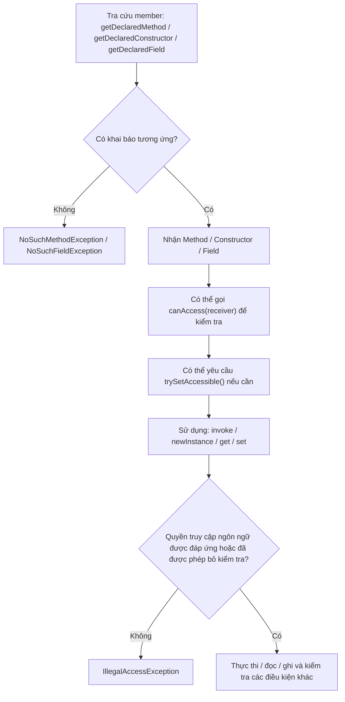

# AccessibleObject và thời điểm kiểm tra quyền khi sử dụng Method, Constructor hoặc Field

> **Chương:** Quyền reflection  
> **Ngữ cảnh module:** `JAVA_VERSION_JAVA18` — học hợp đồng reflection được hỗ trợ trên JDK hiện đại, đặc biệt cách kiểm tra quyền lúc sử dụng một member. Nội dung áp dụng cho JDK 18 trở lên và không dựa vào cơ chế mở quyền truy cập đã lỗi thời.

## Mục tiêu

Hoàn thành bài này, bạn sẽ:

- Giải thích vì sao **tìm thấy** một `Method`, `Constructor` hoặc `Field` bằng reflection **chưa có nghĩa được phép sử dụng** member đó.
- Xác định thời điểm kiểm tra quyền của `Method.invoke()`, `Constructor.newInstance()`, `Field.get()` và `Field.set()`.
- Dùng `AccessibleObject.canAccess()` để quan sát khả năng truy cập hiện tại, và hiểu điều kiện cho `trySetAccessible()` / `setAccessible(true)`.
- Phân biệt lỗi về **tra cứu member**, **quyền truy cập**, **thực thi mã trong member** và **kiểu dữ liệu**.
- Hiểu vai trò của `exports` và `opens` trong hệ module của Java.

## 1. AccessibleObject nằm ở đâu trong Reflection API?

`java.lang.reflect.AccessibleObject` là lớp cha của `Field` và `Executable`; `Method` cùng `Constructor` kế thừa từ `Executable`. Ba loại member này đều có các thao tác liên quan đến kiểm soát truy cập:

| Thành phần | Member đại diện | Lời gọi sử dụng member |
| --- | --- | --- |
| `Method` | Phương thức được khai báo trên một kiểu | `method.invoke(receiver, arguments...)` |
| `Constructor` | Constructor của một lớp | `constructor.newInstance(arguments...)` |
| `Field` | Trường dữ liệu của một kiểu | `field.get(receiver)`, `field.set(receiver, value)` và các biến thể có kiểu |
| `AccessibleObject` | Nền tảng chung để quản lý việc **bỏ qua kiểm tra quyền truy cập ngôn ngữ** khi được phép | `canAccess(receiver)`, `trySetAccessible()`, `setAccessible(true/false)` |

Thông thường, Java áp dụng các quy tắc truy cập `public`, `protected`, package-private, `private` và ranh giới module. Reflection vẫn tuân theo các quy tắc này khi gọi member. `AccessibleObject` cung cấp cơ chế yêu cầu **bỏ qua kiểm tra quyền truy cập ngôn ngữ** cho một đối tượng phản chiếu cụ thể, nhưng việc yêu cầu có được chấp nhận hay không phụ thuộc các điều kiện của JDK và module.

**Điểm cốt lõi:** API tra cứu member và API sử dụng member là hai bước riêng. `getDeclaredMethod("secret")` hay `getDeclaredField("token")` có thể trả về object phản chiếu mô tả member `private`, trong khi `invoke()` hoặc `get()` vẫn phát sinh `IllegalAccessException`.

## 2. Thời điểm kiểm tra quyền: từ tìm kiếm đến thực thi

Xét luồng điển hình:



Cần phân biệt:

1. **Lúc tra cứu:** `Class.getDeclaredMethod()`, `getDeclaredConstructor()` và `getDeclaredField()` trả về metadata của member được khai báo trực tiếp, bao gồm cả `private`. Việc một member là `private` tự nó không làm lời gọi tra cứu này thất bại.
2. **Lúc kiểm tra chủ động:** `canAccess(receiver)` trả về `boolean` cho biết caller hiện tại có thể truy cập member phản chiếu đó hay không. Phương thức này **không cấp quyền**.
3. **Lúc yêu cầu bỏ kiểm tra:** `trySetAccessible()` cố kích hoạt chế độ bỏ qua kiểm tra quyền truy cập ngôn ngữ cho đối tượng phản chiếu và trả về `true` khi được phép. `setAccessible(true)` là lựa chọn tương ứng, có thể ném `InaccessibleObjectException` nếu ranh giới module không cho phép.
4. **Lúc sử dụng:** `invoke()`, `newInstance()`, `get()` hoặc `set()` mới thực hiện thao tác nhắm vào member. Nếu caller chưa có quyền truy cập và chưa được phép bỏ kiểm tra, thao tác có thể ném `IllegalAccessException`.

Việc đã lấy được `Method`, `Constructor` hoặc `Field` từ trước không bảo đảm một lần sử dụng về sau hợp lệ. Quyền được xem xét theo caller, member, receiver và trạng thái bỏ kiểm tra quyền của đối tượng reflection tại thời điểm sử dụng.

### Hai cột cần nhớ

| Câu hỏi | API | Ý nghĩa |
| --- | --- | --- |
| Member có tồn tại theo tiêu chí tra cứu? | `getMethod()`, `getDeclaredMethod()`, `getDeclaredConstructor()`, `getDeclaredField()` | Tìm **member**, không cấp phép gọi |
| Caller hiện có thể truy cập member này? | `canAccess(receiver)` | Quan sát khả năng truy cập hiện tại, không thay đổi quyền |
| Có thể yêu cầu bỏ kiểm tra quyền truy cập ngôn ngữ? | `trySetAccessible()` / `setAccessible(true)` | Phụ thuộc ranh giới module và điều kiện cho phép |
| Thực sự có thể sử dụng member? | `invoke()`, `newInstance()`, `get()`, `set()` | Kiểm tra quyền khi sử dụng, cùng các điều kiện khác của thao tác |

## 3. Ví dụ chạy được: cùng một member, hai thời điểm khác nhau

Ví dụ dưới đây biên dịch và chạy trên classpath với hai package khác nhau. `Vault` là lớp `public`, nhưng có phương thức, constructor và field `private`. Chương trình gọi từ package khác để thấy rõ lần sử dụng đầu tiên bị từ chối.

Cấu trúc:

```text
reflection-access-demo/
└── src/
    └── demo/
        ├── model/
        │   └── Vault.java
        └── app/
            └── AccessDemo.java
```

**`src/demo/model/Vault.java`**

```java
package demo.model;

public final class Vault {
    private String token;

    public Vault(String token) {
        this.token = token;
    }

    private Vault() {
        this("from-private-constructor");
    }

    public String preview() {
        return "preview:" + token;
    }

    private String reveal() {
        return "secret:" + token;
    }
}
```

**`src/demo/app/AccessDemo.java`**

```java
package demo.app;

import demo.model.Vault;
import java.lang.reflect.Constructor;
import java.lang.reflect.Field;
import java.lang.reflect.Method;

public final class AccessDemo {
    public static void main(String[] args) throws ReflectiveOperationException {
        Vault vault = new Vault("A1");

        // Bước 1: Tra cứu member. Các phương thức getDeclared* tìm cả private.
        Method preview = Vault.class.getMethod("preview");
        Method reveal = Vault.class.getDeclaredMethod("reveal");
        Constructor<Vault> privateCtor = Vault.class.getDeclaredConstructor();
        Field token = Vault.class.getDeclaredField("token");

        // Bước 2: Hỏi quyền truy cập, chưa thay đổi trạng thái.
        System.out.println("public.canAccess=" + preview.canAccess(vault));
        System.out.println("method.canAccess=" + reveal.canAccess(vault));
        System.out.println("ctor.canAccess=" + privateCtor.canAccess(null));
        System.out.println("field.canAccess=" + token.canAccess(vault));
        System.out.println("public.invoke=" + preview.invoke(vault));

        // Bước 3: Sử dụng private member khi chưa được phép bỏ kiểm tra.
        try {
            reveal.invoke(vault);
        } catch (IllegalAccessException expected) {
            System.out.println("method.invoke=IllegalAccessException");
        }

        try {
            privateCtor.newInstance();
        } catch (IllegalAccessException expected) {
            System.out.println("ctor.newInstance=IllegalAccessException");
        }

        try {
            token.get(vault);
        } catch (IllegalAccessException expected) {
            System.out.println("field.get=IllegalAccessException");
        }

        try {
            token.set(vault, "B2");
        } catch (IllegalAccessException expected) {
            System.out.println("field.set=IllegalAccessException");
        }

        // Bước 4: Trong ví dụ classpath/unnamed module, yêu cầu này được phép.
        boolean methodOpened = reveal.trySetAccessible();
        boolean ctorOpened = privateCtor.trySetAccessible();
        boolean fieldOpened = token.trySetAccessible();

        System.out.println("method.trySetAccessible=" + methodOpened);
        System.out.println("ctor.trySetAccessible=" + ctorOpened);
        System.out.println("field.trySetAccessible=" + fieldOpened);

        if (methodOpened && ctorOpened && fieldOpened) {
            System.out.println("field.get=" + token.get(vault));
            System.out.println("method.invoke=" + reveal.invoke(vault));
            System.out.println(
                    "ctor.newInstance=" + privateCtor.newInstance().preview());

            token.set(vault, "B2");
            System.out.println("after-field-set=" + preview.invoke(vault));
        }
    }
}
```

Tại thư mục `reflection-access-demo`, dùng JDK 18 trở lên:

```sh
javac -encoding UTF-8 -d out src/demo/model/Vault.java src/demo/app/AccessDemo.java
java -cp out demo.app.AccessDemo
```

Kết quả dự kiến trên classpath thông thường:

```text
public.canAccess=true
method.canAccess=false
ctor.canAccess=false
field.canAccess=false
public.invoke=preview:A1
method.invoke=IllegalAccessException
ctor.newInstance=IllegalAccessException
field.get=IllegalAccessException
field.set=IllegalAccessException
method.trySetAccessible=true
ctor.trySetAccessible=true
field.trySetAccessible=true
field.get=A1
method.invoke=secret:A1
ctor.newInstance=preview:from-private-constructor
after-field-set=preview:B2
```

### Giải thích chính xác kết quả

- `getDeclaredMethod("reveal")`, `getDeclaredConstructor()` và `getDeclaredField("token")` **thành công ngay** vì member tồn tại trực tiếp trong `Vault`. Chúng không yêu cầu caller được phép gọi member.
- `canAccess` của ba member `private` trả về `false` tại caller thuộc package `demo.app`, vì vẫn áp dụng kiểm soát truy cập thông thường.
- Lúc gọi `reveal.invoke(vault)`, `privateCtor.newInstance()`, `token.get(vault)` hoặc `token.set(vault, ...)`, kiểm tra quyền truy cập mới ngăn thao tác và dẫn tới `IllegalAccessException`.
- Trong ví dụ chạy trên **classpath**, các lớp thuộc unnamed module, có package mở cho reflective access. Vì thế `trySetAccessible()` có thể kích hoạt bỏ kiểm tra quyền truy cập ngôn ngữ cho từng đối tượng `Method`, `Constructor` và `Field` đã lấy.
- Sau khi mở quyền, `Field.get()`, `Field.set()`, `Method.invoke()` và `Constructor.newInstance()` thực hiện được. Field `token` không phải `final`, nên trong ví dụ phép gán qua reflection hợp lệ.

**Không suy rộng đầu ra này sang mọi named module.** Việc classpath cho phép `trySetAccessible()` không có nghĩa một thư viện có thể mở mọi member `private` trong JDK hoặc một module khác.

## 4. Đúng receiver cho canAccess, invoke, get và set

`canAccess(Object obj)` cần đối số phù hợp với loại member:

| Đối tượng reflection | Đối số cho `canAccess` | Đối số khi thực hiện |
| --- | --- | --- |
| Instance `Method` | Instance của lớp khai báo hoặc subtype tương ứng | `method.invoke(instance, ...)` |
| `static` `Method` | `null` | `method.invoke(null, ...)` |
| `Constructor` | `null` | `ctor.newInstance(...)` |
| Instance `Field` | Instance có field đó | `field.get(instance)`, `field.set(instance, value)` |
| `static` `Field` | `null` | `field.get(null)`, `field.set(null, value)` nếu field cho phép ghi |

Truyền `null` cho instance member hoặc truyền receiver có kiểu không phù hợp vào `canAccess` sẽ gây `IllegalArgumentException`, vì đó là lỗi đối số của thao tác kiểm tra, không phải câu trả lời `false` về quyền truy cập. Với constructor, luôn dùng `null` để kiểm tra quyền vì constructor không gọi trên instance có sẵn.

`canAccess` là **phép kiểm tra tại thời điểm gọi**, không phải một lệnh mở khóa. Tương tự, việc `getModifiers()` cho thấy member là `public` chỉ nói về modifier; để gọi member còn cần lớp/package chứa nó truy cập được theo hợp đồng module.

### Trạng thái truy cập gắn với từng đối tượng reflection

Ví dụ:

```java
Method first = Vault.class.getDeclaredMethod("reveal");
Method second = Vault.class.getDeclaredMethod("reveal");

first.trySetAccessible(); // Yêu cầu trên first
// Không dựa vào first để giả định second đã bật chế độ bỏ kiểm tra.
```

Chế độ bỏ kiểm tra của `AccessibleObject` áp dụng cho đối tượng reflection đang dùng; nên yêu cầu trực tiếp trên `Method`, `Field` hoặc `Constructor` mà đoạn mã sẽ sử dụng. `setAccessible(false)` tắt chế độ bỏ kiểm tra quyền truy cập ngôn ngữ trên đối tượng đó, để các lần sử dụng tiếp theo phải tuân theo kiểm tra thông thường.

## 5. Bản chất của trySetAccessible() và setAccessible(true)

Hai API này cùng nhắm tới việc **cho phép bỏ qua kiểm tra quyền truy cập ngôn ngữ** cho đối tượng `AccessibleObject`:

```java
Method method = Vault.class.getDeclaredMethod("reveal");

if (method.trySetAccessible()) {
    // Chỉ gọi sau khi hệ thống xác nhận đã được phép bỏ kiểm tra.
} else {
    // Thiết kế lại điểm tích hợp hoặc bổ sung opens phù hợp.
}
```

- `trySetAccessible()` **trả về `true`** nếu có thể bật chế độ bỏ kiểm tra; **trả về `false`** nếu không thể bật vì các quy tắc encapsulation của module. Nó tránh việc phải dùng exception làm cách kiểm tra thường xuyên.
- `setAccessible(true)` cố bật chế độ tương đương, nhưng có thể ném `InaccessibleObjectException` khi không thể bật.
- `setAccessible(false)` tắt chế độ bỏ kiểm tra. Nó không sửa modifier `private`/`public` được khai báo trong bytecode.
- Ngay cả khi chế độ bỏ kiểm tra đã bật, member vẫn phải đáp ứng **các điều kiện khác** của thao tác: receiver phù hợp, số lượng/kiểu tham số, khả năng khởi tạo lớp và quy tắc ghi các loại final field.

Không nên giải thích `trySetAccessible()` thành “đổi member thành public”. Nó chỉ thay đổi việc kiểm tra quyền truy cập ngôn ngữ của **đối tượng reflection**, trong phạm vi module cho phép.

### Ranh giới của named module: exports khác opens

Giả sử mã `Vault` thuộc module `vault.module` và ứng dụng reflection thuộc module `inspector.module`. Khi `vault.module` chỉ khai báo:

```java
module vault.module {
    exports demo.model;
}
```

`exports` giúp module khác truy cập lớp `public` và thành viên `public` của package được xuất. Nhưng `exports` **không tự cho phép** `inspector.module` mở quyền để gọi `private Vault.reveal()` bằng reflection. `getDeclaredMethod("reveal")` vẫn có thể tìm thấy khai báo, trong khi `trySetAccessible()` trên method đó trả `false` đối với caller ở module khác khi package chưa được mở tương ứng.

Khi nhà cung cấp module chủ động cho phép reflection sâu từ `inspector.module`, có thể khai báo:

```java
module vault.module {
    exports demo.model;
    opens demo.model to inspector.module;
}
```

Lúc này package `demo.model` được mở có chọn lọc cho `inspector.module`, và trong các điều kiện thông thường, `trySetAccessible()` đối với member `private` trong package đó có thể thành công.

Cách hiểu:

| Cấu hình module cung cấp member | Truy cập API `public` từ module khác | Bỏ kiểm tra quyền đối với `private` từ module khác |
| --- | --- | --- |
| Chỉ `exports pkg;` | Có, nếu module gọi đọc được module cung cấp | Không vì chỉ `exports` |
| `exports pkg; opens pkg to caller.module;` | Có, nếu module gọi đọc được module cung cấp | Có thể, với module được chỉ định |
| `opens pkg to caller.module;` (không `exports`) | Không cho phép dùng kiểu `public` qua truy cập ngôn ngữ thông thường chỉ nhờ `opens` | Cho phép reflective access sâu theo điều kiện tương ứng |
| Các lớp cùng một module | Quyền truy cập Java theo khai báo vẫn áp dụng | `setAccessible` có thể bỏ kiểm tra trong cùng module |

Trong ứng dụng Java module hóa, ưu tiên API công khai rõ ràng. Nếu framework có nhu cầu đọc/ghi private member, hãy cấu hình `opens` đúng package và đúng module nhận quyền theo hợp đồng của ứng dụng. Không giả định các package nội bộ của JDK được mở sẵn.

## 6. Ngoại lệ nào xuất hiện ở giai đoạn nào?

| Tình huống | Giai đoạn | Kết quả cần phân biệt |
| --- | --- | --- |
| `getDeclaredMethod("missing")` không có phương thức khớp | Tra cứu | `NoSuchMethodException` |
| `getDeclaredField("missing")` không có field khớp | Tra cứu | `NoSuchFieldException` |
| `getDeclaredConstructor(...)` không có constructor khớp | Tra cứu | `NoSuchMethodException` |
| `trySetAccessible()` bị giới hạn bởi module | Yêu cầu bỏ kiểm tra | Trả `false` |
| `setAccessible(true)` bị giới hạn bởi module | Yêu cầu bỏ kiểm tra | `InaccessibleObjectException` |
| `Method.invoke()` trên private method chưa được phép truy cập | Sử dụng | `IllegalAccessException` |
| `Constructor.newInstance()` trên private constructor chưa được phép truy cập | Sử dụng | `IllegalAccessException` |
| `Field.get()/set()` trên private field chưa được phép truy cập | Sử dụng | `IllegalAccessException` |
| Lời gọi được phép, nhưng **phương thức/constructor bên trong** ném ngoại lệ | Thực thi mã đích | `InvocationTargetException` bao nguyên nhân từ mã đích |
| Receiver, kiểu tham số hoặc giá trị gán không phù hợp | Sử dụng | Có thể là `IllegalArgumentException` |
| Yêu cầu ghi field `final` không được phép sửa | Ghi field | Có thể là `IllegalAccessException` dù bỏ kiểm tra truy cập đã bật |

`InvocationTargetException` và `IllegalAccessException` đặc biệt dễ bị nhầm khi chạy thử `Method.invoke()`. Trường hợp đầu cho biết mã đích đã được gọi rồi ném lỗi, còn trường hợp sau cho biết reflection không được quyền thực hiện lời gọi.

Ví dụ phân loại:

```java
try {
    method.invoke(receiver);
} catch (IllegalAccessException accessProblem) {
    // Caller không được phép truy cập method tại lần invoke này.
} catch (java.lang.reflect.InvocationTargetException targetProblem) {
    // Method đã được gọi và chính mã đích đã ném ngoại lệ.
    Throwable cause = targetProblem.getCause();
    System.err.println("Target failed: " + cause);
}
```

**Lưu ý đối với field `final`:** Bỏ kiểm tra quyền truy cập không đồng nghĩa có quyền ghi mọi trường `final`. Các trường `static final` và một số nhóm `final` khác (ví dụ field của record hoặc hidden class) thuộc nhóm **không thể sửa qua reflection**. Việc mở quyền, nếu được phép, chủ yếu phục vụ đọc các trường này. Hãy dùng constructor hoặc API bất biến có chủ đích thay vì tìm cách cập nhật trạng thái `final` qua reflection.

## 7. Kiểm chứng trong một hệ thống thực tế

Khi thấy phản chiếu tìm được member nhưng lần sử dụng bị lỗi, thực hiện theo thứ tự:

1. **Xác định member:** ghi lại `getDeclaringClass()`, `getName()`, `getModifiers()`, và loại `Method`/`Constructor`/`Field`. Đừng nhầm lỗi không khớp chữ ký với lỗi quyền.
2. **Xác định caller và receiver:** caller nằm trong package/module nào? Receiver có đúng kiểu cần thiết không? `canAccess(null)` dành cho member `static` và constructor; instance member cần receiver phù hợp.
3. **Kiểm tra khả năng truy cập:** gọi `canAccess(receiver)` trên đối tượng phản chiếu sử dụng ở nơi thực sự invoke/get/set, rồi ghi lại kết quả.
4. **Nếu cần reflection sâu, xác định chính sách module:** module cung cấp có mở package cho module gọi qua `opens` hay chưa? Quyền này cần được thiết kế tại ranh giới module.
5. **Chỉ yêu cầu bỏ kiểm tra khi có lý do:** dùng `trySetAccessible()` và xử lý cả nhánh `false`, thay vì giả định mọi private member đều mở được.
6. **Phân loại exception tại thao tác:** `IllegalAccessException` là vấn đề quyền; `InvocationTargetException` là lỗi từ mã đích; `IllegalArgumentException` thường liên quan receiver/đối số; ghi final field có các quy tắc bổ sung.

### Tình huống áp dụng

Một thư viện mapping dữ liệu dùng `getDeclaredField("id")` để tìm trường `private` của entity. Trường tồn tại và method lookup thành công, nhưng `field.set(entity, value)` ném `IllegalAccessException`. Nhà phát triển cần hỏi: thư viện có được phép truy cập `private` field không; entity nằm trong named module nào; package có `opens` cho module mapping không; và field có thể ghi được không (đặc biệt khi `final`). Nếu không thể mở quyền, hãy chuyển sang constructor, factory, hoặc API công khai phù hợp.

Cùng một bộ kiểm tra quyền, cách xử lý khác nhau tùy mục đích của ứng dụng: bộ kiểm tra metadata có thể chỉ cần đọc `Method`/`Field` mà không invoke; framework thực thi cần quyền truy cập phù hợp và phải giải thích được vì sao quyền đó được cấp.

## 8. Tự kiểm tra

**Câu 1.** `getDeclaredMethod("secret")` trả về `Method` với modifier `private`. Liệu thao tác tìm thấy method đã xác nhận có thể `invoke()` chưa?

> Chưa. Tra cứu xác định member tồn tại; quyền được kiểm tra riêng khi sử dụng. `invoke()` có thể ném `IllegalAccessException`.

**Câu 2.** `field.canAccess(entity)` trả `false`. Điều đó có cho biết field không tồn tại hoặc đã bị xóa không?

> Không. Field đã được tìm thấy; `false` chỉ cho biết caller hiện không có khả năng truy cập field qua đối tượng reflection đó với receiver đã cung cấp.

**Câu 3.** Vì sao `constructor.canAccess(null)` là cú pháp phù hợp, còn `field.canAccess(null)` có thể sai?

> Constructor không có receiver instance nên truyền `null`. Với instance field, phải truyền object mang field; chỉ static field mới dùng `null`.

**Câu 4.** Một package đã `exports` cho module gọi; điều đó đã đủ để `trySetAccessible()` mở `private` field chưa?

> Chưa. `exports` phục vụ API công khai. Để cho module khác truy cập sâu qua reflection, package cần được `opens` phù hợp hoặc thuộc trường hợp khác mà hợp đồng API cho phép.

**Câu 5.** Method đã được truy cập hợp lệ nhưng phần thân ném `IllegalStateException`. Khi gọi qua `Method.invoke()`, exception ngoài thường là gì?

> `InvocationTargetException`; dùng `getCause()` để xem lỗi do mã bên trong method ném ra.

**Câu 6.** `trySetAccessible()` trả `true` cho `static final` field. Có được mặc định ghi giá trị mới bằng `Field.set()` không?

> Không. Khả năng bỏ kiểm tra quyền truy cập không loại bỏ quy tắc hạn chế ghi field `final`; static final thuộc nhóm không thể sửa qua reflection theo hợp đồng hiện đại.

## Tài liệu đối chiếu (Java SE API)

- [AccessibleObject — `canAccess()`, `trySetAccessible()`, `setAccessible()`](https://docs.oracle.com/en/java/javase/25/docs/api/java.base/java/lang/reflect/AccessibleObject.html): điều kiện bỏ kiểm tra quyền, bao gồm các quy tắc module.
- [Method — `invoke()`](https://docs.oracle.com/en/java/javase/25/docs/api/java.base/java/lang/reflect/Method.html): kiểm tra quyền và cách xử lý exception từ lời gọi đích.
- [Constructor — `newInstance()`](https://docs.oracle.com/en/java/javase/25/docs/api/java.base/java/lang/reflect/Constructor.html): tạo instance qua constructor phản chiếu.
- [Field — `get()` / `set()`](https://docs.oracle.com/en/java/javase/25/docs/api/java.base/java/lang/reflect/Field.html): đọc/ghi field, chuyển kiểu và giới hạn của final field.
- [InaccessibleObjectException](https://docs.oracle.com/en/java/javase/25/docs/api/java.base/java/lang/reflect/InaccessibleObjectException.html): lỗi khi không thể bật chế độ bỏ kiểm tra quyền.

**Ghi nhớ:** **Tra cứu** trả về metadata; **`canAccess()`** quan sát khả năng truy cập; **`trySetAccessible()`** xin phép bỏ kiểm tra trong phạm vi module cho phép; và **`invoke()` / `newInstance()` / `get()` / `set()`** mới thực hiện thao tác với quyền và các điều kiện hợp lệ tại thời điểm sử dụng.
