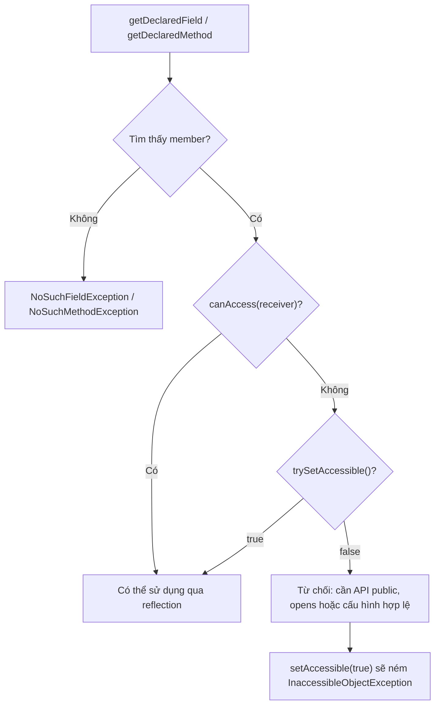

# `setAccessible(true)` và `InaccessibleObjectException` khi ranh giới module không cho phép

## 1. Khi tìm thấy member bằng Reflection nhưng vẫn không thể truy cập

Một framework có thể dùng `getDeclaredField()`, `getDeclaredMethod()` hoặc `getDeclaredConstructor()` để tìm các thành viên `private`, `protected` và package-private của một class. Tuy nhiên, **tìm thấy metadata không đồng nghĩa có quyền đọc field, gọi method hoặc tạo object**.

Ví dụ:

```java
import java.lang.reflect.Field;

Field field = SomeType.class.getDeclaredField("secret");

// Có đối tượng Field chưa có nghĩa là được đọc secret.
field.setAccessible(true);
```

Trên JDK hiện đại với **Java Platform Module System (JPMS)**, lời gọi `setAccessible(true)` có thể ném `java.lang.reflect.InaccessibleObjectException` khi package chứa member không được module sở hữu cho phép deep reflection từ module đang gọi. `InaccessibleObjectException` là một `RuntimeException`; lỗi phát sinh khi cố **bỏ qua kiểm tra truy cập**, không phải vì không tìm thấy tên field.

Kiến thức này vẫn áp dụng từ Java 18 đến các JDK hiện đại. Java 18 có JEP 416 thay đổi cách triển khai core reflection dựa trên MethodHandle, nhưng không hủy bỏ hàng rào truy cập do JPMS quy định. Bài thuộc chương **Quyền reflection** của mô-đun `JAVA_VERSION_JAVA18` và tập trung vào hợp đồng public API, không dựa vào workaround triển khai cũ.

**Thông điệp chính:** `setAccessible(true)` yêu cầu quyền bỏ qua một số kiểm tra truy cập ngôn ngữ Java; nó **không phải lệnh vô điều kiện phá encapsulation của module khác**.

## 2. Ba câu hỏi khác nhau: tìm thấy, được gọi, được mở quyền

Khi làm việc với một thành viên reflection, nên tách ba tầng:

1. **Member có tồn tại không?** Ví dụ `getDeclaredField("secret")` có tìm được field hay ném `NoSuchFieldException`.
2. **Caller có thể truy cập theo quy tắc thông thường không?** Ví dụ `field.canAccess(object)` trả `true` hoặc `false`.
3. **Caller có thể yêu cầu bỏ qua kiểm tra truy cập không?** `field.trySetAccessible()` hoặc `field.setAccessible(true)` chịu các điều kiện JPMS.



Sơ đồ mô tả nhánh điển hình khi muốn truy cập một member non-public. Thực tế còn cần truyền đúng receiver, đúng kiểu tham số, kiểm tra exception của target, và tôn trọng các hạn chế đặc biệt của final fields.

### 2.1. Chọn đúng API

| API | Câu hỏi được trả lời | Hành vi đáng chú ý |
| --- | --- | --- |
| `getDeclaredField(name)` | Field có được khai báo tại đúng class này không? | Có thể trả về private field; không tự cấp quyền đọc |
| `getDeclaredMethod(name, types...)` | Method có được khai báo trực tiếp ở class này không? | Có thể trả về private method; không tự cấp quyền gọi |
| `getField(name)` | Có public field phù hợp, kể cả kế thừa, không? | Chỉ tìm public member; vẫn chịu giới hạn truy cập class/module |
| `canAccess(receiver)` | Caller hiện tại có thể dùng reflected object này không? | Xét quyền thông thường hoặc cờ bỏ qua access checks |
| `trySetAccessible()` | Có thể bật cờ bỏ qua kiểm tra truy cập không? | Trả `true` khi thành công, `false` khi JPMS không cho |
| `setAccessible(true)` | Yêu cầu bật cờ bỏ qua kiểm tra truy cập | Ném `InaccessibleObjectException` nếu không thể |
| `setAccessible(false)` | Khôi phục kiểm tra truy cập thông thường | Không thay cấu hình module |
| `Method.invoke`, `Field.get` | Thực hiện thao tác với member | Có thể ném `IllegalAccessException` nếu không có quyền |

`AccessibleObject` là lớp cơ sở của `Field`, `Method` và `Constructor`. Cùng một nguyên tắc về cờ accessible và module boundary áp dụng cho cả ba.

## 3. Hợp đồng chính xác của `setAccessible(true)`

Theo Javadoc Java SE 24, giả sử caller ở class `C` muốn bật deep reflection cho member của class khai báo `D`. Lời gọi `setAccessible(true)` có thể thành công nếu **ít nhất một** điều kiện sau đúng:

1. `C` và `D` nằm **trong cùng một module**.
2. Member là `public`; `D` là public class và package của `D` được module sở hữu `exports` tới ít nhất module của `C`.
3. Member là `protected static`; `D` là public class trong package được export tới caller và `C` là subclass của `D`.
4. Package của `D` được module sở hữu `opens` tới ít nhất module của `C`.

Đối với unnamed module và `open module`, các package được mở phù hợp theo hợp đồng JPMS, vì vậy việc bật accessibility có thể thành công khi điều kiện đối tượng hợp lệ.

### 3.1. Bảng diễn giải thực tế

| Member | Quan hệ module/package | `setAccessible(true)` |
| --- | --- | --- |
| Private field | Caller và target cùng module | Có thể thành công |
| Public member của public class | Package export tới caller | Có thể thành công |
| Protected static member | Caller là subclass hợp lệ và package export | Có thể thành công |
| Private member | Khác named module, package chỉ export | **Không đủ quyền** |
| Private member | Khác named module, package mở tới caller | Có thể thành công |
| Package-private member | Khác named module, package không mở | **Không đủ quyền** |
| Protected instance method | Khác named module, package không mở | **Không đủ quyền để bật deep reflection** |
| Member thuộc unnamed/open module | Package được mở theo chính sách module | Có thể thành công theo hợp đồng |

Điểm quan trọng: ngoại lệ `protected static` dành cho subclass là điều kiện được Javadoc ghi riêng. **Không** suy rộng điều kiện này sang private member hoặc protected instance member khi package không mở.

### 3.2. Cờ accessible không phải quyền tự do sửa mọi dữ liệu

Khi `setAccessible(true)` thành công, reflected object bỏ qua một số kiểm tra truy cập ngôn ngữ Java lúc sử dụng nó. Điều này **không có nghĩa** các quy tắc type safety, receiver, module ownership hoặc giới hạn của final field biến mất.

Đặc biệt, Javadoc quy định không thể dùng `setAccessible(true)` để mở quyền **ghi** cho các non-modifiable final fields như:

- `static final` fields.
- Final fields trong hidden classes.
- Final fields trong record classes.

Với những field này, việc bật cờ accessible có thể chỉ giúp **đọc**, không cho phép ghi. Không dùng Reflection để sửa bất biến, final field hoặc thành viên nội bộ của JDK như một chiến lược ứng dụng thông thường.

## 4. `exports` khác `opens` như thế nào?

JPMS phân biệt khả năng truy cập API thông thường và khả năng deep reflection.

| Khai báo | Mục đích | Có cho deep reflection vào private member từ module khác? |
| --- | --- | --- |
| `requires com.example.model;` | Consumer khai báo dependency để đọc module | Không tự cho quyền |
| `exports com.example.model.api;` | Công bố public types/members để dùng như API | **Không** |
| `exports com.example.model.api to com.example.client;` | Công bố public API có điều kiện cho module chỉ định | **Không** |
| `opens com.example.model.api;` | Mở package cho deep reflection từ các module khác | Có |
| `opens com.example.model.api to com.example.inspector;` | Mở có mục tiêu cho module chỉ định | Có, với module đó |
| `open module com.example.model { ... }` | Mở mọi package của module | Có, nhưng mở phạm vi rộng hơn |

**`exports` không tương đương `opens`.** Một public class trong exported package cho phép người dùng module khác biên dịch và gọi public API khi có dependency thích hợp. Nhưng việc thử đọc `private` field của class đó là yêu cầu deep reflection riêng.

`opens` chỉ định ranh giới mà module sở hữu chấp thuận cho framework, serializer, ORM hoặc công cụ introspection truy cập sâu. Với dự án kiểm soát được cả hai module, nên chọn `opens package to module;` thay vì mở tất cả.

### 4.1. `opens` không tự thay thế `exports` ở compile time

Nếu module chỉ khai báo:

```java
module com.example.model {
    opens com.example.model.api to com.example.inspector;
}
```

code ở module consumer chưa chắc được phép `import com.example.model.api.Account;` ở thời điểm compile: `opens` hướng tới reflection runtime, không phải xuất public API cho việc tham chiếu trực tiếp từ mã nguồn.

Nếu consumer cần vừa gọi public API vừa deep reflection, module sở hữu có thể khai báo cả hai:

```java
module com.example.model {
    exports com.example.model.api;
    opens com.example.model.api to com.example.inspector;
}
```

Chỉ công bố đúng package cần thiết. Trong thiết kế thực tế, có thể đặt DTO, configuration model hoặc persistence model trong package riêng để tránh mở không cần thiết toàn bộ API.

## 5. Thực hành hai named modules: tái hiện lỗi khi chỉ `exports`

Ví dụ có hai module:

- `com.example.model` sở hữu một class công khai có field `private`.
- `com.example.inspector` là consumer, có thể gọi public API nhưng thử đọc field private bằng Reflection.

Cấu trúc source:

```text
src/
  com.example.model/
    module-info.java
    com/example/model/api/Account.java
  com.example.inspector/
    module-info.java
    com/example/inspector/Main.java
```

Đây là ví dụ tạo trong dự án thử nghiệm riêng của người học, không yêu cầu sửa source của thư viện hoặc JDK.

### 5.1. Module sở hữu: chỉ export public API

File `src/com.example.model/module-info.java`:

```java
module com.example.model {
    exports com.example.model.api;
}
```

File `src/com.example.model/com/example/model/api/Account.java`:

```java
package com.example.model.api;

public class Account {
    private final String id = "DEMO-001";

    public String publicId() {
        return id;
    }
}
```

Vì package được export, caller có quyền tham chiếu public class `Account` và gọi `publicId()`. Field `id` vẫn là private member, không trở thành một phần public API chỉ vì package được export.

### 5.2. Module consumer: yêu cầu đọc model

File `src/com.example.inspector/module-info.java`:

```java
module com.example.inspector {
    requires com.example.model;
}
```

File `src/com.example.inspector/com/example/inspector/Main.java`:

```java
package com.example.inspector;

import com.example.model.api.Account;
import java.lang.reflect.Field;
import java.lang.reflect.InaccessibleObjectException;

public class Main {
    public static void main(String[] args) throws Exception {
        Account account = new Account();
        Field field = Account.class.getDeclaredField("id");

        Module owner = field.getDeclaringClass().getModule();
        Module caller = Main.class.getModule();
        String packageName = field.getDeclaringClass()
                .getPackageName();

        System.out.println("public API: " + account.publicId());
        System.out.println("owner module: " + owner.getName());
        System.out.println("caller module: " + caller.getName());
        System.out.println("exported to caller: "
                + owner.isExported(packageName, caller));
        System.out.println("opened to caller: "
                + owner.isOpen(packageName, caller));

        System.out.println("canAccess before: "
                + field.canAccess(account));

        boolean enabled = field.trySetAccessible();
        System.out.println("trySetAccessible: " + enabled);

        try {
            field.setAccessible(true);
            System.out.println("private field: " + field.get(account));
        } catch (InaccessibleObjectException ex) {
            System.out.println("setAccessible failed: "
                    + ex.getClass().getSimpleName());
        }
    }
}
```

Điểm kiểm chứng:

- `getDeclaredField("id")` tìm được private field và tạo `Field`.
- `publicId()` vẫn gọi được theo `exports`.
- `owner.isExported(packageName, caller)` là `true`.
- `owner.isOpen(packageName, caller)` là `false`.
- `field.canAccess(account)` ban đầu là `false`.
- `field.trySetAccessible()` trả `false`, không bật access flag.
- `field.setAccessible(true)` ném `InaccessibleObjectException`.

### 5.3. Biên dịch và chạy

Đứng ở thư mục chứa `src`, dùng lệnh trên JDK 18+:

```bash
javac -d mods --module-source-path src -m com.example.model,com.example.inspector

java --module-path mods -m com.example.inspector/com.example.inspector.Main
```

Cú pháp này dùng module-source-path có cấu trúc thư mục như ví dụ ở trên. Nếu máy có nhiều JDK, bảo đảm `javac` và `java` thuộc phiên bản tương thích.

Đầu ra minh họa (lược bớt phần không quan trọng):

```text
public API: DEMO-001
owner module: com.example.model
caller module: com.example.inspector
exported to caller: true
opened to caller: false
canAccess before: false
trySetAccessible: false
setAccessible failed: InaccessibleObjectException
```

Đây là lỗi ranh giới module hợp lệ theo hợp đồng, **không phải bug của `getDeclaredField()`** và cũng không phải bằng chứng JDK đã làm mất field.

## 6. Khắc phục đúng: mở package có mục tiêu bằng `opens ... to ...`

Nếu module `com.example.model` thực sự cho phép consumer `com.example.inspector` truy cập sâu, sửa module declaration của module sở hữu:

```java
module com.example.model {
    exports com.example.model.api;
    opens com.example.model.api to com.example.inspector;
}
```

Biên dịch lại và chạy cùng lệnh như phần 5. Lúc này:

```text
exported to caller: true
opened to caller: true
canAccess before: false
trySetAccessible: true
private field: DEMO-001
```

`canAccess before` vẫn là `false` vì private field chưa được bật cờ bỏ qua kiểm tra truy cập. Sau khi `trySetAccessible()` thành công, `setAccessible(true)` tiếp tục thành công; `field.get(account)` có thể đọc giá trị.

### 6.1. Vì sao nên mở tới đúng module?

Khai báo:

```java
opens com.example.model.api to com.example.inspector;
```

cho quyền deep reflection đối với package đó cho module được chỉ định, thay vì cho **mọi** module. Đây là khả năng mạnh vì không chỉ field trong ví dụ mà các member non-public khác trong package có thể được truy cập bởi code phù hợp của module đích.

Hãy cân nhắc tách package chuyên dành cho serialization/ORM và mở đúng package đó. Việc mở toàn bộ module thường có phạm vi lớn hơn yêu cầu của một framework.

### 6.2. Trong module cùng sở hữu code, có cần `opens` không?

Không nhất thiết. Theo `setAccessible` Javadoc, nếu caller và declaring class ở **cùng module**, yêu cầu bật accessibility cho member thường được phép theo điều kiện cùng module (vẫn không bỏ qua các hạn chế field đặc biệt).

Điều cần kiểm tra là **module identity**, không chỉ package name. Một class có package name tương tự nhưng thuộc module hoặc class loader khác không có nghĩa quyền reflection sẽ giống nhau.

## 7. Khi không sửa được module declaration: `--add-opens` có mục tiêu

Trong môi trường kiểm thử hoặc tích hợp, đôi khi module nguồn thuộc thư viện bên thứ ba và không thể sửa `module-info.java`. Java launcher hỗ trợ cấu hình mở package tại thời điểm khởi động:

```bash
java --module-path mods --add-opens com.example.model/com.example.model.api=com.example.inspector -m com.example.inspector/com.example.inspector.Main
```

Cú pháp:

```text
--add-opens <source-module>/<package>=<target-module>
```

Với lệnh trên, module `com.example.model` được mở package `com.example.model.api` cho `com.example.inspector` **trong tiến trình Java đó**. Lệnh không sửa class file hay `module-info.java` đã biên dịch.

Nếu framework chạy trên **classpath** (unnamed modules), có thể gặp cú pháp:

```bash
java --add-opens com.example.model/com.example.model.api=ALL-UNNAMED --class-path app.jar com.example.Main
```

`ALL-UNNAMED` đại diện các unnamed modules. Chỉ dùng cấu hình này khi thật sự cần cho hệ thống được tin cậy, vì nó mở package cho toàn bộ code classpath; một qualified named target thường hẹp hơn.

### 7.1. `--add-exports` không thay thế `--add-opens`

Hai tùy chọn runtime có mục đích khác nhau:

| Tùy chọn | Tác dụng chính | Cho phép private deep reflection? |
| --- | --- | --- |
| `--add-exports source/pkg=target` | Export package để truy cập public API | Không, nếu package không open |
| `--add-opens source/pkg=target` | Mở package cho deep reflection tới target | Có, theo điều kiện JPMS |

Nếu ứng dụng gặp `InaccessibleObjectException` khi phản chiếu private field ở module khác, chỉ thêm `--add-exports` thường không giải quyết được.

**Ưu tiên:** module sở hữu công bố API public phù hợp; nếu framework cần deep reflection, khai báo `opens` có mục tiêu. Chỉ dùng `--add-opens` như cấu hình triển khai có giải thích rõ phạm vi và rủi ro, không mở tràn lan tất cả package nội bộ JDK.

## 8. Dùng `trySetAccessible()` và `canAccess()` để xử lý hợp đồng

### 8.1. `trySetAccessible()`: trả `false` khi không thể mở

Với member được phép mở, `trySetAccessible()` đặt cờ bỏ qua kiểm tra và trả `true`. Với member bị module boundary chặn, nó trả `false` thay vì ném `InaccessibleObjectException` như `setAccessible(true)`.

```java
Field field = Account.class.getDeclaredField("id");
Account account = new Account();

if (field.trySetAccessible()) {
    System.out.println(field.get(account));
} else {
    System.err.println(
            "Module sở hữu chưa mở package cho deep reflection");
}
```

Mẫu này phù hợp khi deep reflection là **tùy chọn**: nếu không được mở, framework có thể sử dụng public getter hoặc từ chối tính năng một cách có kiểm soát.

Không nên dùng `trySetAccessible()` rồi bỏ qua boolean và giả định việc mở đã thành công.

### 8.2. `canAccess(receiver)`: kiểm tra quyền của caller hiện tại

`canAccess(Object)` kiểm tra caller có thể dùng reflected object hay không, có tính đến cờ accessible và quy tắc access control hiện tại.

```java
Field field = Account.class.getDeclaredField("id");
Account account = new Account();

System.out.println(field.canAccess(account)); // false lúc chưa mở

if (field.trySetAccessible()) {
    System.out.println(field.canAccess(account)); // true
}
```

Lưu ý về receiver:

- Với **instance field/method**, truyền đối tượng là instance của declaring class hoặc subtype phù hợp.
- Với **static member** hoặc constructor, truyền `null`.
- Nếu truyền `null` cho instance member, hoặc receiver sai kiểu, `canAccess` ném `IllegalArgumentException` thay vì chỉ trả `false`.

`canAccess` trả `true` cho một public member mà caller đã có quyền bình thường, **ngay cả khi chưa từng gọi `setAccessible(true)`**. Vì thế nó thích hợp hơn để trả lời câu hỏi “hiện tại có thể dùng được hay không”.

### 8.3. Không dùng `isAccessible()` để kiểm tra quyền mới

`AccessibleObject.isAccessible()` đã deprecated vì tên dễ gây hiểu nhầm: nó chỉ phản ánh trạng thái cờ bỏ qua access checks, **không** kiểm tra caller có thể truy cập member theo quy tắc Java hay không.

Hãy dùng `canAccess(receiver)` khi cần xem quyền hiện tại, hoặc `trySetAccessible()` nếu muốn yêu cầu mở quyền và có phương án fallback.

## 9. Phân biệt các exception khi phản chiếu member

| Vị trí lỗi | Exception thường gặp | Diễn giải |
| --- | --- | --- |
| `getDeclaredField("missing")` | `NoSuchFieldException` | Field không tồn tại trong class đang hỏi |
| `getDeclaredMethod("missing")` | `NoSuchMethodException` | Không có method khớp tên + parameter types |
| `setAccessible(true)` | `InaccessibleObjectException` | Không thể tắt Java language access checks do ranh giới access/module |
| `trySetAccessible()` | Giá trị `false` | Yêu cầu bật cờ không được phép; không dùng exception cho nhánh này |
| `field.get(target)` / `method.invoke(target)` | `IllegalAccessException` | Caller không có quyền truy cập hiện tại |
| `method.invoke(target)` | `InvocationTargetException` | Method đích đã ném exception; exception được bọc lại |
| `canAccess(receiver)` | `IllegalArgumentException` | Receiver không phù hợp hoặc sai quy tắc null |
| `MethodHandles.privateLookupIn(...)` | `IllegalAccessException` | Thiếu quyền/reads/opens cho lookup |

Ví dụ xử lý lỗi đúng lớp:

```java
import java.lang.reflect.Field;
import java.lang.reflect.InaccessibleObjectException;

static Object readRequiredField(Object target, String name)
        throws ReflectiveOperationException {
    Field field = target.getClass().getDeclaredField(name);

    try {
        field.setAccessible(true);
    } catch (InaccessibleObjectException ex) {
        throw new IllegalStateException(
                "Không có quyền deep reflection vào "
                        + field.getDeclaringClass().getModule().getName()
                        + "/" + field.getDeclaringClass().getPackageName(),
                ex);
    }

    return field.get(target);
}
```

Trong framework, nên báo lỗi cấu hình rõ ràng và dừng tính năng cần quyền nếu không thể mở. Đừng catch `RuntimeException` rồi âm thầm bỏ qua mọi lỗi, vì như vậy rất khó phân biệt lỗi quyền với lỗi logic ứng dụng.

### 9.1. Lỗi `IllegalAccessException` khác `InaccessibleObjectException`

- `InaccessibleObjectException` xảy ra **khi yêu cầu mở quyền** qua `setAccessible(true)` mà JPMS không cho phép.
- `IllegalAccessException` có thể xảy ra **khi dùng member** mà vẫn chưa có quyền, chẳng hạn gọi `Method.invoke` trên một private method mà chưa bật accessibility.

Vì vậy, xem stack trace và thao tác gây lỗi trước khi quyết định có cần `opens` hay cần thay đổi API hoặc receiver.

## 10. Quan sát quyền module bằng `Module` API

Trong các ứng dụng lớn, exception thường ghi tên module và package đích. Có thể kiểm tra bằng API public:

```java
Class<?> targetType = Account.class;
Module targetModule = targetType.getModule();
Module callerModule = Main.class.getModule();
String targetPackage = targetType.getPackageName();

System.out.println("target module: " + targetModule.getName());
System.out.println("caller module: " + callerModule.getName());
System.out.println("exports to caller: "
        + targetModule.isExported(targetPackage, callerModule));
System.out.println("opens to caller: "
        + targetModule.isOpen(targetPackage, callerModule));
System.out.println("caller reads target: "
        + callerModule.canRead(targetModule));
```

Những phép kiểm tra này giúp mô tả **module graph và quyền mở package** trong tiến trình hiện tại.

Lưu ý kỹ một chi tiết của `Module.isExported(package, other)`: một package **được mở** cho module kia cũng được xem là exported ở **runtime**, vì vậy `isExported(...) == true` không nhất thiết chứng minh file `module-info.java` có dòng `exports`. Muốn biết deep reflection có được cho phép hay không, kiểm tra `isOpen(package, callerModule)` và các điều kiện `setAccessible`.

Cả `isOpen` lẫn `isExported` không tự kiểm tra quan hệ read edge; nếu cần chẩn đoán Module MethodHandles, kiểm tra thêm `canRead`. Đối với core reflection, Javadoc `AccessibleObject` nói rằng access checks của reflected objects **giả định readability**, nên không được đánh đồng kết quả reflection với mọi yêu cầu của `MethodHandles.Lookup`.

### 10.1. Đừng chỉ xét package name

Package là một phần của định danh runtime gồm module và class loader. Khi class được tải qua nhiều layer hoặc plugin, hai class cùng tên nhưng thuộc module/class loader khác có thể có quyền truy cập khác. Hãy log `getModule()` và class loader khi cần phân tích một lỗi khó.

## 11. `MethodHandles.privateLookupIn` cũng tôn trọng ranh giới module

Core reflection và MethodHandle đều là API hiện đại, nhưng **`MethodHandles.privateLookupIn(...)` không phải lối tắt vô điều kiện** để lấy quyền private khi module chưa mở package.

`privateLookupIn(targetClass, callerLookup)` đòi hỏi lookup caller có đặc quyền phù hợp. Nếu hai class thuộc module khác nhau, Javadoc còn quy định:

- Module caller **đọc** module đích.
- Module đích **opens** package chứa target class tới module caller.

Ví dụ khi đã mở package:

```java
import java.lang.invoke.MethodHandles;
import java.lang.invoke.VarHandle;

var lookup = MethodHandles.privateLookupIn(
        Account.class, MethodHandles.lookup());

VarHandle idHandle = lookup.findVarHandle(
        Account.class, "id", String.class);

String id = (String) idHandle.get(new Account());
System.out.println(id);
```

Nếu chưa có quyền cần thiết, thao tác tạo private lookup có thể ném `IllegalAccessException`. Khác với `setAccessible(true)`, nó không dùng `InaccessibleObjectException` làm lỗi tiêu biểu của bước cấp lookup.

Dùng `MethodHandle`/`VarHandle` khi công cụ cần invocation hoặc access động hiệu quả và có quyền hợp lệ. Đừng thay `setAccessible` bằng `privateLookupIn` chỉ với hy vọng bỏ qua encapsulation.

## 12. Thiết kế tốt hơn việc mở private members tùy tiện

Trong hệ thống production, mục tiêu không phải luôn “làm cho Reflection truy cập được”. Hãy xác định dữ liệu cần trao đổi và phạm vi tin cậy.

### 12.1. Ưu tiên public API rõ ràng

Nếu module ngoài chỉ cần ID của Account, gọi `account.publicId()` là giải pháp ổn định hơn đọc `private String id` bằng reflection.

Ưu điểm:

- Không phụ thuộc cấu trúc nội bộ của class.
- Không cần mở package riêng cho deep reflection.
- Ít bị ảnh hưởng khi refactor field.
- Hợp đồng dễ kiểm thử và phân quyền.

Đối với serialization, cân nhắc DTO/record API phù hợp thay vì để framework đọc mọi private field của domain model.

### 12.2. Khi framework thật sự cần reflection

Nếu ORM, DI, serializer hoặc test framework cần nhìn vào non-public members:

1. Xác định **module thực sự chạy code reflection**.
2. Xác định **package chứa declaring class**.
3. Mở đúng package tới đúng module bằng `opens ... to ...`, khi có thể.
4. Chỉ dùng `--add-opens` khi không điều khiển được module declaration.
5. Kiểm tra lại với `trySetAccessible()` và test tích hợp.
6. Ghi nhận phạm vi mở trong tài liệu build/deployment.
7. Tránh truyền MethodHandle hoặc lookup đặc quyền cho code không tin cậy.

Nếu framework nằm trên classpath, cấu hình `ALL-UNNAMED` có phạm vi rộng hơn; cân nhắc modular hóa hoặc chọn API adapter phù hợp.

### 12.3. Không mở package nội bộ JDK theo thói quen

Một số lỗi `InaccessibleObjectException` xuất hiện khi thư viện cố introspect các field private của `java.base` hoặc các module JDK khác. Việc thêm `--add-opens java.base/...=ALL-UNNAMED` có thể làm ứng dụng chạy trong một môi trường, nhưng tăng phụ thuộc vào chi tiết nội bộ và mở rộng bề mặt truy cập.

Nên ưu tiên phiên bản thư viện hỗ trợ JPMS, public API hoặc cấu hình chính thức của framework. Chỉ mở package nội bộ JDK khi có yêu cầu được hiểu rõ, phạm vi giới hạn và kế hoạch loại bỏ dependency đó.

## 13. Test matrix: phân biệt export và open

Với ví dụ `Account` ở phần 5, có thể kiểm tra các biến thể:

| Cấu hình `com.example.model` | Kỳ vọng public `publicId()` | `trySetAccessible()` trên private `id` |
| --- | --- | --- |
| Chỉ `exports com.example.model.api;` | Gọi được từ consumer có `requires` | `false` |
| `exports` và `opens ... to com.example.inspector;` | Gọi được | `true` |
| Chỉ `exports`, runtime thêm `--add-opens` tới inspector | Gọi được | `true` |
| `open module com.example.model` và export public API phù hợp | Gọi được | `true` |
| Caller và target ở cùng module | Theo quy tắc truy cập của class/member | Có thể mở private member |

Đây là các phép kiểm tra cho **private instance field được khai báo trong class bình thường**; các loại member đặc biệt như non-modifiable final fields có giới hạn riêng và không được suy rộng từ bảng.

### 13.1. Viết test xác nhận kết quả thay vì phụ thuộc thông báo lỗi

`InaccessibleObjectException.getMessage()` thường chứa thông tin package và module chưa mở. Nội dung chính xác của message không phải API ổn định để kiểm tra nguyên văn giữa các bản JDK hoặc vendor.

Nên test:

- Exception class là `InaccessibleObjectException` khi gọi `setAccessible(true)` trong cấu hình bị chặn.
- `trySetAccessible()` trả `false`.
- `Module.isOpen(package, caller)` phản ánh cấu hình.
- Sau khi mở đúng package, `trySetAccessible()` trả `true` và thao tác đọc hợp lệ thành công.
- Public API vẫn hoạt động trước và sau khi mở package.

Không dùng substring của thông báo lỗi làm logic quyết định quyền.

## 14. Các hiểu lầm cần tránh

| Nhận định sai | Điều đúng theo hợp đồng hiện đại |
| --- | --- |
| `getDeclaredField()` tìm được private field nghĩa là đọc được ngay | Metadata và quyền sử dụng member là hai lớp riêng |
| `setAccessible(true)` luôn bỏ qua `private` trong mọi module | JPMS có thể từ chối và ném `InaccessibleObjectException` |
| Có `exports` là đủ để ORM đọc mọi private field | Deep reflection thường cần `opens` |
| `--add-exports` thay cho `--add-opens` | Hai launcher options có mục đích khác nhau |
| `trySetAccessible()` thất bại sẽ ném `InaccessibleObjectException` | Thường trả `false` khi không được phép mở |
| `canAccess(receiver)` và cờ accessible luôn là cùng một giá trị | `canAccess` còn xét quyền caller thông thường |
| `isAccessible()` là cách hiện đại để hỏi quyền | Method này deprecated; dùng `canAccess` |
| `privateLookupIn` có thể vượt module boundary chưa mở | Cần lookup đủ quyền, read edge và package opens |
| Có quyền đọc private final field nghĩa là có quyền ghi nó | Một số final fields không cho mở quyền ghi |
| Chỉ thêm cờ mở module là thiết kế bền vững | Ưu tiên API công khai, mở có mục tiêu và giảm quyền |

## 15. Bài tập tự kiểm tra

**Bài 1.** Vì sao `Account.class.getDeclaredField("id")` tìm thấy field nhưng `field.get(account)` vẫn có thể ném `IllegalAccessException`?

*Đáp án:* `getDeclaredField` chỉ trả metadata. Việc đọc field phải qua access checks; private field chưa được caller phép truy cập hoặc chưa bật accessibility thành công.

**Bài 2.** Module A `exports p;`, module B có `requires A;`. B có thể gọi `setAccessible(true)` để đọc private field của public class trong `p` không?

*Đáp án:* Không chỉ nhờ `exports`. A cần mở `p` tới B qua `opens p to B;` hoặc cấu hình runtime tương ứng, trừ khi có điều kiện khác của `setAccessible` được thỏa mãn.

**Bài 3.** Sự khác nhau giữa `setAccessible(true)` và `trySetAccessible()` khi module không cho deep reflection là gì?

*Đáp án:* `setAccessible(true)` ném `InaccessibleObjectException`; `trySetAccessible()` trả `false` khi không thể bật cờ.

**Bài 4.** Khi nào truyền `null` vào `canAccess(obj)`?

*Đáp án:* Khi reflected object là static field/method hoặc constructor. Với instance field/method, truyền receiver đúng kiểu của declaring class hoặc subtype.

**Bài 5.** Nêu cú pháp mở package `com.example.model.api` từ module `com.example.model` cho module `com.example.inspector` khi chạy JVM.

*Đáp án:* `--add-opens com.example.model/com.example.model.api=com.example.inspector`.

**Bài 6.** `Module.isExported(package, other)` trả `true` có chứng minh trong `module-info.java` có dòng `exports` không?

*Đáp án:* Không. Package được `opens` cho module kia cũng được xem là exported ở runtime. Dùng `isOpen(package, other)` để kiểm tra khả năng deep reflection.

**Bài 7.** Có nên mặc định áp dụng `--add-opens java.base/java.lang=ALL-UNNAMED` để giải quyết mọi lỗi Reflection không?

*Đáp án:* Không. Cần chẩn đoán module/package cụ thể, ưu tiên public API hoặc thư viện tương thích JPMS, và chỉ mở phạm vi hẹp được kiểm soát.

**Bài 8.** Nếu `MethodHandles.privateLookupIn` thất bại với `IllegalAccessException`, điều đó có chứng minh `setAccessible(true)` cũng phải thất bại giống hệt không?

*Đáp án:* Không hoàn toàn. Hai API có hợp đồng access checks khác nhau; `privateLookupIn` còn yêu cầu read edge khi cross-module và lookup caller có full privilege. Cần đối chiếu điều kiện của API đang dùng.

## 16. Ghi nhớ

`setAccessible(true)` không phải chìa khóa mở mọi private member. Trên JDK hiện đại, việc bỏ qua kiểm tra truy cập phải thỏa điều kiện JPMS; nếu module sở hữu không cho phép, `InaccessibleObjectException` cho biết yêu cầu đã bị từ chối. `trySetAccessible()` giúp kiểm tra khả năng mở quyền theo cách trả boolean.

**`exports` dành cho API công khai; `opens` dành cho deep reflection.** Khi cần mở từ module khác, hãy mở đúng package tới đúng consumer, hoặc cấu hình `--add-opens` có mục tiêu. Đừng mặc định mở rộng các package nội bộ JDK hay dùng Reflection thay thế thiết kế public API.

Java 18 trở đi có triển khai Reflection hiện đại hơn nhưng hợp đồng này vẫn giữ giá trị: tìm thấy member, được truy cập và được phép tắt access checks là những vấn đề khác nhau. Thiết kế tốt là **dùng public API trước, chỉ sử dụng deep reflection khi có lý do và được module sở hữu cho phép**.

### Tài liệu tham khảo chính thức

- [Oracle Java SE 24 — AccessibleObject: setAccessible, trySetAccessible, canAccess](https://docs.oracle.com/en/java/javase/24/docs/api/java.base/java/lang/reflect/AccessibleObject.html).
- [Oracle Java SE 24 — InaccessibleObjectException](https://docs.oracle.com/en/java/javase/24/docs/api/java.base/java/lang/reflect/InaccessibleObjectException.html).
- [Oracle Java SE 24 — Module: isOpen, isExported, canRead](https://docs.oracle.com/en/java/javase/24/docs/api/java.base/java/lang/Module.html).
- [Oracle JDK 24 — java command: --add-opens và --add-exports](https://docs.oracle.com/en/java/javase/24/docs/specs/man/java.html).
- [Oracle Java SE 24 — MethodHandles.privateLookupIn](https://docs.oracle.com/en/java/javase/24/docs/api/java.base/java/lang/invoke/MethodHandles.html).
- [Oracle Java SE 24 — Field](https://docs.oracle.com/en/java/javase/24/docs/api/java.base/java/lang/reflect/Field.html).
- [OpenJDK — JEP 416: Reimplement Core Reflection with Method Handles](https://openjdk.org/jeps/416).
