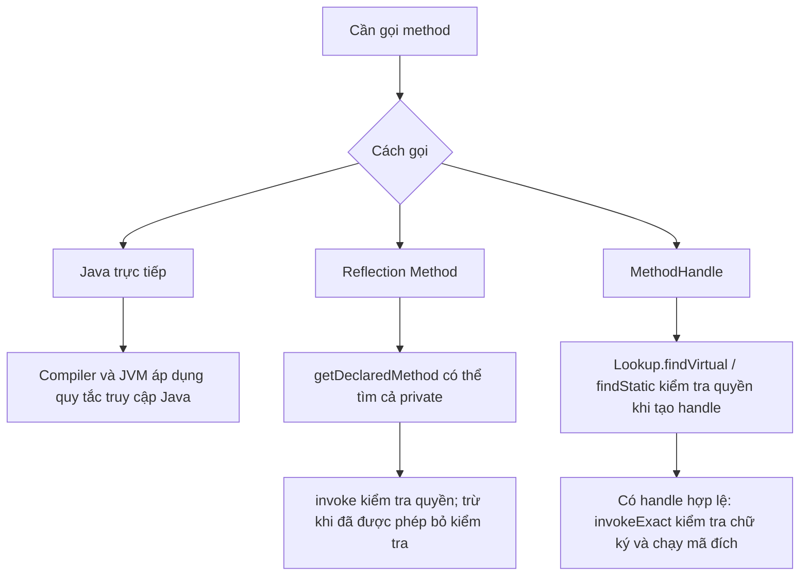

# So sánh lời gọi trực tiếp, Method.invoke() và MethodHandle theo kiểu dữ liệu, kiểm tra quyền và ngoại lệ

> **Chương:** Reflection và hiệu năng  
> **Module:** `JAVA_VERSION_JAVA18` — khám phá các hợp đồng API còn hiệu lực trên JDK hiện đại. Nội dung nhấn mạnh lời gọi qua reflection và `java.lang.invoke`, trong bối cảnh Java 18 áp dụng JEP 416 để triển khai Core Reflection dựa trên Method Handles.

## Mục tiêu học tập

Sau bài này, bạn có thể:

1. So sánh lời gọi Java trực tiếp, `Method.invoke()` và `MethodHandle.invokeExact()` theo **chữ ký**, **primitive/boxing**, **thời điểm kiểm tra quyền** và **cách truyền ngoại lệ**.
2. Tạo một `MethodHandle` bằng `MethodHandles.Lookup` và giải thích vai trò của `MethodType`.
3. Phân biệt `InvocationTargetException`, `IllegalAccessException`, `WrongMethodTypeException` và ngoại lệ do chính phương thức đích ném.
4. Hiểu các yếu tố ảnh hưởng đến hiệu năng thực tế: tối ưu hóa JIT, tính ổn định của đối tượng phản chiếu, chuyển đổi kiểu, lookup và khối lượng công việc.
5. Thiết kế phép đo JMH có ý nghĩa mà không kết luận rằng một cơ chế luôn nhanh hơn cơ chế khác trong mọi ứng dụng.

## 1. Ba con đường để gọi cùng một phương thức

Giả sử lớp `Calculator` có phương thức instance:

```java
public int twice(int value) {
    return value * 2;
}
```

Cả ba cách đều có thể tạo kết quả `42` với đầu vào `21`, nhưng con đường tìm phương thức, biểu diễn kiểu và xử lý lỗi khác nhau.

| Khía cạnh | Lời gọi trực tiếp | `Method.invoke()` | `MethodHandle.invokeExact()` |
| --- | --- | --- | --- |
| Cách gọi | `target.twice(21)` | `method.invoke(target, 21)` | `(int) handle.invokeExact(target, 21)` |
| Chữ ký ở nơi gọi | Compiler biết kiểu của method theo mã Java | API reflection nhận `Object...`, giá trị trả về là `Object` | Chữ ký tại call site phải khớp **chính xác** `MethodType` của handle |
| Primitive | `int` truyền/trả về theo khai báo | Giá trị primitive đi qua `Object` cần boxing/unboxing; primitive trả về được bọc | `invokeExact` giữ kiểu primitive khi handle có chữ ký tương ứng |
| Tìm member | Chọn và kiểm tra qua compiler/linkage Java | `Class.getMethod` hoặc `getDeclaredMethod` tạo `Method` | `Lookup.findVirtual`, `findStatic`, v.v. tạo handle |
| Quyền truy cập | Quy tắc truy cập Java khi biên dịch và liên kết/thực thi | Quyền được xem xét lúc `invoke` (trừ khi được phép bỏ kiểm tra) | `Lookup` kiểm tra quyền khi **tạo** handle; handle hợp lệ có thể được gọi sau đó |
| Ngoại lệ do mã đích ném | Truyền trực tiếp | Được bọc trong `InvocationTargetException` | Truyền trực tiếp |
| Rủi ro khác | Tương ứng hợp đồng của lời gọi Java | `IllegalAccessException`, `IllegalArgumentException` và lỗi mã đích được bọc | `IllegalAccessException` ở lookup; `WrongMethodTypeException` khi chữ ký call site sai; lỗi đích không bị bọc |
| Tối ưu hóa hiệu năng | Thường dễ được JIT inline khi phù hợp | Phụ thuộc cách lưu `Method`, chuyển đổi kiểu, tối ưu hóa của JDK | Có thể tối ưu tốt khi handle ổn định và call site có kiểu rõ ràng |

**Không có thứ hạng hiệu năng cố định** dùng được cho mọi workload. Java 18 triển khai các API Core Reflection dựa trên method handles theo JEP 416; điều đó làm thay đổi cách JVM có thể tối ưu `Method.invoke()` so với các JDK trước, nhưng không đồng nhất hai API về chữ ký hoặc ngoại lệ.

## 2. Thí nghiệm chạy độc lập trên JDK 18+

Ví dụ đặt lớp đích và lớp gọi ở hai package để phân biệt rõ thao tác công khai với truy cập `private`.

```text
invocation-demo/
└── src/
    └── demo/
        ├── api/
        │   └── Calculator.java
        └── app/
            └── InvocationComparison.java
```

**`src/demo/api/Calculator.java`**

```java
package demo.api;

public final class Calculator {
    public int twice(int value) {
        if (value < 0) {
            throw new IllegalArgumentException("negative input");
        }
        return value * 2;
    }

    private int triple(int value) {
        return value * 3;
    }
}
```

**`src/demo/app/InvocationComparison.java`**

```java
package demo.app;

import demo.api.Calculator;
import java.lang.invoke.MethodHandle;
import java.lang.invoke.MethodHandles;
import java.lang.invoke.MethodType;
import java.lang.invoke.WrongMethodTypeException;
import java.lang.reflect.InvocationTargetException;
import java.lang.reflect.Method;

public final class InvocationComparison {
    public static void main(String[] args) throws Throwable {
        Calculator target = new Calculator();
        int input = 21;

        // Đường reflection: chữ ký tra cứu gồm tên và kiểu tham số.
        Method reflected = Calculator.class.getMethod("twice", int.class);

        // Đường MethodHandle: kiểu có cả receiver, tham số và kết quả.
        MethodHandle handle = MethodHandles.publicLookup().findVirtual(
                Calculator.class,
                "twice",
                MethodType.methodType(int.class, int.class));

        int direct = target.twice(input);
        Object boxedResult = reflected.invoke(target, input);
        int viaReflection = (Integer) boxedResult;
        int viaHandle = (int) handle.invokeExact(target, input);

        System.out.println("direct=" + direct);
        System.out.println("reflection=" + viaReflection);
        System.out.println("methodHandle=" + viaHandle);
        System.out.println("handle.type=" + handle.type());

        // Phân biệt ngoại lệ từ chính mã của phương thức đích.
        try {
            target.twice(-1);
        } catch (IllegalArgumentException e) {
            System.out.println("direct.target=" + e.getClass().getSimpleName());
        }

        try {
            reflected.invoke(target, -1);
        } catch (InvocationTargetException e) {
            System.out.println(
                    "reflection.target=" + e.getCause().getClass().getSimpleName());
        }

        try {
            int ignored = (int) handle.invokeExact(target, -1);
        } catch (IllegalArgumentException e) {
            System.out.println("handle.target=" + e.getClass().getSimpleName());
        }

        // Reflection: sai kiểu đối số ở thời điểm invoke.
        try {
            reflected.invoke(target, "21");
        } catch (IllegalArgumentException e) {
            System.out.println("reflection.argument=" + e.getClass().getSimpleName());
        }

        // invokeExact: call site dùng Integer thay vì primitive int.
        try {
            int ignored = (int) handle.invokeExact(target, Integer.valueOf(21));
        } catch (WrongMethodTypeException e) {
            System.out.println("handle.signature=" + e.getClass().getSimpleName());
        }

        // Tìm được private Method không đồng nghĩa được quyền gọi.
        Method hidden = Calculator.class.getDeclaredMethod("triple", int.class);
        System.out.println("private.canAccess=" + hidden.canAccess(target));
        try {
            hidden.invoke(target, input);
        } catch (IllegalAccessException e) {
            System.out.println("reflection.private=" + e.getClass().getSimpleName());
        }

        // Lookup không có quyền private bị từ chối khi tạo handle.
        try {
            MethodHandles.publicLookup().findVirtual(
                    Calculator.class,
                    "triple",
                    MethodType.methodType(int.class, int.class));
        } catch (IllegalAccessException e) {
            System.out.println("handle.private=" + e.getClass().getSimpleName());
        }
    }
}
```

Biên dịch và chạy từ thư mục `invocation-demo`:

```sh
javac -encoding UTF-8 -d out src/demo/api/Calculator.java src/demo/app/InvocationComparison.java
java -cp out demo.app.InvocationComparison
```

Đầu ra dự kiến:

```text
direct=42
reflection=42
methodHandle=42
handle.type=(Calculator,int)int
direct.target=IllegalArgumentException
reflection.target=IllegalArgumentException
handle.target=IllegalArgumentException
reflection.argument=IllegalArgumentException
handle.signature=WrongMethodTypeException
private.canAccess=false
reflection.private=IllegalAccessException
handle.private=IllegalAccessException
```

Giá trị `reflection.target` được lấy từ **`InvocationTargetException.getCause()`**. Trong thực tế, exception phía ngoài ở nhánh reflection vẫn là `InvocationTargetException`, còn hai nhánh gọi trực tiếp và method handle để `IllegalArgumentException` của mã đích truyền ra mà không bọc theo cách đó.

`handle.type()` hiển thị `(Calculator,int)int` bởi handle cho phương thức instance có **receiver** ở tham số đầu tiên của `MethodType`. Trong lời gọi Java thông thường `target.twice(input)`, receiver được viết trước dấu chấm và không nằm trong danh sách đối số khai báo `twice(int)`.

## 3. Kiểu dữ liệu: chính xác, chuyển đổi và boxing

### 3.1. Lời gọi trực tiếp

Khi compiler thấy:

```java
int result = target.twice(21);
```

nó có thông tin kiểu `Calculator`, `int` của tham số và `int` của kết quả. Những chuyển đổi lời gọi được Java cho phép (ví dụ một số phép widening hoặc boxing phù hợp) được xác định theo quy tắc ngôn ngữ; caller không cần biến primitive thành `Object` chỉ để đi qua API phản chiếu.

### 3.2. Method.invoke(): Object[] và primitive

`Method.invoke(Object obj, Object... args)` nhận receiver và danh sách đối số kiểu `Object`; nó trả về `Object`. Với phương thức trả về primitive, giá trị kết quả được boxing thành wrapper tương ứng; `void` cho kết quả `null`.

```java
Method method = Calculator.class.getMethod("twice", int.class);
Object result = method.invoke(target, 21); // int 21 được boxing thành Integer
int answer = (Integer) result;              // unboxing kết quả
```

Cần tách hai việc:

- **Tra cứu** `getMethod("twice", int.class)` phải khớp kiểu tham số được khai báo. `getMethod("twice", Integer.class)` không tìm thấy phương thức `twice(int)`.
- **Thực thi** `Method.invoke` có thể unbox wrapper và thực hiện widening primitive theo quy tắc của API reflection, nhưng không thực hiện mọi chuyển đổi tùy ý. `"21"` là `String`, nên `invoke(target, "21")` báo `IllegalArgumentException`.

Ví dụ method khai báo `accept(long value)` có thể được gọi bằng `Integer.valueOf(3)` thông qua `invoke` nhờ unbox `int` rồi widening sang `long`; nhưng `getMethod("accept", int.class)` vẫn không tìm được khai báo `accept(long)`.

Vì `invoke` là varargs nhận `Object...`, khi method đích tự nhận một tham số kiểu mảng, cần chú ý cách đóng gói đối số để tránh trải mảng nhầm:

```java
// Nếu method khai báo void take(String[] values):
Method take = SomeType.class.getMethod("take", String[].class);
take.invoke(instance, (Object) new String[] {"a", "b"});
```

Dấu cast `(Object)` giúp truyền **một đối số là mảng**, thay vì khiến Java xem mảng như các phần tử của varargs `Object...` ở nơi gọi.

### 3.3. MethodType và invokeExact()

`MethodHandle` chứa một chữ ký runtime `MethodType` mô tả **kiểu trả về** và các **kiểu tham số**. Với handle tạo bởi `findVirtual` cho `Calculator.twice(int)`:

```text
(Calculator, int) -> int
 receiver  arg    return
```

`invokeExact()` yêu cầu chữ ký tại vị trí gọi khớp chính xác chữ ký của handle. Cả **kiểu trả về mà biểu thức caller yêu cầu** cũng tham gia chữ ký call site:

```java
int ok = (int) handle.invokeExact(target, 21);

// Sai kiểu tại call site: Integer thay cho int.
int wrongArgument = (int) handle.invokeExact(target, Integer.valueOf(21));

// Sai kiểu kết quả mong muốn: Object thay cho int.
Object wrongReturn = handle.invokeExact(target, 21);
```

Hai câu lệnh `wrongArgument` và `wrongReturn` có thể biên dịch vì `invokeExact` là phương thức **signature-polymorphic**, nhưng khi chạy với handle kiểu `(Calculator,int)int`, chúng ném `WrongMethodTypeException`.

Trong thực tế, dùng `invokeExact` khi bạn quản lý chắc chắn `MethodType` và muốn giữ primitive theo chữ ký chính xác. `MethodHandle.invoke()` có khả năng áp dụng một số phép chuyển đổi kiểu theo quy tắc `asType` của Method Handle (ví dụ boxing/unboxing phù hợp hoặc widening). Nó linh hoạt hơn `invokeExact`, nhưng vẫn có thể báo `WrongMethodTypeException` hoặc lỗi chuyển kiểu khi yêu cầu không hợp lệ.

`MethodHandle.invokeWithArguments()` là lựa chọn cho danh sách tham số rất động, đổi lại có các bước chuyển đổi/đóng gói phù hợp với API. Hãy chọn theo đặc tính dữ liệu và mức độ biết trước của chữ ký thay vì mặc định tất cả cơ chế invocation là tương đương.

## 4. Thời điểm kiểm tra quyền truy cập

Ba cơ chế không đưa ra cùng một điểm kiểm soát quyền.



### Lời gọi trực tiếp

Compiler kiểm tra tính hợp lệ của cú pháp, overload và quyền truy cập theo ngữ cảnh mã nguồn. JVM còn thực hiện liên kết/kiểm tra tương ứng khi thực thi. Ví dụ, mã ở `demo.app` không thể gọi thẳng `target.triple(21)` vì `triple` là `private` của `Calculator`.

### Method.invoke()

`Calculator.class.getDeclaredMethod("triple", int.class)` **tìm được** metadata private method. Tuy nhiên, từ class `InvocationComparison` ở package khác, `hidden.invoke(target, 21)` bị từ chối bằng `IllegalAccessException` khi dùng member, trừ khi caller được cho phép bỏ kiểm tra quyền qua `AccessibleObject`.

`Method.trySetAccessible()` có thể bật bỏ kiểm tra quyền ngôn ngữ khi module chứa member **mở** package phù hợp (hoặc một điều kiện được API cho phép khác). `setAccessible(true)` có thể ném `InaccessibleObjectException` khi module không cho phép. Đây là cơ chế áp dụng cho **đối tượng Method**, không biến method trong class thành `public`.

### MethodHandles.Lookup

`MethodHandles.Lookup` mang theo phạm vi đặc quyền của caller. `findVirtual`, `findStatic` và các phương thức tương tự tra cứu **đồng thời kiểm tra quyền** để tạo một handle hợp lệ.

Trong chương trình mẫu, `publicLookup()` không có quyền lấy handle cho `Calculator.triple(int)`, do đó `findVirtual` ném `IllegalAccessException` trước khi có handle để gọi. Đối với member `private` mà caller có quyền hợp lệ, `MethodHandles.privateLookupIn(targetClass, lookup)` có thể tạo lookup có quyền truy cập sâu; giữa named modules, điều này đòi hỏi module đích `opens` package tương ứng cho module caller theo hợp đồng API.

**Một handle đã tạo thành công đóng vai trò capability có quyền gọi member tương ứng.** Không thể suy ra quyền mới chỉ từ đối tượng `Method` tìm được; còn `Lookup` phải có quyền ngay tại bước tạo handle. Việc gọi handle vẫn cần đúng receiver, chữ ký và thỏa các điều kiện runtime còn lại.

| Tình huống | Reflection | Method Handle |
| --- | --- | --- |
| Private method tồn tại, nhưng caller không được phép dùng | `getDeclaredMethod` trả về `Method`; `invoke` có thể ném `IllegalAccessException` | `Lookup.findVirtual` không có quyền sẽ ném `IllegalAccessException` ở bước lookup |
| Module không mở package cho truy cập sâu | `trySetAccessible()` có thể trả `false` | `privateLookupIn` có thể bị từ chối bằng `IllegalAccessException` |
| Quyền hợp lệ và chữ ký đúng | `invoke` thực thi mã đích | `invokeExact` thực thi mã đích |
| Public member trong package không được export từ named module | Không mặc nhiên gọi được từ module khác chỉ vì member là `public` | Public lookup cũng tôn trọng điều kiện accessibility của module |

## 5. Ngoại lệ: ai ném, ở bước nào và có bị bọc không?

| Nguyên nhân | Java trực tiếp | Method.invoke() | MethodHandle |
| --- | --- | --- | --- |
| Không có phương thức khớp chữ ký khi tìm | Phát hiện bởi compiler/liên kết Java, tùy tình huống | `Class.getMethod()` ném `NoSuchMethodException` | `Lookup.findVirtual()` ném `NoSuchMethodException` |
| Thiếu quyền gọi private method | Thường lỗi biên dịch với mã nguồn ngoài phạm vi được phép | `IllegalAccessException` tại `invoke` nếu chưa bỏ kiểm tra quyền hợp lệ | `IllegalAccessException` khi tạo handle bằng lookup không có quyền |
| Sai kiểu đối số/receiver | Theo kiểm tra kiểu tại compile/runtime | `IllegalArgumentException` trong trường hợp đối số không hợp lệ | `invokeExact` có thể ném `WrongMethodTypeException`; `invoke` có thể gặp lỗi thích ứng/chuyển kiểu |
| Phương thức đích ném `IllegalStateException` | Truyền nguyên `IllegalStateException` | Ném `InvocationTargetException`, `getCause()` là `IllegalStateException` | Truyền nguyên `IllegalStateException` |
| Method đích có checked exception | Compiler yêu cầu caller xử lý hoặc khai báo theo chữ ký | Exception đích được bọc trong `InvocationTargetException` | Signature-polymorphic invocation khai báo `throws Throwable`; caller phải xử lý/khai báo phù hợp |

Ví dụ xử lý lỗi reflection:

```java
try {
    Object result = reflected.invoke(target, 21);
} catch (IllegalAccessException accessError) {
    // Caller không có quyền tại thời điểm invoke.
} catch (InvocationTargetException targetError) {
    // Method đã được gọi, chính thân method ném lỗi.
    Throwable cause = targetError.getCause();
    System.err.println(cause);
} catch (IllegalArgumentException argumentError) {
    // Receiver hoặc đối số không hợp lệ cho thao tác reflection.
}
```

Với handle:

```java
try {
    int result = (int) handle.invokeExact(target, 21);
} catch (WrongMethodTypeException signatureError) {
    // Chữ ký tại call site không khớp MethodType của handle.
} catch (Throwable targetOrRuntimeError) {
    // Có thể là exception từ mã đích hoặc lỗi runtime khác.
    System.err.println(targetOrRuntimeError);
}
```

Đoạn `catch (Throwable)` mang tính minh họa cho chữ ký `throws Throwable` của `invokeExact`. Trong ứng dụng thực tế, nên phân loại ngoại lệ theo hợp đồng phương thức đích và chính sách xử lý; không nuốt mọi `Throwable`.

## 6. Hiệu năng trên JDK hiện đại: tối ưu phần nào?

### 6.1. Vai trò của JEP 416 trong Java 18

JEP 416 (*Reimplement Core Reflection with Method Handles*) thay đổi triển khai nội bộ của các cơ chế Core Reflection chính trên Java 18 để sử dụng method handles. Người sử dụng vẫn viết `Method.invoke()`, `Constructor.newInstance()` hoặc `Field.get()/set()` theo API quen thuộc; **hợp đồng về kiểu, quyền và exception của Core Reflection vẫn giữ nguyên**.

JEP này giải thích một yếu tố hiệu năng quan trọng: khi `Method`, `Constructor` hay `Field` là đối tượng ổn định mà JVM có thể coi như **hằng** (đặc biệt được giữ trong `static final`), JIT có nhiều cơ hội tối ưu hóa đường reflection. Trái lại, khi object phản chiếu liên tục thay đổi hoặc khó chứng minh là hằng, chi phí thực tế có thể khác đáng kể.

**Không diễn giải JEP 416 thành “Method.invoke và MethodHandle.invokeExact nhanh như nhau”.** Chúng có hợp đồng khác nhau: `Method.invoke` có danh sách `Object...` và đường trả về `Object`, còn `invokeExact` phụ thuộc `MethodType` chính xác. JIT, profile runtime và kiểu dữ liệu quyết định phần chi phí được khử bỏ trong một trường hợp cụ thể.

### 6.2. Các yếu tố đo cần kiểm soát

| Yếu tố | Vì sao ảnh hưởng kết quả |
| --- | --- |
| Chi phí lookup | `getMethod` hoặc `findVirtual` tốn công xây dựng đối tượng/kiểm tra; nên đo **riêng** chi phí tạo và chi phí gọi nếu ứng dụng cache member |
| Tính ổn định của member | `static final Method` và `static final MethodHandle` có thể tạo điều kiện tối ưu tốt hơn dữ liệu thay đổi liên tục |
| Primitive và boxing | Reflection trả về `Object` cho primitive và sử dụng `Object...`; so sánh có thể bao gồm chi phí wrapper/array |
| JIT warmup và inlining | Những lần chạy đầu chưa phản ánh mã đã tối ưu; workload quá nhỏ dễ bị tối ưu khác thường |
| Polymorphism | Gọi trên nhiều lớp nhận/đích khác nhau có thể khó inline hơn lời gọi cùng một implementation |
| Kết quả có được sử dụng? | Nếu kết quả bị bỏ, JIT có thể loại bỏ công việc làm sai phép đo |
| JVM, CPU, GC và cấu hình | Các điều kiện môi trường làm số đo thay đổi |
| Giai đoạn thực tế của ứng dụng | Startup, tạo lookup, xử lý dữ liệu hàng loạt và lời gọi nóng trong vòng lặp có profile rất khác nhau |

Trên một phương thức đơn giản như `twice(int)`, thời gian cho các đường gọi và chuyển đổi kiểu có thể chiếm phần lớn tổng chi phí. Với phương thức đích thực hiện I/O hoặc xử lý lớn, chênh lệch của cơ chế invocation có thể trở nên ít quan trọng hơn.

### 6.3. Phác thảo phép đo bằng JMH

Java Microbenchmark Harness (JMH) là công cụ đo benchmark Java có cơ chế warmup, nhiều lượt đo và tiêu thụ kết quả phù hợp hơn việc đặt `System.nanoTime()` quanh một vòng lặp đơn giản. Ví dụ sau mô tả cấu trúc một phép đo; nó **cần JMH trong dự án benchmark** nên không phải mã chạy độc lập chỉ với `javac` như mục 2.

```java
package bench;

import demo.api.Calculator;
import java.lang.invoke.MethodHandle;
import java.lang.invoke.MethodHandles;
import java.lang.invoke.MethodType;
import java.lang.reflect.Method;
import org.openjdk.jmh.annotations.Benchmark;
import org.openjdk.jmh.annotations.Param;
import org.openjdk.jmh.annotations.Scope;
import org.openjdk.jmh.annotations.Setup;
import org.openjdk.jmh.annotations.State;

@State(Scope.Thread)
public class InvocationBench {
    private static final Method REFLECTED;
    private static final MethodHandle HANDLE;

    static {
        try {
            REFLECTED = Calculator.class.getMethod("twice", int.class);
            HANDLE = MethodHandles.publicLookup().findVirtual(
                    Calculator.class,
                    "twice",
                    MethodType.methodType(int.class, int.class));
        } catch (ReflectiveOperationException e) {
            throw new ExceptionInInitializerError(e);
        }
    }

    private Calculator target;

    @Param({"21", "41"})
    public int input;

    @Setup
    public void setup() {
        target = new Calculator();
    }

    @Benchmark
    public int direct() {
        return target.twice(input);
    }

    @Benchmark
    public int reflection() throws ReflectiveOperationException {
        return (Integer) REFLECTED.invoke(target, input);
    }

    @Benchmark
    public int methodHandleExact() throws Throwable {
        return (int) HANDLE.invokeExact(target, input);
    }
}
```

Thí nghiệm này đo **đường gọi đã cache** vì `REFLECTED` và `HANDLE` được tạo trong `static` initializer. Nếu ứng dụng thực tế liên tục lookup lại member, hãy lập một benchmark khác đo giai đoạn lookup. Nếu thành phần dữ liệu đích có nhiều implementation, tạo workload đại diện thay vì một đối tượng cố định. Không công bố một con số “nhanh hơn bao nhiêu lần” nếu chưa đo trên môi trường và workload cụ thể.

Lưu ý: `Method.invoke()` trong ví dụ có cả chi phí truyền tham số qua `Object...`, boxing input và unboxing kết quả ở cấp API; JIT có thể tối ưu một phần khi điều kiện thuận lợi. Benchmark nên có cùng logic đích, không có I/O/log trong thân phép đo và sử dụng kết quả để tránh tối ưu loại bỏ toàn bộ công việc.

## 7. Chọn cơ chế gọi phù hợp với nhu cầu

| Ngữ cảnh | Lựa chọn nên cân nhắc | Lý do |
| --- | --- | --- |
| Biết kiểu và chữ ký lúc viết mã | Gọi trực tiếp | Dễ đọc, kiểm tra kiểu rõ ràng và dễ được JVM tối ưu |
| Framework biết method tại runtime, cần metadata và annotation | `Method` và `Method.invoke` | Dễ kết hợp API reflection, chú ý cache và bắt `InvocationTargetException` |
| Có thể tạo call site có kiểu xác định, gọi lặp lại nhiều lần | `MethodHandle` với `invokeExact` | Chữ ký rõ ràng, làm việc tốt với primitive, có cơ hội tối ưu khi handle ổn định |
| Chữ ký thay đổi theo dữ liệu runtime | Reflection hoặc Method Handle thích ứng | Đổi lại phải xử lý chuyển kiểu và chi phí động; đo trên workload thật |
| Truy cập private member của module khác | Thiết kế API hoặc `opens` được cấp phù hợp | Cả reflection và lookup đều tôn trọng module encapsulation; đổi công cụ không tự tạo quyền mới |

### Các sai lầm cần tránh

- **Không cache** `Method` hoặc `MethodHandle` ở đường gọi nóng mà liên tục tra cứu lại, sau đó gán toàn bộ chi phí đó cho riêng `invoke`.
- **Nhầm lookup và invocation:** `getMethod`/`findVirtual` tìm thành viên, còn `invoke`/`invokeExact` mới gọi nó; so sánh phải cùng phạm vi công việc.
- **Nhầm kiểu ở invokeExact:** cả kiểu receiver, tham số, kết quả đều tham gia `MethodType` tại call site; một `Integer` khác `int`.
- **Coi kết quả nhanh/chậm trên một máy là luật chung:** cần xem warmup, profile, inlining, boxing, sự ổn định của member và phân bố lớp thực tế.
- **Dùng reflection sâu để vượt module mà không có quyền:** `setAccessible` và `privateLookupIn` đều chịu ràng buộc Java Platform Module System.

## 8. Câu hỏi tự kiểm tra

**1. Vì sao `Method.invoke()` trả về `Object` khi method đích trả về `int`, còn `invokeExact()` có thể trả về `int` trực tiếp?**

> `Method.invoke` có chữ ký API cố định trả về `Object`, vì vậy primitive được boxing. `MethodHandle.invokeExact` là signature-polymorphic và dùng chữ ký chính xác của handle/call site, có thể biểu diễn primitive.

**2. `getDeclaredMethod("hidden")` đã trả về `Method`. Tại sao `Method.invoke()` vẫn ném `IllegalAccessException`?**

> Tra cứu và quyền sử dụng là hai bước khác nhau. `getDeclaredMethod` có thể tìm cả method `private`; `invoke` cần quyền truy cập tương ứng hoặc chế độ bỏ kiểm tra quyền đã được bật hợp lệ.

**3. Một `Lookup` không có quyền `private` gọi `findVirtual` với tên/chữ ký đúng. Lỗi xuất hiện ở đâu?**

> `findVirtual` có thể ném `IllegalAccessException` khi tạo handle, trước khi có lời gọi `invokeExact`.

**4. Khi method đích ném `IllegalArgumentException`, cách truyền lỗi khác nhau thế nào?**

> Lời gọi trực tiếp và method handle truyền ngoại lệ từ mã đích ra caller; `Method.invoke` bọc ngoại lệ từ mã đích trong `InvocationTargetException`. Cần đọc `getCause()`.

**5. `handle` có kiểu `(Calculator,int)int`; biểu thức `(int) handle.invokeExact(target, Integer.valueOf(21))` có khớp không?**

> Không. Call site truyền `Integer` trong khi handle đòi `int` chính xác; `invokeExact` ném `WrongMethodTypeException`.

**6. Java 18 triển khai Core Reflection qua Method Handles. Có thể khẳng định `Method.invoke()` luôn nhanh như `invokeExact()` không?**

> Không. Chúng vẫn khác về chữ ký, boxing, đối số dạng `Object...`, lưu trữ `Method`/handle và khả năng tối ưu hóa. Chỉ benchmark đại diện trên JDK/môi trường sử dụng mới cho kết luận hiệu năng có giá trị.

## Tài liệu tham khảo

- [JEP 416 — Reimplement Core Reflection with Method Handles](https://openjdk.org/jeps/416): thay đổi triển khai Core Reflection trong Java 18 và ghi chú hiệu năng.
- [Java SE API — `Method.invoke()`](https://docs.oracle.com/en/java/javase/25/docs/api/java.base/java/lang/reflect/Method.html#invoke(java.lang.Object,java.lang.Object...)): hợp đồng boxing, conversion, quyền truy cập, `InvocationTargetException`.
- [Java SE API — `MethodHandle`](https://docs.oracle.com/en/java/javase/25/docs/api/java.base/java/lang/invoke/MethodHandle.html): `invokeExact()`, `invoke()`, `invokeWithArguments()` và chữ ký tại call site.
- [Java SE API — `MethodHandles.Lookup`](https://docs.oracle.com/en/java/javase/25/docs/api/java.base/java/lang/invoke/MethodHandles.Lookup.html): lookup và kiểm tra quyền khi tạo handle.
- [Java SE API — `AccessibleObject`](https://docs.oracle.com/en/java/javase/25/docs/api/java.base/java/lang/reflect/AccessibleObject.html): `canAccess()`, `trySetAccessible()` và module boundaries.
- [OpenJDK JMH](https://github.com/openjdk/jmh): công cụ thực hiện phép đo microbenchmark Java có warmup và kiểm soát điều kiện đo.

**Ghi nhớ:** Gọi trực tiếp dùng hệ kiểu tĩnh; `Method.invoke()` cho phép gọi động qua `Object` và bọc lỗi từ mã đích; `MethodHandle.invokeExact()` dùng chữ ký runtime chính xác và truyền lỗi đích trực tiếp. So sánh hiệu năng phải đo trong bối cảnh JDK và workload cụ thể, đặc biệt từ Java 18 khi Core Reflection đã được triển khai dựa trên Method Handles.
