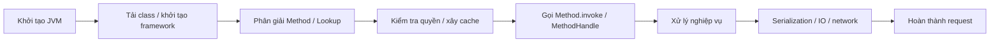

# Tách phép đo cold start, steady state, allocation và độ trễ thay vì chỉ ghi một con số

## 1. Vì sao “Reflection mất 80 ns” chưa phải kết luận hiệu năng?

Khi đánh giá `Method.invoke()`, `Constructor.newInstance()`, `Field.get()` hoặc `MethodHandle.invokeExact()`, một câu như “Reflection mất 80 ns/lần” bỏ sót nhiều câu hỏi quan trọng:

- Con số đó tính **lần gọi đầu tiên** hay sau hàng triệu lần JIT tối ưu?
- Có bao gồm `getMethod()`, `getDeclaredField()`, kiểm tra quyền JPMS và tạo lookup không?
- Có đo việc JVM khởi động, class loading, class initialization hoặc khởi tạo framework không?
- Có bao nhiêu **byte được cấp phát trên mỗi operation**, kéo theo áp lực GC thế nào?
- Có biểu diễn độ trễ **p95/p99** khi nhiều request cạnh tranh CPU/GC không?
- Kết quả đến từ JDK, GC, kiến trúc CPU, bộ tham số và tải đồng thời nào?

Một phép đo tốt cần tách ít nhất bốn góc nhìn:

1. **Cold start / first-use:** chi phí khi tiến trình hoặc code path chưa được làm nóng.
2. **Steady state:** thông lượng hoặc chi phí trung bình khi JVM đã có cơ hội tối ưu.
3. **Allocation:** số byte tạo ra và chi phí quản lý bộ nhớ khi thực hiện cùng công việc.
4. **Latency distribution:** phân bố độ trễ, đặc biệt ở phần đuôi khi có tải.

Các số liệu trả lời **những câu hỏi khác nhau**, không thể gộp thành một điểm số duy nhất mà vẫn giữ đầy đủ ý nghĩa. Một cách gọi có thể nhanh hơn sau warmup nhưng tăng thời gian khởi tạo; hoặc giảm thời gian trung bình nhưng tạo thêm object khiến p99 xấu đi khi GC.

Bài này thuộc chương **Reflection và hiệu năng** của mô-đun `JAVA_VERSION_JAVA18`. JEP 416 trong Java 18 triển khai core reflection trên method handles; bài tập trung vào cách kiểm chứng trên **JDK hiện đại**, tránh các mẹo dựa trên triển khai Reflection đã bị loại bỏ.

## 2. Bốn nhóm phép đo và đơn vị phù hợp

| Góc nhìn | Câu hỏi chính | Phép đo | Đơn vị nên báo |
| --- | --- | --- | --- |
| Cold process startup | Từ lúc tạo tiến trình đến lúc sẵn sàng phục vụ? | External wall clock, nhiều JVM process độc lập | ms hoặc s/startup; p50/p95 |
| First reflective use | Lần lookup + invoke đầu tiên trên JVM mới tốn bao lâu? | Single-shot, nhiều fork không warmup; tách setup | µs hoặc ms/first use |
| Steady state | Code path nóng xử lý bao nhiêu operation/giây? | JMH throughput hoặc average time, nhiều warmup/measurement/fork | ops/s hoặc ns/op, µs/op |
| Allocation | Mỗi operation phân bổ bao nhiêu bộ nhớ? | JMH GC profiler và allocation profiling | B/op, MB/s; GC count/time |
| Latency distribution | Một lần xử lý thực tế chờ bao lâu, kể cả tail? | JMH sample time cho micro-op; load test cho request end-to-end | p50, p90, p95, p99, max với đơn vị |
| Tải hệ thống | Khi đồng thời tăng, hệ thống còn đáp ứng SLA không? | Load test, metrics CPU/GC/queue | RPS, số thread, utilization, timeout rate |

**Lưu ý:** p99 trong một microbenchmark và p99 của request thực tế **không phải cùng đại lượng**. Microbenchmark có thể loại bỏ network, serialization, lock contention và queueing, còn request thực tế phải tính tất cả.

Ví dụ, “50 ns/op” chỉ nên được diễn giải là **trung bình mỗi operation theo một workload và chế độ benchmark cụ thể**. Không được suy trực tiếp rằng toàn bộ request web sẽ nhanh hơn đúng 50 ns.

### 2.1. Đặt ranh giới đo trước khi chọn công cụ

Với một framework Reflection, có thể vẽ đường đi:



Nếu cần đo **chi phí gọi lặp lại**, benchmark chỉ nên bao vùng E (và phần boxing/adapter thực tế đi kèm). Nếu cần đo **thời gian phản hồi lần đầu**, phải bao các bước B–H có thể xuất hiện. Nếu mục tiêu là **readiness khi khởi động**, thường phải bao cả A–D.

Mỗi câu hỏi dẫn tới một benchmark khác nhau. Hãy ghi rõ điểm bắt đầu, kết thúc và các chi phí được tính.

## 3. Cold start có nhiều nghĩa, không nên nhập làm một

Từ “cold” có thể chỉ các hiện tượng khác nhau:

| Khái niệm | Bắt đầu tại | Thường bao gồm |
| --- | --- | --- |
| JVM process startup | Trước khi OS tạo tiến trình Java | Khởi động launcher/JVM, nạp class cơ bản, chạy `main`, setup cần thiết |
| Framework cold initialization | Bắt đầu bootstrap framework | Scan classpath/module, đọc annotation, reflection lookup, tạo proxy/cache |
| First reflective call | Ngay trước lần lookup/invoke đầu tiên | Lookup, resolution, kiểm tra quyền và dispatch lần đầu |
| First request | Khi request đầu tiên được gửi đến dịch vụ | Queueing, lazy initialization, xử lý request, IO/serialization |
| Warm request / steady state | Khi JVM và hệ thống đã ổn định | Workload lặp lại cùng các cache/JIT đã hình thành |

Một phép đo `System.nanoTime()` đặt ở đầu `main` **không tính toàn bộ JVM startup**, vì JVM đã chạy để gọi `main`. Ngược lại, shell đo từ trước khi gọi `java` tới khi tiến trình kết thúc sẽ bao cả startup, thực thi và chi phí process/console.

### 3.1. Ví dụ đo first-use bằng đồng hồ trong JVM

```java
import java.lang.reflect.Method;

public final class FirstReflectionUse {
    public static final class Target {
        public int addOne(int value) {
            return value + 1;
        }
    }

    public static void main(String[] args) throws Exception {
        long start = System.nanoTime();

        Method method = Target.class.getMethod(
                "addOne", int.class);
        Object result = method.invoke(new Target(), 41);

        long elapsed = System.nanoTime() - start;
        if (!Integer.valueOf(42).equals(result)) {
            throw new AssertionError(result);
        }

        System.out.println("first lookup + invoke ns = "
                + elapsed);
    }
}
```

Chạy `javac FirstReflectionUse.java` rồi `java FirstReflectionUse` trong một JVM mới cho mỗi lần đo. Code cho thấy cách định nghĩa vùng **lookup + invoke**, nhưng đây chỉ là **probe minh họa**, không phải benchmark đủ chính xác để công bố kết luận nano-giây. Kết quả nhiễu bởi JIT, class loading, scheduling, timer và lần thực hiện; cần nhiều process độc lập và phương pháp thống kê.

### 3.2. Đo thời gian tạo tiến trình đến khi chương trình kết thúc

Ví dụ trên PowerShell:

```powershell
Measure-Command {
    & java FirstReflectionUse | Out-Null
}
```

Thời gian này bao gồm process startup, `main`, output và chi phí shell/pipeline. Nó **không phải** chỉ riêng Reflection, và nếu `main` thực hiện nhiều công việc thì tất cả đều được tính.

Để đo readiness của một server, hãy dùng bộ điều phối ngoài JVM: khởi chạy process, chờ tín hiệu ứng dụng đã sẵn sàng (health endpoint hoặc tín hiệu readiness đáng tin cậy) và ghi wall-clock tới lúc đó. Làm nhiều lượt process mới; nếu muốn thử cold OS cache thật sự, phải kiểm soát thêm filesystem/page cache, không coi mỗi JVM mới tự động là cache lạnh tuyệt đối.

### 3.3. `SingleShotTime` không tự đo JVM boot

OpenJDK JMH có `Mode.SingleShotTime` để đo một lần gọi benchmark thay vì lặp liên tục theo thời lượng. Nó phù hợp để ước lượng chi phí first use **bên trong JVM đang chạy harness**.

Điều quan trọng:

- JMH cần khởi động JVM/harness trước khi gọi benchmark method.
- Fixture `@Setup`, class loading do harness và các bước chuẩn bị có thể đã diễn ra.
- `SingleShotTime` **không bằng** thời gian process startup.
- Muốn đo lạnh thực sự của một code path, phải thiết kế trạng thái để code path đó chưa được gọi khi setup.
- Nên dùng nhiều fork mới để có nhiều lần độc lập.

## 4. Steady state: điều gì đã được tối ưu?

JVM HotSpot biên dịch JIT dựa trên thông tin thực thi. Sau khi một code path chạy đủ lâu, kết quả steady state có thể khác đáng kể so với lần gọi đầu tiên.

Các yếu tố ảnh hưởng:

- Interpreter, tiered compilation và mức tối ưu của JIT.
- Class loading, resolution, inlining và devirtualization.
- Escape analysis và scalar replacement.
- Thông tin type profile của receiver/argument.
- Khả năng compiler coi `Method` hoặc `MethodHandle` như giá trị ổn định.
- Class hierarchy, class loader, quyền access và dạng gọi `invoke`.
- Các nhánh, boxing/unboxing, varargs và xử lý exception.

Từ Java 18, **JEP 416** triển khai `java.lang.reflect.Method`, `Field` và `Constructor` dựa trên `java.lang.invoke`. Với một số benchmark, đối tượng reflection được giữ ở `static final` có thể dễ tối ưu hơn trường hợp được lưu trong mutable field hoặc array. Điều đó là động lực để **thử các dạng cache khác nhau**, không phải lời hứa “mọi reflection luôn nhanh”.

### 4.1. Đừng so “lookup + invoke” với “invoke đã cache” rồi kết luận về `Method.invoke`

Hai workload này khác nhau:

```java
// Lookup trên mỗi operation.
Object a = Target.class.getMethod("addOne", int.class)
        .invoke(target, 41);

// Lookup một lần, tái sử dụng Method.
Method cached = Target.class.getMethod("addOne", int.class);
Object b = cached.invoke(target, 41);
```

Nếu đo workload đầu tiên, chi phí `getMethod` và những tối ưu hóa compiler cũng nằm trong số đo. Nếu mục tiêu là so chi phí invocation, hãy setup metadata trước khi benchmark. Nếu framework thực tế lookup cho mỗi request, vẫn nên đo workload “lookup + invoke” **riêng** vì đó chính là hành vi ứng dụng cần tối ưu.

### 4.2. So sánh công bằng, nhưng không giả định mọi kiểu gọi có cùng semantics

| Đường gọi | Chi phí thường liên quan |
| --- | --- |
| Gọi Java trực tiếp | Dispatch bình thường, compiler có thể inline |
| `Method.invoke` với `Method` cached | Reflection dispatch, boxing/unboxing, varargs, access policy, các tối ưu của JIT |
| `MethodHandle.invokeExact` với handle cached | Method type chính xác; tối ưu JIT phụ thuộc độ ổn định của handle/call site |
| `getMethod` rồi `Method.invoke` | Lookup + Reflection dispatch |
| Framework dùng annotation/adapter/proxy | Lookup, cache, dispatch, chuyển đổi kiểu và logic framework |

Không nói “MethodHandle luôn nhanh hơn Reflection” chỉ dựa trên một tình huống. So cùng công việc, cùng dữ liệu và đúng đường gọi mà hệ thống sản xuất sử dụng.

### 4.3. Từ JDK 22 không còn benchmark bằng cờ fallback Reflection cũ

Triển khai core reflection mới là mặc định từ JDK 18. **JDK 22 đã loại bỏ triển khai cũ**; cờ `-Djdk.reflect.useDirectMethodHandle=false` từng dùng cho giai đoạn chuyển đổi trở thành **no-op**.

Vì vậy, trên JDK hiện đại không dùng cờ đó để tuyên bố có so sánh “reflection implementation cũ vs mới”. Muốn đánh giá tác động giữa các phiên bản JDK, chạy **cùng workload** trên hai bản phân phối JDK được chỉ định, với cấu hình và máy tương đương, rồi kiểm tra khác biệt như một phép đo xuyên phiên bản.

## 5. Dùng JMH thay cho vòng lặp `System.nanoTime()` tự phát

**JMH (Java Microbenchmark Harness)** của OpenJDK được thiết kế để xây dựng và chạy các benchmark nhỏ cho JVM, có xử lý warmup, nhiều fork, measurement iteration, kết quả có đơn vị và nhiều kiểu đo.

Không dùng chương trình sau để kết luận hiệu năng:

```java
long start = System.nanoTime();
for (int i = 0; i < 1_000_000; i++) {
    target.addOne(41);
}
long nanos = System.nanoTime() - start;
System.out.println(nanos / 1_000_000.0);
```

Phép tính bỏ qua khả năng loop bị compiler tối ưu mạnh, kết quả không được tiêu thụ, JIT đang warmup, và số đo lẫn chi phí vòng lặp/timer. Một lần chạy không cung cấp độ phân tán hay bằng chứng tái lập.

### 5.1. Tạo dự án JMH độc lập

OpenJDK JMH khuyên tạo dự án benchmark riêng bằng Maven archetype. Trong thư mục thử nghiệm **bên ngoài mã nguồn bài học**, người học có thể chạy:

```bash
mvn archetype:generate -DinteractiveMode=false -DarchetypeGroupId=org.openjdk.jmh -DarchetypeArtifactId=jmh-java-benchmark-archetype -DgroupId=org.example -DartifactId=reflection-bench -Dversion=1.0
```

Sau khi thêm class benchmark vào dự án đã được generate, xây và chạy:

```bash
mvn -f reflection-bench/pom.xml clean verify
java -jar reflection-bench/target/benchmarks.jar
```

JMH **không nằm trong Java SE**; cần dependencies và annotation processor do dự án JMH cấu hình. Không thể chỉ copy một class có `@Benchmark` vào `jshell` rồi mong có kết quả chuẩn. Không cần chạy Maven/Gradle trong workflow viết bài này; các lệnh trên là hướng dẫn thực hành riêng cho người học.

## 6. Ví dụ JMH đo steady state của cùng một công việc

Tạo class `ReflectionSteadyBenchmark.java` trong source benchmark của dự án JMH:

```java
package org.example;

import java.lang.invoke.MethodHandle;
import java.lang.invoke.MethodHandles;
import java.lang.invoke.MethodType;
import java.lang.reflect.Method;
import java.util.concurrent.TimeUnit;
import org.openjdk.jmh.annotations.*;

@State(Scope.Thread)
@BenchmarkMode(Mode.AverageTime)
@OutputTimeUnit(TimeUnit.NANOSECONDS)
@Warmup(iterations = 5, time = 1, timeUnit = TimeUnit.SECONDS)
@Measurement(iterations = 5, time = 1, timeUnit = TimeUnit.SECONDS)
@Fork(3)
public class ReflectionSteadyBenchmark {

    public static class Target {
        private final int base;

        public Target(int base) {
            this.base = base;
        }

        public int compute(int value) {
            return base + value;
        }
    }

    private static final Method STATIC_FINAL_METHOD = lookup();

    private static Method lookup() {
        try {
            return Target.class.getMethod("compute", int.class);
        } catch (NoSuchMethodException ex) {
            throw new ExceptionInInitializerError(ex);
        }
    }

    @Param({"1", "129"})
    public int operand;

    private Target target;
    private Method cachedMethod;
    private MethodHandle cachedHandle;

    @Setup(Level.Trial)
    public void setup() throws ReflectiveOperationException {
        target = new Target(7);
        cachedMethod = Target.class.getMethod("compute", int.class);
        cachedHandle = MethodHandles.lookup().findVirtual(
                Target.class, "compute",
                MethodType.methodType(int.class, int.class));
    }

    @Benchmark
    public int direct() {
        return target.compute(operand);
    }

    @Benchmark
    public int reflectedCached() throws ReflectiveOperationException {
        return (int) cachedMethod.invoke(target, operand);
    }

    @Benchmark
    public int reflectedStaticFinal() throws ReflectiveOperationException {
        return (int) STATIC_FINAL_METHOD.invoke(target, operand);
    }

    @Benchmark
    public int handleCached() throws Throwable {
        return (int) cachedHandle.invokeExact(target, operand);
    }

    @Benchmark
    public Method lookupOnly() throws NoSuchMethodException {
        return Target.class.getMethod("compute", int.class);
    }

    @Benchmark
    public int lookupAndInvoke() throws ReflectiveOperationException {
        Method method = Target.class.getMethod("compute", int.class);
        return (int) method.invoke(target, operand);
    }
}
```

### 6.1. Điều benchmark này cố tình tách ra

| Benchmark method | Nội dung được tính thời gian |
| --- | --- |
| `direct()` | Gọi method Java trực tiếp với input lấy từ `@Param` |
| `reflectedCached()` | `Method.invoke` qua một `Method` trong instance state |
| `reflectedStaticFinal()` | `Method.invoke` qua metadata ở `static final` |
| `handleCached()` | `MethodHandle.invokeExact` qua instance state |
| `lookupOnly()` | `Class.getMethod`, không invoke |
| `lookupAndInvoke()` | Lookup và reflective invocation trong mỗi operation |

`@Setup(Level.Trial)` chạy trước các lần đo của benchmark, do đó **không tính** việc tạo `Target` và phân giải `cachedMethod`/`cachedHandle` trong các method invocation benchmarks. Nếu ứng dụng thực tế làm setup mỗi request, cần benchmark end-to-end tương ứng.

`@Param` làm input biến đổi giữa trial; method benchmark trả giá trị cho harness sử dụng, giúp tránh một số dạng dead-code elimination. Tuy nhiên, JIT vẫn có thể tối ưu hóa khác nhau giữa các đường gọi. Mục đích là **so sánh có kiểm soát**, không khẳng định các phương pháp có semantics/cost giống hệt.

### 6.2. Chạy một nhóm kết quả steady state

Sau khi đóng gói benchmark jar:

```bash
java -jar target/benchmarks.jar ReflectionSteadyBenchmark -wi 5 -i 5 -w 1s -r 1s -f 3 -t 1 -prof gc
```

Các tham số:

- `-wi 5`: 5 warmup iterations.
- `-i 5`: 5 measurement iterations.
- `-w 1s` và `-r 1s`: thời lượng warmup/measurement mỗi iteration.
- `-f 3`: 3 fork JVM độc lập.
- `-t 1`: một worker thread để bắt đầu với contention thấp.
- `-prof gc`: thu thêm các chỉ số allocation/GC mà profiler hỗ trợ.

Đây là **cấu hình ví dụ**, không phải lượng warmup lý tưởng cho mọi máy. Cần quan sát kết quả theo từng iteration; nếu vẫn thay đổi đáng kể, kéo dài warmup hoặc kiểm tra hệ thống.

### 6.3. Đọc đúng đơn vị `ns/op` và `ops/s`

Với `Mode.AverageTime`, kết quả thường là thời gian bình quân trên operation, ví dụ `ns/op`. Với `Mode.Throughput`, kết quả là operation trên đơn vị thời gian, ví dụ `ops/s`.

Không quy đổi máy móc `ns/op` thành p99; **trung bình không chứa phân bố**. Ngoài ra, phép chuyển nghịch đảo giữa average time và throughput có thể bị ảnh hưởng bởi cách tổng hợp qua thread, fork và workload; không coi hai mode là tương đương tuyệt đối.

Nếu method benchmark thực hiện một batch gồm 100 reflective invocations, `op` trong kết quả JMH mặc định là **một lời gọi benchmark method**, không tự động là một reflective invocation. Muốn báo `ns/invocation`, phải xác định số invocation thực tế và ghi rõ cách chuẩn hóa, có thể dùng `@OperationsPerInvocation` khi thích hợp.

## 7. Đo first-use bằng `Mode.SingleShotTime`

Một bài benchmark riêng có thể gần với “lần reflective lookup + invoke đầu tiên”:

```java
package org.example;

import java.lang.reflect.Method;
import java.util.concurrent.TimeUnit;
import org.openjdk.jmh.annotations.*;

@BenchmarkMode(Mode.SingleShotTime)
@OutputTimeUnit(TimeUnit.MICROSECONDS)
@Warmup(iterations = 0)
@Measurement(iterations = 1)
@Fork(10)
public class ReflectionFirstUseBenchmark {

    public static class ColdTarget {
        public int compute(int value) {
            return value + 1;
        }
    }

    @Benchmark
    public Object firstLookupAndInvoke() throws Exception {
        Method method = ColdTarget.class.getMethod(
                "compute", int.class);
        return method.invoke(new ColdTarget(), 41);
    }
}
```

Với nhiều fork và không có warmup, mỗi fork cung cấp một lần đo trong một JVM mới. Tuy nhiên:

- JMH đã khởi động harness và có thể đã tải một số class trước khi chạy method.
- Một phần runtime/JIT nền đã hoạt động.
- Việc dùng class literal không cho phép khẳng định mọi resolution đều mới hoàn toàn.
- Kết quả đo **method benchmark**, không đo thời gian khởi động toàn JVM.
- Nếu `@Setup` chuẩn bị reflection metadata, chi phí đó sẽ nằm ngoài method benchmark.

Do đó nên gọi phép đo này là **first-use microbenchmark trong JVM fork mới**, không dán nhãn “JVM cold startup” nếu không có đo từ bên ngoài tiến trình.

### 7.1. Tách lookup với first invocation

Nếu muốn biết lần đầu tốn bao nhiêu vì lookup và bao nhiêu vì invocation, thiết kế hai thí nghiệm riêng:

1. **Lookup only:** đo `getMethod` khi class đã được chuẩn bị theo điều kiện mô tả.
2. **Cached first invoke:** tạo `Method` ở setup, đo invocation đầu tiên.
3. **Lookup + invoke:** đo tổng hai bước khi xảy ra cùng request.
4. **Whole first request:** đo từ đầu request đến khi hoàn tất đáp ứng.

Không lấy hiệu hai số đo từ các trạng thái JIT khác nhau rồi khẳng định chênh lệch chính xác bằng chi phí lookup. Đó là ước lượng chịu ảnh hưởng runtime state và thiết kế thí nghiệm.

## 8. Allocation: byte trên mỗi operation quan trọng thế nào?

Reflection có thể tạo object tạm ở các đường đi khác nhau, ví dụ do varargs, boxing, adapter, exception hoặc metadata/lookup. **Không kết luận mỗi lần `Method.invoke` chắc chắn cấp phát một object**, vì JIT/escape analysis có thể loại bỏ một số allocation trong trường hợp cụ thể.

Các số liệu hữu ích:

| Số liệu | Đơn vị | Diễn giải |
| --- | --- | --- |
| `gc.alloc.rate.norm` của JMH GC profiler | B/op | Byte allocation ước lượng, chuẩn hóa theo operation |
| `gc.alloc.rate` | MB/s | Tốc độ cấp phát khi benchmark chạy |
| GC count/time | lần, ms/s | Áp lực thu gom bộ nhớ |
| Heap live set | byte/MB/GB | Bộ nhớ còn sống, khác tổng byte cấp phát |
| Allocation profile theo stack | event/số mẫu/byte ước tính | Nguồn cấp phát thường gặp; có thể là sampling |

Ví dụ chạy lại benchmark cùng phép đo:

```bash
java -jar target/benchmarks.jar ReflectionSteadyBenchmark -wi 5 -i 5 -f 3 -prof gc
```

Xem các secondary results như `gc.alloc.rate.norm` và GC count. Hai phương pháp có thể có `ns/op` tương tự nhưng `B/op` khác nhau. Với hệ thống chạy lâu hoặc có tải lớn, chênh lệch allocation có thể ảnh hưởng đến GC pauses và tail latency.

### 8.1. Không nhầm allocation với heap usage

- **Allocated bytes:** tổng bộ nhớ được cấp phát trong một khoảng thời gian.
- **Live heap:** bộ nhớ vẫn còn được tham chiếu sau GC.
- **RSS / process memory:** bộ nhớ tiến trình chiếm ở hệ điều hành, có thể bao gồm vùng không thuộc Java heap.

Một benchmark `0 B/op` không chứng minh không có bất kỳ object nào; nó phản ánh lượng allocation **được đo trong chế độ chạy và khả năng tối ưu của runtime**. Không suy từ `0 B/op` rằng toàn bộ ứng dụng không tạo object hoặc không bị GC.

### 8.2. Đo allocation trong ứng dụng bằng JFR

Java Flight Recorder (JFR) có thể hỗ trợ quan sát allocation và GC trong workload tích hợp. Ví dụ khởi động một ứng dụng riêng của người học với profile recording:

```bash
java -XX:StartFlightRecording=filename=reflection-profile.jfr,settings=profile,duration=60s -jar app.jar
```

Sau khi file được tạo:

```bash
jfr summary reflection-profile.jfr
jfr print --events jdk.ObjectAllocationSample reflection-profile.jfr
```

Sự hiện diện và tần suất event phụ thuộc cấu hình `.jfc` và JVM. `ObjectAllocationSample` là **sampling**, không thay thế phép đo chính xác tổng B/op của một microbenchmark. JFR hữu ích để tìm vị trí cấp phát/GC trong hệ thống thực; JMH GC profiler hữu ích cho so sánh chuẩn hóa trên workload hẹp.

Nếu dịch vụ đang chạy, có thể dùng `jcmd <pid> JFR.start settings=profile duration=60s filename=reflection-profile.jfr` theo hướng dẫn Java SE 24, khi được phép truy cập process. Chạy profiling trên môi trường cho phép, vì profiling có overhead và cần cân nhắc dữ liệu nhạy cảm trong recording.

## 9. Độ trễ: average, p50, p95 và p99 nói điều gì?

Average time là một thước đo trung tâm, nhưng không nói mọi operation có nhanh như vậy không. Với request latency, có thể cần:

- **p50 (median):** khoảng 50% quan sát không lớn hơn giá trị này.
- **p95:** khoảng 95% quan sát không lớn hơn giá trị này.
- **p99:** khoảng 99% quan sát không lớn hơn giá trị này.
- **max:** lớn nhất trong mẫu đã quan sát; nhạy với nhiễu.
- **Error/timeout rate:** tỉ lệ request không hoàn tất đúng hạn, không được bỏ khỏi báo cáo để làm p99 đẹp hơn.

Ví dụ **minh họa cách diễn giải, không phải số đo thực tế**: nếu p50 = 2 ms và p99 = 60 ms thì đa số request khá nhanh nhưng 1% chậm nhất có tail cao hơn nhiều. Không được thay cột p99 bằng p50 hoặc average khi đánh giá SLA.

### 9.1. Dùng `Mode.SampleTime` của JMH cho phân bố microbenchmark

JMH `Mode.SampleTime` lấy mẫu thời gian một số lần thực hiện benchmark method để ước lượng phân bố latency. Nó có thể xuất percentile và confidence information theo cấu hình.

Ví dụ class `ReflectionLatencyBenchmark.java` trong dự án JMH:

```java
package org.example;

import java.lang.reflect.Method;
import java.util.concurrent.TimeUnit;
import org.openjdk.jmh.annotations.*;

@State(Scope.Thread)
@BenchmarkMode(Mode.SampleTime)
@OutputTimeUnit(TimeUnit.MICROSECONDS)
@Warmup(iterations = 5, time = 1)
@Measurement(iterations = 5, time = 1)
@Fork(3)
public class ReflectionLatencyBenchmark {

    public static class Target {
        public int compute(int value) {
            return value + 3;
        }
    }

    private Target target;
    private Method method;

    @Setup(Level.Trial)
    public void setup() throws NoSuchMethodException {
        target = new Target();
        method = Target.class.getMethod("compute", int.class);
    }

    @Benchmark
    public int sampleReflectiveBatch() throws Exception {
        int sum = 0;

        for (int i = 0; i < 32; i++) {
            sum += (int) method.invoke(target, i);
        }

        return sum;
    }
}
```

Lệnh ví dụ:

```bash
java -jar target/benchmarks.jar ReflectionLatencyBenchmark -f 3 -wi 5 -i 5 -t 1
```

Vì một benchmark operation gồm **32 lần invoke**, sample latency ở đây là thời gian của cả **batch**, không phải percentile của từng lần `Method.invoke`. Không lấy p99 của batch chia 32 rồi gọi đó là p99 mỗi invoke: percentile của tổng thời gian không tuyến tính theo cách đó.

Với operation ngắn cỡ nano-giây, timer/sampling overhead và JIT optimization có thể lớn so với workload; gom một batch có ý nghĩa giúp thấy một code path thực tế hơn. Nhưng phải báo đúng “µs/batch” và số invoke/batch.

### 9.2. JMH p99 không phải request p99

Một HTTP request có thể bao gồm:

```text
queueing + network + parse + reflection + business logic + IO + serialization
```

JMH chỉ đo đoạn code được đặt trong benchmark method; nó không tự mô phỏng request arrival, server thread pool, IO và queueing. Muốn đánh giá p95/p99 ở sản phẩm:

1. Thiết lập endpoint/hành vi nghiệp vụ thực tế.
2. Gửi tải có kiểm soát, với concurrency và request rate cụ thể.
3. Thu end-to-end latency phía client, bao gồm lỗi và timeout.
4. Quan sát CPU, GC, allocation và queue depth.
5. So sánh p50/p95/p99 ở cùng mức tải và cấu hình.
6. Kiểm tra coordinated omission nếu công cụ đo có nguy cơ bỏ sót khoảng chậm khi generator không gửi thêm request.

Đừng kết luận một thay đổi `Method.invoke` cải thiện p99 production nếu chỉ có JMH `ns/op` trong một thread không có contention.

## 10. Nhiễu benchmark và các bẫy cần kiểm soát

### 10.1. JVM/JDK và phần cứng

Ghi lại:

- JDK feature release và patch version, ví dụ Java 24.0.x hoặc JDK đang triển khai.
- Vendor và JVM implementation.
- Kiến trúc CPU, số lõi, xung, chính sách tiết kiệm điện và trạng thái nhiệt.
- OS, container quotas, CPU pinning nếu áp dụng.
- JVM flags, heap size, GC và mode JIT.
- Số thread, số fork, số iteration và thời lượng mỗi iteration.
- Classpath/module path, compiler build và phiên bản JMH.

Nếu đổi JDK, CPU hoặc JMH config đồng thời, khó xác định vì sao con số thay đổi.

### 10.2. Warmup phải đủ và được quan sát

Warmup giúp JIT tối ưu code path và hình thành cache. Nhưng số lần warmup không phải hằng số phổ quát. Nếu score liên tục giảm hoặc tăng qua measurement iterations, benchmark có thể chưa ổn định.

Một quy trình thực dụng:

1. Chạy JMH với nhiều warmup/measurement iterations.
2. Xem result từng iteration/fork thay vì chỉ điểm tổng hợp.
3. Tăng warmup khi JIT còn biến động.
4. Kiểm tra thermal throttling, GC hoặc background processes.
5. Lặp thí nghiệm ở nhiều fork sau khi cấu hình được cố định.

### 10.3. Dead-code elimination và constant folding

JIT có thể loại bỏ công việc nếu kết quả không được quan sát, hoặc thay phép tính bằng hằng số nếu mọi đầu vào đã biết.

Giảm rủi ro bằng cách:

- Trả kết quả từ method `@Benchmark` hoặc truyền vào `Blackhole.consume(...)`.
- Dùng `@Param` hoặc state phản ánh dữ liệu biến đổi.
- Đảm bảo benchmark có đúng công việc cần kiểm tra.
- Không thêm log, print hoặc synchronized không cần thiết vào vùng đo.

Ngay cả khi dùng JMH, code benchmark vẫn cần review. JMH giúp tránh nhiều sai sót chứ không thể tự bảo đảm workload đại diện cho sản phẩm.

### 10.4. Hai bên phải có cùng input, nhưng cũng phải tôn trọng semantics

Ví dụ `Method.invoke` trả `Object` và có thể boxing kết quả primitive, còn `invokeExact` yêu cầu method type đúng. Nếu phiên bản production phải trả `Object` cho framework, so với direct int call là so **hai thiết kế khác nhau**, không chỉ phí dispatch.

Hãy viết rõ câu hỏi:

- “Chi phí dispatch của cơ chế nào?” — giữ đầu vào/đầu ra gần nhất có thể.
- “Chi phí end-to-end của adapter nào?” — bao tất cả boxing, conversion, validation, cache.
- “Chi phí dùng framework nào trên mỗi request?” — đo request workflow thực tế.

Ba câu hỏi hợp lệ nhưng không trộn score vào một bảng mà không ghi rõ khác biệt.

### 10.5. Không đo trong môi trường vốn không thể so sánh

IDE debugger, log console, build daemons, profiler nặng hoặc CPU đang chịu tải nền có thể làm kết quả méo. Nên chạy JMH bằng process fork riêng ở chế độ command-line, đồng thời chạy trên cùng máy/cấu hình trong nhiều lượt.

JFR hoặc JMH `-prof gc` có chi phí quan sát; khi cần biết overhead profiler, chạy thêm lượt không profiler để đối chiếu.

## 11. Tách allocation, steady state và latency trong kế hoạch thực nghiệm

Một kế hoạch tốt có thể chia thành bốn track:

| Track | Cách thực hiện | Kết quả chính | Điều tuyệt đối không khẳng định |
| --- | --- | --- | --- |
| A — Cold process | Launch JVM mới nhiều lượt, đo tới readiness | ms/startup, p50/p95 | `System.nanoTime` trong `main` tính cả JVM boot |
| B — First reflective use | JMH SingleShotTime không warmup, nhiều fork; mô tả setup | µs/first-use operation | Là cùng số với process startup |
| C — Steady state | JMH AverageTime/Throughput, warmup, nhiều fork | ns/op, ops/s | Mean chứng minh p99 production |
| D — Allocation & tail | JMH GC profiler, JFR, load test | B/op, GC, p95/p99 request | Một profiler mô tả chính xác mọi loại metric |

Thay đổi Reflection nên được quyết định theo **khối lượng công việc thực tế**. Với CLI chạy một lần, cold start có thể quan trọng hơn 10 ns steady state. Với RPC server xử lý hàng triệu request, steady throughput, GC và p99 quan trọng hơn việc startup tăng vài millisecond. Với batch ETL, B/op và băng thông bộ nhớ có thể chi phối.

### 11.1. Cần mẫu baseline và candidate

Một thí nghiệm rõ ràng nên có hai biến thể:

- **Baseline:** implementation đang chạy, ví dụ `Method.invoke` với metadata cache.
- **Candidate:** triển khai đề xuất, ví dụ `MethodHandle` cached hoặc adapter khác.

Giữ nguyên dữ liệu đầu vào và workload. Thay đổi **một yếu tố chính mỗi lần**, bao gồm số lần lookup, chiến lược cache hoặc cách tạo handle. Sau đó chạy mỗi biến thể theo các track phù hợp.

Không chọn candidate chỉ vì nhanh hơn ở một ô `ns/op` trong một lượt chạy. Cần xem chênh lệch có ổn định qua fork/máy/JDK hay không, và có làm allocation, cold hoặc tail latency xấu đi không.

## 12. Mẫu báo cáo nên dùng thay cho một con số duy nhất

Ví dụ khung báo cáo để điền **dữ liệu đo thực tế**; dấu gạch ngang nghĩa là chưa đo, không phải số 0:

| Metric | Baseline | Candidate | Cách thu |
| --- | --- | --- | --- |
| Process startup p50/p95 (ms) | — / — | — / — | N process mới, đo tới readiness |
| First-use cost (µs/op) | — | — | JMH SingleShotTime, không warmup |
| Steady average (ns/op) | — | — | JMH AverageTime; forks/iterations ghi rõ |
| Throughput (ops/s) | — | — | JMH Throughput |
| Allocation (B/op) | — | — | JMH GC profiler |
| GC count/time | — | — | JFR hoặc runtime metrics |
| Request p50/p95/p99 (ms) | — / — / — | — / — / — | Load test cùng concurrency/RPS |
| Error/timeout rate (%) | — | — | Load test |
| CPU, heap, GC, JDK/OS | — | — | Metadata và quan sát |

Mỗi bảng nên có phần metadata riêng:

```text
Experiment ID: REFLECT-2026-11
JDK: <vendor, java -version, JVM flags>
Hardware/OS: <CPU, memory, container quota, OS>
Build/Classpath: <git commit, dependencies, JMH version>
Workload: <type, method signature, argument mix, return type>
Setup included: <yes/no, what is outside measured method>
Warmup/Measurement/Forks/Threads: <n, duration>
Sampling/GC profiler: <mode, settings>
Failures/Timeouts: <counts>
Raw results: <path hoặc artifact nội bộ>
Conclusion: <với điều kiện này, metric nào thay đổi>
```

Không đưa số liệu của một JDK đời cũ thành quy luật cho JDK mới. Kết quả benchmark phải đi cùng **phiên bản JDK và bối cảnh chạy**; “Java Reflection chậm hơn X lần” không có đủ thông tin để dùng trong quyết định kiến trúc.

## 13. Kịch bản quyết định trong thực tế

### 13.1. Framework khởi động chậm nhưng khi chạy ổn

Dấu hiệu:

- Process startup và first request tăng cao.
- Steady throughput tốt, ít allocation sau khi cache tạo xong.

Hướng đo: classpath/module scanning, annotation scanning, lookup, proxy creation và class initialization. Chỉ tối ưu `Method.invoke` nóng nếu nó thật sự nằm trên critical path. Có thể cân nhắc cache metadata, giảm scanning hoặc lazy/eager initialization theo mục tiêu readiness.

### 13.2. Microbenchmark nhanh nhưng p99 sản phẩm kém

Dấu hiệu:

- `ns/op` thấp trong JMH.
- p99 tăng khi concurrency lớn, có nhiều timeout.

Hướng đo: GC pauses, thread pool saturation, queueing, synchronized sections, downstream IO, allocation và payload. Reflection có thể chỉ là phần nhỏ trong request. Không thêm `--add-opens` hoặc thay MethodHandle một cách mù quáng khi chưa tìm bottleneck.

### 13.3. Throughput không đổi nhưng B/op tăng

Dấu hiệu:

- Thông lượng trung bình trong benchmark tương tự.
- Allocation rate và GC work tăng rõ ở candidate.

Hướng đo: boxing/varargs, new arrays, lookup objects, metadata cache, adapter wrappers. Ước lượng tác động trên tải dự kiến, ví dụ:

```text
allocationRate(B/s) ≈ allocationPerOperation(B/op) × throughput(ops/s)
```

Đây chỉ là phép nhân chuẩn hóa cho cùng workload, không tự tính mọi allocation của tiến trình. Khi tải cao, thêm vài chục byte/op có thể tạo mức allocation lớn dù `ns/op` chưa khác nhiều.

### 13.4. Cold giảm nhưng steady tăng

Một implementation tạo metadata sớm có thể giảm first request nhưng tăng startup. Một implementation lazy có thể cải thiện startup nhưng khiến request đầu tiên chậm. Hãy dùng mục tiêu sản phẩm (CLI latency, readiness, SLO p99, throughput) làm căn cứ đánh đổi, thay vì chọn phương án thắng một metric.

## 14. Checklist trước khi đưa số liệu vào review

- [ ] Có mô tả vùng thời gian được đo và loại cold start không?
- [ ] Có tách startup, first-use, steady state và request latency không?
- [ ] Có ghi rõ `getMethod`/`getDeclaredMethod` được tính trong benchmark không?
- [ ] Có benchmark method trả kết quả hoặc dùng `Blackhole` để tránh dead-code elimination không?
- [ ] Có warmup, measurement iterations và nhiều fork không?
- [ ] Có so sánh cùng workload, cùng JDK/hardware/JVM flags không?
- [ ] Có kiểm tra dữ liệu đầu vào, overload, boxing và kiểu trả về không?
- [ ] Có B/op hoặc allocation profile khi GC quan trọng không?
- [ ] Có p95/p99 và error rate của request thực khi SLA yêu cầu không?
- [ ] Có raw results, metadata, độ phân tán và số fork không?
- [ ] Có chỉ ra giới hạn của JMH SingleShotTime đối với JVM startup không?
- [ ] Có tránh cờ fallback reflection cũ đã không còn tác dụng trên JDK 22+ không?

Nếu nhiều câu trả lời là “không”, số liệu có thể dùng để **khơi gợi giả thuyết**, nhưng chưa đủ để khẳng định một phương án tối ưu hơn trong production.

## 15. Bài tập tự kiểm tra

**Bài 1.** Một benchmark JMH đo `Method.invoke` sau warmup và báo `25 ns/op`. Có thể suy ra lần gọi Reflection đầu tiên khi khởi động CLI cũng mất 25 ns không?

*Đáp án:* Không. `25 ns/op` là chi phí steady-state của benchmark đã warmup; first-use còn có lookup, class loading, resolution và các bước khác tùy ranh giới đo.

**Bài 2.** `Mode.SingleShotTime` có đo chính xác thời gian từ khi OS tạo JVM tới lúc chương trình sẵn sàng không?

*Đáp án:* Không. JMH đã khởi động harness trước khi gọi benchmark method. Muốn đo process startup, dùng phép đo bên ngoài tiến trình tới tín hiệu readiness.

**Bài 3.** Hai implementation có cùng `ns/op` nhưng A là `8 B/op` và B là `96 B/op`. Nên chọn cái nào?

*Đáp án:* Không thể chọn chỉ dựa vào `ns/op`. Cần xem allocation rate tại tải thực, GC pauses, heap, p99, độ ổn định và các yêu cầu khác; kết quả B/op phải được đo trên workload tương ứng.

**Bài 4.** Vì sao không thể lấy p99 của một benchmark method gồm 32 lời gọi `Method.invoke` chia cho 32 để thu được p99 của mỗi invocation?

*Đáp án:* Percentile của tổng nhiều lần gọi không biến đổi tuyến tính thành percentile của từng phần tử; số đo còn chứa loop, scheduling và hiệu ứng tương quan giữa các lần gọi.

**Bài 5.** Vì sao cần ghi rõ `Method` được lưu ở `static final` hay mutable field?

*Đáp án:* Khả năng JIT coi metadata là giá trị ổn định có thể ảnh hưởng tối ưu, đặc biệt sau JEP 416. Hai cách lưu có thể cho kết quả khác trong cùng một JDK/workload.

**Bài 6.** Trên JDK 24, đặt `-Djdk.reflect.useDirectMethodHandle=false` có phải cách hợp lệ để benchmark core reflection implementation cũ không?

*Đáp án:* Không. JDK 22 đã loại bỏ triển khai cũ; property này trở thành no-op. Cần benchmark theo JDK/workload hiện hành.

**Bài 7.** `JMH -prof gc` và JFR `ObjectAllocationSample` có thay thế nhau hoàn toàn không?

*Đáp án:* Không. JMH GC profiler có metric chuẩn hóa như `B/op` cho microbenchmark; JFR sampling giúp tìm nơi cấp phát/GC trong workload lớn, không tự cung cấp B/op chính xác cho mọi lần gọi.

**Bài 8.** Một nhóm đổi sang MethodHandle và cải thiện throughput 5% trong JMH nhưng p99 HTTP request không đổi. Có thể tuyên bố cải thiện latency production không?

*Đáp án:* Chưa. Cần xem hệ thống có bottleneck ở phần khác, concurrency, GC và queueing. Chỉ có bằng chứng cải thiện throughput của benchmark trong điều kiện đã đo.

**Bài 9.** Vì sao các benchmark steady state thường cần nhiều fork?

*Đáp án:* Mỗi fork có trạng thái JVM/JIT/GC riêng, giúp quan sát độ biến thiên giữa các tiến trình và giảm rủi ro phụ thuộc một lần chạy đặc biệt.

**Bài 10.** Một server nhận `10.000 ops/s` và dùng `40 B/op` trong workload được đo. Allocation rate của **riêng phần workload đó** là bao nhiêu?

*Đáp án:* Khoảng `400.000 B/s` theo phép nhân `10.000 × 40`, chưa tính allocation của phần khác trong tiến trình; đây là bài toán ước lượng có điều kiện.

## 16. Ghi nhớ

Không dùng một con số `ns/op` để kết luận toàn bộ hiệu năng Reflection. Cần xác định **cold process startup** khác **first reflective use**, tách **steady-state average/throughput** khỏi **allocation B/op**, và đo **latency p95/p99 end-to-end** khi mục tiêu là SLO của ứng dụng thực.

JMH giúp đo các đoạn code JVM nhỏ với warmup, forks và measurement có kiểm soát; `SingleShotTime` thích hợp cho một benchmark operation không lặp, `AverageTime`/`Throughput` cho steady state, `SampleTime` cho phân bố mẫu của benchmark method và `-prof gc` cho allocation. JFR và load test bổ sung bối cảnh runtime và request thực tế.

JEP 416 là thay đổi triển khai Reflection từ Java 18, không phải cam kết tăng tốc trong mọi trường hợp. Trên JDK 22+, cơ chế reflection cũ đã bị loại bỏ. **Benchmark tốt là phép đo có câu hỏi rõ, ranh giới rõ, đơn vị rõ, kết quả có thể tái lập và giới hạn diễn giải rõ** — không phải một con số đơn lẻ.

### Tài liệu tham khảo chính thức

- [OpenJDK — JEP 416: Reimplement Core Reflection with Method Handles](https://openjdk.org/jeps/416).
- [Oracle JDK 22 Release Notes — Old Core Reflection Implementation removed](https://www.oracle.com/java/technologies/javase/22all-relnotes.html).
- [OpenJDK — Java Microbenchmark Harness (JMH) project](https://github.com/openjdk/jmh).
- [OpenJDK JMH Sample 02 — Benchmark Modes](https://github.com/openjdk/jmh/blob/master/jmh-samples/src/main/java/org/openjdk/jmh/samples/JMHSample_02_BenchmarkModes.java).
- [OpenJDK JMH Sample 10 — Constant Folding](https://github.com/openjdk/jmh/blob/master/jmh-samples/src/main/java/org/openjdk/jmh/samples/JMHSample_10_ConstantFold.java).
- [OpenJDK JMH Sample 35 — Profilers](https://github.com/openjdk/jmh/blob/master/jmh-samples/src/main/java/org/openjdk/jmh/samples/JMHSample_35_Profilers.java).
- [Oracle Java SE 24 — Method](https://docs.oracle.com/en/java/javase/24/docs/api/java.base/java/lang/reflect/Method.html).
- [Oracle Java SE 24 — MethodHandle](https://docs.oracle.com/en/java/javase/24/docs/api/java.base/java/lang/invoke/MethodHandle.html).
- [Oracle Java SE 24 — Diagnostic Tools / Java Flight Recorder](https://docs.oracle.com/en/java/javase/24/troubleshoot/diagnostic-tools.html).
- [Oracle Java SE 24 — jcmd Command](https://docs.oracle.com/en/java/javase/24/docs/specs/man/jcmd.html).
- [Oracle Java SE 24 — jfr Command](https://docs.oracle.com/en/java/javase/24/docs/specs/man/jfr.html).
