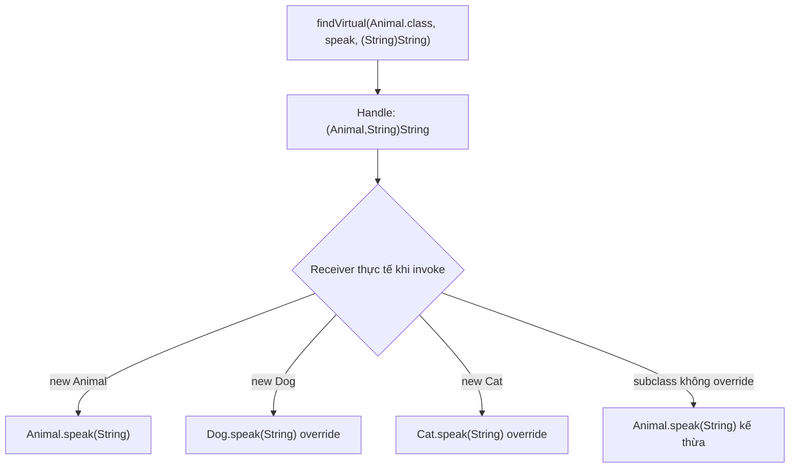

# findVirtual(): receiver là tham số đầu tiên và lời gọi vẫn có virtual dispatch

> **Chương:** MethodHandle  
> **Module:** `JAVA_VERSION_JAVA18` — khám phá các hợp đồng API Java còn hữu ích trên JDK hiện đại, bao gồm `MethodHandles.Lookup`, `MethodType` và phương thức `MethodHandle.invokeExact()`. Ví dụ sử dụng API được hỗ trợ từ Java 18 trở lên.

## Mục tiêu bài học

Sau bài học này, bạn có thể:

1. Tạo `MethodHandle` bằng `MethodHandles.Lookup.findVirtual()` và đọc đúng chữ ký của nó.
2. Giải thích tại sao **receiver là tham số đầu tiên của handle**, dù receiver không nằm trong danh sách tham số khai báo của phương thức Java.
3. Chứng minh rằng handle trỏ tới phương thức instance vẫn thực hiện **virtual dispatch**: khi subclass override, implementation được gọi phụ thuộc đối tượng nhận thực tế.
4. Phân biệt **kiểu receiver trong `MethodType`**, **kiểu tĩnh tại call site** và **kiểu thực tế của object khi chạy**.
5. Hiểu `invokeExact()`, `invoke()`, `bindTo()` và các lỗi thường gặp mà không lẫn lộn kiểm tra chữ ký với dispatch.

## 1. findVirtual() tìm phương thức instance như thế nào?

`MethodHandles.Lookup.findVirtual(Class<?> refc, String name, MethodType type)` tìm một **phương thức instance có thể gọi theo quy tắc virtual invocation** trên kiểu tham chiếu `refc`.

Ví dụ:

```java
class Animal {
    public String speak(String message) {
        return "Animal: " + message;
    }
}
```

Ta tạo handle (giả sử `Animal` truy cập được từ `Lookup`):

```java
MethodHandle speak = MethodHandles.lookup().findVirtual(
        Animal.class,
        "speak",
        MethodType.methodType(String.class, String.class));
```

Ba đối số của `findVirtual` có ý nghĩa:

| Đối số | Giá trị | Ý nghĩa |
| --- | --- | --- |
| `refc` | `Animal.class` | Kiểu tham chiếu dùng để tìm phương thức và xác định kiểu receiver trong handle |
| `name` | `"speak"` | Tên phương thức muốn tìm |
| `type` | `MethodType.methodType(String.class, String.class)` | **Kiểu trả về `String`** và **một tham số khai báo kiểu `String`**; chưa có receiver |

Khi lookup thành công, `speak.type()` là:

```text
(Animal,String)String
```

Có thể đọc như sau:

```text
     (Animal, String) -> String
        |       |          |
    receiver  message   return
```

**Tại sao xuất hiện `Animal`?** Vì handle hoạt động như một hàm nhận cả đối tượng đích và tham số khai báo:

```java
// Cú pháp Java thông thường:
String value = animal.speak("chào");

// Dạng gọi handle tương ứng:
String valueViaHandle = (String) speak.invokeExact(animal, "chào");
```

Ở lời gọi Java trực tiếp, receiver là biểu thức đứng trước dấu chấm. Với `MethodHandle` chưa gắn receiver, đối tượng đó trở thành **tham số số 0** trong `MethodType` của handle. Đây là hợp đồng quan trọng của `findVirtual()`.

**Không thêm `Animal.class` vào `MethodType` truyền cho `findVirtual()`.** Tham số receiver được thêm vào **kiểu của handle trả về**, không được tính là tham số khai báo của `Animal.speak(String)`.

Ví dụ sau tìm sai chữ ký vì đã thêm receiver nhầm vào danh sách tham số khai báo:

```java
// Sai: tìm phương thức speak(Animal, String), vốn không được khai báo.
lookup.findVirtual(
        Animal.class,
        "speak",
        MethodType.methodType(String.class, Animal.class, String.class));
```

Với ví dụ này, lời gọi sẽ ném `NoSuchMethodException` vì method `speak(Animal, String)` không tồn tại.

## 2. Handle được tạo trên superclass vẫn gọi bản override của subclass

Giả sử mở rộng ví dụ:

```java
class Dog extends Animal {
    @Override
    public String speak(String message) {
        return "Dog: " + message;
    }
}

class Cat extends Animal {
    @Override
    public String speak(String message) {
        return "Cat: " + message;
    }
}
```

Dù handle được tạo bằng `findVirtual(Animal.class, "speak", ...)`, kiểu thực tế của receiver vẫn quyết định method override nào được thực thi:

```java
Animal first  = new Dog();
Animal second = new Cat();

String a = (String) speak.invokeExact(first, "chào");
String b = (String) speak.invokeExact(second, "chào");

// a = "Dog: chào"
// b = "Cat: chào"
```

Tại sao?

- **Lookup** tìm phương thức theo tên, chữ ký và quyền truy cập dựa vào `Animal.class`.
- **Kiểu handle** giữ receiver là `Animal`: `(Animal,String)String`.
- **Lần invocation** áp dụng ngữ nghĩa lời gọi virtual. Nếu receiver thực tế là `Dog`, bản override của `Dog` được chọn; nếu là `Cat`, bản override của `Cat` được chọn.
- Nếu subclass **không override**, implementation kế thừa từ `Animal` được dùng.

Kết luận quan trọng: **chữ ký handle cố định nhưng đích override được chọn động theo receiver thực tế**. `MethodType` và virtual dispatch giải quyết hai việc khác nhau.



Virtual dispatch ở đây tuân theo quy tắc override của Java. Một phương thức `final` không thể bị subclass override, nên tất cả receiver hợp lệ sẽ dùng implementation không bị thay thế đó. Cơ chế dispatch không khiến `private` hay `static` tự nhiên trở thành các phương thức override.

## 3. Ví dụ hoàn chỉnh: kiểm chứng receiver và virtual dispatch

Tạo một file duy nhất `src/demo/FindVirtualDemo.java`:

```java
package demo;

import java.lang.invoke.MethodHandle;
import java.lang.invoke.MethodHandles;
import java.lang.invoke.MethodType;
import java.lang.invoke.WrongMethodTypeException;

public final class FindVirtualDemo {

    public static class Animal {
        public String speak(String message) {
            return "Animal: " + message;
        }
    }

    public static class Dog extends Animal {
        @Override
        public String speak(String message) {
            return "Dog: " + message;
        }
    }

    public static class Cat extends Animal {
        @Override
        public String speak(String message) {
            return "Cat: " + message;
        }
    }

    public static class Lizard extends Animal {
        // Không override speak(String).
    }

    public interface Greeting {
        String greet(String name);
    }

    public static class FriendlyGreeting implements Greeting {
        @Override
        public String greet(String name) {
            return "Xin chào " + name;
        }
    }

    public static void main(String[] args) throws Throwable {
        MethodHandle speak = MethodHandles.publicLookup().findVirtual(
                Animal.class,
                "speak",
                MethodType.methodType(String.class, String.class));

        System.out.println("lookup.type=" + speak.type());

        Animal animal = new Animal();
        Animal dogAsAnimal = new Dog();
        Animal catAsAnimal = new Cat();
        Animal lizardAsAnimal = new Lizard();

        System.out.println("animal=" +
                (String) speak.invokeExact(animal, "Mai"));
        System.out.println("dog=" +
                (String) speak.invokeExact(dogAsAnimal, "Mai"));
        System.out.println("cat=" +
                (String) speak.invokeExact(catAsAnimal, "Mai"));
        System.out.println("lizard=" +
                (String) speak.invokeExact(lizardAsAnimal, "Mai"));

        // Kiểu tĩnh Dog không khớp receiver Animal của invokeExact.
        Dog dog = new Dog();
        try {
            String unused = (String) speak.invokeExact(dog, "Mai");
            System.out.println("unexpected=" + unused);
        } catch (WrongMethodTypeException expected) {
            System.out.println("exact.dogTyped=WrongMethodTypeException");
        }

        // invoke(...) có thể thích ứng kiểu tham số Dog -> Animal.
        String adapted = (String) speak.invoke(dog, "Mai");
        System.out.println("invoke.adapted=" + adapted);

        // bindTo gắn receiver, nên handle mới không cần tham số Animal.
        MethodHandle bound = speak.bindTo(dog);
        System.out.println("bound.type=" + bound.type());
        System.out.println("bound=" + (String) bound.invokeExact("Mai"));

        // findVirtual cũng hoạt động cho phương thức instance của interface.
        MethodHandle greet = MethodHandles.publicLookup().findVirtual(
                Greeting.class,
                "greet",
                MethodType.methodType(String.class, String.class));

        Greeting greeting = new FriendlyGreeting();
        System.out.println("interface.type=" + greet.type());
        System.out.println("interface=" +
                (String) greet.invokeExact(greeting, "Mai"));
    }
}
```

Từ thư mục chứa `src`, dùng JDK 18 trở lên:

```sh
javac -encoding UTF-8 -d out src/demo/FindVirtualDemo.java
java -cp out demo.FindVirtualDemo
```

Kết quả dự kiến:

```text
lookup.type=(Animal,String)String
animal=Animal: Mai
dog=Dog: Mai
cat=Cat: Mai
lizard=Animal: Mai
exact.dogTyped=WrongMethodTypeException
invoke.adapted=Dog: Mai
bound.type=(String)String
bound=Dog: Mai
interface.type=(Greeting,String)String
interface=Xin chào Mai
```

Đọc kết quả:

1. Cả bốn lời gọi đầu đều dùng **cùng một** `MethodHandle`, có kiểu `(Animal,String)String`. Chỉ receiver thực tế thay đổi. `Dog` và `Cat` override nên chọn method tương ứng; `Lizard` không override nên dùng method của `Animal`.
2. `exact.dogTyped` minh họa lỗi về **chữ ký tại call site**, không phải lỗi do dispatch. Kiểu tĩnh của biểu thức `dog` là `Dog`, khác tham số đầu `Animal` mà `invokeExact` yêu cầu.
3. `invoke.adapted` cho thấy `invoke()` có thể thích ứng tham số reference `Dog` sang `Animal`. Sau thích ứng, dispatch vẫn gọi `Dog.speak()`.
4. `bound.type` cho thấy `bindTo(dog)` đã gắn receiver vào handle và loại tham số receiver khỏi danh sách tham số của handle mới. Nó **không vô hiệu hóa virtual dispatch**: vì đối tượng được gắn là `Dog`, phương thức được thực thi vẫn là `Dog.speak()`.
5. `interface.type` cho thấy `findVirtual` cũng hỗ trợ phương thức instance của interface; handle nhận `Greeting` là receiver, còn triển khai `FriendlyGreeting` thực hiện lời gọi khi chạy.

## 4. Phân biệt ba loại kiểu: refc, kiểu tĩnh và kiểu runtime

Trong đoạn mã:

```java
MethodHandle speak = MethodHandles.publicLookup().findVirtual(
        Animal.class, "speak",
        MethodType.methodType(String.class, String.class));

Animal receiver = new Dog();
String result = (String) speak.invokeExact(receiver, "Mai");
```

cần phân biệt:

| Tầng | Giá trị trong ví dụ | Quyết định điều gì? |
| --- | --- | --- |
| `refc` khi lookup | `Animal.class` | Kiểu để phân giải tên, chữ ký, quyền truy cập và receiver type của handle |
| `MethodType` của handle | `(Animal,String)String` | Hợp đồng đối số/kết quả của handle |
| Kiểu tĩnh của biểu thức receiver tại call site | `Animal` | Cùng kiểu trả về mong đợi tạo ra chữ ký mà `invokeExact` phải khớp |
| Kiểu runtime của receiver | `Dog` | Implementation override nào được gọi qua virtual dispatch |

Nếu thay duy nhất phần khai báo:

```java
Dog receiver = new Dog();
String result = (String) speak.invokeExact(receiver, "Mai");
```

lúc này call site yêu cầu chữ ký `(Dog,String)String`. Handle vẫn có kiểu `(Animal,String)String`, nên `invokeExact()` ném `WrongMethodTypeException`. Đây không phải vì `Dog` không phải `Animal`; ngược lại, `Dog` là subtype hợp lệ cho receiver của phương thức Java. Vấn đề là **`invokeExact` yêu cầu chữ ký call site giống hoàn toàn chữ ký handle**, kể cả kiểu receiver.

Cách sửa đơn giản là khai báo biến dưới kiểu `Animal`, hoặc cast receiver ngay tại call site:

```java
Dog dog = new Dog();

String value = (String) speak.invokeExact((Animal) dog, "Mai");
// "Dog: Mai" — ép kiểu thay đổi kiểu tĩnh của biểu thức tại call site,
// không biến instance Dog thành Animal ở runtime.
```

Ngoài ra, nếu cần chấp nhận chữ ký khác có chuyển đổi hợp lệ, bạn có thể dùng `invoke()` hoặc tạo handle thích ứng thông qua `asType()`. Đừng hiểu các API thích ứng kiểu là cách thay đổi quy tắc override.

### Kiểu kết quả cũng là một phần của invokeExact

```java
Animal animal = new Dog();

// Đúng: handle trả về String và call site mong chờ String.
String ok = (String) speak.invokeExact(animal, "Mai");

// Sai: call site mong chờ Object, khác kiểu trả về String của handle.
Object wrong = speak.invokeExact(animal, "Mai");
```

Lời gọi `wrong` có thể biên dịch do `invokeExact` là phương thức *signature-polymorphic*, nhưng tại runtime nó yêu cầu `(Animal,String)Object`, không khớp `(Animal,String)String`, nên ném `WrongMethodTypeException`.

## 5. findVirtual khác findStatic(), bindTo() và findSpecial() ở điểm nào?

| Cơ chế | Đối tượng/phương thức đích | Receiver trong handle | Hành vi chọn implementation |
| --- | --- | --- | --- |
| `findVirtual(Animal.class, "speak", (String)String)` | Phương thức instance, theo cơ chế virtual | Có: `Animal` đứng đầu | Áp dụng override theo receiver runtime |
| `findStatic(Utility.class, "format", (String)String)` | Phương thức `static` | Không có receiver | Gọi static method đã được phân giải, không virtual dispatch |
| `speak.bindTo(dog)` | Một handle có receiver đã gắn vào object cụ thể | Receiver bị ràng buộc, không còn là đối số call site | Vẫn dùng ngữ nghĩa của handle gốc; ở đây chọn override của `Dog` |
| `findSpecial(...)` | Lời gọi có ngữ nghĩa `invokespecial` khi caller có quyền phù hợp | Có receiver theo hợp đồng special invocation | Có thể gọi implementation đặc biệt như `super`, tuân điều kiện truy cập và ngữ cảnh lookup |

`findSpecial()` là API khác, dành cho ngữ nghĩa lời gọi đặc biệt và có quy tắc quyền truy cập chặt chẽ; không nên thay `findVirtual()` bằng `findSpecial()` chỉ để cố “khóa” một implementation khi chưa hiểu hợp đồng caller và superclass.

Tương tự, `bindTo()` không giống `findStatic()`. Sau khi gắn một `Dog` vào handle `speak`, handle mới có chữ ký `(String)String`, nhưng vẫn gọi **phương thức instance** trên object `Dog` đã gắn. Việc không còn receiver trong danh sách đối số chỉ phản ánh bước *binding*.

### Khi findVirtual được gọi trên subclass

Bạn cũng có thể tạo:

```java
MethodHandle dogHandle = MethodHandles.publicLookup().findVirtual(
        Dog.class,
        "speak",
        MethodType.methodType(String.class, String.class));
```

`dogHandle.type()` là `(Dog,String)String`: receiver bây giờ được khai báo là `Dog` vì `refc` là `Dog.class`. Nếu một subclass của `Dog` tiếp tục override `speak()`, handle này vẫn tuân thủ virtual dispatch đối với receiver subtype đó. Kiểu receiver của handle xác định loại đối tượng được chấp nhận tại call site, không buộc runtime chỉ gọi implementation khai báo tại `Dog`.

## 6. Tra cứu, kiểm tra quyền và ngoại lệ

Có hai nhóm sự cố cần phân biệt: **không tạo được handle** và **không gọi được handle hợp lệ**.

### Lúc findVirtual()

```java
MethodHandles.Lookup lookup = MethodHandles.publicLookup();

// Nếu không có phương thức tương ứng:
lookup.findVirtual(
        Animal.class, "doesNotExist",
        MethodType.methodType(String.class, String.class));
// -> NoSuchMethodException
```

`findVirtual()` có thể ném `NoSuchMethodException` khi không tìm thấy phương thức khớp; hoặc `IllegalAccessException` khi lookup không có quyền truy cập phương thức đã chọn. Việc class có phương thức `private` với đúng tên không đồng nghĩa `publicLookup()` được phép tạo handle để gọi nó.

`Lookup` mang quyền truy cập gắn với ngữ cảnh tạo. `publicLookup()` phù hợp với public API công khai có thể truy cập được; `MethodHandles.lookup()` mang quyền của lớp caller theo hợp đồng API; `privateLookupIn()` có thể cấp quyền lookup sâu khi thỏa điều kiện truy cập và `opens` của named module. Không giả định mọi package nội bộ JDK đều mở cho reflection sâu.

### Lúc invokeExact() hoặc invoke()

Sau khi handle được tạo thành công:

- `invokeExact()` kiểm tra chữ ký call site so với `MethodType` của handle; nếu không khớp, ném `WrongMethodTypeException`.
- `invoke()` dùng cơ chế chuyển kiểu theo `asType()` khi có thể; không bảo đảm mọi kiểu dữ liệu đều chuyển đổi được.
- Receiver `null` cho phương thức instance có thể dẫn tới `NullPointerException` khi lời gọi thực hiện.
- Nếu phương thức đích ném ngoại lệ, lời gọi qua `MethodHandle` truyền ngoại lệ đó ra caller, không bọc trong `InvocationTargetException` như `Method.invoke()`.
- `invokeExact()` và `invoke()` được khai báo `throws Throwable`, nên mã gọi phải có chiến lược xử lý hoặc khai báo phù hợp.

| Tín hiệu | Điểm phát sinh thường gặp | Cách kiểm tra |
| --- | --- | --- |
| `NoSuchMethodException` | `findVirtual` không phân giải được tên/chữ ký | Xác minh `refc`, tên, kiểu trả về và kiểu tham số **không bao gồm receiver** |
| `IllegalAccessException` | `Lookup` không đủ quyền để tạo handle | Xem modifier, package, module, `exports`/`opens` và lookup class |
| `WrongMethodTypeException` | `invokeExact` nhận chữ ký call site không khớp | In `handle.type()`, kiểm tra kiểu tĩnh của receiver, tham số và **kiểu kết quả** |
| `ClassCastException` | Một phép chuyển đổi reference không hợp lệ trong đường thích ứng kiểu, tùy cơ chế invocation | Kiểm tra kiểu thực tế của object và các adapter |
| `NullPointerException` | Lời gọi instance trên receiver `null` (hoặc do mã đích tự ném) | Kiểm tra receiver và stack trace |
| Ngoại lệ từ thân `speak()` | Bản override được gọi phát sinh lỗi | Xử lý theo hợp đồng method đích, giữ nguyên chuỗi nguyên nhân |

**Đặc biệt:** `WrongMethodTypeException` không phải bằng chứng rằng virtual dispatch chọn sai subclass. Nó xảy ra do **hợp đồng kiểu tại call site không khớp handle**, có thể xảy ra trước khi method đích bắt đầu chạy.

## 7. Áp dụng khi xây dựng cơ chế gọi động

Giả sử một bộ xử lý sự kiện có nhiều implementation cùng kế thừa `EventHandler`:

```java
public class EventHandler {
    public void handle(String event) {
        System.out.println("default: " + event);
    }
}

public class AuditHandler extends EventHandler {
    @Override
    public void handle(String event) {
        System.out.println("audit: " + event);
    }
}
```

Hệ thống có thể tạo **một handle** dựa trên base class:

```java
MethodHandle dispatch = MethodHandles.publicLookup().findVirtual(
        EventHandler.class,
        "handle",
        MethodType.methodType(void.class, String.class));

EventHandler handler = new AuditHandler();
dispatch.invokeExact(handler, "LOGIN");
```

Vì `dispatch.type()` là `(EventHandler,String)void`, kiểu tĩnh của `handler` và argument khớp handle. Tại runtime, `AuditHandler.handle()` được gọi theo virtual dispatch. Có thể đổi sang một implementation khác mà không cần tạo lại handle chỉ vì class của object thay đổi.

Lưu ý đây là minh họa độc lập, với `EventHandler` và `AuditHandler` đặt trong các tệp Java public class tương ứng khi đưa vào dự án thật. Ví dụ này tập trung vào tính đa hình của handle, không giả định một phương thức instance luôn có hiệu năng tốt hơn lời gọi Java trực tiếp.

### Khi nào nên dùng findVirtual()?

- Khi method cần gọi là **instance method**, có thể là một phần của API từ lớp cha hoặc interface.
- Khi hệ thống biết tên/chữ ký tại runtime và cần lưu một handle để gọi lặp lại.
- Khi muốn giữ **đa hình thông thường của Java** cho các implementation override.
- Khi có thể xác định và kiểm soát `MethodType`, đặc biệt nếu dùng `invokeExact()`.

Nếu kiểu và phương thức đã biết tĩnh trong mã, lời gọi Java trực tiếp thường đơn giản hơn. Nếu cần metadata như annotation và danh sách method, `java.lang.reflect.Method` có thể phù hợp. Cả hai API reflection và MethodHandle đều có cơ chế kiểm soát truy cập; lựa chọn API không tự vượt qua giới hạn module.

## 8. Tự kiểm tra

**Câu 1.** Phương thức `Animal.speak(String)` trả `String`. Vì sao `findVirtual(Animal.class, "speak", MethodType.methodType(String.class, String.class))` tạo handle kiểu `(Animal,String)String`?

> Vì `MethodType` truyền vào lookup mô tả kiểu trả về và tham số **khai báo** của method, còn `findVirtual` thêm receiver `Animal` làm tham số đầu tiên của handle tạo ra.

**Câu 2.** Handle được tìm trên `Animal.class`, nhưng receiver thực tế là `new Dog()` có override `speak()`. Implementation nào được gọi?

> `Dog.speak()`, vì `findVirtual` tạo handle có ngữ nghĩa virtual dispatch theo kiểu receiver thực tế.

**Câu 3.** `Dog dog = new Dog();`, handle có kiểu `(Animal,String)String`. Vì sao `(String) handle.invokeExact(dog, "Hi")` sai dù `Dog extends Animal`?

> `invokeExact()` yêu cầu kiểu call site chính xác. Biểu thức `dog` có kiểu tĩnh `Dog`, nên call site yêu cầu `(Dog,String)String`, khác handle. Có thể cast `(Animal) dog` tại call site hoặc dùng `invoke()` khi chuyển đổi được phép.

**Câu 4.** Khi gọi `speak.bindTo(new Dog())`, handle mới có chữ ký gì và có còn gọi method override không?

> Chữ ký mới là `(String)String` vì receiver đã được gắn. Cơ chế virtual dispatch của handle gốc vẫn áp dụng, nên gọi `Dog.speak()`.

**Câu 5.** `WrongMethodTypeException` xảy ra khi `invokeExact()` có kiểu kết quả `Object` trong khi handle trả về `String`. Có nên kiểm tra code override của `Dog` trước không?

> Trước tiên kiểm tra kiểu tại call site và `handle.type()`, vì đây là lỗi chữ ký, không phải kết quả của virtual dispatch.

**Câu 6.** Tại sao `publicLookup().findVirtual(...)` có thể báo `IllegalAccessException` dù method tồn tại?

> Tìm được tên/chữ ký chưa đủ. `Lookup` phải có quyền truy cập hợp lệ đến member theo Java access control và ranh giới module.

## Tài liệu tham khảo

- [Java SE API — `MethodHandles.Lookup.findVirtual()`](https://docs.oracle.com/en/java/javase/25/docs/api/java.base/java/lang/invoke/MethodHandles.Lookup.html#findVirtual(java.lang.Class,java.lang.String,java.lang.invoke.MethodType)): hợp đồng tìm method instance, kiểu receiver và quyền truy cập.
- [Java SE API — `MethodHandle`](https://docs.oracle.com/en/java/javase/25/docs/api/java.base/java/lang/invoke/MethodHandle.html): `invokeExact()`, `invoke()`, `bindTo()`, `asType()`.
- [Java SE API — `MethodType`](https://docs.oracle.com/en/java/javase/25/docs/api/java.base/java/lang/invoke/MethodType.html): cách biểu diễn tham số và kiểu trả về của method handle.
- [Java SE API — `WrongMethodTypeException`](https://docs.oracle.com/en/java/javase/25/docs/api/java.base/java/lang/invoke/WrongMethodTypeException.html): lỗi chữ ký invocation.
- [Java Language Specification, §15.12.4.4 — Locate Method to Invoke](https://docs.oracle.com/javase/specs/jls/se25/html/jls-15.html#jls-15.12.4.4): quy tắc chọn implementation khi gọi method instance.

**Ghi nhớ:** `findVirtual()` thêm **receiver vào đầu `MethodType` của handle**; `invokeExact()` yêu cầu **chữ ký call site khớp tuyệt đối**; còn **virtual dispatch** tiếp tục chọn implementation theo **class thực tế của receiver** khi chạy.
