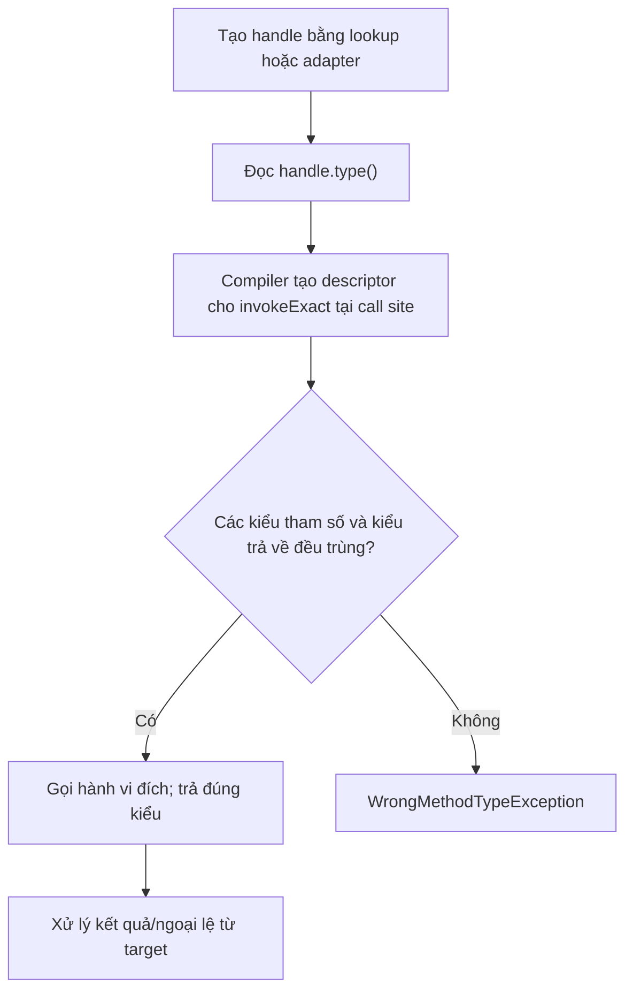

# `invokeExact()`: chữ ký tại vị trí gọi phải khớp chính xác với `MethodType`

## 1. Vì sao `invokeExact()` không giống lời gọi method thông thường?

Trong Java, một lời gọi method thông thường được compiler kiểm tra theo chữ ký đã biết. Chẳng hạn, khi gọi `twice(21)` với method nhận `int` và trả `int`, kiểu tham số và kết quả được xác định từ khai báo của `twice`.

Với `java.lang.invoke.MethodHandle`, ta có một đối tượng đại diện cho hành vi có thể gọi động. Mỗi handle mang theo một kiểu bất biến được mô tả bằng `MethodType`, bao gồm **thứ tự và kiểu của tất cả tham số, cùng kiểu trả về**. `invokeExact()` yêu cầu chữ ký tại chính vị trí gọi (*call site*) **khớp hoàn toàn** với `handle.type()`.

Ví dụ, một handle có kiểu:

```text
(int)int
```

chỉ nhận được lời gọi `invokeExact` có **một tham số `int`** và **kết quả `int`**. Một lời gọi có đối số `Integer`, `long` hoặc kỳ vọng trả `Object` đều là một chữ ký khác. Java không tự boxing, unboxing hoặc widening bên trong `invokeExact` để sửa khác biệt đó.

Điều kiện này là hợp đồng hiện hành của Java SE, không phải một tính năng mới ra đời trong Java 18. Method Handle được giới thiệu từ Java 7; những thay đổi triển khai Core Reflection từ Java 18 không làm mất quy tắc khớp kiểu của `invokeExact`. Trong mô-đun **JAVA_VERSION_JAVA18** và chương **MethodHandle**, ta sẽ kiểm chứng hợp đồng còn hữu ích này trên JDK hiện đại, tránh phụ thuộc implementation cũ hoặc cơ chế legacy.

### Sau bài học, bạn có thể

1. Đọc một `MethodType` và xác định chính xác kiểu tham số/kiểu trả về.
2. Giải thích cơ chế *signature polymorphism* của `invokeExact`.
3. Dùng cast kết quả đúng vị trí để tạo call-site descriptor khớp handle.
4. Chẩn đoán `WrongMethodTypeException` khi sai tham số, receiver hoặc kiểu trả về.
5. Phân biệt `invokeExact`, `invoke`, `invokeWithArguments` và adapter `asType`.
6. Sử dụng `findStatic`, `findVirtual`, `bindTo` với kiểu receiver chính xác.
7. Kiểm thử handle trả primitive, reference, `void` và ngoại lệ từ target.

## 2. `MethodType` chứa những gì?

`java.lang.invoke.MethodType` biểu diễn một chữ ký gồm kiểu trả về và dãy kiểu tham số theo đúng thứ tự:

```java
MethodType t1 = MethodType.methodType(int.class, int.class);
// (int)int

MethodType t2 = MethodType.methodType(
        String.class, String.class, int.class);
// (String,int)String

MethodType t3 = MethodType.methodType(void.class);
// ()void
```

`MethodType.methodType(returnType, parameterTypes...)` đặt **kiểu trả về trước** trong lời gọi factory, mặc dù chuỗi hiển thị `toString()` thường ghi tham số trước và kiểu trả về sau.

| `MethodType` | Số tham số | Kiểu tham số | Kiểu trả về |
| --- | ---: | --- | --- |
| `(int)int` | 1 | `int` | `int` |
| `(String,int)String` | 2 | `String`, `int` | `String` |
| `()void` | 0 | Không có | `void` |
| `(Greeter,String)String` | 2 | `Greeter`, `String` | `String` |
| `(Integer)Object` | 1 | `Integer` | `Object` |

Ví dụ kiểm tra metadata:

```java
MethodType type = MethodType.methodType(int.class, int.class);

System.out.println(type.returnType() == int.class);    // true
System.out.println(type.parameterCount() == 1);        // true
System.out.println(type.parameterType(0) == int.class); // true
System.out.println(type);                              // (int)int
```

`MethodType` là đối tượng bất biến. Nếu cần chữ ký khác, tạo một `MethodType` mới hoặc dùng factory/transformer, chẳng hạn `changeReturnType` hay `changeParameterType`. Việc thay `MethodType` trong một biến không tự đổi `type()` của handle đã có.

Khi dùng handle, hãy xem hai thứ độc lập:

- `handle.type()`: chữ ký **thật của handle**, được xác định khi tạo hoặc biến đổi handle.
- **Call-site descriptor**: chữ ký mà compiler ghi vào bytecode của **lời gọi `invokeExact` cụ thể**.

`invokeExact` thành công chỉ khi hai chữ ký này có cùng arity, đúng mọi kiểu tham số theo vị trí và đúng kiểu trả về. So sánh `MethodType` dùng `equals`, không cần so sánh chuỗi đã in.

## 3. Vì sao `invokeExact()` được gọi là *signature-polymorphic*?

API hiển thị một khai báo dạng:

```java
public final Object invokeExact(Object... args) throws Throwable
```

**Không** suy từ khai báo đó rằng mọi lời gọi Java đều có chữ ký `(Object[])Object`. `invokeExact` là một phương thức *signature-polymorphic* đặc biệt: compiler có thể phát sinh bytecode gọi nó với descriptor lấy từ **kiểu tĩnh của các biểu thức đối số** và **kiểu kết quả tại nơi gọi**.

Quy tắc xác định kiểu kết quả rất quan trọng:

- Nếu **cast trực tiếp trên biểu thức gọi**, kiểu của cast đó trở thành kiểu trả về của call site.
- Nếu gọi để lấy giá trị **mà không cast trực tiếp**, kiểu trả về được phát sinh là `Object`, kể cả khi bạn gán kết quả vào một biến reference.
- Nếu gọi ở vị trí **statement** và không dùng kết quả, kiểu trả về của call site là `void`.

Ví dụ đối với handle có `type() == (int)int`:

```java
int a = (int) handle.invokeExact(21);     // call site (int)int

Object b = handle.invokeExact(21);        // call site (int)Object

handle.invokeExact(21);                   // call site (int)void
```

Chỉ lời gọi **đầu tiên** khớp handle. Hai lời gọi sau vẫn có thể được compiler chấp nhận theo quy tắc của phương thức signature-polymorphic, nhưng JVM ném `WrongMethodTypeException` khi thực thi lời gọi đó.

Đặc biệt, **không được hiểu** `int a = handle.invokeExact(21)` là một cách tự động chọn kiểu trả về `int` của handle. Với `invokeExact`, hãy viết `(int) handle.invokeExact(21)` để chỉ rõ kiểu kết quả tại call site.

Nếu muốn thực sự chuyển `int` sang `long`, hãy nhận `int` bằng call site chính xác trước, rồi chuyển đổi trong Java:

```java
int original = (int) handle.invokeExact(21);
long widened = original; // Java widening SAU khi invokeExact hoàn thành.
```

Ngược lại, `long wrong = (long) handle.invokeExact(21)` đòi hỏi call site `(int)long`, không khớp `(int)int`.

### Sơ đồ kiểm tra kiểu



Lỗi kiểu ở bước `D` khác lỗi do method đích tự ném trong bước `G`.

## 4. Chương trình chạy được: thành công và các lỗi chữ ký

Tạo file `InvokeExactDemo.java`. Ví dụ tự kiểm tra bằng `AssertionError` để không phụ thuộc cờ `-ea`.

```java
import java.lang.invoke.MethodHandle;
import java.lang.invoke.MethodHandles;
import java.lang.invoke.MethodType;
import java.lang.invoke.WrongMethodTypeException;

public final class InvokeExactDemo {
    private static int executions;
    private static int touches;

    private InvokeExactDemo() {
    }

    public static int twice(int value) {
        executions++;
        return value * 2;
    }

    public static void touch() {
        touches++;
    }

    public static final class Greeter {
        private final String prefix;

        public Greeter(String prefix) {
            this.prefix = prefix;
        }

        public String say(String name) {
            return prefix + name;
        }
    }

    @FunctionalInterface
    private interface ThrowingAction {
        void run() throws Throwable;
    }

    private static void check(boolean condition, String message) {
        if (!condition) {
            throw new AssertionError(message);
        }
    }

    private static void expectWrongType(
            String scenario, ThrowingAction action) throws Throwable {
        try {
            action.run();
            throw new AssertionError("Thiếu WrongMethodTypeException: " + scenario);
        } catch (WrongMethodTypeException expected) {
            System.out.println("WRONG TYPE: " + scenario);
        }
    }

    public static void main(String[] args) throws Throwable {
        MethodHandles.Lookup lookup = MethodHandles.lookup();

        MethodHandle twiceHandle = lookup.findStatic(
                InvokeExactDemo.class,
                "twice",
                MethodType.methodType(int.class, int.class)
        );
        check(twiceHandle.type().equals(
                MethodType.methodType(int.class, int.class)),
                "Sai MethodType của twice");
        System.out.println("twice.type=" + twiceHandle.type());

        // Call site khớp: (int)int.
        int doubled = (int) twiceHandle.invokeExact(21);
        check(doubled == 42, "Sai kết quả");
        check(executions == 1, "Target phải chạy một lần");
        System.out.println("exact=" + doubled);

        // Kiểu trả về ở call site là Object thay vì int.
        expectWrongType("return Object", () -> {
            Object ignored = twiceHandle.invokeExact(21);
            System.out.println(ignored);
        });

        // Đối số là Integer thay vì int.
        expectWrongType("argument Integer", () -> {
            int ignored = (int) twiceHandle.invokeExact(Integer.valueOf(21));
            System.out.println(ignored);
        });

        // Kỳ vọng long thay vì int.
        expectWrongType("return long", () -> {
            long ignored = (long) twiceHandle.invokeExact(21);
            System.out.println(ignored);
        });

        // Lời gọi dạng statement có kiểu trả về void ở call site.
        expectWrongType("discarded int result", () -> {
            twiceHandle.invokeExact(21);
        });

        check(executions == 1,
                "Không lời gọi sai kiểu nào được chạy target");

        // invoke có thể điều chỉnh boxing/unboxing và kiểu trả về.
        Object flexible = twiceHandle.invoke(Integer.valueOf(21));
        check(flexible instanceof Integer && flexible.equals(42),
                "invoke không trả kết quả mong đợi");
        System.out.println("invoke=" + flexible);

        // asType tạo một handle mới có kiểu (Integer)Object.
        MethodHandle adapted = twiceHandle.asType(
                MethodType.methodType(Object.class, Integer.class)
        );
        check(adapted.type().equals(
                MethodType.methodType(Object.class, Integer.class)),
                "Sai kiểu handle đã thích nghi");
        Object adaptedValue = adapted.invokeExact(Integer.valueOf(21));
        check(adaptedValue.equals(42), "Sai kết quả asType");
        System.out.println("adapted=" + adaptedValue);

        // Handle instance có thêm receiver trong MethodType.
        MethodHandle say = lookup.findVirtual(
                Greeter.class,
                "say",
                MethodType.methodType(String.class, String.class)
        );
        check(say.type().equals(MethodType.methodType(
                String.class, Greeter.class, String.class)),
                "Sai kiểu receiver");

        Greeter greeter = new Greeter("Xin chào, ");
        String greeting = (String) say.invokeExact(greeter, "Ada");
        check("Xin chào, Ada".equals(greeting), "Sai kết quả instance");
        System.out.println("virtual=" + greeting);

        Object receiverAsObject = greeter;
        expectWrongType("receiver Object", () -> {
            String ignored = (String) say.invokeExact(receiverAsObject, "Ada");
            System.out.println(ignored);
        });

        MethodHandle boundSay = say.bindTo(greeter);
        check(boundSay.type().equals(
                MethodType.methodType(String.class, String.class)),
                "bindTo phải bỏ tham số receiver");
        String boundGreeting = (String) boundSay.invokeExact("Ada");
        check("Xin chào, Ada".equals(boundGreeting), "Sai kết quả bindTo");
        System.out.println("bound=" + boundGreeting);

        // Với handle ()void, câu lệnh invokeExact không có cast.
        MethodHandle touchHandle = lookup.findStatic(
                InvokeExactDemo.class,
                "touch",
                MethodType.methodType(void.class)
        );
        touchHandle.invokeExact();
        check(touches == 1, "Method void chưa chạy");
        System.out.println("void touched=" + touches);

        // Nếu kỳ vọng Object ở call site, ()Object không khớp ()void.
        expectWrongType("void as Object", () -> {
            Object ignored = touchHandle.invokeExact();
            System.out.println(ignored);
        });
        check(touches == 1, "Lời gọi sai kiểu không được chạy");
    }
}
```

Chạy từ thư mục chứa file:

```bash
javac -encoding UTF-8 InvokeExactDemo.java
java InvokeExactDemo
```

Kết quả mong đợi (các dòng phụ thuộc dữ liệu đã cố định trong ví dụ):

```text
twice.type=(int)int
exact=42
WRONG TYPE: return Object
WRONG TYPE: argument Integer
WRONG TYPE: return long
WRONG TYPE: discarded int result
invoke=42
adapted=42
virtual=Xin chào, Ada
WRONG TYPE: receiver Object
bound=Xin chào, Ada
void touched=1
WRONG TYPE: void as Object
```

`WrongMethodTypeException` là lỗi khớp kiểu ở lời gọi, không phải giá trị trả về của target. Test `executions == 1` và `touches == 1` chứng minh các lời gọi có chữ ký sai **không chạy** method đích. Đây là lý do không nên catch loại lỗi này và âm thầm xem là kết quả `null`.

Lệnh `main` khai báo `throws Throwable` vì `MethodHandle.invokeExact` và `invoke` có hợp đồng cho phép truyền thẳng bất kỳ `Throwable` nào từ target. Khác với `Method.invoke` trong Core Reflection, lời gọi MethodHandle không mặc định bọc exception của target vào `InvocationTargetException`.

## 5. Các tình huống sai kiểu cần nhận diện

Giả sử:

```java
MethodHandle mh = lookup.findStatic(
        InvokeExactDemo.class, "twice",
        MethodType.methodType(int.class, int.class)
);
// mh.type() == (int)int
```

| Câu lệnh | Kiểu call site | Kết quả |
| --- | --- | --- |
| `int x = (int) mh.invokeExact(21);` | `(int)int` | Thành công |
| `Object x = mh.invokeExact(21);` | `(int)Object` | `WrongMethodTypeException` |
| `Integer x = (Integer) mh.invokeExact(21);` | `(int)Integer` | `WrongMethodTypeException` |
| `long x = (long) mh.invokeExact(21);` | `(int)long` | `WrongMethodTypeException` |
| `int x = (int) mh.invokeExact(21L);` | `(long)int` | `WrongMethodTypeException` |
| `int x = (int) mh.invokeExact(Integer.valueOf(21));` | `(Integer)int` | `WrongMethodTypeException` |
| `mh.invokeExact(21);` | `(int)void` | `WrongMethodTypeException` |
| `int x = (int) mh.invokeExact((int) 21L);` | `(int)int` | Thành công: ép kiểu đối số trước lời gọi |

Các cột kiểu call site được suy từ kiểu tĩnh của **biểu thức đối số** và **cast kết quả ngay trên lời gọi**. Không dùng lớp runtime của `Object` hoặc suy luận từ kiểu của biến nhận kết quả để thay thế cho thông tin này.

### 5.1. Khi đối số khai báo là `Object`

```java
Object boxed = Integer.valueOf(21);
int value = (int) mh.invokeExact(boxed);       // (Object)int -> sai
```

Mặc dù đối tượng nằm trong `boxed` thực tế là `Integer`, kiểu tĩnh của biểu thức `boxed` vẫn là `Object`. Để gọi handle `(int)int`:

```java
int argument = ((Integer) boxed).intValue();
int value = (int) mh.invokeExact(argument);    // (int)int -> đúng
```

Cast/unboxing được thực hiện trong Java **trước** lời gọi; `invokeExact` không tự thích nghi.

### 5.2. Trường hợp đặc biệt của `null` không có cast

Đối với lời gọi signature-polymorphic, đối số literal `null` không có cast được ghi nhận với kiểu symbolic `java.lang.Void` tại call site. Nếu handle đòi `String`, dùng cast đối số rõ ràng:

```java
MethodHandle identity = lookup.findStatic(
        SomeClass.class, "identity",
        MethodType.methodType(String.class, String.class)
);

String ok = (String) identity.invokeExact((String) null);
// (String)String; target có thể trả null nếu cho phép.

String wrong = (String) identity.invokeExact(null);
// (Void)String ở call site; không khớp (String)String.
```

`SomeClass.identity(String)` trong ví dụ phải tồn tại và có thể được `lookup` truy cập. Điều cần rút ra là **cast lên chính đối số null** mới ấn định kiểu mà handle yêu cầu. Việc gán kết quả vào `String` không giải quyết sai kiểu tham số.

## 6. Handle cho instance method có receiver trong chữ ký

Khi dùng `MethodHandles.Lookup.findVirtual`, `MethodType` truyền cho phương thức lookup mô tả **kiểu trả về và các tham số được khai báo** của method, không bao gồm receiver. Nhưng `MethodHandle` được tạo ra sẽ có **một tham số receiver đứng đầu**.

```java
MethodHandle say = MethodHandles.lookup().findVirtual(
        InvokeExactDemo.Greeter.class,
        "say",
        MethodType.methodType(String.class, String.class)
);

// say.type() == (Greeter,String)String
```

Vì thế:

```java
InvokeExactDemo.Greeter greeter =
        new InvokeExactDemo.Greeter("Chào ");
String value = (String) say.invokeExact(greeter, "Java");
```

là call site đúng kiểu. Nhưng:

```java
Object receiver = greeter;
String value = (String) say.invokeExact(receiver, "Java");
```

đòi handle kiểu `(Object,String)String`; việc receiver thực sự là instance của `Greeter` không làm `invokeExact` tự chuyển nó.

Có hai giải pháp rõ ràng:

1. Cast receiver thành đúng class khai báo trước khi gọi: `(String) say.invokeExact((InvokeExactDemo.Greeter) receiver, "Java")`.
2. Dùng `say.bindTo(greeter)` để tạo handle mới đã gắn receiver; kiểu còn lại là `(String)String`.

`bindTo` tạo **handle mới** và không thay đổi `type()` của handle gốc. Khi gắn receiver, hãy kiểm tra kiểu handle mới bằng `type()` trước khi xây dựng call site.

## 7. `void` và reference return không giống nhau

Handle trả `void` có `type()` mà kiểu trả về là `void.class`. Call site đúng sẽ là câu lệnh không sử dụng kết quả:

```java
MethodHandle touch = lookup.findStatic(
        InvokeExactDemo.class,
        "touch",
        MethodType.methodType(void.class)
);
touch.invokeExact(); // ()void -> đúng
```

Nhưng câu lệnh:

```java
Object result = touch.invokeExact(); // ()Object -> sai
```

không có cơ chế tự biến giá trị `void` thành `null` trong `invokeExact`. Đây là khác biệt lớn so với API `Method.invoke` của Core Reflection, nơi method trả `void` được biểu diễn bằng `null` trong kết quả `Object`.

Ngược lại, một method khai báo trả `Void` (lớp tham chiếu) có kiểu trả về `Void.class`, **không phải** `void.class`:

```java
public static Void noReferenceValue() {
    return null;
}
```

Handle tới method này có `type() == ()Void`. Lời gọi chính xác phải nêu kiểu kết quả `Void`:

```java
Void value = (Void) handleReturningVoidReference.invokeExact();
```

Không thay bằng `handleReturningVoidReference.invokeExact();` nếu muốn dùng `invokeExact`: dạng statement có kiểu trả về `void` và vì vậy không khớp `()Void`.

## 8. Cần chuyển đổi kiểu? Chọn `invoke` hoặc `asType`

`invokeExact` thích hợp khi caller biết chính xác `MethodType` và muốn giữ hợp đồng gọi typed. Nếu đầu vào có wrapper, kiểu trả về được yêu cầu là `Object` hoặc cần widening hợp lệ, đừng trông chờ `invokeExact` tự biến đổi chúng.

### 8.1. `invoke` thử điều chỉnh theo quy tắc `asType`

Với handle `(int)int`:

```java
Object result = mh.invoke(Integer.valueOf(21));
// Kiểu call site (Integer)Object.
// invoke có thể unbox Integer -> int và box int -> Object.
```

Nếu caller yêu cầu kiểu mà `asType` không hỗ trợ, `invoke` có thể ném `WrongMethodTypeException`. Trong một số trường hợp adapter được tạo nhưng cast reference thất bại ở runtime, có thể nhận `ClassCastException` hoặc lỗi unboxing nếu giá trị không hợp lệ. `invoke` **không phải** một cơ chế ép kiểu tùy ý.

### 8.2. `asType` tạo một handle có chữ ký mới

```java
MethodHandle adapted = mh.asType(
        MethodType.methodType(Object.class, Integer.class)
);
// adapted.type() == (Integer)Object

Object result = adapted.invokeExact(Integer.valueOf(21));
```

`asType` không sửa handle `mh`; nó cung cấp một handle mới có adapter thích hợp. `invokeExact` trên `adapted` vẫn hoàn toàn **exact** vì kiểu call site lúc này đúng `(Integer)Object`.

| Cách gọi | Yêu cầu về kiểu | Khi nên dùng |
| --- | --- | --- |
| `invokeExact` | Call-site descriptor phải trùng `handle.type()` | Đường gọi có kiểu được xác định rõ |
| `invoke` | Call-site descriptor cần có phép thích nghi hợp lệ qua `asType` | Cần boxing/unboxing/widening hoặc cast reference hợp lệ |
| `asType(...).invokeExact` | Tạo handle adapter có kiểu mới, rồi gọi chính xác kiểu đó | Muốn chuẩn hóa chữ ký ở bước cấu hình |
| `invokeWithArguments` | Nhận danh sách `Object`, xử lý theo cơ chế gọi tổng quát | Khi số lượng/kiểu đối số chỉ biết lúc runtime |

`invokeWithArguments` trả `Object`, có cơ chế chuyển đổi và boxing cho mục đích gọi linh hoạt; không dùng nó làm bằng chứng rằng `invokeExact` có cùng khả năng thích nghi. Với API động chuyên sâu, nên cân nhắc hiệu năng, kiểm tra arity và kiểm soát lỗi chuyển đổi.

### 8.3. Không che lỗi bằng adapter một cách tùy tiện

Nếu client nghĩ method trả `String` nhưng handle thật trả `int`, thử `asType` cho mọi chữ ký có thể làm lỗi cấu hình trở nên khó tìm. Khi thiết kế thư viện, hãy xác định **hợp đồng API** và chỉ tạo adapter cho các phép biến đổi được phép. Ghi lại cả `handle.type()` gốc và kiểu adapter đích khi debug.

## 9. Phân biệt `WrongMethodTypeException` với những lỗi khác

| Giai đoạn | Vấn đề | Lỗi/hành vi có thể gặp |
| --- | --- | --- |
| Tạo handle bằng `findStatic`/`findVirtual` | Tên method hoặc kiểu khai báo không đúng | `NoSuchMethodException` |
| Tạo handle qua `Lookup` | Không đủ quyền truy cập member | `IllegalAccessException` |
| Gọi `invokeExact` | Call-site descriptor không trùng `handle.type()` | `WrongMethodTypeException` |
| Gọi `invoke`/`asType` | Chữ ký không thể thích nghi | `WrongMethodTypeException` |
| Chuyển đổi reference khi gọi linh hoạt | Runtime object không thể cast sang kiểu đích | `ClassCastException` |
| Unboxing khi gọi linh hoạt | Giá trị `null` dùng ở nơi cần primitive | Có thể là `NullPointerException` |
| Target đã chạy và ném exception | Lỗi nghiệp vụ từ method đích | `Throwable` của target được truyền thẳng |

`WrongMethodTypeException` nói về mismatch kiểu **ở ranh giới lời gọi**. Nếu method đích tự ném `IllegalArgumentException`, `IOException` hay một exception khác, hãy xử lý theo hợp đồng của target thay vì tự động coi đó là lỗi kiểu của handle.

Khác với Core Reflection `Method.invoke`, MethodHandle **không tự bọc** lỗi target trong `InvocationTargetException`. Chữ ký `invokeExact` khai báo `throws Throwable`, nên code cần bắt, chuyển tiếp hoặc khai báo `Throwable` phù hợp với ngữ cảnh.

### Nhật ký debug nên có

```java
System.out.println("handle.type=" + handle.type());
System.out.println("return=" + handle.type().returnType());
System.out.println("parameters=" + handle.type().parameterList());
```

Đừng chỉ log `handle.getClass()`. Lớp triển khai nội bộ của MethodHandle không phải API cam kết và không có ích bằng `handle.type()` trong việc tìm lỗi exact signature.

## 10. Kiểm chứng bằng JUnit Jupiter

Trong test, ngoài kiểm tra kết quả đúng, hãy thêm các trường hợp **sai kiểu có chủ đích**. Ví dụ:

```java
import java.lang.invoke.MethodHandle;
import java.lang.invoke.MethodHandles;
import java.lang.invoke.MethodType;
import java.lang.invoke.WrongMethodTypeException;
import org.junit.jupiter.api.Test;

import static org.junit.jupiter.api.Assertions.*;

class InvokeExactDemoTest {
    private static MethodHandle twiceHandle()
            throws ReflectiveOperationException {
        return MethodHandles.lookup().findStatic(
                InvokeExactDemo.class,
                "twice",
                MethodType.methodType(int.class, int.class)
        );
    }

    @Test
    void exactCallReturnsPrimitive() throws Throwable {
        MethodHandle mh = twiceHandle();
        assertEquals(
                MethodType.methodType(int.class, int.class),
                mh.type()
        );

        int answer = (int) mh.invokeExact(21);
        assertEquals(42, answer);
    }

    @Test
    void objectReturnTypeIsNotExact() throws Throwable {
        MethodHandle mh = twiceHandle();

        assertThrows(WrongMethodTypeException.class, () -> {
            Object ignored = mh.invokeExact(21);
            System.out.println(ignored);
        });
    }

    @Test
    void wrapperArgumentIsNotExact() throws Throwable {
        MethodHandle mh = twiceHandle();

        assertThrows(WrongMethodTypeException.class, () -> {
            int ignored = (int) mh.invokeExact(Integer.valueOf(21));
            System.out.println(ignored);
        });
    }

    @Test
    void voidCallSiteCannotDiscardIntReturn() throws Throwable {
        MethodHandle mh = twiceHandle();

        assertThrows(WrongMethodTypeException.class, () -> {
            mh.invokeExact(21);
        });
    }

    @Test
    void adapterAllowsExactObjectResult() throws Throwable {
        MethodHandle mh = twiceHandle().asType(
                MethodType.methodType(Object.class, Integer.class)
        );

        Object value = mh.invokeExact(Integer.valueOf(21));
        assertEquals(42, value);
    }
}
```

Đoạn test giả định có JUnit Jupiter API và test engine trên classpath, đồng thời class `InvokeExactDemo` ở phần 4 đã được biên dịch. Trong Maven/Gradle, dùng test task đã cấu hình sẵn; test framework quản lý discovery và báo cáo. Không cần bật Java preview hay dùng API nội bộ để chạy các test này.

**Tại sao vẫn kiểm tra `mh.type()`?** Vì lỗi có thể nằm ngay trong cấu hình lookup: nếu tạo handle khác chữ ký mong đợi, assertion về metadata phát hiện sai lệch trước khi test gọi method.

## 11. Những nhầm lẫn cần tránh

- **Tưởng kiểu runtime của đối số quyết định call site:** biến khai báo `Object` vẫn tạo đối số kiểu `Object` dù chứa `Integer`.
- **Tưởng phép gán quyết định kiểu trả về:** `Object o = mh.invokeExact(...)` không tự đọc `mh.type().returnType()`.
- **Quên cast kết quả `int`:** dùng `(int) mh.invokeExact(...)` ngay tại vị trí lời gọi.
- **Vứt kết quả của handle không `void`:** câu lệnh trần `mh.invokeExact(...)` có call-site return `void`.
- **Nhầm `void.class` với `Void.class`:** `()void` và `()Void` là hai `MethodType` khác nhau.
- **Cho rằng receiver được chuyển kiểu tự động:** `(Greeter,String)String` không trùng `(Object,String)String`.
- **Dùng `invoke` rồi tưởng kết quả là hợp đồng của `invokeExact`:** `invoke` cho phép một số thích nghi kiểu; `invokeExact` không.
- **Catch `WrongMethodTypeException` rồi trả `null`:** làm mất chẩn đoán lỗi cấu hình và trộn nó với kết quả hợp lệ.
- **Coi `MethodHandle.type()` là chỉ có kiểu tham số:** kiểu trả về luôn là một phần của `MethodType`.
- **Dùng workaround nội bộ JDK cũ:** các quy tắc này là API công khai, nên dùng trực tiếp `java.lang.invoke` hiện hành.

## 12. Quy trình chẩn đoán nhanh trong ứng dụng

Nếu một dòng `invokeExact` ném `WrongMethodTypeException`, lần lượt:

1. In `handle.type()`, `returnType()` và `parameterList()`.
2. Kiểm tra số lượng đối số và **kiểu tĩnh** của từng biểu thức đối số ở source.
3. Kiểm tra cast trực tiếp trên biểu thức `invokeExact` để xác định kiểu trả về.
4. Nếu handle là virtual, kiểm tra tham số receiver đầu tiên.
5. Nếu handle đã qua `bindTo`, `asType`, `filterArguments` hoặc biến đổi khác, kiểm tra `type()` **sau biến đổi**, không chỉ trước.
6. Với literal `null`, thêm cast sang đúng kiểu tham số reference.
7. Với handle trả `void`, gọi dạng statement; với handle trả value, nhận đúng kiểu.
8. Nếu cần chuyển đổi hợp lệ, thử `invoke` hoặc tạo adapter `asType` có chủ đích.
9. Viết test cho một đường gọi đúng và ít nhất một đường gọi sai.

### Bài tự luyện

1. Tạo handle `(long)long` cho method `static long triple(long x)`; gọi đúng bằng `(long) mh.invokeExact(3L)`.
2. Truyền `3` thay cho `3L`; giải thích vì sao lỗi không được sửa bằng widening tự động.
3. Dùng handle trả `int` trong một statement; đoán loại lỗi và thử sửa.
4. Viết handle `(String)String` và truyền literal `null` có/không có cast; đối chiếu descriptor.
5. Tạo handle virtual và gọi với receiver khai báo `Object`; sửa bằng cast đúng receiver.
6. Dùng `asType` để nhận `Integer` thành `int` và trả `Object`, rồi gọi `invokeExact` trên adapter.
7. Tạo handle `()void` và handle `()Void`; so sánh câu lệnh gọi hợp lệ của mỗi handle.
8. Viết một target ném `IllegalStateException`; xác minh ngoại lệ được truyền qua MethodHandle mà không bị bọc.
9. Thêm JUnit test để kiểm tra type metadata và kết quả từng kiểu.

## 13. Tài liệu tham khảo chính thức

- [MethodHandle — Java SE 25](https://docs.oracle.com/en/java/javase/25/docs/api/java.base/java/lang/invoke/MethodHandle.html): signature-polymorphic invocation, call-site descriptor, `invokeExact`, `invoke`, `asType`, `bindTo` và `throws Throwable`.
- [MethodType — Java SE 25](https://docs.oracle.com/en/java/javase/25/docs/api/java.base/java/lang/invoke/MethodType.html): cách biểu diễn kiểu tham số và trả về, `methodType`, `returnType` và `parameterType`.
- [MethodHandles.Lookup — Java SE 25](https://docs.oracle.com/en/java/javase/25/docs/api/java.base/java/lang/invoke/MethodHandles.Lookup.html): tạo handle bằng `findStatic`, `findVirtual` và quy tắc quyền truy cập.
- [WrongMethodTypeException — Java SE 25](https://docs.oracle.com/en/java/javase/25/docs/api/java.base/java/lang/invoke/WrongMethodTypeException.html): lỗi gọi handle với method type không phù hợp.
- [Java Virtual Machine Specification, mục 6.5 (Java SE 25)](https://docs.oracle.com/javase/specs/jvms/se25/html/jvms-6.html): cơ chế thực thi `invokevirtual` cho phương thức signature-polymorphic.
- [JEP 416 — Reimplement Core Reflection with Method Handles](https://openjdk.org/jeps/416): mối liên hệ lịch sử từ Java 18; không làm thay đổi hợp đồng `invokeExact`.

**Ghi nhớ:** Với `MethodHandle.invokeExact()`, chữ ký tại **chính chỗ gọi** phải trùng `handle.type()` ở cả **tham số** và **kiểu trả về**. Cast kết quả ngay trên biểu thức gọi và kiểu tĩnh của đối số là những chi tiết quyết định. Không có boxing, unboxing hay widening tự động trong `invokeExact`; khi cần thích nghi có chủ đích, hãy dùng `invoke` hoặc `asType` và kiểm thử chữ ký mới.
