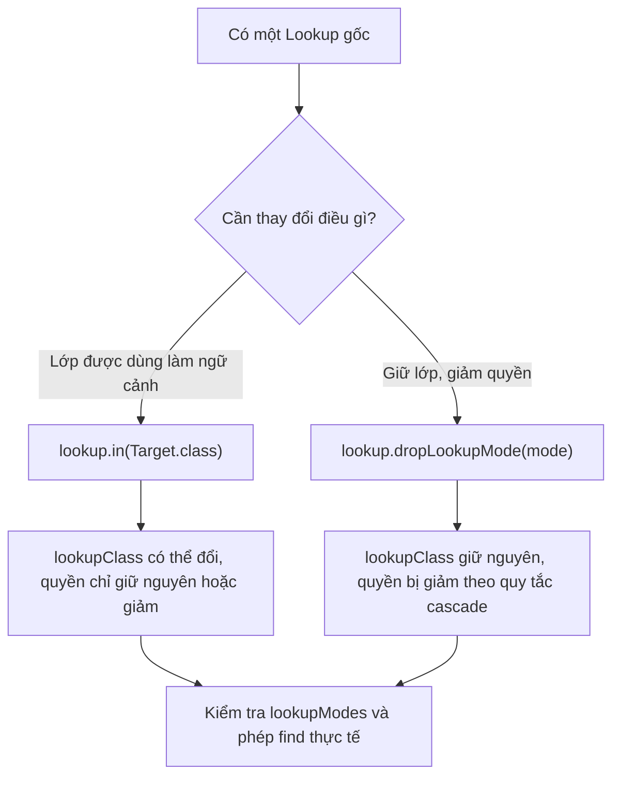

# Lookup.in() và dropLookupMode(): thu hẹp ngữ cảnh hoặc quyền truy cập

> **Chương:** Lookup và adapter  
> **Module:** `JAVA_VERSION_JAVA18` — học hợp đồng `java.lang.invoke` được hỗ trợ trên JDK 18 và những phiên bản JDK hiện đại. Bài tập trung vào cách giới hạn quyền khi tạo `MethodHandle`, đồng thời liên hệ tới cơ chế kiểm tra quyền của reflection.

## Mục tiêu học tập

Sau bài này, bạn có thể:

1. Mô tả `MethodHandles.Lookup` như một **ngữ cảnh tra cứu có các quyền truy cập cụ thể**, thay vì chỉ là công cụ tìm phương thức theo tên.
2. Phân biệt `lookup.in(Target.class)` — **đổi lớp làm ngữ cảnh lookup** — với `lookup.dropLookupMode(mode)` — **giữ lớp lookup nhưng hạ quyền**.
3. Giải thích vì sao chuyển sang lớp cùng package, khác package hoặc khác module có thể làm mất những quyền khác nhau.
4. Dự đoán các quyền bị mất dây chuyền khi bỏ `PRIVATE`, `PACKAGE`, `MODULE` hoặc `PUBLIC`.
5. Kiểm chứng bằng `lookupClass()`, `lookupModes()` và những phép `findStatic()` thành công hoặc ném `IllegalAccessException`.
6. Phân biệt **thu hẹp lookup** với **thu hồi MethodHandle đã tạo**, và biết khi nào cần `privateLookupIn()`.

## 1. Lookup mang quyền của ngữ cảnh tạo nó

`MethodHandles.Lookup` được dùng để tìm `MethodHandle` hoặc `VarHandle` cho method, constructor và field. Khi tạo handle, `Lookup` kiểm tra quyền truy cập dựa vào **lớp lookup**, **các access mode** và quy tắc module của JDK.

Ví dụ:

```java
MethodHandles.Lookup lookup = MethodHandles.lookup();
MethodHandle handle = lookup.findStatic(
        Example.class,
        "message",
        MethodType.methodType(String.class));
```

`MethodHandles.lookup()` trả về lookup gắn với lớp gọi phương thức này. Khi gọi từ bên trong `Example`, lookup có quyền của `Example` theo quy tắc API và có thể truy cập thành viên `private` của chính lớp đó. Nếu lấy `Lookup` từ `publicLookup()`, phạm vi quyền nhỏ hơn và dành cho các public member có thể truy cập.

Các phương thức quan sát quan trọng:

| API | Ý nghĩa |
| --- | --- |
| `lookup.lookupClass()` | Lớp hiện được dùng làm ngữ cảnh kiểm tra truy cập |
| `lookup.lookupModes()` | Mặt nạ bit thể hiện những kiểu quyền mà lookup đang mang |
| `lookup.previousLookupClass()` | Lớp lookup trước đó, dùng thêm khi ngữ cảnh lookup đã chuyển qua ranh giới module |
| `lookup.hasFullPrivilegeAccess()` | Cho biết lookup có cả quyền `PRIVATE` và `MODULE` theo định nghĩa API |
| `lookup.findStatic()` / `lookup.findVirtual()` | Tìm và kiểm tra quyền để tạo handle; có thể ném `NoSuchMethodException` hoặc `IllegalAccessException` |

`lookupModes()` là bitmask, thường xét bằng biểu thức `(modes & Lookup.PRIVATE) != 0`. Các bit đáng chú ý gồm `PUBLIC`, `PRIVATE`, `PROTECTED`, `PACKAGE`, `MODULE`, `ORIGINAL` và `UNCONDITIONAL`.

**Đừng hiểu bit `PUBLIC` là giấy phép truy cập mọi lớp `public` trong mọi module.** Quy tắc module readability, package `exports`, lookup class và có thể cả previous lookup class vẫn tham gia kiểm tra.

## 2. Lookup.in(): thay đổi lớp làm ngữ cảnh tra cứu

Dạng API:

```java
MethodHandles.Lookup relocated = original.in(Target.class);
```

`in(Target.class)` tạo lookup mà `lookupClass()` của kết quả là `Target.class`. Tuy nhiên, **kết quả không được mạnh hơn lookup gốc**. Một số quyền có thể bị bỏ khi chuyển sang lớp mới:

- Sang **lớp khác**, quyền `ORIGINAL` không còn.
- Sang **nest khác**, không tiếp tục có quyền `PRIVATE` chỉ nhờ lookup cũ. Hai lớp top-level riêng biệt trong cùng package thông thường là hai nest khác nhau.
- Sang **package khác**, quyền `PACKAGE` và khả năng dựa vào quan hệ package để truy cập `protected` bị mất. Các quy tắc có thể loại bỏ thêm các access mode liên quan.
- Sang **module khác**, quyền `MODULE` bị mất. Việc tra cứu `public` còn phụ thuộc các giới hạn cross-module.
- Nếu lớp đích **không truy cập được** từ lookup ban đầu, lookup mới có thể mất **mọi** access mode, kể cả `PUBLIC`.
- Khi một lookup đã chuyển qua ranh giới module rồi tiếp tục chuyển sang module thứ ba, các giới hạn `previousLookupClass()` có thể làm mất toàn bộ quyền.

Các quy tắc này giải thích vì sao `in()` không phải là cách “mượn quyền của lớp đích” để đọc các phương thức `private` của lớp đó. Đối với lookup được tạo bằng `MethodHandles.lookup()`, thay đổi lớp lookup thường thu hẹp quyền.

### Ví dụ cùng package nhưng khác nest

Giả sử `Owner` và `Peer` là hai lớp top-level riêng biệt trong package `demo`. `Owner` có lookup đầy đủ trên chính nó:

```java
MethodHandles.Lookup ownerLookup = MethodHandles.lookup();
MethodHandles.Lookup peerLookup = ownerLookup.in(Peer.class);
```

`peerLookup.lookupClass()` là `Peer.class`. Nếu hai lớp đều ở cùng package và module nhưng **khác nest**, lookup mới vẫn có thể truy cập các member package-private trong phạm vi được phép, trong khi quyền `PRIVATE` của lớp đích không được tự động cấp. Bài thực hành ở mục 4 sẽ quan sát chính xác hành vi này.

**Chú ý về nestmates:** Các lớp thực sự thuộc **cùng nest** có quan hệ truy cập private khác hai lớp top-level độc lập. Vì vậy không nên viết quy tắc “chuyển lớp luôn mất PRIVATE”; điều kiện chính xác liên quan đến nest/package member theo hợp đồng API.

## 3. dropLookupMode(): giữ nguyên lớp lookup nhưng hạ quyền

Dạng API:

```java
MethodHandles.Lookup restricted =
        original.dropLookupMode(MethodHandles.Lookup.PRIVATE);
```

Khác với `in()`, phương thức này **không đổi `lookupClass()`**. Nó trả về lookup có ít quyền hơn, theo các quy tắc hạ access mode do API quy định.

Điểm dễ nhầm: `dropLookupMode()` **không đơn giản là xóa đúng một bit**. Trên một lookup thông thường không phải `publicLookup()`, `PROTECTED` và `ORIGINAL` luôn bị loại khỏi kết quả; khi bỏ các mode khác còn có hiệu ứng liên đới.

| Lời gọi trên lookup đầy đủ ban đầu | Quyền quan trọng còn lại trong kết quả | Quyền mất đáng chú ý |
| --- | --- | --- |
| `dropLookupMode(PROTECTED)` | `PRIVATE`, `PACKAGE`, `MODULE`, `PUBLIC` | `PROTECTED`, `ORIGINAL` |
| `dropLookupMode(PRIVATE)` | `PACKAGE`, `MODULE`, `PUBLIC` | `PRIVATE`, `PROTECTED`, `ORIGINAL` |
| `dropLookupMode(PACKAGE)` | `MODULE`, `PUBLIC` | `PACKAGE`, `PRIVATE`, `PROTECTED`, `ORIGINAL` |
| `dropLookupMode(MODULE)` | `PUBLIC` | `MODULE`, `PACKAGE`, `PRIVATE`, `PROTECTED`, `ORIGINAL` |
| `dropLookupMode(PUBLIC)` | Không còn access mode | Tất cả quyền truy cập |

Bảng giả định lookup gốc có đầy đủ các quyền liên quan trong ngữ cảnh gọi. Nếu lookup ban đầu đã bị giới hạn, kết quả cũng **không thể có nhiều quyền hơn** bảng này. Với lookup có mode `UNCONDITIONAL` do `publicLookup()` tạo, có quy tắc riêng: bỏ `UNCONDITIONAL` khiến lookup đó không còn quyền truy cập.

Ví dụ từ một lookup có đầy đủ quyền:

```java
MethodHandles.Lookup original = MethodHandles.lookup();

MethodHandles.Lookup noPrivate =
        original.dropLookupMode(MethodHandles.Lookup.PRIVATE);

MethodHandles.Lookup publicOnly =
        original.dropLookupMode(MethodHandles.Lookup.MODULE);

System.out.println(noPrivate.lookupClass() == original.lookupClass()); // true
System.out.println(publicOnly.lookupClass() == original.lookupClass()); // true
```

`noPrivate` không thể dùng để tra cứu private method của lớp ban đầu, dù `lookupClass()` không thay đổi. `publicOnly` cũng mất quyền package-private; nó có thể tìm các public method hợp lệ theo quy tắc truy cập.

### Sơ đồ lựa chọn



## 4. Thực hành đầy đủ: đo quyền trước và sau khi thu hẹp

Ví dụ dưới đây dùng **hai lớp top-level ở cùng package nhưng khác nest**. `LookupScopeDemo` tự tạo lookup đầy đủ trên chính lớp của nó. `Peer` nằm cùng package `demo` và không lồng trong `LookupScopeDemo`, vì vậy không phải nestmate.

Tạo một file `src/demo/LookupScopeDemo.java`:

```java
package demo;

import java.lang.invoke.MethodHandle;
import java.lang.invoke.MethodHandles;
import java.lang.invoke.MethodHandles.Lookup;
import java.lang.invoke.MethodType;

public final class LookupScopeDemo {
    private static String secret() {
        return "owner-private";
    }

    static String packageMessage() {
        return "owner-package";
    }

    public static String publicMessage() {
        return "owner-public";
    }

    private static void printModes(String label, Lookup lookup) {
        int modes = lookup.lookupModes();
        System.out.printf(
                "%s: class=%s PRIVATE=%s PACKAGE=%s MODULE=%s%n",
                label,
                lookup.lookupClass().getSimpleName(),
                (modes & Lookup.PRIVATE) != 0,
                (modes & Lookup.PACKAGE) != 0,
                (modes & Lookup.MODULE) != 0);
    }

    private static void tryFind(
            String label, Lookup lookup, Class<?> owner, String name)
            throws Throwable {
        try {
            MethodHandle method = lookup.findStatic(
                    owner, name, MethodType.methodType(String.class));
            System.out.println(label + "=" + (String) method.invokeExact());
        } catch (IllegalAccessException e) {
            System.out.println(label + "=DENIED");
        } catch (NoSuchMethodException e) {
            System.out.println(label + "=MISSING");
        }
    }

    public static void main(String[] args) throws Throwable {
        Lookup original = MethodHandles.lookup();

        // in(): đổi lookup class sang một top-level class khác, cùng package.
        Lookup inPeer = original.in(Peer.class);

        // dropLookupMode(): vẫn là lookup trên LookupScopeDemo.
        Lookup noPrivate = original.dropLookupMode(Lookup.PRIVATE);
        Lookup publicOnly = original.dropLookupMode(Lookup.MODULE);
        Lookup noAccess = original.dropLookupMode(Lookup.PUBLIC);

        printModes("original", original);
        printModes("inPeer", inPeer);
        printModes("noPrivate", noPrivate);
        printModes("publicOnly", publicOnly);
        printModes("noAccess", noAccess);

        tryFind("original.secret",
                original, LookupScopeDemo.class, "secret");

        tryFind("inPeer.package",
                inPeer, Peer.class, "packageMessage");
        tryFind("inPeer.secret",
                inPeer, Peer.class, "secret");

        tryFind("noPrivate.secret",
                noPrivate, LookupScopeDemo.class, "secret");
        tryFind("noPrivate.package",
                noPrivate, LookupScopeDemo.class, "packageMessage");

        tryFind("publicOnly.package",
                publicOnly, LookupScopeDemo.class, "packageMessage");
        tryFind("publicOnly.public",
                publicOnly, LookupScopeDemo.class, "publicMessage");
        tryFind("noAccess.public",
                noAccess, LookupScopeDemo.class, "publicMessage");

        // Không lấy lại PRIVATE chỉ bằng cách quay lookup class về lớp cũ.
        Lookup returned = inPeer.in(LookupScopeDemo.class);
        tryFind("returned.secret",
                returned, LookupScopeDemo.class, "secret");

        // Khác với in(): yêu cầu private lookup có kiểm tra quyền tường minh.
        Lookup privatePeer = MethodHandles.privateLookupIn(Peer.class, original);
        tryFind("privateLookupIn.secret",
                privatePeer, Peer.class, "secret");

        // Thu hẹp lookup không thu hồi MethodHandle được tạo trước.
        MethodHandle existing = original.findStatic(
                LookupScopeDemo.class, "secret",
                MethodType.methodType(String.class));
        Lookup reducedLater = original.dropLookupMode(Lookup.PRIVATE);
        System.out.println("existingHandle=" + (String) existing.invokeExact());
        System.out.println("reduced.privateMode=" +
                ((reducedLater.lookupModes() & Lookup.PRIVATE) != 0));
    }
}

// Lớp top-level thứ hai, cùng package nhưng không cùng nest với Demo.
final class Peer {
    private static String secret() {
        return "peer-private";
    }

    static String packageMessage() {
        return "peer-package";
    }
}
```

Từ thư mục chứa `src`, chạy trên JDK 18 trở lên:

```sh
javac -encoding UTF-8 -d out src/demo/LookupScopeDemo.java
java -cp out demo.LookupScopeDemo
```

Kết quả dự kiến với classpath thông thường (hai lớp thuộc cùng unnamed module):

```text
original: class=LookupScopeDemo PRIVATE=true PACKAGE=true MODULE=true
inPeer: class=Peer PRIVATE=false PACKAGE=true MODULE=true
noPrivate: class=LookupScopeDemo PRIVATE=false PACKAGE=true MODULE=true
publicOnly: class=LookupScopeDemo PRIVATE=false PACKAGE=false MODULE=false
noAccess: class=LookupScopeDemo PRIVATE=false PACKAGE=false MODULE=false
original.secret=owner-private
inPeer.package=peer-package
inPeer.secret=DENIED
noPrivate.secret=DENIED
noPrivate.package=owner-package
publicOnly.package=DENIED
publicOnly.public=owner-public
noAccess.public=DENIED
returned.secret=DENIED
privateLookupIn.secret=peer-private
existingHandle=owner-private
reduced.privateMode=false
```

### Vì sao các kết quả này có ý nghĩa?

**A. `inPeer` mất `PRIVATE` nhưng còn `PACKAGE`.** `LookupScopeDemo` và `Peer` nằm cùng package và module nhưng là hai nest khác nhau. Vì vậy `in(Peer.class)` có thể tạo lookup trên `Peer` đủ để tìm `Peer.packageMessage()`, song không cấp quyền tự động tìm `Peer.secret()`.

**B. `noPrivate` giữ lớp lookup cũ.** Nó vẫn tìm được `packageMessage()` của `LookupScopeDemo`, nhưng không tìm được `secret()` vì quyền `PRIVATE` đã bị hạ.

**C. `publicOnly` đã mất cả quyền `PACKAGE` và `MODULE`.** Nó vẫn tìm được `publicMessage()` ở lớp `public` có thể truy cập, nhưng không thể tìm thành viên package-private. Thao tác bỏ `MODULE` kéo theo mất thêm các quyền liên quan.

**D. `noAccess` không tạo được handle kể cả cho public method.** Bỏ `PUBLIC` trên lookup thông thường làm kết quả không còn access mode.

**E. `returned` không lấy lại quyền cũ.** Việc `inPeer.in(LookupScopeDemo.class)` chuyển ngữ cảnh trở lại lớp ban đầu nhưng không khôi phục quyền `PRIVATE` đã bị mất khi đi sang nest khác.

**F. `privateLookupIn()` là một cơ chế có điều kiện khác với `in()`.** Vì lookup gốc trong ví dụ có đầy đủ quyền và hai lớp cùng module, lời gọi `privateLookupIn(Peer.class, original)` có thể tạo lookup với quyền private trên `Peer`. Giữa named modules, cần thỏa điều kiện đặc quyền của caller và package đích mở phù hợp. Không thể dùng `in()` để tự động đạt kết quả như vậy.

**G. `existing` vẫn dùng được sau khi tạo lookup bị hạ quyền.** Hạ quyền của một `Lookup` chỉ hạn chế những lần **tạo handle qua lookup mới**. Nó không hủy handle đã được tìm bằng lookup mạnh hơn, và cũng không sửa lookup gốc.

## 5. Quyền giảm nhưng không có thao tác “nâng lại”

Hai API tạo kết quả theo các quy tắc giữ nguyên hoặc mất quyền:

```java
Lookup original = MethodHandles.lookup();

Lookup a = original.dropLookupMode(Lookup.PRIVATE);
Lookup b = a.in(SomeOtherClass.class);
```

Từ `a` sang `b` sẽ không tự hồi phục `PRIVATE` đã bị bỏ. Đặt `lookupClass()` về lớp ban đầu cũng không làm tăng quyền.

Ngược lại, `original` vẫn là object cũ với các quyền ban đầu. Nếu ứng dụng muốn cung cấp một lookup hạn chế cho thư viện/plugin, hãy chuyển **chỉ lookup đã thu hẹp** và không làm rò rỉ `original` hoặc các handle nhạy cảm đã được tạo từ nó. `dropLookupMode()` không phải sandbox bảo mật toàn bộ mã plugin: nó giới hạn khả năng lookup do object này cung cấp, trong khi plugin vẫn có thể dùng những API khác trong phạm vi quyền chạy của nó.

### Một lưu ý về MethodHandle adapter

Các adapter như `asType()`, `bindTo()` hoặc `filterArguments()` biến đổi **handle đã có**. Chúng không sử dụng `Lookup` để xin quyền tìm method mới trong mọi lần invocation. Vì vậy:

- `dropLookupMode()` ảnh hưởng đến **những lần `findStatic()`, `findVirtual()` hoặc lookup tương tự về sau bằng lookup bị hạn chế**.
- Nó không thu hồi capability của `MethodHandle` đã tạo thành công từ lookup đủ quyền.
- Adapter thay đổi cách nhận tham số hoặc kiểu gọi theo hợp đồng API, nhưng không biến một lookup thiếu quyền thành lookup có quyền private.

Điểm này quan trọng khi thiết kế framework: bước cấp phép tìm member cần được quyết định tại lúc tạo handle, sau đó handle có thể được cache và truyền tới nơi sử dụng khác.

## 6. Module boundary và previousLookupClass()

Trong named modules, `Lookup.in()` còn bị chi phối bởi việc module nào **đọc** module nào và package nào được `exports`.

Giả sử lookup ban đầu thuộc module `app.module`, còn `Target` thuộc `library.module`. Khi chuyển:

```java
Lookup fromApp = MethodHandles.lookup();
Lookup fromLibrary = fromApp.in(Target.class);
```

JDK ghi nhận ngữ cảnh đi qua ranh giới module và bỏ quyền `MODULE`. Trong một số trường hợp lookup mới có `previousLookupClass()` không còn `null` để kiểm tra quan hệ giữa ngữ cảnh trước và sau. Quyền `PUBLIC` còn tồn tại cũng cần thỏa kiểm tra đọc module và xuất package; không thể chỉ nhìn một bit `PUBLIC` rồi kết luận có quyền.

Chuyển tiếp tới **module thứ ba** có thể làm mất toàn bộ access mode. Nếu lớp đích không truy cập được ngay từ lookup gốc, `in()` cũng có thể cho kết quả không có quyền. Đây là khác biệt quan trọng so với suy nghĩ rằng chỉ cần `in(Target.class)` là sẽ tìm được mọi public method của `Target`.

Đối với truy cập sâu vào member `private` của module khác, `MethodHandles.privateLookupIn()` có quy tắc riêng, bao gồm quyền của lookup caller và điều kiện `opens` từ module đích. `exports` không thay thế `opens` khi yêu cầu truy cập private qua module boundary.

## 7. Phân biệt các lỗi theo giai đoạn

| Tình huống | Giai đoạn | Điều cần quan sát |
| --- | --- | --- |
| Gọi `in(null)` | Đổi ngữ cảnh | `NullPointerException` |
| Gọi `in(int.class)` hoặc `in(String[].class)` | Đổi ngữ cảnh | `IllegalArgumentException` vì đối tượng đích không phải class/interface phù hợp |
| Lớp đích không truy cập được từ lookup ban đầu | Tạo lookup qua `in()` | Có thể nhận lookup với **0 access mode**, không được giả định là lookup đầy đủ |
| Gọi `dropLookupMode(giá_trị_không_hợp_lệ)` | Hạ mode | `IllegalArgumentException` |
| Tra cứu sai tên hoặc `MethodType` | `findStatic()` / `findVirtual()` | `NoSuchMethodException` |
| Member có tồn tại nhưng lookup mới thiếu quyền | `find*()` | `IllegalAccessException` |
| Handle đã tạo nhưng chữ ký `invokeExact()` sai | Invocation | `WrongMethodTypeException`; đây là lỗi kiểu call site, không phải lỗi quyền lookup |
| Handle đã tạo và phương thức đích tự ném exception | Invocation | Exception của phương thức đích được truyền ra theo hợp đồng `MethodHandle` |

**Phân biệt quan trọng:** `dropLookupMode()` và `in()` không tự chạy phương thức nghiệp vụ. Lỗi thiếu quyền thường được phát hiện **khi lookup thực hiện `find*()` để tạo handle**, trong khi lỗi chữ ký `invokeExact()` chỉ xuất hiện khi gọi một handle đã tồn tại.

Khi chẩn đoán, in `lookupClass()`, `lookupModes()` và (nếu có cross-module) `previousLookupClass()`, sau đó xác nhận thao tác `findStatic()` hoặc `findVirtual()` thực tế. Đừng chỉ nhìn bitmask mà bỏ qua module/package visibility.

## 8. Tình huống ứng dụng: cấp lookup giới hạn cho thành phần mở rộng

Giả sử một framework có lớp `Registry` chứa cả phương thức `private` quản lý khóa bí mật và phương thức `public` dùng cho plugin. Framework cần cho phần mở rộng tạo handle tới các public method được cấp phép.

Một lựa chọn rõ ràng là cung cấp lookup đã bị giảm quyền:

```java
Lookup full = MethodHandles.lookup();
Lookup forPlugin = full.dropLookupMode(Lookup.MODULE);
```

`forPlugin` có cùng `lookupClass()` như `full` nhưng chỉ còn kiểu quyền `PUBLIC` trong trường hợp lookup đầy đủ thông thường. Plugin có thể sử dụng nó để tìm các public member đủ điều kiện, nhưng không thể dùng chính lookup này để tìm các private/package-private member.

Nếu plugin chỉ cần handle tới **một phương thức cụ thể**, cách giảm quyền theo nguyên tắc tối thiểu còn rõ hơn là framework **tự tạo handle được cho phép rồi chuyển chính handle đó**. Cách này giúp giới hạn API mà plugin nhận được. Trong cả hai trường hợp, hãy cẩn thận không truyền lookup đầy đủ hoặc các handle nhạy cảm cho plugin.

Mục tiêu ở đây là **kiểm soát capability mà framework chủ động chia sẻ**, không phải dựng ranh giới cách ly bảo mật tổng thể cho code không đáng tin. Việc cấp lookup bị giảm quyền chỉ quản lý khả năng tra cứu qua object đó.

## 9. Câu hỏi tự kiểm tra

**Câu 1.** `original.in(Peer.class)` đổi điều gì, và có tự cấp quyền `private` của `Peer` không?

> Nó đổi `lookupClass()` sang `Peer.class`; quyền của lookup mới không mạnh hơn lookup ban đầu. Nếu `Peer` là nest khác, `PRIVATE` bị mất, nên không tự nhiên truy cập được private member của `Peer`.

**Câu 2.** `original.dropLookupMode(Lookup.MODULE)` có nhất thiết chỉ bỏ một bit `MODULE` không?

> Không. Trên lookup thông thường, nó còn bỏ `PACKAGE`, `PRIVATE`, `PROTECTED` và `ORIGINAL`. Nếu lookup gốc đầy đủ, kết quả chủ yếu còn `PUBLIC`.

**Câu 3.** `dropLookupMode(Lookup.PRIVATE)` có thay đổi `lookupClass()` không?

> Không. Nó hạ quyền trên cùng lookup class. Ngược lại, `in(Target.class)` thay đổi lớp làm ngữ cảnh tra cứu.

**Câu 4.** Sau khi `in(Peer.class)` làm mất quyền private, gọi tiếp `in(Original.class)` có phục hồi quyền cũ không?

> Không. `in()` không tự tăng quyền đã mất. Muốn lookup private mới phải đi theo cơ chế `privateLookupIn()` khi có đủ điều kiện truy cập.

**Câu 5.** Vì sao `existingHandle` vẫn gọi được sau khi tạo `restricted = original.dropLookupMode(PRIVATE)`?

> Vì `restricted` là một lookup mới bị giới hạn. Lệnh này không thay đổi handle đã tạo, cũng không sửa `original`. Các quyền của handle hợp lệ đã được kiểm tra khi handle được tạo.

**Câu 6.** Một lookup chỉ có `PUBLIC` có luôn tìm được public member trong mọi named module không?

> Không. Còn phải thỏa kiểm tra module readability, package exports và, với lookup đã đi qua module khác, có thể cả previous lookup class.

**Câu 7.** `findStatic()` báo `IllegalAccessException` sau khi hạ quyền; có nên sửa `invokeExact()` không?

> Không. Lỗi phát sinh ở **bước tạo handle** do thiếu quyền. `invokeExact()` chưa được gọi; hãy xem ngữ cảnh lookup, quyền và module/package visibility.

## Tài liệu API trên JDK hiện đại

- [Java SE 25 — `MethodHandles.Lookup.in(Class)`](https://docs.oracle.com/en/java/javase/25/docs/api/java.base/java/lang/invoke/MethodHandles.Lookup.html#in(java.lang.Class)): thay đổi lookup class và quy tắc giảm quyền khi chuyển ngữ cảnh.
- [Java SE 25 — `MethodHandles.Lookup.dropLookupMode(int)`](https://docs.oracle.com/en/java/javase/25/docs/api/java.base/java/lang/invoke/MethodHandles.Lookup.html#dropLookupMode(int)): cách bỏ access mode và các quyền bị bỏ liên đới.
- [Java SE 25 — `MethodHandles.Lookup`](https://docs.oracle.com/en/java/javase/25/docs/api/java.base/java/lang/invoke/MethodHandles.Lookup.html): `lookupModes()`, `lookupClass()`, `previousLookupClass()`, quyền truy cập giữa các module.
- [Java SE 25 — `MethodHandles.privateLookupIn()`](https://docs.oracle.com/en/java/javase/25/docs/api/java.base/java/lang/invoke/MethodHandles.html#privateLookupIn(java.lang.Class,java.lang.invoke.MethodHandles.Lookup)): cơ chế yêu cầu lookup private khi thỏa điều kiện.
- [Java SE 25 — `MethodHandle`](https://docs.oracle.com/en/java/javase/25/docs/api/java.base/java/lang/invoke/MethodHandle.html): các handle được tạo hợp lệ và adapter như `bindTo()` hoặc `asType()`.

**Ghi nhớ:** `Lookup.in()` **thay lớp ngữ cảnh** và có thể mất quyền khi di chuyển giữa nest/package/module; `dropLookupMode()` **giữ lớp ngữ cảnh nhưng hạ quyền**, có thể mất nhiều mode theo quy tắc liên đới. Hai cách đều không tự khôi phục quyền đã mất và không thu hồi các `MethodHandle` đã tạo thành công.
