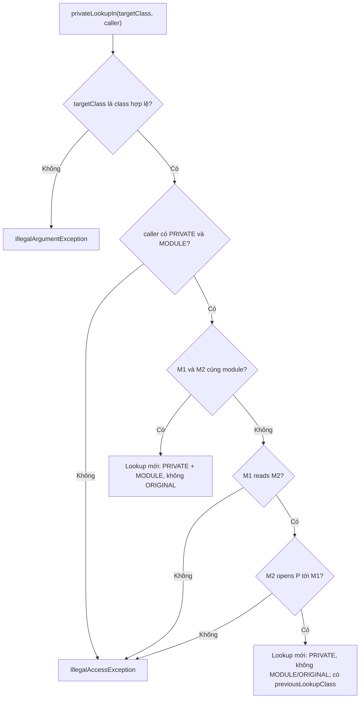

# `privateLookupIn()`: điều kiện readability, opens và quyền của `Lookup` gốc khi đi qua module

## 1. Một private member có tồn tại chưa chắc tạo được `MethodHandle`

Khi xây serializer, dependency injection, ORM hoặc công cụ xử lý metadata, ta có thể cần tạo `MethodHandle` để đọc field hay gọi method không công khai:

```java
import java.lang.invoke.MethodHandles;
import java.lang.invoke.MethodHandle;

MethodHandles.Lookup caller = MethodHandles.lookup();
MethodHandles.Lookup targetLookup =
        MethodHandles.privateLookupIn(Target.class, caller);
```

Dòng `privateLookupIn` không đơn giản là “bật quyền private”. Nó phải kiểm tra **quyền được gắn vào đối tượng `Lookup` gốc**, đồng thời kiểm tra **quan hệ đọc module (readability)** và **package mở (opens)** nếu đi sang module khác.

Khi thất bại, API ném `IllegalAccessException`. Việc class hay private field có tồn tại không đủ để nhận quyền. Thêm `exports` mà thiếu `opens` cũng chưa chắc khắc phục lỗi.

Bài này thuộc chương **Lookup và adapter** trong mô-đun `JAVA_VERSION_JAVA18`. API `MethodHandles.privateLookupIn` đã có từ Java 9 và vẫn áp dụng trên JDK hiện đại; Java 18 có JEP 416 liên quan cách triển khai **core reflection**, nhưng không làm mất các điều kiện JPMS của `privateLookupIn`. Nội dung dưới đây tập trung vào hợp đồng Java SE còn hiệu lực, không dùng workaround nội bộ lỗi thời.

## 2. Mô hình: ai xin quyền, ai sở hữu class?

Xét ba thực thể:

- `M1`: module của **lookup class** trong `caller`, tức module đại diện bên xin quyền.
- `M2`: module sở hữu `targetClass`, nơi chứa member cần truy cập.
- `P`: package khai báo `targetClass`.

Ví dụ:

```text
M1 = demo.probe           (module chạy code kiểm tra)
M2 = demo.vault           (module sở hữu dữ liệu)
P  = demo.vault.api       (package chứa SecretBox)
```

Nếu `M1 != M2`, `privateLookupIn(targetClass, caller)` thành công chỉ khi **đồng thời**:

1. `caller` có quyền đầy đủ: bit `Lookup.PRIVATE` và bit `Lookup.MODULE`.
2. `targetClass` là class hợp lệ cho lookup, không phải kiểu primitive, `void` hay array.
3. `M1` **reads** `M2`: `M1.canRead(M2) == true`.
4. `M2` **opens** package `P` ít nhất tới `M1`: `M2.isOpen(P, M1) == true`.

Nếu `M1 == M2`, không cần quan hệ đọc chéo module hay mở package ra ngoài; `caller` vẫn phải có đủ `PRIVATE` và `MODULE`. Đây là cơ chế deep access có kiểm soát, không phải bypass chung cho mọi code trong JVM.



Sơ đồ tập trung vào access contract. Hai đối số `null` gây `NullPointerException`; khi các điều kiện được thỏa mãn nhưng tên member hoặc `MethodType` sai, các phép `findGetter`/`findVirtual` tiếp theo còn có thể báo lỗi riêng.

## 3. `Lookup` gốc phải có `PRIVATE` **và** `MODULE`

`MethodHandles.Lookup` là một **capability object**. Nó ghi lại class đại diện cho quyền tra cứu và các bit mode cho phép tạo handle nào.

### 3.1. Lookup có đủ quyền

Khi gọi `MethodHandles.lookup()` trong code bình thường của class thực hiện lời gọi, ta có lookup với full privilege access cho class đó:

```java
import java.lang.invoke.MethodHandles;
import java.lang.invoke.MethodHandles.Lookup;

Lookup caller = MethodHandles.lookup();

System.out.println(caller.lookupClass());
System.out.println(caller.hasFullPrivilegeAccess());

boolean hasPrivate = (caller.lookupModes()
        & Lookup.PRIVATE) != 0;
boolean hasModule = (caller.lookupModes()
        & Lookup.MODULE) != 0;

System.out.println("PRIVATE: " + hasPrivate);
System.out.println("MODULE: " + hasModule);
```

`hasFullPrivilegeAccess()` trả `true` khi **cả `PRIVATE` và `MODULE`** đều hiện diện. Nó phù hợp để kiểm tra yêu cầu đầu vào của `privateLookupIn` hơn `hasPrivateAccess()`, vì API cũ này đã deprecated từ Java 14.

`MethodHandles.lookup()` là **caller-sensitive**: lookup class được xác định theo class thực sự gọi method này. Nếu code trong một thư viện helper gọi `lookup()`, đối tượng lookup đại diện **helper**, không tự đại diện module/class của người đã gọi helper.

### 3.2. `publicLookup()` không có quyền tạo private lookup

`MethodHandles.publicLookup()` chỉ cung cấp quyền truy cập công khai tối thiểu, thường là `UNCONDITIONAL` đối với public members trong package được export vô điều kiện.

```java
Lookup publicOnly = MethodHandles.publicLookup();

System.out.println(publicOnly.hasFullPrivilegeAccess()); // false

try {
    MethodHandles.privateLookupIn(Target.class, publicOnly);
    throw new AssertionError("Không được cấp private lookup");
} catch (IllegalAccessException expected) {
    System.out.println("Thiếu PRIVATE và MODULE");
}
```

`publicLookup()` không được nâng cấp quyền chỉ bằng việc truyền vào `privateLookupIn`. Việc module đích có `opens` cũng **không bù lại** thiếu `PRIVATE` hoặc `MODULE` của lookup gốc.

### 3.3. `dropLookupMode` chỉ hạ quyền, không nâng quyền

`Lookup.dropLookupMode(int)` cho phép tạo bản lookup có ít quyền hơn. Quyền đã mất không thể được `privateLookupIn` khôi phục từ lookup đã giảm quyền.

```java
Lookup full = MethodHandles.lookup();

Lookup withoutPrivate =
        full.dropLookupMode(Lookup.PRIVATE);

Lookup withoutModule =
        full.dropLookupMode(Lookup.MODULE);

System.out.println(withoutPrivate.hasFullPrivilegeAccess()); // false
System.out.println(withoutModule.hasFullPrivilegeAccess());  // false
```

Khi bỏ `MODULE`, các bit liên quan như `PACKAGE` và `PRIVATE` cũng bị bỏ theo quy tắc `dropLookupMode`. Khi bỏ `PRIVATE`, lookup không còn full privilege access dù có thể vẫn còn `MODULE`. Không kiểm tra bằng một bit duy nhất.

**Lưu ý:** `Lookup.ORIGINAL` cung cấp năng lực bổ sung cho lookup gốc do `lookup()`/VM tạo; `privateLookupIn` yêu cầu `PRIVATE + MODULE`, **không đòi** `ORIGINAL`.

## 4. Phân biệt `requires`, `exports` và `opens`

JPMS có ba ý niệm khác nhau:

| Cơ chế | Ảnh hưởng chính | Có đủ để tạo private lookup xuyên module? |
| --- | --- | --- |
| `requires M2;` trong `M1` | Tạo read edge `M1 → M2` | Chưa đủ; cần `opens` |
| `exports P;` trong `M2` | Cho module khác dùng public types/API của `P` | Không mở private members |
| `exports P to M1;` | Export công khai có mục tiêu | Không tự cho deep reflection |
| `opens P to M1;` | Cho `M1` deep reflection vào package `P` | Cần thêm read edge và full caller lookup |
| `opens P;` | Mở package cho các module khác | Vẫn cần read edge và quyền lookup |
| `open module M2 { ... }` | Mở các package của module | Phạm vi rộng; vẫn cần read edge |
| `--add-reads M1=M2` | Bổ sung read edge runtime | Không tự mở package |
| `--add-opens M2/P=M1` | Mở package runtime cho module M1 | Không tự tạo read edge |

**`exports` không đồng nghĩa với `opens`.** Một class công khai trong exported package có thể được import và gọi public API bình thường nhưng `privateLookupIn` vẫn bị từ chối vì package không open.

Ngược lại, `opens` cho deep reflection runtime **không tự làm package đó có thể import từ source code module khác**. Khi consumer cần tham chiếu trực tiếp class từ mã nguồn, package cũng cần được export phù hợp.

## 5. Ví dụ chạy được: hai named modules

Ví dụ dưới đây có:

- `demo.vault`: module sở hữu `SecretBox`.
- `demo.probe`: module client muốn tạo method handle đọc field `private` của `SecretBox`.

Cấu trúc dự án độc lập dành cho người học:

```text
src/
  demo.vault/
    module-info.java
    demo/vault/api/SecretBox.java
  demo.probe/
    module-info.java
    demo/probe/Main.java
```

### 5.1. Module sở hữu dữ liệu: chỉ `exports`

File `src/demo.vault/module-info.java`:

```java
module demo.vault {
    exports demo.vault.api;
}
```

File `src/demo.vault/demo/vault/api/SecretBox.java`:

```java
package demo.vault.api;

public final class SecretBox {
    private final String secret;

    public SecretBox(String secret) {
        this.secret = secret;
    }

    public String publicSummary() {
        return "SecretBox[hidden]";
    }
}
```

`SecretBox` là public class trong exported package, nên client có thể khởi tạo và gọi `publicSummary()`. Field `secret` vẫn private; `exports` không cấp quyền đọc field này qua `MethodHandles.privateLookupIn`.

### 5.2. Client có read edge từ `requires`

File `src/demo.probe/module-info.java`:

```java
module demo.probe {
    requires demo.vault;
}
```

File `src/demo.probe/demo/probe/Main.java`:

```java
package demo.probe;

import demo.vault.api.SecretBox;
import java.lang.invoke.MethodHandle;
import java.lang.invoke.MethodHandles;
import java.lang.invoke.MethodHandles.Lookup;

public final class Main {

    public static void main(String[] args) throws Throwable {
        SecretBox box = new SecretBox("Bí mật mẫu");
        Lookup caller = MethodHandles.lookup();

        Module m1 = caller.lookupClass().getModule();
        Module m2 = SecretBox.class.getModule();
        String pkg = SecretBox.class.getPackageName();

        System.out.println("public API: " + box.publicSummary());
        System.out.println("caller full: "
                + caller.hasFullPrivilegeAccess());
        System.out.println("M1 reads M2: " + m1.canRead(m2));
        System.out.println("M2 opens P to M1: "
                + m2.isOpen(pkg, m1));

        try {
            Lookup deep = MethodHandles.privateLookupIn(
                    SecretBox.class, caller);

            MethodHandle getter = deep.findGetter(
                    SecretBox.class, "secret", String.class);

            String secret = (String) getter.invokeExact(box);
            System.out.println("private getter: " + secret);

            boolean hasPrivate = (deep.lookupModes()
                    & Lookup.PRIVATE) != 0;
            boolean hasModule = (deep.lookupModes()
                    & Lookup.MODULE) != 0;
            boolean hasOriginal = (deep.lookupModes()
                    & Lookup.ORIGINAL) != 0;

            System.out.println("deep PRIVATE: " + hasPrivate);
            System.out.println("deep MODULE: " + hasModule);
            System.out.println("deep ORIGINAL: " + hasOriginal);
            System.out.println("deep full: "
                    + deep.hasFullPrivilegeAccess());
            System.out.println("previous lookup class: "
                    + deep.previousLookupClass().getName());

            // Không thể dùng lookup xuyên module này
            // để xin thêm một private lookup mới.
            try {
                MethodHandles.privateLookupIn(SecretBox.class, deep);
                throw new AssertionError(
                        "Lookup thiếu MODULE không được phép");
            } catch (IllegalAccessException expected) {
                System.out.println("second privateLookupIn: denied");
            }
        } catch (IllegalAccessException denied) {
            System.out.println("first privateLookupIn: denied");
        }
    }
}
```

Chương trình cố tình phân biệt `IllegalAccessException` do **quyền truy cập** với các lỗi khác như `NoSuchFieldException` khi tên/type field không khớp. Chỉ bắt ngoại lệ quyền ở đúng vùng cần giải thích, không nuốt mọi `Throwable`.

### 5.3. Biên dịch và chạy khi thiếu `opens`

Đứng trong thư mục chứa `src`:

```bash
javac --module-source-path src -d mods -m demo.vault,demo.probe

java --module-path mods -m demo.probe/demo.probe.Main
```

Kết quả quan trọng:

```text
public API: SecretBox[hidden]
caller full: true
M1 reads M2: true
M2 opens P to M1: false
first privateLookupIn: denied
```

**Giải thích:** client có `requires demo.vault;` nên read edge tồn tại. Public API hoạt động qua `exports`. Nhưng `demo.vault.api` chưa được `opens` cho `demo.probe`, vì thế `privateLookupIn` ném `IllegalAccessException`.

Thêm `--add-exports` không giải quyết quyền private này, vì package đã export public API và yêu cầu còn thiếu là **opens**.

### 5.4. Mở có mục tiêu rồi chạy lại

Đổi file `src/demo.vault/module-info.java` thành:

```java
module demo.vault {
    exports demo.vault.api;
    opens demo.vault.api to demo.probe;
}
```

Biên dịch lại:

```bash
javac --module-source-path src -d mods -m demo.vault,demo.probe
java --module-path mods -m demo.probe/demo.probe.Main
```

Các dòng kết quả quan trọng:

```text
caller full: true
M1 reads M2: true
M2 opens P to M1: true
private getter: Bí mật mẫu
deep PRIVATE: true
deep MODULE: false
deep ORIGINAL: false
deep full: false
previous lookup class: demo.probe.Main
second privateLookupIn: denied
```

Ở đây `MethodHandle` đã được tạo bằng `deep.findGetter` và đọc field `private` thành công. Tuy vậy, **lookup được trả về không còn full privilege access** vì đi qua module: có `PRIVATE` nhưng mất `MODULE`. Đây là hành vi được **đặc tả**, không phải sự cố hay giới hạn của một JVM vendor.

### 5.5. Dùng `--add-opens` khi không sửa được module đích

Nếu giữ module-info của `demo.vault` chỉ có `exports`, có thể mở package có mục tiêu tại runtime:

```bash
java --module-path mods --add-opens demo.vault/demo.vault.api=demo.probe -m demo.probe/demo.probe.Main
```

Tùy chọn chỉ áp dụng cho tiến trình khởi chạy, không sửa bytecode hoặc file `module-info.java`. Nó thay đổi quyền mở package runtime; điều kiện `caller` có `PRIVATE/MODULE` và `M1 reads M2` vẫn phải đúng.

Ưu tiên để module sở hữu công bố `opens ... to ...` nếu kiểm soát mã nguồn. Với thư viện bên thứ ba, chỉ dùng `--add-opens` khi thật sự cần deep access, giới hạn theo đúng package và consumer tin cậy.

## 6. Đọc được module đích là một điều kiện **độc lập**

Ví dụ trước có read edge nhờ `requires demo.vault;`. Nhưng chỉ mở package chưa đủ khi module caller **không đọc được module đích**.

Với named modules, `Module.canRead(Module)` giúp kiểm tra quan hệ đọc hiệu lực. `requires` (hoặc dependency transitive phù hợp) là cách khai báo thông thường; `--add-reads` bổ sung read edge runtime.

### 6.1. Thí nghiệm mở package nhưng thiếu read edge

Có thể tạo thêm module độc lập `demo.noread`, **không khai báo `requires demo.vault;`**. Nó tải class bằng tên thay vì import ở compile time.

Cấu trúc bổ sung:

```text
src/
  demo.noread/
    module-info.java
    demo/noread/NoReadMain.java
```

File `src/demo.noread/module-info.java`:

```java
module demo.noread {
}
```

File `src/demo.noread/demo/noread/NoReadMain.java`:

```java
package demo.noread;

import java.lang.invoke.MethodHandles;
import java.lang.invoke.MethodHandles.Lookup;

public final class NoReadMain {
    public static void main(String[] args) throws Exception {
        // Class.forName nạp class; điều đó không tự tạo read edge.
        Class<?> target = Class.forName(
                "demo.vault.api.SecretBox");

        Lookup caller = MethodHandles.lookup();
        Module m1 = caller.lookupClass().getModule();
        Module m2 = target.getModule();

        System.out.println("M1 reads M2: "
                + m1.canRead(m2));
        System.out.println("M2 opens P to M1: "
                + m2.isOpen(target.getPackageName(), m1));

        try {
            MethodHandles.privateLookupIn(target, caller);
            System.out.println("privateLookupIn: granted");
        } catch (IllegalAccessException denied) {
            System.out.println("privateLookupIn: denied");
        }
    }
}
```

Để tách riêng phép thử readability, bảo đảm `demo.vault` đã mở đúng package cho `demo.noread` **và** `demo.probe`:

```java
module demo.vault {
    exports demo.vault.api;
    opens demo.vault.api to demo.probe, demo.noread;
}
```

Biên dịch cả ba module:

```bash
javac --module-source-path src -d mods -m demo.vault,demo.probe,demo.noread
```

Vì `demo.noread` không `requires demo.vault`, khi chạy cần đảm bảo `demo.vault` được giải quyết vào boot module layer:

```bash
java --module-path mods --add-modules demo.vault -m demo.noread/demo.noread.NoReadMain
```

Kết quả kỳ vọng:

```text
M1 reads M2: false
M2 opens P to M1: true
privateLookupIn: denied
```

Mặc dù package đã mở, caller chưa có read edge nên bị từ chối.

### 6.2. Bổ sung read edge rồi kiểm tra lại

```bash
java --module-path mods --add-modules demo.vault --add-reads demo.noread=demo.vault -m demo.noread/demo.noread.NoReadMain
```

Kết quả kỳ vọng:

```text
M1 reads M2: true
M2 opens P to M1: true
privateLookupIn: granted
```

`--add-reads` chỉ bổ sung quan hệ đọc; nếu `demo.vault` không mở `demo.vault.api` tới `demo.noread`, lookup vẫn thất bại. Trong ứng dụng lâu dài, nên biểu đạt dependency bằng `requires` và mở đúng package trong module descriptor, thay vì biến mọi dependency thành launcher flag.

**Phân biệt:** `Class.forName` có thể tải một class đã được resolve mà chưa chứng minh class đó accessible với caller. Việc tải class, quan hệ đọc module và quyền private lookup là ba bước kiểm tra khác nhau.

## 7. Lookup “teleport” giữa module làm mất những quyền gì?

Một đặc tính quan trọng của `privateLookupIn` là **thay lookup class** mà vẫn tôn trọng module boundary.

Giả sử:

```text
caller lookup:
  lookupClass          = demo.probe.Main
  previousLookupClass  = null
  PRIVATE              = true
  MODULE               = true
  ORIGINAL             = true

privateLookupIn(SecretBox.class, caller) thành công qua module:

result lookup:
  lookupClass          = demo.vault.api.SecretBox
  previousLookupClass  = demo.probe.Main
  PRIVATE              = true
  MODULE               = false
  ORIGINAL             = false
```

Lookup mới có quyền tạo handle cho member private thích hợp của `SecretBox`, nhưng **không** có `MODULE`. Nó **không thể** làm `caller` của một `privateLookupIn` khác, kể cả thử lại trên chính `SecretBox.class`.

### 7.1. Vì sao `PRIVATE` vẫn có mà `hasFullPrivilegeAccess()` lại là false?

`PRIVATE` và `MODULE` là hai bit **độc lập**. `hasFullPrivilegeAccess()` kiểm tra đủ **cả hai**. Qua module:

```java
Lookup deep = MethodHandles.privateLookupIn(
        SecretBox.class, MethodHandles.lookup());

boolean canPrivate = (deep.lookupModes()
        & Lookup.PRIVATE) != 0;    // true

boolean canModule = (deep.lookupModes()
        & Lookup.MODULE) != 0;     // false

boolean isFull = deep.hasFullPrivilegeAccess(); // false
```

Không dùng `hasPrivateAccess()` để suy ra quyền vì method đó deprecated và tên dễ gây hiểu lầm. Đọc `lookupModes()` hoặc `hasFullPrivilegeAccess()` theo đúng câu hỏi.

### 7.2. Trường hợp cùng module khác gì?

Nếu `M1 == M2` và caller gốc có `PRIVATE` cùng `MODULE`, `privateLookupIn` trả lookup trên target class với **full privilege access** và `previousLookupClass() == null`.

Tuy nhiên, lookup mới **không có `ORIGINAL`**. Mode `ORIGINAL` gắn với lookup được tạo trực tiếp bởi caller `MethodHandles.lookup()` hoặc VM trong hoàn cảnh đặc biệt. **Full privilege** không có nghĩa có `ORIGINAL`.

| Trường hợp | `PRIVATE` | `MODULE` | `ORIGINAL` | `previousLookupClass()` |
| --- | --- | --- | --- | --- |
| `MethodHandles.lookup()` tại caller bình thường | Có | Có | Có | `null` |
| `privateLookupIn` trong cùng module | Có | Có | Không | `null` |
| `privateLookupIn` qua module, đủ reads/opens | Có | Không | Không | Lookup class của caller gốc |
| `MethodHandles.publicLookup()` | Không | Không | Không | `null` |

Đây là các trường hợp tiêu biểu theo Javadoc hiện hành, không phải quyền mặc định của mọi `Lookup` đã qua adapter hoặc `dropLookupMode`.

### 7.3. `Lookup.in(...)` không phục hồi quyền đã mất

`lookup.in(Other.class)` có thể đổi lookup class và **giảm** các mode theo package/module boundary. Nó **không nâng** `PRIVATE/MODULE`, cũng không thay thế điều kiện `reads` và `opens` của `privateLookupIn`.

Khi teleport sang một module thứ ba, khả năng truy cập của lookup còn có thể bị thu hẹp hơn nữa, thậm chí mất tất cả quyền theo quy tắc cross-module lookup.

Vì vậy, không viết chuỗi kiểu:

```java
Lookup fromM2 = MethodHandles.privateLookupIn(
        SecretBox.class, MethodHandles.lookup());

// Không phải cách hợp lệ để xin private access sang M3.
Lookup fromM3 = MethodHandles.privateLookupIn(
        ThirdType.class, fromM2);
```

Lookup `fromM2` thiếu `MODULE` sau khi đi qua module; lời gọi thứ hai ném `IllegalAccessException`. Nếu cần quyền riêng cho hai module đích, phải có một **caller lookup đủ quyền** và thực hiện từng `privateLookupIn` theo read/open contract tương ứng, không truyền vòng lookup đã giảm quyền.

## 8. `privateLookupIn` tạo `Lookup`; handle được tạo ở bước sau

`privateLookupIn` **không tự tạo một `MethodHandle`** đến field/method bất kỳ. Nó trả `Lookup` với khả năng tra cứu trên target class.

Sau đó mới dùng:

| Factory trên `Lookup` | Dùng để |
| --- | --- |
| `findGetter(refc, name, type)` | Tạo handle đọc instance field |
| `findSetter(refc, name, type)` | Tạo handle ghi instance field theo luật Java |
| `findVirtual(refc, name, methodType)` | Tạo handle gọi instance method |
| `findStatic(refc, name, methodType)` | Tạo handle gọi static method |
| `findConstructor(refc, methodType)` | Tạo handle constructor |
| `findVarHandle(refc, name, type)` | Tạo `VarHandle` truy cập field |
| `unreflectGetter(field)` | Chuyển `Field` thành getter handle khi đủ quyền |

Ví dụ `findGetter` trong phần 5 trả một handle có kiểu:

```text
(SecretBox)String
```

Do đó invocation với `invokeExact` cần đúng descriptor:

```java
String value = (String) getter.invokeExact(box);
```

Nếu đổi kiểu receiver hoặc return type của expression sang kiểu không khớp method handle, có thể gặp `WrongMethodTypeException`. Nếu tên field sai có thể gặp `NoSuchFieldException`. Đây là lỗi **khác** với `IllegalAccessException` khi xin private lookup.

### 8.1. Adapter không nâng quyền

`MethodHandle.asType(...)` và `bindTo(...)` có thể đổi kiểu lời gọi hoặc gắn trước một receiver, nhưng **không trao thêm quyền truy cập module**. Quyền để tạo handle đã được kiểm tra khi `findGetter`/`findVirtual` thực hiện.

Ví dụ nếu `getter` đã được tạo hợp lệ:

```java
import java.lang.invoke.MethodType;

MethodHandle bound = getter.bindTo(box);
String value = (String) bound.invokeExact();

MethodHandle widened = bound.asType(
        MethodType.methodType(Object.class));
Object result = (Object) widened.invokeExact();
```

`bound` không còn tham số receiver; `widened` có kiểu trả về `Object`. Đây là adapter về **method type**, không phải chuyển quyền `Lookup` hoặc mở package. Nếu không có private lookup hợp lệ để tạo `getter` ngay từ đầu, `bindTo` hay `asType` không giải quyết được lỗi.

## 9. Các loại lỗi cần phân biệt

| Thao tác | Tình huống | Kết quả thường gặp |
| --- | --- | --- |
| `privateLookupIn(Target.class, caller)` | `caller` thiếu `PRIVATE` hoặc `MODULE` | `IllegalAccessException` |
| `privateLookupIn(Target.class, caller)` | Cross-module, `M1` không đọc `M2` | `IllegalAccessException` |
| `privateLookupIn(Target.class, caller)` | Cross-module, `M2` không open package tới `M1` | `IllegalAccessException` |
| `privateLookupIn(int.class, caller)` | Target là primitive/array/void | `IllegalArgumentException` |
| `privateLookupIn(null, caller)` | Đối số null | `NullPointerException` |
| `deep.findGetter(...)` | Tên/type field không tồn tại | `NoSuchFieldException` |
| `deep.findGetter(...)` | Lookup không đủ quyền cho field | `IllegalAccessException` |
| `getter.invokeExact(receiver)` | Method type trên call site không khớp | `WrongMethodTypeException` |
| `Field.setAccessible(true)` | Package không cho phép deep reflection | `InaccessibleObjectException` |

Lỗi `InaccessibleObjectException` thuộc API Core Reflection `setAccessible`. `MethodHandles.privateLookupIn` khai báo `IllegalAccessException` cho trường hợp access checks thất bại. Không gộp mọi lỗi thành “cần thêm --add-opens”, vì còn có thể thiếu read edge hoặc caller lookup modes.

### 9.1. Kiểm tra read/open trước khi xin private lookup

```java
Lookup caller = MethodHandles.lookup();

Module m1 = caller.lookupClass().getModule();
Module m2 = targetClass.getModule();
String pkg = targetClass.getPackageName();

System.out.println("full lookup: "
        + caller.hasFullPrivilegeAccess());
System.out.println("read edge: " + m1.canRead(m2));
System.out.println("package opens: " + m2.isOpen(pkg, m1));
```

Đây là thông tin chẩn đoán hữu ích. Không coi ba dòng này là phép cấp quyền; việc tạo `Lookup` vẫn cần thành công bằng chính `privateLookupIn`.

Khi đọc log, nên ghi **module của `caller.lookupClass()`**, không mặc định đó là module của class đang giữ biến `caller` hoặc thread thực thi. Lookup có thể được truyền giữa các lớp; caller identity được gắn từ khi lookup được tạo.

## 10. Khác biệt với `setAccessible(true)`

Cả `AccessibleObject` và `MethodHandles` đều tôn trọng JPMS, nhưng không có cùng hợp đồng chi tiết.

| Khía cạnh | `Field.setAccessible(true)` | `MethodHandles.privateLookupIn` |
| --- | --- | --- |
| Kết quả | Bật cờ bỏ qua access checks trên reflected object | Tạo `Lookup` cho target class |
| Khi bị ranh giới module chặn | `InaccessibleObjectException` | `IllegalAccessException` |
| Read edge xuyên module | Core Reflection giả định readability trong access checks | Yêu cầu rõ ràng `M1 reads M2` |
| Package được mở | Có điều kiện mở package theo API | Bắt buộc khi `M1 != M2` |
| Quyền caller ban đầu | Kiểm tra caller theo `AccessibleObject` | Caller `Lookup` phải có `PRIVATE` và `MODULE` |
| Thời điểm kiểm tra | Khi set accessible và khi dùng member theo cơ chế Reflection | Khi tạo lookup/handle |
| Kết quả sau khi qua module | Reflected object và access flag | Lookup có `PRIVATE` nhưng mất `MODULE` |

Tài liệu `MethodHandles.Lookup` nêu rằng access checks tạo handle được thực hiện khi **factory tạo handle**, không phải mỗi lần gọi handle. Điều đó giúp hiểu vì sao `Lookup` là capability nhạy cảm: nếu chia sẻ một handle đã được tạo với code khác, code đó có thể gọi handle theo type contract mà không xin lại `privateLookupIn`.

Tương tự, `exports` chỉ phù hợp cho truy cập public API và không đủ để đọc private field của module khác qua deep reflection.

## 11. Bảo mật: mở package và chia sẻ `Lookup` là quyết định trao quyền

`privateLookupIn` không phải API tùy tiện dành cho mọi module lạ. Một lookup có quyền private trên class đích có thể dùng để tạo handles đến private members thích hợp, nên hãy coi nó là **capability có quyền**.

Ngoài việc gọi method và đọc field, Javadoc còn cảnh báo: lookup được trả về bởi `privateLookupIn` có thể cho phép `Lookup.defineClass(byte[])` để định nghĩa class trong **runtime package của target class** theo các điều kiện của API. Việc mở package sang module khác có thể trao nhiều năng lực hơn nhu cầu đọc một field.

Nguyên tắc thiết kế:

1. Ưu tiên public API, accessor hoặc service interface được export khi có thể.
2. Nếu framework thật sự cần deep reflection, mở **đúng package** tới **đúng named module**.
3. Không mặc định `opens` mọi package của domain model.
4. Tránh `ALL-UNNAMED` trừ khi hiểu phạm vi mở cho toàn bộ code classpath.
5. Không trả `MethodHandles.lookup()` hoặc private lookup cho code không tin cậy.
6. Giới hạn và bảo vệ những MethodHandle có thể đọc dữ liệu bí mật.
7. Log module/lookup modes trong chẩn đoán, nhưng không log private data của người dùng.
8. Test lại sau khi thay đổi module descriptor, module path, class loader hoặc build plugin.

Trong ứng dụng chạy lâu, cache handle đã được kiểm tra quyền đúng lúc khởi tạo sẽ thường phù hợp hơn việc liên tục xin lookup trên hot path. Tuy nhiên, thiết kế cache và hiệu năng thực tế vẫn cần benchmark theo workload; không nên khẳng định mọi handle sẽ nhanh hơn mọi Reflection.

## 12. Checklist tái hiện lỗi khi đi qua module

Nếu `privateLookupIn` thất bại, kiểm tra theo thứ tự:

1. **JDK và module graph:** dùng đúng JDK đang chạy thực tế.
2. **Target class:** không phải primitive, `void` hoặc array.
3. **Caller identity:** `caller.lookupClass()` là class nào? Lookup do ai tạo?
4. **Full privilege:** `caller.hasFullPrivilegeAccess()` có `true` không?
5. **Lookup modes:** có cả bit `PRIVATE` và `MODULE` không?
6. **Quan hệ module:** `caller.lookupClass().getModule()` và `targetClass.getModule()` có cùng module không?
7. **Readability:** nếu khác module, `M1.canRead(M2)` có `true` không?
8. **Openness:** `M2.isOpen(targetPackage, M1)` có `true` không?
9. **Không nhầm exports:** public API dùng được không chứng minh private lookup được phép.
10. **Không tái dùng lookup đã teleport:** lookup kết quả cross-module không còn `MODULE`.
11. **Lỗi member:** nếu lookup thành công nhưng `findGetter` thất bại, kiểm tra tên/type member và quyền factory.
12. **Runtime options:** chỉ dùng `--add-opens` và `--add-reads` khi cần, ghi rõ phạm vi.
13. **Test:** kiểm tra cả case thiếu reads, thiếu opens, thiếu full lookup và đủ cả ba.

### Bảng dự đoán kết quả

| Caller đủ `PRIVATE + MODULE`? | `M1 == M2`? | `M1 reads M2` | `M2 opens P to M1` | Kết quả |
| --- | --- | --- | --- | --- |
| Không | Bất kỳ | Bất kỳ | Bất kỳ | Từ chối |
| Có | Có | Không cần kiểm tra chéo | Không cần opens ra ngoài | Được; lookup full, không ORIGINAL |
| Có | Không | Không | Có | Từ chối |
| Có | Không | Có | Không | Từ chối |
| Có | Không | Có | Có | Được; lookup PRIVATE, không MODULE |

Bảng áp dụng cho class target hợp lệ và đối số không null. Một MethodHandle cụ thể vẫn cần phép `find...` thành công với đúng chữ ký.

## 13. Bài tập tự kiểm tra

**Bài 1.** `MethodHandles.publicLookup()` có thể làm caller của `privateLookupIn` nếu module đích đã `opens` không?

*Đáp án:* Không. `publicLookup()` không có cả `PRIVATE` và `MODULE`; `opens` không thay thế quyền của caller lookup.

**Bài 2.** Module `M1` `requires M2`, còn `M2` `exports P` cho `M1`. `privateLookupIn` vào private member trong `P` có chắc thành công?

*Đáp án:* Không. `requires` tạo read edge nhưng `exports` chỉ cho public API. `M2` phải `opens P` cho `M1` và caller lookup phải full privilege.

**Bài 3.** Nếu `M2` đã `opens P to M1` nhưng `M1.canRead(M2) == false`, điều gì xảy ra?

*Đáp án:* `privateLookupIn` thất bại với `IllegalAccessException`. Khi cross-module, readability và openness đều bắt buộc.

**Bài 4.** Vì sao `MethodHandles.privateLookupIn(T.class, deep)` có thể thất bại dù `deep` vừa được tạo thành công cho `T` ở module khác?

*Đáp án:* Lookup `deep` do cross-module private lookup đã mất `MODULE`. Nó có `PRIVATE` nhưng không còn full privilege access để xin private lookup tiếp theo.

**Bài 5.** Khi target và caller cùng module, có phải khai báo `opens` ra ngoài để xin private lookup không?

*Đáp án:* Không. Nếu caller lookup đủ `PRIVATE` và `MODULE`, `privateLookupIn` cùng module có thể thành công mà không cần mở package cho module khác.

**Bài 6.** `lookup.in(Target.class)` có thể nâng `publicLookup()` thành private lookup không?

*Đáp án:* Không. `Lookup.in` đổi lookup class và có thể làm mất thêm quyền, nhưng không nâng quyền đã thiếu.

**Bài 7.** Tra cứu bằng `deep.findGetter` thành công; việc dùng `getter.asType` có cần thêm `--add-opens` không?

*Đáp án:* Không, việc `asType` chỉ tạo adapter cho method type. Quyền truy cập member đã được kiểm tra lúc tạo handle. Nhưng method type và conversion vẫn phải hợp lệ.

**Bài 8.** `privateLookupIn(int.class, caller)` thất bại với loại exception nào?

*Đáp án:* `IllegalArgumentException` vì target là primitive, không phải proper class.

**Bài 9.** Tại sao không nên truyền `Lookup` đầy quyền hoặc private lookup sang plugin không tin cậy?

*Đáp án:* Lookup là capability cho phép tạo handles đến member được cấp quyền, thậm chí có thể cho phép `defineClass` trong runtime package đích. Chia sẻ lookup có thể trao nhiều quyền hơn một thao tác cụ thể.

**Bài 10.** Cách kiểm tra nhanh một lỗi `privateLookupIn` xuyên module gồm những gì?

*Đáp án:* Đọc `lookupClass()`, `hasFullPrivilegeAccess()`, `Module.canRead()` và `Module.isOpen()`; kiểm tra target class và các tên/type member. Không mặc định mọi lỗi đều sửa bằng `--add-opens`.

## 14. Ghi nhớ

`MethodHandles.privateLookupIn(targetClass, caller)` là cách xin một `Lookup` có khả năng truy cập private members **theo hợp đồng quyền của JPMS**, không phải API bỏ qua module boundary. Caller phải có **cả `PRIVATE` và `MODULE`**. Với hai named modules khác nhau, module caller phải **reads** module đích và module đích phải **opens** package chứa target class tới caller.

Khi thành công xuyên module, lookup kết quả có `PRIVATE` nhưng **không còn `MODULE` hoặc `ORIGINAL`**, đồng thời ghi lại `previousLookupClass()`. Vì vậy, không thể dùng nó để tiếp tục xin một private lookup khác. Trong cùng module, lookup kết quả có full privilege nhưng cũng không có `ORIGINAL`.

Hãy xác minh riêng **lookup modes**, **read edge** và **opens**, dùng `Module.canRead`, `Module.isOpen`, `Lookup.hasFullPrivilegeAccess` và `lookupModes` để chẩn đoán. Ưu tiên mở package có mục tiêu, tránh chia sẻ capability đặc quyền rộng rãi và phân biệt lỗi `IllegalAccessException` lúc xin quyền với lỗi `find...` hoặc lỗi method type lúc tạo/gọi handle. Đây là nguyên tắc còn hữu ích trên JDK hiện đại.

### Tài liệu tham khảo chính thức

- [Oracle Java SE 26 — MethodHandles.privateLookupIn](https://docs.oracle.com/en/java/javase/26/docs/api/java.base/java/lang/invoke/MethodHandles.html#privateLookupIn(java.lang.Class,java.lang.invoke.MethodHandles.Lookup)).
- [Oracle Java SE 26 — MethodHandles.Lookup: quyền PRIVATE, MODULE và cross-module lookups](https://docs.oracle.com/en/java/javase/26/docs/api/java.base/java/lang/invoke/MethodHandles.Lookup.html).
- [Oracle Java SE 26 — Module: canRead, isOpen, isExported](https://docs.oracle.com/en/java/javase/26/docs/api/java.base/java/lang/Module.html).
- [Oracle JDK 26 — java command: --add-opens, --add-reads, --add-exports](https://docs.oracle.com/en/java/javase/26/docs/specs/man/java.html).
- [Oracle Java SE 26 — MethodHandle: invokeExact, asType và bindTo](https://docs.oracle.com/en/java/javase/26/docs/api/java.base/java/lang/invoke/MethodHandle.html).
- [Oracle Java SE 26 — AccessibleObject: setAccessible và module boundaries](https://docs.oracle.com/en/java/javase/26/docs/api/java.base/java/lang/reflect/AccessibleObject.html).
- [OpenJDK — JEP 416: Reimplement Core Reflection with Method Handles](https://openjdk.org/jeps/416).
