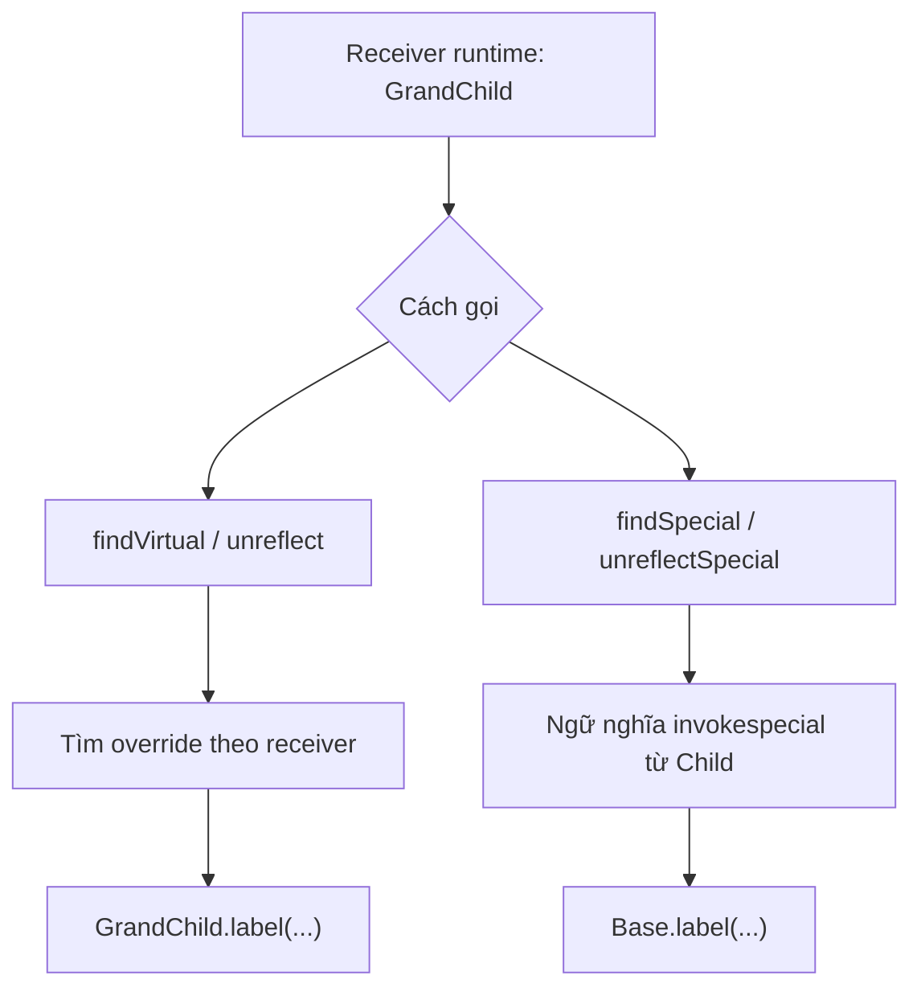

# `findSpecial()` và `unreflectSpecial()`: lời gọi đặc biệt khác với virtual dispatch

## 1. Vấn đề: cùng một receiver nhưng có thể chạy hai implementation khác nhau

Java thường chọn implementation của một **instance method có thể override** dựa trên kiểu runtime của đối tượng nhận (*receiver*). Chẳng hạn, nếu `Child` override method `greet()` của `Parent`, biểu thức `parentReference.greet()` vẫn chạy `Child.greet()` khi receiver thực tế là `Child`. Đây là **virtual dispatch**.

Nhưng trong thân lớp `Child`, biểu thức `super.greet()` có ý nghĩa khác: nó không yêu cầu JVM tìm override cuối cùng trên receiver, mà thực hiện lời gọi đặc biệt theo ngữ cảnh lớp đang gọi. Bytecode JVM sử dụng `invokespecial` cho những trường hợp như gọi implementation của superclass, một số lời gọi private và khởi tạo đối tượng.

API công khai `java.lang.invoke.MethodHandles.Lookup` cung cấp hai factory để tạo handle có ngữ nghĩa đặc biệt này:

- `findSpecial(refc, name, type, specialCaller)`: tìm member theo tên và `MethodType`, tạo handle có hành vi tương tự `invokespecial` từ lớp `specialCaller`.
- `unreflectSpecial(method, specialCaller)`: nhận đối tượng `java.lang.reflect.Method` đã được tìm trước đó, tạo handle với cùng ngữ nghĩa lời gọi đặc biệt.

Hai API **không đơn giản là phiên bản nhanh hơn của `findVirtual()`**. Chúng thay đổi cách chọn implementation, đồng thời yêu cầu kiểm tra quyền truy cập chặt chẽ khi tạo handle.

Bài này nằm trong chương **Lookup và adapter** của mô-đun **JAVA_VERSION_JAVA18**. Mô-đun nghiên cứu những kiến thức từ Java 18 còn có ích trên JDK hiện đại, đặc biệt là kiểm chứng các hợp đồng của Reflection và MethodHandle. Các API và quy tắc trong bài vẫn được hỗ trợ ở JDK hiện hành; không dựa vào quyền truy cập legacy hay chi tiết triển khai JVM cũ.

### Mục tiêu học tập

Sau bài này, bạn có thể:

1. Phân biệt `findVirtual`/`unreflect` với `findSpecial`/`unreflectSpecial` qua dispatch thực tế.
2. Hiểu vai trò riêng của `refc`, `type` và `specialCaller`.
3. Giải thích vì sao một special handle thường có receiver type là `specialCaller`, không phải `refc`.
4. Tạo một lời gọi tương đương `super.method(...)` từ lookup có quyền hợp lệ.
5. Gọi một interface default method theo kiểu đặc biệt khi lớp triển khai đã override.
6. Dùng `MethodType` và `invokeExact` chính xác, phân biệt lỗi access và lỗi call-site type.
7. Đánh giá khi nào nên dùng lời gọi đặc biệt và khi nào nên ưu tiên API thông thường.

## 2. Năm cách gọi dễ bị nhầm với nhau

Giả sử lớp `Base` có method `label(String)` và `Child` override method đó.

| Cách lấy handle/lời gọi | Cơ chế chọn implementation | Trường hợp điển hình |
| --- | --- | --- |
| `receiver.label("x")` | Virtual dispatch theo kiểu runtime của receiver | Java code thông thường |
| `lookup.findVirtual(Base.class, "label", mt)` | Virtual dispatch: override trên receiver vẫn được tôn trọng | Bộ gọi phương thức instance động |
| `lookup.unreflect(baseMethod)` | Với method virtual, override vẫn được tôn trọng | Chuyển một `Method` thành handle thông thường |
| `lookup.findSpecial(Base.class, "label", mt, Child.class)` | Mô phỏng `invokespecial` từ `Child`; không chạy override chỉ vì receiver là subclass | Tương đương ngữ nghĩa `super.label(...)` ở ngữ cảnh hợp lệ |
| `lookup.unreflectSpecial(baseMethod, Child.class)` | Cùng hướng dispatch đặc biệt, bắt đầu từ `Method` đã có | Tích hợp Reflection → MethodHandle cần super/default invocation |

Từ “early-bound” trong tài liệu `findSpecial` đề cập việc lựa chọn implementation không phụ thuộc vào override trên receiver như virtual dispatch. Nó **không có nghĩa** là bỏ kiểm tra kiểu, bỏ quy tắc access hay có thể nhảy tự do tới bất kỳ method private nào.



Sơ đồ giả định `Child extends Base` trực tiếp và cả `Child`, `GrandChild` override `label`. Nếu chuỗi kế thừa phức tạp hơn, JVM còn áp dụng quy tắc chọn method của `invokespecial`; đừng hiểu `refc` là một công tắc luôn gọi đúng method khai báo trong bất kỳ tổ tiên xa nào.

## 3. Phân tích chữ ký `findSpecial` và `unreflectSpecial`

### 3.1. `findSpecial`

```java
MethodHandle findSpecial(
        Class<?> refc,
        String name,
        MethodType type,
        Class<?> specialCaller
) throws NoSuchMethodException, IllegalAccessException;
```

Ý nghĩa tham số:

- `refc`: lớp/interface được dùng làm điểm tham chiếu để phân giải method.
- `name`: tên method instance cần gọi, ví dụ `"label"`.
- `type`: kiểu trả về và các **tham số khai báo của method**, **chưa bao gồm receiver**.
- `specialCaller`: lớp được giả định là nơi phát sinh bytecode `invokespecial`, nên quyết định ngữ cảnh special invocation và kiểm tra access.

Ví dụ `Base.label(String)` trả `String`:

```java
MethodType declared = MethodType.methodType(String.class, String.class);
// (String)String: chỉ gồm tham số String và kết quả String.

MethodHandle special = lookup.findSpecial(
        Base.class,
        "label",
        declared,
        Child.class
);
// Kiểu handle thường là (Child,String)String.
```

Điều này khác `findVirtual(Base.class, ...)`, nơi handle thông thường có kiểu `(Base,String)String`.

**Không** truyền receiver vào `MethodType` của `findSpecial`; lookup tự thêm receiver bị ràng buộc khi tạo handle. Nhưng khi gọi `invokeExact`, receiver trở thành **đối số đầu tiên** và phải có đúng kiểu tĩnh theo `handle.type()`.

### 3.2. `unreflectSpecial`

```java
MethodHandle unreflectSpecial(
        Method method,
        Class<?> specialCaller
) throws IllegalAccessException;
```

API này nhận trực tiếp `Method` của Core Reflection thay vì tra cứu lại bằng tên và kiểu. Nó cũng mô phỏng `invokespecial` từ `specialCaller` và tạo handle có receiver bị ràng buộc tương ứng.

```java
Method reflected = Base.class.getMethod("label", String.class);
MethodHandle special = lookup.unreflectSpecial(reflected, Child.class);
```

Lưu ý: `Method.invoke(receiver, args)` và `Lookup.unreflect(reflected)` với method virtual **vẫn thực hiện virtual dispatch**. Chỉ vì bạn có `Method` khai báo trong `Base` không có nghĩa một lời gọi Reflection thông thường sẽ bỏ qua override ở `GrandChild`.

### 3.3. Quyền tạo handle không phải quyền gọi tùy ý

Theo đặc tả hiện hành, cả hai factory special đều yêu cầu `specialCaller` **trùng lookup class** và lookup có **quyền PRIVATE** cần thiết. Sau đó JVM còn kiểm tra quan hệ lớp/interface, khả năng truy cập method và tính hợp lệ của special invocation.

Vì vậy:

- `MethodHandles.lookup()` được tạo **bên trong `Child`** có lookup class là `Child` và thường có đầy đủ quyền private của lớp đó.
- `MethodHandles.lookup()` được tạo **trong một lớp khác** không thể tự tuyên bố `specialCaller = Child.class` để giả làm `Child`.
- `MethodHandles.publicLookup()` không có quyền private phù hợp để tạo special handle kiểu này.
- Nếu library thật sự cần lookup ở một lớp khác, `privateLookupIn` là API hợp lệ khi module và quyền truy cập cho phép, nhưng không phải lối tắt vượt qua strong encapsulation.

Handle đã tạo thành công có thể được truyền tới nơi khác để gọi. Việc **kiểm tra quyền truy cập member chủ yếu diễn ra lúc tạo handle**; vì vậy đừng phát tán special handle truy cập member nhạy cảm cho code không đáng tin cậy.

## 4. Ví dụ chạy được: Base → Child → GrandChild

Tạo một file `SpecialDispatchDemo.java`. Mọi class con trong ví dụ được khai báo lồng nhau để bạn chỉ cần biên dịch một file.

```java
import java.lang.invoke.MethodHandle;
import java.lang.invoke.MethodHandles;
import java.lang.invoke.MethodType;
import java.lang.invoke.WrongMethodTypeException;
import java.lang.reflect.Method;

public final class SpecialDispatchDemo {
    private SpecialDispatchDemo() {
    }

    public static class Base {
        public String label(String value) {
            return "Base:" + value;
        }
    }

    public static class Child extends Base {
        @Override
        public String label(String value) {
            return "Child:" + value;
        }

        // Lookup được tạo trong Child nên specialCaller = Child hợp lệ.
        public static MethodHandle superLabel() throws ReflectiveOperationException {
            return MethodHandles.lookup().findSpecial(
                    Base.class,
                    "label",
                    MethodType.methodType(String.class, String.class),
                    Child.class
            );
        }

        public static MethodHandle reflectedSuperLabel(Method method)
                throws IllegalAccessException {
            return MethodHandles.lookup().unreflectSpecial(method, Child.class);
        }
    }

    public static final class GrandChild extends Child {
        @Override
        public String label(String value) {
            return "GrandChild:" + value;
        }
    }

    public interface Tagger {
        default String tag(String value) {
            return "Tagger:" + value;
        }
    }

    public static final class TagChild implements Tagger {
        @Override
        public String tag(String value) {
            return "TagChild:" + value;
        }

        public static MethodHandle defaultTag()
                throws ReflectiveOperationException {
            return MethodHandles.lookup().findSpecial(
                    Tagger.class,
                    "tag",
                    MethodType.methodType(String.class, String.class),
                    TagChild.class
            );
        }
    }

    @FunctionalInterface
    private interface CheckedAction {
        void run() throws Throwable;
    }

    private static void check(boolean condition, String description) {
        if (!condition) {
            throw new AssertionError(description);
        }
    }

    private static void expectWrongType(CheckedAction action) throws Throwable {
        try {
            action.run();
            throw new AssertionError("Expected WrongMethodTypeException");
        } catch (WrongMethodTypeException expected) {
            // Đúng: receiver tại call site có kiểu không khớp MethodType.
        }
    }

    public static void main(String[] args) throws Throwable {
        MethodType declared = MethodType.methodType(
                String.class, String.class
        );
        Method method = Base.class.getMethod("label", String.class);

        Base asBase = new GrandChild();
        Child asChild = (Child) asBase;

        // Virtual: kiểu handle là (Base,String)String.
        MethodHandle virtual = MethodHandles.lookup().findVirtual(
                Base.class, "label", declared
        );

        // Unreflect thông thường vẫn theo virtual dispatch.
        MethodHandle unreflected = MethodHandles.lookup().unreflect(method);

        // Hai special handle được tạo qua lookup CỦA Child.
        MethodHandle special = Child.superLabel();
        MethodHandle specialFromMethod = Child.reflectedSuperLabel(method);

        check(virtual.type().equals(MethodType.methodType(
                String.class, Base.class, String.class)),
                "Sai kiểu virtual handle");
        check(special.type().equals(MethodType.methodType(
                String.class, Child.class, String.class)),
                "Sai kiểu special handle");
        check(specialFromMethod.type().equals(special.type()),
                "Hai special handle phải có cùng MethodType");

        String normal = asBase.label("Ada");
        String fromVirtual = (String) virtual.invokeExact(asBase, "Ada");
        String fromMethod = (String) method.invoke(asBase, "Ada");
        String fromUnreflect = (String) unreflected.invokeExact(asBase, "Ada");

        String fromSpecial = (String) special.invokeExact(asChild, "Ada");
        String fromUnreflectSpecial =
                (String) specialFromMethod.invokeExact(asChild, "Ada");

        check("GrandChild:Ada".equals(normal), "Sai normal dispatch");
        check("GrandChild:Ada".equals(fromVirtual), "Sai virtual dispatch");
        check("GrandChild:Ada".equals(fromMethod), "Sai Method.invoke");
        check("GrandChild:Ada".equals(fromUnreflect), "Sai unreflect");
        check("Base:Ada".equals(fromSpecial), "Sai findSpecial");
        check("Base:Ada".equals(fromUnreflectSpecial),
                "Sai unreflectSpecial");

        System.out.println("normal=" + normal);
        System.out.println("findVirtual=" + fromVirtual);
        System.out.println("Method.invoke=" + fromMethod);
        System.out.println("unreflect=" + fromUnreflect);
        System.out.println("findSpecial=" + fromSpecial);
        System.out.println("unreflectSpecial=" + fromUnreflectSpecial);

        // Bind receiver: kiểu mới là (String)String.
        MethodHandle bound = special.bindTo(asChild);
        check(bound.type().equals(declared), "Sai kiểu bound handle");
        String fromBound = (String) bound.invokeExact("Ada");
        check("Base:Ada".equals(fromBound), "bindTo không được đổi dispatch");
        System.out.println("boundSpecial=" + fromBound);

        // Sai kiểu tĩnh: Base không phải Child tại call site invokeExact.
        expectWrongType(() -> {
            String ignored = (String) special.invokeExact(asBase, "Ada");
            System.out.println(ignored);
        });
        System.out.println("wrongReceiver=WrongMethodTypeException");

        // Lookup từ lớp bao ngoài không được tự nhận specialCaller=Child.
        try {
            MethodHandles.lookup().findSpecial(
                    Base.class, "label", declared, Child.class
            );
            throw new AssertionError("Expected IllegalAccessException");
        } catch (IllegalAccessException expected) {
            System.out.println("wrongLookup=IllegalAccessException");
        }

        // Default method của interface cũng có special invocation.
        TagChild tagged = new TagChild();
        MethodHandle defaultTag = TagChild.defaultTag();
        check(defaultTag.type().equals(MethodType.methodType(
                String.class, TagChild.class, String.class)),
                "Sai kiểu handle của interface default");

        String virtualTag = tagged.tag("Ada");
        String specialTag = (String) defaultTag.invokeExact(tagged, "Ada");
        check("TagChild:Ada".equals(virtualTag), "Sai override interface");
        check("Tagger:Ada".equals(specialTag), "Sai interface default");
        System.out.println("interfaceVirtual=" + virtualTag);
        System.out.println("interfaceSpecial=" + specialTag);
    }
}
```

Chạy trên JDK hiện đại (không cần bật preview):

```bash
javac --release 18 -encoding UTF-8 SpecialDispatchDemo.java
java SpecialDispatchDemo
```

Đầu ra kỳ vọng:

```text
normal=GrandChild:Ada
findVirtual=GrandChild:Ada
Method.invoke=GrandChild:Ada
unreflect=GrandChild:Ada
findSpecial=Base:Ada
unreflectSpecial=Base:Ada
boundSpecial=Base:Ada
wrongReceiver=WrongMethodTypeException
wrongLookup=IllegalAccessException
interfaceVirtual=TagChild:Ada
interfaceSpecial=Tagger:Ada
```

Tất cả assertion sử dụng `AssertionError` nên việc chạy test không phụ thuộc vào flag `-ea`. Nếu kết quả khác dự kiến, kiểm tra phiên bản JDK, file source và `MethodType` trước khi suy luận về tối ưu hóa JIT.

## 5. Diễn giải từng kết quả

### 5.1. Virtual dispatch chọn `GrandChild.label`

Mặc dù `asBase` có kiểu tĩnh `Base`, đối tượng runtime được tạo bằng `new GrandChild()`. Vì thế:

```java
Base asBase = new GrandChild();
String value = asBase.label("Ada");
// GrandChild:Ada
```

`MethodHandles.lookup().findVirtual(Base.class, "label", declared)` tạo handle có receiver type `Base`, nhưng khi gọi với một `GrandChild`, nó vẫn chọn override của `GrandChild`. `Method.invoke` và `Lookup.unreflect` trên method virtual của `Base` cũng tôn trọng overriding.

### 5.2. Special invocation bỏ qua override trên receiver

`Child.superLabel()` tạo handle từ lookup của `Child`, với `refc=Base.class` và `specialCaller=Child.class`. Dùng receiver runtime `GrandChild` vẫn cho ra `Base:Ada`:

```java
Child asChild = new GrandChild();
MethodHandle special = Child.superLabel();
String value = (String) special.invokeExact(asChild, "Ada");
// Base:Ada
```

Ngữ nghĩa tương tự khi code **trong `Child`** viết `super.label("Ada")`: bỏ qua `Child.label` và các override ở subclass của receiver để gọi implementation phía superclass theo quy tắc `invokespecial`.

Quan trọng: handle đặc biệt không làm method của `GrandChild` bị xóa, không thay đổi kiểu runtime của receiver, không can thiệp vĩnh viễn vào cơ chế virtual dispatch. Nó chỉ định **đường gọi riêng** cho lời gọi qua handle đó.

### 5.3. `unreflectSpecial` không phải `Method.invoke`

Từ một `Method` cùng trỏ tới `Base.label`:

```java
Method m = Base.class.getMethod("label", String.class);

MethodHandle virtual = MethodHandles.lookup().unreflect(m);
MethodHandle special = Child.reflectedSuperLabel(m);
```

- `virtual` gọi override trên receiver thực tế: `GrandChild:Ada`.
- `special` mô phỏng `invokespecial` từ `Child`: `Base:Ada`.

Truyền `m` vào `unreflectSpecial` **không làm cho mọi method gọi bằng Reflection chuyển thành special**. Việc chọn factory nào là quyết định riêng của mã tích hợp.

### 5.4. `bindTo` đổi chữ ký, không đổi implementation

Với `special.type() == (Child,String)String`, `special.bindTo(asChild)` trả handle mới có kiểu `(String)String`. Receiver đã được gắn vào handle; việc gọi method gốc vẫn giữ special invocation. Nếu muốn virtual dispatch thì phải tạo **virtual handle** ngay từ đầu.

## 6. Vai trò của `specialCaller` và quyền của `Lookup`

Đây là điểm dễ gây nhầm nhất trong hai API. `specialCaller` **không phải** một tham số cho phép chọn bất kỳ lớp nào. Nó thể hiện lớp được giả định chứa vị trí gọi `invokespecial`. JVM kiểm tra rằng lookup thực sự có quyền đóng vai lớp ấy.

```java
// Hợp lệ khi thực hiện từ code BÊN TRONG Child:
MethodHandles.lookup().findSpecial(
        Base.class,
        "label",
        MethodType.methodType(String.class, String.class),
        Child.class
);
```

Trong chương trình, `Child.superLabel()` là static factory nằm trong chính lớp `Child`. Khi gọi `MethodHandles.lookup()` tại đây, lookup class là `Child`.

Nếu thực hiện lời gọi tương tự trong `SpecialDispatchDemo.main`, lookup class là `SpecialDispatchDemo`, **không phải `Child`**. Vì special caller khác lookup class nên có thể nhận `IllegalAccessException` ngay tại bước tạo handle, kể cả `Base.label` public.

### 6.1. Nhận diện lookup class và quyền

```java
MethodHandles.Lookup lookup = MethodHandles.lookup();
System.out.println(lookup.lookupClass().getName());
System.out.println(lookup.hasFullPrivilegeAccess());
System.out.println(lookup.lookupModes());
```

`lookupClass()` chỉ ra lớp mà quyền lookup được xét theo đó. `hasFullPrivilegeAccess()` và `lookupModes()` giúp chẩn đoán nhưng **không phải lời cam kết** rằng mọi method của mọi module đều có thể bị gọi bằng `findSpecial`.

`publicLookup()` chỉ có quyền truy cập public phù hợp; nó không phải cách tạo special handle cho tùy ý superclass. `lookup.in(OtherClass.class)` cũng không đơn giản là đổi tên lookup mà giữ nguyên toàn bộ quyền private.

### 6.2. `privateLookupIn` và named module

Trong trường hợp có quyền hợp pháp, có thể lấy một lookup mang danh tính class đích:

```java
MethodHandles.Lookup childLookup =
        MethodHandles.privateLookupIn(
                SpecialDispatchDemo.Child.class,
                MethodHandles.lookup()
        );
```

Vì các lớp trong ví dụ cùng nest/module, cách này có thể được áp dụng trong phạm vi quyền phù hợp. Với class thuộc **module khác**, `privateLookupIn` còn phải tuân theo quan hệ đọc module và yêu cầu package được mở đúng module caller. Không tự gắn `--add-opens` rộng rãi rồi coi đó là cơ chế vượt quyền chuẩn.

Sau khi có `childLookup` thực sự đủ quyền PRIVATE và lookup class là `Child`, mới cân nhắc gọi `childLookup.findSpecial(...)` với `specialCaller=Child.class`. Đối với một public method, factory public/virtual thường đơn giản và an toàn hơn.

### 6.3. Truyền special handle ra ngoài là cấp một khả năng

Các kiểm tra quyền truy cập thành viên được thực hiện khi tạo handle. Một object `MethodHandle` được đưa cho module khác có thể cho phép module đó gọi hành vi mà nó không tự lookup được. Vì vậy, hãy hạn chế nơi lưu/truyền handle được tạo bằng lookup có private access.

Đây không phải lỗ hổng trong Java: đó là mô hình *capability* có chủ đích. Ứng dụng phải giữ ranh giới tin cậy cho việc công bố handle.

## 7. Interface default method: khi override che mất implementation mặc định

Một interface có thể cung cấp method `default`. Lớp triển khai có thể override method đó. Lời gọi thông thường:

```java
TagChild tagged = new TagChild();
String a = tagged.tag("Ada");  // TagChild:Ada
```

sẽ chọn override của lớp. Tuy nhiên, nếu special caller được phép gọi default method của direct superinterface, `findSpecial` có thể đại diện cho lời gọi tương tự `Tagger.super.tag("Ada")`:

```java
// Trong TagChild:
MethodHandle handle = MethodHandles.lookup().findSpecial(
        Tagger.class,
        "tag",
        MethodType.methodType(String.class, String.class),
        TagChild.class
);

// Handle có receiver TagChild đứng trước tham số String.
String value = (String) handle.invokeExact(new TagChild(), "Ada");
// Tagger:Ada
```

Thực tế, các proxy, framework dispatch hoặc bộ kết hợp hành vi có thể cần gọi đúng default implementation thay vì override hiện tại. Tuy nhiên, special dispatch vẫn chịu quy tắc `invokespecial` của JVM, bao gồm yêu cầu về quan hệ lớp/interface và khả năng truy cập. Không thể chọn tùy ý một interface không nằm trong quan hệ hợp lệ.

Nếu có nhiều interface cung cấp default method xung đột, mã Java thông thường buộc lớp triển khai giải quyết xung đột theo quy tắc ngôn ngữ. Không nên dùng special handle như cách tùy tiện vượt qua những quy tắc đó.

## 8. Cẩn thận với superclass xa và ngữ nghĩa `invokespecial`

Một trực giác sai là: “truyền class nào vào `refc` thì chắc chắn chạy trực tiếp implementation khai báo trong class đó”. Đặc tả `findSpecial` nói rằng handle phải hành xử như bytecode `invokespecial` từ `specialCaller`; quy tắc JVM có thể chọn implementation ở **direct superclass** trong các trường hợp có `ACC_SUPER`.

Ví dụ hình dung:

```text
Root
  ^
Middle (override method)
  ^
Leaf (specialCaller = Leaf)
```

Nếu từ `Leaf` tham chiếu một method của `Root` bằng special invocation, đừng mặc định rằng `Middle` sẽ bị bỏ qua và `Root` chắc chắn được gọi. Tùy cấu trúc và quy tắc phân giải `invokespecial`, implementation được chọn có thể là `Middle`. Đây cũng là lý do Javadoc `findSpecial` mô tả hành vi dựa trên ngữ cảnh `specialCaller` thay vì hứa gọi đúng một “declaring method” bất kể quan hệ kế thừa.

Với use case thông thường, hãy biểu diễn rõ lời gọi `super.method(...)` từ lớp con trực tiếp hoặc một default method có quan hệ hợp lệ; viết test kết quả khi cây kế thừa thay đổi.

## 9. `invokeExact` và receiver type vẫn phải khớp

Khi bạn đã tạo special handle, việc gọi nó vẫn tuân theo `MethodHandle.type()`. Với ví dụ:

```java
MethodHandle special = Child.superLabel();
// special.type() == (Child,String)String
```

Lời gọi đúng:

```java
Child receiver = new GrandChild();
String result = (String) special.invokeExact(receiver, "Ada");
```

Lời gọi sai dù receiver runtime cũng là `GrandChild`:

```java
Base receiver = new GrandChild();
String result = (String) special.invokeExact(receiver, "Ada");
// Call site: (Base,String)String, khác handle.type().
```

Kết quả là `WrongMethodTypeException`, không phải `IllegalAccessException`. Lỗi đầu xảy ra lúc gọi do lệch `MethodType`, trong khi lỗi access chủ yếu phát sinh lúc tạo special handle.

Nếu muốn hỗ trợ receiver có kiểu tĩnh `Base` nhưng vẫn giữ special behavior, phải có phép thích nghi hợp lệ và kiểm tra receiver thực tế:

```java
MethodHandle adapted = special.asType(MethodType.methodType(
        String.class, Base.class, String.class
));

Base receiver = new GrandChild(); // Runtime vẫn là Child.
String value = (String) adapted.invokeExact(receiver, "Ada");
// Base:Ada
```

Adapter có thể thực hiện cast runtime để bảo đảm receiver thích hợp. Nếu nhận một `Base` không phải `Child`, nó có thể ném `ClassCastException`. `asType` điều chỉnh kiểu lời gọi, **không** thay đổi method implementation đã chọn bởi special invocation.

## 10. Những lỗi thường gặp và cách phân biệt

| Triệu chứng | Nơi xảy ra | Nguyên nhân/giải pháp |
| --- | --- | --- |
| `NoSuchMethodException` khi `findSpecial` | Tạo handle | Sai tên/chữ ký hoặc không có method phù hợp; kiểm tra `MethodType` không chứa receiver |
| `IllegalAccessException` khi `findSpecial` | Tạo handle | `specialCaller` không phù hợp lookup class, thiếu PRIVATE access hoặc quan hệ/access không hợp lệ |
| `IllegalAccessException` khi `unreflectSpecial` | Tạo handle | Lookup thiếu quyền gọi đặc biệt đối với `Method` hoặc `specialCaller` |
| `WrongMethodTypeException` khi `invokeExact` | Gọi handle | Kiểu tĩnh receiver, tham số hoặc kiểu trả về tại call site khác `handle.type()` |
| `ClassCastException` khi dùng adapter `asType` | Gọi handle | Object runtime không cast được thành kiểu receiver/tham số của target |
| Kết quả vẫn là override subclass | Chọn factory | Có thể đang dùng `findVirtual`, `unreflect` hoặc `Method.invoke` thay vì special |
| Kết quả là method ở direct superclass, không phải tổ tiên xa được ghi trong `refc` | Phân giải `invokespecial` | Kiểm tra quy tắc chọn implementation và cấu trúc cây kế thừa |
| Gọi `"<init>"` bằng `findSpecial` không được | Tạo handle | Dùng `findConstructor` để tạo constructor handle |
| Quyền module chặn tạo private lookup | Tạo lookup | Kiểm tra `privateLookupIn`, module readability và `opens`; ưu tiên public API |

### 10.1. `findSpecial` không phải cách gọi constructor

Mặc dù bytecode `invokespecial` cũng liên quan tới constructor, `findSpecial` **không nhận tên JVM `"<init>"` để tạo constructor handle**. API đúng cho trường hợp khởi tạo là `findConstructor(refc, methodType(void.class, ...))`. Hai mục đích phải được phân biệt.

### 10.2. Không gọi `setAccessible(true)` một cách mù quáng

`Method` thu được bằng Core Reflection không tự động cho phép special invocation. `unreflectSpecial` vẫn chịu quyền của lookup và quy tắc special caller. `setAccessible(true)` có thể thất bại dưới JPMS strong encapsulation, và không làm cho một caller không hợp lệ trở thành người gọi `super` hợp lệ.

### 10.3. Không nhầm lỗi target với lỗi lookup

Handle được tạo thành công không có nghĩa method đích luôn thành công. Nếu body `Base.label` ném `IllegalStateException` hoặc exception khác, lời gọi MethodHandle truyền nguyên nhân theo hợp đồng của target, không tự bọc trong `InvocationTargetException` như `Method.invoke`.

## 11. Kiểm thử bằng JUnit Jupiter

Trong dự án có JUnit Jupiter, ngoài kiểm thử kết quả virtual/special còn phải xác nhận metadata `type()`. Ví dụ:

```java
import java.lang.invoke.MethodHandle;
import java.lang.invoke.MethodHandles;
import java.lang.invoke.MethodType;
import java.lang.invoke.WrongMethodTypeException;
import java.lang.reflect.Method;
import org.junit.jupiter.api.Test;

import static org.junit.jupiter.api.Assertions.*;

class SpecialDispatchDemoTest {
    @Test
    void virtualAndSpecialChooseDifferentImplementations() throws Throwable {
        SpecialDispatchDemo.Base base = new SpecialDispatchDemo.GrandChild();
        SpecialDispatchDemo.Child child = (SpecialDispatchDemo.Child) base;

        MethodHandle virtual = MethodHandles.lookup().findVirtual(
                SpecialDispatchDemo.Base.class,
                "label",
                MethodType.methodType(String.class, String.class)
        );
        MethodHandle special = SpecialDispatchDemo.Child.superLabel();

        assertEquals(
                MethodType.methodType(
                        String.class, SpecialDispatchDemo.Child.class, String.class
                ),
                special.type()
        );
        assertEquals("GrandChild:Ada",
                (String) virtual.invokeExact(base, "Ada"));
        assertEquals("Base:Ada",
                (String) special.invokeExact(child, "Ada"));
    }

    @Test
    void unreflectSpecialIsNotUnreflect() throws Throwable {
        Method method = SpecialDispatchDemo.Base.class
                .getMethod("label", String.class);
        SpecialDispatchDemo.Base base = new SpecialDispatchDemo.GrandChild();
        SpecialDispatchDemo.Child child = (SpecialDispatchDemo.Child) base;

        MethodHandle normal = MethodHandles.lookup().unreflect(method);
        MethodHandle special =
                SpecialDispatchDemo.Child.reflectedSuperLabel(method);

        assertEquals("GrandChild:Ada",
                (String) normal.invokeExact(base, "Ada"));
        assertEquals("Base:Ada",
                (String) special.invokeExact(child, "Ada"));
    }

    @Test
    void wrongReceiverStaticTypeFails() throws Throwable {
        MethodHandle special = SpecialDispatchDemo.Child.superLabel();
        SpecialDispatchDemo.Base base = new SpecialDispatchDemo.GrandChild();

        assertThrows(WrongMethodTypeException.class, () -> {
            String ignored = (String) special.invokeExact(base, "Ada");
            System.out.println(ignored);
        });
    }

    @Test
    void cannotInventSpecialCallerFromOtherLookup()
            throws ReflectiveOperationException {
        assertThrows(IllegalAccessException.class, () ->
                MethodHandles.lookup().findSpecial(
                        SpecialDispatchDemo.Base.class,
                        "label",
                        MethodType.methodType(String.class, String.class),
                        SpecialDispatchDemo.Child.class
                )
        );
    }
}
```

Test trên giả định `SpecialDispatchDemo` từ phần 4 có trong test classpath; dependency JUnit Jupiter và engine đã được cấu hình trong Maven/Gradle. Với mã thư viện public, thêm test cho default method, bound/adapted handle và các trường hợp module access thực tế nếu có.

## 12. Quy trình chẩn đoán khi triển khai

Khi tạo hoặc dùng special handle trong code động:

1. **Xác định mục tiêu.** Thực sự cần `super`/default-method semantics, hay chỉ muốn gọi method thường? Nếu gọi thường, dùng `findVirtual`.
2. **Xác định member.** In tên class, method và `MethodType` khai báo (không gồm receiver).
3. **Xác định caller.** Đọc `lookup.lookupClass()` và các access mode của `Lookup`.
4. **Kiểm tra `specialCaller`.** Có trùng lookup class và đáp ứng quan hệ lớp/interface hợp lệ không?
5. **Tạo handle.** Phân biệt `NoSuchMethodException` với `IllegalAccessException`.
6. **Kiểm tra `handle.type()`.** Lưu ý receiver type thực tế; không đoán theo `refc`.
7. **Gọi thử bằng `invokeExact`.** Khớp cả receiver, tham số và kiểu trả về tại call site.
8. **So sánh với virtual.** Chạy đối chứng `findVirtual` và `Method.invoke` với cùng receiver.
9. **Kiểm tra kế thừa.** Nếu thêm lớp trung gian hoặc thay đổi default method, chạy lại test để không giả định sai resolution.
10. **Đánh giá quyền.** Chỉ công bố handle tới mã được tin cậy và dùng public API nếu không thật sự cần special invocation.

### Bài tập thực hành

1. Sửa `GrandChild.label` trả `"NewGrandChild"`. Quan sát `findVirtual` thay đổi nhưng special handle từ `Child` vẫn trả `Base`.
2. Bỏ override ở `GrandChild` rồi chạy lại. Virtual sẽ chọn implementation nào?
3. Đổi `Child.superLabel()` sang gọi `findVirtual`; so sánh kiểu receiver và kết quả.
4. Dùng `Base.class.getMethod("label", String.class)` rồi tạo cả `unreflect` và `unreflectSpecial`; ghi bảng kết quả.
5. Gọi special handle với biến receiver khai báo `Base`; sửa bằng cast có chủ đích trước khi gọi.
6. Thay `specialCaller` thành một class không liên quan; giải thích lỗi quyền/quan hệ.
7. Dùng `TagChild.defaultTag()` và thử thêm một subclass của `TagChild` (bỏ `final` trước). Kiểm tra special invocation có tôn trọng override không.
8. Thêm một lớp giữa `Base` và `Child` có override `label`; nghiên cứu lại cách `invokespecial` chọn implementation.
9. Viết JUnit test kiểm tra ngoại lệ khi thiếu PRIVATE access trong `Lookup`.

## 13. Tài liệu tham khảo chính thức

- [MethodHandles.Lookup — Java SE 25](https://docs.oracle.com/en/java/javase/25/docs/api/java.base/java/lang/invoke/MethodHandles.Lookup.html): đặc tả `findVirtual`, `findSpecial`, `unreflect`, `unreflectSpecial`, `privateLookupIn` và yêu cầu `specialCaller`.
- [MethodHandle — Java SE 25](https://docs.oracle.com/en/java/javase/25/docs/api/java.base/java/lang/invoke/MethodHandle.html): cách gọi `invokeExact`/`invoke`, `MethodType` của receiver và khác biệt virtual/non-virtual handle.
- [MethodType — Java SE 25](https://docs.oracle.com/en/java/javase/25/docs/api/java.base/java/lang/invoke/MethodType.html): tạo và đọc chữ ký của handle.
- [Method — Java SE 25](https://docs.oracle.com/en/java/javase/25/docs/api/java.base/java/lang/reflect/Method.html): hợp đồng `Method.invoke`, virtual dispatch và ngoại lệ.
- [JVMS 25 — `invokespecial`](https://docs.oracle.com/javase/specs/jvms/se25/html/jvms-6.html#jvms-6.5.invokespecial): ngữ nghĩa và các quy tắc chọn implementation.
- [JLS 25 — Method Invocation](https://docs.oracle.com/javase/specs/jls/se25/html/jls-15.html#jls-15.12.4.4): cách xác định method được gọi ở runtime, khác biệt với `super` invocation.
- [JEP 416 — Reimplement Core Reflection with Method Handles](https://openjdk.org/jeps/416): bối cảnh Java 18; không thay đổi hợp đồng public `findSpecial` và `unreflectSpecial`.

**Ghi nhớ:** `findVirtual`/`unreflect` tuân theo override của receiver runtime; `findSpecial`/`unreflectSpecial` mô phỏng `invokespecial` từ `specialCaller` hợp lệ và bỏ qua override theo quy tắc gọi đặc biệt. `specialCaller` phải phù hợp với lookup class có PRIVATE access; receiver type của special handle có thể là `specialCaller` thay vì `refc`. Hãy kiểm chứng `handle.type()`, chọn factory theo ngữ nghĩa mong muốn và không dùng special lookup như công cụ vượt qua giới hạn quyền truy cập.
