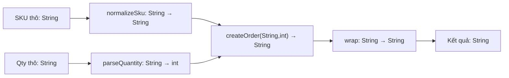

# filterArguments() và filterReturnValue(): ghép bước chuyển đổi đầu vào hoặc đầu ra

## 1. Mục tiêu: tạo pipeline từ những MethodHandle nhỏ

Trong Java 18 và các JDK hiện đại, `MethodHandle` không chỉ dùng để tìm và gọi method theo `Lookup`. Bạn còn có thể **ghép nhiều handle thành một adapter** giữ hợp đồng kiểu tĩnh chặt chẽ. Hai combinators cốt lõi là:

- `MethodHandles.filterArguments(target, pos, filters...)`: biến đổi **các đối số đi vào**, rồi mới chuyển cho `target`.
- `MethodHandles.filterReturnValue(target, filter)`: gọi `target` trước, lấy giá trị nó trả về (nếu có), sau đó chuyển qua một handle khác để **biến đổi kết quả**.

Ví dụ: ứng dụng nhận mã hàng và số lượng từ biểu mẫu dưới dạng chuỗi, nhưng nghiệp vụ thật cần `(String, int) -> String`. Ta muốn:

```text
raw SKU: "  pear  " ── normalize(String)->String ──┐
                                              ├── createOrder(String,int)->String
raw qty: "003"      ── parse(String)->int ─────┘
                                                      │
                                                      ▼
                                              wrap(String)->String
                                                      │
                                                      ▼
                                                 "<PEAR x 3>"
```

Không cần thay đổi implementation của `createOrder`, không cần viết một lớp proxy riêng cho từng cặp chuyển đổi và cũng không dùng reflection `Method.invoke` cho mỗi bước. Các combinators tạo một `MethodHandle` mới có `MethodType` phù hợp với dữ liệu đầu vào và đầu ra thực tế.

**Sau bài này, bạn cần làm được:**

1. Đọc và dự đoán `MethodType` của target, từng filter và adapter cuối.
2. Dùng `filterArguments` với `pos` và danh sách unary filters; chứng minh các filter chạy **từ trái sang phải**.
3. Dùng `filterReturnValue` để chuyển một kết quả `String` sang `String`, `int` hoặc `void`.
4. Xử lý trường hợp đặc biệt target trả `void` bằng output filter **không nhận tham số**.
5. Hiểu vì sao phần tử `null` trong `filters` tương đương identity, còn filter có arity/return type sai bị từ chối.
6. Phân biệt lỗi **lúc lắp adapter** (`IllegalArgumentException`) với lỗi **khi gọi adapter** (ví dụ `NumberFormatException` hoặc `WrongMethodTypeException`).
7. Kiểm chứng thứ tự gọi và ngắt pipeline khi filter ném exception, dùng những API công khai vẫn còn được hỗ trợ.

Bài thuộc nhóm **Lookup và adapter** trong chương Java 18. Các quy tắc trình bày theo hợp đồng `java.lang.invoke.MethodHandles` đang còn hiệu lực trên Java SE 25; không dựa vào thủ thuật JDK nội bộ hay API đã legacy.

## 2. Hợp đồng kiểu của filterArguments()

Hãy gọi target là `T`, có type:

```text
T: (A0, A1, A2, ...) -> R
```

Giả sử chọn `pos = 1` và có hai filter:

```text
F0: (B1) -> A1
F1: (B2) -> A2
```

Adapter thu được có type:

```text
adapter: (A0, B1, B2, ...) -> R

adapter(a0, b1, b2, ...)
    = T(a0, F0(b1), F1(b2), ...)
```

**Quan hệ type bắt buộc:**

- Mỗi filter **không null** phải nhận **đúng một tham số**.
- Return type của filter phải **bằng chính xác** parameter type tương ứng của target; ví dụ filter trả `int` cho target cần `int`, không thay bằng `Integer` rồi trông chờ automatic boxing.
- Parameter type của filter trở thành parameter type ở vị trí tương ứng của **adapter mới**.
- Những tham số không được lọc và **return type của target** giữ nguyên.
- Các filter áp vào **các vị trí liên tiếp** tính từ `pos`; vị trí 0 là tham số đầu tiên của MethodHandle, không nhất thiết là tham số đầu tiên bạn thấy trong source Java (với virtual method handle, receiver cũng chiếm một vị trí).
- Với nhiều filter, thao tác tiền xử lý diễn ra **theo thứ tự từ trái sang phải**.

### 2.1. Ví dụ cụ thể

```java
// Target: (String,int)String
MethodHandle createOrder = lookup.findStatic(
    Demo.class, "createOrder",
    MethodType.methodType(String.class, String.class, int.class));

// Filter 0: (String)String
MethodHandle normalize = lookup.findStatic(
    Demo.class, "normalizeSku",
    MethodType.methodType(String.class, String.class));

// Filter 1: (String)int
MethodHandle parse = lookup.findStatic(
    Demo.class, "parseQuantity",
    MethodType.methodType(int.class, String.class));

// Adapter mới: (String,String)String
MethodHandle inputAdapter =
    MethodHandles.filterArguments(createOrder, 0, normalize, parse);
```

Ở đây `normalize` nhận chuỗi SKU thô rồi trả chuỗi SKU chuẩn hóa cho parameter 0. `parse` nhận chuỗi số lượng thô rồi trả `int` cho parameter 1. Vì vậy `inputAdapter` nhận **hai chuỗi**, nhưng `createOrder` vẫn nhận `String` và `int` như ban đầu.

Điều quan trọng: tổ hợp này không sửa `createOrder`. Mỗi `MethodHandle` có kiểu bất biến; combinator trả về **một handle mới** với kiểu mới.

### 2.2. Vai trò của pos và null filter

| Cách ghép cho target `(String,int)String` | Adapter type | Ý nghĩa |
| --- | --- | --- |
| `filterArguments(target, 0, normalize, parse)` | `(String,String)String` | Lọc cả SKU và số lượng |
| `filterArguments(target, 1, parse)` | `(String,String)String` | Giữ SKU nguyên vẹn, chỉ đổi số lượng |
| `filterArguments(target, 0, new MethodHandle[]{null, parse})` | `(String,String)String` | Dùng identity tại vị trí 0, chỉ áp filter ở vị trí 1 |
| `filterArguments(target, 0, normalize)` | `(String,int)String` | Chỉ chuẩn hóa SKU, số lượng vẫn là `int` |

`null` **là một phần tử hợp lệ bên trong mảng `filters`**: nó biểu thị identity tại vị trí đó. Nếu không có phần tử nào khác `null`, combinator trả lại target ban đầu. Ngược lại, **chính mảng `filters` bằng `null`** sẽ bị từ chối bằng `NullPointerException`. Mảng có nhiều phần tử hơn số parameter còn lại cũng không hợp lệ, kể cả khi phần tử dư là `null`.

## 3. Hợp đồng kiểu của filterReturnValue()

`MethodHandles.filterReturnValue(target, outputFilter)` gọi `target` trước rồi chuyển giá trị trả về tới `outputFilter`. Có hai trường hợp.

### 3.1. Target trả một giá trị

```text
target:       (A, B) -> R
outputFilter: (R)    -> S
adapter:      (A, B) -> S

adapter(a,b) = outputFilter(target(a,b))
```

Filter đầu ra phải nhận **đúng một tham số có kiểu `R`**. Kiểu trả về của filter có thể khác `R`, và chính nó trở thành kiểu trả về của adapter. Vì vậy:

```java
// inputAdapter: (String,String)String
// wrap:         (String)String
MethodHandle display =
    MethodHandles.filterReturnValue(inputAdapter, wrap);
// display:      (String,String)String

// length:       (String)int
MethodHandle measure =
    MethodHandles.filterReturnValue(inputAdapter, length);
// measure:      (String,String)int
```

Mọi tham số của target được giữ nguyên. `filterReturnValue` không thể tự sửa kiểu tham số của target và cũng không tự đảo thứ tự chúng.

### 3.2. Target trả void

Đây là ngoại lệ có chủ đích: khi `target` trả `void`, output filter phải **nhận 0 tham số**, không phải nhận một giá trị `void` (Java không có giá trị `void` để truyền).

```text
target:       (String) -> void
outputFilter: ()       -> String
adapter:      (String) -> String
```

Một cách dùng: ghi một sự kiện rồi sinh confirmation:

```java
MethodHandle audit = lookup.findStatic(
    Demo.class, "record",
    MethodType.methodType(void.class, String.class));
MethodHandle confirmation = lookup.findStatic(
    Demo.class, "confirmation",
    MethodType.methodType(String.class));

MethodHandle confirmed =
    MethodHandles.filterReturnValue(audit, confirmation);
// confirmed: (String)String
```

Ngược lại, khi target trả `String`, output filter `(String)void` cũng hợp lệ: adapter cuối có return type `void`, dùng để tiêu thụ/lưu log kết quả mà không trả giá trị ra caller.

### 3.3. Pipeline đầy đủ: input trước, output sau




Thứ tự xử lý được bảo đảm là: **filter đầu vào từ trái qua phải → target → filter đầu ra**. Nếu một filter đầu vào ném exception, các bước kế tiếp không chạy. Nếu target ném exception, output filter không chạy. Combinator không nuốt exception hoặc tự retry.

## 4. Ví dụ Java đầy đủ: FilterPipelineLab

Tạo duy nhất tệp `FilterPipelineLab.java`. Đây là chương trình thực hành tự chứa: dùng `MethodHandles.lookup().findStatic(...)` để lấy handle trỏ đến các static methods trong cùng lớp, ghép adapter, kiểm kiểu và ghi lại thứ tự gọi.

```java
import java.lang.invoke.MethodHandle;
import java.lang.invoke.MethodHandles;
import java.lang.invoke.MethodType;
import java.lang.invoke.WrongMethodTypeException;
import java.util.ArrayList;
import java.util.Arrays;
import java.util.List;
import java.util.Locale;

public final class FilterPipelineLab {
    private static final List<String> EVENTS = new ArrayList<>();

    private static void log(String stage) {
        EVENTS.add(stage);
    }

    // Filter đầu vào 0: (String)String.
    private static String normalizeSku(String raw) {
        log("normalize");
        String result = raw.strip().toUpperCase(Locale.ROOT);
        if (result.isEmpty()) {
            throw new IllegalArgumentException("SKU không được rỗng");
        }
        return result;
    }

    // Filter đầu vào 1: (String)int.
    private static int parseQuantity(String raw) {
        log("parse");
        int result = Integer.parseInt(raw.strip());
        if (result <= 0) {
            throw new IllegalArgumentException("Số lượng phải dương");
        }
        return result;
    }

    // Target nghiệp vụ: (String,int)String.
    private static String createOrder(String sku, int quantity) {
        log("target");
        return sku + " x " + quantity;
    }

    // Các filter đầu ra: cùng input String nhưng có return type khác nhau.
    private static String wrap(String value) {
        log("wrap");
        return "<" + value + ">";
    }

    private static int length(String value) {
        log("length");
        return value.length();
    }

    private static void observe(String value) {
        log("observe");
    }

    // Target void và filter đầu ra không tham số.
    private static void record(String text) {
        log("record");
    }

    private static String confirmation() {
        log("confirmation");
        return "ACK";
    }

    // Hai method cố ý có MethodType không hợp lệ để ghép.
    private static String stringify(int number) {
        return Integer.toString(number);
    }

    private static String combine(String first, String second) {
        return first + second;
    }

    private static void check(boolean condition, String message) {
        if (!condition) {
            throw new AssertionError(message);
        }
    }

    private static void typeIs(MethodHandle handle, MethodType expected) {
        check(handle.type().equals(expected),
                "Sai MethodType: actual=" + handle.type()
                        + ", expected=" + expected);
    }

    private static void traceIs(String... expected) {
        List<String> expectedEvents = Arrays.asList(expected);
        check(EVENTS.equals(expectedEvents),
                "Sai thứ tự gọi: actual=" + EVENTS
                        + ", expected=" + expectedEvents);
        EVENTS.clear();
    }

    @FunctionalInterface
    private interface CheckedAction {
        void run() throws Throwable;
    }

    private static void expectIllegalArgument(
            String caseName, CheckedAction action) throws Throwable {
        check(EVENTS.isEmpty(), "Phải reset trace trước phép thử sai kiểu");
        try {
            action.run();
            throw new AssertionError(
                    "Thiếu IllegalArgumentException: " + caseName);
        } catch (IllegalArgumentException expected) {
            check(EVENTS.isEmpty(),
                    "Không được gọi target/filter khi lắp sai adapter");
            System.out.println("EXPECTED IAE: " + caseName);
        }
    }

    private static void expectNullPointer(
            String caseName, CheckedAction action) throws Throwable {
        check(EVENTS.isEmpty(), "Phải reset trace trước ca null");
        try {
            action.run();
            throw new AssertionError("Thiếu NullPointerException: " + caseName);
        } catch (NullPointerException expected) {
            check(EVENTS.isEmpty(), "Không được chạy filter khi lắp adapter");
            System.out.println("EXPECTED NPE: " + caseName);
        }
    }

    public static void main(String[] args) throws Throwable {
        MethodHandles.Lookup lookup = MethodHandles.lookup();

        MethodHandle target = lookup.findStatic(
                FilterPipelineLab.class, "createOrder",
                MethodType.methodType(
                        String.class, String.class, int.class));

        MethodHandle normalize = lookup.findStatic(
                FilterPipelineLab.class, "normalizeSku",
                MethodType.methodType(String.class, String.class));

        MethodHandle parse = lookup.findStatic(
                FilterPipelineLab.class, "parseQuantity",
                MethodType.methodType(int.class, String.class));

        MethodHandle wrap = lookup.findStatic(
                FilterPipelineLab.class, "wrap",
                MethodType.methodType(String.class, String.class));

        MethodHandle length = lookup.findStatic(
                FilterPipelineLab.class, "length",
                MethodType.methodType(int.class, String.class));

        MethodHandle observe = lookup.findStatic(
                FilterPipelineLab.class, "observe",
                MethodType.methodType(void.class, String.class));

        MethodHandle record = lookup.findStatic(
                FilterPipelineLab.class, "record",
                MethodType.methodType(void.class, String.class));

        MethodHandle confirmation = lookup.findStatic(
                FilterPipelineLab.class, "confirmation",
                MethodType.methodType(String.class));

        MethodHandle stringify = lookup.findStatic(
                FilterPipelineLab.class, "stringify",
                MethodType.methodType(String.class, int.class));

        MethodHandle combine = lookup.findStatic(
                FilterPipelineLab.class, "combine",
                MethodType.methodType(
                        String.class, String.class, String.class));

        typeIs(target, MethodType.methodType(
                String.class, String.class, int.class));
        typeIs(normalize, MethodType.methodType(
                String.class, String.class));
        typeIs(parse, MethodType.methodType(
                int.class, String.class));

        // A. Hai input filters liền nhau, chạy trái sang phải.
        MethodHandle input = MethodHandles.filterArguments(
                target, 0, normalize, parse);
        typeIs(input, MethodType.methodType(
                String.class, String.class, String.class));

        MethodHandle display = MethodHandles.filterReturnValue(input, wrap);
        typeIs(display, MethodType.methodType(
                String.class, String.class, String.class));

        String rendered = (String) display.invokeExact("  pear  ", "003");
        check("<PEAR x 3>".equals(rendered), "Sai kết quả pipeline");
        traceIs("normalize", "parse", "target", "wrap");

        // B. Đổi đầu ra từ String sang int; giữ nguyên input type.
        MethodHandle measure = MethodHandles.filterReturnValue(input, length);
        typeIs(measure, MethodType.methodType(
                int.class, String.class, String.class));

        int size = (int) measure.invokeExact(" pear ", "003");
        check(size == 8, "Sai độ dài chuỗi PEAR x 3");
        traceIs("normalize", "parse", "target", "length");

        // C. pos=1: chỉ đổi quantity, SKU không qua normalize.
        MethodHandle onlyQuantity =
                MethodHandles.filterArguments(target, 1, parse);
        typeIs(onlyQuantity, MethodType.methodType(
                String.class, String.class, String.class));

        String rawSku = (String) onlyQuantity.invokeExact("raw", "4");
        check("raw x 4".equals(rawSku), "pos=1 phải giữ SKU nguyên vẹn");
        traceIs("parse", "target");

        // D. null element: identity ở vị trí 0, parse ở vị trí 1.
        MethodHandle identityAtZero = MethodHandles.filterArguments(
                target, 0, new MethodHandle[]{null, parse});
        typeIs(identityAtZero, MethodType.methodType(
                String.class, String.class, String.class));

        String kept = (String) identityAtZero.invokeExact("plain", "5");
        check("plain x 5".equals(kept), "null filter phải giữ nguyên SKU");
        traceIs("parse", "target");

        // E. Target String -> output filter String->void.
        MethodHandle observed =
                MethodHandles.filterReturnValue(input, observe);
        typeIs(observed, MethodType.methodType(
                void.class, String.class, String.class));
        observed.invokeExact("  plum ", "9");
        traceIs("normalize", "parse", "target", "observe");

        // F. Target void -> output filter ()String.
        MethodHandle confirmed =
                MethodHandles.filterReturnValue(record, confirmation);
        typeIs(confirmed, MethodType.methodType(
                String.class, String.class));
        String ack = (String) confirmed.invokeExact("submitted");
        check("ACK".equals(ack), "Sai kết quả sau void target");
        traceIs("record", "confirmation");

        // G. Exception ở filter đầu vào dừng toàn bộ pipeline.
        try {
            String ignored =
                    (String) display.invokeExact(" pear ", "not-a-number");
            throw new AssertionError("Phải báo sai định dạng số");
        } catch (NumberFormatException expected) {
            traceIs("normalize", "parse");
        }

        // H. Không tự adapt kiểu khi filterArguments: dùng asType rõ ràng.
        MethodHandle parseObject = parse.asType(
                MethodType.methodType(int.class, Object.class));
        MethodHandle objectInput =
                MethodHandles.filterArguments(target, 1, parseObject);
        typeIs(objectInput, MethodType.methodType(
                String.class, String.class, Object.class));

        Object rawCount = "7";
        String wider = (String) objectInput.invokeExact("RAW", rawCount);
        check("RAW x 7".equals(wider), "Sai asType cho Object input");
        traceIs("parse", "target");

        // I. Sai cấu trúc filter bị từ chối NGAY KHI GHÉP adapter.
        expectIllegalArgument("filter accepts two inputs", () ->
                MethodHandles.filterArguments(target, 0, combine));

        expectIllegalArgument("filter return String but target needs int", () ->
                MethodHandles.filterArguments(target, 1, stringify));

        expectIllegalArgument("position out of range", () ->
                MethodHandles.filterArguments(target, 2, parse));

        expectIllegalArgument("return filter expects int, target returns String",
                () -> MethodHandles.filterReturnValue(target, stringify));

        expectIllegalArgument("void target requires zero-argument output filter",
                () -> MethodHandles.filterReturnValue(record, wrap));

        // J. Null mảng filters khác null phần tử filters.
        expectNullPointer("null filters array", () ->
                MethodHandles.filterArguments(
                        target, 0, (MethodHandle[]) null));
        expectNullPointer("null return filter", () ->
                MethodHandles.filterReturnValue(target, null));

        // K. invokeExact yêu cầu đúng cả kiểu trả về ở call site.
        try {
            display.invokeExact(" pear ", "3"); // Call site return void.
            throw new AssertionError("Phải báo WrongMethodTypeException");
        } catch (WrongMethodTypeException expected) {
            traceIs();
        }

        // Combinators không làm thay đổi target đã cho.
        typeIs(target, MethodType.methodType(
                String.class, String.class, int.class));
        check(EVENTS.isEmpty(), "Không còn sự kiện thừa");

        System.out.println("PASS: input filters run left-to-right");
        System.out.println("PASS: return filter runs after target");
        System.out.println("PASS: output type String/int/void");
        System.out.println("PASS: null element is identity");
        System.out.println("PASS: void target uses zero-arg return filter");
        System.out.println("PASS: filter failure stops downstream work");
        System.out.println("PASS: invalid adapter types rejected at composition");
        System.out.println("PASS: invokeExact requires adapted MethodType");
    }
}
```

### 4.1. Tại sao chương trình dùng invokeExact và cast cụ thể?

Các `MethodHandle` là **signature-polymorphic** tại nơi gọi. `invokeExact` yêu cầu toàn bộ descriptor của call site trùng với `handle.type()`, gồm cả kiểu trả về.

Vì vậy các câu lệnh kiểm tra được viết đúng ngữ cảnh:

```java
String text = (String) display.invokeExact("pear", "3");  // return String
int n = (int) measure.invokeExact("pear", "3");           // return int
observed.invokeExact("pear", "3");                        // return void
```

Nếu viết `display.invokeExact("pear", "3");` như một expression statement, call site sẽ yêu cầu return `void`; handle lại trả `String` nên `WrongMethodTypeException` xảy ra **trước khi pipeline chạy**. Đây là vấn đề khác với filter signature sai lúc ghép adapter.

### 4.2. Thứ tự và tác dụng phụ được test ra sao?

Các methods `normalizeSku`, `parseQuantity`, `createOrder`, `wrap`, `length`, `record`, `confirmation` đều ghi sự kiện vào `EVENTS`. `traceIs(...)` đòi chính xác chuỗi sự kiện rồi làm sạch nhật ký trước ca tiếp theo.

Ví dụ với hai input filters và một output filter:

```text
normalize → parse → target → wrap
```

Với dữ liệu số lượng không hợp lệ, `parseQuantity` ném `NumberFormatException` nên trace chỉ còn:

```text
normalize → parse
```

Không có `target` hoặc `wrap` sau lỗi. Điều này vừa kiểm chứng thứ tự gọi, vừa chứng minh combinator **không nuốt exception** hay tự động gọi các bước còn lại.

## 5. Biên dịch, chạy và diễn giải kết quả

Lưu toàn bộ lớp ở phần 4 thành `FilterPipelineLab.java`. Không cần dependency ngoài `java.base`, Gradle, Maven hay quyền truy cập module nội bộ.

### Windows PowerShell

```powershell
java -version
javac --release 18 FilterPipelineLab.java
java FilterPipelineLab
```

### Bash / Linux / macOS

```bash
java -version
javac --release 18 FilterPipelineLab.java
java FilterPipelineLab
```

`--release 18` buộc mã ví dụ chỉ sử dụng API và ngôn ngữ có trên Java 18. Bạn có thể chạy file `.class` với một JDK từ 18 trở lên, miễn runtime hỗ trợ class file và các API đã biên dịch. Không dùng `-source` mà bỏ `-target` để “giả lập” API cũ nếu đang thực sự kiểm tra tính tương thích Java 18.

### Kết quả console dự kiến

```text
EXPECTED IAE: filter accepts two inputs
EXPECTED IAE: filter return String but target needs int
EXPECTED IAE: position out of range
EXPECTED IAE: return filter expects int, target returns String
EXPECTED IAE: void target requires zero-argument output filter
EXPECTED NPE: null filters array
EXPECTED NPE: null return filter
PASS: input filters run left-to-right
PASS: return filter runs after target
PASS: output type String/int/void
PASS: null element is identity
PASS: void target uses zero-arg return filter
PASS: filter failure stops downstream work
PASS: invalid adapter types rejected at composition
PASS: invokeExact requires adapted MethodType
```

Nếu một assertion thất bại, chương trình ném `AssertionError` thay vì in toàn bộ dòng PASS. Trường hợp `EXPECTED IAE` và `EXPECTED NPE` là kết quả **được chủ động kiểm tra**, không phải lỗi chưa xử lý của bài thực hành.

### Ma trận các pipeline đã kiểm tra

| Adapter | Kiểu target/filter | Kiểu adapter nhận được | Output/trace |
| --- | --- | --- | --- |
| `input` | target `(String,int)String`; filters `(String)String` và `(String)int` | `(String,String)String` | `normalize → parse → target` |
| `display` | `input` rồi `(String)String` | `(String,String)String` | `<PEAR x 3>`, thêm `wrap` cuối |
| `measure` | `input` rồi `(String)int` | `(String,String)int` | `8`, thêm `length` cuối |
| `onlyQuantity` | target, `pos=1`, `(String)int` | `(String,String)String` | Giữ nguyên SKU, chỉ `parse → target` |
| `identityAtZero` | target, `pos=0`, `null` và `(String)int` | `(String,String)String` | `null` không chạy filter; chỉ `parse → target` |
| `observed` | `input` rồi `(String)void` | `(String,String)void` | `normalize → parse → target → observe` |
| `confirmed` | `record(String)void` rồi `confirmation()String` | `(String)String` | `record → confirmation`, trả `ACK` |

Lưu ý chuỗi `<PEAR x 3>` bao gồm các dấu `<` và `>` do `wrap` thêm. Dấu này không xuất hiện trong giá trị target trả về, nên dễ quan sát vị trí biến đổi cuối.

## 6. Đọc các biến thể type từng bước

### 6.1. Từ target có kiểu String/int sang adapter String/String

Chỉ cần nhìn chữ ký, không cần chạy thử:

```text
createOrder  : (String, int) -> String
normalizeSku : (String)     -> String
parseQuantity: (String)     -> int

filterArguments(createOrder, 0, normalizeSku, parseQuantity)
             : (String, String) -> String
```

Đối số thứ hai đã đổi từ `int` sang `String` trong **adapter**, vì `parseQuantity` nhận `String`. Nhưng `createOrder` không hề đổi signature và vẫn nhận `int` được trả về từ filter.

### 6.2. filterReturnValue chỉ thay kết quả cuối

```text
input            : (String, String) -> String
wrap             : (String) -> String
filterReturnValue: (String, String) -> String

length           : (String) -> int
filterReturnValue: (String, String) -> int

observe          : (String) -> void
filterReturnValue: (String, String) -> void
```

Ở cả ba trường hợp, **danh sách tham số không đổi**. Điều đó giúp ghép nhiều tầng, chẳng hạn các filter đầu vào chuẩn hóa dữ liệu, một target xử lý nghiệp vụ, rồi output filter quyết định loại kết quả xuất ra API.

### 6.3. Trường hợp void target đảo vai trò của filterReturnValue

```text
record        : (String) -> void
confirmation  : () -> String
confirmed     : (String) -> String
```

Không có giá trị `void` để đưa vào filter, nên filter cuối là hàm **zero-argument**. Điều kiện này được kiểm tra **ngay lúc gọi `filterReturnValue`**, trước khi gọi target.

Nếu muốn giữ return `void` và chỉ làm thêm một hành động hậu xử lý, filter zero-argument `()void` cũng hợp lệ.

### 6.4. Filter không phải converter tự động

Một `filterArguments` không tự sửa sự khác nhau giữa `int` và `Integer`, hoặc `String` và `Object`. Kiểm tra kiểu diễn ra khi lắp adapter:

```java
// target có tham số thứ hai là int.
// stringify có type (int)String: return String không khớp int.
MethodHandles.filterArguments(target, 1, stringify);
// IllegalArgumentException khi lắp adapter.
```

Nếu có chủ đích chấp nhận kiểu rộng hơn, dùng một adapter tường minh trước:

```java
// parse có type (String)int.
MethodHandle parseObject = parse.asType(
        MethodType.methodType(int.class, Object.class));

// parseObject nhận Object, nhưng bên trong cần cast thành String.
MethodHandle acceptsObject = MethodHandles.filterArguments(
        target, 1, parseObject);

// acceptsObject có type (String,Object)String.
```

`asType` có các quy tắc chuyển đổi của riêng nó và vẫn có thể thất bại ở construction hoặc invocation khi chuyển đổi không hợp lệ. Đừng lẫn lộn việc **kiểu return của filter phải khớp chính xác target parameter** với khả năng `asType` tạo ra một filter có kiểu mới đã hợp lệ.

## 7. Phân biệt combinators gần giống nhau

| Combinator | Điểm ghép | Kiểu filter | Mục đích chính |
| --- | --- | --- | --- |
| `filterArguments(target, pos, filters...)` | Trước target, trên từng parameter vị trí liên tiếp | Mỗi filter **một tham số** và trả đúng kiểu parameter tương ứng | Chuẩn hóa/parse độc lập từng đối số |
| `filterReturnValue(target, filter)` | Sau target | Một tham số nếu target có return value; không tham số nếu target `void` | Định dạng, chuyển kiểu hoặc tiêu thụ kết quả |
| `collectArguments(target, pos, filter)` | Trước target | Filter có thể nhận nhiều đối số, kết quả thay một parameter hoặc thực hiện side effect | Gom nhiều đối số thành một giá trị cho target |
| `foldArguments(target, combiner)` | Trước target | Combiner phối hợp với đối số theo hợp đồng fold | Chèn bước tính toán từ những đối số liên quan |
| `asType(newType)` | Tạo adapter chuyển đổi `MethodType` | Không nhận filter riêng | Adapt kiểu cặp tham số và kiểu trả về theo phép chuyển đổi cho phép |

Nếu một bước tiền xử lý cần **hai input** cùng lúc, ví dụ `(String first, String last) -> FullName`, đừng ép nó vào `filterArguments` (unary filter). `collectArguments` hoặc một composition khác phù hợp hơn, tùy đồ thị tham số muốn tạo.

Ngược lại, khi chỉ muốn dùng cùng một unary formatter cho kết quả trả về của target, `filterReturnValue` là lựa chọn trực tiếp hơn việc viết một method trung gian gọi target rồi xử lý kết quả bằng tay.

### 7.1. Vị trí filter trên virtual method handle

Với `Lookup.findVirtual`, receiver là **parameter đầu tiên của MethodHandle**. Chẳng hạn:

```java
MethodHandle concat = MethodHandles.lookup().findVirtual(
        String.class,
        "concat",
        MethodType.methodType(String.class, String.class));

// concat.type() = (String receiver, String suffix)String
```

`pos=0` tác động vào receiver `String`; `pos=1` tác động vào suffix. Đừng đếm `pos` theo danh sách tham số hiển thị trong declaration của instance method mà quên receiver được đưa thành argument của handle.

### 7.2. null element là identity, không phải null value

```java
MethodHandle partial = MethodHandles.filterArguments(
        target, 0, new MethodHandle[]{null, parse});
```

Ở đây `null` nghĩa là **không có filter tại vị trí 0**. Nó không truyền giá trị `null` vào target, không thay `String` bằng `null` và không gọi một “null MethodHandle”. Giá trị mà caller truyền tại vị trí 0 vẫn đi thẳng tới target không đổi.

Nếu muốn cố định một parameter là giá trị `null` hoặc một literal cụ thể, đó là bài toán **chèn/ghim đối số** như `insertArguments`; không phải ý nghĩa của null trong `filters`.

## 8. Lỗi hay gặp và cách chẩn đoán

### 8.1. IllegalArgumentException khi tạo adapter

`IllegalArgumentException` ở `filterArguments` hoặc `filterReturnValue` thường xảy ra **trước khi target được gọi**, vì chữ ký không ghép được.

| Trường hợp | Vì sao không hợp lệ |
| --- | --- |
| Filter đầu vào có 0 hoặc 2 tham số | `filterArguments` cần **unary** filter cho từng parameter |
| Filter đầu vào trả `String` nhưng target cần `int` | Return type không trùng chính xác target parameter type |
| `pos < 0` hoặc `pos + filters.length` vượt số parameter | Vị trí filter không tương ứng với tham số hợp lệ |
| Target trả `String` nhưng return filter nhận `int` | Input type của output filter không trùng target return type |
| Target trả `void` nhưng return filter cần một parameter | Không có giá trị return để truyền; filter phải zero-argument |
| Tổng số parameter của adapter vượt giới hạn MethodHandle | Adapter không thể có type hợp lệ |

Mã `expectIllegalArgument` trong lab chứng minh năm trường hợp đầu, đồng thời xác nhận không có sự kiện nào trong `EVENTS` khi việc lắp adapter thất bại.

**Không sửa bằng cách bắt exception rồi lặp lại cùng một composition:** đó là lỗi thiết kế chữ ký, cần sửa `MethodType`, `pos`, chọn combinator khác hoặc dùng `asType` tường minh.

### 8.2. NullPointerException khi một đối tượng bắt buộc là null

`filterArguments` cho phép **phần tử null** trong mảng `filters` vì đó là identity, nhưng không chấp nhận `target == null` hoặc **mảng filters == null**. `filterReturnValue` không chấp nhận `target == null` hoặc `filter == null`.

```java
// Hợp lệ: một phần tử identity.
MethodHandles.filterArguments(
        target, 0, new MethodHandle[]{null, parse});

// Không hợp lệ: cả mảng filters là null.
MethodHandles.filterArguments(
        target, 0, (MethodHandle[]) null); // NullPointerException

// Không hợp lệ: output filter bằng null.
MethodHandles.filterReturnValue(
        target, null); // NullPointerException
```

Khi cấu hình pipeline bằng mảng sinh động, kiểm tra null ở **hai tầng**: reference của mảng và từng phần tử (có muốn identity hay không). Không vô tình dùng `null` để thay thế filter bị lỗi mà không có chủ đích.

### 8.3. NumberFormatException khi thực thi filter

Nếu `parseQuantity` nhận `"not-a-number"`, lỗi `NumberFormatException` đến từ method filter thực sự được gọi. **Đây không phải lỗi lắp adapter.** Trace cho biết `normalize` và `parse` đã chạy, nhưng `target` và `wrap` chưa chạy.

Tương tự, nếu target ném exception, output filter không được gọi. Nếu output filter ném exception thì target đã chạy rồi; hệ thống không tự rollback tác dụng phụ trước đó. Khi cần tính nguyên tử hoặc retry, phải thiết kế giao dịch/exception handling ở tầng nghiệp vụ, không kỳ vọng combinators tự cung cấp.

### 8.4. WrongMethodTypeException ở invokeExact

Sau khi adapter đã ghép đúng, caller vẫn phải gọi theo đúng `adapter.type()`. Ví dụ:

```java
// display.type(): (String,String)String.
String ok = (String) display.invokeExact("pear", "3");

// Lỗi runtime: expression statement yêu cầu return void,
// nhưng display trả String.
display.invokeExact("pear", "3");
```

`WrongMethodTypeException` tại vị trí gọi khác với `IllegalArgumentException` của việc ghép filter. Với `invokeExact`, lỗi sai kiểu xảy ra trước pipeline, nên `EVENTS` vẫn rỗng.

`var result = display.invokeExact("pear", "3")` cũng không tự suy ra `String` từ `display.type()`: nếu không có cast trực tiếp ở invocation, call site có thể yêu cầu `Object` theo quy tắc signature-polymorphic. Dùng `var result = (String) display.invokeExact("pear", "3")` để quy định return type chính xác.

### 8.5. Thứ tự và tác dụng phụ của nhiều filter

Theo Javadoc, `filterArguments` chạy các filters từ trái qua phải. Tuy nhiên thứ tự này **không phải một hệ thống transaction**. Nếu filter đầu tiên đã ghi log, gọi API khác hoặc cập nhật dữ liệu, rồi filter thứ hai ném lỗi, tác dụng phụ của filter đầu không tự bị hoàn tác.

Vì vậy:

- Ưu tiên filter tinh khiết (pure) khi tiền xử lý dữ liệu.
- Nếu filter có side effect, ghi rõ thứ tự và phương thức phục hồi khi bước sau thất bại.
- Tránh giả định input filters luôn chạy nếu một call site `invokeExact` sai type; khi đó JVM có thể từ chối từ trước.
- Không trông cậy vào thứ tự giữa **hai lần invoke từ các thread khác nhau**; bài chỉ cam kết thứ tự các filter trong **một lời gọi**.

## 9. Quy trình xây dựng pipeline an toàn trong dự án

Một quy trình dễ bảo trì gồm các bước:

1. **Viết hợp đồng target trước.** Ví dụ `createOrder(String,int):String`; không bắt target xử lý mọi kiểu thô.
2. **Định nghĩa từng filter một nhiệm vụ.** `normalizeSku(String):String`, `parseQuantity(String):int`, `wrap(String):String`.
3. **Kiểm `MethodType` của từng handle.** Dùng `handle.type()` và `MethodType.methodType(...)` để xác định type đúng; không suy từ tên biến.
4. **Ghép input filters trước.** Chọn `pos` theo **vị trí parameter trong handle**, không theo tên parameter trong source.
5. **Ghép output filter sau.** Nếu muốn đổi return type, dùng đúng filter nhận return type hiện tại.
6. **Assert kiểu của adapter cuối.** Ví dụ `(String,String)int` trước khi tích hợp với caller.
7. **Dùng `invokeExact` đúng return/parameter types.** Nếu thực sự cần adaptation ở call site, cân nhắc `invoke` hoặc `asType` có chủ đích.
8. **Test thứ tự, lỗi và null identity.** Bao gồm filter lỗi trước target, target lỗi trước output filter, và các position ngoài phạm vi.
9. **Tách composition khỏi mỗi lần gọi khi hợp lý.** Tạo adapter một lần cho một configuration ổn định thay vì ghép lại trong vòng lặp xử lý sự kiện, trừ khi thay đổi target là yêu cầu nghiệp vụ.
10. **Giữ giới hạn truy cập của Lookup.** `findStatic`, `findVirtual` và các lookup khác vẫn tuân theo quyền access của `MethodHandles.Lookup`. Combinator không cấp thêm quyền truy cập vào member private của module khác.

`MethodHandle` và adapters là các đối tượng bất biến nên dùng lại thuận tiện sau khi xây dựng. JVM có thể tối ưu đường gọi của chúng, nhưng không nên hứa một mức hiệu năng cố định hoặc rằng mọi tổ hợp đều luôn được inline. Với hot path, đo benchmark riêng theo kiểu dữ liệu và JVM đang dùng.

### 9.1. Khi nào nên dùng method Java thường?

Nếu luồng xử lý cố định, chỉ có vài bước và không cần tạo logic động, một method thông thường:

```java
static String makeDisplay(String rawSku, String rawQty) {
    String sku = normalizeSku(rawSku);
    int qty = parseQuantity(rawQty);
    return wrap(createOrder(sku, qty));
}
```

thường dễ đọc, debug và bảo trì hơn. Method-handle composition đáng dùng khi target/filters được chọn động, framework cần mô tả pipeline bằng kiểu runtime, hoặc cần kết nối với những API `MethodHandle` khác. Đừng sử dụng combinators chỉ để thay mọi lệnh gọi Java thông thường.

## 10. Bài tập áp dụng

### Bài tập A — đổi vị trí filter

Với target `(String,int)String`, hãy dự đoán sự khác biệt giữa:

```java
MethodHandles.filterArguments(target, 0, normalize);
MethodHandles.filterArguments(target, 1, parse);
MethodHandles.filterArguments(target, 0, normalize, parse);
```

Viết chính xác type của ba adapters. Thêm `traceIs` để chứng minh filter nào chạy và filter nào không chạy.

### Bài tập B — xử lý kết quả thành số

Dùng `filterReturnValue(input, length)` để tạo adapter `(String,String)int`. Gọi với `" kiwi "` và `"10"`; dự đoán result `9` vì target trả `"KIWI x 10"` (9 ký tự). Giải thích vì sao input types vẫn là hai `String`.

### Bài tập C — zero-argument filter sau void target

Tạo `record(String):void` và `confirmation():String`. Viết type của adapter `filterReturnValue(record, confirmation)`. Sau đó thay confirmation bằng filter `(String)String` và kiểm chứng lỗi `IllegalArgumentException` ngay khi lắp adapter.

### Bài tập D — chain nhiều output filters

Giả sử:

```text
target (String,int)String
length (String)int
stringify (int)String
```

Hãy ghép:

```java
MethodHandle twoSteps = MethodHandles.filterReturnValue(
        MethodHandles.filterReturnValue(target, length),
        stringify);
```

Dự đoán type cuối `(String,int)String`. Kiểm tra thứ tự: target chạy trước, sau đó `length`, cuối cùng `stringify`. Không dùng `stringify` trực tiếp trên target trả `String` vì input `int` của nó không khớp.

### Bài tập E — filter có lỗi và tác dụng phụ

Cho `normalizeSku` tăng bộ đếm hoặc ghi nhật ký, còn `parseQuantity` ném `NumberFormatException` khi gặp `"xyz"`. Chạy pipeline với đầu vào hợp lệ ở SKU nhưng sai ở quantity, rồi giải thích vì sao chỉ hai bước đầu chạy. Đề xuất xử lý nghiệp vụ nếu bước normalize có side effect không thể hoàn tác.

### Bài tập F — virtual method handle

Dùng `Lookup.findVirtual(String.class, "concat", methodType(String.class, String.class))`. Kiểm tra `handle.type()`, áp filter `(String)String` ở `pos=0` và `pos=1` lần lượt; giải thích vì sao receiver cũng được tính vào chỉ số vị trí.

## 11. Checklist, tiêu chí hoàn thành và tài liệu tham khảo

- [ ] Biết phân biệt filter chạy **trước target** với filter chạy **sau target**.
- [ ] Có thể suy ra type sau `filterArguments` từ parameter của filter và target.
- [ ] Mỗi input filter không null nhận đúng **một** tham số.
- [ ] Return type của input filter **trùng chính xác** parameter type mà target nhận.
- [ ] Hiểu `pos` đánh số từ 0 và các filter áp trên những vị trí liên tiếp.
- [ ] Biết filter đầu vào chạy từ trái qua phải trong cùng một invocation.
- [ ] Hiểu phần tử `null` trong mảng filter là identity; mảng `null` là lỗi.
- [ ] Suy ra type sau `filterReturnValue` và không làm mất kiểu tham số gốc.
- [ ] Phân biệt output filter unary khi target trả giá trị với zero-arg filter khi target trả `void`.
- [ ] Biết output filter có thể trả `int`, `String` hoặc `void`.
- [ ] Nhận diện `IllegalArgumentException` xảy ra khi ghép adapter sai type.
- [ ] Nhận diện exception của filter khi thực thi và `WrongMethodTypeException` ở call site.
- [ ] Dùng `MethodHandles.Lookup` theo quyền hiện có, không cố vượt access control.
- [ ] Chạy được `FilterPipelineLab.java` bằng JDK 18+ và kiểm chứng các trace/MethodType.

**Tiêu chí hoàn thành:** Tự ghép được `normalizeSku → parseQuantity → createOrder → wrap` mà không sửa target; giải thích chính xác kiểu mỗi adapter, kết quả cuối và thứ tự filter; xác minh được ít nhất một trường hợp filter sai chữ ký và một trường hợp filter ném exception lúc chạy.

### Tài liệu tham khảo

- [MethodHandles — Java SE 25](https://docs.oracle.com/en/java/javase/25/docs/api/java.base/java/lang/invoke/MethodHandles.html): hợp đồng chính thức của `filterArguments`, `filterReturnValue`, `collectArguments`, `foldArguments` và `asType`.
- [MethodHandle — Java SE 25](https://docs.oracle.com/en/java/javase/25/docs/api/java.base/java/lang/invoke/MethodHandle.html): kiểu handle, `invokeExact`, `invoke` và đặc tính bất biến của adapters.
- [MethodType — Java SE 25](https://docs.oracle.com/en/java/javase/25/docs/api/java.base/java/lang/invoke/MethodType.html): biểu diễn kiểu tham số/kiểu trả về.
- [WrongMethodTypeException — Java SE 25](https://docs.oracle.com/en/java/javase/25/docs/api/java.base/java/lang/invoke/WrongMethodTypeException.html): lỗi kiểu tại vị trí gọi.
- [Java Language Specification, mục 15.12.3 — Java SE 25](https://docs.oracle.com/javase/specs/jls/se25/html/jls-15.html#jls-15.12.3): quy tắc kiểu trả về tại signature-polymorphic invocation.
