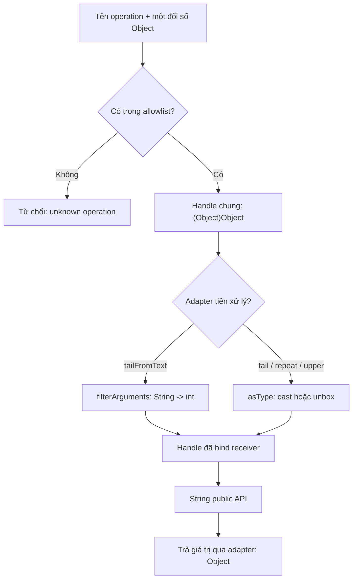

# Thực hành bộ gọi động nhỏ với public API, receiver được bind và chuyển đổi tham số tường minh

> **Chương:** Lookup và adapter — **mô-đun:** `JAVA_VERSION_JAVA18`. Bài thực hành xây dựng một *dynamic invoker* nhỏ bằng `MethodHandle`, chỉ truy cập các API `public` được Java SE công bố. Người học sẽ dùng `MethodHandles.publicLookup()` để tìm method, `bindTo()` để cố định receiver, `asType()` để đưa nhiều chữ ký về một dạng gọi chung, và `MethodHandles.filterArguments()` khi thực sự cần chuyển đổi tham số theo quy tắc do ứng dụng định nghĩa. Tất cả đều là API còn hỗ trợ từ Java 18 trên JDK hiện đại; không phụ thuộc Java internals hoặc cách mở quyền reflection lỗi thời.

Giả sử một ứng dụng muốn đăng ký các thao tác nhỏ theo tên, chẳng hạn:

- `tail`: lấy phần đuôi của chuỗi `"MethodHandle"` từ một vị trí `int`.
- `repeat`: lặp lại chuỗi `"Ha "` một số lần.
- `upper`: chuyển chuỗi `"chào java"` sang chữ hoa theo `Locale`.
- `tailFromText`: nhận vị trí dưới dạng `String` như `"6"`, parse thành `int` rồi cắt chuỗi.

Có thể viết `switch` để gọi trực tiếp từng API. Nhưng bài này dùng dispatcher theo tên để luyện cách **tạo, bind và thích nghi** một method handle. Một thư viện triển khai handler/plugin có thể áp dụng mô hình tương tự, với điều kiện phải quản lý rõ các operation được cho phép và kiểu dữ liệu đầu vào.

Điểm quan trọng nhất: `MethodHandle` không phải một lệnh “gọi bất kỳ method nào bằng reflection”. Nó luôn có `MethodType` cụ thể; các adapter tạo **handle mới với chữ ký mới**. Bộ gọi động chỉ hoạt động ổn định khi hiểu rõ đường đi của dữ liệu và các conversion được hỗ trợ.

## 1. Mục tiêu học tập

Sau bài này, bạn có thể:

1. Dùng `publicLookup().findVirtual(...)` để lấy method handle cho public API của `String`.
2. Đọc `MethodHandle.type()`, bao gồm receiver đứng đầu của instance method.
3. Cố định receiver bằng `bindTo(...)` và quan sát cách tham số đầu biến mất khỏi chữ ký.
4. Chuẩn hóa handle một tham số thành `(Object)Object` bằng `asType(...)`.
5. Dùng `invokeExact` với descriptor chính xác sau khi chuẩn hóa.
6. Tạo conversion tường minh `String → int` bằng `filterArguments(...)` thay vì giả định `asType` biết parse chuỗi.
7. Phân biệt lỗi lookup, lỗi ghép adapter, lỗi conversion và lỗi do method đích ném.
8. Thiết kế allowlist nhỏ cho public API và biết ranh giới của mô hình khi đưa vào production.

## 2. Sơ đồ bộ gọi động

Mỗi operation được đăng ký bằng một tên và một method handle. Khi caller gửi tên operation cùng dữ liệu, dispatcher lấy đúng adapter đã đăng ký rồi gọi với chữ ký chung `(Object)Object`.



Chủ đích ở đây là **adapter được xây trước**, không dò tìm method bằng tên tùy ý ở mỗi request. Các thao tác được đăng ký có giới hạn và có chữ ký đã kiểm tra.

## 3. Lookup an toàn: public API thay vì deep reflection

`MethodHandles.publicLookup()` tạo một `Lookup` có quyền tối thiểu. Nó chỉ tìm được các member `public` của các class `public` thuộc package được **export không điều kiện**. Vì vậy, nó thích hợp khi muốn chia sẻ method handles tới những người gọi không có đặc quyền truy cập vào class nội bộ.

Ví dụ public API:

```java
MethodHandles.Lookup lookup = MethodHandles.publicLookup();

MethodHandle substring = lookup.findVirtual(
        String.class,
        "substring",
        MethodType.methodType(String.class, int.class));
```

`String` là public type trong package `java.lang` thuộc module `java.base`, được export công khai. Method `substring(int)` là public. Không cần `setAccessible(true)`, `privateLookupIn`, `--add-opens` hoặc `--add-exports`.

Ngược lại, nếu muốn truy cập private field của một class hoặc package không export, `publicLookup` sẽ không “tự bỏ qua” module encapsulation. Tùy loại truy cập và lookup context, `findVirtual`/`findStatic` có thể báo `IllegalAccessException` hoặc `NoSuchMethodException`. Bài này cố ý không thực hiện kiểu truy cập đó.

### 3.1. Chọn đúng `MethodType` khi lookup

`findVirtual` yêu cầu một `MethodType` mô tả kiểu trả về và **những tham số được khai báo trong method**, không kèm receiver. Chẳng hạn:

```java
MethodType.methodType(String.class, int.class)
```

là mô tả của `String.substring(int)`. Nhưng **handle nhận được** có receiver đứng đầu:

```text
String.substring(int)  -> String
findVirtual handle     -> (String,int)String
```

Nếu bạn truyền `MethodType.methodType(String.class, String.class, int.class)` cho `findVirtual(String.class,"substring",...)`, lookup sẽ tìm sai chữ ký Java và có thể ném `NoSuchMethodException`. Receiver là tham số của *handle*, không phải tham số khai báo của *method* khi tra cứu.

## 4. Bind receiver: từ instance method sang phép gọi trên một đối tượng cố định

Sau `findVirtual`, handle có kiểu `(String,int)String`. Nếu dispatcher luôn cắt chuỗi `"MethodHandle"`, ta có thể cố định receiver:

```java
MethodHandle tail = substring.bindTo("MethodHandle");
```

Kết quả:

```text
before bindTo: (String,int)String
after  bindTo: (int)String
```

Lời gọi `tail` không còn cần truyền chuỗi receiver; chỉ nhận vị trí bắt đầu:

```java
String result = (String) tail.invokeExact(6);
System.out.println(result); // Handle
```

`bindTo` không thực thi target, chỉ tạo **method handle mới**. Handle `substring` ban đầu vẫn giữ kiểu và hành vi cũ, vì method handles là immutable.

### 4.1. Vì sao `bindTo` không bind được tùy ý tham số primitive?

`bindTo(Object value)` chỉ cố định **tham số tham chiếu đứng đầu** của handle. Nếu tham số đầu là primitive `int`, không thể dùng `bindTo` để cố định nó như một primitive argument; thay vào đó dùng `MethodHandles.insertArguments`.

Ví dụ:

```java
// tail.type() == (int)String
MethodHandle fixedTail = MethodHandles.insertArguments(
        tail, 0, 6);

// fixedTail.type() == ()String
String result = (String) fixedTail.invokeExact();
```

`insertArguments` có thể cố định tham số ở vị trí được chỉ định, gồm cả primitive (với giá trị boxed thích hợp), chứ không bị giới hạn ở reference parameter đứng đầu như `bindTo`.

### 4.2. Receiver bind không phải receiver động

Khi đã `bindTo("MethodHandle")`, operation `tail` gắn với đúng chuỗi đó. Nếu muốn cắt một chuỗi bất kỳ do caller truyền vào, **không bind receiver**, mà đăng ký một handle có hai đối số hoặc xây API với receiver động.

Bài học chọn receiver cố định để minh họa `bindTo` và đơn giản hóa dispatcher thành mô hình mỗi operation nhận đúng một đối số. Trong ứng dụng thực tế, hãy quyết định rõ receiver nên được bind hay được caller truyền vào.

## 5. Chuẩn hóa nhiều chữ ký thành một giao diện gọi

Ba handle sau khi bind receiver đều còn một tham số:

| Operation | API được lookup | Handle sau `bindTo` |
|---|---|---|
| `tail` | `String.substring(int)` | `(int)String` |
| `repeat` | `String.repeat(int)` | `(int)String` |
| `upper` | `String.toUpperCase(Locale)` | `(Locale)String` |

Nếu dispatcher nhận một `Object` rồi gọi các handle trực tiếp bằng `invokeExact`, call-site descriptor sẽ là `(Object)Object`, **không trùng** bất cứ kiểu nào trong bảng trên. Đó không phải vì giá trị runtime sai; mà vì `invokeExact` kiểm tra chính xác kiểu tĩnh của đối số và kiểu trả về.

Giải pháp có chủ đích: tạo adapter **một lần khi đăng ký**:

```java
MethodType generic = MethodType.methodType(
        Object.class, Object.class);

MethodHandle adapted = tail.asType(generic);

// tail.type()    == (int)String
// adapted.type() == (Object)Object
```

Bây giờ dispatcher có thể gọi:

```java
Object input = Integer.valueOf(6);
Object output = (Object) adapted.invokeExact(input);
```

Tại call site, argument có kiểu tĩnh `Object` và cast trực tiếp kết quả là `Object`. Descriptor `(Object)Object` khớp **adapter.type()**, nên `invokeExact` chính xác.

### 5.1. Những conversion nào thực sự xảy ra?

Adapter `(Object)Object → (int)String` hoạt động theo các bước:

1. Kiểm tra đầu vào `Object` có thể chuyển thành tham số `int` hay không (ví dụ `Integer` được unbox).
2. Gọi target `(int)String`.
3. Trả `String` dưới kiểu `Object` bằng phép widening reference.

Mỗi phép chuyển đổi phải được `asType` cho phép. Một `String` như `"6"` **không** được tự parse thành `int`. Nếu caller gửi `"6"` cho operation `tail`, adapter sẽ báo lỗi chuyển kiểu, không làm phép `Integer.parseInt` hộ ứng dụng.

Đây là phân biệt giữa *type adaptation* của JVM và *business conversion* của ứng dụng.

## 6. Chuyển đổi tham số tường minh bằng `filterArguments`

Để operation `tailFromText` nhận chỉ số dạng chuỗi `"6"`, tạo một filter có chữ ký:

```text
parseIndex(String) -> int
```

Sau đó đặt filter trước target `tail`:

```java
MethodHandle parseIndex = MethodHandles.lookup().findStatic(
        TinyDynamicInvoker.class, "parseIndex",
        MethodType.methodType(int.class, String.class));

// tail.type() == (int)String
MethodHandle tailFromText =
        MethodHandles.filterArguments(tail, 0, parseIndex);

// tailFromText.type() == (String)String
```

Khi gọi `tailFromText`:

```text
String "6"  -> parseIndex(String) -> int 6
           -> String.substring(int) trên receiver đã bind
           -> String "Handle"
```

Như vậy, *business conversion* từ chuỗi sang số được thể hiện bằng một **method handle riêng có hợp đồng rõ ràng**, không giả vờ `asType` tự hiểu dữ liệu.

`filterArguments(target, pos, filters...)` thực hiện lần lượt các filter unary trên những tham số tương ứng rồi gọi target với giá trị đã biến đổi. Filter phải trả đúng kiểu mà tham số target ở vị trí tương ứng cần; nếu mismatch, việc xây adapter có thể bị từ chối bằng `IllegalArgumentException`.

Chuyển đổi `"abc"` qua `Integer.parseInt` sẽ ném `NumberFormatException`. Đây là lỗi **dữ liệu không hợp lệ**, không phải `WrongMethodTypeException`. Cần phân biệt chúng trong hợp đồng API của dispatcher.

## 7. Lab hoàn chỉnh: TinyDynamicInvoker

Ví dụ dưới đây là một chương trình Java độc lập. Nó dùng public API của `String`, đăng ký một số operation cố định, chuẩn hóa mọi handle về `(Object)Object`, và minh họa cả đường thành công lẫn thất bại.

Tạo file `TinyDynamicInvoker.java`:

```java
import java.lang.invoke.MethodHandle;
import java.lang.invoke.MethodHandles;
import java.lang.invoke.MethodType;
import java.util.LinkedHashMap;
import java.util.Locale;
import java.util.Map;
import java.util.Objects;

public final class TinyDynamicInvoker {

    // Mỗi operation nhận đúng một Object và trả về Object.
    private static final MethodType CALL_TYPE =
            MethodType.methodType(Object.class, Object.class);

    private final Map<String, MethodHandle> operations =
            new LinkedHashMap<>();

    public void register(String name, MethodHandle handle) {
        Objects.requireNonNull(name, "name");
        Objects.requireNonNull(handle, "handle");

        if (name.isBlank()) {
            throw new IllegalArgumentException("Tên operation trống");
        }
        if (handle.type().parameterCount() != 1
                || handle.type().returnType() == void.class) {
            throw new IllegalArgumentException(
                    "Chỉ nhận handle có một tham số và có kết quả");
        }
        if (operations.containsKey(name)) {
            throw new IllegalArgumentException(
                    "Operation đã tồn tại: " + name);
        }

        // Chuẩn hóa ở lúc đăng ký, không tạo adapter lại cho mỗi call.
        MethodHandle adapted = handle.asType(CALL_TYPE);
        operations.put(name, adapted);
    }

    public Object call(String name, Object argument) throws Throwable {
        MethodHandle adapted = operations.get(name);
        if (adapted == null) {
            throw new IllegalArgumentException(
                    "Operation không được cho phép: " + name);
        }

        // Argument có kiểu tĩnh Object; return cast là Object.
        // Call-site descriptor khớp chính xác (Object)Object.
        return (Object) adapted.invokeExact(argument);
    }

    public static int parseIndex(String text) {
        // Quy tắc chuyển đổi ứng dụng định nghĩa rõ ràng.
        return Integer.parseInt(text);
    }

    @FunctionalInterface
    interface CheckedAction {
        void run() throws Throwable;
    }

    private static void expectFailure(
            String label, CheckedAction action) throws Throwable {
        try {
            action.run();
            throw new AssertionError(
                    "Kịch bản phải thất bại: " + label);
        } catch (RuntimeException expected) {
            System.out.printf("%s: %s%n",
                    label, expected.getClass().getSimpleName());
        }
    }

    public static void main(String[] args) throws Throwable {
        MethodHandles.Lookup publicApi =
                MethodHandles.publicLookup();

        // A. Chỉ lookup các public methods thuộc java.lang.String.
        MethodHandle substring = publicApi.findVirtual(
                String.class, "substring",
                MethodType.methodType(String.class, int.class));
        MethodHandle repeat = publicApi.findVirtual(
                String.class, "repeat",
                MethodType.methodType(String.class, int.class));
        MethodHandle toUpper = publicApi.findVirtual(
                String.class, "toUpperCase",
                MethodType.methodType(String.class, Locale.class));

        System.out.println("lookup substring = " + substring.type());

        // B. Cố định receiver của từng instance method.
        MethodHandle tail = substring.bindTo("MethodHandle");
        MethodHandle laugh = repeat.bindTo("Ha ");
        MethodHandle upper = toUpper.bindTo("chào java");

        System.out.println("bound tail       = " + tail.type());
        System.out.println("bound repeat     = " + laugh.type());
        System.out.println("bound upper      = " + upper.type());

        // C. Filter tường minh String -> int.
        MethodHandle parse = MethodHandles.lookup().findStatic(
                TinyDynamicInvoker.class, "parseIndex",
                MethodType.methodType(int.class, String.class));

        MethodHandle tailFromText =
                MethodHandles.filterArguments(tail, 0, parse);
        System.out.println("filtered tail    = " + tailFromText.type());

        // D. Đăng ký allowlist và chuẩn hóa về (Object)Object.
        TinyDynamicInvoker dispatcher = new TinyDynamicInvoker();
        dispatcher.register("tail", tail);
        dispatcher.register("repeat", laugh);
        dispatcher.register("upper", upper);
        dispatcher.register("tailFromText", tailFromText);

        System.out.println("tail        = " +
                dispatcher.call("tail", Integer.valueOf(6)));
        System.out.println("repeat      = [" +
                dispatcher.call("repeat", Integer.valueOf(3)) + "]");
        System.out.println("upper       = " +
                dispatcher.call("upper", Locale.ROOT));
        System.out.println("tailFromText= " +
                dispatcher.call("tailFromText", "6"));

        // E. Các loại lỗi có nguồn gốc khác nhau.
        expectFailure("unknown operation", () -> {
            dispatcher.call("notRegistered", 6);
        });
        expectFailure("String không được asType parse thành int", () -> {
            dispatcher.call("tail", "6");
        });
        expectFailure("NumberFormatException từ filter", () -> {
            dispatcher.call("tailFromText", "abc");
        });
        expectFailure("substring index ngoài phạm vi", () -> {
            dispatcher.call("tail", Integer.valueOf(200));
        });
        expectFailure("repeat nhận số âm", () -> {
            dispatcher.call("repeat", Integer.valueOf(-1));
        });

        // F. Bind receiver khác với cố định một tham số primitive.
        MethodHandle startAt6 =
                MethodHandles.insertArguments(tail, 0, 6);
        String fromNoArgHandle =
                (String) startAt6.invokeExact();
        System.out.println("insertArguments = " + fromNoArgHandle);

        // G. Một lời gọi exact trực tiếp cần chữ ký (int)String.
        String direct = (String) tail.invokeExact(6);
        System.out.println("direct exact    = " + direct);
    }
}
```

Chạy trên Java 18 hoặc JDK hiện đại:

```text
java TinyDynamicInvoker.java
```

Đầu ra tiêu biểu:

```text
lookup substring = (String,int)String
bound tail       = (int)String
bound repeat     = (int)String
bound upper      = (Locale)String
filtered tail    = (String)String
tail        = Handle
repeat      = [Ha Ha Ha ]
upper       = CHÀO JAVA
tailFromText= Handle
unknown operation: IllegalArgumentException
String không được asType parse thành int: ClassCastException
NumberFormatException từ filter: NumberFormatException
substring index ngoài phạm vi: StringIndexOutOfBoundsException
repeat nhận số âm: IllegalArgumentException
insertArguments = Handle
direct exact    = Handle
```

Các tên class exception trong ví dụ là để phân biệt nguồn lỗi. Không nên assert chuỗi message/stack trace nguyên văn giữa các bản JDK; hãy kiểm tra loại exception và contract. Nếu bạn đổi chuỗi receiver, chỉ số truyền vào cũng phải được điều chỉnh để còn nằm trong giới hạn.

### 7.1. Vì sao `register` kiểm tra arity?

Dispatcher cố ý có chữ ký thống nhất:

```text
(Object)Object
```

Do đó, mọi handle được đăng ký phải có **một tham số**. Ví dụ một handle `(String,int)String` chưa bind receiver vẫn có hai tham số, nên không hợp lệ với dispatcher này. `asType` không tự thêm hoặc bỏ tham số tùy ý. Việc kiểm tra `parameterCount()` giúp phát hiện lỗi thiết kế sớm hơn.

Lớp demo cũng yêu cầu return type khác `void` vì caller mong đợi một giá trị `Object`. Có thể thiết kế dispatcher khác để hỗ trợ `void`, nhiều tham số hoặc kết quả bất đồng bộ, nhưng phải đưa quy tắc ấy vào contract trước khi mở rộng.

### 7.2. Vì sao gọi `invokeExact` sau khi đã dùng `asType`?

Dispatcher không dựa vào chuyển đổi ngầm trong mỗi `invokeExact`. Nó đã tạo adapter có đúng kiểu `(Object)Object` tại lúc đăng ký. Khi xử lý request, lời gọi `adapted.invokeExact(argument)` được biên dịch với đối số `Object` và cast return `Object`, nên là lời gọi **exact vào adapter**.

Conversion `Object → int` hoặc `Object → Locale` xảy ra **trong adapter `asType`** trước khi target thực thi. Đây là khác biệt quan trọng giữa “`invokeExact` tự ép kiểu” (sai) và “gọi exact một adapter đã chứa các bước chuyển đổi” (đúng).

## 8. Ma trận chuyển đổi: API nào thực hiện bước nào?

| Chuỗi thao tác | Kiểu trước | Kiểu sau | Ai chịu trách nhiệm chuyển? |
|---|---|---|---|
| `findVirtual(String.substring(int))` | chữ ký Java nhận `int` | `(String,int)String` | `Lookup` bổ sung receiver vào handle |
| `bindTo("MethodHandle")` | `(String,int)String` | `(int)String` | `bindTo` cố định receiver tham chiếu |
| `filterArguments(tail,0,parse)` | `(int)String` | `(String)String` | Filter `parseIndex` đổi chuỗi thành số |
| `asType((Object)Object)` trên `tail` | `(int)String` | `(Object)Object` | Adapter cast/unbox input và đổi return |
| `asType((Object)Object)` trên `upper` | `(Locale)String` | `(Object)Object` | Adapter cast input `Object` về `Locale` |
| `asType((Object)Object)` trên `tailFromText` | `(String)String` | `(Object)Object` | Adapter cast `Object → String`; filter parse sau đó |
| `invokeExact(argument)` trong dispatcher | `(Object)Object` | `(Object)Object` | Exact matching, không tự biến đổi call site |
| `insertArguments(tail,0,6)` | `(int)String` | `()String` | Cố định một primitive argument |

Dù các conversion được dựng từ `MethodHandle`, **contract của dữ liệu đầu vào** vẫn thuộc về ứng dụng. Đừng dùng `asType` như trình phân tích JSON, kiểm tra quyền nghiệp vụ hoặc parser chuỗi số.

## 9. Những nhóm lỗi cần xử lý riêng

Một bộ gọi động dễ chẩn đoán phải phân biệt lỗi xảy ra ở **lookup**, **dựng adapter**, **conversion** và **method đích**.

| Giai đoạn | Ví dụ lỗi | Ý nghĩa |
|---|---|---|
| Lookup | `NoSuchMethodException` | Sai tên, tham số hoặc kiểu trả về khi tìm member |
| Lookup | `IllegalAccessException` | Lookup không có quyền truy cập member/module theo quy tắc Java |
| Bind receiver | `ClassCastException` hoặc lỗi liên quan tới binding | Giá trị bind không phù hợp kiểu tham số tham chiếu đầu |
| Dựng adapter | `WrongMethodTypeException`/`IllegalArgumentException` tùy API và kiểu biến đổi | Yêu cầu chuyển đổi hoặc ghép filter không phù hợp |
| Exact call | `WrongMethodTypeException` | Call-site descriptor không trùng `MethodHandle.type()` của handle được gọi |
| Conversion | `ClassCastException` | Đối số `Object` không thể cast/unbox sang kiểu target |
| Conversion | `NullPointerException` | Cố unbox một giá trị null sang primitive |
| Filter ứng dụng | `NumberFormatException` | `parseIndex` không parse được chuỗi số |
| Target | `StringIndexOutOfBoundsException` | `substring` nhận chỉ số ngoài giới hạn |
| Target | `IllegalArgumentException` | `String.repeat` từ chối số lần lặp âm |
| Dispatcher | `IllegalArgumentException` có message do ứng dụng định nghĩa | Operation chưa có trong allowlist hoặc trùng tên |

Không dùng cách bắt mọi `Throwable` rồi trả lỗi “method not found” — vì làm thế sẽ che lỗi dữ liệu, bug target và `Error` nghiêm trọng. Khi expose qua HTTP/RPC, có thể map các trường hợp input validation sang response phù hợp, còn lỗi cấu hình lookup/adapter nên được phát hiện lúc bootstrap và log dưới dạng lỗi tích hợp.

### 9.1. Không có `InvocationTargetException` tự động

Core Reflection `Method.invoke` bọc exception của method đích trong `InvocationTargetException`. Ngược lại, `MethodHandle.invokeExact` và `invoke` cho phép exception của target đi qua theo hợp đồng `throws Throwable`, không tự động gói vào `InvocationTargetException`. Vì vậy `NumberFormatException` từ filter hoặc `StringIndexOutOfBoundsException` từ target trong lab là chính exception gốc.

### 9.2. `asType` không bảo đảm mọi chuyển đổi đều hợp lệ

`asType` chỉ hỗ trợ những chuyển đổi được Javadoc quy định (như một số reference casts, boxing/unboxing và widening primitive), không tự parse số từ chuỗi hoặc thực hiện chuyển đổi nghiệp vụ. `String "6"` không phải một `Integer`; muốn chấp nhận nó, hãy dùng parser/filter tường minh như `tailFromText`.

## 10. `invoke` so với `invokeExact` trong cùng lab

Từ handle `tail.type() == (int)String`, lời gọi exact đúng là:

```java
String result = (String) tail.invokeExact(6);
```

Với `invoke`, call site có thể có kiểu khác và JVM cố thích nghi như `asType`:

```java
Integer boxed = Integer.valueOf(6);
Object result = tail.invoke(boxed);
```

Ở đây call site mô tả `(Integer)Object`, khác `(int)String`, nhưng thích nghi có thể unbox tham số `Integer → int` và đổi `String → Object`. Đừng suy ra rằng `invoke` sẽ parse một chuỗi `"6"` hoặc tự bỏ mọi giới hạn.

**Vì sao lab dùng `asType` khi đăng ký?** Vì cách đó công bố rõ chữ ký chung của dispatcher, có thể kiểm tra `adapted.type()`, tái sử dụng adapter và tránh để mỗi nơi gọi xử lý type negotiation riêng lẻ. Với một lời gọi lẻ đã biết signature, `invoke` vẫn là API hợp lệ.

## 11. Quyền truy cập và thiết kế operation allowlist

`publicLookup` có phạm vi quyền nhỏ hơn `MethodHandles.lookup()` ở nhiều tình huống, nhưng **một public method vẫn có thể tạo tác dụng phụ**. API có thể sửa trạng thái, gọi dịch vụ mạng hoặc ghi dữ liệu. Vì vậy chỉ cho phép những operation mà ứng dụng đã kiểm duyệt.

Trong lab, registry chỉ có `tail`, `repeat`, `upper` và `tailFromText`. Caller chọn một tên trong danh sách đó; nó **không** được truyền class name, method name hoặc `MethodType` tùy ý để hệ thống tự lookup.

Các nguyên tắc nên giữ khi đưa mô hình vào hệ thống lớn:

1. Tạo và kiểm chứng handle khi khởi động thay vì khi nhận request.
2. Giới hạn danh sách operation, quyền người gọi và kiểu argument của từng operation.
3. Nếu dùng `publicLookup`, chỉ dựa vào public APIs được export chính thức; không cố truy cập `jdk.internal.*` hay field private.
4. Không suy diễn rằng public method nào cũng “an toàn để gọi từ bên ngoài”.
5. Kiểm tra giá trị như chỉ số cắt chuỗi, số lần repeat và locale hợp lệ trước khi gọi target.
6. Không log token, dữ liệu bí mật hoặc giá trị nhạy cảm của receiver đã bind.
7. Nếu dispatcher bị gọi đồng thời, dùng registry bất biến sau bootstrap hoặc áp dụng đồng bộ hóa phù hợp khi cập nhật.
8. Giới hạn tài nguyên cho input có thể gây tải lớn; ví dụ `String.repeat` với count rất lớn có thể tiêu tốn bộ nhớ.
9. Ưu tiên lỗi có thông tin rõ (unknown operation, invalid input, target failure) thay vì tự retry mọi ngoại lệ.
10. Kiểm thử trên đúng JDK và deployment module/classpath của ứng dụng.

`MethodHandle` là cơ chế gọi có kiểu, **không phải security boundary** thay thế xác thực hoặc authorization của ứng dụng.

## 12. Mở rộng thiết kế có chủ đích

Mô hình một argument `(Object)Object` đơn giản nhưng không đại diện mọi bài toán. Một số hướng mở rộng hợp lệ:

### 12.1. Giữ receiver động

Không gọi `bindTo` với `String.substring(int)`. Handle có kiểu `(String,int)String`, nên dispatcher phải nhận cả receiver và index:

```java
MethodHandle substring = MethodHandles.publicLookup()
        .findVirtual(String.class, "substring",
                MethodType.methodType(String.class, int.class));

String result = (String) substring.invokeExact("MethodHandle", 6);
```

Khi muốn chuẩn hóa, có thể tạo adapter kiểu `(Object,Object)Object` nhưng cần thiết kế rõ hai argument và các conversion. Đừng đăng ký handle hai tham số vào dispatcher chỉ nhận một argument.

### 12.2. Dùng `insertArguments` để bind tham số khác receiver

Với `tail.type() == (int)String`, có thể cố định chỉ số `6`:

```java
MethodHandle fixed = MethodHandles.insertArguments(tail, 0, 6);
String result = (String) fixed.invokeExact();
```

Khi cần bind một reference receiver có sẵn ở tham số đầu, `bindTo` trực quan hơn. Khi cần bind primitive hoặc tham số ở vị trí khác, `insertArguments` cung cấp cơ chế phù hợp.

### 12.3. Chuẩn hóa dữ liệu động bằng converter có hợp đồng riêng

Nếu chấp nhận đầu vào String, đừng ép caller gửi `Integer` chỉ vì `asType` unbox được. Hãy viết filter như `parseIndex`, bổ sung validate range và chính sách lỗi có chủ đích. Những adapter như `filterArguments` giúp đường chuyển đổi trở thành một phần của *cấu trúc handle*, thay vì dựa vào ép kiểu ngầm và điều kiện rải rác.

### 12.4. Khi nào không cần dispatcher?

Nếu chỉ có một hoặc hai public methods với chữ ký đã biết, lời gọi Java thông thường hoặc một interface rõ ràng thường đơn giản và dễ đọc hơn. Dispatcher bằng `MethodHandle` hữu ích khi cần cấu hình operation động, xây adapter có kiểu hoặc tích hợp framework, nhưng không phải cách thay thế mặc định cho lời gọi method thông thường.

## 13. Checklist kiểm chứng kết quả

Dùng checklist sau khi đọc hoặc tự mở rộng lab:

- [ ] Lookup chỉ dùng public members của public types trong package được export.
- [ ] `findVirtual` nhận `MethodType` mô tả **signature method khai báo**, không chèn receiver vào khi tra cứu.
- [ ] Handle nhận được sau `findVirtual` có receiver ở tham số đầu.
- [ ] `bindTo` cố định reference receiver và trả handle mới với một tham số ít hơn.
- [ ] `asType` tạo adapter có `type()` chính xác là `(Object)Object`.
- [ ] Dispatcher cast kết quả `(Object)` ngay trên lời gọi `invokeExact` để call site khớp adapter.
- [ ] `filterArguments` đổi `String → int` trước khi `substring` được gọi.
- [ ] Dữ liệu `"6"` đi tới `tail` thuần sẽ thất bại; tới `tailFromText` sẽ thành công.
- [ ] Unknown operation được chặn bởi allowlist.
- [ ] Lỗi format, lỗi chuyển kiểu và lỗi từ target không bị nhầm lẫn.
- [ ] Không dùng API nội bộ, không yêu cầu `--add-opens`, không dùng reflection để bypass quyền.
- [ ] Trạng thái registry và dữ liệu receiver được quản lý theo nhu cầu concurrency và bảo mật của ứng dụng.

## 14. Bài tập tự kiểm tra

1. Vì sao `publicLookup` tìm được `String.substring(int)` nhưng không thể dùng để lấy private field bất kỳ của ứng dụng?
2. Vì sao `findVirtual(String.class, "substring", MethodType.methodType(String.class, int.class))` tạo handle kiểu `(String,int)String`?
3. Sau `substring.bindTo("MethodHandle")`, handle có kiểu gì?
4. Nếu gọi `tail.invokeExact(Integer.valueOf(6))` với cast return `String`, vì sao bị `WrongMethodTypeException`?
5. Vì sao `asType((Object)Object)` cho phép dispatcher nhận một `Integer` dù target thực sự đòi `int`?
6. Tại sao `asType` không tự biến `"6"` thành `6`?
7. `filterArguments(tail,0,parseIndex)` tạo chữ ký nào?
8. Nếu parser nhận `"abc"`, exception xuất hiện thuộc tầng conversion hay target?
9. Vì sao `bindTo` không phù hợp để bind tham số primitive đứng đầu, và `insertArguments` giúp thế nào?
10. Vì sao `(Object) adapted.invokeExact(argument)` cần cast kết quả `Object` ngay trên invocation?
11. Nếu operation `repeat` nhận số âm, exception đến từ adapter hay từ method `String.repeat`?
12. Vì sao không nên cho người dùng truyền tên class/method bất kỳ để tự `publicLookup` ở runtime?
13. Khi app cần hỗ trợ nhiều tham số, phần nào của dispatcher phải thiết kế lại?
14. Vì sao method handle được bind với một receiver khác với method handle nhận receiver động?

**Tiêu chí hoàn thành:** Bạn tự tạo được dispatcher cho public APIs, đọc và giải thích `MethodHandle.type()` trước/sau `bindTo`, `filterArguments` và `asType`, gọi exact adapter `(Object)Object`, phân loại lỗi hợp lý và đánh giá được giới hạn thiết kế.

## 15. Tài liệu chuẩn

- [MethodHandles — Java SE 18](https://docs.oracle.com/en/java/javase/18/docs/api/java.base/java/lang/invoke/MethodHandles.html): `publicLookup`, `filterArguments`, `insertArguments` và các handle combinators.
- [MethodHandles.Lookup — Java SE 18](https://docs.oracle.com/en/java/javase/18/docs/api/java.base/java/lang/invoke/MethodHandles.Lookup.html): `findVirtual`, `findStatic` và hợp đồng quyền lookup.
- [MethodHandle — Java SE 26](https://docs.oracle.com/en/java/javase/26/docs/api/java.base/java/lang/invoke/MethodHandle.html): `type`, `bindTo`, `asType`, `invokeExact`, `invoke` và conversion.
- [MethodHandles — Java SE 26](https://docs.oracle.com/en/java/javase/26/docs/api/java.base/java/lang/invoke/MethodHandles.html): hợp đồng `filterArguments` và `insertArguments` trên JDK hiện đại.
- [MethodType — Java SE 26](https://docs.oracle.com/en/java/javase/26/docs/api/java.base/java/lang/invoke/MethodType.html): chữ ký có kiểu và hàm tạo `methodType`.
- [String — Java SE 26](https://docs.oracle.com/en/java/javase/26/docs/api/java.base/java/lang/String.html): `substring`, `repeat` và `toUpperCase(Locale)` là public APIs được dùng trong lab.
- [JEP 416 — Reimplement Core Reflection with Method Handles](https://openjdk.org/jeps/416): bối cảnh của Java 18; phân biệt việc Java dùng MethodHandle trong implementation Core Reflection với các API được học ở đây.

