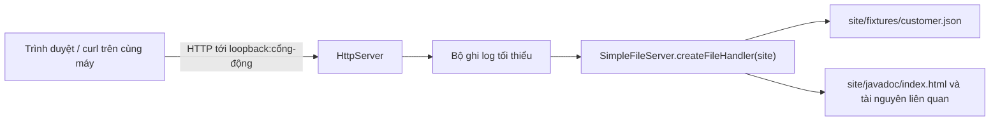

# Phục vụ fixture và Javadoc qua loopback bằng SimpleFileServer với cổng động và log có kiểm soát

> **Chương:** Thực hành tổng hợp  
> **Module:** `JAVA_VERSION_JAVA18` — kết hợp các tính năng vẫn được hỗ trợ trên JDK hiện đại: Simple Web Server từ Java 18, UTF-8 mặc định và công cụ `javadoc`.  
> **Mục đích:** Dựng một máy chủ HTTP tạm thời trên chính máy phát triển để kiểm tra fixture và duyệt Javadoc đã sinh. Đây là máy chủ phục vụ nội dung tĩnh cho phát triển/thử nghiệm, không phải máy chủ ứng dụng sản xuất.

## Mục tiêu học tập

Sau bài này, bạn có thể:

1. Chuẩn bị một thư mục tĩnh chứa **fixture JSON** và **Javadoc HTML** được sinh từ mã nguồn Java.
2. Dùng `SimpleFileServer.createFileHandler()` kết hợp `HttpServer` để phục vụ hai loại tài nguyên bằng cùng một địa chỉ HTTP.
3. Bind server vào **loopback** và dùng **cổng `0`** để hệ điều hành cấp cổng trống, tránh hard-code cổng dễ xung đột.
4. Lấy cổng thực tế từ `server.getAddress().getPort()` và in URL đúng cả khi loopback là IPv4 hoặc IPv6.
5. Tạo **log có kiểm soát**, chỉ gồm nhóm tài nguyên, phương thức HTTP, mã đáp ứng và thời lượng, thay vì ghi nguyên URI, query string hoặc header của client.
6. Kiểm chứng hành vi bằng trình duyệt hoặc `curl`, đồng thời hiểu giới hạn bảo mật của một static file server.

## 1. Bài toán: hai nhóm tệp, một server cục bộ

Trong một dự án Java, bạn có thể cần:

- Một **fixture** là dữ liệu thử nghiệm cố định, chẳng hạn `fixtures/customer.json`, để kiểm tra trình duyệt, chương trình `HttpClient` hoặc đoạn mã demo.
- Bộ **Javadoc** đã xuất thành nhiều tệp HTML/CSS/JavaScript, cần mở bằng HTTP để đường dẫn tương đối giữa các trang và tài nguyên hoạt động đồng nhất.
- Một server khởi động bằng lệnh đơn giản, không chiếm cổng cố định và không vô tình lắng nghe trên tất cả giao diện mạng.
- Dấu vết truy cập đủ để biết URL thuộc nhóm nào, có thành công hay không, mà không ghi dữ liệu nhạy cảm từ request.

Cấu trúc đích:

```text
local-assets-demo/
├── src/
│   └── demo/
│       ├── SampleApi.java
│       └── LocalAssetsServer.java
└── site/
    ├── fixtures/
    │   └── customer.json
    └── javadoc/                 # javadoc tạo thư mục này
        ├── index.html
        └── ... các trang và tài nguyên do javadoc sinh
```

`site` là **document root**. Khi phục vụ root đó tại `/`, đường dẫn `site/fixtures/customer.json` tương ứng với `/fixtures/customer.json`, còn `site/javadoc/index.html` tương ứng với `/javadoc/index.html`.



**Giới hạn phạm vi:** server chỉ phục vụ các tệp trong root được cấu hình theo hợp đồng của file handler. Đây không phải cơ chế thực thi Java, API JSON động, servlet container hay công cụ cấp quyền người dùng.

## 2. Các API liên quan còn được hỗ trợ trên JDK hiện đại

Tính năng Simple Web Server từ Java 18 (JEP 408) cung cấp `com.sun.net.httpserver.SimpleFileServer` thuộc module `jdk.httpserver`. Namespace `com.sun.net.httpserver` là API được tài liệu hóa trong module này; tên package chứa chữ `com.sun` không có nghĩa phải dùng thủ thuật truy cập API nội bộ.

| API | Vai trò |
| --- | --- |
| `SimpleFileServer.createFileServer(address, root, outputLevel)` | Tạo sẵn `HttpServer` cho tệp tĩnh và chọn mức output của tiện ích |
| `SimpleFileServer.createFileHandler(root)` | Tạo `HttpHandler` để gắn vào `HttpServer` do mình cấu hình |
| `HttpServer.create(address, backlog)` | Tạo và bind HTTP server; địa chỉ có thể chứa cổng `0` |
| `server.createContext("/", handler)` | Gắn handler vào đường dẫn gốc `/` |
| `server.getAddress().getPort()` | Đọc cổng thực sự được bind khi yêu cầu cổng động |
| `HttpExchange.getResponseCode()` | Đọc mã trạng thái HTTP mà handler đã gửi; có thể là `-1` nếu chưa gửi response headers |
| `SimpleFileServer.OutputLevel.NONE/INFO/VERBOSE` | Điều khiển output do tiện ích tạo; bài này dùng handler riêng để chỉ log thông tin cho phép |

Cách ngắn nhất là dùng trực tiếp `createFileServer()`:

```java
HttpServer server = SimpleFileServer.createFileServer(
        new InetSocketAddress(InetAddress.getLoopbackAddress(), 0),
        root,
        SimpleFileServer.OutputLevel.NONE);

server.start();
int actualPort = server.getAddress().getPort();
```

Cách này thích hợp khi bạn chỉ cần server tĩnh với output tích hợp. Bài thực hành bên dưới dùng `createFileHandler()` để **tự quyết định trường log nào được ghi**. Ta để một `HttpServer` phục vụ nội dung do `SimpleFileServer` cung cấp, nên không phải tự viết logic đọc tệp hoặc MIME type.

**Không dùng `new InetSocketAddress(0)` nếu yêu cầu chỉ nghe ở loopback:** constructor này tạo địa chỉ wildcard. Hãy chỉ định `InetAddress.getLoopbackAddress()` tường minh.

## 3. Chuẩn bị fixture và Javadoc

Yêu cầu tối thiểu: **JDK 18+** có `java`, `javac` và `javadoc`. Kiểm tra `java -version` và `javadoc --version` đang trỏ đến JDK mong muốn. Khi biên dịch ví dụ server, ta khai báo rõ module `jdk.httpserver`.

### 3.1. Tạo fixture UTF-8

Tạo tệp `site/fixtures/customer.json`:

```json
{
  "id": 17,
  "name": "Nguyễn Lan",
  "active": true,
  "tags": ["demo", "utf8"]
}
```

Lưu file dưới **UTF-8**. Java 18 đưa UTF-8 thành default charset trong nhiều API tiêu chuẩn theo JEP 400; viết rõ encoding trong dữ liệu và công cụ vẫn giúp bài tập tái lập được trên các môi trường khác nhau.

Fixture chỉ chứa dữ liệu thử nghiệm giả lập. Đừng đặt mật khẩu, token, tệp cấu hình nội bộ, dữ liệu cá nhân thật hoặc khóa bí mật trong `site`, kể cả khi server hiện chỉ bind loopback.

### 3.2. Tạo một API nhỏ để sinh Javadoc

Tạo `src/demo/SampleApi.java`:

```java
package demo;

/**
 * API mẫu dùng để kiểm chứng trang tài liệu HTML trên server cục bộ.
 */
public final class SampleApi {
    private SampleApi() {
    }

    /**
     * Tạo lời chào từ tên được cung cấp.
     *
     * {@snippet :
     * String result = SampleApi.greet("Lan");
     * System.out.println(result);
     * }
     *
     * @param name tên cần chào, không được null
     * @return lời chào tiếng Việt
     * @throws NullPointerException nếu name là null
     */
    public static String greet(String name) {
        return "Xin chào, " + java.util.Objects.requireNonNull(name);
    }
}
```

`{@snippet ...}` là tag Javadoc được giới thiệu từ Java 18 (JEP 413), vẫn được hỗ trợ trên JDK hiện đại. Nó giúp đưa đoạn mã minh họa có định dạng vào tài liệu API.

Từ thư mục `local-assets-demo`, sinh trang HTML:

```sh
javadoc -encoding UTF-8 -docencoding UTF-8 -charset UTF-8 \
  -d site/javadoc src/demo/SampleApi.java
```

Lệnh trên được viết với dấu nối dòng `\` của shell POSIX. Trên **PowerShell/Windows**, chạy một dòng để tránh khác biệt cú pháp:

```powershell
javadoc -encoding UTF-8 -docencoding UTF-8 -charset UTF-8 -d site/javadoc src/demo/SampleApi.java
```

Sau khi `javadoc` chạy thành công, kiểm tra `site/javadoc/index.html` tồn tại và có các tài nguyên liên quan. **Không tự tạo file `index.html` rỗng:** mục tiêu là phục vụ toàn bộ output thật của `javadoc`.

## 4. Viết server: loopback, cổng động, log tối thiểu

Tạo `src/demo/LocalAssetsServer.java`:

```java
package demo;

import com.sun.net.httpserver.HttpExchange;
import com.sun.net.httpserver.HttpHandler;
import com.sun.net.httpserver.HttpServer;
import com.sun.net.httpserver.SimpleFileServer;
import java.net.InetAddress;
import java.net.InetSocketAddress;
import java.nio.file.Files;
import java.nio.file.Path;
import java.util.concurrent.CountDownLatch;
import java.util.concurrent.TimeUnit;

public final class LocalAssetsServer {
    private LocalAssetsServer() {
    }

    public static void main(String[] args) throws Exception {
        if (args.length != 1) {
            throw new IllegalArgumentException(
                    "Usage: java ... demo.LocalAssetsServer <site-directory>");
        }

        // root phải tồn tại; toRealPath() cũng chuẩn hóa đường dẫn thực.
        Path root = Path.of(args[0]).toRealPath();
        if (!Files.isDirectory(root)
                || !Files.isRegularFile(root.resolve("fixtures/customer.json"))
                || !Files.isRegularFile(root.resolve("javadoc/index.html"))) {
            throw new IllegalArgumentException(
                    "site must contain fixtures/customer.json and javadoc/index.html");
        }

        // Dùng handler tệp tĩnh được cung cấp bởi SimpleFileServer.
        HttpHandler staticFiles = SimpleFileServer.createFileHandler(root);

        // 0 = OS chọn một cổng còn trống. Bind cụ thể vào loopback.
        InetSocketAddress bind =
                new InetSocketAddress(InetAddress.getLoopbackAddress(), 0);
        HttpServer server = HttpServer.create(bind, 0);

        server.createContext("/", exchange -> {
            long started = System.nanoTime();

            // Phân loại thay vì ghi nguyên URI hoặc tham số query.
            String category = categoryOf(exchange);
            String method = methodOf(exchange);

            try {
                staticFiles.handle(exchange);
            } finally {
                long millis = TimeUnit.NANOSECONDS.toMillis(
                        System.nanoTime() - started);
                System.out.printf(
                        "http method=%s category=%s status=%d durationMs=%d%n",
                        method,
                        category,
                        exchange.getResponseCode(),
                        millis);
            }
        });

        Runtime.getRuntime().addShutdownHook(
                new Thread(() -> server.stop(0), "stop-local-assets"));

        server.start();

        // Lấy địa chỉ đã bind; không sử dụng lại giá trị cổng 0.
        InetSocketAddress actual = server.getAddress();
        String ip = actual.getAddress().getHostAddress();
        String urlHost = ip.contains(":") ? "[" + ip + "]" : ip;
        String base = "http://" + urlHost + ":" + actual.getPort() + "/";

        System.out.println("BASE_URL=" + base);
        System.out.println("FIXTURE_URL=" + base + "fixtures/customer.json");
        System.out.println("JAVADOC_URL=" + base + "javadoc/index.html");
        System.out.println("Stop with Ctrl+C");

        // Giữ tiến trình sống cho đến khi người dùng kết thúc.
        new CountDownLatch(1).await();
    }

    private static String categoryOf(HttpExchange exchange) {
        String path = exchange.getRequestURI().getPath();
        if (path.startsWith("/fixtures/")) {
            return "fixture";
        }
        if (path.startsWith("/javadoc/")) {
            return "javadoc";
        }
        return "other";
    }

    private static String methodOf(HttpExchange exchange) {
        // Chỉ in các nhãn cố định, không in method tùy ý từ client.
        return switch (exchange.getRequestMethod()) {
            case "GET" -> "GET";
            case "HEAD" -> "HEAD";
            default -> "OTHER";
        };
    }
}
```

**Điểm cần chú ý trong code:**

- `SimpleFileServer.createFileHandler(root)` giữ nhiệm vụ phục vụ file tĩnh, kể cả tài nguyên của Javadoc.
- `HttpServer.create(bind, 0)` tạo server HTTP và bind cổng; tham số thứ hai là backlog, **không phải cổng**. Cổng động là `0` ở `InetSocketAddress`.
- `InetAddress.getLoopbackAddress()` giới hạn lắng nghe trên địa chỉ loopback mà JDK chọn. Địa chỉ đó có thể là IPv4 hoặc IPv6; nhánh `urlHost` thêm ngoặc vuông khi URL chứa IPv6.
- `createContext("/", ...)` gắn handler chung; phần wrapper chỉ thống kê request ở mức tối thiểu và không can thiệp vào cách file handler chọn tệp.
- `getResponseCode()` được gọi sau khi file handler xử lý. Nếu response headers chưa được gửi do lỗi bất thường, giá trị có thể là `-1`, cần chẩn đoán từ stack trace.
- `CountDownLatch(1).await()` giữ tiến trình chạy khi phục vụ. Bấm `Ctrl+C` trong terminal để kết thúc, shutdown hook gọi `server.stop(0)`.
- `categoryOf()` **chỉ phục vụ mục đích log**; nó **không** phải bộ lọc quyền truy cập HTTP. Chính vì vậy document root chỉ được chứa tài nguyên đã cho phép công khai trên máy thử nghiệm.

Không cần cấu hình executor riêng cho demo ít request; `HttpServer` có executor mặc định nếu không gọi `setExecutor()`. Khi cần xử lý tải lớn, concurrency và giới hạn tài nguyên phải được thiết kế riêng; đây không phải nhiệm vụ của simple file server.

### Biên dịch và chạy

Từ thư mục `local-assets-demo`:

```sh
javac --add-modules jdk.httpserver -encoding UTF-8 \
  -d out src/demo/LocalAssetsServer.java
java --add-modules jdk.httpserver -cp out demo.LocalAssetsServer site
```

PowerShell/Windows, dùng một dòng cho lệnh biên dịch:

```powershell
javac --add-modules jdk.httpserver -encoding UTF-8 -d out src/demo/LocalAssetsServer.java
java --add-modules jdk.httpserver -cp out demo.LocalAssetsServer site
```

Ví dụ đầu ra:

```text
BASE_URL=http://127.0.0.1:51347/
FIXTURE_URL=http://127.0.0.1:51347/fixtures/customer.json
JAVADOC_URL=http://127.0.0.1:51347/javadoc/index.html
Stop with Ctrl+C
```

**51347 chỉ là ví dụ.** Mỗi lần chạy có thể nhận cổng khác; bạn phải dùng URL in ở lần chạy hiện tại. Nếu JDK chọn IPv6 loopback, URL sẽ có dạng `http://[0:0:0:0:0:0:0:1]:<port>/` hoặc tương đương. Không thay thế máy chủ bằng địa chỉ `0.0.0.0` vì địa chỉ wildcard không mang ý nghĩa “localhost”.

## 5. Kiểm chứng HTTP theo một quy trình có thể lặp lại

Trong terminal thứ hai (giữ server chạy ở terminal đầu), sử dụng chính các URL được in ra.

### 5.1. Fixture được phục vụ qua HTTP

```sh
curl -i "http://127.0.0.1:51347/fixtures/customer.json"
```

Đây là URL minh họa; thay `51347` và host theo `FIXTURE_URL` thực tế. Kỳ vọng đáp ứng `HTTP 200` và body có dữ liệu:

```json
{
  "id": 17,
  "name": "Nguyễn Lan",
  "active": true,
  "tags": ["demo", "utf8"]
}
```

Header `Content-Type` do file handler chọn; có thể phụ thuộc kiểu tệp và môi trường. Để kiểm chứng nội dung, so sánh body và encoding của fixture; đừng đặt bài kiểm tra phụ thuộc một thứ tự header cụ thể.

### 5.2. Javadoc và các tài nguyên con

Mở URL `JAVADOC_URL` đã in trong trình duyệt, ví dụ:

```text
http://127.0.0.1:51347/javadoc/index.html
```

Kiểm tra trang HTML hiển thị, liên kết tới lớp `demo.SampleApi` hoạt động và đoạn `@snippet` được định dạng. Bạn cũng có thể kiểm tra response headers:

```sh
curl -I "http://127.0.0.1:51347/javadoc/index.html"
```

`curl -I` gửi yêu cầu `HEAD`; static file handler hỗ trợ tra cứu tài nguyên tĩnh cho `GET` và `HEAD`. Ứng dụng không cần viết bộ định tuyến riêng cho từng trang Javadoc.

### 5.3. Tệp không tồn tại

```sh
curl -i "http://127.0.0.1:51347/fixtures/missing.json"
```

Kỳ vọng mã `404` cho tệp không tồn tại. Khác với `Connection refused`: lỗi kết nối có thể nghĩa là server đã dừng, host/cổng không đúng hoặc khác họ địa chỉ IPv4/IPv6.

### 5.4. Nhật ký có kiểm soát

Sau ba phép kiểm tra, log trong terminal chạy server có thể có dạng:

```text
http method=GET category=fixture status=200 durationMs=4
http method=HEAD category=javadoc status=200 durationMs=2
http method=GET category=fixture status=404 durationMs=1
```

Các giá trị `durationMs` là minh họa, không phải kỳ vọng cố định hoặc benchmark. Tải trang Javadoc qua browser thường tạo **nhiều request** tới CSS, JavaScript, icon và trang con, nên log thực tế có thêm nhiều dòng `category=javadoc`.

Phần log này **không in**:

- URI đầy đủ, query string hoặc giá trị tham số đường dẫn.
- Header `Authorization`, cookie, token hoặc request body.
- Địa chỉ IP của người gọi hay nội dung JSON/HTML.

Trong ví dụ, đường dẫn `/fixtures/customer.json` và `/fixtures/missing.json` cùng được phân loại `fixture`, nhưng vẫn phân biệt được kết quả qua `status`. Nếu cần điều tra chi tiết hơn, chỉ mở rộng trường log theo chính sách dữ liệu cụ thể của dự án và không đưa bí mật vào URL.

## 6. Cổng động, loopback và các nhầm lẫn thường gặp

### Cổng động

```java
new InetSocketAddress(InetAddress.getLoopbackAddress(), 0)
```

Giá trị `0` ở **constructor socket address** nhờ hệ điều hành chọn cổng khi bind. Nó không có nghĩa server thật sự lắng nghe trên cổng 0 sau khi khởi tạo. Lấy địa chỉ thực tế qua:

```java
int port = server.getAddress().getPort();
```

Làm như vậy tránh xung đột khi nhiều bài thực hành hoặc test chạy đồng thời, nhưng **không bảo đảm tất cả lần chạy dùng cùng URL**. Đừng hard-code số cổng trong fixture hoặc đoạn test.

### Loopback

`InetAddress.getLoopbackAddress()` giúp truy cập dịch vụ từ **chính máy đang chạy server**, không nhằm cấp dịch vụ cho máy khác trong LAN. Nếu trình duyệt chạy trên một máy khác, cùng URL loopback sẽ trỏ đến **máy của trình duyệt**, nên không truy cập được server này.

Một máy có thể chọn `127.0.0.1` hoặc `::1` làm loopback. Nếu bạn bind IPv6 `::1` nhưng nhập URL IPv4 `127.0.0.1`, có thể không kết nối được. Cách chắc chắn nhất là dùng URL do server in trực tiếp từ địa chỉ đã bind.

### Khi nào chọn createFileServer()?

Khi chỉ muốn lệnh Java thật ngắn, dùng `SimpleFileServer.createFileServer(..., OutputLevel.NONE)` là hợp lý. Trong ví dụ cần **log request có trường chọn lọc**, ta dùng `createFileHandler()` và wrapper của `HttpServer`.

| Cách tổ chức | Điều khiển log | Khi phù hợp |
| --- | --- | --- |
| `createFileServer(..., OutputLevel.NONE)` | Không xuất log tích hợp cho request | Xem tài liệu/fixture nhanh, chỉ cần URL lúc khởi động |
| `createFileServer(..., OutputLevel.INFO/VERBOSE)` | Dùng format của tiện ích; `VERBOSE` cung cấp thêm chi tiết | Thử nghiệm cục bộ khi đã cân nhắc thông tin request được in ra |
| `createFileHandler(root)` + `HttpServer` | Tự giới hạn field log và tích hợp handling khác nếu cần | Bài này: yêu cầu audit tối thiểu, không ghi nguyên URI/header |

Không dùng `OutputLevel.VERBOSE` như một mặc định an toàn khi request có thể chứa dữ liệu riêng tư. Output càng chi tiết càng cần chính sách lưu trữ, thời hạn giữ log và kiểm soát truy cập phù hợp.

## 7. Các ranh giới và lưu ý vận hành

Simple Web Server là công cụ tiện lợi cho **phục vụ tệp tĩnh**. Để vận hành thận trọng:

1. **Chỉ công khai dữ liệu không nhạy cảm trong document root.** Nên tạo thư mục `site` riêng, không lấy root là thư mục home, workspace toàn dự án hoặc thư mục chứa file cấu hình. Không đặt shortcut/symlink dẫn tới nội dung riêng tư vào root.
2. **Bind loopback tường minh.** Tránh dùng wildcard address trong ví dụ cục bộ. Loopback giúp giới hạn nơi có thể kết nối, nhưng không thay thế authentication/authorization nếu có ứng dụng khác trên cùng máy.
3. **Xử lý cổng động như dữ liệu runtime.** In cổng thực tế khi server đã bind; nếu tích hợp test tự động, truyền URL được tạo ra vào test thay vì tự đoán cổng.
4. **Không ghi thông tin nhạy cảm vào log.** Ở ví dụ, các nhãn `fixture`, `javadoc`, `other` và `GET`, `HEAD`, `OTHER` đều là giá trị cố định.
5. **Kiểm soát vòng đời.** Dùng `Ctrl+C` sau khi thử nghiệm và bảo đảm tiến trình dừng. Nếu chạy trong test harness, nên có bước `server.stop(...)` trong cleanup để giải phóng cổng.
6. **Không coi static file server là production server.** Ví dụ này không cung cấp TLS, authentication, quota, rate limiting hoặc chính sách truy cập theo người dùng. Các nhu cầu đó thuộc về hệ thống server và hạ tầng chuyên dụng.

### Tại sao không tự xử lý đường dẫn trên file system?

`SimpleFileServer.createFileHandler()` là API chuẩn cho nhiệm vụ phục vụ file tĩnh. Nếu tự nối `request.getPath()` vào `root` rồi đọc tệp, bạn phải tự xử lý URL encoding, đường dẫn `..`, symlink, status code, MIME type và những trường hợp lỗi khác. Bài này dùng handler tiêu chuẩn và **không diễn giải chức năng phân loại log là lớp bảo mật**.

Nếu dự án cần kiểm soát chặt từng URL hoặc chặn directory listing, hãy cấu hình lớp HTTP và lựa chọn công cụ phù hợp; không chỉ dựa vào nhãn `category` để thực thi chính sách cho phép.

## 8. Bảng chẩn đoán lỗi

| Triệu chứng | Nguyên nhân thường gặp | Cách kiểm tra |
| --- | --- | --- |
| `IllegalArgumentException` khi bắt đầu chương trình | Thiếu `site`, fixture hoặc Javadoc index | Xác nhận `site/fixtures/customer.json` và `site/javadoc/index.html` tồn tại |
| `NoClassDefFoundError` liên quan tới `com.sun.net.httpserver` | Runtime/module chưa cung cấp hoặc chưa resolve `jdk.httpserver` | Dùng JDK hỗ trợ và tham số `--add-modules jdk.httpserver` khi cần |
| Không kết nối được tới URL dù có port | Dùng port từ lượt chạy cũ hoặc dùng IPv4 khi server bind IPv6 (hay ngược lại) | Sao chép đúng `FIXTURE_URL` / `JAVADOC_URL` đã in |
| Có HTTP 404 | Đường dẫn URL không tương ứng với tệp trong document root | So sánh `/fixtures/customer.json` với `site/fixtures/customer.json`; kiểm tra output Javadoc |
| Có HTTP 405 với phương thức không hỗ trợ | Static file handler phục vụ tài nguyên tĩnh theo phương thức hỗ trợ | Dùng `GET` hoặc `HEAD` để kiểm tra nội dung |
| Trang Javadoc thiếu CSS hoặc link bị hỏng | Chưa sinh đầy đủ bộ tài nguyên hoặc chỉ copy `index.html` | Sinh bằng `javadoc -d site/javadoc ...` và giữ nguyên thư mục kết quả |
| Log xuất hiện thêm nhiều dòng `javadoc` | Browser tải CSS, JS và tài nguyên con | Đây là hành vi bình thường; đối chiếu status của từng request |
| Browser báo không an toàn cho dữ liệu nhạy cảm | Đang sử dụng HTTP thuần, không TLS/auth | Chỉ dùng với fixture/tài liệu công khai trên máy thử nghiệm; không truyền bí mật |

## 9. Câu hỏi tự kiểm tra

**1. Vì sao dùng `new InetSocketAddress(InetAddress.getLoopbackAddress(), 0)` thay vì `new InetSocketAddress(8080)`?**

> Để bind đúng loopback và cho hệ điều hành chọn cổng trống; `new InetSocketAddress(8080)` không chỉ định loopback mà dùng wildcard address.

**2. `server.getAddress().getPort()` trả cổng nào nếu ban đầu truyền `0`?**

> Sau khi bind thành công, nó trả **cổng thực tế** do hệ điều hành cấp, không phải giá trị `0` đầu vào.

**3. Tại sao nên đặt cả `fixtures` và `javadoc` dưới cùng `site`?**

> Vì file handler phục vụ URL tương đối với một document root. Hai thư mục con truy cập qua một server và một cổng mà không cần tự viết handler cho từng tệp.

**4. Trong bài này, `categoryOf()` có ngăn người dùng yêu cầu một tệp ngoài thư mục `fixtures` và `javadoc` không?**

> Không. Nó chỉ phân loại để ghi log. Muốn giới hạn tài nguyên, cần thiết kế ranh giới phục vụ tệp và kiểm soát truy cập riêng; cách đơn giản nhất trong demo là document root chỉ chứa tài nguyên được phép phục vụ.

**5. Dùng `OutputLevel.VERBOSE` có phải cách tốt nhất để “log có kiểm soát” trong mọi tình huống không?**

> Không. Mức output tích hợp có format và độ chi tiết riêng; khi cần tránh ghi URI/query/header, hãy dùng wrapper ghi những trường đã chọn và kiểm soát nơi lưu log.

**6. Vì sao trang Javadoc mở được nhưng một số liên kết kiểu hoặc CSS bị lỗi 404?**

> Có thể bạn chỉ di chuyển `index.html` hoặc chưa sinh đủ trang/tài nguyên. Cần phục vụ **nguyên bộ thư mục** do `javadoc` tạo dưới `site/javadoc`.

**7. Server bind `::1` nhưng request tới `127.0.0.1` bị từ chối; có nghĩa server không chạy không?**

> Chưa chắc. Hai địa chỉ là loopback của hai họ IP khác nhau; phải dùng URL mà server in từ địa chỉ đã bind.

## Tài liệu tham khảo

- [JEP 408 — Simple Web Server](https://openjdk.org/jeps/408): giới thiệu Simple Web Server trong Java 18 và mục tiêu phục vụ tệp tĩnh để phát triển, thử nghiệm.
- [Java SE API — `SimpleFileServer`](https://docs.oracle.com/en/java/javase/25/docs/api/jdk.httpserver/com/sun/net/httpserver/SimpleFileServer.html): `createFileServer()`, `createFileHandler()` và các mức `OutputLevel`.
- [Java SE API — `HttpServer`](https://docs.oracle.com/en/java/javase/25/docs/api/jdk.httpserver/com/sun/net/httpserver/HttpServer.html): `create()`, `createContext()`, `getAddress()`, `start()`, `stop()`.
- [Java SE API — `HttpExchange`](https://docs.oracle.com/en/java/javase/25/docs/api/jdk.httpserver/com/sun/net/httpserver/HttpExchange.html): `getRequestURI()`, `getRequestMethod()`, `getResponseCode()`.
- [JEP 400 — UTF-8 by Default](https://openjdk.org/jeps/400): UTF-8 là charset mặc định cho nhiều API Java kể từ Java 18.
- [JEP 413 — Code Snippets in Java API Documentation](https://openjdk.org/jeps/413): tag `@snippet` được hỗ trợ trong tài liệu Javadoc hiện đại.

**Ghi nhớ:** Kết hợp `SimpleFileServer.createFileHandler(root)` với `HttpServer` giúp phục vụ **fixture và Javadoc** trên cùng một server. Dùng `InetAddress.getLoopbackAddress()` cùng **cổng `0`**, lấy **cổng thật** từ server, ghi **log tối thiểu có chủ đích** và giữ document root chỉ chứa dữ liệu an toàn để chia sẻ trong môi trường thử nghiệm.
