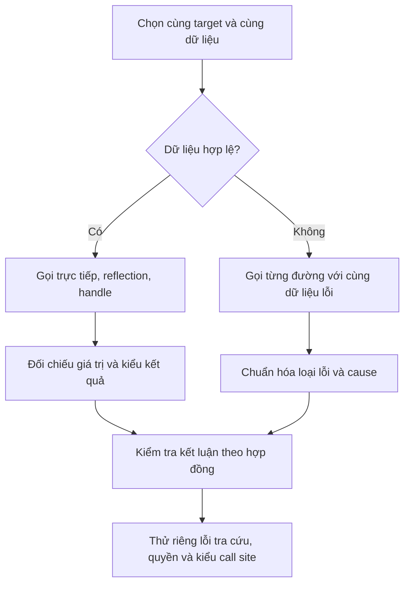

# Đối chiếu một thao tác qua lời gọi trực tiếp, Method.invoke() và MethodHandle bằng cùng dữ liệu

## 1. Mục tiêu của bài thực hành tổng hợp

Bài thuộc chương **Thực hành tổng hợp** trong mô-đun **JAVA_VERSION_JAVA18**. Mô-đun khảo sát những thay đổi của Java 18 còn hữu ích trên JDK hiện đại, gồm UTF-8 mặc định, simple web server, Javadoc snippet và việc kiểm chứng hợp đồng API trong phân giải tên, reflection, `MethodHandle`. Ở đây, chúng ta đặt **cùng một thao tác** sau ba cách gọi khác nhau rồi so sánh bằng chứng quan sát được.

Ba cách gọi:

1. **Trực tiếp:** gọi phương thức qua cú pháp Java thông thường, ví dụ `formatter.shorten(input, maxLength)`.
2. **Reflection:** tìm `java.lang.reflect.Method` và gọi `method.invoke(formatter, input, maxLength)`.
3. **MethodHandle:** tìm `java.lang.invoke.MethodHandle` qua `MethodHandles.Lookup` và gọi `handle.invokeExact(formatter, input, maxLength)` với kiểu call site chính xác.

Mục tiêu không phải chứng minh cách nào luôn nhanh hơn. Một phép đo ngắn chịu tác động của khởi tạo lớp, JIT, warm-up và môi trường chạy; bài này **đối chiếu hợp đồng** về kiểu, dữ liệu đầu vào, kết quả và ngoại lệ.

Sau bài này, bạn có thể:

- Thiết kế bộ dữ liệu chung và chuẩn hóa quan sát để so sánh ba con đường gọi.
- Giải thích vị trí receiver, kiểu tham số/kiểu trả về tại mỗi API.
- Kiểm chứng ba lời gọi cùng cho kết quả khi thực thi cùng phương thức với cùng đối số hợp lệ.
- Phân biệt ngoại lệ do thân phương thức ném với lỗi tìm thành viên, kiểm tra quyền, sai tham số hoặc sai kiểu call site.
- Diễn giải `InvocationTargetException` của reflection và ngoại lệ truyền thẳng qua `MethodHandle`.
- Tránh phụ thuộc vào API lỗi thời, mở truy cập private vô cớ hoặc suy diễn từ một lần chạy.

## 2. Xác định thao tác cần đối chiếu

Ta dùng một lớp `Formatter` chứa **một** phương thức public, không phụ thuộc mạng, thời gian hiện tại hay trạng thái dùng chung:

```java
public static final class Formatter {
    public String shorten(String raw, int maxLength) {
        if (raw == null) {
            throw new IllegalArgumentException("raw must not be null");
        }
        if (maxLength < 0) {
            throw new IllegalArgumentException("maxLength must be >= 0");
        }

        String normalized = raw.strip().toUpperCase(Locale.ROOT);
        return normalized.length() <= maxLength
                ? normalized
                : normalized.substring(0, maxLength);
    }
}
```

Đặc điểm của thao tác:

- `raw` là `String`; `maxLength` là kiểu primitive `int`; kiểu trả về là `String`.
- `strip()` loại bỏ khoảng trắng ở hai đầu theo quy tắc whitespace của Java. `Locale.ROOT` giữ phép chuyển chữ hoa độc lập với locale mặc định của máy.
- Với `"  java  "` và `3`, kết quả là `"JAV"`.
- Với `raw == null`, **chính phương thức đích** ném `IllegalArgumentException("raw must not be null")`.
- Với `maxLength < 0`, phương thức ném `IllegalArgumentException("maxLength must be >= 0")`.
- `substring(0, maxLength)` ở đây tính theo chỉ số UTF-16 của `String`. Bài thử dùng dữ liệu ASCII để kết quả minh bạch; nếu yêu cầu cắt theo code point hoặc grapheme cluster thì cần thiết kế thuật toán khác.

Để đối chiếu công bằng, giữ nguyên cùng một instance `Formatter`, cùng giá trị `raw` và `maxLength` cho cả ba phép gọi. Trong bài toán có trạng thái thay đổi, việc gọi lần lượt ba lần có thể tự làm thay đổi trạng thái; cần thiết kế phép thử độc lập hoặc reset fixture. Lớp mẫu ở đây có thao tác quyết định được, nên tránh vấn đề đó.

## 3. Ba mô hình gọi và cách khai báo chữ ký

### 3.1. Gọi trực tiếp

```java
Formatter formatter = new Formatter();
String input = "  java  ";
int maxLength = 3;

String direct = formatter.shorten(input, maxLength);
```

Trình biên dịch biết kiểu `Formatter`, chữ ký `shorten(String, int)` và kiểu `String` của kết quả. Nó kiểm tra kiểu tham số và chọn phương thức theo quy tắc Java tại thời điểm biên dịch.

### 3.2. Reflection bằng `Method.invoke`

```java
Method method = Formatter.class.getMethod(
        "shorten", String.class, int.class);

String reflected = (String) method.invoke(
        formatter, input, maxLength);
```

`getMethod` tìm một phương thức **public** với tên và **kiểu tham số chính xác**. Trường hợp này có `shorten(String, int)`; không thay `int.class` bằng `Integer.class` ở bước tra cứu. `Method.invoke` nhận receiver là đối số đầu của chính API reflection, tiếp theo là danh sách đối số dành cho target.

`Method.invoke` trả kiểu `Object` nên mã gọi cần ép về `String`. Giá trị primitive `maxLength` được Java đóng gói khi truyền vào `Object...`; reflection có thể unbox hợp lệ để gọi tham số `int` của target.

Nếu thân `shorten` ném ngoại lệ, reflection báo `InvocationTargetException` và cho phép truy xuất ngoại lệ gốc qua `getCause()`.

### 3.3. MethodHandle bằng `findVirtual` và `invokeExact`

```java
MethodHandle handle = MethodHandles.lookup().findVirtual(
        Formatter.class,
        "shorten",
        MethodType.methodType(
                String.class, String.class, int.class));

String viaHandle = (String) handle.invokeExact(
        formatter, input, maxLength);
```

Ở `findVirtual`, `MethodType.methodType(String.class, String.class, int.class)` mô tả **kiểu trả về và các tham số khai báo của target**, **không bao gồm receiver** trong danh sách truyền cho `findVirtual`.

Sau khi tạo, `handle.type()` lại **có receiver làm tham số đầu**:

```text
Method trong Formatter:  String shorten(String raw, int maxLength)

Truy vấn findVirtual:    (String, int)String
MethodHandle đã tạo:     (Formatter, String, int)String
Call site invokeExact:   (Formatter, String, int)String
```

Cú pháp `(String) handle.invokeExact(...)` ở phép gọi trên xác định kiểu kết quả tĩnh là `String`. Với `invokeExact`, **toàn bộ** descriptor tại call site phải khớp kiểu của handle, gồm receiver, tham số và kiểu trả về. Dù có quan hệ subtype hoặc boxing thuận tiện trong Java thông thường, `invokeExact` không tự điều chỉnh kiểu cho khớp.

Khi thân `shorten` tự ném `IllegalArgumentException`, lời gọi qua handle truyền ngoại lệ đó tới caller, **không mặc định bọc trong `InvocationTargetException`**.

## 4. Bảng so sánh hợp đồng

| Khía cạnh | Lời gọi trực tiếp | `Method.invoke` | `MethodHandle.invokeExact` |
| --- | --- | --- | --- |
| Cách xác định target | Biên dịch từ lời gọi nguồn | Tra cứu `Method` bằng tên + kiểu tham số | Tra cứu handle bằng `Lookup` + `MethodType` |
| Vị trí receiver | `formatter.shorten(...)` | Tham số đầu của `Method.invoke` | Tham số đầu trong kiểu handle lấy từ `findVirtual` |
| Kiểu kết quả tại API | `String` | `Object`, caller ép kiểu | Descriptor tại call site phải đúng `String` |
| Tham số `int` | Truyền `int` theo chữ ký Java | Qua `Object...`, boxing/unboxing phù hợp | Call site `invokeExact` cần đúng `int` |
| Đối số sai kiểu | Thường bị kiểm tra tại compile time | Có thể `IllegalArgumentException` trực tiếp từ reflection | Có thể `WrongMethodTypeException` ở `invokeExact` |
| Ngoại lệ từ thân target | Truyền trực tiếp | Bọc trong `InvocationTargetException` | Truyền trực tiếp |
| Điều kiện quyền | Quy tắc truy cập Java | Truy cập reflective tại thời điểm gọi | Quyền tra cứu khi tạo handle, rồi gọi theo handle |
| Phù hợp nhất với | Mã biết kiểu lúc biên dịch | Công cụ đọc/call metadata lúc runtime | Pipeline động có `MethodType` rõ và adapter khi cần |

**Giới hạn của bảng:** Nó mô tả cách gọi `invokeExact` đối với handle đã tạo bằng `findVirtual`. `MethodHandle.invoke` có quy tắc thích nghi kiểu rộng hơn; `MethodHandle.asType` tạo handle đã thích nghi. Không lấy kết quả `invoke` để khẳng định descriptor của `invokeExact` là hợp lệ.

## 5. Chương trình hoàn chỉnh: so sánh cả kết quả và ngoại lệ

Đoạn sau chỉ dùng API Java chuẩn vẫn được hỗ trợ trên JDK 18 trở lên. Nó kiểm tra **cùng một tập dữ liệu** ở ba đường gọi và chủ động phân biệt lỗi do target với lỗi do cách gọi.

Lưu thành `CompareInvocationPaths.java`:

```java
import java.lang.invoke.MethodHandle;
import java.lang.invoke.MethodHandles;
import java.lang.invoke.MethodType;
import java.lang.invoke.WrongMethodTypeException;
import java.lang.reflect.InvocationTargetException;
import java.lang.reflect.Method;
import java.util.Locale;

public class CompareInvocationPaths {
    public static final class Formatter {
        public String shorten(String raw, int maxLength) {
            if (raw == null) {
                throw new IllegalArgumentException("raw must not be null");
            }
            if (maxLength < 0) {
                throw new IllegalArgumentException("maxLength must be >= 0");
            }
            String normalized = raw.strip().toUpperCase(Locale.ROOT);
            return normalized.length() <= maxLength
                    ? normalized
                    : normalized.substring(0, maxLength);
        }
    }

    private static void require(boolean condition, String message) {
        if (!condition) {
            throw new AssertionError(message);
        }
    }

    public static void main(String[] args) throws Throwable {
        Formatter formatter = new Formatter();
        String input = "  java  ";
        int maxLength = 3;

        Method method = Formatter.class.getMethod(
                "shorten", String.class, int.class);

        MethodHandle handle = MethodHandles.lookup().findVirtual(
                Formatter.class,
                "shorten",
                MethodType.methodType(
                        String.class, String.class, int.class));

        require(handle.type().equals(
                MethodType.methodType(
                        String.class, Formatter.class,
                        String.class, int.class)),
                "Unexpected virtual MethodHandle type");

        // Cùng receiver, cùng dữ liệu hợp lệ, cùng target.
        String direct = formatter.shorten(input, maxLength);
        String reflected =
                (String) method.invoke(formatter, input, maxLength);
        String viaHandle =
                (String) handle.invokeExact(formatter, input, maxLength);

        require("JAV".equals(direct), "Unexpected reference result");
        require(direct.equals(reflected), "Reflection result mismatch");
        require(direct.equals(viaHandle), "MethodHandle result mismatch");

        System.out.println("direct=" + direct);
        System.out.println("reflection=" + reflected);
        System.out.println("handle=" + viaHandle);
        System.out.println("success=PASS");

        // Cùng dữ liệu lỗi: null được khai báo tĩnh là String.
        String invalidInput = null;

        try {
            formatter.shorten(invalidInput, maxLength);
            throw new AssertionError("Direct call should fail");
        } catch (IllegalArgumentException expected) {
            require("raw must not be null".equals(expected.getMessage()),
                    "Unexpected direct cause");
            System.out.println("direct-failure=IllegalArgumentException");
        }

        try {
            method.invoke(formatter, invalidInput, maxLength);
            throw new AssertionError("Reflection call should fail");
        } catch (InvocationTargetException wrapped) {
            Throwable original = wrapped.getCause();
            require(original instanceof IllegalArgumentException,
                    "Unexpected reflection cause type");
            require("raw must not be null".equals(original.getMessage()),
                    "Unexpected reflection cause message");
            System.out.println(
                    "reflection-failure=InvocationTargetException"
                    + " -> IllegalArgumentException");
        }

        try {
            String ignored =
                    (String) handle.invokeExact(
                            formatter, invalidInput, maxLength);
            throw new AssertionError("MethodHandle call should fail");
        } catch (IllegalArgumentException expected) {
            require("raw must not be null".equals(expected.getMessage()),
                    "Unexpected MethodHandle cause");
            System.out.println("handle-failure=IllegalArgumentException");
        }

        // Đây là phép thử lỗi KIỂU CALL SITE, không phải lỗi của target.
        // Tham số thứ hai là Object, trong khi handle đòi String.
        try {
            String ignored =
                    (String) handle.invokeExact(
                            formatter, (Object) input, maxLength);
            throw new AssertionError("Expected WrongMethodTypeException");
        } catch (WrongMethodTypeException expected) {
            System.out.println(
                    "handle-wrong-type=WrongMethodTypeException");
        }

        // Lỗi kiểu đối số của reflection xuất hiện trực tiếp, vì
        // target yêu cầu String nhưng bên gọi đưa Integer.
        try {
            method.invoke(formatter, Integer.valueOf(17), maxLength);
            throw new AssertionError("Expected argument type mismatch");
        } catch (IllegalArgumentException expected) {
            System.out.println(
                    "reflection-wrong-type=IllegalArgumentException");
        }

        System.out.println("PASS");
    }
}
```

Biên dịch và chạy:

```bash
javac CompareInvocationPaths.java
java CompareInvocationPaths
```

Đầu ra kỳ vọng:

```text
direct=JAV
reflection=JAV
handle=JAV
success=PASS
direct-failure=IllegalArgumentException
reflection-failure=InvocationTargetException -> IllegalArgumentException
handle-failure=IllegalArgumentException
handle-wrong-type=WrongMethodTypeException
reflection-wrong-type=IllegalArgumentException
PASS
```

Các phép kiểm tra `require` giúp bài thử phát hiện sai khác mà không cần bật từ khóa `assert` lúc chạy. Chương trình dùng dữ liệu cục bộ, không cần mạng, DNS, môi trường locale mặc định hay truy cập private member.

### Cách đọc hai phép thử sai kiểu

Phép thử:

```java
(String) handle.invokeExact(formatter, (Object) input, maxLength);
```

có đối số chứa **một `String` thật**, nhưng kiểu tĩnh của biểu thức lại là `Object`. `invokeExact` kiểm tra descriptor tại call site: `(Formatter, Object, int)String` không trùng `(Formatter, String, int)String`, do đó ném `WrongMethodTypeException`. Đây **không phải lỗi dữ liệu bên trong `shorten`**.

Còn:

```java
method.invoke(formatter, Integer.valueOf(17), maxLength);
```

truyền `Integer` vào vị trí `String`. Reflection phát hiện không thể chuyển đối số đó để gọi `shorten`, nên `IllegalArgumentException` phát sinh **trực tiếp** tại `Method.invoke`; không có `InvocationTargetException` vì thân phương thức chưa được chạy.

Hai phép thử được đặt sau phần đối chiếu “cùng dữ liệu” để không làm nhầm lỗi của con đường gọi với lỗi của target.

## 6. Cùng một ngoại lệ của target, ba đường biểu hiện

Tập dữ liệu lỗi `invalidInput = null` và `maxLength = 3` không bị thay đổi giữa các lời gọi. Vì target có kiểm tra `raw == null` ngay đầu, cả ba đường đều đi tới cùng nhánh:

```text
Cùng một đối tượng Formatter, input = null, maxLength = 3
                       |
       +---------------+----------------+
       |               |                |
  direct call      Method.invoke     MethodHandle.invokeExact
       |               |                |
  shorten()        shorten()          shorten()
       |               |                |
  throw IllegalArgumentException("raw must not be null")
       |               |                |
  IllegalArgumentException           IllegalArgumentException
                  |
            InvocationTargetException
            cause = IllegalArgumentException
```

Sơ đồ tập trung vào cách **bọc ngoại lệ** ở tầng caller:

- **Gọi trực tiếp:** ngoại lệ `IllegalArgumentException` của `shorten` truyền thẳng.
- **Method.invoke:** thân `shorten` ném `IllegalArgumentException`; reflection bọc trong `InvocationTargetException`. Đọc `getCause()` để xác nhận loại và thông điệp của lỗi gốc.
- **MethodHandle.invokeExact:** ngoại lệ của target truyền thẳng, tương tự về mặt bọc ngoại lệ như gọi trực tiếp.

Không kết luận rằng mọi lỗi từ `Method.invoke` đều bị bọc. Sai đối số có thể ném `IllegalArgumentException` trực tiếp, thiếu quyền có thể ném `IllegalAccessException`, và tra cứu bằng `getMethod` có thể ném `NoSuchMethodException` **trước khi gọi**. Tương tự, `findVirtual` có thể ném `NoSuchMethodException` hoặc `IllegalAccessException` trong giai đoạn tạo handle; `invokeExact` có thể ném `WrongMethodTypeException` vì descriptor không khớp.

### Chỉ so sánh cause khi thực sự có cause

Không nên viết một đoạn bắt `Exception` chung rồi in `getCause()` cho mọi đường gọi. Với `InvocationTargetException`, `getCause()` là cách chuẩn lấy nguyên nhân do target ném. Với ngoại lệ trực tiếp, chính đối tượng ngoại lệ là lỗi cần xử lý. Một `NullPointerException` do receiver null cũng phải phân biệt với `NullPointerException` do thân target ném, bằng cách quan sát ngữ cảnh và stack trace.

## 7. Những khác biệt về kiểu và quyền cần giữ khi mở rộng phép thử

### 7.1. Tra cứu chữ ký không áp dụng boxing tùy ý

```java
// Đúng: tham số thứ hai khai báo int.
Formatter.class.getMethod("shorten", String.class, int.class);

// Sai nếu không có thêm overload với Integer.
Formatter.class.getMethod("shorten", String.class, Integer.class);
```

Ở `findVirtual`, `MethodType` tương ứng cũng phải mô tả đúng `int.class`. Việc `Method.invoke` cho phép truyền một `Integer` được unbox để gọi `int` thuộc **giai đoạn thực thi**, không làm thay đổi quy tắc khớp chữ ký lúc tìm `Method`/`MethodHandle`.

### 7.2. Receiver nằm ở vị trí khác nhau

Với method instance:

```text
Trực tiếp:       formatter.shorten(input, maxLength)
Reflection:      method.invoke(formatter, input, maxLength)
MethodHandle:    handle.invokeExact(formatter, input, maxLength)
                               ^
                     tham số đầu là receiver
```

`Method.getParameterTypes()` trả `[String.class, int.class]`, vì receiver **không nằm trong danh sách tham số khai báo**. `handle.type().parameterArray()` của handle tạo từ `findVirtual` là `[Formatter.class, String.class, int.class]`, vì receiver là đối số đầu ở kiểu handle.

Nếu `formatter == null`, ba con đường có thể ném `NullPointerException` theo cơ chế của chúng, nhưng không được suy đoán đó là lỗi “tham số `raw` null”. Trường hợp receiver null và trường hợp target nhận đối số null là hai kịch bản độc lập; khi thử nghiệm, chỉ thay đổi **một điều kiện mỗi lần**.

### 7.3. Quyền truy cập khác biệt theo cơ chế

Lớp mẫu và method `shorten` đều `public` để phép thử tập trung vào kết quả và ngoại lệ. Nếu chuyển target sang `private`, cần kiểm chứng thêm:

- **Lời gọi trực tiếp:** trình biên dịch kiểm tra quy tắc truy cập Java đối với lớp gọi.
- **Reflection:** việc tìm metadata bằng `getDeclaredMethod` không đảm bảo `Method.invoke` được phép thực thi. `canAccess` và `trySetAccessible` chịu giới hạn của quyền và JPMS.
- **MethodHandle:** `MethodHandles.Lookup` dùng để `findVirtual` có quyền theo lớp tạo lookup và cấu hình module. Một handle đã tạo và chia sẻ có thể được gọi ở nơi khác theo năng lực của handle; caller bên ngoài không tự được trao cùng quyền tra cứu.

Việc dùng `setAccessible(true)` để ép kết quả so sánh khi quyền không rõ ràng sẽ làm thay đổi câu hỏi thí nghiệm. Để đối chiếu thuần túy cơ chế gọi, nên bắt đầu với method public có thể truy cập theo hợp đồng.

### 7.4. `invoke` và adapter không giống `invokeExact`

`MethodHandle.invoke` có thể thích nghi kiểu theo những chuyển đổi được `asType` hỗ trợ. Ví dụ nếu một biến mang kiểu tĩnh `Object` nhưng thực sự chứa `String`, `invoke` có thể cast thích hợp để gọi target. `invokeExact` lại yêu cầu kiểu call site trùng đúng kiểu của handle, kể cả kiểu kết quả.

Nếu muốn so sánh thêm `invoke`, hãy đưa nó thành một **cột phép thử riêng**, ghi rõ descriptor và chuyển đổi đã diễn ra; đừng âm thầm thay `invokeExact` bằng `invoke` rồi khẳng định mọi hành vi kiểu là tương đương.

### 7.5. Cẩn thận với phương thức có trạng thái và tác dụng phụ

Trong ví dụ, `shorten` là thao tác quyết định được với cùng tham số. Nếu target ghi cơ sở dữ liệu, tăng bộ đếm, sửa object, đọc cấu hình hay gọi mạng, ba lần gọi tuần tự sẽ có **ba tác dụng phụ**, không còn cùng trạng thái ban đầu. Muốn đối chiếu chính xác, hãy dùng fixture độc lập, transaction được kiểm soát hoặc fake dependency phù hợp; đồng thời ghi rõ điều gì được kiểm chứng ở mỗi đường gọi.

## 8. Thiết kế bảng bằng chứng cho dự án thật

Không nên chỉ so sánh ba chuỗi kết quả rồi kết luận tất cả hợp đồng giống nhau. Ghi cả **cách tra cứu, kiểu, ngoại lệ và dữ liệu**:

| Trường ghi nhận | Ví dụ cho bài này | Tác dụng |
| --- | --- | --- |
| Phiên bản JDK | `Runtime.version()` khi chạy | Cố định môi trường quan sát |
| Lớp và phương thức đích | `Formatter.shorten(String, int)` | Xác nhận cùng thao tác |
| Receiver | Cùng instance `formatter` | Tránh so sánh trên object khác |
| Dữ liệu hợp lệ | `"  java  "`, `3` | Đối chiếu kết quả `"JAV"` |
| Dữ liệu lỗi từ target | `null` kiểu `String`, `3` | Đối chiếu cùng nguyên nhân |
| Chữ ký reflection | `getMethod("shorten", String.class, int.class)` | Tách lỗi tra cứu |
| Kiểu handle | `(Formatter, String, int)String` | Kiểm tra descriptor `invokeExact` |
| Kết quả chuẩn hóa | `String` hoặc loại/cause ngoại lệ | So sánh ý nghĩa ở ba đường |
| Điều kiện quyền | `public`, chạy trên classpath | Không lẫn lỗi JPMS vào thử nghiệm cơ bản |

Sơ đồ chọn đường kiểm thử:



Việc “chuẩn hóa” ở đây chỉ nhằm đối chiếu **ý nghĩa lỗi từ target**; không xóa bỏ chi tiết rằng reflection đã bọc ngoại lệ. Báo cáo cần giữ đủ cả ngoại lệ ở caller lẫn nguyên nhân gốc.

## 9. Bài tập mở rộng có hướng dẫn

**Bài 1 — Hai bộ dữ liệu hợp lệ.** Chạy `shorten("  hello  ", 4)` và `shorten("java", 10)` theo cả ba đường. Kết quả lần lượt là `"HELL"` và `"JAVA"`. Hãy bảo đảm mỗi đường dùng cùng instance và cùng bộ tham số trước khi so sánh.

**Bài 2 — Ngoại lệ từ giới hạn âm.** Với `raw = "java"`, `maxLength = -1`, thân method ném `IllegalArgumentException("maxLength must be >= 0")`. So sánh đường trực tiếp, `Method.invoke` (nhận `InvocationTargetException`) và `invokeExact`. Mục tiêu là chứng minh **cùng nguyên nhân từ target**, dù biểu hiện ở caller khác nhau.

**Bài 3 — Boxing trong reflection.** Vì sao `Formatter.class.getMethod("shorten", String.class, Integer.class)` thất bại dù `method.invoke(formatter, "java", Integer.valueOf(3))` có thể chạy? Phân biệt giai đoạn tra cứu chính xác chữ ký và giai đoạn chuyển đổi đối số.

**Bài 4 — Sai kiểu `invokeExact`.** Thay `String input` bằng `Object input = "  java  "` và viết `(String) handle.invokeExact(formatter, input, maxLength)`. Dự đoán `WrongMethodTypeException` rồi giải thích vì sao giá trị runtime vẫn là `String` nhưng descriptor ở call site không trùng `(Formatter, String, int)String`.

**Bài 5 — Đối chiếu lỗi quyền.** Chuyển method đích thành private trong một cấu trúc module do bạn kiểm soát. Từ một class khác, thử lời gọi trực tiếp ở compile time, `getDeclaredMethod` + `canAccess`/`invoke` và `findVirtual` với lookup của caller. Ghi riêng lỗi tra cứu/quyền, không đưa chúng vào nhóm “ngoại lệ từ thân method”.

**Bài 6 — Đừng dùng một phép đo để xếp hạng tốc độ.** Nếu muốn nghiên cứu hiệu năng, đặt giả thuyết riêng, giữ cùng target/đầu vào, thiết kế warm-up, đo đủ mẫu trên JDK và môi trường cố định; công cụ benchmark như JMH phù hợp hơn một lần `System.nanoTime()`. Bài này chỉ kết luận về **đầu ra và hành vi ngoại lệ**.

## 10. Ghi nhớ

1. Một thao tác có thể được gọi trực tiếp, qua `Method.invoke` hoặc qua `MethodHandle`; muốn so sánh công bằng cần **cùng target, cùng receiver, cùng dữ liệu và cùng trạng thái ban đầu**.
2. Gọi trực tiếp kiểm tra chữ ký ở compile time; reflection tìm `Method` theo tên/kiểu tham số; `findVirtual` tạo handle có **receiver đứng đầu** trong `MethodHandle.type()`.
3. `Method.invoke` trả `Object` và thường cần ép kiểu kết quả; `invokeExact` yêu cầu **kiểu tĩnh tại call site khớp chính xác** cả tham số lẫn kiểu trả về.
4. Khi target ném ngoại lệ, lời gọi trực tiếp và `MethodHandle` truyền ngoại lệ gốc; reflection bọc nguyên nhân từ thân target trong `InvocationTargetException`.
5. Sai đối số ở `Method.invoke` có thể ném `IllegalArgumentException` trực tiếp; sai descriptor ở `invokeExact` có thể ném `WrongMethodTypeException`. Đây **không phải** là hai cách bọc cùng lỗi của target.
6. Quyền truy cập và cơ chế adapter là những trục kiểm thử khác. Chọn method public để đối chiếu nền tảng trước, rồi mở rộng có kiểm soát.
7. Những hợp đồng này vẫn áp dụng trên JDK hiện đại; kiểm chứng bằng điều quan sát được và tránh giả định mọi con đường gọi tự động có cùng cách chuyển đổi kiểu hoặc ngoại lệ.

Bài thực hành kết nối reflection và `MethodHandle` qua **một thao tác duy nhất** để người học thấy rõ điều gì giữ nguyên ở target và điều gì thay đổi ở **giao diện gọi**. Đây là nền tảng để kiểm chứng API động, đọc đúng stack trace và thiết kế thư viện Java bền vững.
