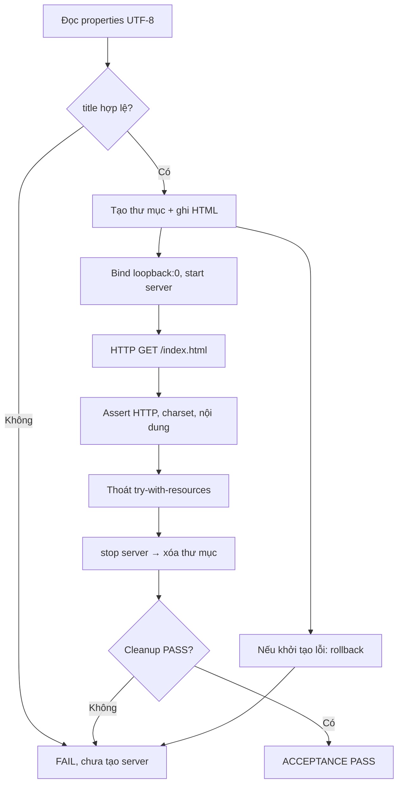

# Hoàn thiện ví dụ ứng dụng với cleanup xác định, tài liệu được kiểm thử và tiêu chí nghiệm thu có thể tái lập

## 1. Thế nào là một ví dụ Java có thể nghiệm thu?

Một ứng dụng nhỏ không được coi là hoàn chỉnh chỉ vì đã chạy thành công một lần trên máy tác giả. Người đọc tài liệu cần biết **cách chạy**, **điều gì được kiểm tra**, **tài nguyên nào cần giải phóng**, và **làm sao chạy lại mà không phụ thuộc cổng TCP hay thư mục tạm**.

Bài **Thực hành tổng hợp** thuộc mô-đun **JAVA_VERSION_JAVA18** kết hợp những kiến thức từ Java 18 vẫn hữu ích trên JDK hiện đại:

- **JEP 400 / UTF-8:** dùng `StandardCharsets.UTF_8` tường minh khi đọc properties và ghi HTML; nhớ rằng `Properties.load(InputStream)` vẫn áp dụng ISO-8859-1, còn `load(Reader)` dùng ký tự do Reader cung cấp.
- **JEP 408 / Simple Web Server:** dùng `SimpleFileServer` từ module `jdk.httpserver` để xem trước nội dung tĩnh ở loopback. API này chỉ dành cho kiểm thử, phát triển và gỡ lỗi, **không dùng cho production Internet server**.
- **JEP 413 / Javadoc snippet:** trích đoạn mã từ một file Java thật; biên dịch và chạy chính file ví dụ đó, sau đó sinh Javadoc có DocLint.
- **Hợp đồng API:** thiết kế rõ quyền sở hữu tài nguyên, ngoại lệ, cleanup, test và tiêu chí nghiệm thu. Khi mở rộng với Reflection hoặc MethodHandle cũng không được bỏ qua nghĩa vụ cleanup.

Sản phẩm bài này là một **phiên xem trước HTML tạm thời**. Ứng dụng đọc tiêu đề tiếng Việt từ file UTF-8, tạo một thư mục tạm và `index.html`, chạy HTTP server trên `127.0.0.1` với cổng động, kiểm tra nội dung rồi dừng server và xóa dữ liệu.

### Mục tiêu cụ thể

1. Source, external snippet và test đều biên dịch với release mục tiêu.
2. Smoke test gửi HTTP GET thật, nhận HTTP 200 và xác nhận văn bản tiếng Việt.
3. Server bị dừng và file tạm bị xóa sau khi dùng xong.
4. Cleanup vẫn chạy khi có exception giữa chừng.
5. Cấu hình không hợp lệ phải thất bại với thông báo rõ ràng.
6. Javadoc tạo thành công từ snippet được kiểm thử, không còn warning vi phạm chính sách build.
7. Chạy lại nhiều lần vẫn PASS dù số cổng và tên thư mục tạm thay đổi.

## 2. Tái lập theo hợp đồng, không theo giá trị ngẫu nhiên

| Yếu tố | Cách xử lý | Assertion đúng |
| --- | --- | --- |
| Cổng HTTP | Bind cổng `0` để OS chọn cổng trống | Cổng thực tế `> 0`, HTTP 200 |
| Thư mục tạm | `Files.createTempDirectory` | Tồn tại khi dùng; không còn sau cleanup |
| Kết quả HTML | Ghi UTF-8 và nội dung từ cấu hình | So sánh text/tag mong đợi |
| Kết nối mạng | Loopback, connect/read timeout | Không chờ vô hạn; lỗi có exit code |
| Build/Javadoc | Toolchain xác định, DocLint | Exit code 0, trang HTML có nội dung |
| Chạy nhiều lần | Test lại nhiều vòng | Cùng điều kiện PASS, không đòi trùng port |

“Tái lập” trong bài có nghĩa các **khẳng định ngữ nghĩa** được thỏa mãn mỗi lần chạy. Không nên so byte-for-byte mọi HTML do các phiên bản Javadoc khác nhau sinh ra hoặc đòi thư mục tạm có cùng tên.



## 3. Cấu trúc dự án

Tạo ví dụ độc lập, không cần Maven hoặc Gradle:

```text
preview-demo/
├── site.properties
└── src/
    ├── main/java/com/example/preview/
    │   ├── PreviewApp.java
    │   └── snippet-files/
    │       └── PreviewExample.java
    └── test/java/com/example/preview/
        └── PreviewAcceptance.java
```

Ba file Java cùng khai báo `package com.example.preview;`; file external snippet được đặt trong `snippet-files` để Javadoc nhận diện. Khi compile, ta liệt kê tường minh cả đường dẫn file snippet, vì công cụ không tự đảm bảo nó được kiểm tra kiểu chỉ bằng cách sinh Javadoc.

Điều kiện chạy: JDK hiện đại có module `jdk.httpserver` và các công cụ `javac`, `java`, `javadoc`; quyền tạo/xóa file tạm và kết nối loopback. Bài dùng `--release 18` để minh họa hợp đồng bytecode/API tối thiểu Java 18; JDK 18 không còn là LTS. Trong sản phẩm thật, chọn JDK LTS được hỗ trợ và đặt release theo support matrix của dự án.

File `site.properties`, lưu UTF-8:

```properties
title=Xin chào Java 18!
```

Không cần đổi tiếng Việt sang Unicode escapes ở đây: code dùng `Properties.load(Reader)` với Reader giải mã UTF-8. Điều đó không làm thay đổi hợp đồng ISO-8859-1 của overload `load(InputStream)`.

## 4. Code ứng dụng hoàn chỉnh: `PreviewApp.java`

File `src/main/java/com/example/preview/PreviewApp.java`:

```java
package com.example.preview;

import com.sun.net.httpserver.HttpServer;
import com.sun.net.httpserver.SimpleFileServer;
import java.io.IOException;
import java.io.Reader;
import java.io.Writer;
import java.net.InetSocketAddress;
import java.net.URI;
import java.nio.charset.StandardCharsets;
import java.nio.file.Files;
import java.nio.file.Path;
import java.util.Comparator;
import java.util.List;
import java.util.Objects;
import java.util.Properties;
import java.util.stream.Stream;

/**
 * Phiên xem trước trang HTML trên loopback.
 *
 * <p>Phiên sở hữu cả HTTP server và thư mục tạm; caller phải đóng phiên
 * sau khi sử dụng để giải phóng tài nguyên.</p>
 *
 * <p>Ví dụ sử dụng:</p>
 * {@snippet class=PreviewExample region=usage}
 *
 * @since 1.0
 */
public final class PreviewApp implements AutoCloseable {
    private final Path directory;
    private HttpServer server;
    private boolean closed;

    private PreviewApp(Path directory) {
        this.directory = directory;
    }

    /**
     * Đọc cấu hình UTF-8 và khởi động phiên xem trước HTML.
     *
     * @param config file properties chứa title
     * @return phiên xem trước đang hoạt động, phải được đóng
     * @throws IOException nếu đọc, ghi hoặc tạo tài nguyên thất bại
     * @throws NullPointerException nếu config là null
     * @throws IllegalArgumentException nếu thiếu title hoặc title rỗng
     */
    public static PreviewApp start(Path config) throws IOException {
        Objects.requireNonNull(config, "config");
        Properties props = new Properties();
        try (Reader reader = Files.newBufferedReader(
                config, StandardCharsets.UTF_8)) {
            props.load(reader);
        }

        String title = props.getProperty("title");
        if (title == null || title.isBlank()) {
            throw new IllegalArgumentException(
                    "title is required and must not be blank");
        }

        Path root = Files.createTempDirectory(
                "java18-preview-").toAbsolutePath();
        PreviewApp app = new PreviewApp(root);
        try {
            try (Writer writer = Files.newBufferedWriter(
                    root.resolve("index.html"), StandardCharsets.UTF_8)) {
                writer.write(renderHtml(title));
            }

            app.server = SimpleFileServer.createFileServer(
                    new InetSocketAddress("127.0.0.1", 0),
                    root,
                    SimpleFileServer.OutputLevel.NONE
            );
            app.server.start();
            return app;
        } catch (IOException | RuntimeException | Error failure) {
            // Factory chưa trả session: nó phải rollback phần đã tạo.
            try {
                app.close();
            } catch (IOException cleanupFailure) {
                failure.addSuppressed(cleanupFailure);
            }
            throw failure;
        }
    }

    /**
     * Lấy URI đến trang được phục vụ khi session còn mở.
     *
     * @return URI trên loopback với cổng do hệ điều hành cấp
     * @throws IllegalStateException nếu session đã đóng
     */
    public URI uri() {
        if (closed || server == null) {
            throw new IllegalStateException("Preview is closed");
        }
        return URI.create(
                "http://127.0.0.1:" + server.getAddress().getPort()
                        + "/index.html");
    }

    // Package-private: test cùng package dùng để xác nhận cleanup.
    Path temporaryDirectory() {
        return directory;
    }

    private static String renderHtml(String title) {
        return """
                <!doctype html>
                <html lang="vi">
                <head><meta charset="UTF-8"><title>Preview</title></head>
                <body><h1>%s</h1></body>
                </html>
                """.formatted(escapeHtml(title));
    }

    private static String escapeHtml(String value) {
        return value.replace("&", "&amp;")
                .replace("<", "&lt;")
                .replace(">", "&gt;");
    }

    /**
     * Dừng server và xóa toàn bộ dữ liệu tạm thuộc session.
     *
     * @throws IOException nếu không thể liệt kê hoặc xóa file tạm
     */
    @Override
    public void close() throws IOException {
        if (closed) {
            return;
        }
        closed = true;

        if (server != null) {
            server.stop(0);
        }

        // Đóng stream liệt kê TRƯỚC khi xóa file, tránh giữ
        // directory handle mở trên một số hệ điều hành.
        List<Path> paths;
        try (Stream<Path> stream = Files.walk(directory)) {
            paths = stream.sorted(Comparator.reverseOrder()).toList();
        }
        for (Path file : paths) {
            Files.deleteIfExists(file);
        }
    }
}
```

### 4.1. Những quyết định quan trọng

| Quyết định | Lý do |
| --- | --- |
| `load(Reader)` với UTF-8 | Giữ tiếng Việt và tránh nhầm với `load(InputStream)` |
| `Files.newBufferedWriter(..., UTF_8)` | Charset rõ ràng; đóng writer ngay sau khi ghi |
| `createTempDirectory` | Tránh trùng tên giữa các lần chạy hoặc các job CI |
| Root absolute path | `SimpleFileServer.createFileServer` yêu cầu directory tuyệt đối |
| `127.0.0.1` và port `0` | Không lộ server ra mạng ngoài, tránh xung đột port |
| `OutputLevel.NONE` | Không lẫn log request vào output cần kiểm tra |
| `AutoCloseable` | Caller quản lý vòng đời bằng `try-with-resources` |
| `stop(0)` trước khi xóa | Dừng server rồi mới xóa file mà nó đang phục vụ |
| `Files.walk` được đóng trước khi delete | Tránh giữ handle tới thư mục khi xóa |
| `addSuppressed` | Giữ lỗi khởi tạo ban đầu nếu cleanup cũng lỗi |

`SimpleFileServer.createFileServer` trả một `HttpServer` đã bind nhưng chưa chạy; `start()` phải được gọi tường minh. Root directory phải tồn tại, đọc được và là đường dẫn tuyệt đối. `HttpServer.stop(0)` đóng listener, ngừng nhận exchange mới và kết thúc server; một instance đã stop không thể start lại.

### 4.2. Giới hạn của cleanup

`close()` báo `IOException` khi xóa file thất bại; chương trình **không tự nhận đã dọn sạch** chỉ vì khối `finally` đã chạy. Trong đường đi lỗi, `try-with-resources` giữ nguyên exception chính và có thể gắn exception từ `close()` dưới dạng *suppressed*. Factory `start` cũng chủ động dọn tài nguyên đã khởi tạo dở, vì caller chưa sở hữu được một session để đóng.

`Files.walk` trả một `Stream` nắm giữ tài nguyên hệ thống file. Trong ví dụ, danh sách đường dẫn được thu thập trước, stream được đóng, rồi mới xóa file theo thứ tự ngược (con trước cha). Không bật `FOLLOW_LINKS` khi dọn thư mục không đáng tin cậy. Đoạn này dùng một thư mục tạm do chính ứng dụng tạo và chỉ chứa `index.html`.

`escapeHtml` bảo vệ **text content** được đưa vào thẻ `<h1>` bằng cách encode `&`, `<`, `>`. Đây không phải bộ encoder tổng quát cho HTML attributes, JavaScript hoặc URL; các ngữ cảnh đó cần quy tắc riêng. Không truyền secret hoặc dữ liệu nhạy cảm vào ứng dụng preview này.

## 5. File snippet có thể chạy: `PreviewExample.java`

File `src/main/java/com/example/preview/snippet-files/PreviewExample.java`:

```java
package com.example.preview;

import java.io.InputStream;
import java.net.HttpURLConnection;
import java.nio.charset.StandardCharsets;
import java.nio.file.Path;

public final class PreviewExample {
    private PreviewExample() {
    }

    public static void main(String[] args) throws Exception {
        // @start region=usage
        try (PreviewApp preview = PreviewApp.start(Path.of("site.properties"))) {
            HttpURLConnection connection = (HttpURLConnection)
                    preview.uri().toURL().openConnection();
            connection.setConnectTimeout(2_000);
            connection.setReadTimeout(2_000);
            try {
                if (connection.getResponseCode() != 200) {
                    throw new AssertionError("HTTP status is not 200");
                }
                try (InputStream response = connection.getInputStream()) {
                    String html = new String(
                            response.readAllBytes(), StandardCharsets.UTF_8);
                    if (!html.contains("Xin chào Java 18!")) {
                        throw new AssertionError("UTF-8 text was not served");
                    }
                }
                System.out.println("EXAMPLE PASS");
            } finally {
                connection.disconnect();
            }
        }
        // @end region=usage
    }
}
```

Output thành công:

```text
EXAMPLE PASS
```

Trình tự có chủ đích: HTTP GET xảy ra **trong** phạm vi `try (PreviewApp ...)`, khi server còn chạy. Không in một URL rồi đóng server ngay và bảo người học mở URL đó sau khi chương trình kết thúc. Sau khi `EXAMPLE PASS`, URL cũ không còn là endpoint đang phục vụ.

Các marker `@start region=usage` và `@end region=usage` xác định đoạn được trích bởi `{@snippet class=PreviewExample region=usage}`. File này là Java thật có method `main`, nên có thể được compile/run độc lập. Javadoc chỉ trích và định dạng snippet; nó **không tự biên dịch, thực thi** nội dung để kiểm chứng hành vi.

## 6. Bộ test nghiệm thu độc lập: `PreviewAcceptance.java`

Bộ test này chỉ dùng JDK, không cần tải JUnit. Trong dự án thực tế có thể chuyển cùng các assertion sang JUnit Jupiter. Điều quan trọng là test **thực sự gửi HTTP request**, **xác nhận cleanup** và trả exit code khác 0 khi thất bại.

File `src/test/java/com/example/preview/PreviewAcceptance.java`:

```java
package com.example.preview;

import java.io.IOException;
import java.io.InputStream;
import java.net.HttpURLConnection;
import java.net.URI;
import java.nio.charset.StandardCharsets;
import java.nio.file.Files;
import java.nio.file.Path;

public final class PreviewAcceptance {
    private PreviewAcceptance() {
    }

    private static void check(boolean pass, String message) {
        if (!pass) {
            throw new AssertionError(message);
        }
    }

    private static String fetchHtml(URI uri) throws IOException {
        HttpURLConnection connection = (HttpURLConnection)
                uri.toURL().openConnection();
        connection.setConnectTimeout(2_000);
        connection.setReadTimeout(2_000);
        try {
            int status = connection.getResponseCode();
            check(status == 200, "Expected HTTP 200, got " + status);
            try (InputStream stream = connection.getInputStream()) {
                return new String(
                        stream.readAllBytes(), StandardCharsets.UTF_8);
            }
        } finally {
            connection.disconnect();
        }
    }

    public static void main(String[] args) throws Exception {
        Path fixtures = Files.createTempDirectory("preview-fixtures-");
        Path config = fixtures.resolve("site.properties");
        Path invalid = fixtures.resolve("invalid.properties");
        Path unsafe = fixtures.resolve("unsafe.properties");

        try {
            Files.writeString(config,
                    "title=Xin chào Java 18!\n", StandardCharsets.UTF_8);

            Path root;
            try (PreviewApp preview = PreviewApp.start(config)) {
                root = preview.temporaryDirectory();
                URI address = preview.uri();
                check("127.0.0.1".equals(address.getHost()),
                        "Server must bind loopback");
                check(address.getPort() > 0, "Port must be assigned");
                check(Files.exists(root.resolve("index.html")),
                        "Missing generated index.html");

                String html = fetchHtml(address);
                check(html.contains("<meta charset=\"UTF-8\">"),
                        "UTF-8 declaration missing");
                check(html.contains("<h1>Xin chào Java 18!</h1>"),
                        "Vietnamese text is wrong");
            }
            check(!Files.exists(root), "Temp directory remains after close");

            // Thân try bị lỗi thì AutoCloseable vẫn phải chạy.
            Path interruptedRoot = null;
            try {
                try (PreviewApp preview = PreviewApp.start(config)) {
                    interruptedRoot = preview.temporaryDirectory();
                    throw new IllegalStateException("injected failure");
                }
            } catch (IllegalStateException expected) {
                check("injected failure".equals(expected.getMessage()),
                        "Unexpected exception");
            }
            check(interruptedRoot != null && !Files.exists(interruptedRoot),
                    "Temp directory remains after exception");

            // Cấu hình sai phải bị từ chối.
            Files.writeString(invalid,
                    "other=value\n", StandardCharsets.UTF_8);
            try {
                try (PreviewApp ignored = PreviewApp.start(invalid)) {
                    throw new AssertionError("Missing title accepted");
                }
            } catch (IllegalArgumentException expected) {
                // PASS: start() không tạo session từ cấu hình thiếu title.
            }

            // HTML phải escape đầu vào từ cấu hình.
            Files.writeString(unsafe,
                    "title=<script>alert(1)</script>\n",
                    StandardCharsets.UTF_8);
            try (PreviewApp preview = PreviewApp.start(unsafe)) {
                String html = fetchHtml(preview.uri());
                check(html.contains("&lt;script&gt;"),
                        "Expected escaped text");
                check(!html.contains("<script>"),
                        "Unexpected raw script element");
            }
        } finally {
            Files.deleteIfExists(config);
            Files.deleteIfExists(invalid);
            Files.deleteIfExists(unsafe);
            Files.deleteIfExists(fixtures);
        }

        System.out.println("ACCEPTANCE PASS");
    }
}
```

Output thành công:

```text
ACCEPTANCE PASS
```

Test dùng `AssertionError` thay cho keyword `assert` vì `assert` bị tắt theo mặc định nếu không bật `-ea`. Thất bại sẽ làm process thoát với mã lỗi; vì thế CI có thể phát hiện một cách đáng tin cậy.

### Phạm vi chứng minh

| Assertion | Điều được chứng minh |
| --- | --- |
| URI host là `127.0.0.1` và port `> 0` | Server bind loopback và OS cấp port |
| HTTP 200 và có text tiếng Việt | Server xử lý GET, file được phục vụ đúng encoding |
| `index.html` tồn tại trong phạm vi `try` | Output được tạo trước request |
| `!Files.exists(root)` sau `try` | Session dọn file khi hoàn tất thành công |
| Đường đi ném `injected failure` | `try-with-resources` gọi `close` ngay cả khi thân `try` lỗi |
| Cấu hình thiếu `title` | API từ chối trạng thái không hợp lệ |
| Input `<script>` được escape | Nội dung cấu hình không bị chèn thành HTML element |

Test này **không** chứng minh rằng SimpleFileServer an toàn cho production, không thay thế load test hoặc security review. Nó kiểm chứng chính hợp đồng nhỏ của ứng dụng trong môi trường CI cho phép loopback networking.

## 7. Biên dịch, chạy và kiểm tra Javadoc

Tất cả lệnh sau chạy từ thư mục `preview-demo/`. Module `jdk.httpserver` chứa SimpleFileServer; cấu hình `--add-modules jdk.httpserver` rõ ràng để tránh lệ thuộc root module resolution ngầm của từng cách khởi chạy.

### 7.1. Biên dịch source và file snippet

```bash
set -eu
mkdir -p build/classes build/test-classes build/docs

javac --release 18 --add-modules jdk.httpserver \
  -encoding UTF-8 -d build/classes \
  src/main/java/com/example/preview/PreviewApp.java \
  src/main/java/com/example/preview/snippet-files/PreviewExample.java
```

Nếu đổi tên `PreviewApp.start` trong ứng dụng nhưng quên sửa code snippet, bước compile phải báo lỗi. **Không** coi việc Javadoc hiển thị một đoạn code là bằng chứng đoạn code đó biên dịch được.

### 7.2. Chạy đúng ví dụ mà tài liệu hiển thị

```bash
java --add-modules jdk.httpserver \
  -cp build/classes com.example.preview.PreviewExample
```

Kết quả mong đợi: `EXAMPLE PASS` và exit code 0. Test nhận HTTP khi server còn chạy; không dựa vào sleep hay cổng cố định.

### 7.3. Biên dịch và chạy test nghiệm thu

```bash
javac --release 18 --add-modules jdk.httpserver \
  -encoding UTF-8 -cp build/classes -d build/test-classes \
  src/test/java/com/example/preview/PreviewAcceptance.java

java --add-modules jdk.httpserver \
  -cp build/classes:build/test-classes \
  com.example.preview.PreviewAcceptance
```

Trên Windows PowerShell, dấu phân cách classpath thường là `;`:

```powershell
java --add-modules jdk.httpserver -cp "build/classes;build/test-classes" com.example.preview.PreviewAcceptance
if ($LASTEXITCODE -ne 0) {
    throw "Acceptance tests failed"
}
```

### 7.4. Sinh Javadoc có DocLint

```bash
javadoc --release 18 --add-modules jdk.httpserver \
  -encoding UTF-8 -docencoding UTF-8 \
  -Xdoclint:all -Werror \
  --source-path src/main/java \
  -d build/docs \
  com.example.preview

test -s build/docs/com/example/preview/PreviewApp.html
```

Javadoc class `PreviewApp` phải trích được region `usage` từ file `snippet-files/PreviewExample.java`. Nếu marker `@end` bị sai hoặc file snippet bị thiếu, Javadoc cần báo chẩn đoán. `-Werror` biến warning theo chính sách công cụ thành lỗi build.

**Hai assertion khác nhau:** lệnh `javadoc` trả exit code thành công và file `PreviewApp.html` tồn tại, không rỗng. HTML có thể được ghi ra một phần trước khi Javadoc phát hiện lỗi; chỉ nhìn thấy thư mục docs chưa đủ để PASS.

## 8. Cleanup xác định qua từng đường đi

### 8.1. Đường đi thành công

```java
try (PreviewApp preview = PreviewApp.start(config)) {
    // Gửi request và dùng tài nguyên trong phạm vi này.
}
// Java gọi preview.close() khi ra khỏi phạm vi try.
```

### 8.2. Exception trong thân `try`

```java
try (PreviewApp preview = PreviewApp.start(config)) {
    throw new IllegalStateException("injected failure");
}
// Đặt đoạn này trong method có catch/throws phù hợp.
```

Thực tế, `PreviewAcceptance` dùng `catch` bên ngoài để xác nhận lỗi gốc và kiểm tra thư mục tạm không còn. Nếu `close` cũng ném lỗi, try-with-resources gắn lỗi `close` vào `getSuppressed()` của lỗi chính.

### 8.3. Khởi tạo lỗi trước khi trả session

Nếu đã tạo thư mục nhưng việc ghi file hoặc mở server thất bại, caller chưa nhận `PreviewApp` để đóng. Vì thế, factory `start` tự rollback trong `catch`, giữ nguyên lỗi gốc và gắn lỗi cleanup làm suppressed.

Không giả định `try (PreviewApp x = PreviewApp.start(...))` tự động dọn những tài nguyên mà factory mới tạo một phần trước khi ném exception. **Factory sở hữu trách nhiệm rollback tới khi trả object thành công.**

### 8.4. Exception trong HTTP client

`HttpURLConnection` không triển khai `AutoCloseable`. Đặt `InputStream` vào try-with-resources và gọi `connection.disconnect()` trong `finally` bảo đảm không bỏ quên kết nối khi đọc thất bại, status không phải 200 hoặc assertion về nội dung lỗi.

`connectTimeout` và `readTimeout` giúp công cụ không chờ vô hạn. Không dùng `Thread.sleep` theo thời lượng đoán trước để che giấu race condition.

### 8.5. Thứ tự cleanup

1. Đọc xong response, đóng `InputStream` và disconnect HTTP client.
2. Thoát khỏi `try-with-resources` của session.
3. `HttpServer.stop(0)` ngừng nhận connection mới, đóng socket và đợi background thread kết thúc theo hợp đồng API.
4. `Files.walk` liệt kê cây file; stream được đóng.
5. `Files.deleteIfExists` xóa file con trước, sau đó xóa thư mục cha.

`stop(0)` hợp lý cho bài kiểm thử nhỏ mà request đã kết thúc. Với service cần graceful drain, cần thiết kế thời hạn chờ và chính sách request riêng; không coi SimpleFileServer là một HTTP server production.

## 9. Ma trận nghiệm thu có thể tái lập

| ID | Điều kiện | Lệnh/bằng chứng | PASS khi |
| --- | --- | --- | --- |
| AC-01 | Source tương thích release mục tiêu | `javac --release 18` | Exit code 0 |
| AC-02 | Snippet đồng bộ API | Biên dịch `PreviewExample.java` | Exit code 0 |
| AC-03 | Snippet chạy thật | Chạy `PreviewExample` | `EXAMPLE PASS` |
| AC-04 | Không đụng cổng cố định | URI từ server | Loopback, port `> 0` |
| AC-05 | HTTP và Unicode đúng | `PreviewAcceptance` gửi GET | Status 200, tiêu đề tiếng Việt đúng |
| AC-06 | Cleanup sau thành công | Root sau khi `close` | Không còn thư mục |
| AC-07 | Cleanup sau exception | Intentional failure | Không còn thư mục |
| AC-08 | Kiểm tra cấu hình | Properties thiếu `title` | Bị từ chối |
| AC-09 | Escape HTML | Chuỗi `<script>` | Không xuất hiện raw tag |
| AC-10 | Javadoc hợp lệ | `javadoc -Xdoclint:all -Werror` | Exit code 0 |
| AC-11 | Có trang tài liệu | `PreviewApp.html` | Tồn tại, không rỗng |
| AC-12 | Chạy lại được | Lặp cả smoke/acceptance 3 lần | Mọi vòng PASS |

Một báo cáo nghiệm thu hữu ích:

```text
JDK: <version actually used>
compile main + snippet: PASS
example: EXAMPLE PASS
acceptance: ACCEPTANCE PASS
javadoc + doclint: PASS
PreviewApp.html: exists, nonempty
cleanup on success/failure: PASS
overall: PASS
```

Đây là **mẫu**, không phải kết quả đã thực thi. Chỉ ghi PASS từ log và exit code thực tế; kèm bản JDK, OS, commit và câu lệnh để người khác có thể đối chiếu.

## 10. Đưa quy trình vào CI

Ví dụ GitHub Actions sau chạy trên Linux với JDK 25, biên dịch source theo `--release 18` và kiểm tra đủ compile, ví dụ, acceptance, Javadoc. Workflow giả định ba source Java và `site.properties` đã được tạo tại root như phần 3.

```yaml
name: Java integrated practice

on:
  pull_request:
  push:
    branches: [main]

permissions:
  contents: read

jobs:
  verify:
    runs-on: ubuntu-latest
    steps:
      - name: Checkout
        uses: actions/checkout@v7

      - name: Set up JDK
        uses: actions/setup-java@v6
        with:
          distribution: temurin
          java-version: '25'

      - name: Tool versions
        run: |
          java -version
          javac -version
          javadoc --version

      - name: Compile app, snippet and test
        run: |
          set -eu
          mkdir -p build/classes build/test-classes build/docs
          javac --release 18 --add-modules jdk.httpserver \
            -encoding UTF-8 -d build/classes \
            src/main/java/com/example/preview/PreviewApp.java \
            src/main/java/com/example/preview/snippet-files/PreviewExample.java
          javac --release 18 --add-modules jdk.httpserver \
            -encoding UTF-8 -cp build/classes -d build/test-classes \
            src/test/java/com/example/preview/PreviewAcceptance.java

      - name: Smoke-test snippet
        run: |
          java --add-modules jdk.httpserver \
            -cp build/classes com.example.preview.PreviewExample

      - name: Acceptance tests
        run: |
          java --add-modules jdk.httpserver \
            -cp build/classes:build/test-classes \
            com.example.preview.PreviewAcceptance

      - name: Checked Javadoc
        run: |
          javadoc --release 18 --add-modules jdk.httpserver \
            -encoding UTF-8 -docencoding UTF-8 \
            -Xdoclint:all -Werror \
            --source-path src/main/java \
            -d build/docs com.example.preview
          test -s build/docs/com/example/preview/PreviewApp.html

      - name: Upload Javadoc for review
        if: always()
        uses: actions/upload-artifact@v4
        with:
          name: checked-javadoc
          path: build/docs/
          if-no-files-found: warn
```

Tránh `continue-on-error: true` cho các bước compile, smoke test, acceptance hoặc Javadoc. Bước upload artifact có thể chạy dù job thất bại để người review xem một phần output; artifact **không thay thế exit code** và không được biến build lỗi thành PASS.

Khai báo workflow chưa đủ để ngăn merge: repository cần bật branch protection/ruleset yêu cầu check này thành công. Nếu dự án nằm trong subdirectory, hãy đặt `working-directory` hoặc điều chỉnh đường dẫn; không copy workflow vào repository khác rồi giả định mọi path vẫn đúng.

Maven/Gradle cũng có thể chạy các lệnh tương đương, nhưng hãy bảo đảm external snippet thực sự nằm trong compile/test source hoặc được biên dịch riêng, đồng thời task/goal Javadoc **thực sự được gọi**. Không giả định `mvn verify` hoặc `gradle check` mặc nhiên tạo Javadoc.

## 11. Kiểm chứng tái lập và lỗi có chủ đích

### 11.1. Chạy lặp lại nhiều lần

Sau bước compile, dùng Bash:

```bash
set -eu
for round in 1 2 3; do
  java --add-modules jdk.httpserver \
    -cp build/classes com.example.preview.PreviewExample
  java --add-modules jdk.httpserver \
    -cp build/classes:build/test-classes \
    com.example.preview.PreviewAcceptance
done
```

Mỗi vòng phải có `EXAMPLE PASS` và `ACCEPTANCE PASS`. Cổng TCP và thư mục tạm của từng vòng có thể khác nhau; test phải dựa vào response và trạng thái tài nguyên, không hard-code đường dẫn/cổng.

### 11.2. Đừng để output từ build trước đánh lừa

Trong kiểm thử chính thức, bảo đảm thư mục `build` chỉ chứa class và Javadoc của commit hiện tại. Có thể xóa riêng `build` của **dự án ví dụ** sau khi kiểm tra working directory, hoặc dùng task `clean` của build tool. Không dùng một `PreviewApp.class` cũ để kết luận source mới đã biên dịch.

Nếu nâng JDK, chạy lại cả bộ acceptance. `--release 18` kiểm tra mức API và bytecode lúc compile, **không thay thế runtime test** trên các JDK/OS trong support matrix.

### 11.3. Fault injection để chứng minh test có giá trị

Mỗi lần chỉ gây ra **một** lỗi rồi hoàn tác:

| Thay đổi cố ý | Bước phải thất bại | Điều được chứng minh |
| --- | --- | --- |
| Đổi tên `PreviewApp.start` nhưng không sửa snippet | `javac` của `PreviewExample` | Code tài liệu được biên dịch |
| Đổi `@end region=usage` thành region khác | `javadoc` | Marker Javadoc được kiểm tra |
| Thay hằng `127.0.0.1` bằng host khác | Acceptance host assertion | Yêu cầu bind loopback có test |
| Đổi nội dung `<h1>` | HTTP content assertion | Không chỉ kiểm tra status |
| Bỏ `escapeHtml` | Assertion `<script>` | Input không thể chèn markup tùy ý |
| Bỏ vòng xóa file ở `close` | Cleanup assertion | Phát hiện thư mục tạm rò rỉ |
| Cố định cổng đã bị chiếm | Bind/start thất bại | Không phụ thuộc cổng tĩnh |
| Bỏ đoạn `try-with-resources` khi giữ session | Test đường đi lỗi cần được sửa để phát hiện leak | Cleanup không phải do garbage collector đảm bảo |

Ví dụ lỗi `BindException` không phải lý do để nuốt exception và báo PASS. Một build có cleanup không thành công hoặc server còn nghe sau khi hết test phải bị đánh dấu FAIL. Nếu CI runner cấm socket loopback, hãy ghi rõ **điều kiện môi trường chưa đáp ứng** và dùng runner thích hợp; không tắt assertion để hợp thức hóa kết quả.

### 11.4. Lỗi từ hệ thống file cần được báo rõ

Khi file bị process khác giữ, `Files.deleteIfExists` có thể ném `IOException`. Trong ví dụ, exception từ cleanup không bị nuốt. Với sản phẩm thật, có thể cần chính sách retry hữu hạn hoặc công cụ dọn rác riêng; nhưng trạng thái nghiệm thu vẫn phải phân biệt “đã dọn xong” và “đã thử dọn nhưng thất bại”.

## 12. Liên hệ với Reflection và MethodHandle

Nội dung mô-đun còn nhấn mạnh Reflection và MethodHandle. Một bài mở rộng cho thấy **cơ chế gọi động không thay đổi nghĩa vụ đóng tài nguyên**. Từ `MethodHandles.publicLookup()`, ta có thể tìm method factory `PreviewApp.start(Path)` đã công bố:

```java
import com.example.preview.PreviewApp;
import java.lang.invoke.MethodHandle;
import java.lang.invoke.MethodHandles;
import java.lang.invoke.MethodType;
import java.nio.file.Path;

public final class DynamicPreviewExample {
    public static void main(String[] args) throws Throwable {
        MethodHandle start = MethodHandles.publicLookup().findStatic(
                PreviewApp.class,
                "start",
                MethodType.methodType(PreviewApp.class, Path.class)
        );

        try (PreviewApp preview =
                (PreviewApp) start.invokeExact(Path.of("site.properties"))) {
            System.out.println("Port: " + preview.uri().getPort());
        }
    }
}
```

Đây là **bài mở rộng tùy chọn**, không thuộc ba source file bắt buộc đã liệt kê. Nếu muốn chạy, lưu thành file Java tương ứng, biên dịch với classpath chứa `PreviewApp` và thêm module `jdk.httpserver` theo cấu hình dự án.

`invokeExact` cần call-site signature gồm tham số `Path` và kiểu trả về `PreviewApp`. Phép cast ở biểu thức gọi giúp chọn đúng kiểu kết quả; nếu sai, `WrongMethodTypeException` có thể xảy ra trước khi target chạy. Khi target đã chạy, MethodHandle có thể truyền exception ra theo hợp đồng `throws Throwable`. Dù gọi trực tiếp hay qua handle, **caller vẫn phải đặt session trong `try-with-resources`**.

Không thêm Reflection/MethodHandle chỉ để làm một đoạn code trực tiếp trở nên phức tạp. Hãy dùng cơ chế gọi động khi có yêu cầu tích hợp thực sự và test riêng hợp đồng kiểu, quyền truy cập, exception của nó.

## 13. Những nhầm lẫn thường gặp

| Nhầm lẫn | Thực tế | Cách sửa |
| --- | --- | --- |
| “Javadoc tạo được nghĩa là snippet chạy được” | Standard Doclet trích code, không thực thi ví dụ | Biên dịch và smoke test file snippet |
| “JEP 400 làm mọi `.properties` thành UTF-8” | `load(InputStream)` vẫn ISO-8859-1 | Dùng `load(Reader)` với charset rõ ràng |
| “Cứ chọn port 8080 là đủ” | Job khác có thể chiếm port | Bind `127.0.0.1:0` và dùng cổng thực tế |
| “In URL là người đọc mở được mãi” | Server đóng khi kết thúc `try` | Gửi GET trong vòng đời session |
| “Không lỗi nghĩa là đã cleanup” | Xóa file có thể thất bại | Assert root không còn; đừng nuốt IOException |
| “`finally` ở caller dọn cả factory thất bại” | Caller chưa nhận object khi factory ném lỗi | Factory rollback tài nguyên tạo dở |
| “Dùng `Files.walk` không cần đóng” | Stream có thể giữ directory handle | Try-with-resources; đóng trước khi delete |
| “Đã bind loopback thì test không cần timeout” | HTTP vẫn có thể treo do lỗi môi trường | Đặt connect/read timeout |
| “Báo PASS nếu thấy HTML tồn tại” | Tool có thể xuất một phần file rồi báo lỗi | Kiểm tra exit code và artifact |
| “Có workflow là merge đã bị chặn” | Phụ thuộc branch protection/ruleset | Yêu cầu check thành công trong repository settings |

## 14. Checklist nộp bài

- [ ] File properties được lưu UTF-8 và đọc bằng `load(Reader)`.
- [ ] Writer, HTTP response stream và `Files.walk` stream đều được đóng.
- [ ] Server bind `127.0.0.1`, cổng `0`, không phục vụ Internet production.
- [ ] Factory rollback khi khởi tạo thất bại.
- [ ] `close()` dừng server trước khi dọn file và không che lỗi cleanup.
- [ ] External snippet là Java thật và được biên dịch cùng source chính.
- [ ] Smoke test chạy code snippet và xác nhận HTTP 200 cùng nội dung.
- [ ] Acceptance kiểm tra cleanup ở cả đường thành công và đường lỗi.
- [ ] Không chấp nhận raw HTML tag từ cấu hình.
- [ ] Javadoc chạy với DocLint/`-Werror` và trang API tồn tại.
- [ ] Kiểm thử lặp lại ít nhất ba vòng mà không phụ thuộc port/thư mục cố định.
- [ ] Log nghiệm thu có JDK, OS, source version, lệnh, exit code và kết quả.

## 15. Tài liệu tham khảo chính thức

- [JEP 400 — UTF-8 by Default](https://openjdk.org/jeps/400): thay đổi mặc định từ Java 18, không sửa hợp đồng overload `Properties.load(InputStream)`.
- [Properties — Java SE 25](https://docs.oracle.com/en/java/javase/25/docs/api/java.base/java/util/Properties.html): quy tắc `load(Reader)` và `load(InputStream)`.
- [JEP 408 — Simple Web Server](https://openjdk.org/jeps/408): động cơ và giới hạn mục đích của file server.
- [SimpleFileServer — Java SE 25](https://docs.oracle.com/en/java/javase/25/docs/api/jdk.httpserver/com/sun/net/httpserver/SimpleFileServer.html): `createFileServer`, thư mục absolute, `OutputLevel.NONE`.
- [HttpServer — Java SE 25](https://docs.oracle.com/en/java/javase/25/docs/api/jdk.httpserver/com/sun/net/httpserver/HttpServer.html): `start()`, `getAddress()`, `stop(delay)`.
- [Files — Java SE 25](https://docs.oracle.com/en/java/javase/25/docs/api/java.base/java/nio/file/Files.html): `newBufferedReader`, `newBufferedWriter`, `createTempDirectory`, `walk`.
- [JEP 413 — Code Snippets in Java API Documentation](https://openjdk.org/jeps/413): nền tảng snippet từ Java 18.
- [Javadoc Snippets Guide — JDK 25](https://docs.oracle.com/en/java/javase/25/javadoc/snippets.html): external snippet và named region.
- [The javadoc Command — JDK 25](https://docs.oracle.com/en/java/javase/25/docs/specs/man/javadoc.html): `--release`, encoding, DocLint và `-Werror`.
- [MethodHandle — Java SE 25](https://docs.oracle.com/en/java/javase/25/docs/api/java.base/java/lang/invoke/MethodHandle.html): kiểm chứng `invokeExact` ở bài mở rộng.
- [GitHub actions/checkout](https://github.com/actions/checkout): checkout source trong workflow, phiên bản v7.
- [GitHub actions/setup-java](https://github.com/actions/setup-java): cài JDK có kiểm soát, lựa chọn distribution Temurin.

**Ghi nhớ:** Một ví dụ được nghiệm thu phải có **mã biên dịch được, snippet đã chạy thật, assertion HTTP/Unicode cụ thể, cleanup sau cả thành công lẫn exception và Javadoc được kiểm tra bằng tool**. Dùng cổng/thư mục tạm động, charset rõ ràng, timeout hữu hạn và try-with-resources. Chỉ ghi PASS khi từng quality gate thực sự đạt.
