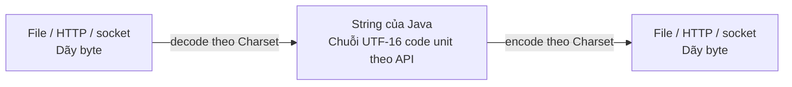
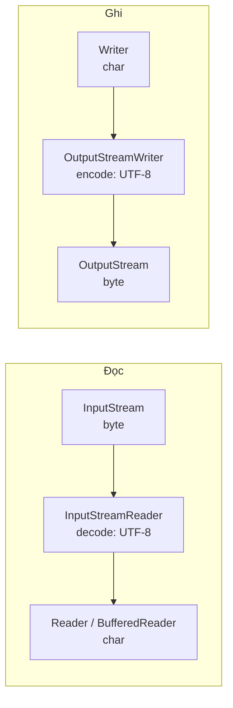

# Phân biệt biểu diễn của `String` trong Java với charset dùng tại ranh giới nhập xuất

## 1. Mục tiêu và vấn đề thực tế

Khi chương trình Java đọc một tệp CSV, nhận nội dung HTTP, ghi log hoặc trao đổi dữ liệu với dịch vụ khác, có hai câu hỏi hoàn toàn khác nhau:

1. **Văn bản đang được Java xử lý dưới dạng gì?** Trong chương trình, một `String` biểu diễn dãy đơn vị ký tự Unicode theo hợp đồng API của Java.
2. **Văn bản được biến thành byte theo quy tắc nào khi đi vào hoặc đi ra chương trình?** Tại ranh giới nhập xuất (I/O), `Charset` quyết định cách giải mã byte thành văn bản và mã hóa văn bản thành byte.

Java 18 đưa **UTF-8 thành charset mặc định** qua **JEP 400**, giúp giảm phụ thuộc vào hệ điều hành và locale. Tuy vậy, thay đổi này **không biến `String` thành “một mảng byte UTF-8”** và **không bảo đảm mọi byte nhận từ bên ngoài đều thực sự là UTF-8**.

Bài học thuộc chương **UTF-8 mặc định** của mô-đun `JAVA_VERSION_JAVA18`, tập trung vào những hợp đồng API vẫn còn hiệu lực trên JDK hiện đại. Sau bài này, bạn có thể xác định nơi cần nêu rõ charset, đọc được sơ đồ chuyển đổi byte–văn bản, và kiểm chứng các lỗi encoding trong chương trình thực tế.

## 2. Mô hình tư duy: văn bản trong ứng dụng và byte bên ngoài



- **Giải mã (decode):** `byte[]` → `String`. Phải biết encoding đã được bên gửi sử dụng.
- **Mã hóa (encode):** `String` → `byte[]`. Phải chọn encoding mà bên nhận mong đợi.
- **Charset:** bản đồ chuyển đổi qua lại giữa dãy byte và dãy ký tự. Các lựa chọn thường dùng: `StandardCharsets.UTF_8`, `StandardCharsets.ISO_8859_1`, `StandardCharsets.UTF_16LE`...
- **Hợp đồng dữ liệu:** quy định encoding của file, nội dung HTTP, hàng đợi thông điệp hoặc giao thức. Hợp đồng này quan trọng hơn default charset trên máy chạy.

Ví dụ với văn bản `"Cà 🙂"`:

| Góc nhìn | Kết quả | Ý nghĩa |
| --- | --- | --- |
| `String s = "Cà 🙂";` | Giá trị văn bản trong chương trình | Không gắn nhãn “UTF-8” hoặc “ISO-8859-1” lên đối tượng `String`. |
| `s.length()` | `5` | Số **UTF-16 code unit**: `C`, `à`, dấu cách và hai code unit của `🙂`. |
| `s.codePointCount(0, s.length())` | `4` | Số Unicode code point của chuỗi này. |
| `s.getBytes(UTF_8).length` | `8` | Số **byte UTF-8** khi xuất dữ liệu. |
| `s.getBytes(UTF_8)` dạng hex | `43 C3 A0 20 F0 9F 99 82` | Biểu diễn byte cụ thể khi dùng UTF-8. |

**Không suy luận số byte từ `String.length()`.** Số byte phụ thuộc charset. Trong UTF-8, ASCII thường chiếm một byte, chữ có dấu tiếng Việt thường cần nhiều hơn một byte, còn emoji như `🙂` cần bốn byte.

## 3. `String` có ngữ nghĩa UTF-16, nhưng là một đối tượng văn bản

### 3.1. Hợp đồng API phải hiểu đúng

`java.lang.String` là chuỗi ký tự **bất biến** (*immutable*). Theo Java API, `String` biểu diễn dữ liệu dưới dạng **dãy UTF-16 code unit**; ký tự Unicode nằm ngoài mặt phẳng cơ bản BMP được biểu diễn bằng một *surrogate pair*, nên chiếm hai vị trí `char`.

Điều này được thể hiện ở các phương thức:

- `length()` trả về số **UTF-16 code unit**, không phải byte hay số ký tự hiển thị trên màn hình.
- `charAt(index)` trả về một `char`, tức **một code unit 16 bit**.
- `substring(begin, end)` và nhiều chỉ số khác thao tác bằng vị trí code unit.
- `codePoints()` và `codePointAt(index)` hỗ trợ thao tác với Unicode code point.

```java
String text = "Cà 🙂";

System.out.println(text.length()); // 5 UTF-16 code unit
System.out.println(text.codePointCount(0, text.length())); // 4 code point

String emoji = "🙂";
System.out.println(emoji.length()); // 2
System.out.println(Character.isSurrogate(emoji.charAt(0))); // true
System.out.printf("U+%X%n", emoji.codePointAt(0)); // U+1F642
```

Ngữ nghĩa UTF-16 của `String` **không phải cam kết về cách JVM lưu đối tượng trong RAM**. Các JVM hiện đại có thể tối ưu biểu diễn nội bộ, chẳng hạn dùng *compact strings* với các dạng lưu trữ khác nhau. Đó là chi tiết cài đặt; chương trình không được phụ thuộc vào cấu trúc byte nội bộ hay cố dùng reflection để lấy byte bên trong `String` làm dữ liệu trao đổi.

### 3.2. `char` không đồng nghĩa với một ký tự nhìn thấy

`"🙂"` là một Unicode code point nhưng chiếm hai `char`. Chữ `"ắ"` dạng dựng sẵn có một code point, còn cùng chữ ở dạng `"a\u0306\u0301"` gồm ba code point. Một emoji ghép bằng ký tự nối ZWJ cũng có thể gồm nhiều code point nhưng thường được người dùng xem là một ký tự.

Những khác biệt này liên quan đến đếm ký tự, cắt chuỗi và chỉnh sửa văn bản. Chúng **không phải vấn đề charset**: dù chọn UTF-8 hay UTF-16LE để ghi file, quy tắc `String.length()` vẫn giữ nguyên.

### 3.3. `String` không nhớ byte đã dùng để tạo ra nó

Hai nguồn khác nhau có thể tạo cùng giá trị `String`:

```java
import java.nio.charset.StandardCharsets;

String a = new String(
        new byte[] {0x43, (byte) 0xC3, (byte) 0xA0},
        StandardCharsets.UTF_8); // "Cà"

String b = new String(
        new byte[] {0x43, (byte) 0xE0},
        StandardCharsets.ISO_8859_1); // "Cà"

System.out.println(a.equals(b)); // true
```

Sau khi giải mã thành công, cả hai đều là `"Cà"`. Đối tượng `String` không giữ thông tin “được đọc từ UTF-8” hay “được đọc từ ISO-8859-1”. Muốn ghi lại theo encoding nào, **phải chọn ở lần xuất dữ liệu**.

Ngược lại, hai byte sequence giống nhau có thể cho ra hai `String` khác nhau khi áp dụng hai charset khác nhau. Do vậy, **không thể đoán charset đúng chỉ từ nội dung byte trong mọi trường hợp**.

## 4. `Charset` tác động ở đâu?

`Charset` đại diện cho phép ánh xạ giữa **UTF-16 code unit** và **byte**. Java hỗ trợ các charset tiêu chuẩn thông qua lớp `java.nio.charset.StandardCharsets`.

| API | Hướng chuyển đổi | Charset được sử dụng |
| --- | --- | --- |
| `text.getBytes(StandardCharsets.UTF_8)` | `String` → `byte[]` | UTF-8 tường minh |
| `new String(bytes, StandardCharsets.UTF_8)` | `byte[]` → `String` | UTF-8 tường minh |
| `text.getBytes()` | `String` → `byte[]` | `Charset.defaultCharset()` |
| `new String(bytes)` | `byte[]` → `String` | `Charset.defaultCharset()` |
| `new InputStreamReader(input, UTF_8)` | Luồng byte → luồng ký tự | UTF-8 tường minh |
| `new OutputStreamWriter(output, UTF_8)` | Luồng ký tự → luồng byte | UTF-8 tường minh |
| `Files.readString(path, UTF_8)` | File byte → `String` | UTF-8 tường minh |
| `Files.writeString(path, text, UTF_8)` | `String` → file byte | UTF-8 tường minh |
| `Files.readString(path)`, `Files.writeString(path, text)` | Đọc/ghi file byte | **UTF-8 theo hợp đồng API**, không phụ thuộc default charset |
| `new FileReader(file)`, `new FileWriter(file)` | Luồng file byte ↔ ký tự | Default charset nếu dùng constructor không chỉ định charset |

**Khác biệt cần nhớ:** có API *dùng default charset*, có API *đã cố định UTF-8 từ trước*, và có API *đòi hỏi người gọi chỉ định charset*. Không nên coi mọi thao tác đọc/ghi chữ trong Java đều phụ thuộc JEP 400.

### 4.1. Mã hóa và giải mã phải khớp nhau

```java
import java.nio.charset.StandardCharsets;
import java.util.HexFormat;

String source = "Cà 🙂";
byte[] utf8 = source.getBytes(StandardCharsets.UTF_8);
String restored = new String(utf8, StandardCharsets.UTF_8);

System.out.println(HexFormat.of().withUpperCase().formatHex(utf8));
// 43C3A020F09F9982
System.out.println(source.equals(restored)); // true
```

Nếu hệ thống phát tạo byte bằng UTF-8, hệ thống nhận phải giải mã bằng UTF-8 theo hợp đồng của dữ liệu. Việc decode nhầm bằng một charset khác có thể dẫn đến ký tự sai hoặc mất dữ liệu. Trên đường ngược lại, gọi `getBytes(...)` sẽ tạo một **mảng byte mới**; nó không đổi nội dung của `source`.

### 4.2. Vì sao `new String(bytes)` là điểm cần chú ý?

`new String(bytes)` **không tự động phát hiện charset của byte**. Nó đơn giản áp dụng default charset của JVM. Nếu byte thực tế là ISO-8859-1, việc mặc định UTF-8 có thể làm sai dữ liệu:

```java
import java.nio.charset.StandardCharsets;

byte[] latin1 = {0x43, (byte) 0xE0}; // "Cà" theo ISO-8859-1

String correct = new String(latin1, StandardCharsets.ISO_8859_1);
String wrong = new String(latin1, StandardCharsets.UTF_8);

System.out.println(correct);              // Cà
System.out.println(correct.equals(wrong)); // false
```

Với UTF-8, byte `E0` đứng một mình không phải chuỗi UTF-8 hoàn chỉnh, nên constructor `String(byte[], Charset)` xử lý bằng cơ chế **thay thế dữ liệu giải mã lỗi**. Giá trị của `wrong` không còn là chuỗi gốc.

**Quy tắc thực hành:** charset phải do **định dạng file, cấu hình giao thức hoặc metadata đáng tin cậy** xác định; không chọn chỉ vì máy hiện tại đang dùng charset đó.

## 5. JEP 400 tác động lên default charset, không thay đổi `String`

**JEP 400: UTF-8 by Default** được triển khai từ **JDK 18** và còn áp dụng trên JDK hiện đại. Trong cấu hình khởi động thông thường, `Charset.defaultCharset()` trả về `UTF-8` nhất quán trên các hệ điều hành.

Trước JDK 18, default charset thường chịu ảnh hưởng của môi trường chạy. Vì vậy, những lời gọi như `String#getBytes()` và `new String(byte[])` có thể tạo kết quả khác nhau giữa máy phát triển và server. Từ JDK 18, chúng thường dùng UTF-8 nhờ default charset được chuẩn hóa.

Tuy nhiên, JEP 400 **không**:

- Thay đổi ý nghĩa của `String`, `char` hoặc `String.length()`.
- Tự động chuyển encoding của file cũ sang UTF-8.
- Khiến các chương trình bên ngoài Java tự hiểu UTF-8.
- Làm cho mọi API đều dùng default charset; những API cố định UTF-8 vẫn giữ hợp đồng riêng.
- Bảo đảm encoding terminal, `System.in`, `System.out` và `System.err` giống default charset của JVM.

### 5.1. Cấu hình khởi động hỗ trợ

Khi muốn kiểm tra tác động đến mã nguồn cũ, JDK 18+ hỗ trợ hai giá trị chính thức cho thuộc tính khởi động `file.encoding`:

```bash
java -Dfile.encoding=UTF-8 MyApplication
java -Dfile.encoding=COMPAT MyApplication
```

- `UTF-8`: default charset là UTF-8.
- `COMPAT`: chọn charset phụ thuộc môi trường theo cơ chế tương thích trước JDK 18, hữu ích khi điều tra ứng dụng vốn phụ thuộc encoding máy.

Các giá trị `file.encoding` khác **không thuộc cấu hình được hỗ trợ theo đặc tả JEP 400**. Việc gọi `System.setProperty("file.encoding", "...")` sau khi JVM đã chạy **không phải cách được hỗ trợ để đổi default charset** cho các API.

Có thể in giá trị trong quá trình kiểm tra:

```java
import java.nio.charset.Charset;

System.out.println(Charset.defaultCharset());
System.out.println(System.getProperty("file.encoding"));
System.out.println(System.getProperty("native.encoding"));
```

`native.encoding` là thông tin charset của môi trường gốc, có thể khác UTF-8. Không lấy nó làm chuẩn dữ liệu trao đổi giữa các hệ thống.

### 5.2. Các luồng chuẩn là ngoại lệ đáng chú ý

`System.in`, `System.out` và `System.err` thường liên quan đến encoding của console hoặc môi trường chạy. Chúng có thể dùng các thiết lập như `stdin.encoding`, `stdout.encoding`, `stderr.encoding` khác với `Charset.defaultCharset()`.

Ví dụ, `System.out.println("Cà 🙂")` nhận một `String` đúng nhưng terminal có thể hiển thị sai do charset hoặc font. Không nên dùng kết quả hiển thị console làm bằng chứng duy nhất về byte UTF-8 thực sự được ghi vào file hay gửi qua mạng.

Một điểm quan trọng hơn: gọi `new InputStreamReader(System.in, StandardCharsets.UTF_8)` **chỉ đúng** khi nguồn nhập thật sự gửi UTF-8. Đối với terminal có encoding khác, cần áp dụng encoding của nguồn, có thể dựa vào API console khi phù hợp với ứng dụng.

## 6. Ví dụ Java 18+: kiểm chứng từ `String` đến file và trở lại

Chương trình độc lập dưới đây kiểm tra ba lớp dữ liệu:

1. Giá trị `String` và số UTF-16 code unit.
2. Byte sau khi mã hóa UTF-8.
3. Byte trong file và nội dung sau khi giải mã UTF-8.

Lưu nguồn thành `StringCharsetBoundaryDemo.java` với UTF-8:

```java
import java.nio.charset.Charset;
import java.nio.charset.StandardCharsets;
import java.nio.file.Files;
import java.nio.file.Path;
import java.util.HexFormat;

public class StringCharsetBoundaryDemo {
    public static void main(String[] args) throws Exception {
        String message = "Cà 🙂";
        byte[] utf8 = message.getBytes(StandardCharsets.UTF_8);

        System.out.println("Default charset: " + Charset.defaultCharset());
        System.out.println("UTF-16 units: " + message.length());
        System.out.println("Unicode code points: "
                + message.codePointCount(0, message.length()));
        System.out.println("UTF-8 bytes: " + utf8.length);
        System.out.println("UTF-8 hex: "
                + HexFormat.of().withUpperCase().formatHex(utf8));

        Path file = Path.of("message-utf8.txt");
        Files.writeString(file, message, StandardCharsets.UTF_8);

        byte[] diskBytes = Files.readAllBytes(file);
        String readBack = Files.readString(file, StandardCharsets.UTF_8);

        System.out.println("File size: " + Files.size(file));
        System.out.println("Bytes preserved: "
                + java.util.Arrays.equals(utf8, diskBytes));
        System.out.println("Text preserved: " + message.equals(readBack));
    }
}
```

Biên dịch và chạy trên JDK 18+:

```bash
javac -encoding UTF-8 StringCharsetBoundaryDemo.java
java StringCharsetBoundaryDemo
```

Kết quả dự kiến với cấu hình default bình thường:

```text
Default charset: UTF-8
UTF-16 units: 5
Unicode code points: 4
UTF-8 bytes: 8
UTF-8 hex: 43C3A020F09F9982
File size: 8
Bytes preserved: true
Text preserved: true
```

File `message-utf8.txt` có tám byte và **không tự thêm ký tự xuống dòng**. Độ dài của `String` vẫn là năm UTF-16 code unit. Khi kiểm tra trên JDK với `-Dfile.encoding=COMPAT`, các thao tác file trong ví dụ vẫn dùng UTF-8 vì charset đã được truyền tường minh.

**Cẩn thận với hai phép kiểm tra:**

- `Bytes preserved` so sánh dãy byte đã mã hóa ban đầu với byte trong file. Điều này xác nhận thao tác I/O.
- `Text preserved` so sánh giá trị văn bản trước và sau giải mã. Đây là phép kiểm tra dữ liệu Unicode.

Hai phép kiểm tra trả lời hai câu hỏi khác nhau; cùng dùng khi cần xác minh một giao thức lưu trữ văn bản.

## 7. Đọc và ghi luồng đúng cách

Với dữ liệu lớn hoặc kết nối mạng, thường không muốn nạp toàn bộ file vào `byte[]`. Java cung cấp **reader/writer** là các cầu nối giữa byte và ký tự.



Ví dụ cụ thể:

```java
import java.io.BufferedReader;
import java.io.BufferedWriter;
import java.io.InputStreamReader;
import java.io.OutputStreamWriter;
import java.nio.charset.StandardCharsets;
import java.nio.file.Files;
import java.nio.file.Path;

Path source = Path.of("input-utf8.txt");
Path target = Path.of("output-utf8.txt");

try (var input = Files.newInputStream(source);
     var reader = new BufferedReader(
             new InputStreamReader(input, StandardCharsets.UTF_8));
     var output = Files.newOutputStream(target);
     var writer = new BufferedWriter(
             new OutputStreamWriter(output, StandardCharsets.UTF_8))) {

    String line;
    while ((line = reader.readLine()) != null) {
        writer.write(line);
        writer.newLine();
    }
}
```

`InputStreamReader` quyết định cách **byte đầu vào** thành `char`; `OutputStreamWriter` quyết định cách **`char` đầu ra** thành byte. Mẫu trên minh họa chuyển đổi dòng; nó **có thể chuẩn hóa ký tự xuống dòng** do `readLine()` loại dấu kết thúc dòng còn `newLine()` dùng dấu xuống dòng của hệ thống. Vì vậy, **đây không phải phép copy byte nguyên vẹn** và không phù hợp nếu yêu cầu giữ y hệt file gốc.

Khi chỉ cần thao tác file văn bản UTF-8, API gọn hơn thường là:

```java
try (var reader = Files.newBufferedReader(source, StandardCharsets.UTF_8);
     var writer = Files.newBufferedWriter(target, StandardCharsets.UTF_8)) {
    // Xử lý văn bản theo từng dòng hoặc từng khối nhỏ.
}
```

Với dữ liệu **nhị phân** như ảnh, ZIP hay PDF, hãy dùng `InputStream` / `OutputStream` hoặc `Files.copy` theo byte. Không đưa dữ liệu nhị phân qua `String` vì việc giải mã thành ký tự có thể làm mất thông tin.

## 8. Khi charset sai hoặc byte không hợp lệ

Có ít nhất ba nhóm lỗi cần phân biệt:

| Hiện tượng | Nguyên nhân điển hình | Cách xử lý |
| --- | --- | --- |
| `café` thay vì `café` | Byte UTF-8 được giải mã như ISO-8859-1 hoặc charset tương tự | Xác định charset **gốc** và giải mã lại từ byte nguyên vẹn |
| Ký tự thay thế `�` | Byte không hợp lệ đối với charset được dùng; phép decode cho phép thay thế | Đọc theo đúng charset hoặc dùng decoder có chính sách báo lỗi |
| `?` sau khi ghi | Charset đích không biểu diễn được ký tự; encoder đã thay thế | Dùng UTF-8 nếu giao thức hỗ trợ, hoặc cấu hình encoder báo lỗi |

### 8.1. Ví dụ giải mã nhầm charset vẫn cho kết quả trông có vẻ hợp lệ

```java
import java.nio.charset.StandardCharsets;

byte[] bytes = "café".getBytes(StandardCharsets.UTF_8);

System.out.println(new String(bytes, StandardCharsets.UTF_8));
// café

System.out.println(new String(bytes, StandardCharsets.ISO_8859_1));
// café
```

Ở ví dụ này, ISO-8859-1 ánh xạ được mọi byte sang code point, nên chương trình **không báo lỗi**. Dữ liệu vẫn sai về ngữ nghĩa. Đây là lý do kiểm tra “decode không ném exception” chưa đủ để chứng minh charset đúng.

### 8.2. Decoder nghiêm ngặt cho dữ liệu phải hợp lệ

Constructor `new String(bytes, Charset)` **thay thế** các byte bị lỗi giải mã bằng chuỗi thay thế mặc định của charset. Nếu hợp đồng dữ liệu bắt buộc UTF-8 hợp lệ, có thể dùng `CharsetDecoder` với `CodingErrorAction.REPORT` để phát hiện lỗi.

```java
import java.nio.ByteBuffer;
import java.nio.charset.CharacterCodingException;
import java.nio.charset.CodingErrorAction;
import java.nio.charset.StandardCharsets;

byte[] invalidUtf8 = {(byte) 0xC3, (byte) 0x28};

String withReplacement =
        new String(invalidUtf8, StandardCharsets.UTF_8);
System.out.println(withReplacement); // �(

var decoder = StandardCharsets.UTF_8.newDecoder()
        .onMalformedInput(CodingErrorAction.REPORT)
        .onUnmappableCharacter(CodingErrorAction.REPORT);

try {
    decoder.decode(ByteBuffer.wrap(invalidUtf8));
    throw new AssertionError("Phải phát hiện byte UTF-8 lỗi");
} catch (CharacterCodingException expected) {
    System.out.println("Đã phát hiện dữ liệu UTF-8 không hợp lệ");
}
```

Cặp byte `C3 28` không phải một chuỗi UTF-8 hợp lệ: `C3` khởi đầu một ký tự hai byte nhưng `28` không phải byte tiếp diễn. `CharsetDecoder` giúp **không âm thầm chấp nhận dữ liệu bị hỏng**.

Theo hợp đồng API, `Files.readString(path, UTF_8)` cũng có thể báo lỗi I/O khi gặp byte sai hoặc không thể ánh xạ. Chính sách báo lỗi và thay thế có thể khác nhau giữa từng API: phải kiểm tra hợp đồng overload đang dùng, không suy từ việc chúng đều có cùng charset.

### 8.3. Mã hóa sang charset không biểu diễn được ký tự

Ví dụ ISO-8859-1 không có emoji `🙂`. Nếu gọi:

```java
byte[] latin1 = "🙂".getBytes(StandardCharsets.ISO_8859_1);
```

`String#getBytes(Charset)` có cơ chế **thay thế các ký tự không mã hóa được** bằng byte thay thế của charset; byte được ghi không còn giữ nguyên emoji. Nếu không cho phép mất dữ liệu, dùng `CharsetEncoder` và `CodingErrorAction.REPORT` tương tự `CharsetDecoder` để phát hiện sớm.

Chú ý phân biệt: byte bị giải mã sai, byte bất hợp lệ và ký tự không biểu diễn được ở charset đích là ba tình huống khác nhau, dù bề ngoài đều dẫn đến “chữ lỗi”.

## 9. Ranh giới HTTP, JSON, cơ sở dữ liệu và file

Trong ứng dụng thực tế, **mỗi ranh giới có thể có hợp đồng encoding riêng**:

### 9.1. HTTP và payload JSON

Khi ứng dụng xây dựng payload JSON dưới dạng `String`, cần mã hóa thành byte theo quy định của giao thức và giao tiếp với bên nhận. Với JSON trao đổi ngoài hệ sinh thái đóng, UTF-8 là lựa chọn tiêu chuẩn và phù hợp với quy định IETF về JSON trên mạng.

Ví dụ tạo body UTF-8 bằng `java.net.http.HttpClient`:

```java
import java.net.http.HttpRequest;
import java.nio.charset.StandardCharsets;

String json = "{\"message\":\"Cà 🙂\"}";

HttpRequest.BodyPublisher body =
        HttpRequest.BodyPublishers.ofString(
                json, StandardCharsets.UTF_8);
// BodyPublisher chịu trách nhiệm biến String thành byte UTF-8.
```

Khi tự giải mã body trả về, phải dựa vào định dạng và metadata của response. Chỉ vì trong code có `String json` không có nghĩa byte HTTP tự động là UTF-8: chính **API tạo body và charset được chọn** mới quyết định điều đó.

### 9.2. File văn bản

Tệp chỉ chứa byte. Tên tệp đuôi `.txt`, `.csv` hoặc `.log` **không bảo đảm** encoding. Khi chương trình ghi file để trao đổi, cần công bố charset trong đặc tả và dùng API tường minh:

```java
Files.writeString(path, content, StandardCharsets.UTF_8);
String value = Files.readString(path, StandardCharsets.UTF_8);
```

Nếu nhập file do phần mềm cũ tạo bằng encoding khác, đọc đúng encoding nguồn trước khi viết lại UTF-8. Đổi JDK hoặc đổi default charset **không chuyển mã tự động** các file đang tồn tại.

### 9.3. Cơ sở dữ liệu và JDBC

Các API JDBC có thể đọc/ghi cột ký tự qua `String`, nhưng driver, giao thức kết nối và định nghĩa cột/quy tắc collation của DB quyết định cách chuyển đổi hoặc lưu trữ ở phía ngoài ứng dụng. **Không tự chuyển mọi `String` thành UTF-8 byte rồi gửi** nếu JDBC driver đã cung cấp `setString` / `getString` theo hợp đồng.

Ví dụ:

```java
// Trong phạm vi PreparedStatement và ResultSet đã có sẵn:
statement.setString(1, "Cà 🙂");
String text = resultSet.getString("note");
```

Nếu kết quả bị lỗi, cần xem cấu hình database, driver, loại cột, collation và dữ liệu gốc. `Charset.defaultCharset()` của JVM không phải lời giải mặc định cho mọi sự cố Unicode tại DB.

### 9.4. Binary payload, mã hóa Base64 và hàm băm

Base64 chỉ biến **byte thành chữ ASCII biểu diễn byte**; nó không xác định encoding của `String` gốc. Muốn hash một chuỗi theo giao thức, phải chỉ định byte nào được hash:

```java
import java.nio.charset.StandardCharsets;
import java.security.MessageDigest;

String token = "Cà 🙂";
byte[] payload = token.getBytes(StandardCharsets.UTF_8);
byte[] sha256 = MessageDigest.getInstance("SHA-256").digest(payload);
```

Nếu hai hệ thống hash cùng “chuỗi nhìn thấy” nhưng mã hóa ra byte khác nhau, hash có thể khác. Tương tự, Unicode normalization (NFC/NFD) là quy tắc về **dãy code point của văn bản** và không thể thay thế quy tắc charset tại I/O.

## 10. Chọn API phù hợp theo mục tiêu

| Mục tiêu | Cách làm khuyến nghị | Vì sao |
| --- | --- | --- |
| Ghi nội dung văn bản UTF-8 nhỏ | `Files.writeString(path, text, UTF_8)` | Rõ encoding và đơn giản |
| Đọc nội dung văn bản UTF-8 nhỏ | `Files.readString(path, UTF_8)` | Giải mã có hợp đồng UTF-8 |
| Xử lý văn bản UTF-8 lớn theo luồng | `Files.newBufferedReader(path, UTF_8)` / `newBufferedWriter` | Tránh giữ toàn bộ văn bản trong RAM |
| Chuyển payload văn bản thành byte | `text.getBytes(UTF_8)` | Kết quả được xác định chính xác |
| Tạo văn bản từ byte đã biết là UTF-8 | `new String(bytes, UTF_8)` | Không phụ thuộc môi trường |
| Bắt buộc từ chối byte UTF-8 sai | `UTF_8.newDecoder()` + `REPORT` | Phát hiện dữ liệu bị hỏng |
| Sao chép file nhị phân | `Files.copy(...)` hoặc byte stream | Không gây chuyển mã |
| Khảo sát rủi ro nâng cấp JDK 18+ | Kiểm tra `Charset.defaultCharset()` và thử `COMPAT` | Phát hiện các lời gọi phụ thuộc default charset |

Cách viết `UTF_8` trong bảng là `StandardCharsets.UTF_8` đã được import.

### Các lỗi thiết kế cần tránh

1. **Cho rằng `String` có “encoding UTF-8” ngay khi tạo:** `String` là giá trị văn bản; encoding thành byte diễn ra tại ranh giới.
2. **Dùng `new String(bytes)` để đoán encoding:** constructor chỉ dùng default charset.
3. **Dùng `String.length()` để giới hạn kích thước byte của HTTP body:** phải đo hoặc giới hạn byte theo charset đã chọn.
4. **Coi dữ liệu nhị phân là văn bản:** chuyển qua `String` có thể làm mất byte.
5. **Coi việc ghi thành công là bảo đảm không mất ký tự:** một số encoder có cơ chế thay thế khi gặp ký tự không biểu diễn được.
6. **Dùng `-Dfile.encoding=COMPAT` để né hợp đồng file rõ ràng:** giá trị này phục vụ chẩn đoán tương thích, còn ứng dụng nên nêu charset tại nơi I/O.

## 11. Bài tập tự kiểm tra

**Bài 1 — Hai lần mã hóa.** Hai biến `String` chứa cùng `"Cà"`. Một biến được tạo từ UTF-8, biến kia từ ISO-8859-1. Khi gọi `getBytes(StandardCharsets.UTF_8)` trên từng biến, kết quả có giống nhau không?

**Đáp án:** Có, nếu giá trị hai `String` thật sự bằng nhau. `getBytes(UTF_8)` mã hóa **giá trị văn bản hiện tại**; nó không biết hoặc phụ thuộc vào charset từng dùng để tạo đối tượng.

**Bài 2 — Số đơn vị.** `String value = "Cà 🙂";`. `value.length()` bằng bao nhiêu? `getBytes(UTF_8).length` bằng bao nhiêu?

**Đáp án:** `5` UTF-16 code unit và `8` byte UTF-8. Số code point là `4`. Không được dùng `length()` làm độ dài byte trong thông điệp mạng.

**Bài 3 — Đổi JDK.** Một dịch vụ nhận file cũ có byte `43 E0` (chuỗi `"Cà"` theo ISO-8859-1), nhưng gọi `new String(Files.readAllBytes(file))`. Trên JDK 18+ default UTF-8, điều gì có thể xảy ra?

**Đáp án:** File được giải mã theo UTF-8 mặc định; byte `E0` không hợp lệ khi đứng một mình nên chuỗi có thể bị thay thế ký tự và sai dữ liệu. Sửa bằng cách xác nhận charset nguồn và dùng `new String(bytes, StandardCharsets.ISO_8859_1)`, hoặc `Files.readString(file, StandardCharsets.ISO_8859_1)`.

**Bài 4 — Cắt dòng hay copy nguyên byte.** Có thể dùng `BufferedReader.readLine()` rồi `BufferedWriter.newLine()` để bảo đảm file đầu ra khớp byte hoàn toàn với file đầu vào không?

**Đáp án:** Không. Đọc theo dòng có thể loại dấu xuống dòng gốc và ghi lại theo ký tự xuống dòng của hệ thống; thêm nữa có bước decode/encode. Nếu yêu cầu copy đúng byte, dùng API byte-oriented như `Files.copy`.

**Bài 5 — Decoder.** Một API nhận JSON phải từ chối payload UTF-8 sai thay vì tự thay thế thành `�`. Nên dùng API nào khi tự quản lý việc decode byte?

**Đáp án:** `CharsetDecoder` với `CodingErrorAction.REPORT` cho malformed input và unmappable characters, bắt `CharacterCodingException` và trả thông báo lỗi phù hợp. Vẫn phải tuân thủ các quy tắc khác của định dạng JSON sau bước decode.

## 12. Ghi nhớ

**`String` là văn bản bên trong Java; `Charset` là quy tắc chuyển văn bản thành byte và chuyển byte thành văn bản.** Java 18 chuẩn hóa charset mặc định UTF-8 cho các API dựa vào default charset, qua đó giúp hành vi I/O nhất quán hơn. Trên JDK hiện đại, lựa chọn ổn định là **dùng `StandardCharsets.UTF_8` tường minh tại ranh giới** khi định dạng quy định UTF-8, kiểm tra dữ liệu đầu vào và dùng cơ chế báo lỗi khi không được phép mất thông tin.

Khi gặp chữ tiếng Việt hoặc emoji bị lỗi, hãy lần theo đường đi **byte nguồn → charset giải mã → `String` → charset mã hóa → byte đích**. Việc xác định đúng ranh giới sai thường có giá trị hơn nhiều so với thay đổi cấu hình toàn JVM.

### Tài liệu tham khảo chính thức

- [OpenJDK — JEP 400: UTF-8 by Default](https://openjdk.org/jeps/400).
- [Oracle Java SE 27 — `java.lang.String`](https://docs.oracle.com/en/java/javase/27/docs/api/java.base/java/lang/String.html).
- [Oracle Java SE 27 — `Charset`](https://docs.oracle.com/en/java/javase/27/docs/api/java.base/java/nio/charset/Charset.html).
- [Oracle Java SE 27 — `CharsetDecoder`](https://docs.oracle.com/en/java/javase/27/docs/api/java.base/java/nio/charset/CharsetDecoder.html).
- [Oracle Java SE 27 — `Files`](https://docs.oracle.com/en/java/javase/27/docs/api/java.base/java/nio/file/Files.html).
- [Oracle Java SE 27 — Migration Guide: Default Charset](https://docs.oracle.com/en/java/javase/27/migrate/migrating-from-jdk-8-later-jdk-releases.html).
