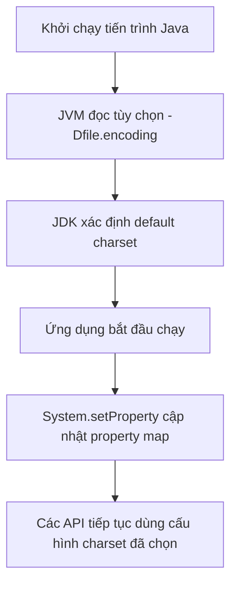

# Vì sao `System.setProperty` sau khi JVM khởi động không bảo đảm thay đổi charset mặc định

## 1. Một thay đổi property không đồng nghĩa đổi cấu hình đã khởi tạo

Trong Java, `System.setProperty(name, value)` thay đổi giá trị của một system property trong đối tượng `Properties` mà tiến trình truy cập qua `System.getProperties()`. Thao tác này hữu ích cho những property được ứng dụng đọc động, nhưng **không có nghĩa mọi thành phần của JVM sẽ tự cấu hình lại theo giá trị mới**.

Điều này đặc biệt quan trọng với `file.encoding`. Từ JDK 18, theo **JEP 400**, default charset được xác định trong quá trình khởi động JVM. Tài liệu Java quy định việc gọi `System.setProperty("file.encoding", ...)` sau khi JVM chạy **không phải cách được hỗ trợ để thay đổi default charset**.

Ví dụ, đoạn mã sau có thể thay đổi chuỗi được trả về bởi `System.getProperty("file.encoding")`:

```java
System.setProperty("file.encoding", "ISO-8859-1");
System.out.println(System.getProperty("file.encoding"));
```

Nhưng điều đó không bảo đảm `Charset.defaultCharset()` chuyển sang ISO-8859-1, cũng không làm các reader, writer hay luồng chuẩn đã tạo trước đó đổi charset. Property map và lựa chọn cấu hình của JVM là hai việc khác nhau.

**Nguyên tắc:** cấu hình default charset bằng tùy chọn JVM khi khởi động; chọn charset của từng file hoặc giao thức bằng đối số `Charset` ở API nhập xuất.

## 2. `file.encoding` được xử lý trong giai đoạn khởi động

Từ JDK 18, UTF-8 là default charset thông thường trên các hệ điều hành. JEP 400 chuẩn hóa lựa chọn này để các API phụ thuộc default charset có hành vi nhất quán hơn.

Hai giá trị được hỗ trợ khi đặt `file.encoding` lúc khởi động trên JDK 18+ là:

- `UTF-8`: chọn UTF-8 làm default charset.
- `COMPAT`: chọn default charset theo cách JDK 17 và các bản trước đó đã xác định từ môi trường.

Ví dụ, tùy chọn JVM phải đứng trước tên lớp chính hoặc `-jar`:

```bash
java -Dfile.encoding=UTF-8 -jar app.jar
java -Dfile.encoding=COMPAT -jar app.jar
```

Các giá trị khác không được hỗ trợ theo đặc tả. Không dùng `-Dfile.encoding=windows-1258` như một cách portable để ép default charset của JDK 18+ sang Windows-1258.

Việc gọi `System.setProperty` sau khi chương trình đã chạy khác với việc truyền `-Dfile.encoding=...` trong lệnh khởi động. Lệnh `-D` cung cấp giá trị trong giai đoạn khởi tạo JVM; `System.setProperty` chỉ cập nhật property map sau đó.

### 2.1. Sơ đồ vòng đời cấu hình



Sơ đồ cho thấy `System.setProperty` xảy ra sau giai đoạn xác định default charset. Nó không phát tín hiệu để JVM khởi tạo lại charset hay dựng lại các luồng I/O.

## 3. Vì sao `Charset.defaultCharset()` không đổi theo property mới?

`Charset.defaultCharset()` là API chuẩn để lấy default charset của JVM. JDK xác định lựa chọn này trong quá trình khởi động và implementation có thể lưu/cache đối tượng charset để tái sử dụng.

Nếu ứng dụng gọi `System.setProperty("file.encoding", "ISO-8859-1")` sau khi default charset đã được xác định, việc đọc lại property có thể cho thấy giá trị mới, trong khi `Charset.defaultCharset()` vẫn phản ánh charset đã chọn lúc khởi động.

Ví dụ minh họa:

```java
import java.nio.charset.Charset;

public class RuntimePropertyChange {
    public static void main(String[] args) {
        // Lấy charset mà JVM đã chọn.
        Charset selectedAtStartup = Charset.defaultCharset();

        String before = System.getProperty("file.encoding");
        System.out.println("Before property = " + before);
        System.out.println("Default before = "
                + selectedAtStartup.name());

        // Chỉ thay đổi giá trị trong System properties.
        System.setProperty("file.encoding", "ISO-8859-1");

        System.out.println("After property = "
                + System.getProperty("file.encoding"));
        System.out.println("Default after = "
                + Charset.defaultCharset().name());
    }
}
```

Khi chạy trên JDK 18+ với cấu hình mặc định thông thường, có thể quan sát dạng kết quả:

```text
Before property = UTF-8
Default before = UTF-8
After property = ISO-8859-1
Default after = UTF-8
```

Kết quả trên minh họa sự khác biệt giữa property map và default charset đã được chọn. Không lấy việc property in ra giá trị mới làm bằng chứng rằng charset thực tế đã đổi.

**Lưu ý:** đây là ví dụ chẩn đoán, không phải cách cấu hình encoding. Giá trị ISO-8859-1 trong ví dụ được đặt sau khi khởi động; nó không phải giá trị `file.encoding` được JDK 18+ hỗ trợ khi cấu hình JVM lúc khởi động.

## 4. Các API đã khởi tạo không tự thay đổi charset

Ngay cả khi một API tạo đối tượng sau thời điểm gọi `System.setProperty`, không nên dựa vào property mới để thay đổi default charset. Default charset của JVM đã được xác định; các API phụ thuộc default charset dùng lựa chọn đó.

Với đối tượng đã được tạo trước khi property thay đổi, charset còn gắn với đối tượng đó. Ví dụ:

- `InputStreamReader` và `OutputStreamWriter` đã chọn charset khi constructor chạy.
- `FileReader` và `FileWriter` đã chọn charset cho thao tác file khi được tạo.
- `PrintStream` đã được tạo với charset của nó; riêng `System.out` và `System.err` có cấu hình standard stream riêng.
- `Scanner` đọc từ luồng byte có thể đã chọn charset ở constructor.
- Các mảng `byte[]` đã được mã hóa không tự chuyển đổi khi property đổi.

Ví dụ:

```java
import java.io.OutputStreamWriter;
import java.io.Writer;
import java.nio.charset.Charset;

Writer writer = new OutputStreamWriter(System.out);
Charset defaultBefore = Charset.defaultCharset();

System.setProperty("file.encoding", "ISO-8859-1");

// Writer đã tạo vẫn dùng charset đã chọn ở constructor.
System.out.println("Default: " + Charset.defaultCharset().name());
writer.write("Tiếng Việt");
writer.flush();
```

Trong ví dụ, `writer` đã được tạo trước thay đổi property. Nó không được dựng lại và không có API để đổi charset của đối tượng writer đang tồn tại. Muốn ghi theo charset khác, tạo writer mới với charset được chỉ định rõ.

Không nên cố tạo lại hoặc thay thế `System.out` chỉ để điều khiển default charset. Standard streams có encoding riêng, được JVM thiết lập theo môi trường console.

## 5. Phân biệt các loại cấu hình liên quan đến encoding

| Thành phần | Vai trò | Có đổi bằng `System.setProperty("file.encoding", ...)` sau khởi động không? |
| --- | --- | --- |
| `System.getProperty("file.encoding")` | Giá trị property đang lưu | Có thể thay đổi nội dung property map |
| `Charset.defaultCharset()` | Default charset đã được JVM chọn | Không có bảo đảm đổi; JEP 400 quy định xác định khi khởi động |
| `native.encoding` | Thông tin encoding môi trường gốc do JDK phát hiện | Không; thay đổi property map không đổi encoding hệ điều hành |
| `stdin.encoding` | Charset của standard input | Không tự cấu hình lại qua `file.encoding` |
| `stdout.encoding` | Charset của standard output | Không tự cấu hình lại qua `file.encoding` |
| `stderr.encoding` | Charset của standard error | Không tự cấu hình lại qua `file.encoding` |
| `StandardCharsets.UTF_8` | Đối tượng charset UTF-8 cố định | Không liên quan đến default charset |
| Charset của `Reader`/`Writer` đã tạo | Charset gắn với đối tượng chuyển đổi | Không đổi sau khi đối tượng đã được tạo |

`native.encoding` cung cấp thông tin về encoding của môi trường gốc. Gán `System.setProperty("native.encoding", "UTF-8")` cũng không biến môi trường Windows code page hoặc terminal thành UTF-8.

### 5.1. Luồng chuẩn có quy tắc riêng

`System.in` là byte stream đầu vào; `System.out` và `System.err` là các `PrintStream`. Charset của chúng có thể được thiết lập riêng bằng `stdin.encoding`, `stdout.encoding` và `stderr.encoding`.

Từ Java 18, có thể kiểm tra charset của `PrintStream` bằng `charset()`:

```java
System.out.println("Default = "
        + java.nio.charset.Charset.defaultCharset().name());
System.out.println("stdout = " + System.out.charset().name());
System.err.println("stderr = " + System.err.charset().name());
```

Nếu console hiển thị sai tiếng Việt, cần kiểm tra charset của luồng chuẩn và terminal. Thay đổi `file.encoding` trong property map không phải cách cấu hình lại encoding console.

## 6. Những API nào chịu ảnh hưởng của default charset?

Một số API sử dụng default charset khi không truyền charset:

- `String.getBytes()`.
- `new String(byte[])`.
- `new InputStreamReader(inputStream)`.
- `new OutputStreamWriter(outputStream)`.
- `new FileReader(file)` và `new FileWriter(file)`.
- Một số constructor của `Scanner`, `Formatter` và `PrintStream` nhận nguồn/đích byte mà không chỉ định charset.

Trên JDK 18+ mặc định, các API đó dùng UTF-8. Nếu chạy với `-Dfile.encoding=COMPAT`, default charset có thể theo môi trường cũ.

Một số API có encoding cố định hoặc nhận charset riêng:

| API | Hành vi |
| --- | --- |
| `Files.readString(path)` | UTF-8 theo hợp đồng API |
| `Files.writeString(path, text)` | UTF-8 theo hợp đồng API |
| `Files.newBufferedReader(path)` | UTF-8 theo hợp đồng API |
| `Properties.load(InputStream)` | ISO-8859-1 theo hợp đồng API |
| `new String(bytes, StandardCharsets.UTF_8)` | Luôn giải mã bằng UTF-8 |
| `text.getBytes(StandardCharsets.UTF_8)` | Luôn mã hóa bằng UTF-8 |

Vì vậy, dù thay đổi được property map, các API dùng charset cố định hoặc charset tường minh vẫn giữ hành vi của chúng.

## 7. Cách đúng để cấu hình charset

### 7.1. Nếu muốn chọn default charset cho cả tiến trình

Đặt tùy chọn JVM trước khi ứng dụng chạy:

```bash
java -Dfile.encoding=UTF-8 -jar app.jar
```

Hoặc dùng chế độ tương thích khi đang điều tra ứng dụng cũ:

```bash
java -Dfile.encoding=COMPAT -jar app.jar
```

Nếu chạy trong service, container hoặc công cụ build, hãy đặt JVM option trong cấu hình khởi chạy tương ứng. Đảm bảo tùy chọn thuộc về tiến trình Java cần cấu hình, không chỉ là tham số được truyền vào `main(String[] args)`.

### 7.2. Nếu chỉ một file hoặc giao thức cần charset riêng

Không thay đổi default charset toàn JVM. Chọn charset trực tiếp ở API:

```java
import java.nio.charset.StandardCharsets;
import java.nio.file.Files;
import java.nio.file.Path;

Path utf8File = Path.of("message.txt");
String text = Files.readString(utf8File, StandardCharsets.UTF_8);

Path legacyFile = Path.of("legacy.txt");
String legacy = Files.readString(
        legacyFile, StandardCharsets.ISO_8859_1);
```

Ví dụ này cho phép một ứng dụng vừa đọc file UTF-8 vừa đọc file legacy ISO-8859-1 mà không phải thay đổi cấu hình JVM.

### 7.3. Với luồng byte

Khi tự chuyển đổi byte và ký tự, truyền charset vào reader/writer:

```java
import java.io.InputStreamReader;
import java.io.OutputStreamWriter;
import java.nio.charset.StandardCharsets;

var reader = new InputStreamReader(
        inputStream, StandardCharsets.UTF_8);

var writer = new OutputStreamWriter(
        outputStream, StandardCharsets.UTF_8);
```

Charset của từng đối tượng được xác định ngay khi tạo. Đây là cách kiểm soát chính xác encoding của kết nối, file hoặc giao thức.

## 8. Thử nghiệm so sánh property map và default charset

Chương trình sau thực hiện ba bước:

1. Lấy default charset ban đầu.
2. Thay đổi giá trị `file.encoding` trong property map.
3. Kiểm tra lại default charset và chuyển đổi văn bản.

```java
import java.nio.charset.Charset;
import java.nio.charset.StandardCharsets;
import java.util.Arrays;

public class DefaultCharsetIsStartupChoice {
    public static void main(String[] args) {
        Charset startupChoice = Charset.defaultCharset();

        String message = "Tiếng Việt";
        byte[] before = message.getBytes();

        System.setProperty("file.encoding", "ISO-8859-1");

        byte[] after = message.getBytes();
        byte[] explicitUtf8 =
                message.getBytes(StandardCharsets.UTF_8);

        System.out.println("property = "
                + System.getProperty("file.encoding"));
        System.out.println("startup choice = "
                + startupChoice.name());
        System.out.println("current default = "
                + Charset.defaultCharset().name());
        System.out.println("implicit bytes unchanged = "
                + Arrays.equals(before, after));
        System.out.println("implicit equals explicit UTF-8 = "
                + Arrays.equals(after, explicitUtf8));
    }
}
```

Biên dịch và chạy trên JDK 18+:

```bash
javac -encoding UTF-8 DefaultCharsetIsStartupChoice.java
java DefaultCharsetIsStartupChoice
```

Với JVM được khởi chạy mặc định bằng UTF-8, kết quả minh họa:

```text
property = ISO-8859-1
startup choice = UTF-8
current default = UTF-8
implicit bytes unchanged = true
implicit equals explicit UTF-8 = true
```

Kết quả chứng minh property map đã thay đổi, còn lựa chọn default charset của tiến trình vẫn là UTF-8. Nếu khởi chạy JVM với `COMPAT` trên môi trường có encoding khác UTF-8, giá trị default ban đầu và byte tạo ra sẽ khác; việc đặt lại property sau đó vẫn không phải cách chuyển chế độ.

## 9. Những lỗi thiết kế cần tránh

1. **Dùng `System.setProperty("file.encoding", ...)` trong `main()` để cấu hình encoding.** Thao tác này chỉ thay property map, không cấu hình lại default charset đã xác định.
2. **Đọc `System.getProperty("file.encoding")` rồi tin rằng đó là charset thực tế sau khi property bị sửa.** Hãy dùng `Charset.defaultCharset()` để kiểm tra default charset.
3. **Cho rằng các reader/writer đang tồn tại tự thay đổi charset.** Charset được chọn khi tạo đối tượng.
4. **Thay đổi `native.encoding` bằng system property.** Điều này không đổi encoding môi trường gốc.
5. **Dùng default charset cho file có định dạng riêng.** Hãy truyền charset theo hợp đồng file.
6. **Dùng `COMPAT` như cách né lỗi lâu dài.** Chỉ dùng để điều tra và hỗ trợ chuyển đổi; sau đó làm rõ charset ở ranh giới I/O.
7. **Nhầm charset của console với `file.encoding`.** Kiểm tra các standard stream riêng khi lỗi chỉ xuất hiện trên terminal.

## 10. Quy trình chẩn đoán khi thấy chữ bị lỗi

Khi ứng dụng hiển thị tiếng Việt sai sau khi gọi `System.setProperty` hoặc sau khi nâng cấp JDK:

1. Ghi nhận `Charset.defaultCharset()` trước và sau thay đổi property.
2. Ghi nhận `System.getProperty("file.encoding")` để biết property map hiện tại.
3. Kiểm tra JVM option khởi động, đặc biệt `-Dfile.encoding=UTF-8` hoặc `-Dfile.encoding=COMPAT`.
4. Xác định charset thật sự của file hoặc giao thức.
5. Kiểm tra các đối tượng `Reader`, `Writer`, `Scanner` đã được tạo trước khi property thay đổi.
6. Kiểm tra `stdin.encoding`, `stdout.encoding` và `stderr.encoding` nếu vấn đề liên quan console.
7. Sửa tại điểm I/O bằng `StandardCharsets.UTF_8` hoặc charset nguồn/đích được hợp đồng quy định.
8. Kiểm tra byte đầu ra và nội dung sau khi giải mã.

## 11. Bài tập tự kiểm tra

**Bài 1.** Vì sao `System.getProperty("file.encoding")` có thể trả về `ISO-8859-1` trong khi `Charset.defaultCharset()` vẫn trả về UTF-8?

*Đáp án:* `System.setProperty` đã thay đổi giá trị trong property map, nhưng default charset của JVM được xác định khi khởi động và không được cấu hình lại bằng thao tác này.

**Bài 2.** Có thể gọi `System.setProperty("file.encoding", "COMPAT")` để chuyển tiến trình đang chạy sang chế độ tương thích không?

*Đáp án:* Không. `COMPAT` phải được truyền như `-Dfile.encoding=COMPAT` lúc khởi động JDK 18+. Thay đổi property sau khi chạy không kích hoạt lại cơ chế chọn charset.

**Bài 3.** Một `OutputStreamWriter` được tạo trước khi property đổi có dùng charset mới không?

*Đáp án:* Không. Writer đã chọn charset khi constructor chạy; cần tạo writer mới với charset tường minh nếu muốn một encoding khác.

**Bài 4.** Nếu chỉ cần đọc một file Windows-1258 trong ứng dụng có default UTF-8, có nên đổi `file.encoding` không?

*Đáp án:* Không. Dùng `Files.readString(path, Charset.forName("windows-1258"))` hoặc reader có charset tương ứng cho riêng file đó.

**Bài 5.** Nếu console hiển thị sai tiếng Việt nhưng `Charset.defaultCharset()` là UTF-8, cần kiểm tra điều gì?

*Đáp án:* Kiểm tra charset riêng của standard streams (`stdin.encoding`, `stdout.encoding`, `stderr.encoding`) và cấu hình terminal/font. Default charset của JVM không bảo đảm charset console giống nó.

## 12. Ghi nhớ

`System.setProperty` thay đổi system property trong tiến trình; nó không phải API để khởi tạo lại default charset. Theo JEP 400, default charset được xác định lúc JVM khởi động. Vì vậy, thay đổi `file.encoding` sau khi chạy không bảo đảm `Charset.defaultCharset()`, các API phụ thuộc default charset hoặc các stream đã tạo chuyển sang encoding mới.

Muốn chọn default charset cho tiến trình, đặt `-Dfile.encoding=UTF-8` hoặc `-Dfile.encoding=COMPAT` trước lớp chính hoặc `-jar`. Muốn kiểm soát một file, socket hay giao thức, truyền `StandardCharsets.UTF_8` hoặc charset được hợp đồng quy định vào API nhập xuất. Đây là cách làm có thể dự đoán và còn áp dụng trên các JDK hiện đại.

### Tài liệu tham khảo chính thức

- [OpenJDK — JEP 400: UTF-8 by Default](https://openjdk.org/jeps/400).
- [Oracle Java SE 27 — Charset.defaultCharset()](https://docs.oracle.com/en/java/javase/27/docs/api/java.base/java/nio/charset/Charset.html).
- [Oracle Java SE 27 — System: setProperty and standard system properties](https://docs.oracle.com/en/java/javase/27/docs/api/java.base/java/lang/System.html).
- [Oracle Java SE 27 — Migration Guide: Be Aware of the Default Charset](https://docs.oracle.com/en/java/javase/27/migrate/migrating-from-jdk-8-later-jdk-releases.html).
- [Oracle Java SE 27 — Supported Encodings and Default Charset](https://docs.oracle.com/en/java/javase/27/intl/supported-encodings.html).
