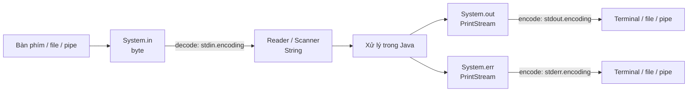

# Phân biệt charset của `System.in`, `System.out`, `System.err` và charset mặc định khi làm việc với terminal

## 1. Vì sao cần phân biệt các charset này?

Một chương trình Java có thể chạy trong terminal tương tác, IDE, test runner, CI, container, service nền hoặc một pipeline có chuyển hướng đầu vào/đầu ra. Trong những môi trường đó, byte đi vào và đi ra tiến trình có thể được diễn giải theo các charset khác nhau.

Từ **JDK 18**, theo **JEP 400**, UTF-8 là default charset thông thường của các Java SE API phụ thuộc charset mặc định. Tuy nhiên, ba luồng chuẩn `System.in`, `System.out` và `System.err` **không dùng `Charset.defaultCharset()`**. Chúng có encoding riêng:

- `stdin.encoding` cho `System.in`.
- `stdout.encoding` cho `System.out`.
- `stderr.encoding` cho `System.err`.

Các giá trị này được JDK thiết lập theo nền tảng và môi trường người dùng; chúng có thể khác `file.encoding`, `native.encoding` và `Charset.defaultCharset()`.

Bài học thuộc chương **UTF-8 mặc định** của `JAVA_VERSION_JAVA18`. Mục tiêu là hiểu chính xác byte được chuyển thành ký tự ở đầu vào như thế nào, ký tự được mã hóa thành byte ở đầu ra ra sao, và làm thế nào để chương trình hoạt động đúng cả khi có lẫn không có terminal.

## 2. Bốn khái niệm cần tách biệt

### 2.1. Default charset của JVM

`Charset.defaultCharset()` trả về charset mặc định mà JVM chọn. Trong cấu hình thông thường của JDK 18 trở lên, kết quả là UTF-8.

Nhiều API sử dụng charset này nếu người gọi không truyền charset, ví dụ:

- `new String(bytes)`.
- `text.getBytes()`.
- `new InputStreamReader(inputStream)`.
- `new OutputStreamWriter(outputStream)`.
- Một số constructor của `FileReader`, `FileWriter`, `Scanner`, `Formatter` và `PrintStream`.

Default charset này phục vụ các API byte–ký tự thông thường. Nó không tự quyết định encoding của các luồng chuẩn.

### 2.2. Charset của standard streams

| Luồng | Kiểu dữ liệu API | Thuộc tính encoding |
| --- | --- | --- |
| `System.in` | `InputStream` — byte đầu vào | `stdin.encoding` |
| `System.out` | `PrintStream` — ký tự được mã hóa thành byte đầu ra | `stdout.encoding` |
| `System.err` | `PrintStream` — ký tự được mã hóa thành byte lỗi đầu ra | `stderr.encoding` |

`System.in` là luồng byte. Nó không có phương thức `charset()` và không tự biến byte thành `String`. Ứng dụng phải bọc nó bằng `InputStreamReader`, `Scanner` hoặc một API đọc ký tự khác và chọn đúng charset.

`System.out` và `System.err` là `PrintStream`. Chúng nhận chuỗi/ký tự và tự mã hóa ra byte bằng charset gắn với từng stream. Từ Java 18, có thể gọi `PrintStream.charset()` để xem charset của một đối tượng `PrintStream`.

### 2.3. Charset của console

Nếu JVM có console tương tác, `System.console()` trả về đối tượng `Console`. Đọc và ghi qua `Console` sử dụng hai encoding tương ứng:

- Đọc: `stdin.encoding`.
- Ghi: `stdout.encoding`.

`Console.charset()` trả về charset dùng cho thao tác ghi của console. Phương thức này có từ **JDK 17**; nó vẫn có sẵn trên Java 18 và các JDK hiện đại.

### 2.4. Sơ đồ luồng dữ liệu



Sơ đồ nhấn mạnh rằng charset được chọn ở ranh giới byte–ký tự. Bên trong ứng dụng, dữ liệu đã trở thành chuỗi Java; khi xuất qua stream, nó lại được mã hóa thành byte theo charset của đích.

## 3. JEP 400 không đổi charset của standard streams

JEP 400 chuẩn hóa default charset của các API phụ thuộc default charset thành UTF-8 từ JDK 18. Nhưng tài liệu Java quy định rõ standard streams không dùng default charset.

Ví dụ, trên một môi trường có thể quan sát:

```text
Charset.defaultCharset() = UTF-8
stdin.encoding           = windows-1258
stdout.encoding          = windows-1258
stderr.encoding          = windows-1258
```

Các giá trị trên chỉ là ví dụ minh họa; thực tế phụ thuộc nền tảng, terminal và cách khởi chạy tiến trình. Điều quan trọng là default charset UTF-8 không kéo theo việc ba luồng chuẩn cũng tự động dùng UTF-8.

Điều này giải thích vì sao:

- `new String(bytes)` có thể giải mã bằng UTF-8.
- `new InputStreamReader(System.in)` cũng dùng default charset nếu không truyền charset, nhưng có thể **khác** encoding thực tế của standard input.
- `System.out.println(text)` dùng charset của `System.out`, không mặc nhiên dùng `Charset.defaultCharset()`.
- `System.err.println(text)` dùng charset của `System.err`, có thể khác cả stdout lẫn default charset.

**Đừng dùng việc chữ hiển thị đúng trên terminal làm bằng chứng rằng mọi file hoặc payload của ứng dụng đều UTF-8.** Mỗi ranh giới dữ liệu cần tuân theo hợp đồng encoding riêng.

## 4. Kiểm tra charset của các luồng chuẩn

### 4.1. Đọc system properties

Có thể kiểm tra default charset và ba thuộc tính của standard streams:

```java
import java.nio.charset.Charset;

public class StandardStreamCharsets {
    public static void main(String[] args) {
        System.out.println("default = "
                + Charset.defaultCharset().name());

        System.out.println("stdin.encoding = "
                + System.getProperty("stdin.encoding"));
        System.out.println("stdout.encoding = "
                + System.getProperty("stdout.encoding"));
        System.out.println("stderr.encoding = "
                + System.getProperty("stderr.encoding"));
    }
}
```

Các property standard stream được JDK thiết lập theo nền tảng và môi trường người dùng. Không ghi cứng một giá trị như Windows-1258 hoặc UTF-8 trong logic chỉ vì đã thấy nó trên máy phát triển.

### 4.2. Kiểm tra trực tiếp charset của các print stream

Từ Java 18, `PrintStream.charset()` trả về charset dùng bởi đối tượng `PrintStream` đó:

```java
import java.nio.charset.Charset;

System.out.println("default = "
        + Charset.defaultCharset().name());
System.out.println("System.out = "
        + System.out.charset().name());
System.err.println("System.err = "
        + System.err.charset().name());
```

`System.out.charset()` và `System.err.charset()` giúp kiểm tra charset thực tế của hai print stream. Đây là API có từ Java 18, nên phù hợp để minh họa trực tiếp chủ đề của phiên bản này.

`System.in` không có API tương tự vì nó chỉ là luồng byte. Muốn giải mã dữ liệu đầu vào, ứng dụng phải chọn charset và tạo một reader/scanner tương ứng.

### 4.3. Kiểm tra charset của console khi có console

`System.console()` có thể trả về `null` nếu tiến trình không có console tương tác. Khi console tồn tại, `Console.charset()` trả về charset dùng cho thao tác ghi:

```java
import java.io.Console;

Console console = System.console();

if (console != null) {
    System.out.println("Console output = "
            + console.charset().name());
} else {
    System.out.println("No interactive console");
}
```

`Console.charset()` có từ JDK 17 và trên JDK hiện đại trả charset dùng cho thao tác ghi. Đọc qua `Console` dùng `stdin.encoding`, còn ghi dùng `stdout.encoding`. Hai giá trị này thường giống nhau trên terminal tương tác, nhưng không được giả định rằng luôn giống nhau.

## 5. Đọc `System.in` đúng charset

### 5.1. `System.in` là byte stream

`System.in` có kiểu `InputStream`. Khi cần đọc văn bản, phải chuyển byte thành ký tự bằng một decoder.

Không nên viết:

```java
var reader = new java.io.InputStreamReader(System.in);
```

nếu chưa xác định rằng nguồn nhập thực sự dùng default charset. Constructor trên dùng `Charset.defaultCharset()`, trong khi tài liệu Java khuyến nghị dùng encoding được chỉ định bởi `stdin.encoding` cho standard input.

Cách đọc theo charset của standard input:

```java
import java.io.BufferedReader;
import java.io.InputStreamReader;
import java.nio.charset.Charset;

String inputEncoding = System.getProperty("stdin.encoding");
if (inputEncoding == null) {
    throw new IllegalStateException(
            "Runtime không cung cấp stdin.encoding");
}

Charset inputCharset = Charset.forName(inputEncoding);
BufferedReader reader = new BufferedReader(
        new InputStreamReader(System.in, inputCharset));

String line = reader.readLine();
```

Ví dụ kiểm tra `null` để tránh truyền tên charset rỗng hoặc không tồn tại vào constructor. Trong ứng dụng có hợp đồng đầu vào riêng, có thể truyền charset theo hợp đồng thay vì phụ thuộc property của standard input.

**Sau khi đã bọc `System.in`, hãy tiếp tục đọc qua wrapper đó.** Không trộn việc đọc từ `reader` với việc đọc trực tiếp từ `System.in`; wrapper có thể buffer byte vượt quá phần ký tự vừa trả về, khiến hành vi đọc tiếp không xác định.

### 5.2. Nếu hợp đồng input quy định UTF-8

Khi chương trình được thiết kế để nhận UTF-8 qua pipe hoặc stdin, có thể chỉ định UTF-8 trực tiếp:

```java
import java.io.BufferedReader;
import java.io.InputStreamReader;
import java.nio.charset.StandardCharsets;

BufferedReader reader = new BufferedReader(
        new InputStreamReader(System.in, StandardCharsets.UTF_8));

String line = reader.readLine();
```

Đoạn code này đúng khi bên tạo dữ liệu đầu vào gửi UTF-8. Nó không tự động đúng cho mọi terminal hoặc pipeline; charset phải khớp với byte thực tế được đưa vào tiến trình.

### 5.3. Dùng `Scanner`

Nếu muốn tách token hoặc đọc từng dòng, `Scanner` cũng có constructor nhận charset:

```java
import java.nio.charset.Charset;
import java.util.Scanner;

String inputEncoding = System.getProperty("stdin.encoding");
if (inputEncoding == null) {
    throw new IllegalStateException("Missing stdin.encoding");
}

try (Scanner scanner =
        new Scanner(System.in, Charset.forName(inputEncoding))) {
    while (scanner.hasNextLine()) {
        String line = scanner.nextLine();
        System.out.println("Received: " + line);
    }
}
```

Ví dụ này dành cho chương trình sở hữu toàn bộ vòng đời đọc stdin. Đóng scanner cũng đóng luồng đầu vào bên dưới; nếu các thành phần khác còn cần `System.in`, hãy quản lý vòng đời wrapper ở cấp ứng dụng và tránh đóng quá sớm.

## 6. Ghi ra `System.out` và `System.err`

### 6.1. Mỗi stream dùng encoding riêng

`System.out` và `System.err` là hai `PrintStream` độc lập. `System.out` thường dùng cho kết quả chính; `System.err` thường dùng cho lỗi hoặc thông báo cần tách khỏi output chính.

```java
System.out.println("Kết quả: hoàn tất");
System.err.println("Cảnh báo: có bản ghi bị bỏ qua");
```

Khi shell chuyển hướng:

```bash
java App > result.txt 2> error.txt
```

byte ghi vào `result.txt` được tạo theo charset của `System.out`; byte ghi vào `error.txt` được tạo theo charset của `System.err`. Chương trình nhận các file này cần biết encoding tương ứng. Không mặc định rằng hai file đều UTF-8 chỉ vì JVM dùng default charset UTF-8.

Nếu shell gộp hai luồng:

```bash
java App > all.log 2>&1
```

cả stdout và stderr cùng đi vào đích đã chuyển hướng. Nếu hai stream được cấu hình charset khác nhau, file kết quả có thể chứa byte theo hai encoding khác nhau. Khi cần log thống nhất, nên cấu hình hoặc tạo hệ thống ghi log có encoding được xác định rõ.

### 6.2. `System.out.println` không tự dùng default charset

`PrintStream` đã có charset riêng khi được JVM khởi tạo. Từ Java 18, có thể xem charset đó:

```java
System.out.println("Output charset = "
        + System.out.charset().name());
System.err.println("Error charset = "
        + System.err.charset().name());
```

Nếu cần tạo file UTF-8, hãy dùng API file có charset tường minh thay vì dựa vào `System.out` đã được thiết lập cho môi trường terminal:

```java
import java.nio.charset.StandardCharsets;
import java.nio.file.Files;
import java.nio.file.Path;

Files.writeString(
        Path.of("report.txt"),
        "Báo cáo tiếng Việt",
        StandardCharsets.UTF_8);
```

### 6.3. Cẩn thận khi tự bọc `System.out`

`new OutputStreamWriter(System.out)` không tự nhận biết charset của `System.out`. Constructor không truyền charset dùng default charset của JVM, có thể khác charset mà `System.out` đang dùng.

Nếu có lý do cần bọc output stream, hãy truyền charset phù hợp với đích, chẳng hạn charset của print stream:

```java
import java.io.OutputStreamWriter;
import java.io.Writer;
import java.nio.charset.Charset;

Charset outputCharset = System.out.charset();
Writer writer = new OutputStreamWriter(System.out, outputCharset);

writer.write("Xin chào terminal");
writer.write(System.lineSeparator());
writer.flush();
```

Khi đã dùng writer này, tránh ghi xen kẽ bằng `System.out` vì hai lớp có buffer và cách đồng bộ riêng. Với output thông thường, dùng trực tiếp `System.out.print/println` thường đơn giản hơn.

## 7. Charset của `Console` và trường hợp không có console

`System.console()` trả về `Console` nếu JVM có console tương tác; nếu không, kết quả là `null`. Trường hợp không có console thường gặp khi chạy trong IDE, test runner, service nền, CI hoặc khi standard streams bị chuyển hướng.

Khi có console:

- `console.readLine()` và `console.readPassword()` dùng charset đầu vào `stdin.encoding`.
- `console.printf()`, `console.format()` và `console.writer()` dùng charset đầu ra `stdout.encoding`.
- `console.charset()` trả về charset dùng cho thao tác ghi.

Ví dụ:

```java
import java.io.Console;

Console console = System.console();

if (console == null) {
    System.err.println("Không có console tương tác.");
    return;
}

String name = console.readLine("Tên của bạn: ");
if (name != null) {
    console.printf("Xin chào, %s!%n", name);
}
```

Không có console **không đồng nghĩa không có standard streams**. `System.in`, `System.out` và `System.err` vẫn có thể kết nối với file, pipe hoặc một nguồn/đích khác. Khi console là `null`, ứng dụng cần xác định charset của input/output theo hợp đồng của nguồn/đích đó.

Đối với mật khẩu tương tác, chỉ dùng `Console.readPassword()` khi console có sẵn. Không thay thế bằng `Scanner(System.in)` nếu yêu cầu là ẩn ký tự khi nhập, vì scanner thông thường không tắt echo.

## 8. Các thuộc tính standard stream có thể cấu hình thế nào?

Tài liệu Java hiện hành cho phép khởi chạy JVM với các thuộc tính standard stream được đặt thành UTF-8:

```bash
java -Dstdin.encoding=UTF-8 -Dstdout.encoding=UTF-8 -Dstderr.encoding=UTF-8 -jar app.jar
```

Đây là một dòng lệnh dùng được trong Windows Command Prompt, PowerShell, Linux và macOS; nếu tách thành nhiều dòng thì ký tự nối dòng phụ thuộc shell.

Theo hợp đồng Java, JVM có thể được khởi chạy với các property này đặt thành `UTF-8`. Đặt chúng thành giá trị khác dẫn đến hành vi không được đặc tả; không dùng chúng như một cơ chế portable để ép tùy ý Windows-1258, ISO-8859-1 hoặc charset khác.

Các property này cũng phải được truyền trong giai đoạn khởi động JVM. Gọi `System.setProperty("stdout.encoding", "UTF-8")` sau khi stream đã được khởi tạo không bảo đảm thay đổi charset của `System.out`.

Nếu chỉ một file hoặc giao thức cần encoding riêng, truyền charset trực tiếp vào API tương ứng thay vì thay đổi cấu hình standard streams.

## 9. So sánh nhanh các API và charset

| API | Charset được sử dụng | Ghi chú |
| --- | --- | --- |
| `Charset.defaultCharset()` | Default charset của JVM | UTF-8 thông thường từ JDK 18+ |
| `new InputStreamReader(System.in)` | Default charset | Có thể không khớp `stdin.encoding` |
| `new InputStreamReader(System.in, Charset)` | Charset truyền vào | Dùng `stdin.encoding` hoặc charset của hợp đồng input |
| `new Scanner(System.in)` | Default charset | Nên truyền charset rõ ràng cho stdin |
| `System.out` | `stdout.encoding` | `PrintStream` có charset riêng |
| `System.err` | `stderr.encoding` | Có thể khác stdout |
| `System.out.charset()` | Charset của print stream | Có từ Java 18 |
| `System.err.charset()` | Charset của print stream | Có từ Java 18 |
| `Console.charset()` | Charset ghi của console | Có từ Java 17; thường theo `stdout.encoding` |
| `Files.readString(path)` | UTF-8 cố định theo hợp đồng API | Không phụ thuộc default charset hoặc stream encoding |

## 10. Ví dụ tổng hợp kiểm tra cả ba luồng

Chương trình sau hiển thị default charset, charset của hai output stream và property của input stream. Nếu có console, nó còn hiển thị charset ghi của console:

```java
import java.io.Console;
import java.nio.charset.Charset;

public class TerminalEncodingProbe {
    public static void main(String[] args) {
        System.out.println("default = "
                + Charset.defaultCharset().name());

        System.out.println("stdin.encoding = "
                + System.getProperty("stdin.encoding"));
        System.out.println("stdout.encoding = "
                + System.getProperty("stdout.encoding"));
        System.out.println("stderr.encoding = "
                + System.getProperty("stderr.encoding"));

        System.out.println("System.out.charset = "
                + System.out.charset().name());
        System.err.println("System.err.charset = "
                + System.err.charset().name());

        Console console = System.console();
        if (console != null) {
            System.out.println("Console.charset = "
                    + console.charset().name());
        } else {
            System.out.println("Console = unavailable");
        }
    }
}
```

Biên dịch và chạy:

```bash
javac -encoding UTF-8 TerminalEncodingProbe.java
java TerminalEncodingProbe
```

Thử chạy với chuyển hướng:

```bash
java TerminalEncodingProbe < input.txt > output.txt 2> error.txt
```

Khi đọc kết quả, đừng giả định output file là UTF-8. Hãy kiểm tra giá trị `stdout.encoding` và charset của đích nhận. Nếu hợp đồng của pipeline quy định UTF-8, có thể khởi chạy JVM với `-Dstdout.encoding=UTF-8` hoặc chủ động ghi payload UTF-8 qua API file/stream riêng.

## 11. Các lỗi thường gặp

1. **Đồng nhất `Charset.defaultCharset()` với encoding của terminal.** JEP 400 không đổi charset của standard streams.
2. **Dùng `new InputStreamReader(System.in)` mà không kiểm tra `stdin.encoding`.** Constructor đó dùng default charset, không nhất thiết là charset của input.
3. **Cho rằng `System.in` tự trả về chuỗi.** Đây là byte stream; ứng dụng phải giải mã byte.
4. **Cho rằng stdout và stderr luôn cùng encoding.** Hai stream có property riêng.
5. **Dùng `System.out.charset()` để giải mã input.** Đây là charset của output stream; input dùng `stdin.encoding`.
6. **Dùng `Console.charset()` như charset đọc.** Phương thức trả charset cho thao tác ghi của console.
7. **Cho rằng `System.console() == null` nghĩa là không có stdin/stdout.** Standard streams vẫn có thể nối với file hoặc pipe.
8. **Tạo writer bọc `System.out` mà không truyền charset.** `OutputStreamWriter` không tự lấy charset từ `PrintStream` bên trong.
9. **Gọi `System.setProperty` sau khi khởi động để đổi encoding stream.** Các stream đã được thiết lập; property thay đổi không bảo đảm cấu hình lại stream.
10. **Giả định redirect luôn tạo file UTF-8.** Byte được ghi theo encoding của stream; chương trình nhận file cần biết encoding thực tế.

## 12. Bài tập tự kiểm tra

**Bài 1.** JDK 18+ có `Charset.defaultCharset()` là UTF-8. Điều đó có nghĩa `System.out` cũng bắt buộc dùng UTF-8 không?

*Đáp án:* Không. `System.out` dùng `stdout.encoding`. Charset này được thiết lập riêng theo nền tảng và môi trường, có thể khác default charset.

**Bài 2.** `System.in` có kiểu `InputStream`. Nếu muốn đọc tiếng Việt, nên dùng charset nào?

*Đáp án:* Dùng `stdin.encoding` theo tài liệu Java cho standard input, hoặc charset được quy định rõ bởi hợp đồng của nguồn dữ liệu. Không mặc định dùng `Charset.defaultCharset()`.

**Bài 3.** `System.out.charset()` và `System.err.charset()` có nhất thiết giống nhau không?

*Đáp án:* Không. Chúng là hai print stream riêng, lần lượt theo `stdout.encoding` và `stderr.encoding`.

**Bài 4.** Khi `System.console()` trả về `null`, chương trình có còn ghi được output không?

*Đáp án:* Có. `System.out` và `System.err` vẫn có thể nối với file, pipe hoặc đích do host cung cấp. Chỉ API `Console` không khả dụng.

**Bài 5.** Vì sao `new OutputStreamWriter(System.out)` có thể ghi sai tiếng Việt dù `System.out.println()` hiển thị đúng?

*Đáp án:* `OutputStreamWriter` không truyền charset sẽ dùng default charset của JVM; `System.out` lại dùng `stdout.encoding`. Nếu hai charset khác nhau, byte do writer tạo có thể không khớp với đích nhận.

**Bài 6.** Có thể đặt `-Dstdout.encoding=windows-1258` để ép output stream dùng Windows-1258 trên mọi JDK không?

*Đáp án:* Không. Tài liệu Java cho phép đặt property standard stream thành UTF-8 lúc khởi động; giá trị khác dẫn đến hành vi không được đặc tả. Nếu cần Windows-1258 cho một file, hãy tạo writer hoặc print stream riêng với charset đó.

## 13. Ghi nhớ

`Charset.defaultCharset()` và charset của standard streams là hai nhóm cấu hình khác nhau. Từ JDK 18, default charset thông thường là UTF-8 theo JEP 400. Trong khi đó, `System.in`, `System.out` và `System.err` dùng lần lượt `stdin.encoding`, `stdout.encoding` và `stderr.encoding`.

`System.in` là byte stream nên cần giải mã theo charset của nguồn. `System.out` và `System.err` là print stream đã có charset riêng; từ Java 18, có thể kiểm tra bằng `PrintStream.charset()`. Khi có console, `Console` đọc bằng charset stdin và ghi bằng charset stdout; `Console.charset()` trả charset ghi.

Khi làm việc với terminal, IDE, CI, container hoặc dữ liệu được chuyển hướng, hãy kiểm tra encoding thực tế của luồng và tuân thủ hợp đồng dữ liệu. Đối với file hoặc giao thức cần UTF-8, chỉ định UTF-8 tường minh tại điểm nhập xuất. Đây là cách tránh phụ thuộc vào môi trường và giữ văn bản tiếng Việt chính xác trên các JDK hiện đại.

### Tài liệu tham khảo chính thức

- [OpenJDK — JEP 400: UTF-8 by Default](https://openjdk.org/jeps/400).
- [Oracle Java SE 26 — System: Standard input, output, error và các system properties](https://docs.oracle.com/en/java/javase/26/docs/api/java.base/java/lang/System.html).
- [Oracle Java SE 26 — PrintStream.charset()](https://docs.oracle.com/en/java/javase/26/docs/api/java.base/java/io/PrintStream.html).
- [Oracle Java SE 26 — Console: charset và read/write operations](https://docs.oracle.com/en/java/javase/26/docs/api/java.base/java/io/Console.html).
- [Oracle Java SE 27 — Supported Encodings: Standard stream charsets](https://docs.oracle.com/en/java/javase/27/intl/supported-encodings.html).
- [Oracle Java SE 27 — Migration Guide: Be Aware of the Default Charset](https://docs.oracle.com/en/java/javase/27/migrate/migrating-from-jdk-8-later-jdk-releases.html).
