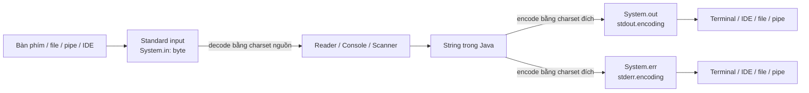

# Ảnh hưởng của terminal, IDE, chuyển hướng và pipe đến đường đi của dữ liệu văn bản

## 1. Một chuỗi đi qua những lớp nào?

Một dòng chữ tiếng Việt nhìn thấy trong terminal đã đi qua nhiều thành phần. Khi nhập, dữ liệu thường bắt đầu từ bàn phím, được terminal hoặc môi trường chạy chuyển thành byte, đi vào tiến trình Java qua standard input rồi được giải mã thành ký tự. Khi xuất, Java chuyển ký tự thành byte qua standard output hoặc standard error; terminal, file, pipe hoặc IDE tiếp nhận byte đó và quyết định cách hiển thị hay chuyển tiếp.



Có ba lớp cần tách biệt:

1. **Dữ liệu trong Java:** sau khi giải mã, chương trình làm việc với `String`, `char` và các API văn bản.
2. **Byte tại ranh giới tiến trình:** `System.in`, `System.out`, `System.err`, file và pipe vận chuyển byte.
3. **Môi trường hiển thị hoặc chuyển tiếp:** terminal emulator, IDE, shell và chương trình nhận có thể giải mã, định dạng hoặc ghi lại byte theo quy tắc riêng.

Một `String` đúng trong JVM không bảo đảm file redirect hoặc cửa sổ IDE hiển thị đúng. Ngược lại, terminal hiển thị đúng một dòng chữ cũng không chứng minh mọi file và giao thức mà ứng dụng tạo ra đều dùng UTF-8.

Bài này thuộc chương **UTF-8 mặc định** của mô-đun `JAVA_VERSION_JAVA18`. Từ JDK 18, JEP 400 chuẩn hóa default charset thông thường thành UTF-8. Tuy nhiên, terminal, IDE, redirection và pipe tạo ra các đường đi dữ liệu khác nhau; cần xác định charset ở từng ranh giới theo hợp đồng của nguồn và đích.

## 2. Phân biệt default charset với các standard streams trên JDK 24

### 2.1. Default charset không phải encoding của mọi luồng

`Charset.defaultCharset()` trả về default charset mà JVM chọn. Từ JDK 18, giá trị mặc định thông thường là UTF-8 theo JEP 400. Nhiều API dùng charset này nếu không được truyền `Charset`, chẳng hạn `new String(bytes)`, `text.getBytes()`, `new FileReader(file)` hoặc `new InputStreamReader(stream)`.

Ba standard streams có hợp đồng riêng:

| Luồng | Kiểu Java | Charset/encoding theo tài liệu Java SE 24 |
| --- | --- | --- |
| `System.in` | `InputStream` | Luồng byte; nếu bọc bằng `InputStreamReader`, tài liệu khuyên dùng `Console.charset()` hoặc dùng `Console.reader()` |
| `System.out` | `PrintStream` | `stdout.encoding` |
| `System.err` | `PrintStream` | `stderr.encoding` |

JDK 24 không xem `System.out` và `System.err` là các API dùng default charset. Vì vậy, dù `Charset.defaultCharset()` là UTF-8, không thể suy ra stdout và stderr chắc chắn cũng là UTF-8.

### 2.2. `stdout.encoding` và `stderr.encoding`

Hai thuộc tính này mô tả hai stream khác nhau:

- `stdout.encoding` tương ứng với việc `System.out` chuyển ký tự thành byte.
- `stderr.encoding` tương ứng với việc `System.err` chuyển ký tự thành byte.

Giá trị mặc định phụ thuộc nền tảng và môi trường. Khi nền tảng không cung cấp console streams, tài liệu Java SE 24 nêu rằng giá trị mặc định của chúng lấy theo `native.encoding`.

Trên JDK 24, runtime có thể được khởi chạy với `stdout.encoding=UTF-8` và `stderr.encoding=UTF-8`. Tài liệu `System` cảnh báo rằng khởi chạy với giá trị khác UTF-8 dẫn đến hành vi không được đặc tả. Không dùng các property này như cách portable để ép tùy ý một code page legacy.

Ví dụ cấu hình hai output streams khi khởi chạy:

```bash
java -Dstdout.encoding=UTF-8 -Dstderr.encoding=UTF-8 -jar app.jar
```

`file.encoding` vẫn là default charset cho các API phụ thuộc default charset. `stdout.encoding` và `stderr.encoding` quyết định encoding của hai output streams chuẩn. `native.encoding` cung cấp thông tin về encoding môi trường gốc; nó không thay thế hợp đồng của file hay giao thức.

### 2.3. Đọc `System.in` theo nguồn dữ liệu

`System.in` là `InputStream`, tức byte stream. Trên Java SE 24, tài liệu của trường `System.in` hướng dẫn dùng `Console.charset()` nếu bọc luồng này bằng `InputStreamReader`, hoặc cân nhắc `Console.reader()`.

Khi có console tương tác:

```java
import java.io.Console;
import java.io.Reader;

Console console = System.console();

if (console != null) {
    Reader reader = console.reader();
    // Đọc ký tự từ console qua Reader đã được cấu hình phù hợp.
}
```

Khi đọc dữ liệu đã được chuyển hướng từ file hoặc pipe, hãy dùng charset mà bên tạo dữ liệu cam kết. Ví dụ, nếu hợp đồng của pipe quy định UTF-8:

```java
import java.io.BufferedReader;
import java.io.InputStreamReader;
import java.nio.charset.StandardCharsets;

BufferedReader input = new BufferedReader(
        new InputStreamReader(System.in, StandardCharsets.UTF_8));

String line = input.readLine();
```

Không dùng `Charset.defaultCharset()` chỉ vì đó là giá trị mặc định của JVM. Bộ giải mã phải khớp với byte mà nguồn gửi.

**Lưu ý theo đúng phiên bản:** bảng system properties của Java SE 24 mô tả `stdout.encoding` và `stderr.encoding`; phần `System.in` hướng dẫn dùng `Console.charset()` hoặc `Console.reader()`. Đừng lấy tên property từ tài liệu một JDK khác rồi giả định nó là hợp đồng chuẩn của Java SE 24.

## 3. Khi chạy trong terminal tương tác

### 3.1. Terminal không chỉ là cửa sổ hiển thị

Terminal emulator thường đảm nhiệm nhiều việc:

- Nhận thao tác bàn phím và chuyển thành dữ liệu đầu vào của tiến trình.
- Gửi byte từ chương trình ra màn hình.
- Diễn giải byte theo cấu hình encoding của terminal.
- Xử lý điều khiển con trỏ, màu sắc, xuống dòng và các chuỗi điều khiển.
- Chọn font hoặc font fallback để vẽ glyph.

Java gửi byte ra standard output. Terminal cần diễn giải byte theo encoding tương thích với encoding mà `System.out` sử dụng. Nếu hai phía không thống nhất, chữ có thể thành mojibake, ví dụ `Tiếng Việt` thành một chuỗi ký tự sai.

Một trường hợp khác là byte và ký tự đã đúng nhưng font không có glyph tương ứng. Khi đó terminal có thể hiện ô vuông hoặc ký hiệu thay thế. Đây là lỗi font/rendering, không nhất thiết là lỗi charset.

### 3.2. Kiểm tra có console và có terminal hay không

`System.console()` trả về `Console` nếu JVM được gắn với thiết bị console; nếu không, trả về `null`. Tài liệu Java SE 24 mô tả rằng khi JVM chạy từ dòng lệnh tương tác và không chuyển hướng standard input và output, console thường tồn tại. Một job nền hoặc scheduler có thể không có console.

Từ JDK 22, `Console.isTerminal()` cho biết thiết bị console có phải terminal hay không:

```java
import java.io.Console;

Console console = System.console();

if (console == null) {
    System.out.println("JVM không có Console");
} else if (console.isTerminal()) {
    System.out.println("Có terminal tương tác");
} else {
    System.out.println("Có Console nhưng thiết bị không phải terminal");
}
```

Hai phép kiểm tra trả lời hai câu hỏi khác nhau: `console != null` cho biết có đối tượng Console; `isTerminal()` cho biết thiết bị đó có phải terminal. `isTerminal()` có từ JDK 22, nên có sẵn trên JDK 24.

### 3.3. Dùng charset của Console

`Console.charset()` có từ JDK 17. Trên Java SE 24, charset này tương ứng với nguồn và đích input/output của console do môi trường cung cấp; mặc định dựa trên `stdout.encoding`. Nó có thể khác `Charset.defaultCharset()`.

```java
import java.io.Console;
import java.nio.charset.Charset;

Console console = System.console();

if (console != null) {
    Charset consoleCharset = console.charset();
    System.out.println("Console charset = "
            + consoleCharset.name());
    System.out.println("Default charset = "
            + Charset.defaultCharset().name());
}
```

Khi có console, `console.readLine()` là lựa chọn thuận tiện cho input theo dòng; `console.printf()` hoặc `console.writer()` phù hợp cho output tương tác. Nếu cần bọc `System.in` thủ công, tài liệu `System.in` khuyên dùng `Console.charset()` hoặc `Console.reader()`.

Hãy flush prompt trước khi chờ input để người dùng nhìn thấy lời nhắc ngay:

```java
System.out.print("Tên của bạn: ");
System.out.flush();

// Sau đó mới đọc dữ liệu.
```

Buffering có thể làm prompt chưa xuất hiện nếu chương trình chưa flush. Đây là vấn đề thời điểm truyền dữ liệu, khác với encoding.

## 4. Khi chạy trong IDE

### 4.1. Cửa sổ Run không nhất thiết là Console của JVM

IDE thường thu thập stdout và stderr của tiến trình rồi hiển thị trong một cửa sổ Run, Debug hoặc Test. Cửa sổ đó là giao diện của IDE; nó không nhất thiết là một thiết bị console gắn với JVM.

Vì vậy, có thể xảy ra tình huống:

- Ứng dụng ghi được `System.out.println(...)` và IDE hiển thị kết quả.
- `System.console()` vẫn trả về `null`.
- `Console.readLine()` hoặc `Console.readPassword()` không khả dụng.
- Input phải được cấp qua cấu hình Run, test input, file hoặc pipe.

Một số IDE có tùy chọn chạy bằng terminal hoặc pseudo-terminal. Khi bật tùy chọn đó, kết quả `System.console()` và `Console.isTerminal()` có thể khác. Hãy kiểm tra trong chính cấu hình chạy của dự án thay vì giả định IDE luôn cấp console.

### 4.2. IDE có thể có bước giải mã riêng

Luồng output của Java chứa byte được tạo bởi `System.out` và `System.err`. IDE tiếp nhận chúng rồi hiển thị thành chuỗi. Nếu IDE giải mã theo charset khác với charset mà Java dùng, cửa sổ Run có thể hiển thị sai dù chuỗi trong JVM hoàn toàn đúng.

Khi chẩn đoán:

1. Kiểm tra `System.out.charset()` và `System.err.charset()` trên JDK 18+.
2. Kiểm tra `stdout.encoding` và `stderr.encoding`.
3. Kiểm tra cấu hình encoding của IDE và terminal tích hợp nếu có.
4. So sánh byte được ghi ra file bằng một cách redirect bảo toàn byte.
5. Kiểm tra font nếu chỉ một số glyph không hiển thị.

Không thay đổi `file.encoding` chỉ để sửa cách IDE hiển thị. Trước tiên hãy xác định byte Java đã gửi và cách IDE giải mã byte đó.

### 4.3. Encoding của mã nguồn là một bước khác

Mã nguồn `.java` được IDE hoặc `javac` đọc trước khi chương trình chạy. Encoding source file là cấu hình build/editor, không phải charset của `System.out`.

Nếu source file được lưu bằng UTF-8, có thể khai báo rõ khi biên dịch:

```bash
javac -encoding UTF-8 Main.java
```

Việc JDK 18+ dùng UTF-8 làm default charset runtime không tự bảo đảm mọi IDE, plugin build hoặc file nguồn cũ đều được đọc theo UTF-8. Hãy giữ encoding của repository và cấu hình build nhất quán.

## 5. Khi chuyển hướng stdout và stderr ra file

### 5.1. Redirect thay đích nhận byte

Trong shell kiểu POSIX hoặc `cmd.exe`, có thể chạy:

```bash
java -Dstdout.encoding=UTF-8 -Dstderr.encoding=UTF-8 App 1> output.txt 2> error.txt
```

Ý nghĩa:

- `1>` chuyển standard output sang `output.txt`.
- `2>` chuyển standard error sang `error.txt`.
- Java vẫn tạo byte theo charset của từng `PrintStream`.
- Shell chuyển các byte đến file đích; bản thân redirection ở mức file descriptor không phải thao tác decode rồi encode lại văn bản.

Do đó, file `output.txt` cần được đọc bằng charset tương ứng với `stdout.encoding`; `error.txt` cần được đọc bằng charset tương ứng với `stderr.encoding`.

Đuôi `.txt` hoặc `.log` không nói lên encoding. Nếu không biết byte được tạo theo charset nào, đừng đoán từ tên file.

### 5.2. Gộp stdout và stderr

Lệnh:

```bash
java App > combined.log 2>&1
```

đưa stderr vào cùng đích với stdout theo thứ tự shell xử lý. Nếu hai stream dùng charset khác nhau, file kết quả có thể chứa các đoạn byte thuộc hai encoding. Một chương trình đọc log bằng một charset duy nhất có thể giải mã sai một trong hai phần.

Nếu cần log hợp nhất dễ đọc, hãy bảo đảm hai stream cùng encoding theo cấu hình runtime được hỗ trợ, hoặc dùng một logging pipeline có charset thống nhất. Không nên dựa vào việc gộp stream để tự chuyển đổi encoding.

### 5.3. Redirect không tự thêm hoặc loại BOM

BOM là một phần byte của nội dung file. Shell redirect ở mức byte không tự động thêm BOM UTF-8 hay loại bỏ BOM có sẵn. Nếu một công cụ trung gian xử lý output như văn bản, nó có thể có chính sách BOM riêng.

Khi file đầu ra được một hệ thống khác đọc, hợp đồng cần nói rõ có BOM hay không. Không suy ra BOM chỉ từ việc file có UTF-8.

## 6. PowerShell trên Windows: cần phân biệt phiên bản

PowerShell có pipeline và redirection riêng; không phải mọi lệnh `>` đều tương đương với redirect byte ở `cmd.exe` hoặc shell POSIX.

### 6.1. Windows PowerShell 5.1

Windows PowerShell 5.1 gọi `Out-File` khi dùng toán tử `>` hoặc `>>`. Theo tài liệu Microsoft, `Out-File` và hai toán tử này tạo file UTF-16LE theo mặc định. Khi chạy Java bằng PowerShell 5.1:

```powershell
java App > output.txt
```

file `output.txt` không nhất thiết chứa nguyên byte mà Java đã ghi vào stdout. PowerShell xử lý output native như dữ liệu văn bản rồi ghi lại theo encoding của `Out-File`. Nếu cần kiểm tra byte gốc của Java, dùng redirection của `cmd.exe`:

```powershell
cmd.exe /c "java -Dstdout.encoding=UTF-8 -Dstderr.encoding=UTF-8 App 1>output.bin 2>error.bin"
Format-Hex .\output.bin
Format-Hex .\error.bin
```

`cmd.exe` chuyển hướng các handle của tiến trình; nó không dùng `Out-File` để viết lại output thành UTF-16LE.

Workspace hiện tại dùng Windows PowerShell 5.1.26100.9818, vì vậy cần lưu ý khác biệt này khi kiểm tra file được redirect từ Java.

### 6.2. PowerShell 7.4 trở lên

PowerShell 7.4 thay đổi hành vi redirect stdout của chương trình native: byte stream được giữ nguyên khi redirect stdout ra file hoặc pipe byte stream sang stdin của chương trình native khác.

Ví dụ:

```powershell
java -Dstdout.encoding=UTF-8 App > output.bin
Format-Hex .\output.bin
```

Tính năng bảo toàn byte này áp dụng cho stdout native command. Khi gộp stderr vào stdout bằng `2>&1`, PowerShell xử lý luồng kết hợp như dữ liệu chuỗi; không dựa vào chế độ đó để bảo toàn một luồng byte hỗn hợp.

Đối với output từ cmdlet hoặc script PowerShell, `>` vẫn xử lý output theo mô hình stream/object của PowerShell và encoding của `Out-File`. PowerShell 7 mặc định dùng UTF-8 không BOM cho text output, nhưng đây là quy tắc của PowerShell, không phải charset của Java.

### 6.3. Khi PowerShell gửi chuỗi vào chương trình Java

Nếu pipeline bắt đầu từ một chuỗi PowerShell:

```powershell
"Xin chào Việt Nam" | java Consumer
```

PowerShell phải mã hóa chuỗi thành byte để gửi vào stdin của Java. Biến `$OutputEncoding` quyết định encoding PowerShell dùng khi gửi dữ liệu tới chương trình native. Nó không điều khiển encoding mà Java dùng cho stdout hoặc encoding file được tạo bởi `>`.

Nếu hợp đồng của chương trình Java quy định stdin là UTF-8, hãy cấu hình `$OutputEncoding` tương ứng:

```powershell
$OutputEncoding = [System.Text.UTF8Encoding]::new($false)
"Xin chào Việt Nam" | java Consumer
```

Phía Java cũng phải giải mã stdin bằng UTF-8 theo cùng hợp đồng. Kiểm tra `$OutputEncoding` trong session thực tế; đừng giả định mọi phiên bản PowerShell có cùng giá trị mặc định.

## 7. Khi dùng pipe giữa các tiến trình

### 7.1. Pipe truyền byte, hai chương trình phải thống nhất charset

Ví dụ trên shell POSIX hoặc `cmd.exe`:

```bash
java -Dstdout.encoding=UTF-8 Producer | java Consumer
```

Đường đi dữ liệu:

1. `Producer` tạo `String`.
2. `System.out` mã hóa chuỗi thành byte UTF-8 theo `stdout.encoding`.
3. Pipe chuyển byte sang `System.in` của `Consumer`.
4. `Consumer` giải mã byte bằng UTF-8.
5. `Consumer` xử lý chuỗi Java.

Ví dụ consumer đọc UTF-8:

```java
import java.io.BufferedReader;
import java.io.InputStreamReader;
import java.nio.charset.StandardCharsets;

public class Consumer {
    public static void main(String[] args) throws Exception {
        try (var reader = new BufferedReader(
                new InputStreamReader(
                        System.in, StandardCharsets.UTF_8))) {
            String line;
            while ((line = reader.readLine()) != null) {
                System.out.println("Received: " + line);
            }
        }
    }
}
```

Nếu `Producer` phát Windows-1258 nhưng `Consumer` giải mã UTF-8, dữ liệu sẽ sai. Pipe không tự phát hiện charset hoặc tự chuyển mã.

### 7.2. Pipeline PowerShell không phải lúc nào cũng là byte pipe

Có hai tình huống khác nhau:

- **Native command → native command:** trên PowerShell 7.4+, byte stream của native command được bảo toàn khi pipe stdout sang stdin của native command khác.
- **PowerShell string/object → native command:** PowerShell chuyển đối tượng hoặc chuỗi thành byte theo cơ chế pipeline và `$OutputEncoding`.

Trong Windows PowerShell 5.1, không giả định pipeline native-to-native là đường truyền byte nguyên vẹn như POSIX shell. Khi cần kiểm thử byte chính xác, có thể dùng `cmd.exe /c` để tạo pipe ở mức tiến trình hoặc dùng một công cụ byte-aware.

### 7.3. Gộp stream trong pipeline

Một pipeline thông thường chỉ chuyển stdout của chương trình trước sang stdin của chương trình sau. stderr vẫn là luồng riêng và thường tiếp tục đi tới đích lỗi của tiến trình.

Ví dụ:

```bash
java Producer | java Consumer
```

Nếu muốn đưa cả stderr vào pipeline:

```bash
java Producer 2>&1 | java Consumer
```

hãy hiểu rằng stderr lúc này trở thành một phần dữ liệu đầu vào của consumer. Nếu stdout và stderr có nội dung hoặc charset khác nhau, consumer có thể nhận cả log lỗi xen vào dữ liệu chính. Với pipeline dữ liệu máy đọc, nên dành stdout cho payload và stderr cho chẩn đoán.

## 8. Đường đi của dữ liệu trong các môi trường thường gặp

| Môi trường | `System.console()` | Input | Output | Điều cần xác minh |
| --- | --- | --- | --- | --- |
| Terminal tương tác | Thường khác `null` | Bàn phím/console | Terminal emulator | `Console.charset()`, `Console.isTerminal()`, charset terminal |
| IDE Run/Debug | Có thể `null` | Run configuration hoặc stream IDE cấp | IDE thu stdout/stderr | Charset decode của IDE, cấu hình terminal tích hợp |
| CI hoặc service nền | Thường `null` | File, pipe, cấu hình hoặc không có input | Log collector hoặc file | Charset hợp đồng của từng nguồn/đích |
| Redirect ra file | Có thể `null` | File qua stdin hoặc file API | File qua stdout/stderr | Charset của stream và shell có chuyển đổi text không |
| Pipe giữa hai tiến trình | Thường `null` nếu không có terminal | Byte từ producer | Byte tới consumer | Charset producer và decoder consumer phải khớp |
| Container có TTY | Có thể khác `null` | Terminal hoặc pipe | Terminal hoặc log collector | Container có cấp TTY hay không, cấu hình runtime |

Không có console không có nghĩa tiến trình không có standard streams. `System.in`, `System.out` và `System.err` vẫn có thể được nối với file, pipe hoặc thành phần host khác.

## 9. Ví dụ kiểm chứng byte thực tế

### 9.1. Chương trình phát stdout và stderr

Lưu source file bằng UTF-8:

```java
public class StreamProbe {
    public static void main(String[] args) {
        System.out.print("OUT:Cà 🙂");
        System.out.flush();

        System.err.print("ERR:Cà 🙂");
        System.err.flush();
    }
}
```

Biên dịch:

```bash
javac -encoding UTF-8 StreamProbe.java
```

Chương trình không thêm newline để byte đầu ra dễ đối chiếu. Với UTF-8, phần chuỗi `Cà 🙂` có byte:

```text
43 C3 A0 20 F0 9F 99 82
```

Toàn bộ payload stdout dự kiến:

```text
4F 55 54 3A 43 C3 A0 20 F0 9F 99 82
```

stderr bắt đầu bằng `ERR:` nên có payload:

```text
45 52 52 3A 43 C3 A0 20 F0 9F 99 82
```

### 9.2. Ghi byte nguyên bản ra file

Trên Linux/macOS:

```bash
java -Dstdout.encoding=UTF-8 -Dstderr.encoding=UTF-8 StreamProbe 1>out.bin 2>err.bin
od -An -tx1 -c out.bin
od -An -tx1 -c err.bin
```

Trên Windows PowerShell 5.1, dùng `cmd.exe` để thực hiện redirect byte ở cấp tiến trình:

```powershell
cmd.exe /c "java -Dstdout.encoding=UTF-8 -Dstderr.encoding=UTF-8 StreamProbe 1>out.bin 2>err.bin"
Format-Hex .\out.bin
Format-Hex .\err.bin
```

Trên PowerShell 7.4 trở lên, có thể redirect stdout native command để bảo toàn byte:

```powershell
java -Dstdout.encoding=UTF-8 StreamProbe > out.bin
Format-Hex .\out.bin
```

Ví dụ cuối chỉ redirect stdout. Nếu cần thu stderr thành byte độc lập, hãy kiểm tra đúng hành vi của phiên bản PowerShell đang dùng hoặc dùng `cmd.exe`/shell có redirection ở cấp process handle.

### 9.3. So sánh byte với nội dung được giải mã

Sau khi xác nhận byte đúng, đọc file bằng charset tương ứng:

```java
import java.nio.charset.StandardCharsets;
import java.nio.file.Files;
import java.nio.file.Path;

String text = Files.readString(
        Path.of("out.bin"), StandardCharsets.UTF_8);

System.out.println(text);
```

Có thể tách hai bước kiểm chứng:

- `Format-Hex` hoặc `od` xác nhận byte được ghi.
- `Files.readString(..., UTF_8)` xác nhận cách byte được giải mã thành văn bản.

Nếu byte đã đúng nhưng IDE hoặc terminal vẫn hiển thị sai, hãy kiểm tra lớp hiển thị/font thay vì thay đổi encoding của dữ liệu gốc.

## 10. Các vấn đề phụ có thể làm pipeline trông như lỗi encoding

### 10.1. Buffering và flush

Output có thể đang nằm trong buffer thay vì đã tới terminal hoặc pipe. Khi chương trình in prompt rồi chờ input, hãy flush rõ ràng:

```java
System.out.print("Nhập lệnh: ");
System.out.flush();
```

Nếu producer ghi dữ liệu vào pipe, consumer có thể chờ đến khi nhận newline, đủ dữ liệu hoặc EOF. Hãy thiết kế framing và flush theo giao thức thay vì chờ terminal tự hiển thị dữ liệu.

### 10.2. Dấu xuống dòng

`println()` kết thúc dòng bằng line separator của hệ thống; `System.lineSeparator()` có thể là `\n` trên Unix hoặc `\r\n` trên Windows. Khi ghi vào file hoặc pipe, byte newline cũng là một phần của payload.

Nếu giao thức yêu cầu LF cố định, hãy quy định và ghi LF rõ ràng. Nếu consumer dùng `BufferedReader.readLine()`, dấu kết thúc dòng được loại bỏ khi trả về chuỗi, nên không thể dùng cách đọc này nếu cần bảo toàn chính xác byte newline ban đầu.

### 10.3. Font và glyph

Nếu byte UTF-8 đúng và chuỗi Java đúng nhưng terminal hiện ô vuông, kiểm tra font và khả năng hỗ trợ glyph. Encoding quyết định cách byte được giải mã; font quyết định ký tự đã giải mã có được vẽ hay không.

### 10.4. Trộn dữ liệu và log

Trong pipeline, stdout nên dành cho dữ liệu mà chương trình sau sẽ đọc. Ghi thông báo chẩn đoán vào stderr giúp tránh trộn log vào payload:

```java
System.out.println("42"); // Dữ liệu cho chương trình tiếp theo
System.err.println("Đã xử lý xong một bản ghi"); // Chẩn đoán
```

Khi shell redirect hai stream riêng, có thể lưu log độc lập mà không làm consumer nhận nhầm nội dung chẩn đoán.

## 11. Quy trình chẩn đoán từ đầu đến cuối

Khi tiếng Việt hiển thị sai hoặc file redirect không đọc được, kiểm tra theo thứ tự:

1. **Xác nhận JDK:** chạy `java -version` và xác định đúng JDK mà IDE/service thực sự dùng.
2. **Kiểm tra default charset:** in `Charset.defaultCharset()`; từ JDK 18, mặc định thông thường là UTF-8.
3. **Kiểm tra output streams:** trên JDK 18+, in `System.out.charset()` và `System.err.charset()`; đối chiếu `stdout.encoding` và `stderr.encoding`.
4. **Kiểm tra console:** xem `System.console()` có `null` không; nếu có, kiểm tra `console.isTerminal()` và `console.charset()`.
5. **Xác định input contract:** nếu đọc console, dùng `Console.reader()` hoặc `Console.charset()`; nếu đọc pipe/file, dùng charset mà producer/định dạng cam kết.
6. **Xác định shell:** phân biệt POSIX/`cmd.exe` với Windows PowerShell 5.1 và PowerShell 7.4+.
7. **Tách stdout và stderr:** redirect riêng để kiểm tra từng luồng; tránh gộp khi hai charset có thể khác nhau.
8. **Kiểm tra byte:** dùng `Format-Hex` hoặc `od`; không chỉ nhìn file qua editor.
9. **Kiểm tra decoder và font:** nếu byte đúng, kiểm tra nơi đọc/hiển thị và font.
10. **Ghi rõ hợp đồng:** chọn UTF-8 hoặc charset đã được định nghĩa cho từng file, pipe và giao thức.

### Các suy luận dễ sai

| Suy luận | Thực tế |
| --- | --- |
| JDK 18+ default UTF-8 nên terminal chắc chắn UTF-8 | Terminal và standard streams có encoding riêng |
| `System.console() == null` nghĩa là không có stdin/stdout | Các standard streams vẫn có thể nối với file hoặc pipe |
| IDE có cửa sổ Console nên `System.console()` luôn khác `null` | Cửa sổ Run của IDE không nhất thiết là thiết bị console của JVM |
| `>` luôn ghi nguyên byte Java ra file | Windows PowerShell 5.1 ghi qua `Out-File`; PowerShell 7.4+ có hành vi byte-preserving riêng cho native stdout |
| Pipe tự chuyển producer output sang charset của consumer | Producer và consumer phải thống nhất encoding |
| `2>&1` chỉ là gộp hai file mà không đổi dữ liệu | Shell có quy tắc riêng; PowerShell có thể xử lý luồng kết hợp như chuỗi |
| Chữ hiện ô vuông chắc chắn là lỗi UTF-8 | Có thể là font thiếu glyph |
| `stdout.encoding` và `stderr.encoding` luôn giống nhau | Đây là hai property riêng, phải kiểm tra riêng |

## 12. Bài tập tự kiểm tra

**Bài 1.** Trên JDK 24, `Charset.defaultCharset()` trả UTF-8 nhưng terminal hiển thị `Cà` thành ký tự sai. Cần kiểm tra những lớp nào?

*Đáp án:* Kiểm tra `System.out.charset()` và `stdout.encoding`, encoding mà terminal dùng để giải mã byte, rồi kiểm tra byte thực tế. Nếu byte UTF-8 đúng mà ký tự vẫn không hiện, kiểm tra font/glyph.

**Bài 2.** `System.console()` trả `null` khi chạy trong IDE. Điều đó có nghĩa chương trình không thể đọc input không?

*Đáp án:* Không. `System.in` vẫn có thể được IDE nối với input, file hoặc pipe. Chỉ API `Console` không khả dụng; cần xác định charset của nguồn input và dùng reader phù hợp.

**Bài 3.** Một chương trình Java ghi UTF-8 ra stdout. Khi chạy `java App > output.txt` trong Windows PowerShell 5.1, vì sao file có thể không còn chứa byte UTF-8 ban đầu?

*Đáp án:* PowerShell 5.1 chuyển hướng qua `Out-File`, mặc định ghi UTF-16LE. Nó xử lý output như văn bản rồi ghi lại file, không bảo toàn byte gốc của Java. Dùng `cmd.exe` redirect nếu cần kiểm tra byte nguyên bản.

**Bài 4.** Producer phát UTF-8 vào pipe, consumer giải mã bằng Windows-1258. Shell có tự sửa encoding để consumer nhận đúng không?

*Đáp án:* Không. Pipe truyền byte; consumer phải giải mã bằng UTF-8 theo hợp đồng mà producer sử dụng.

**Bài 5.** Có thể gộp stdout và stderr vào cùng log nếu hai stream có encoding khác nhau không?

*Đáp án:* Có thể gộp ở mức shell, nhưng file kết quả có thể chứa các đoạn byte theo hai encoding. Muốn đọc bằng một charset, hãy cấu hình hai stream cùng encoding theo cách runtime hỗ trợ hoặc dùng logging pipeline thống nhất.

**Bài 6.** Trong PowerShell, `$OutputEncoding` có điều khiển encoding của file được tạo bởi `>` không?

*Đáp án:* Không. `$OutputEncoding` điều khiển cách PowerShell mã hóa chuỗi khi gửi vào chương trình native. Encoding file do redirection/`Out-File` xử lý; riêng redirect stdout của native command có hành vi bảo toàn byte từ PowerShell 7.4.

## 13. Ghi nhớ

Đường đi văn bản qua terminal, IDE, file redirect và pipe luôn có ít nhất một ranh giới byte–ký tự. Default charset UTF-8 từ JDK 18 chỉ áp dụng cho các API phụ thuộc default charset; standard streams và Console có hợp đồng encoding riêng. Theo Java SE 24, `System.out` dùng `stdout.encoding`, `System.err` dùng `stderr.encoding`, còn khi bọc `System.in` để đọc console, hãy dùng `Console.charset()` hoặc `Console.reader()`.

Terminal emulator, IDE, shell và chương trình nhận có thể diễn giải hoặc ghi lại dữ liệu theo quy tắc riêng. Đặc biệt trên Windows, cần phân biệt `cmd.exe`, Windows PowerShell 5.1 và PowerShell 7.4+ khi redirect hoặc pipe output native. Cách chẩn đoán chắc chắn là kiểm tra charset thực tế, tách stdout/stderr, xác nhận byte bằng công cụ hex và đối chiếu charset của consumer với hợp đồng producer.

### Tài liệu tham khảo chính thức

- [OpenJDK — JEP 400: UTF-8 by Default](https://openjdk.org/jeps/400).
- [Oracle Java SE 24 — System: standard input, output, error và system properties](https://docs.oracle.com/en/java/javase/24/docs/api/java.base/java/lang/System.html).
- [Oracle Java SE 24 — Console: charset, terminal và reader/writer](https://docs.oracle.com/en/java/javase/24/docs/api/java.base/java/io/Console.html).
- [Oracle Java SE 24 — PrintStream: charset()](https://docs.oracle.com/en/java/javase/24/docs/api/java.base/java/io/PrintStream.html).
- [Oracle Java SE 24 — Supported Encodings: default charset và standard streams](https://docs.oracle.com/en/java/javase/24/intl/supported-encodings.html).
- [Microsoft Learn — about_Redirection](https://learn.microsoft.com/en-us/powershell/module/microsoft.powershell.core/about/about_redirection).
- [Microsoft Learn — about_Character_Encoding](https://learn.microsoft.com/en-us/powershell/module/microsoft.powershell.core/about/about_character_encoding).
- [Microsoft Learn — about_Preference_Variables: $OutputEncoding](https://learn.microsoft.com/en-us/powershell/module/microsoft.powershell.core/about/about_preference_variables).
