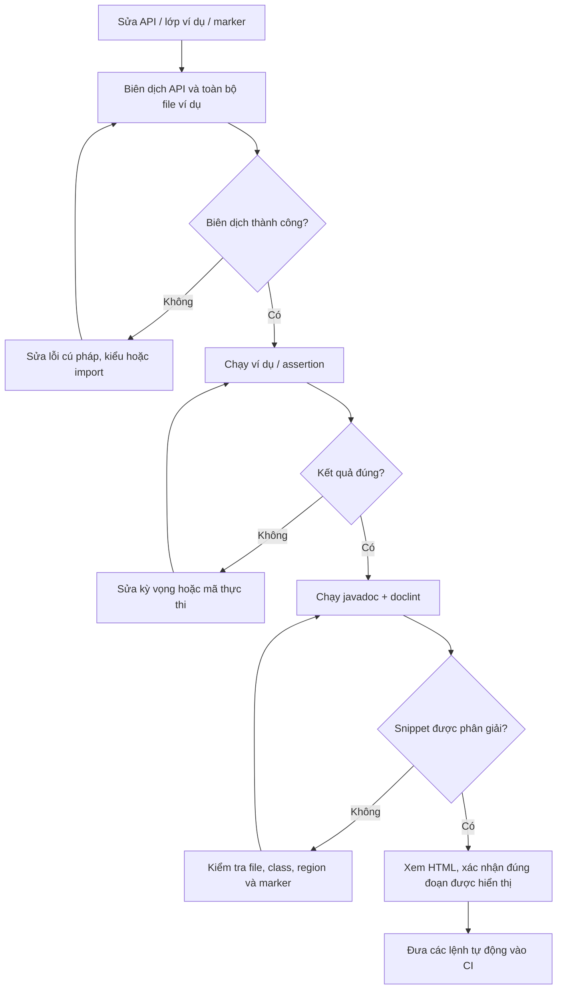

# Tổ chức lớp ví dụ có thể biên dịch và trích đúng region vào tài liệu API

## 1. Bài toán: tài liệu minh họa phải khớp với mã chạy thật

Trong tài liệu API, một đoạn mã ngắn giúp người đọc hiểu nhanh cách gọi phương thức, giá trị trả về và cách xử lý lỗi. Tuy nhiên, nếu chép mã trực tiếp vào chú thích Javadoc rồi sửa API ở nơi khác, ví dụ có thể không còn biên dịch hoặc đưa ra kết quả sai.

Từ **Java 18**, JEP 413 đưa thẻ **`{@snippet ...}`** vào Standard Doclet của Javadoc. Tính năng này vẫn được hỗ trợ trên các JDK hiện đại. Thay vì lặp lại ví dụ ở hai nơi, ta có thể:

1. Viết **một lớp Java hoàn chỉnh**, có thể biên dịch và chạy để kiểm tra hành vi.
2. Đặt các dấu **`@start region=...`** và **`@end region=...`** quanh những phần cần đưa vào tài liệu.
3. Dùng **`{@snippet class=... region=...}`** trong Javadoc để lấy chính xác phần mã đó.
4. Chạy cả **`javac`**, chương trình kiểm tra và **`javadoc`** trong quá trình phát triển hoặc CI.

Bài này thuộc phần **Kiểm chứng tài liệu** của mô-đun **JAVA_VERSION_JAVA18**. Trọng tâm là khả năng tổ chức và kiểm chứng các ví dụ cho tài liệu API, đặc biệt là cú pháp snippet xuất hiện ở Java 18 và còn hữu ích khi làm việc với JDK hiện đại. Không cần dùng tính năng preview hay API đã lỗi thời.

### Mục tiêu học tập

Sau bài học, bạn có thể:

- Đặt file ví dụ ở vị trí Javadoc tìm được và vẫn biên dịch nó như mã Java thông thường.
- Tạo nhiều **named region** trong một file, biết region nào được xuất hiện ở tài liệu của API nào.
- Phân biệt **biên dịch được**, **chạy đúng** và **trích đúng nội dung** — ba phép kiểm tra độc lập.
- Phát hiện và sửa những lỗi thường gặp khi tổ chức external snippet.

## 2. Chọn external snippet và bố trí thư mục

`{@snippet : ...}` là dạng **inline snippet**, phù hợp với ví dụ rất nhỏ. Nhưng đoạn inline nằm trong chú thích nên không tự trở thành một lớp Java độc lập để biên dịch; nó còn chịu các giới hạn cú pháp của chú thích, như chuỗi `*/` và dấu ngoặc nhọn phải cân bằng.

Để kiểm chứng được bằng trình biên dịch, hãy dùng **external snippet**: nội dung được đặt trong một file riêng, còn chú thích Javadoc chỉ tham chiếu file và region. Với Java source, thuộc tính `class` thường dễ đọc hơn `file`.

Ví dụ cấu trúc tối thiểu:

```text
demo/
└── src/
    └── main/
        └── java/
            └── com/
                └── example/
                    └── text/
                        ├── TokenNormalizer.java
                        └── snippet-files/
                            └── TokenNormalizerExample.java
```

- `TokenNormalizer.java` là API cần tạo tài liệu, có khai báo `package com.example.text;`.
- `snippet-files/TokenNormalizerExample.java` là lớp ví dụ thực, cũng khai báo **`package com.example.text;`** để dùng API cùng package.
- `snippet-files` là thư mục đặc biệt mà Standard Doclet tìm khi giải quyết external snippet của lớp cùng package. Tên này cần viết chính xác, có dấu gạch nối.
- File dưới `snippet-files` vẫn là mã nguồn Java bình thường khi được đưa vào lệnh `javac`; đừng mặc định hệ thống build của dự án sẽ tự biên dịch thư mục này. Hãy cấu hình hoặc liệt kê nó trong bước kiểm chứng.

**Quy ước thực dụng:** đặt tên lớp theo chức năng minh họa, chẳng hạn `TokenNormalizerExample`, và tên region theo tình huống, chẳng hạn `normalize` hoặc `rejectNull`. Tránh tên `region1`, `demo2` vì rất khó biết chúng thuộc hành vi nào khi tài liệu lớn dần.

## 3. Ví dụ hoàn chỉnh: một lớp chạy được, hai region riêng biệt

### 3.1. API có thẻ tham chiếu snippet

Tạo `src/main/java/com/example/text/TokenNormalizer.java`:

```java
package com.example.text;

import java.util.Locale;
import java.util.Objects;

/**
 * Cung cấp thao tác chuẩn hóa token.
 */
public final class TokenNormalizer {
    private TokenNormalizer() {
    }

    /**
     * Bỏ khoảng trắng ở hai đầu và chuyển chuỗi sang chữ thường
     * theo locale độc lập với máy chạy.
     *
     * Ví dụ chuẩn hóa đầu vào:
     *
     * {@snippet class=TokenNormalizerExample region=normalize}
     *
     * Ví dụ kiểm tra đầu vào null:
     *
     * {@snippet class=TokenNormalizerExample region=rejectNull}
     *
     * @param input chuỗi cần chuẩn hóa, không được null
     * @return chuỗi sau khi bỏ khoảng trắng đầu/cuối và chuyển chữ thường
     * @throws NullPointerException nếu input là null
     */
    public static String normalize(String input) {
        return Objects.requireNonNull(input, "input")
                .strip()
                .toLowerCase(Locale.ROOT);
    }
}
```

Điểm quan trọng nằm ở hai tham chiếu:

| Thẻ trong Javadoc | Vùng mã được chọn | Ý nghĩa |
| --- | --- | --- |
| `{@snippet class=TokenNormalizerExample region=normalize}` | `normalize` | Cách gọi API và kiểm tra giá trị trả về. |
| `{@snippet class=TokenNormalizerExample region=rejectNull}` | `rejectNull` | Cách nhận biết lỗi khi truyền `null`. |

Hai thẻ đọc **cùng một file ví dụ** nhưng trích **hai đoạn khác nhau**. Người đọc không phải xem cả phần khai báo lớp, phương thức `main` hoặc các dòng kiểm tra không liên quan.

### 3.2. Lớp ví dụ có thể biên dịch và chạy

Tạo `src/main/java/com/example/text/snippet-files/TokenNormalizerExample.java`:

```java
package com.example.text;

/**
 * Ví dụ thực thi cho tài liệu TokenNormalizer.
 */
public final class TokenNormalizerExample {
    private TokenNormalizerExample() {
    }

    public static void main(String[] args) {
        // @start region=normalize
        String actual = TokenNormalizer.normalize("  JAVA 18  "); // @highlight substring="TokenNormalizer.normalize"
        if (!"java 18".equals(actual)) {
            throw new AssertionError("Unexpected result: " + actual);
        }
        System.out.println(actual);
        // @end region=normalize

        // @start region=rejectNull
        try {
            TokenNormalizer.normalize(null);
            throw new AssertionError("Expected NullPointerException");
        } catch (NullPointerException expected) {
            System.out.println(expected.getMessage());
        }
        // @end region=rejectNull
    }
}
```

Lớp này là mã Java hợp lệ: có `package`, khai báo lớp, `main` và các lệnh kiểm tra hành vi. Các dòng bắt đầu bằng `// @...` vẫn là comment hợp lệ đối với `javac`, nhưng mang ý nghĩa đặc biệt khi Javadoc trích snippet.

- `// @start region=normalize` đánh dấu bắt đầu vùng cần hiển thị; `// @end region=normalize` kết thúc đúng vùng đó.
- `// @start region=rejectNull` và `// @end region=rejectNull` tạo vùng khác trong cùng file.
- `// @highlight substring="TokenNormalizer.normalize"` chỉ yêu cầu Javadoc tô nổi bật chuỗi tương ứng ở dòng mã; nó không thay đổi lệnh mà Java thực thi.
- Vì hai cặp marker được đặt **trên các dòng riêng**, phần nội dung được hiển thị bắt đầu ngay sau `@start` và kết thúc ngay trước `@end`. Dòng marker và markup comment không xuất hiện như mã ví dụ trong kết quả HTML.

Với region `normalize`, người đọc sẽ thấy về bản chất:

```java
String actual = TokenNormalizer.normalize("  JAVA 18  ");
if (!"java 18".equals(actual)) {
    throw new AssertionError("Unexpected result: " + actual);
}
System.out.println(actual);
```

Region này **không phải lớp Java tự đứng độc lập**: biến và câu lệnh được đặt trong `main` của file gốc. Khả năng biên dịch được chứng minh trên **lớp ví dụ hoàn chỉnh**, còn snippet chỉ là phần trình bày được trích từ đó.

### 3.3. Kiểm chứng bằng lệnh thực tế

Chạy các lệnh sau từ thư mục `demo/` trên JDK **18 trở lên**. Ví dụ minh họa cú pháp shell POSIX; trên PowerShell có thể tạo thư mục bằng `New-Item -ItemType Directory -Force build/classes` thay cho `mkdir -p`.

```bash
mkdir -p build/classes

javac --release 18 -encoding UTF-8 -d build/classes \
  src/main/java/com/example/text/TokenNormalizer.java \
  src/main/java/com/example/text/snippet-files/TokenNormalizerExample.java

java -cp build/classes com.example.text.TokenNormalizerExample

javadoc -d build/api-docs \
  -encoding UTF-8 -docencoding UTF-8 \
  -Xdoclint:all -Werror \
  src/main/java/com/example/text/TokenNormalizer.java
```

Kết quả dự kiến của lệnh `java`:

```text
java 18
input
```

Diễn giải:

1. **`javac` thành công** chứng tỏ cả API và file ví dụ đều đúng cú pháp, đúng kiểu, đúng lời gọi theo Java 18. Tùy mục tiêu dự án, có thể nâng `--release` lên mức JDK đang hỗ trợ; dùng `--release 18` ở đây để giữ ví dụ tương thích từ Java 18.
2. **Chạy `main` thành công** chứng tỏ kết quả chuỗi là `java 18` và nhánh `null` phát sinh đúng `NullPointerException`. `AssertionError` sẽ khiến chương trình thất bại khi kỳ vọng không còn đúng.
3. **`javadoc` thành công** chứng tỏ Standard Doclet phân giải được file và region, xử lý marker cùng cú pháp tài liệu. `-Xdoclint:all` và `-Werror` giúp bắt cảnh báo trong quá trình tạo tài liệu.
4. Mở file **`build/api-docs/com/example/text/TokenNormalizer.html`** để kiểm tra hai đoạn hiển thị đúng thứ tự, không lộ marker, không trích nhầm phần `main`, và phần `TokenNormalizer.normalize` được làm nổi bật.

Ba bước đầu nên chạy tự động trong CI. Bước xem HTML giúp kiểm chứng trình bày khi thay đổi tên region, nội dung ví dụ hoặc theme của tài liệu.

> **Lưu ý về đường dẫn:** lệnh biên dịch liệt kê tường minh cả hai file. Lệnh Javadoc chỉ nhận file API cần xuất bản; nó tự tìm external snippet trong thư mục `snippet-files` cùng package. Chạy `javac` thành công **không đồng nghĩa** Javadoc sẽ trích đúng region, và Javadoc thành công **không đồng nghĩa** ví dụ sẽ chạy đúng.

## 4. Quy tắc để trích chính xác một region

### 4.1. Tên region phải khớp tuyệt đối

Thẻ `{@snippet class=TokenNormalizerExample region=normalize}` cần tìm được trong file nguồn một vùng có đúng tên `normalize`. Nếu đổi marker thành `region=normalise` nhưng không đổi tham chiếu, Javadoc sẽ báo lỗi khi phân giải snippet.

Mẫu nên dùng:

```java
// @start region=caseName
// Các câu lệnh Java muốn đưa vào tài liệu.
// @end region=caseName
```

Giữ marker bắt đầu/kết thúc theo cặp, tên rõ nghĩa, không bỏ quên `@end`. Có thể tạo nhiều region trong một file; nếu cần lồng region, phải xác định biên rõ ràng để tránh trích một phần khó dự đoán. Với tài liệu API thường ngày, **các region không chồng lấn** là lựa chọn dễ bảo trì nhất.

### 4.2. Phân biệt đánh dấu vùng và hiệu ứng trình bày

| Thành phần | Công dụng | Ảnh hưởng đến mã chạy? |
| --- | --- | --- |
| `@start region=name` / `@end region=name` | Chọn ranh giới vùng để trích. | Không, vì nằm trong comment. |
| `@highlight substring="..."` | Làm nổi bật đoạn khớp trong dòng hoặc region. | Không. |
| `@replace substring="..." replacement="..."` | Thay chữ **khi hiển thị** snippet. | Không thay mã được biên dịch. |
| `{@snippet class=Example region=name}` | Tham chiếu một vùng trong file Java ngoài chú thích. | Không. |
| `{@snippet file=sample.properties region=name}` | Trích từ file không phải Java, ví dụ cấu hình. | Tùy loại file; `javac` không biên dịch file cấu hình. |

`@replace` hữu ích nếu muốn rút gọn đường dẫn hoặc che bớt chi tiết khi trình bày, nhưng có nguy cơ khiến phần người đọc sao chép khác với mã đã kiểm chứng. Với ví dụ giảng dạy có yêu cầu **copy/paste để chạy**, nên hạn chế biến đổi mã hiển thị; nếu có, ghi rõ phần nào chỉ mang tính minh họa.

### 4.3. Khi dùng `class`, khi dùng `file` và `--snippet-path`

- **`class=TokenNormalizerExample`**: biểu đạt ý định rằng snippet nằm trong một file Java mang tên lớp đó. Phù hợp với các lớp ví dụ có thể biên dịch.
- **`file=example.properties`**: biểu đạt ý định trích nội dung từ file bất kỳ, như cấu hình hoặc dữ liệu mẫu. Tên file và đường dẫn phải tồn tại trong các vùng tìm kiếm của Javadoc.
- **`--snippet-path`**: bổ sung thư mục gốc để tìm snippet nếu dự án muốn đặt ví dụ tách khỏi cây nguồn API. Khi dùng, hãy cấu hình thống nhất đường dẫn cho môi trường phát triển và CI.

Ví dụ với một thư mục snippet riêng:

```bash
javadoc --snippet-path docs/snippets \
  -d build/api-docs \
  src/main/java/com/example/text/TokenNormalizer.java
```

Lệnh trên chỉ là **cấu hình tìm file**: muốn hoạt động, thư mục `docs/snippets` phải chứa file snippet ở đường dẫn phù hợp với tham chiếu trong API. Không cần tùy chọn này trong cấu trúc `snippet-files` của ví dụ chính.

## 5. Xây quy trình kiểm chứng tránh tài liệu bị lỗi theo thời gian

Trong một dự án thực tế, nên duy trì chuỗi kiểm tra sau mỗi khi sửa API hoặc thay đổi ví dụ:



Để hạn chế lệch nội dung theo thời gian, áp dụng các quy tắc sau:

1. **Một nguồn mã ví dụ chính**: tài liệu trích từ file mà bước biên dịch và chạy kiểm tra đang sử dụng. Không duy trì thêm bản sao của snippet trong chú thích.
2. **Một tình huống, một region rõ nghĩa**: tên gắn với hành vi API, không gắn với số thứ tự tùy ý.
3. **Kiểm chứng kỳ vọng ngay trong ví dụ hoặc bằng bài test phù hợp**: ví dụ không chỉ in kết quả mà phải phát hiện kết quả sai; ở đây dùng `AssertionError` để minh họa ngắn gọn.
4. **Chạy lại Javadoc khi đổi marker hoặc đường dẫn**: trình biên dịch Java không kiểm tra được các tham chiếu `region=...` trong chú thích API.
5. **Giữ thông báo lỗi và HTML dễ tra cứu**: CI nên lưu log Javadoc, và có thể lưu tài liệu HTML sinh ra dưới dạng artifact để xem khi có thay đổi.

## 6. Lỗi thường gặp và cách xử lý

| Triệu chứng | Nguyên nhân có thể | Cách kiểm tra / khắc phục |
| --- | --- | --- |
| `javac` báo `cannot find symbol` ở lời gọi API | Thiếu file API trong lệnh biên dịch; sai `package`, import hoặc tên phương thức. | Biên dịch cả API và lớp ví dụ, bảo đảm package đồng nhất. |
| `java` báo không tìm được lớp `main` | Thiếu `-cp build/classes` hoặc gọi sai tên đầy đủ của lớp. | Chạy `com.example.text.TokenNormalizerExample` với classpath đã biên dịch. |
| Javadoc không tìm được external snippet | File đặt sai thư mục `snippet-files`; sai chữ hoa/chữ thường; đường dẫn `--snippet-path` không đúng. | Kiểm tra vị trí thực tế, tên lớp/file và cấu hình tìm kiếm. |
| Javadoc không tìm được `region` | Sai chính tả `region=...` hoặc thiếu/mất cặp marker. | Đối chiếu thẻ Javadoc với `@start` và `@end` trong cùng file. |
| HTML trích nhiều hoặc ít dòng hơn dự định | Đặt marker sai chỗ, vô tình lồng vùng hoặc đưa comment kiểm thử vào vùng. | Đặt marker trên dòng độc lập sát đoạn cần trình bày; xem HTML sau khi sinh. |
| Mã chạy đúng nhưng ví dụ trong HTML gây hiểu nhầm | Dùng `@replace` thay nội dung hoặc giấu ngữ cảnh cần thiết (import, khai báo biến). | Giảm biến đổi hiển thị; ghi chú rõ các điều kiện cần để chạy đoạn trích. |
| Tài liệu sinh được nhưng ví dụ trả kết quả sai | Javadoc kiểm chứng cú pháp trích, không kiểm chứng hành vi runtime. | Chạy lớp ví dụ và assertion hoặc test trong CI. |

### Tình huống áp dụng

Giả sử sau này phương thức `normalize` đổi quy ước xử lý chữ hoa. Nếu đoạn mã minh họa được chép trong Javadoc, người sửa API có thể quên cập nhật ví dụ. Trong cách tổ chức trên, thay đổi đó sẽ khiến `TokenNormalizerExample.main` gặp `AssertionError` nếu chưa cập nhật kỳ vọng, trong khi các thẻ `@snippet` vẫn lấy đúng vùng của file ví dụ. Điều này tạo ra hai lớp bảo vệ: **test hành vi** và **kiểm tra phần trình bày**.

### Bài tự kiểm tra

1. Thêm một region `emptyInput` vào `TokenNormalizerExample` để xác nhận `normalize("   ")` trả về chuỗi rỗng; thêm tham chiếu region đó vào Javadoc.
2. Cố tình sửa `region=normalize` ở Javadoc thành một tên không tồn tại và chạy lại `javadoc`. Ghi nhận lỗi rồi khôi phục tên đúng.
3. Thử đổi kết quả kỳ vọng từ `"java 18"` thành `"java18"` và chạy `main`. Quan sát việc kiểm tra hành vi thất bại dù các marker snippet vẫn hợp lệ.
4. Đọc file HTML sinh ra và xác định vùng nào được trích; giải thích vì sao chỉ kiểm tra mã nguồn hoặc chỉ chạy `javadoc` là chưa đủ.

## 7. Ghi nhớ về tính tương thích hiện nay

- `{@snippet}` là tính năng chính thức của **Javadoc từ Java 18**, vẫn hữu ích trên JDK hiện đại; không cần sử dụng các cơ chế preview cũ.
- `@start`, `@end`, `@highlight` và `@replace` là **markup trong comment của snippet**, không phải annotation Java hoặc lệnh của trình biên dịch.
- External snippet hỗ trợ ví dụ Java biên dịch được và cả đoạn văn bản khác. Chỉ lớp Java hoàn chỉnh được đưa qua `javac` mới chứng minh được khả năng biên dịch.
- Để tài liệu đáng tin cậy, cần nối **file ví dụ có thể chạy → kiểm tra hành vi → trích region → kiểm tra HTML Javadoc** vào cùng quy trình bảo trì.

### Tài liệu chính thức

- [JEP 413 — Code Snippets in Java API Documentation](https://openjdk.org/jeps/413): cơ sở giới thiệu `{@snippet}` từ Java 18.
- [Oracle Javadoc Guide — Snippets (JDK 25)](https://docs.oracle.com/en/java/javase/25/javadoc/snippets.html): ví dụ external snippet, marker, named region và cách trình bày.
- [Javadoc Documentation Comment Specification (JDK 25)](https://docs.oracle.com/en/java/javase/25/docs/specs/javadoc/doc-comment-spec.html): quy tắc cú pháp chính thức của snippet và region.
- [The javadoc Command (JDK 25)](https://docs.oracle.com/en/java/javase/25/docs/specs/man/javadoc.html): các tùy chọn như `--snippet-path`, `-encoding`, `-Xdoclint` và `-Werror`.
