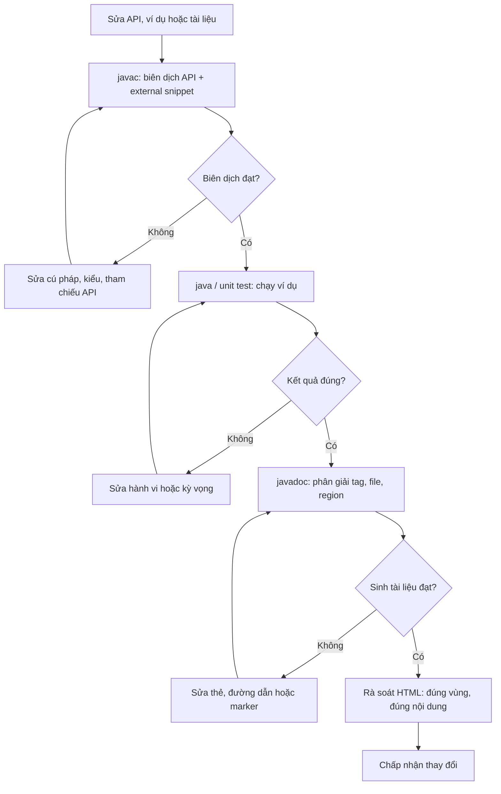

# Phân biệt `javadoc` kiểm tra cú pháp snippet với việc biên dịch hoặc chạy mã minh họa

## 1. Ba câu hỏi khác nhau khi kiểm chứng tài liệu API

Một trang tài liệu API có thể hiển thị một ví dụ trông hợp lý, nhưng ví dụ đó vẫn có thể không biên dịch được hoặc cho kết quả sai khi chạy. Ngược lại, một lớp Java hoạt động hoàn toàn đúng có thể không được đưa vào tài liệu vì tham chiếu `region` của Javadoc bị sai.

Từ **Java 18**, JEP 413 bổ sung thẻ **`{@snippet}`** để trình bày ví dụ mã trong tài liệu API. Cơ chế này vẫn được hỗ trợ trên JDK hiện đại. Với phần **Kiểm chứng tài liệu** trong mô-đun **JAVA_VERSION_JAVA18**, cần tách rõ ba mục tiêu:

| Công cụ / bước | Câu hỏi được trả lời | Không tự bảo đảm |
| --- | --- | --- |
| **`javadoc`** (Standard Doclet) | Thẻ `{@snippet}` có được phân giải, file và region có tìm thấy, markup có hợp lệ, HTML có thể tạo ra không? | Đoạn mã minh họa có đúng kiểu, đúng cú pháp Java hoặc chạy đúng không. |
| **`javac`** | Những **file `.java` đã đưa vào lệnh biên dịch** có đúng cú pháp, kiểu, tên và chữ ký API không? | Kết quả lúc chạy có đúng; Javadoc có trích đúng region không. |
| **`java`**, bài test hoặc assertion | Khi thực thi, mã có trả kết quả, phát sinh ngoại lệ và thực hiện tác dụng phụ như mong đợi không? | Tài liệu HTML đã hiển thị đúng đoạn mã hoặc đúng cách định dạng chưa. |

**Nguyên tắc:** Javadoc hợp lệ, mã biên dịch thành công và hành vi chạy đúng là **ba điều kiện cần kiểm tra riêng**. Không được suy từ một điều kiện sang hai điều kiện còn lại.

### Mục tiêu bài học

Sau bài này, bạn có thể:

1. Nêu đúng phạm vi Javadoc thực sự kiểm tra đối với inline và external snippet.
2. Tạo một API và một lớp ví dụ Java có thể biên dịch, chạy và được trích vùng mã vào Javadoc.
3. Tự gây ba loại lỗi khác nhau để quan sát công cụ nào phát hiện chúng.
4. Thiết lập bước kiểm chứng tài liệu và mã minh họa bằng các lệnh hiện còn áp dụng trên JDK hiện đại.

## 2. `javadoc` kiểm tra điều gì trong một snippet?

### 2.1. Trách nhiệm của Standard Doclet

Ví dụ một thẻ tham chiếu tới external snippet:

```java
/**
 * Ví dụ:
 *
 * {@snippet class=TwiceExample region=usage}
 */
```

Khi tạo tài liệu bằng Standard Doclet, Javadoc xử lý:

- Cú pháp của thẻ `{@snippet}` và các thuộc tính như `class`, `file`, `region`.
- Khả năng tìm thấy file bên ngoài, thường ở thư mục `snippet-files` của package chứa API, hoặc trong đường dẫn khai báo qua `--snippet-path`.
- Việc nhận diện vùng tên `usage` thông qua các comment markup, ví dụ `// @start region=usage` và `// @end region=usage`.
- Các chỉ thị trình bày được nhận diện, như `@highlight` và `@replace`, cùng các lỗi markup có thể phát hiện.
- Sự tương ứng của nội dung inline và external **nếu sử dụng hybrid snippet** (thẻ chứa cả hai dạng).
- Kết quả nội dung snippet trong tài liệu HTML được sinh ra.

Đây là **kiểm tra cấu trúc và cách trình bày snippet**. Standard Doclet **không biên dịch và không chạy mã trong snippet**. Dù nội dung được khai báo là `lang=java`, đó vẫn không phải cam kết rằng nội dung là chương trình Java hợp lệ. `lang` hỗ trợ nhận dạng ngôn ngữ để hiển thị hoặc xử lý bởi công cụ khác.

Ví dụ inline snippet sau có cấu trúc thẻ hợp lệ nhưng câu lệnh bên trong sai kiểu Java:

```java
/**
 * {@snippet :
 *     int number = "khong-phai-so";
 * }
 */
```

Javadoc có thể hiển thị câu lệnh này như nội dung tài liệu. Nó **không tự chạy `javac` trên câu lệnh đó**. Với inline snippet, một đoạn ngắn thậm chí còn thiếu ngữ cảnh như `package`, `import`, lớp hoặc phương thức bao quanh, nên không thể giả định nó là đơn vị biên dịch độc lập.

### 2.2. Phân biệt nguồn API đang được Javadoc xử lý với mã snippet bên ngoài

Javadoc đọc và phân tích các **nguồn API** để dựng mô hình tài liệu. Nếu chính file API có lỗi Java nghiêm trọng, lệnh `javadoc` vẫn có thể thất bại. Tuy nhiên, việc Javadoc phân tích file API **không biến các dòng mã trong external snippet thành đối tượng biên dịch và kiểm thử**.

Hai tình huống cần phân biệt:

- **File API sai cú pháp Java:** Javadoc có thể thất bại khi phân tích nguồn API, dù thẻ snippet vẫn đúng.
- **File external snippet sai cú pháp hoặc sai kiểu Java:** Javadoc có thể vẫn trích và hiển thị văn bản của snippet, còn `javac` sẽ phát hiện lỗi **nếu file ví dụ được đưa vào danh sách biên dịch**.

Các tùy chọn `-Xdoclint:all` và `-Werror` tăng độ nghiêm ngặt khi sinh Javadoc: kiểm tra tài liệu và biến cảnh báo thành lỗi. Chúng **không bổ sung bước chạy mã minh họa**, cũng không biến external snippet thành chương trình được biên dịch.

### 2.3. Tại sao phải quan tâm tới region?

Giả sử phần khai báo Javadoc yêu cầu:

```java
{@snippet class=TwiceExample region=usage}
```

Trong khi file ví dụ chỉ có:

```java
// @start region=sample
int result = Twice.twice(21);
// @end region=sample
```

Tên `usage` và `sample` khác nhau. Đây là lỗi **tham chiếu vùng**, Javadoc phải phát hiện khi xử lý snippet. Nhưng trình biên dịch Java coi các comment marker là comment thông thường, nên có thể biên dịch lớp ví dụ thành công. Lỗi về region **không phải lỗi kiểu Java**.

## 3. Dựng ví dụ có thể kiểm tra cả ba bước

Phần này dùng một API rất nhỏ, chỉ sử dụng cú pháp Java ổn định, để minh họa tính năng Javadoc được giới thiệu ở Java 18. Các lệnh phía dưới phù hợp với JDK **18 trở lên**.

### 3.1. Cây thư mục

```text
demo/
└── src/
    └── demo/
        ├── Twice.java
        └── snippet-files/
            └── TwiceExample.java
```

`src/demo/Twice.java` là API cần tạo tài liệu. `src/demo/snippet-files/TwiceExample.java` là lớp Java đầy đủ dùng để minh họa.

Tên **`snippet-files`** có ý nghĩa đặc biệt đối với Standard Doclet. Nó nằm trong thư mục package của API, nhưng không phải thành phần của tên Java package. Cả hai file Java bên dưới vẫn khai báo `package demo;`.

### 3.2. API: `src/demo/Twice.java`

```java
package demo;

/**
 * Tập hợp các phép tính đơn giản.
 */
public final class Twice {
    private Twice() {
    }

    /**
     * Nhân một số nguyên với hai.
     *
     * <p>Ví dụ sử dụng:</p>
     * {@snippet class=TwiceExample region=usage}
     *
     * @param value số nguyên cần nhân đôi
     * @return kết quả bằng hai lần {@code value}
     */
    public static int twice(int value) {
        return value * 2;
    }
}
```

Javadoc của phương thức chỉ có một nhiệm vụ liên quan đến ví dụ: tìm `TwiceExample.java` rồi trích đúng vùng `usage` vào phần mô tả của `Twice.twice`.

### 3.3. Ví dụ: `src/demo/snippet-files/TwiceExample.java`

```java
package demo;

/**
 * Ví dụ thực thi và kiểm tra hành vi của Twice.
 */
public final class TwiceExample {
    private TwiceExample() {
    }

    public static void main(String[] args) {
        // @start region=usage
        int result = Twice.twice(21);
        if (result != 42) {
            throw new AssertionError("Expected 42, got " + result);
        }
        System.out.println(result);
        // @end region=usage
    }
}
```

Vùng `usage` bao gồm ba phần: gọi API, kiểm tra giá trị và in kết quả. Nhờ `AssertionError`, một kết quả sai làm chương trình thất bại và trả trạng thái lỗi; không phải dựa vào việc người xem tự đọc dòng output. Không dùng từ khóa `assert` của Java ở đây vì các assertion viết bằng từ khóa đó mặc định **không được bật** nếu chạy `java` mà thiếu `-ea`.

Các comment `// @start ...` và `// @end ...` không ảnh hưởng tới việc biên dịch hoặc chạy lớp Java. Chúng chỉ phục vụ Javadoc. Khi phần Javadoc được sinh ra, nội dung hiển thị sẽ là các câu lệnh nằm **giữa** hai marker, không bao gồm marker.

## 4. Chạy ba phép kiểm tra độc lập

Tại thư mục `demo/`, dùng JDK 18 trở lên và chạy các lệnh sau. Ví dụ viết theo cú pháp shell POSIX; với PowerShell, hãy đổi cú pháp tạo thư mục và nối dòng cho phù hợp.

### Bước A — Biên dịch **cả API lẫn file ví dụ**

```bash
mkdir -p build/classes

javac --release 18 -encoding UTF-8 -d build/classes \
  src/demo/Twice.java \
  src/demo/snippet-files/TwiceExample.java
```

Nếu thành công, hai file được biên dịch ra `build/classes/demo/Twice.class` và `build/classes/demo/TwiceExample.class`.

**Điểm dễ bỏ sót:** hệ thống build hoặc lệnh `javac` có thể **không tự thu thập** các file nằm trong `snippet-files`. Nếu chỉ biên dịch `Twice.java`, kết quả thành công chưa nói gì về khả năng biên dịch của `TwiceExample.java`. Khi dùng Gradle/Maven hoặc CI, cần bảo đảm lớp ví dụ thực sự nằm trong tập nguồn hoặc bước biên dịch riêng dành cho ví dụ.

### Bước B — Chạy ví dụ và kiểm chứng kết quả

```bash
java -cp build/classes demo.TwiceExample
```

Đầu ra mong đợi:

```text
42
```

Nếu kết quả khác 42, chương trình ném `AssertionError`; mã thoát của tiến trình là khác 0. Việc kiểm tra này chứng minh hành vi **đối với đầu vào 21**, không chứng minh rằng mọi đầu vào đều đúng. Một API quan trọng cần thêm test cho giá trị biên, ngoại lệ, trường hợp đặc biệt và những hành vi được hợp đồng API yêu cầu.

### Bước C — Tạo Javadoc và kiểm tra snippet

```bash
javadoc -d build/api \
  -encoding UTF-8 -docencoding UTF-8 \
  -Xdoclint:all -Werror \
  src/demo/Twice.java
```

Lệnh này tạo tài liệu cho **file API** `Twice.java`, đồng thời tìm external snippet ở `src/demo/snippet-files/TwiceExample.java` và vùng `usage`. Khi lỗi thẻ, file hoặc region được báo, phải sửa chính cấu trúc tài liệu.

Sau khi tạo tài liệu, mở **`build/api/demo/Twice.html`**, tìm mô tả của `twice(int)` và kiểm tra:

- Có đoạn bắt đầu bằng `int result = Twice.twice(21);`.
- Các dòng `@start` và `@end` không xuất hiện như mã cần sao chép.
- Không hiển thị cả `package demo`, khai báo lớp hay phần `main` nằm ngoài region.
- Đoạn trích phản ánh đúng ví dụ mới nhất đã được biên dịch và chạy.

Kiểm tra HTML bằng mắt hoặc kiểm thử HTML có mục đích là một bước kiểm tra **nội dung xuất bản**. Nó không thay thế được `javac` hoặc `java`.

## 5. Ba thí nghiệm làm lộ rõ ranh giới kiểm chứng

Bắt đầu từ ví dụ ở phần 3–4 đã hoạt động đúng. **Mỗi thí nghiệm chỉ thay đổi một điểm, kiểm tra và khôi phục lại trạng thái gốc trước thí nghiệm tiếp theo**.

### Thí nghiệm 1 — Javadoc phát hiện lỗi region, Java vẫn chạy

Trong `Twice.java`, đổi:

```java
{@snippet class=TwiceExample region=usage}
```

thành:

```java
{@snippet class=TwiceExample region=missing}
```

Trong file ví dụ vẫn chỉ có region `usage`.

- **`javadoc`:** báo lỗi không tìm được vùng `missing` được yêu cầu.
- **`javac`:** vẫn biên dịch hai file Java vì thẻ nằm trong comment Javadoc của API.
- **`java`:** vẫn chạy được lớp ví dụ, in `42`.

Kết luận rút ra từ thí nghiệm: **biên dịch và chạy thành công không xác nhận rằng Javadoc đã trích đúng vùng mã**.

### Thí nghiệm 2 — Javadoc có thể tạo tài liệu cho ví dụ không biên dịch được

Khôi phục thẻ trong `Twice.java` thành `region=usage`. Trong `TwiceExample.java`, sửa **chỉ** dòng gọi API:

```java
int result = Twice.twice("21");
```

`Twice.twice` nhận tham số `int`, còn `"21"` có kiểu `String`.

- **`javadoc`:** có thể vẫn tìm file, tìm đúng `usage` và hiển thị lệnh gọi sai kiểu; Standard Doclet không tự biên dịch external snippet.
- **`javac`:** thất bại vì tham số `String` không phù hợp với chữ ký `twice(int)`.
- **`java`:** không được xem là phép kiểm tra hợp lệ ở trạng thái này vì chưa có bản biên dịch mới thành công. Nếu chạy lại class cũ trong `build/classes`, bạn có thể vô tình thấy `42` và hiểu sai.

Để tránh kết quả **class cũ** che khuất lỗi, quy trình tự động nên dừng khi biên dịch thất bại, đồng thời chỉ chạy từ output của bản build hiện tại.

### Thí nghiệm 3 — Javadoc và `javac` đều thành công nhưng chương trình sai

Khôi phục lời gọi `Twice.twice(21)`. Trong **`Twice.java`**, thay phần thân phương thức:

```java
return value * 3;
```

Chữ ký API và vùng snippet không đổi. File ví dụ vẫn mong đợi 42 nhưng khi chạy nhận 63.

- **`javadoc`:** vẫn tạo tài liệu và trích vùng `usage` vì thẻ, file và region hợp lệ.
- **`javac`:** vẫn biên dịch được vì mọi biểu thức đều đúng kiểu.
- **`java`:** thất bại với `AssertionError` vì `result` là `63`, không phải `42`.

Trường hợp này đặc biệt quan trọng khi bảo trì thư viện: **mã đã biên dịch và tài liệu đã tạo thành công vẫn có thể không giữ đúng hợp đồng hành vi**.

### Bảng tổng hợp kết quả dự kiến

| Trạng thái ví dụ | `javadoc` | `javac` (có file ví dụ) | `java` chạy bản build mới |
| --- | --- | --- | --- |
| Mã và region ban đầu đều đúng | Thành công | Thành công | Thành công, in `42` |
| Javadoc tham chiếu `region=missing` | Lỗi region | Thành công | Thành công, in `42` |
| File ví dụ gọi `twice("21")` | Có thể thành công | Lỗi kiểu dữ liệu | Không chạy vì biên dịch thất bại |
| API trả `value * 3` | Thành công | Thành công | Thất bại vì assertion |

*Các kết quả trên là hành vi dự kiến của ví dụ khi chạy đúng các lệnh đã nêu; đây là thí nghiệm để tự thực hiện, không phải biên bản đã chạy trong bài học.*

## 6. Cần kiểm tra thêm gì để tin cậy vào tài liệu?

### 6.1. Nhận biết các giới hạn của từng phép kiểm tra

| Nhận định | Đúng hay sai? | Giải thích |
| --- | --- | --- |
| “`javadoc` chạy thành công tức là đoạn Java trong snippet hợp lệ.” | **Sai** | Standard Doclet không biên dịch đoạn mã snippet. |
| “Biên dịch file API thành công tức là file trong `snippet-files` cũng biên dịch.” | **Sai** | Phải thực sự đưa file ví dụ vào `javac` hoặc cấu hình source set tương ứng. |
| “`javac` thành công tức là kết quả `twice(21)` là 42.” | **Sai** | Đúng kiểu không đồng nghĩa đúng hành vi; cần chạy và kiểm tra. |
| “`java` in 42 tức là HTML đã hiển thị đúng region.” | **Sai** | Chương trình Java không đọc tham chiếu region trong Javadoc. |
| “`-Xdoclint:all -Werror` giúp bắt lỗi tài liệu.” | **Đúng**, trong phạm vi hỗ trợ | Cấu hình này tăng kiểm tra Javadoc và biến cảnh báo thành lỗi; không thay thế biên dịch/test ví dụ. |
| “Có thể dùng external snippet để dễ biên dịch và test.” | **Đúng** | File Java ngoài Javadoc có thể được biên dịch như mã nguồn bình thường. |

### 6.2. Inline, external và hybrid snippet có mức xác minh khác nhau

**Inline snippet** đặt nội dung ngay trong comment:

```java
/**
 * {@snippet :
 *     int result = Twice.twice(21);
 * }
 */
```

Ưu điểm là ngắn, dễ nhìn cùng API. Hạn chế là đoạn mã không tự được biên dịch; muốn kiểm thử phải có công cụ hoặc quy trình lấy đoạn mã ra, bọc nó vào ngữ cảnh Java phù hợp và kiểm tra.

**External snippet** đặt nội dung trong file riêng rồi tham chiếu qua `class` hoặc `file`. Đây là lựa chọn phù hợp khi muốn biên dịch và thực thi ví dụ. Nhưng **phải chủ động đưa file ví dụ vào quá trình kiểm chứng**; cách lưu trữ này không tự kích hoạt kiểm thử.

**Hybrid snippet** vừa chứa nội dung inline vừa chỉ tới một file/region bên ngoài. Javadoc có thể so sánh phần hiển thị của hai dạng và báo lỗi nếu không khớp. Việc hai phần **khớp văn bản** vẫn không cho biết đoạn Java có biên dịch hoặc chạy đúng hay không.

Một trường hợp khác cần chú ý là `@replace`: Javadoc có thể hiển thị chuỗi khác với mã nguồn thực tế để tăng tính dễ đọc. Kết quả compile/test khi đó chỉ xác nhận **mã nguồn được chạy**, chưa mặc nhiên xác nhận rằng **văn bản sau biến đổi** có thể sao chép và biên dịch. Với ví dụ dự định cho người học copy/paste, nên hạn chế thay thế ký tự làm thay đổi ngữ nghĩa.

### 6.3. Luồng kiểm chứng phù hợp CI



Mẫu lệnh có thể đưa vào bước CI chạy trong thư mục `demo/`, nếu dự án sử dụng shell POSIX:

```bash
set -eu
mkdir -p build/classes

javac --release 18 -encoding UTF-8 -d build/classes \
  src/demo/Twice.java \
  src/demo/snippet-files/TwiceExample.java

java -cp build/classes demo.TwiceExample

javadoc -d build/api -encoding UTF-8 -docencoding UTF-8 \
  -Xdoclint:all -Werror \
  src/demo/Twice.java
```

`set -e` dừng chuỗi khi lệnh trả mã lỗi khác 0, vì vậy một lỗi biên dịch hoặc assertion sẽ ngăn các bước sau được xem là đạt. Với hệ thống build lớn, có thể tổ chức thành các tác vụ tương đương và lưu log riêng cho ba lớp kiểm tra.

**Phạm vi của kết quả CI:** chuỗi này kiểm tra lớp ví dụ đang được biên dịch, đầu vào chạy hiện có và tính hợp lệ của tài liệu. Nó không chứng minh mọi đường đi trong API; muốn mở rộng độ tin cậy cần thêm unit test và bộ dữ liệu phủ các hành vi đã công bố.

## 7. Tình huống bảo trì thường gặp

Giả sử thư viện thay đổi chữ ký `twice(int)` thành một hàm nhận `long` và trả `long`. Người phát triển chỉ sửa API mà không sửa ví dụ, khiến một số biểu thức không còn hợp lệ kiểu. **`javac` với file snippet** sẽ phát hiện sai khác chữ ký. Nếu người phát triển đổi luôn code ví dụ nhưng quên đổi region trong Javadoc, **`javadoc`** sẽ báo lỗi hoặc tài liệu sẽ thiếu phần trích tương ứng. Nếu cả hai đều khớp cú pháp nhưng API không trả giá trị như mô tả, **kiểm thử chạy** mới phát hiện.

Việc dùng ba phép kiểm tra còn giúp chẩn đoán nhanh: không nên mất thời gian tìm lỗi `@start` khi `javac` đang báo sai kiểu, cũng không nên sửa logic chương trình khi Javadoc đang báo thiếu `region`.

### Câu hỏi tự luyện

1. Viết một inline snippet chứa lời gọi phương thức không tồn tại. Tạo Javadoc, sau đó giải thích vì sao kết quả không chứng minh lời gọi đó hợp lệ.
2. Thử bỏ `TwiceExample.java` khỏi lệnh `javac`. Kết quả biên dịch của riêng `Twice.java` cho biết điều gì, và không cho biết điều gì?
3. Đổi tên `region=usage` ở một phía duy nhất. Nêu chính xác công cụ nào cần báo lỗi.
4. Đổi `Twice.twice(21)` sang kết quả sai nhưng vẫn đúng kiểu. Làm thế nào để CI thất bại trước khi xuất bản tài liệu?
5. Giải thích vì sao khi dùng `@replace`, việc biên dịch file gốc có thể chưa đủ để bảo đảm đoạn hiển thị có thể sao chép và chạy.

## 8. Tài liệu tham khảo chính thức

- [JEP 413 — Code Snippets in Java API Documentation](https://openjdk.org/jeps/413): nguồn gốc tính năng snippet từ Java 18.
- [Oracle Javadoc Guide — Snippets (JDK 26)](https://docs.oracle.com/en/java/javase/26/javadoc/snippets.html): cách viết inline, external, hybrid snippet, region và phần **Testing Snippets**; khẳng định Standard Doclet không biên dịch hay kiểm thử snippet.
- [JavaDoc Documentation Comment Specification (JDK 25)](https://docs.oracle.com/en/java/javase/25/docs/specs/javadoc/doc-comment-spec.html): đặc tả thẻ snippet, markup và vùng mã.
- [The javadoc Command (JDK 25)](https://docs.oracle.com/en/java/javase/25/docs/specs/man/javadoc.html): cách dùng `--snippet-path`, `-Xdoclint`, `-Werror` và các tùy chọn tạo tài liệu.

**Điều cần ghi nhớ:** `javadoc` xác minh cách **đưa ví dụ vào tài liệu**; `javac` xác minh tính hợp lệ của **mã được chọn để biên dịch**; `java` và bài test xác minh **hành vi thực thi**. Cả ba vẫn có vai trò riêng trên JDK hiện đại.
