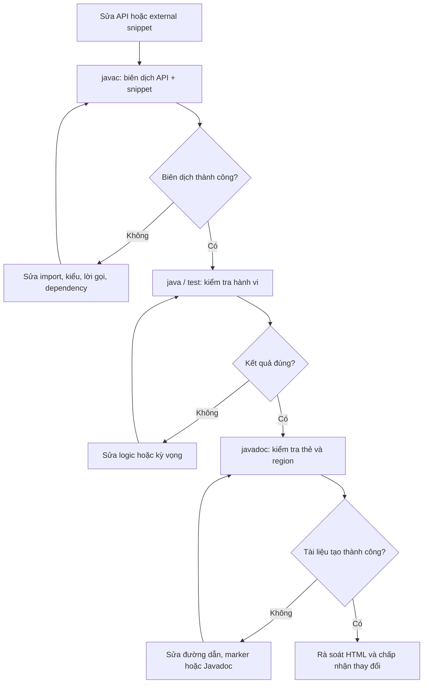

# Biên dịch ví dụ external bằng `javac` để phát hiện import, kiểu và lời gọi API sai

## 1. Vì sao external snippet vẫn cần biên dịch?

Từ **Java 18**, JEP 413 giới thiệu thẻ Javadoc **`{@snippet}`**, hiện vẫn được hỗ trợ trên các JDK hiện đại. Với **external snippet**, ta viết đoạn mã ở một file bên ngoài rồi tham chiếu file hoặc một vùng mang tên (**region**) từ chú thích API. Cách này thuận lợi để duy trì cùng một ví dụ cho cả tài liệu và kiểm thử.

Điểm cần phân biệt: **Standard Doclet của `javadoc` không biên dịch và không chạy mã snippet**. Javadoc xử lý cú pháp thẻ, tìm file/region, xử lý markup và sinh HTML. Một đoạn mã có thể được đưa vào tài liệu dù sai kiểu Java hoặc gọi phương thức đã bị xóa. Vì vậy, phần **Kiểm chứng tài liệu** của mô-đun **JAVA_VERSION_JAVA18** cần thêm phép kiểm tra bằng **`javac` trên chính file external snippet**.

Ba nhóm lỗi được phát hiện sớm:

| Nhóm lỗi | Ví dụ | Chẩn đoán thường gặp |
| --- | --- | --- |
| Import / tên kiểu | Dùng `BigDecimal` nhưng quên `import java.math.BigDecimal;`. | `cannot find symbol`. |
| Sai kiểu | Truyền `String` cho tham số yêu cầu `BigDecimal`. | `incompatible types`. |
| Lời gọi API sai | Gọi phương thức không tồn tại hoặc không đúng chữ ký. | `cannot find symbol`, `method ... cannot be applied`. |

Mục tiêu của bài là tổ chức **một lớp ví dụ Java hoàn chỉnh**, biên dịch cùng bản API đang phát triển, biết cách đọc từng loại lỗi và tích hợp phép kiểm tra vào CI. Nội dung chỉ sử dụng tính năng vẫn có ích trên JDK hiện đại, không dựa vào API legacy hoặc preview.

## 2. Cấu trúc mã nguồn và API minh họa

Sử dụng cấu trúc sau, tính từ thư mục dự án `demo/`:

```text
demo/
└── src/
    └── main/
        └── java/
            └── com/
                └── example/
                    └── invoice/
                        ├── InvoiceCalculator.java
                        └── snippet-files/
                            └── InvoiceExample.java
```

`InvoiceCalculator.java` là file API có chú thích Javadoc. `InvoiceExample.java` chứa ví dụ cần trích và sẽ được biên dịch như nguồn Java bình thường. Thư mục `snippet-files` có ý nghĩa đặc biệt với Javadoc, nhưng **không phải một thành phần Java package**. Cả hai file khai báo cùng `package com.example.invoice;`.

Tạo `src/main/java/com/example/invoice/InvoiceCalculator.java`:

```java
package com.example.invoice;

import java.math.BigDecimal;
import java.math.RoundingMode;
import java.util.Objects;

/**
 * Tính toán số tiền hóa đơn.
 */
public final class InvoiceCalculator {
    private InvoiceCalculator() {
    }

    /**
     * Tính tổng tiền bao gồm thuế và làm tròn hai chữ số thập phân.
     *
     * <p>Ví dụ:</p>
     * {@snippet class=InvoiceExample region=calculate}
     *
     * @param subtotal số tiền trước thuế, không âm và không null
     * @param taxRate tỷ lệ thuế dạng thập phân, không âm và không null
     * @return tổng tiền bao gồm thuế, làm tròn hai chữ số thập phân
     * @throws NullPointerException nếu tham số là null
     * @throws IllegalArgumentException nếu tham số là số âm
     */
    public static BigDecimal totalWithTax(
            BigDecimal subtotal, BigDecimal taxRate) {
        Objects.requireNonNull(subtotal, "subtotal");
        Objects.requireNonNull(taxRate, "taxRate");
        if (subtotal.signum() < 0 || taxRate.signum() < 0) {
            throw new IllegalArgumentException("Values must not be negative");
        }
        return subtotal
                .multiply(BigDecimal.ONE.add(taxRate))
                .setScale(2, RoundingMode.HALF_UP);
    }
}
```

Chữ ký của API:

```java
public static BigDecimal totalWithTax(
        BigDecimal subtotal, BigDecimal taxRate)
```

Nó yêu cầu **hai đối số `BigDecimal`**, trả về **`BigDecimal`** và được khai báo `static`. `javac` có thể kiểm tra sự phù hợp của kiểu, tên và khả năng truy cập. Tính đúng đắn của giá trị trả về chỉ được xác minh bằng chạy mã hoặc bài test.

## 3. Lớp external snippet có thể biên dịch

Tạo `src/main/java/com/example/invoice/snippet-files/InvoiceExample.java`:

```java
package com.example.invoice;

import java.math.BigDecimal;

/**
 * Ví dụ thực thi cho tài liệu InvoiceCalculator.
 */
public final class InvoiceExample {
    private InvoiceExample() {
    }

    public static void main(String[] args) {
        // @start region=calculate
        BigDecimal subtotal = new BigDecimal("125.00");
        BigDecimal taxRate = new BigDecimal("0.08");
        BigDecimal total = InvoiceCalculator.totalWithTax(subtotal, taxRate);

        if (total.compareTo(new BigDecimal("135.00")) != 0) {
            throw new AssertionError("Unexpected total: " + total);
        }
        System.out.println(total);
        // @end region=calculate
    }
}
```

Với `javac`, `// @start` và `// @end` là hai comment bình thường. Với Javadoc, chúng xác định đoạn được trích bởi:

```java
{@snippet class=InvoiceExample region=calculate}
```

Các dòng bên ngoài region (bao gồm `package`, `import`, khai báo lớp, `main`) không nằm trong snippet hiển thị, nhưng **vẫn cần có khi biên dịch lớp ví dụ**. Đó là lý do trích một vài câu lệnh ra riêng rồi chạy `javac` thường không đủ: đoạn trích không nhất thiết là một compilation unit Java độc lập.

Ví dụ dùng `new BigDecimal("0.08")` thay cho `new BigDecimal(0.08)` để tránh đưa sai số biểu diễn của `double` vào phép tính tiền. `compareTo` kiểm tra giá trị số mà không yêu cầu cùng scale như `equals`. Với số tiền 125.00 và tỷ lệ 0.08, đầu ra mong đợi là **135.00**.

## 4. Biên dịch cả API lẫn file external

### 4.1. Lệnh cho shell POSIX

Chạy tại thư mục `demo/` với **JDK 18 trở lên**:

```bash
javac -version
mkdir -p build/classes

javac --release 18 -encoding UTF-8 -d build/classes \
  src/main/java/com/example/invoice/InvoiceCalculator.java \
  src/main/java/com/example/invoice/snippet-files/InvoiceExample.java
```

Nếu thành công, `javac` tạo:

```text
build/classes/com/example/invoice/InvoiceCalculator.class
build/classes/com/example/invoice/InvoiceExample.class
```

### 4.2. Lệnh tương đương trên Windows PowerShell

```powershell
javac -version
New-Item -ItemType Directory -Force -Path build\classes | Out-Null
javac --release 18 -encoding UTF-8 -d build\classes src\main\java\com\example\invoice\InvoiceCalculator.java src\main\java\com\example\invoice\snippet-files\InvoiceExample.java
if ($LASTEXITCODE -ne 0) {
    throw "Biên dịch file ví dụ thất bại"
}
```

Cú pháp PowerShell cố ý đặt toàn bộ lệnh `javac` trên một dòng để dễ sao chép. Khi biên dịch thành công, công cụ thường không in thông điệp; kết quả là **mã thoát 0**. Với lỗi biên dịch, `javac` in thông báo gồm file, dòng và nguyên nhân, đồng thời trả mã thoát khác 0.

### 4.3. Giải thích các tùy chọn

| Thành phần | Vai trò |
| --- | --- |
| `--release 18` | Kiểm tra ngôn ngữ, class file và API Java SE mục tiêu là 18. Chọn release mà JDK hiện tại hỗ trợ. |
| `-encoding UTF-8` | Chỉ định cách đọc mã nguồn để tránh khác biệt mã hóa giữa các máy. |
| `-d build/classes` | Chỉ định thư mục đầu ra, sắp xếp class theo Java package. |
| Hai đường dẫn `.java` | Bảo đảm `javac` xử lý cả lớp API và lớp ví dụ. |
| Mã thoát 0 / khác 0 | Tín hiệu đáng tin cậy để CI biết bước biên dịch đạt hay thất bại. |

Nếu thư viện chỉ dùng API từ Java 18 thì `--release 18` là phép kiểm tra tương thích có ích. Nếu sử dụng API mới hơn, cần chọn mức release thích hợp. Chỉ chạy `javac` của JDK hiện đại với tùy chọn mặc định chưa chứng minh được mã tương thích Java 18.

## 5. Tái hiện ba loại lỗi mà trình biên dịch phát hiện

Các thí nghiệm dưới đây đều bắt đầu từ `InvoiceExample.java` ở phần 3. **Chỉ thay đổi đoạn được yêu cầu, chạy lại chính lệnh `javac` ở phần 4 rồi khôi phục file về đúng trạng thái ban đầu** trước khi sang thí nghiệm kế tiếp. Thông báo chi tiết có thể khác giữa các phiên bản JDK.

### 5.1. Lỗi import: không nhận diện được tên kiểu

Trong file ví dụ, xóa:

```java
import java.math.BigDecimal;
```

nhưng vẫn giữ:

```java
BigDecimal subtotal = new BigDecimal("125.00");
```

**Dự kiến:** `javac` báo `cannot find symbol` tại vị trí sử dụng `BigDecimal`. Java tự tìm được các kiểu thuộc package hiện tại và `java.lang`, nhưng không tự import toàn bộ `java.math`.

Một phần chẩn đoán điển hình:

```text
error: cannot find symbol
        BigDecimal subtotal = new BigDecimal("125.00");
        ^
  symbol:   class BigDecimal
```

**Cách sửa:** thêm lại `import java.math.BigDecimal;` hoặc sử dụng tên đầy đủ `java.math.BigDecimal`. Nếu nhập sai chính tả thành `import java.math.BigDecimall;`, `javac` có thể báo lỗi ngay tại khai báo import.

Đối với lớp từ thư viện bên thứ ba, cần phân biệt **quên import** với **thiếu dependency trên classpath**. Thêm import không làm thư viện tự xuất hiện. Khi gặp `package ... does not exist`, hãy đối chiếu tên package và đường dẫn tới JAR hoặc module chứa lớp.

### 5.2. Lỗi kiểu: truyền một chuỗi thay cho số thập phân

Khôi phục import, rồi thay khai báo `subtotal` và lời gọi bằng:

```java
String subtotal = "125.00";
BigDecimal taxRate = new BigDecimal("0.08");
BigDecimal total = InvoiceCalculator.totalWithTax(subtotal, taxRate);
```

**Dự kiến:** trình biên dịch từ chối lời gọi vì `totalWithTax` cần `BigDecimal` ở tham số thứ nhất, còn biến `subtotal` là `String`. Thông báo có thể là `incompatible types: String cannot be converted to BigDecimal` hoặc giải thích đối số thực tế không phù hợp với chữ ký.

Chuỗi `"125.00"` nhìn giống số nhưng vẫn có kiểu `String`. Sửa bằng cách tạo đối tượng đúng kiểu:

```java
BigDecimal subtotal = new BigDecimal("125.00");
BigDecimal total = InvoiceCalculator.totalWithTax(subtotal, taxRate);
```

Trường hợp khác cùng bản chất là nhận kết quả vào kiểu sai:

```java
int total = InvoiceCalculator.totalWithTax(subtotal, taxRate);
```

Lúc này kiểu `BigDecimal` của giá trị trả về không tương thích với `int`. Lỗi kiểu có thể xuất hiện ở **biến đầu vào, đối số truyền vào, biểu thức trung gian hoặc biến nhận kết quả**.

### 5.3. Lỗi lời gọi API: phương thức không có trong hợp đồng

Khôi phục khai báo đúng kiểu rồi đổi:

```java
BigDecimal total = InvoiceCalculator.calculateTotal(subtotal, taxRate);
```

**Dự kiến:** `javac` báo không tìm thấy phương thức `calculateTotal(BigDecimal, BigDecimal)`. API được cung cấp chỉ có `totalWithTax(BigDecimal, BigDecimal)`.

Sửa thành:

```java
BigDecimal total = InvoiceCalculator.totalWithTax(subtotal, taxRate);
```

Khi một API được nâng cấp, việc đổi tên phương thức, thay thứ tự hoặc kiểu tham số, bỏ overload, đổi quyền truy cập hay chuyển một phương thức `static` thành instance đều có thể làm ví dụ cũ bị lỗi. Đưa file ví dụ vào `javac` sẽ khiến các khác biệt đó xuất hiện ở giai đoạn build.

### 5.4. Cách đọc chẩn đoán

| Thông báo đại diện | Vùng cần kiểm tra |
| --- | --- |
| `cannot find symbol: class ...` | Import, chính tả tên lớp, package, dependency. |
| `package ... does not exist` | Tên package, classpath/module path, JAR chứa kiểu. |
| `incompatible types` | Kiểu đối số, biến nhận hoặc biểu thức không phù hợp. |
| `cannot find symbol: method ...` | Tên phương thức, chữ ký và bản API được biên dịch. |
| `method ... cannot be applied to given types` | Số lượng/kiểu đối số không khớp overload hiện có. |
| `non-static method ... cannot be referenced from a static context` | Đang gọi phương thức instance theo cú pháp `static`. |

Luôn đọc **đường dẫn, số dòng, dấu mũ chỉ vị trí, tên kiểu được yêu cầu và tên kiểu thực tế**. Một lỗi đầu tiên có thể gây nhiều lỗi kéo theo; ví dụ thiếu `BigDecimal` sẽ làm một loạt dòng tiếp theo không thể phân giải tên. Nên sửa lỗi gốc rồi biên dịch lại.

## 6. Biên dịch file ví dụ tách khỏi API bằng classpath

Với dự án nhỏ, lệnh biên dịch hai file cùng nhau đơn giản và ít nhầm lẫn. Dự án thư viện có thể biên dịch API trước, sau đó biên dịch ví dụ để kiểm tra tương thích với class API vừa được tạo.

Ví dụ trên Bash:

```bash
mkdir -p build/api-classes build/example-classes

javac --release 18 -encoding UTF-8 -d build/api-classes \
  src/main/java/com/example/invoice/InvoiceCalculator.java

javac --release 18 -encoding UTF-8 \
  -cp build/api-classes -d build/example-classes \
  src/main/java/com/example/invoice/snippet-files/InvoiceExample.java

java -cp "build/api-classes:build/example-classes" \
  com.example.invoice.InvoiceExample
```

Trên Windows, các mục classpath được ngăn bởi **dấu chấm phẩy `;`**, ví dụ:

```powershell
java -cp "build\api-classes;build\example-classes" com.example.invoice.InvoiceExample
```

`-cp` (hoặc `--class-path`) nói cho `javac` và `java` biết nơi tìm class và JAR phụ thuộc khi dùng classpath thông thường. Nếu không cung cấp `build/api-classes` ở lần biên dịch thứ hai, trình biên dịch có thể không tìm thấy `InvoiceCalculator`.

Một số sai lầm cần tránh:

1. **Chỉ biên dịch file API:** `javac ... InvoiceCalculator.java` thành công không chứng minh `InvoiceExample.java` hợp lệ nếu file ví dụ chưa được xử lý.
2. **Dùng classpath trỏ đến API cũ:** khi ví dụ đang được kiểm tra với một JAR trước lần sửa API, build có thể cho kết quả sai lệch. Hãy biên dịch dựa trên cùng phiên bản nguồn hoặc cùng commit.
3. **Tưởng import tự cung cấp dependency:** `import com.vendor.Library;` không tạo ra JAR. Phải khai báo dependency có thật cho trình biên dịch.
4. **Mong build tool tự biên dịch `snippet-files`:** một số công cụ không nhận thư mục có dấu gạch nối này là cây nguồn Java thông thường. Hãy cấu hình riêng source set hoặc tác vụ biên dịch cho các file ví dụ.
5. **Áp classpath cho mọi dự án module:** nếu dự án sử dụng `module-info.java` và JPMS, cần cấu hình `--module-path` và nguồn mô-đun phù hợp với cấu trúc thực tế.

`javac` có khả năng tìm thêm file nguồn qua source path trong một số cấu hình. Nhưng với tài liệu API, hãy ưu tiên **liệt kê tường minh file ví dụ hoặc xác nhận được tập nguồn mà build đã xử lý**, để tránh bỏ sót snippet.

## 7. Sau khi biên dịch: chạy mã và sinh Javadoc

Chạy lớp ví dụ (sau khi đã dùng lệnh biên dịch chung ở phần 4):

```bash
java -cp build/classes com.example.invoice.InvoiceExample
```

Kết quả mong đợi:

```text
135.00
```

Nếu API trả một số tiền sai nhưng chữ ký vẫn giữ nguyên, `javac` sẽ không tự nhận ra. `AssertionError` giúp bước chạy thất bại khi kết quả cho đầu vào minh họa không như mong đợi. Muốn kiểm tra hợp đồng rộng hơn, cần bổ sung unit test cho null, số âm, giá trị biên và quy tắc làm tròn.

Tiếp theo sinh Javadoc:

```bash
javadoc -d build/docs \
  -encoding UTF-8 -docencoding UTF-8 \
  -Xdoclint:all -Werror \
  src/main/java/com/example/invoice/InvoiceCalculator.java
```

Mở trang `build/docs/com/example/invoice/InvoiceCalculator.html` và xác nhận phần `totalWithTax` hiển thị **đúng region `calculate`**. Marker Javadoc không được xuất hiện như mã ví dụ; các khai báo `package`, `import` và `main` nằm ngoài region cũng không được trích nhầm.

| Bước | Xác minh tốt | Không tự xác minh |
| --- | --- | --- |
| `javac` với API + file snippet | Lỗi cú pháp Java, import, kiểu, chữ ký và khả năng truy cập. | Hành vi đúng và region hiển thị đúng. |
| `java` hoặc unit test | Hành vi đối với các trường hợp đã kiểm tra. | Region của tài liệu có tồn tại hay không. |
| `javadoc` | Thẻ snippet, file, region, markup và các vấn đề tài liệu mà doclet kiểm tra. | Lớp external có biên dịch hoặc chạy đúng không. |
| Rà soát HTML | Nội dung công bố đúng đoạn cần minh họa, không trích thiếu/thừa. | Hành vi API đúng với mọi đầu vào. |

`-Xdoclint:all -Werror` tăng độ nghiêm ngặt của việc sinh tài liệu nhưng **không bổ sung phép biên dịch các external snippet**.

## 8. Quy trình áp dụng trong CI



Với shell POSIX, một chuỗi lệnh CI tối thiểu:

```bash
set -eu
mkdir -p build/classes

javac --release 18 -encoding UTF-8 -d build/classes \
  src/main/java/com/example/invoice/InvoiceCalculator.java \
  src/main/java/com/example/invoice/snippet-files/InvoiceExample.java

java -cp build/classes com.example.invoice.InvoiceExample

javadoc -d build/docs -encoding UTF-8 -docencoding UTF-8 \
  -Xdoclint:all -Werror \
  src/main/java/com/example/invoice/InvoiceCalculator.java
```

`set -e` dừng script nếu một lệnh trả mã lỗi khác 0; `set -u` báo việc dùng biến shell chưa được khai báo. Với CI thực tế, cần chọn JDK cố định, đảm bảo source API và snippet thuộc **cùng commit**, không lấy file class cũ từ lần build trước, và lưu log để phân biệt rõ lỗi biên dịch, chạy và sinh tài liệu.

### Câu hỏi tự luyện

1. Xóa import `BigDecimal` và biên dịch. Tên kiểu nào không được phân giải? Thông báo lỗi nằm tại dòng nào?
2. Đổi `subtotal` thành `String` chứa `"125.00"`. Giải thích vì sao `javac` từ chối dù chuỗi có nội dung số hợp lệ.
3. Đổi lời gọi sang `InvoiceCalculator.calculateTotal(...)`. Làm thế nào kiểm tra chính xác chữ ký của API?
4. Bỏ file `InvoiceExample.java` khỏi lệnh `javac`, rồi cố tình sửa sai import của ví dụ. Vì sao biên dịch riêng API không phát hiện được?
5. Biên dịch snippet với `-cp` trỏ tới thư mục không chứa `InvoiceCalculator.class`. Hãy phân biệt lỗi này với lỗi sai tên phương thức.
6. Giữ nguyên mọi kiểu và lời gọi nhưng sửa công thức tính thuế thành sai kết quả. Bước nào sẽ phát hiện lỗi mà chỉ biên dịch không thấy?

## 9. Nguồn tham khảo chính thức

- [JEP 413 — Code Snippets in Java API Documentation](https://openjdk.org/jeps/413): tính năng snippet xuất hiện từ Java 18.
- [Oracle Javadoc Guide — Snippets (JDK 25)](https://docs.oracle.com/en/java/javase/25/javadoc/snippets.html): external snippet, `snippet-files`, named region và mục *Testing Snippets*.
- [The javac Command (JDK 25)](https://docs.oracle.com/en/java/javase/25/docs/specs/man/javac.html): `--release`, `-encoding`, `-d`, `-cp`, source path và cấu hình biên dịch.
- [Javadoc Documentation Comment Specification (JDK 25)](https://docs.oracle.com/en/java/javase/25/docs/specs/javadoc/doc-comment-spec.html): quy tắc chính thức của `{@snippet}`.

**Ghi nhớ:** External snippet có thể được Javadoc hiển thị hợp lệ nhưng vẫn sai import, sai kiểu hoặc gọi sai API. Muốn kiểm tra điều đó, phải **biên dịch chính file ví dụ** bằng `javac` với bản API đang phát triển; sau đó kiểm tra hành vi bằng cách chạy mã và kiểm tra tài liệu bằng `javadoc`.
